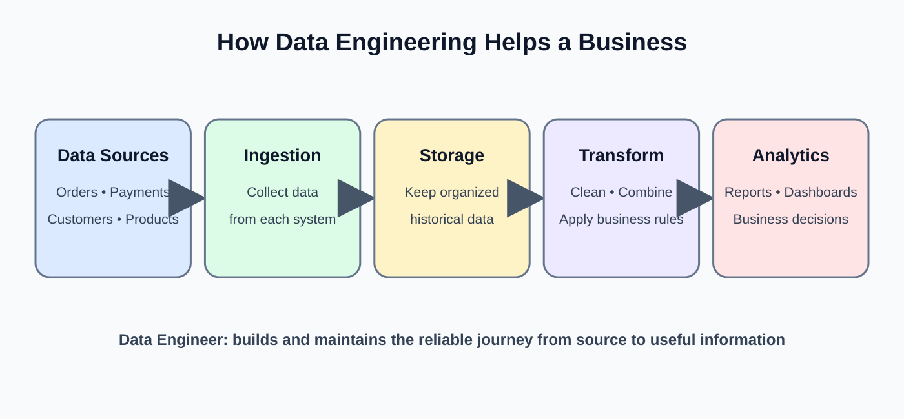

# Day 1: Introduction to Data Engineering

**Phase:** 1 — Data Engineering Foundations  
**Learning time:** 2–3 hours  
**Level:** Absolute beginner  
**Mini-project:** Data Engineering Architecture Map

> **How to use this lesson:** Read one section at a time. Do not try to memorize every new word immediately. First understand the business example, then learn the technical name for each part. The online retail company used throughout this lesson will help connect the concepts.

---

## 1. What you will learn today

By the end of this class, you should be able to:

1. Explain data engineering in simple words.
2. Explain why companies need Data Engineers.
3. Describe the daily responsibilities of a junior Data Engineer.
4. Differentiate a Data Engineer, Data Analyst and Data Scientist.
5. Identify common places where company data is created.
6. Explain the journey of data from a source system to a report.
7. Recognize the main parts of a modern data platform.
8. Explain the difference between operational systems and analytical systems.
9. Understand the words ingestion, storage, transformation, loading and consumption.
10. Draw and explain a beginner-level data engineering architecture.
11. Identify basic quality, security and reliability questions in a pipeline.

### Suggested class timing

| Section | Suggested time |
|---|---:|
| Business problem and meaning of data engineering | 20 minutes |
| Roles and responsibilities | 20 minutes |
| Sources and data lifecycle | 25 minutes |
| Architecture components | 30 minutes |
| Quality, security and reliability | 20 minutes |
| Guided mini-project | 35 minutes |
| Revision and interview practice | 20 minutes |

---

## 2. Before learning data engineering, understand data

### 2.1 What is data?

Data is a collection of recorded facts.

A fact can be a number, a name, a date, a location, a status or even a picture.

Examples:

- Customer name: Ravi
- Product: Laptop
- Order amount: ₹55,000
- Order date: 10 November 2026
- Payment status: Successful
- Delivery status: Shipped

Each item is data. When a company records thousands or millions of these facts, it has a large amount of data to manage.

### 2.2 What is information?

Information is data that has been organized or interpreted so that it becomes useful.

Consider these three orders:

| Order ID | Product | Amount |
|---|---|---:|
| O101 | Laptop | ₹55,000 |
| O102 | Mouse | ₹800 |
| O103 | Keyboard | ₹1,500 |

These are individual data records.

Now suppose a manager asks, "What is the total value of these orders?"

The answer is ₹57,300. That answer is useful information because it answers a business question.

**Remember:**

- Data = recorded facts.
- Information = data organized to answer a question.
- Data engineering = building dependable systems that make the required data available.

### 2.3 Why do companies generate so much data?

Think about a shopping application. Every time a customer performs an action, the application may record an event.

| Customer action | Example data created |
|---|---|
| Opens the application | App-open event and timestamp |
| Searches for a phone | Search text and timestamp |
| Views a product | Product ID and customer session |
| Adds an item to cart | Product ID, quantity and cart ID |
| Places an order | Order ID, items and order amount |
| Pays for the order | Payment reference and payment status |
| Tracks delivery | Shipment status and location updates |

A company may receive millions of these records. It cannot depend on employees manually copying records into spreadsheets every day.

It needs automated systems to collect, organize, check and deliver the data. This is where data engineering becomes important.

---

## 3. Start with a real business problem

Imagine a company called **TechMart**, an online retail business.

Customers purchase products through its website and mobile application. The company has separate systems for orders, payments, inventory, delivery and marketing.

The management team asks five questions every morning:

1. How much revenue did we generate yesterday?
2. How many orders are still waiting for payment?
3. Which products are running low in stock?
4. Which delivery partner has the most delayed orders?
5. Which marketing campaign generated the most purchases?

At first, these questions sound simple. But the information is stored in different systems.

| Department | System | Example information |
|---|---|---|
| Sales | Order application | Orders, products, quantities |
| Finance | Payment application | Payments, refunds, transaction status |
| Warehouse | Inventory application | Available stock, reserved stock |
| Delivery | Logistics application | Shipment status, delivery date |
| Marketing | Campaign platform | Campaign name, clicks, leads |

### 3.1 Why is this a problem?

Suppose the sales manager wants yesterday's revenue.

- The order system knows which orders were placed.
- The payment system knows which payments succeeded.
- The refund system knows which payments were later refunded.

Looking only at the order system may overstate revenue. Looking only at the payment system may not provide product or customer details.

The company must connect information from different systems and apply agreed business rules.

### 3.2 What happens if the company does this manually?

Imagine an employee downloads five files every morning, opens them in Excel, copies columns, removes duplicates and creates a report.

This approach creates problems:

- It takes time.
- Different employees may follow different steps.
- A file may be forgotten.
- A copied value may be changed accidentally.
- Duplicate records may increase totals.
- The process becomes difficult when data grows.
- Nobody may know why yesterday's report differs from today's report.

A repeatable, tested and monitored process is safer.

### 3.3 Where does a Data Engineer help?

A Data Engineer designs a process that can:

1. Collect orders from the order system.
2. Collect payment information from the payment system.
3. Collect stock information from the inventory system.
4. Store the received data safely.
5. check whether important fields are present and valid.
6. Combine records using reliable business keys.
7. Prepare clean tables for reporting.
8. Record whether the process succeeded or failed.
9. Alert the responsible team when something goes wrong.

This is the basic business purpose of data engineering.

---

## 4. What is Data Engineering?

### 4.1 Beginner definition

**Data Engineering is the work of building and maintaining systems that collect data from different sources, process it, store it safely and make it available for people or applications that need it.**

Read the definition in smaller pieces:

- **Collect:** bring data from its original system.
- **Process:** check, clean, combine or change the data.
- **Store:** save the data in an appropriate location.
- **Make available:** allow reports, analysts, scientists or applications to use it.
- **Maintain:** monitor the system, fix failures and keep it dependable.

### 4.2 A simple everyday analogy

Think about a water supply system in a city.

- Water comes from a source.
- It travels through pipes.
- It passes through treatment.
- It is stored in tanks.
- It is delivered to homes.
- The system is monitored for leaks and interruptions.

A data platform has a similar flow:

**Data sources -> Ingestion -> Processing -> Storage -> Data users**

The analogy is not exact, but it helps you understand why a data system needs more than a place to store information.

### 4.3 Data engineering is not just moving files

A beginner may think:

"I downloaded a CSV file and copied it into another folder. Is that data engineering?"

That is one small file movement task. A production data pipeline must answer more questions:

- Did we receive all expected records?
- Is the file from the correct date?
- Are required columns present?
- Are there duplicate records?
- Can we safely process the file again?
- What happens if the destination is unavailable?
- How do we know the job completed?
- Who is allowed to access the data?

Data engineering includes the design, implementation and operation of the complete process.

### 4.4 What makes data engineering an engineering discipline?

Engineering means building something with defined requirements and checking that it behaves correctly.

A dependable data system should consider:

| Engineering concern | Beginner explanation |
|---|---|
| Correctness | Does the output contain the right data? |
| Reliability | Does the process work consistently? |
| Scalability | Can it handle more data when the company grows? |
| Performance | Does it finish within an acceptable time? |
| Security | Can only authorized people access the data? |
| Maintainability | Can another engineer understand and support it? |
| Observability | Can the team see what happened during a run? |
| Cost | Is the system using resources sensibly? |

These are not advanced topics to ignore until later. You will study them throughout the pathway.

---

## 5. What does a Data Engineer do?

A Data Engineer develops and supports the systems that make data usable.

### 5.1 Common responsibilities

**1. Understand data sources**

Find out where the data is created, who owns it, how it can be accessed and how frequently it changes.

Example: TechMart receives orders from a PostgreSQL database and campaign data from an API.

**2. Ingest data**

Bring data from the source into a data platform.

Example: Read new orders from the order database every hour.

**3. Store data**

Choose a suitable destination and organize the received data.

Example: Store the original daily order file in cloud object storage.

**4. Transform data**

Apply rules that make data consistent and useful.

Example: Convert order timestamps into a consistent time zone and standardize payment status values.

**5. Validate data**

Check whether the data meets expectations.

Example: An order must have an order ID, customer ID and order date.

**6. Load data for use**

Write processed records into tables or files used by downstream systems.

Example: Load prepared order and payment data into warehouse tables.

**7. Monitor pipelines**

Check whether jobs ran, how many records were processed and whether failures occurred.

**8. Troubleshoot and recover**

Investigate problems and restore processing without silently losing or duplicating data.

**9. Document the system**

Record source details, field meanings, schedules, dependencies, ownership and recovery steps.

### 5.2 What might a junior Data Engineer do?

A fresher is not expected to design an entire global data platform on the first day.

Typical junior-level tasks include:

- Run an existing Python script and understand its output.
- Write SQL queries to inspect records.
- Read CSV and JSON files.
- Check whether expected columns exist.
- Identify missing or duplicate records.
- Fix a simple transformation.
- Add a validation check.
- Review a pipeline execution result.
- Update documentation.
- Raise a clear issue when a source changes.

As experience grows, engineers may own larger pipelines, architecture decisions, performance improvements and production support.

### 5.3 Example: a daily order pipeline task

A team asks you to verify yesterday's order load.

A sensible beginner investigation is:

1. Confirm which source and date should have been processed.
2. Check whether the source file or source query returned data.
3. Check the pipeline run status.
4. Compare source and destination record counts.
5. Check required fields and duplicate order IDs.
6. Review error details if the counts do not match.
7. Report the evidence and next action.

Do not immediately change production data. First understand the expected result and the failure.

---

## 6. Data Engineer vs Data Analyst vs Data Scientist

These roles work with data, but they solve different problems.

### 6.1 Data Engineer

**Main focus:** Build and maintain systems that provide reliable data.

Example questions:

- How can we collect orders from five applications?
- How can we process new records every hour?
- How can we prevent duplicate loads?
- How can we make trusted data available to analysts?

Typical tools include Python, SQL, databases, cloud storage, Spark and orchestration tools.

### 6.2 Data Analyst

**Main focus:** Understand data and answer business questions.

Example questions:

- Why did sales decrease this month?
- Which product category generated the most revenue?
- Which region has the highest order cancellation rate?
- Did the new campaign improve conversions?

Typical tools include SQL, spreadsheets, Power BI, Tableau and Python.

### 6.3 Data Scientist

**Main focus:** Use statistical and machine learning methods to understand patterns, make predictions or support decisions.

Example questions:

- Which customers are likely to stop purchasing?
- Can we predict product demand?
- Which transactions may be fraudulent?
- Can we recommend products to a customer?

Typical tools include Python, statistics, machine learning libraries and experimentation tools.

### 6.4 Compare the roles

| Area | Data Engineer | Data Analyst | Data Scientist |
|---|---|---|---|
| Main responsibility | Build data systems | Answer business questions | Build predictive or statistical solutions |
| Typical input | Source data and system requirements | Prepared data and business questions | Prepared data and a problem to model |
| Typical output | Pipelines, tables and data platforms | Reports, dashboards and analysis | Models, predictions and experiments |
| Common work | Ingestion, transformation, quality, reliability | Querying, analysis, visualization | Feature preparation, modeling, evaluation |
| Main concern | Data is dependable and available | Data answers the business question | Model or analysis is valid and useful |

### 6.5 How do the three roles work together?

Consider a customer churn problem.

1. The Data Engineer collects customer, order and support data and prepares reliable tables.
2. The Data Analyst studies customer behavior and identifies patterns in cancellations.
3. The Data Scientist builds a model that estimates which customers may leave.
4. The Data Engineer may then build a pipeline to deliver fresh data to the model and store its predictions.
5. The Analyst may create a dashboard to monitor the results.

The work can overlap. The exact responsibilities depend on the organization.

**Interview tip:** Do not say that Data Engineers never analyze data or that Data Scientists never write SQL. Explain the primary responsibility of each role.

---

## 7. Understand the data lifecycle



A data lifecycle describes the stages through which data travels and how it is managed.

For this course, begin with this simple flow:

**Create -> Collect -> Store -> Validate -> Transform -> Deliver -> Use -> Monitor**

### 7.1 Create

Data is generated when a person, application, device or system performs an activity.

TechMart example: a customer places order O101.

The order application records an order ID, customer ID, order time, product and amount.

### 7.2 Collect

The data platform obtains the record from the source.

This may happen by:

- Reading a database table.
- Calling an API.
- Receiving a file.
- Consuming events from a message system.

The method depends on the source and the business requirement.

### 7.3 Store

The received data is written to a suitable storage system.

A common design preserves a copy of the received data before applying business transformations. This helps with investigation and reprocessing.

### 7.4 Validate

Check whether the data follows expected rules.

For example:

- Is order_id present?
- Is order_amount numeric?
- Is order_date a valid date?
- Is payment_status one of the accepted values?

Validation does not guarantee that every value is factually correct. It checks defined expectations.

### 7.5 Transform

Change the data into a useful and consistent form.

Examples:

- Standardize column names.
- Convert a timestamp to a standard time zone.
- Join order and payment records.
- Calculate a net order amount using an approved business rule.
- Remove or isolate invalid records.

A transformation must follow documented business definitions. An engineer should not invent a revenue rule independently.

### 7.6 Deliver

Make the prepared data available in a destination such as a warehouse table, data lake location or application interface.

### 7.7 Use

The data is consumed by:

- Dashboards.
- Business reports.
- Data science workflows.
- Applications.
- Operational decision systems.

### 7.8 Monitor

Check the process and its output.

Examples:

- Did the pipeline finish?
- How long did it take?
- How many records arrived?
- How many records were rejected?
- Did the output arrive before the reporting deadline?

Monitoring continues throughout the lifecycle, not only at the end.

---

## 8. Understand data sources

A **data source** is the original place or system from which data is obtained.

### 8.1 Database

A database stores organized data and provides a way to read or update it.

Example: TechMart stores orders in a PostgreSQL database.

A simplified order table might look like this:

| order_id | customer_id | order_amount | status |
|---|---|---:|---|
| O101 | C01 | 55000 | PAID |
| O102 | C02 | 800 | PENDING |
| O103 | C03 | 1500 | PAID |

Later in this course, you will learn how to create tables and retrieve records using SQL.

### 8.2 API

An API is a defined way for one software system to communicate with another.

Example: TechMart requests shipment updates from a delivery partner's API.

The partner may return information such as shipment ID, current status and estimated delivery date.

You will learn API integration in the Python phase.

### 8.3 Files

Systems often exchange data through files.

Examples:

- CSV: tabular data.
- JSON: structured data commonly used by APIs.
- XML: structured, tag-based data.
- Parquet: column-oriented data storage commonly used in analytics.

Example: a payment provider sends a daily settlement CSV file.

### 8.4 Application events and logs

An application may record events such as:

- User logged in.
- Product viewed.
- Payment attempted.
- Payment failed.
- Order shipped.

Logs may also contain technical information about errors and application behavior.

### 8.5 Devices and sensors

Devices can generate measurements continuously.

Examples:

- Temperature sensors in a warehouse.
- GPS coordinates from delivery vehicles.
- Machine readings from a factory.

These sources may produce high volumes of time-based data.

### 8.6 Source inventory

Before building a pipeline, document the source.

| Question | Example answer |
|---|---|
| What is the source? | Order database |
| Who owns it? | Sales application team |
| What data is available? | Orders and order items |
| How is it accessed? | Read-only database connection |
| How often does it change? | Continuously |
| What is the unique identifier? | order_id |
| What can go wrong? | Connection failure or schema change |
| Who should be contacted? | Sales application team |

Do not assume every source is a database. Real data platforms connect many types of systems.

---

## 9. Understand the main parts of a data platform

A **data platform** is the collection of technologies, storage, processes and controls used to manage data.

You do not need to memorize product names today. First understand the job each component performs.

### 9.1 Source systems

These are the systems where business data is created.

Examples: order application, payment application, inventory database and marketing platform.

### 9.2 Ingestion

**Ingestion** means bringing data from a source into a data platform.

Two common patterns:

- Batch ingestion: collect a group of records at scheduled intervals.
- Streaming ingestion: process events continuously or as they arrive.

You will study the differences on Day 2.

### 9.3 Storage

Storage keeps data so that it can be accessed later.

Examples include:

- A relational database.
- Cloud object storage.
- A data warehouse.
- A data lake.

Different storage systems serve different workloads.

### 9.4 Processing and transformation

This component checks, combines, filters, enriches and reshapes data.

Examples:

- Python scripts.
- SQL transformations.
- Distributed processing engines such as Apache Spark.

### 9.5 Data warehouse

A data warehouse is designed to organize data for analytical queries and reporting.

For example, TechMart may maintain prepared tables for orders, customers, products and daily sales.

A warehouse is not simply another name for every database. Its design and workload are usually analytical.

### 9.6 Orchestration

Orchestration coordinates the execution of tasks.

Suppose a daily report requires three steps:

1. Load orders.
2. Load payments.
3. Build the sales summary after both loads succeed.

An orchestrator manages task order, dependencies, schedules and execution status.

Apache Airflow is one example. You will study orchestration later.

### 9.7 Data consumers

Consumers are the people or systems that use prepared data.

Examples:

- Analysts building dashboards.
- Data scientists training models.
- Finance teams reviewing revenue.
- Applications retrieving trusted customer information.

### 9.8 Monitoring and alerting

Monitoring helps the team understand pipeline health.

An alert may be generated if a daily load fails, takes too long or receives an unexpected number of records.

### 9.9 A simple architecture map

Read this diagram from left to right:

```
Order DB       Payment API       Inventory DB
    |               |                 |
    +---------------+-----------------+
                    |
                Ingestion
                    |
              Raw Data Storage
                    |
             Validation Checks
                    |
          Transformation / Processing
                    |
              Data Warehouse
                    |
          Reports / Analytics / ML
```

Monitoring, security and access control apply across the platform. They are not only one final box.

---

## 10. Operational systems and analytical systems

Companies use different systems for different kinds of work.

### 10.1 Operational system

An operational system supports day-to-day business activities.

Examples:

- Place an order.
- Update a delivery address.
- Record a payment.
- Reserve inventory.

These systems are commonly called **OLTP systems** — Online Transaction Processing systems.

Think of OLTP as the system that helps the business run.

### 10.2 Analytical system

An analytical system helps people understand business performance and patterns.

Examples:

- Calculate monthly revenue.
- Compare sales across regions.
- Analyze customer purchasing behavior.
- Study delivery delays over six months.

These workloads are commonly called **OLAP** — Online Analytical Processing.

Think of OLAP as the system that helps people understand how the business is performing.

### 10.3 Simple comparison

| Area | OLTP | OLAP |
|---|---|---|
| Main purpose | Run daily operations | Analyze business data |
| Typical activity | Insert or update an order | Analyze millions of orders |
| Data focus | Current transactions | Historical and integrated data |
| Query pattern | Many small transactions | Larger analytical queries |
| Example user | Shopping application | Business analyst |

The distinction is about workload and design goals. It does not mean every OLTP database is small or every OLAP platform is a particular product.

---

## 11. What are batch and streaming at a high level?

You will study these properly on Day 2. For now, understand the basic idea.

### 11.1 Batch processing

Batch processing collects records and processes them together at a scheduled time or when a batch is ready.

Example:

- Every night at 1:00 AM, process all orders received during the day.
- Build a daily sales summary.
- Make the summary available by morning.

### 11.2 Streaming processing

Streaming processing handles events continuously or in small increments as they arrive.

Example:

- A payment event arrives.
- The system processes the event.
- A monitoring dashboard is updated shortly afterward.

### 11.3 Which one should a company choose?

It depends on the business requirement.

A monthly finance report may not need second-by-second updates. A fraud detection system may need to react quickly to a transaction.

Do not choose streaming just because it sounds modern. The required response time, cost, complexity and business value should guide the decision.

---

## 12. Data quality: why clean-looking data can still be wrong

Data quality means how well data meets the requirements for its intended use.

Consider this order record:

| order_id | customer_id | order_amount | order_date |
|---|---|---:|---|
| O101 | C01 | 55000 | 2026-11-10 |
| O102 | C02 | -800 | 2026-11-10 |
| O103 | *(missing)* | 1500 | 2026-11-10 |
| O101 | C01 | 55000 | 2026-11-10 |

What should we investigate?

- O102 has a negative amount. Is that allowed by the business rule?
- O103 has no customer ID. Is customer_id mandatory?
- O101 appears twice. Is it a duplicate or a legitimate repeated event?

Do not automatically delete suspicious records. First understand the business rule and preserve evidence.

### 12.1 Common dimensions of data quality

| Dimension | Meaning | Example check |
|---|---|---|
| Completeness | Required information is present | customer_id is not missing |
| Validity | Values follow allowed rules | status is PAID, PENDING or FAILED |
| Uniqueness | Records that should be unique are unique | order_id is not duplicated |
| Consistency | Related systems agree where expected | payment status matches settlement rules |
| Accuracy | Values correctly represent reality | amount matches the source transaction |
| Timeliness | Data is available when needed | daily report is ready by 7 AM |

A technical check can identify suspicious data, but business owners may need to confirm what the correct value should be.

---

## 13. Reliability: what if the pipeline fails?

A pipeline is not reliable merely because it worked once.

Imagine TechMart's daily order load fails at 2:00 AM because the source database is unavailable.

A good design should help the team answer:

1. Was the failure detected?
2. Which task failed?
3. What was the reason?
4. Was any data already written?
5. Can the task be safely retried?
6. Could retrying create duplicate records?
7. Who needs to be informed?
8. How will the team confirm recovery?

### 13.1 Important beginner terms

**Failure:** A task did not complete as expected.

**Retry:** Attempt the task again after a failure.

**Recovery:** Restore the process to a correct working state.

**Duplicate:** A record or business event appears more than once when it should be counted once.

**Idempotency:** Repeating an operation with the same input does not create an unintended additional effect. For example, rerunning a daily load should not insert the same order twice.

**Checkpoint:** Saved progress or state that can help a process resume or recover.

These ideas become especially important in production data pipelines.

---

## 14. Security and governance basics

Data can contain private, confidential or commercially sensitive information.

Examples:

- Customer email addresses.
- Phone numbers.
- Home addresses.
- Payment references.
- Employee information.
- Business financial data.

A Data Engineer must treat this information responsibly.

### 14.1 Basic security practices

- Give users only the access they need.
- Do not place passwords or API keys directly in source code.
- Use approved secret-management methods.
- Encrypt data where required by company policy.
- Avoid copying sensitive data into personal folders.
- Do not expose private customer fields in reports unnecessarily.
- Follow retention and deletion requirements.
- Record who owns important datasets.

### 14.2 What is data governance?

Data governance is the set of responsibilities, rules and processes used to manage data appropriately.

It helps answer:

- Who owns this dataset?
- What does each column mean?
- Which values are permitted?
- Who can access the data?
- How long should it be retained?
- Is the data allowed to be shared?
- Where did the data come from?

Governance is not only paperwork. It helps people use data safely and consistently.

---

## 15. A complete TechMart example: follow one order

Let us trace order **O101** through a simplified data platform.

### Step 1 — Customer places an order

The customer buys a laptop for ₹55,000.

The order application creates:

| Field | Value |
|---|---|
| order_id | O101 |
| customer_id | C01 |
| product_id | P10 |
| quantity | 1 |
| order_amount | 55000 |
| order_status | CONFIRMED |

This is source data.

### Step 2 — Payment is recorded

The payment system records:

| payment_id | order_id | paid_amount | payment_status |
|---|---|---:|---|
| PAY501 | O101 | 55000 | SUCCESS |

Notice that the payment system has its own payment_id. The order_id connects the payment to the order.

### Step 3 — Data is ingested

A pipeline reads the new order and payment records.

It should record useful metadata such as:

- Source system.
- Extraction time.
- Batch or run identifier.
- File name or source query, where applicable.

This makes later investigation easier.

### Step 4 — Data is stored

The received records are saved in a raw or landing area.

The raw copy helps the team investigate what arrived from the source.

### Step 5 — Data is validated

Possible checks:

- order_id must be present.
- quantity must be greater than zero.
- order_amount must be numeric.
- payment_status must use an accepted value.
- payment order_id should refer to a known order.

A failed check should produce a clear result. It should not silently disappear.

### Step 6 — Data is transformed

The pipeline combines order and payment information using order_id.

A simplified prepared record could be:

| order_id | customer_id | product_id | order_amount | payment_status |
|---|---|---|---:|---|
| O101 | C01 | P10 | 55000 | SUCCESS |

In a real system, the transformation must also consider refunds, partial payments, cancellations, late updates and business definitions.

### Step 7 — Data is loaded

The prepared record is written to a warehouse table or another approved analytical destination.

### Step 8 — Data is used

A dashboard can show paid orders and revenue according to the company's agreed definition.

### Step 9 — Pipeline is monitored

The team checks whether the load succeeded, how many records were processed and whether any records were rejected.

**Important:** A dashboard is only as trustworthy as the data and business rules behind it.

---

## 16. Guided practical: build the Data Engineering Architecture Map

This is today's mini-project. You are not expected to build a cloud platform today. Your task is to design and explain a simple architecture.

### 16.1 Project scenario

TechMart wants a daily sales dashboard.

The company has:

1. An order database.
2. A payment API.
3. An inventory database.
4. A delivery partner file.
5. A data warehouse.
6. A dashboard used by management.

Your job is to show how data should travel from the sources to the dashboard.

### 16.2 Step 1 — List the sources

Fill in the source inventory.

| Source | Data available | Possible access method |
|---|---|---|
| Order database | Orders and order items | Database query |
| Payment API | Payment status and amount | API request |
| Inventory database | Product stock | Database query |
| Delivery file | Shipment updates | File ingestion |

Why do this first?

Because an engineer cannot design a sensible ingestion process without knowing where the data comes from and how it can be accessed.

### 16.3 Step 2 — Identify the destination

The destination is the place where prepared data will be made available.

For this scenario, use a data warehouse for analytical tables.

Possible prepared tables:

- fact_orders
- fact_payments
- fact_shipments
- dim_customer
- dim_product
- daily_sales_summary

These are example names, not tables you must create today. Data modeling is covered in a later phase.

### 16.4 Step 3 — Draw the flow

Start with this structure and add labels:

```
[Order Database] ----+
[Payment API] -------+
[Inventory Database] +----> [Ingestion]
[Delivery File] -----+           |
                                v
                         [Raw Storage]
                                |
                                v
                       [Validation Checks]
                                |
                                v
                     [Transform and Combine]
                                |
                                v
                        [Data Warehouse]
                                |
                                v
                          [Dashboard]
```

### 16.5 Step 4 — Add operational questions

For each source, ask:

- How often does it change?
- How often should we collect it?
- What is its unique record identifier?
- What happens if it is unavailable?
- How can we detect missing records?
- Who owns the source?

### 16.6 Step 5 — Add quality checks

Examples:

| Dataset | Check | Why it matters |
|---|---|---|
| Orders | order_id is present | Each order needs an identifier |
| Orders | quantity is positive | Prevent invalid quantities |
| Payments | payment_id is unique | Avoid counting one payment repeatedly |
| Payments | order_id matches a known order | Connect payment to the correct order |
| Inventory | stock quantity is not unexpectedly negative | Identify inventory problems |
| Delivery | shipment status is an accepted value | Keep reporting consistent |

The exact checks must be approved by the business and source owners.

### 16.7 Step 6 — Add failure handling

Write down what should happen if:

- The order database is unavailable.
- The payment API returns an error.
- The delivery file does not arrive.
- Required columns are missing.
- Duplicate records are received.
- The warehouse cannot accept the load.

A good design explains how the team detects, investigates and recovers from these situations.

### 16.8 Step 7 — Add security notes

Document:

- Which service account reads each source?
- Who can access raw data?
- Who can access warehouse tables?
- Are customer contact details required in the dashboard?
- Where are credentials stored?
- Who owns the data?

### 16.9 Project submission checklist

- [ ] All four sources are shown.
- [ ] Each source has an ingestion method.
- [ ] Raw storage is included.
- [ ] Validation is included.
- [ ] Transformation is included.
- [ ] The warehouse is shown.
- [ ] The dashboard is shown.
- [ ] Monitoring and failure handling are documented.
- [ ] Security and ownership are documented.
- [ ] Arrows clearly show the direction of data flow.

### 16.10 How to explain this project in an interview

"I designed a high-level data architecture for an online retail company. The architecture collects order, payment, inventory and delivery data from different source systems. It lands the received data in raw storage, validates important fields, transforms and combines the records, and loads prepared data into a warehouse for reporting. I also documented source ownership, quality checks, monitoring, failure recovery and access controls."

Do not claim that you deployed the architecture if you only designed the diagram. Explain honestly what you built and what you proposed.

---

## 17. Common beginner misunderstandings

| Misunderstanding | Correct understanding |
|---|---|
| Data engineering means only writing SQL | It includes ingestion, storage, processing, testing, monitoring and operations |
| A database and a data warehouse are always the same | They can use related technologies but serve different workload goals |
| A pipeline is just a Python script | A production pipeline also needs scheduling, validation, recovery and monitoring |
| More tools always mean a better architecture | Tools should solve a real requirement |
| Every dataset should be processed in real time | Batch may be simpler and sufficient |
| If a job succeeds, the data must be correct | Technical success does not prove business correctness |
| Duplicate records can always be deleted | First determine whether they are true duplicates |
| Raw data is useless after transformation | It can help with traceability and reprocessing |
| Security is only the security team's job | Engineers must follow secure design and access practices |
| A dashboard proves that the pipeline is healthy | Pipeline health must be monitored separately |

---

## 18. Day 1 glossary

| Term | Simple meaning |
|---|---|
| Data | Recorded facts |
| Information | Data organized to answer a question |
| Data source | Original system where data comes from |
| Ingestion | Bringing data into a platform |
| Pipeline | Connected steps that move and process data |
| Transformation | Changing data into a useful form |
| Storage | Keeping data for later use |
| Data warehouse | Platform designed for analytical data workloads |
| Data lake | Storage approach for keeping data in varied formats |
| OLTP | Processing day-to-day transactions |
| OLAP | Processing analytical queries |
| Batch | Processing a group of records together |
| Streaming | Processing events continuously or as they arrive |
| Validation | Checking data against expected rules |
| Monitoring | Observing pipeline execution and health |
| Orchestration | Coordinating tasks, schedules and dependencies |
| Governance | Rules and responsibilities for managing data |
| Idempotency | Safe repetition without unintended extra effects |
| Schema | Defined structure of data |
| Metadata | Information that describes data or its processing |

---

## 19. Day 1 revision notes

1. Data engineering builds and operates systems that deliver usable, reliable data.
2. Companies generate data through applications, databases, APIs, files, logs and devices.
3. A Data Engineer primarily builds and maintains data pipelines and platforms.
4. Analysts primarily investigate data to answer business questions.
5. Data Scientists primarily develop statistical or machine learning solutions.
6. A data lifecycle includes creation, collection, storage, validation, transformation, delivery, use and monitoring.
7. A data platform contains source systems, ingestion, storage, processing, destinations and consumers.
8. OLTP supports operational transactions; OLAP supports analytical workloads.
9. Batch processes groups of records; streaming processes events continuously or in small increments.
10. Quality, security, reliability and monitoring are essential parts of engineering.

---

## 20. Self-assessment

Try answering these without looking at the lesson.

1. Explain data engineering in your own words.
2. Give five examples of data created by an online shopping application.
3. Why is manually combining five daily files risky?
4. What is the difference between a data source and a data destination?
5. Explain the primary responsibility of a Data Engineer.
6. How is a Data Analyst's main responsibility different?
7. What does ingestion mean?
8. Why might a company preserve raw data?
9. What is the difference between OLTP and OLAP?
10. Give one example where batch processing is suitable.
11. Give one example where streaming may be useful.
12. Name four basic data quality dimensions.
13. Why should a pipeline be monitored?
14. What is idempotency and why is it useful?
15. What information should be recorded in a source inventory?

### Practical assessment

Draw the TechMart architecture without copying the diagram. Explain each box in one or two sentences. Then describe what should happen if the payment API is unavailable.

**You are ready to move on when:** you can explain the complete data flow, identify the responsibility of each component and describe at least three failure or quality checks.

---

## 21. Preview of Day 2

On Day 2, we will study **Data Processing Fundamentals**.

You will learn:

- OLTP and OLAP in more detail.
- Batch processing.
- Stream processing.
- Real-time and near-real-time processing.
- Event-driven architecture.
- How to compare processing approaches for a business requirement.

Day 1 taught you the overall data engineering picture. Day 2 will explain how data is processed inside that picture.
