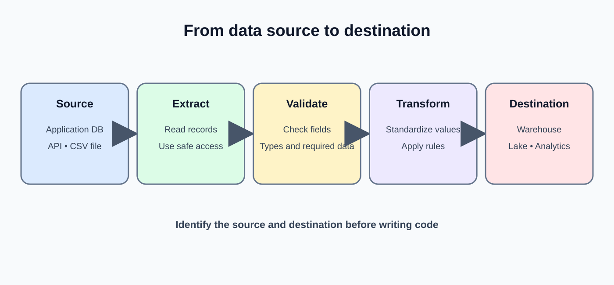
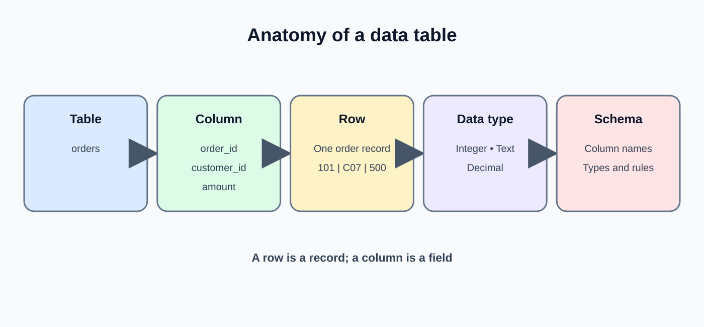
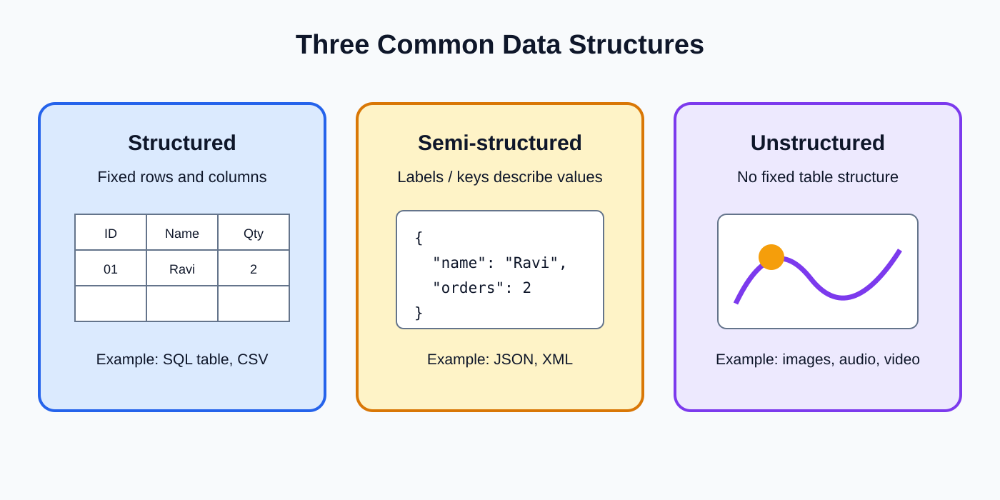

# Day 3: Data Sources and Formats

**Phase:** 1 — Data Engineering Foundations  
**Learning time:** 2–3 hours  
**Level:** Absolute beginner  
**Mini-project:** Data Source Inventory

> **How to study:** Today we will act as junior Data Engineers at TechMart. We will identify where company data is created, understand the shape of that data, and decide what information must be recorded before building a pipeline. Do not memorize file extensions alone. Learn what the data looks like, how it is accessed and what can go wrong.

---

## 1. What you will learn today

By the end of this lesson, you should be able to:

1. Explain what a data source is.
2. Identify databases, APIs, files, logs and devices as data sources.
3. Distinguish structured, semi-structured and unstructured data.
4. Recognize a table, record, field, schema and nested structure.
5. Explain CSV, JSON, XML and Parquet.
6. Compare row-oriented text formats and columnar analytical formats.
7. Understand why identifiers, dates, numbers and missing values need careful handling.
8. Identify basic source access and ingestion questions.
9. Recognize source ownership, refresh frequency, volume, schema and sensitivity.
10. Prepare a practical Data Source Inventory for a business.

### Suggested class timing

| Topic | Suggested time |
|---|---:|
| Data source fundamentals | 15 minutes |
| Data structure categories | 25 minutes |
| Databases, APIs, files, logs and devices | 25 minutes |
| CSV and JSON | 25 minutes |
| XML and Parquet | 25 minutes |
| Source assessment and common risks | 20 minutes |
| Mini-project and revision | 25 minutes |

---

## 2. First understand what a data source is



### 2.1 Beginner definition

A **data source** is the original system, application, device, service or file location from which data is obtained.

Examples:

- A customer database.
- An order management application.
- A payment provider's API.
- A supplier's CSV file.
- A website's application logs.
- A delivery vehicle's GPS device.
- Product photographs uploaded by customers.

The source is where the information originates. The destination is where the data is sent for storage, processing or use.

### 2.2 A simple business example

TechMart sells products through a website and mobile application.

Different activities create different data:

| Activity | Data created | Possible source |
|---|---|---|
| Customer registers | Name, email, registration date | Customer application database |
| Customer places order | Order ID, product, quantity | Order database |
| Customer pays | Payment ID, amount, status | Payment provider API |
| Warehouse receives stock | Product ID, received quantity | Inventory application |
| Delivery partner updates shipment | Tracking ID, delivery status | Partner API or file |
| Customer reviews product | Rating and written comment | Review application |
| Customer uploads product photo | Image file | Object storage |

One company can have many sources. A data engineer must understand each one before designing a reliable pipeline.

### 2.3 Source vs destination

| Term | Meaning | TechMart example |
|---|---|---|
| Source | Where data starts | Order application database |
| Destination | Where data is delivered | Data warehouse |
| Consumer | Who or what uses the result | Sales dashboard |
| Pipeline | The process connecting the source and destination | Daily order ingestion job |

A source can also be a destination in another workflow. For example, a warehouse table may be a source for a machine learning pipeline.

### 2.4 Why should we identify sources before coding?

Imagine a manager asks you to build a daily sales pipeline.

You start writing code without knowing:

- Which system owns the orders?
- Does the source provide a database or a file?
- What does each column mean?
- How often are records updated?
- How can you access the source?
- Are there sensitive customer fields?
- Can old orders change?

You may build a pipeline that runs but produces incorrect data.

**Engineering rule:** Understand the source contract and business meaning before implementing ingestion.

---

## 3. Understand the basic structure of data



Before learning file formats, understand the words used to describe data.

### 3.1 What is a field?

A field is one named piece of information in a record.

Example order:

| Field name | Value |
|---|---|
| order_id | O501 |
| customer_id | C101 |
| amount | 2500 |
| status | PAID |

Here, order_id, customer_id, amount and status are fields.

A field is similar to a column in a relational table or a named property in a JSON object.

### 3.2 What is a record?

A record is one collection of related field values.

For example, the complete O501 order above is one record.

In a table, a record is commonly represented by one row.

### 3.3 What is a table?

A table organizes records into rows and columns.

| order_id | customer_id | amount | status |
|---|---|---:|---|
| O501 | C101 | 2500 | PAID |
| O502 | C102 | 1800 | PENDING |
| O503 | C103 | 900 | PAID |

- Each column describes a field.
- Each row represents one record.
- The table groups records of a similar kind.

### 3.4 What is a schema?

A schema describes the expected structure of data.

For the orders table, a simple schema might be:

| Field | Expected type | Required? |
|---|---|---|
| order_id | Text | Yes |
| customer_id | Text | Yes |
| amount | Decimal number | Yes |
| status | Text | Yes |
| order_date | Date/time | Yes |

The schema helps systems understand what fields should exist and what values are expected.

### 3.5 What is a data type?

A data type describes the kind of value a field is expected to contain.

| Type | Example | Meaning |
|---|---|---|
| Text/string | "O501" | Characters |
| Integer | 3 | Whole number |
| Decimal | 2500.50 | Number with a fractional part |
| Boolean | true | True or false |
| Date | 2026-11-10 | Calendar date |
| Timestamp | 2026-11-10T10:30:00Z | Date and time |
| Array/list | ["A", "B"] | Multiple ordered values |
| Object | {"city":"Hyderabad"} | Group of named fields |

A format may represent a value as text even when the business meaning is a number or date. Parsing and validation are needed.

### 3.6 What is a nested structure?

A nested structure is data placed inside another data structure.

Example:

- An order contains customer details.
- The order also contains a list of items.
- Each item contains a product ID and quantity.

JSON and XML can represent this kind of hierarchy naturally.

### 3.7 Why are identifiers not ordinary numbers?

Consider customer ID 00045.

If a system converts it to a number, it may become 45. The leading zeros disappear.

That can be a problem if the official identifier is exactly "00045".

An identifier is used to identify something; it is not necessarily used for arithmetic.

**Good practice:** Treat codes, account numbers, postal codes and IDs as text unless the source contract explicitly defines a numeric representation and the business confirms that formatting is irrelevant.

---

## 4. Three broad categories of data



Data is often described as structured, semi-structured or unstructured.

These categories help us understand how much predefined organization the data has.

### 4.1 Structured data

Structured data follows a clearly defined organization, commonly rows and columns.

Example:

| customer_id | customer_name | city | age |
|---|---|---|---:|
| C101 | Asha | Hyderabad | 25 |
| C102 | Kiran | Pune | 31 |
| C103 | Meera | Chennai | 28 |

Notice:

- Every row follows the same set of columns.
- Each column has a defined meaning.
- A schema can define expected data types.
- SQL can query relational tables.

Common sources include relational databases and well-defined CSV datasets.

### 4.2 Why is structured data useful?

It is convenient when records share a consistent shape.

A business can ask:

- Count customers by city.
- Find customers older than 30.
- Join orders to customers using customer_id.
- Calculate average order amount.

The defined structure makes consistent querying easier.

### 4.3 Can structured data still be bad?

Yes.

A table can have a clear schema and still contain:

- Missing customer names.
- Invalid dates.
- Negative quantities.
- Duplicate IDs.
- Incorrect city values.
- Amounts stored in the wrong currency.

A structured format does not guarantee data quality.

### 4.4 Semi-structured data

Semi-structured data contains labels, keys, tags or nested objects that describe its organization, but it may not follow one fixed table layout for every record.

Examples:

- JSON API responses.
- XML documents.
- Application events.
- Nested messages.

Example JSON record:

```json
{
  "order_id": "O501",
  "customer": {
    "customer_id": "C101",
    "city": "Hyderabad"
  },
  "items": [
    {
      "product_id": "P10",
      "quantity": 2
    },
    {
      "product_id": "P20",
      "quantity": 1
    }
  ]
}
```

This record has:

- A top-level order_id.
- A nested customer object.
- An items array containing two item objects.

It is structured, but not arranged as one flat row.

### 4.5 Why is semi-structured data useful?

Business applications often need to send related information together.

An API can return one order with customer information and a list of purchased items.

The format can represent optional fields and nested relationships without requiring every record to have exactly the same flat columns.

### 4.6 What challenges can semi-structured data create?

- A field may be missing in some records.
- A field may be nested several levels deep.
- An array may contain zero, one or many elements.
- Field types may change unexpectedly.
- A source may add new fields.
- A consumer may not know how to handle a new schema version.

A pipeline must define how to parse, validate and transform the structure.

### 4.7 Unstructured data

Unstructured data does not naturally follow a consistent tabular layout.

Examples:

- Product photographs.
- Audio recordings.
- Videos.
- PDF documents.
- Free-form email text.
- Scanned forms.

An image is not naturally a row with columns such as customer_id and amount.

However, an image can have metadata such as:

- File name.
- File size.
- File type.
- Upload time.
- Customer or product reference.
- Storage location.

### 4.8 Is unstructured data impossible to process?

No.

Specialized systems can process it.

Examples:

- OCR can extract text from scanned documents.
- Speech recognition can convert audio into text.
- Image processing can identify objects.
- Document processing can extract invoice numbers and totals.

The original file may be stored in object storage, while extracted metadata or results are stored in tables.

### 4.9 Compare all three categories

| Category | How it is organized | Examples | Common processing |
|---|---|---|---|
| Structured | Defined fields and tabular records | Relational tables | SQL, schema checks |
| Semi-structured | Keys, tags, nested objects | JSON, XML, events | Parsing, schema validation, flattening |
| Unstructured | No consistent tabular layout | Images, audio, video, PDFs | Specialized extraction and metadata processing |

### 4.10 One business process can use all three

TechMart's product catalog may contain:

- Structured data: product ID, price and stock quantity.
- Semi-structured data: product attributes returned by an API.
- Unstructured data: product images and demonstration videos.

The data engineer must choose suitable storage and processing for each type.

---

## 5. Databases as data sources

### 5.1 What is a database?

A database is an organized system for storing and managing data.

A relational database stores data in tables that can be connected using keys.

Examples of relational database products include PostgreSQL, MySQL, SQL Server and Oracle Database.

### 5.2 Example: TechMart database

A simple business database may contain:

**customers**

| customer_id | customer_name | city |
|---|---|---|
| C101 | Asha | Hyderabad |
| C102 | Kiran | Pune |

**orders**

| order_id | customer_id | order_date | amount |
|---|---|---|---:|
| O501 | C101 | 2026-11-10 | 2500 |
| O502 | C102 | 2026-11-10 | 1800 |

**order_items**

| order_id | product_id | quantity |
|---|---|---:|
| O501 | P10 | 2 |
| O501 | P20 | 1 |
| O502 | P10 | 1 |

The tables represent different business entities and relationships.

### 5.3 How does a data engineer read from a database?

Common approaches include:

- Running SQL queries.
- Using a database connector from Python.
- Reading from a read replica.
- Using change data capture (CDC), when supported and appropriate.
- Receiving scheduled database exports.

The access method must be approved by the source owner.

### 5.4 What should you learn about a database source?

| Question | Why it matters |
|---|---|
| Which database product is used? | Determines connection and SQL details |
| Which host and database are approved? | Identifies the correct environment |
| Which tables or views are available? | Defines the source data |
| What is the primary key? | Helps identify records |
| Which columns can change? | Affects incremental extraction |
| How much data exists? | Affects query and transfer strategy |
| How often does data change? | Affects freshness |
| Is read access available? | Prevents unsafe source modification |
| Who owns the database? | Provides support and business definitions |

### 5.5 Full extraction vs incremental extraction

**Full extraction** reads the entire selected dataset.

Example: read all 500,000 customer records.

**Incremental extraction** reads only new or changed records since a known point.

Example: read orders updated after the last successful extraction timestamp.

Full extraction can be simple for small datasets. Incremental extraction can reduce repeated work for large or frequently changing datasets, but requires reliable change tracking.

You will study incremental processing in later lessons.

### 5.6 What is a database schema change?

A source team may rename a column, change its type or add a new field.

Example:

Old field: customer_phone

New field: phone_number

A pipeline that expects customer_phone may fail or produce missing output.

A source inventory and schema contract help detect and manage such changes.

---

## 6. APIs as data sources

### 6.1 What is an API?

API stands for **Application Programming Interface**.

An API defines how one software system can request information or actions from another system.

A simple analogy:

A restaurant customer does not walk into the kitchen and operate the stove. The customer makes a request through a defined service process. The restaurant returns the requested result.

An API provides a defined interface between software systems.

### 6.2 TechMart payment API example

TechMart needs payment status from a payment provider.

The payment provider exposes an API endpoint that returns payment information for an order.

A simplified response might look like:

```json
{
  "payment_id": "PAY501",
  "order_id": "O501",
  "amount": 2500,
  "currency": "INR",
  "status": "SUCCESS"
}
```

This is an example response, not a real endpoint.

### 6.3 What is an endpoint?

An endpoint is a specific API address or resource through which a client makes a request.

An API may provide endpoints for:

- Listing payments.
- Retrieving one payment.
- Creating a refund.
- Checking transaction status.

The API documentation defines which operations are available and how to call them.

### 6.4 What is an HTTP request?

An HTTP request is a message sent by a client to a server.

A request commonly includes:

- Method.
- URL.
- Headers.
- Optional body.

Common methods:

| Method | Typical purpose |
|---|---|
| GET | Retrieve information |
| POST | Submit data or create a resource |
| PUT | Replace a resource representation |
| PATCH | Partially update a resource |
| DELETE | Request deletion of a resource |

The actual behavior is defined by the API contract.

### 6.5 What is an HTTP response?

A response is what the server sends back.

It may contain:

- Status code.
- Headers.
- Response body.

Common status code groups:

| Code range | General meaning |
|---|---|
| 2xx | Request succeeded |
| 3xx | Redirection |
| 4xx | Client/request problem |
| 5xx | Server-side problem |

Examples:

- 200: successful request.
- 201: resource created.
- 400: invalid request.
- 401: authentication required or failed.
- 403: access forbidden.
- 404: resource not found.
- 429: too many requests.
- 500: server error.
- 503: service unavailable.

A status code alone may not explain the business outcome. Read the API documentation and response body.

### 6.6 What is authentication?

Authentication verifies who or what is making the request.

Examples include:

- API keys.
- Bearer tokens.
- OAuth access tokens.
- Mutual TLS certificates.

Never paste real API secrets into notebooks, public repositories or screenshots.

### 6.7 What is pagination?

An API may return only a limited number of records per request.

Pagination allows the client to retrieve additional pages.

Example:

- Page 1: records 1–100.
- Page 2: records 101–200.
- Page 3: records 201–300.

Some APIs use page numbers. Others use next-page links, cursors or continuation tokens.

A data engineer must continue until the API indicates that no more records are available.

### 6.8 What is rate limiting?

An API provider may restrict how many requests a client can make during a time period.

If the client exceeds the limit, the API may return HTTP 429.

The pipeline should follow the provider's guidance, such as waiting before retrying. Do not repeatedly send requests in a tight loop.

### 6.9 What should be documented for an API source?

- API provider and owner.
- Base URL and approved endpoints.
- Authentication method.
- Request method and required parameters.
- Response format.
- Pagination approach.
- Rate limits.
- Expected refresh frequency.
- Error and retry behavior.
- Data sensitivity and retention.

---

## 7. Files as data sources

### 7.1 What is a file-based source?

A file-based source provides data through files stored in a folder, shared location, server or cloud object storage.

Examples:

- Daily sales CSV.
- Supplier product JSON.
- Government XML feed.
- Parquet export from an analytics platform.
- PDF invoices.
- Product images.

### 7.2 Why do companies exchange files?

Files are common because they are simple to generate, transfer, archive and share.

A supplier may not provide a database connection or API. Instead, it may upload one CSV file every morning.

### 7.3 What should you check before processing a file?

1. Is the expected file present?
2. Is the file name correct?
3. Is it from the expected date?
4. Is the file complete?
5. Is the format correct?
6. Are the required columns present?
7. Is the encoding supported?
8. Are the values valid?
9. Has this file already been processed?
10. Is the file safe and authorized to access?

### 7.4 File naming conventions

A useful file name may include:

- Source name.
- Dataset name.
- Business date.
- Sequence or batch number.
- File format.

Example:

`techmart_orders_2026-11-10_001.csv`

A naming convention makes it easier to identify files and detect missing deliveries.

Do not rely on a file name alone to prove its contents are correct.

---

## 8. CSV format — learn it carefully

### 8.1 What does CSV mean?

CSV stands for **Comma-Separated Values**.

It is a text format commonly used to represent tabular data.

A simple CSV file:

```csv
order_id,customer_id,amount,status
O501,C101,2500,PAID
O502,C102,1800,PENDING
O503,C103,900,PAID
```

### 8.2 Understand every part

First line:

`order_id,customer_id,amount,status`

This is the header row. It describes the column names.

Second line:

`O501,C101,2500,PAID`

This is one data record.

Third line:

`O502,C102,1800,PENDING`

This is another data record.

Each comma separates one field in this simple example.

### 8.3 Why is CSV popular?

- Human-readable text.
- Easy to generate.
- Supported by spreadsheets and many programming tools.
- Convenient for exchanging simple tables.
- Usually smaller and simpler than verbose structured text.

### 8.4 What are CSV limitations?

CSV does not reliably preserve rich data types.

For example, the text `2500` could represent:

- An integer.
- A customer code.
- A product identifier.
- A string that happens to contain digits.

The meaning must come from a schema or agreement.

CSV also does not naturally represent nested arrays or objects.

### 8.5 What if a value contains a comma?

Consider a customer name:

`Ravi, Kumar`

If the comma is not handled correctly, a reader may think the name contains two columns.

CSV supports quoting:

```csv
customer_id,customer_name,city
C101,"Ravi, Kumar",Hyderabad
C102,Asha,Pune
```

The quoted comma belongs to the customer_name value.

### 8.6 What if a value contains a quote?

A quote inside a quoted CSV field is commonly represented by doubling the quote character.

Example:

```csv
customer_id,comment
C101,"Customer said ""deliver after 5 PM"""
```

The intended comment contains quotation marks around the words.

### 8.7 Delimiters

CSV often uses commas, but text files may use other delimiters.

Examples:

- Comma: `,`
- Tab: tab-separated values.
- Semicolon: `;`
- Pipe: `|`

Always confirm the delimiter rather than assuming every file uses commas.

### 8.8 Header row

A header row contains column names.

Without a header, the reader may need a separate schema that defines column order.

### 8.9 Missing values

A CSV file may represent missing data using:

- Empty fields.
- NULL.
- null.
- NA.
- N/A.
- A special agreed marker.

These values are not automatically equivalent. The source contract should define how missing data is represented.

### 8.10 CSV example with missing data

```csv
customer_id,name,city
C101,Asha,Hyderabad
C102,Kiran,
C103,Meera,Chennai
```

The city for C102 is empty.

A pipeline must decide whether city is optional, invalid or allowed to remain missing.

### 8.11 Dates and time zones in CSV

Example:

```csv
order_id,order_time
O501,2026-11-10T10:30:00Z
O502,2026-11-10T16:00:00+05:30
```

These values include time-zone information.

If one source sends local time and another sends UTC, comparisons can be wrong unless the time-zone rules are understood.

### 8.12 CSV best practices

- Agree on delimiter and quote rules.
- Use stable column names.
- Document data types.
- Preserve identifiers as text.
- Define missing-value representation.
- Define date and time-zone format.
- Validate row counts and required columns.
- Use consistent encoding.
- Handle duplicate file delivery.
- Keep the original file when retention policy permits.

### 8.13 When is CSV a good choice?

CSV is useful for simple tabular data exchange, supplier exports, small data extracts and spreadsheet workflows.

It is less suitable when the data contains deeply nested objects, rich types or very large analytical workloads requiring efficient column reads.

---

## 9. JSON format — understand objects and arrays

### 9.1 What does JSON mean?

JSON stands for **JavaScript Object Notation**.

It is a text-based format used to represent structured data using objects, arrays and values.

JSON is common in REST APIs and event messages.

### 9.2 What is a JSON object?

A JSON object is a collection of key-value pairs enclosed in curly braces.

Example:

```json
{
  "customer_id": "C101",
  "name": "Asha",
  "city": "Hyderabad"
}
```

Understand it:

- `{` starts the object.
- `}` ends the object.
- `customer_id` is a key.
- `"C101"` is the value for that key.
- Commas separate key-value pairs.

### 9.3 What is a JSON array?

An array is an ordered list of values enclosed in square brackets.

Example:

```json
{
  "order_id": "O501",
  "items": [
    "P10",
    "P20",
    "P30"
  ]
}
```

The items field contains three product identifiers.

### 9.4 JSON data types

JSON supports:

| Type | Example |
|---|---|
| String | "Hyderabad" |
| Number | 2500 or 12.5 |
| Boolean | true or false |
| Null | null |
| Object | {"city":"Hyderabad"} |
| Array | ["P10","P20"] |

A JSON number does not automatically tell you the business meaning or currency.

### 9.5 Nested JSON example

```json
{
  "order_id": "O501",
  "order_date": "2026-11-10",
  "customer": {
    "customer_id": "C101",
    "name": "Asha",
    "address": {
      "city": "Hyderabad",
      "postal_code": "500001"
    }
  },
  "items": [
    {
      "product_id": "P10",
      "quantity": 2,
      "unit_price": 1000
    },
    {
      "product_id": "P20",
      "quantity": 1,
      "unit_price": 500
    }
  ]
}
```

### 9.6 Read the nested structure step by step

- order_id belongs to the top-level order object.
- customer is another object inside the order.
- address is an object inside customer.
- items is an array inside the order.
- Each item in the array is an object with product details.

The JSON represents one order containing one customer and two line items.

### 9.7 Why does nested JSON matter to a Data Engineer?

An analytical warehouse may need separate tables:

**orders**

| order_id | order_date |
|---|---|
| O501 | 2026-11-10 |

**customers**

| customer_id | name | city |
|---|---|---|
| C101 | Asha | Hyderabad |

**order_items**

| order_id | product_id | quantity | unit_price |
|---|---|---:|---:|
| O501 | P10 | 2 | 1000 |
| O501 | P20 | 1 | 500 |

The pipeline must decide how to turn the nested object and array into relational records while preserving relationships.

### 9.8 What happens when an array has multiple items?

One order may contain one item, five items or no items.

If an engineer flattens the data incorrectly, the order amount or customer details may be duplicated in a way that affects totals.

Preserve the parent identifier, such as order_id, in every child item record.

### 9.9 What if a JSON field is missing?

One API response may include a phone number and another may not.

The pipeline must know whether the field is:

- Required.
- Optional.
- Deprecated.
- Renamed.
- Available only for some record types.

Missing and null are not always the same in every application contract.

### 9.10 JSON best practices

- Validate required keys.
- Document expected types.
- Preserve parent-child identifiers.
- Handle missing and null fields explicitly.
- Check arrays before flattening.
- Track schema changes.
- Avoid logging sensitive values.
- Preserve source event IDs and timestamps.

### 9.11 When is JSON a good choice?

JSON is useful for APIs, application messages, nested records and event payloads.

It is often more flexible than CSV for nested structures, but may require parsing and transformation before analytical use.

---

## 10. XML format — learn tags and hierarchy

### 10.1 What does XML mean?

XML stands for **Extensible Markup Language**.

It represents information using tags arranged in a hierarchical structure.

XML is used in document exchange, enterprise integrations, configuration files and some legacy systems.

### 10.2 Simple XML example

```xml
<customer>
    <customer_id>C101</customer_id>
    <name>Asha</name>
    <city>Hyderabad</city>
</customer>
```

### 10.3 Understand each part

- `<customer>` opens the customer element.
- `</customer>` closes the customer element.
- `<name>Asha</name>` contains the name value.
- Tags identify the meaning of each value.

Unlike CSV, the structure is explicitly marked with tags.

### 10.4 XML with attributes

```xml
<order order_id="O501" currency="INR">
    <customer_id>C101</customer_id>
    <amount>2500</amount>
    <status>PAID</status>
</order>
```

The order element has attributes:

- order_id.
- currency.

It also has child elements:

- customer_id.
- amount.
- status.

### 10.5 XML with repeating elements

```xml
<order order_id="O501">
    <items>
        <item>
            <product_id>P10</product_id>
            <quantity>2</quantity>
        </item>
        <item>
            <product_id>P20</product_id>
            <quantity>1</quantity>
        </item>
    </items>
</order>
```

The items element contains two item elements.

This is similar to an array in JSON.

### 10.6 XML hierarchy

The structure can be drawn as:

```
order
  |
  +-- order_id (attribute)
  |
  +-- items
        |
        +-- item
        |     +-- product_id
        |     +-- quantity
        |
        +-- item
              +-- product_id
              +-- quantity
```

### 10.7 What is an XML attribute?

An attribute provides additional information about an element and appears inside the opening tag.

Example:

`<order order_id="O501">`

Here, order_id is an attribute of the order element.

### 10.8 What is an XML element?

An element is a named part of the XML document, usually represented by an opening tag, content and a closing tag.

Example:

`<city>Hyderabad</city>`

### 10.9 What is XML well-formedness?

A well-formed XML document follows XML syntax rules.

Common requirements include:

- One root element.
- Properly nested elements.
- Matching opening and closing tags.
- Quoted attribute values.
- Correct special-character escaping.

Malformed XML may fail during parsing.

### 10.10 What is an XML schema?

An XML schema can define the allowed structure, elements, attributes and data types for an XML document.

The source may provide an XSD (XML Schema Definition) to describe the expected format.

### 10.11 JSON vs XML

| Area | JSON | XML |
|---|---|---|
| Main structure | Objects and arrays | Elements and attributes |
| Visual style | Key-value pairs | Tags |
| Nested data | Objects inside objects, arrays | Elements inside elements |
| Common use | REST APIs and events | Document and enterprise integrations |
| Schema options | JSON Schema and API contracts | XSD and other validation approaches |
| Comments | Not part of standard JSON syntax | XML supports comments |
| Verbosity | Often more compact | Often more verbose |

Neither format is universally better. Use the format required by the source contract and the needs of the integration.

### 10.12 XML best practices

- Confirm the expected root element.
- Validate against the agreed schema when available.
- Handle repeated elements.
- Distinguish attributes from child elements.
- Check namespaces when present.
- Handle malformed documents safely.
- Treat external XML input carefully and use secure parser settings.

---

## 11. Parquet format — understand columnar storage

### 11.1 What is Parquet?

Apache Parquet is a columnar storage file format commonly used in analytical data platforms.

Unlike a simple CSV file, Parquet stores data in a structured binary representation and is designed to support efficient analytical access.

### 11.2 What does columnar mean?

Imagine this table:

| order_id | city | amount |
|---|---|---:|
| O501 | Hyderabad | 2500 |
| O502 | Pune | 1800 |
| O503 | Chennai | 900 |

A row-oriented view groups values by record:

- O501, Hyderabad, 2500
- O502, Pune, 1800
- O503, Chennai, 900

A column-oriented view groups values by column:

- order_id: O501, O502, O503
- city: Hyderabad, Pune, Chennai
- amount: 2500, 1800, 900

Parquet organizes data in a columnar way, which can be efficient when analytical queries need only selected columns.

### 11.3 Why can columnar storage help analytics?

Suppose an analyst only needs the amount column to calculate total sales.

A columnar format can allow the engine to read the required column data without reading every other column in the same way a row-oriented format would.

This can reduce unnecessary data scanning.

Actual performance depends on file layout, compression, query engine and storage environment.

### 11.4 What is compression?

Compression reduces the amount of storage needed for data.

Columnar data can often compress effectively because values from the same column may have similar types or repeated patterns.

Parquet supports compression codecs such as Snappy, Gzip and Zstandard, depending on the tools and environment.

### 11.5 What is a schema in Parquet?

Parquet stores schema information describing columns and their data types.

This is useful because the file format is not simply plain text that must be guessed column by column.

Schema evolution still needs careful handling across files and processing tools.

### 11.6 When is Parquet useful?

- Large analytical datasets.
- Data lake storage.
- Column-selective queries.
- Data processing with Spark and other analytics engines.
- Efficient storage and repeated analytical reads.

### 11.7 Is Parquet easy to read in a text editor?

No. Parquet is a binary format. A normal text editor will not display its contents as a readable CSV table.

Use a compatible data processing or query tool to inspect it.

### 11.8 CSV vs Parquet

| Area | CSV | Parquet |
|---|---|---|
| Representation | Text | Binary columnar format |
| Human readability | High | Low in a plain text editor |
| Data types | Often inferred or defined externally | Schema stored in file metadata |
| Nested data | Limited and awkward | Supports nested structures |
| Analytical column reads | Less efficient for many large scans | Designed to support column reads |
| Typical use | Simple exchange and exports | Analytical storage and processing |
| Editing | Easy in text tools | Requires compatible tools |

### 11.9 Should every CSV be converted to Parquet?

No.

Consider:

- Is the dataset large?
- Will it be queried repeatedly?
- Are columnar reads beneficial?
- Do downstream tools support Parquet?
- Is schema evolution understood?
- Is conversion cost justified?

A small supplier file may remain CSV. A large analytics dataset may benefit from Parquet.

---

## 12. Compare CSV, JSON, XML and Parquet

### 12.1 Quick format comparison

| Format | Structure | Readability | Common use |
|---|---|---|---|
| CSV | Rows and columns | Human-readable text | Tabular exports |
| JSON | Objects, arrays and nested keys | Human-readable text | APIs and events |
| XML | Tags, attributes and hierarchy | Human-readable text | Enterprise/document exchange |
| Parquet | Columnar binary | Requires a compatible tool | Analytics and data lakes |

### 12.2 Which format should you expect from each source?

| Source | Possible format | Why |
|---|---|---|
| Supplier spreadsheet export | CSV | Simple table exchange |
| REST API | JSON | Nested structured response |
| Enterprise partner feed | XML | Existing integration contract |
| Analytical data lake | Parquet | Efficient analytical storage |
| Customer image upload | JPEG/PNG | Binary media file |
| Application event stream | JSON or another schema-based format | Structured event payload |

These are common patterns, not fixed rules.

### 12.3 Important warning: file extension is not proof

A file named `orders.csv` may still contain malformed content.

A file named `data.json` may contain invalid JSON.

Always inspect and validate the actual content, not only the extension.

### 12.4 Do not confuse file format with data category

CSV is usually used for structured tabular data.

JSON and XML are commonly used for semi-structured data.

Parquet is a structured, schema-aware columnar format.

Images, audio and video are typically unstructured media.

The category describes how information is organized; the format describes how it is represented or stored.

---

## 13. Logs and event data as sources

### 13.1 What is a log?

A log is a record of an event or activity generated by an application, service or system.

Examples:

- User login.
- API request.
- Database connection failure.
- Payment timeout.
- Application warning.
- Service restart.

### 13.2 Example application log

```text
2026-11-10T10:30:00Z INFO order-service OrderCreated order_id=O501
2026-11-10T10:31:00Z WARN payment-service Retry payment_id=PAY501
2026-11-10T10:32:00Z ERROR payment-service Timeout payment_id=PAY501
```

This is a simplified example of text logs.

### 13.3 Why do engineers use logs?

Logs help investigate:

- What happened?
- When did it happen?
- Which service was involved?
- Which request or order was affected?
- What error occurred?

Logs can also support operational analytics, security monitoring and system observability.

### 13.4 What is a structured log?

A structured log stores fields in a consistent format, often JSON.

Example:

```json
{
  "timestamp": "2026-11-10T10:32:00Z",
  "level": "ERROR",
  "service": "payment-service",
  "event": "Timeout",
  "payment_id": "PAY501"
}
```

Structured logs are easier for systems to filter and aggregate.

### 13.5 What should be handled carefully in logs?

Do not expose:

- Passwords.
- API tokens.
- Full payment credentials.
- Unnecessary personal information.
- Secret keys.

Logging should follow security policy and data minimization principles.

---

## 14. Devices and sensor data

### 14.1 What is device-generated data?

Devices can generate data automatically without a person typing each record.

Examples:

- GPS tracker in a delivery vehicle.
- Temperature sensor in a cold-storage warehouse.
- Smart electricity meter.
- Industrial machine sensor.
- Wearable device.

### 14.2 Example temperature events

| device_id | event_time | temperature_c |
|---|---|---:|
| S101 | 10:00:00 | 4.2 |
| S101 | 10:01:00 | 4.3 |
| S101 | 10:02:00 | 8.9 |

If the allowed temperature range is 2–6°C, the last reading needs investigation.

### 14.3 Why can sensor data be challenging?

- High event volume.
- Frequent timestamps.
- Network interruptions.
- Duplicate readings.
- Late or out-of-order events.
- Device clock differences.
- Missing measurements.
- Device failures.

These sources often require event processing, validation and monitoring.

---

## 15. Source assessment: what must a Data Engineer know?

Before ingesting a source, collect information in a structured way.

### 15.1 Source owner

Who is responsible for the source?

Example: the Sales Application team owns the order database.

The owner can explain business meaning, planned changes and access approval.

### 15.2 Access method

How will the data be obtained?

Examples:

- Read-only database account.
- REST API.
- Secure file transfer.
- Cloud object storage.
- Event subscription.

### 15.3 Schema

What fields exist and what do they mean?

Record:

- Field name.
- Data type.
- Required/optional status.
- Description.
- Allowed values.
- Key information.

### 15.4 Primary or business key

Which field uniquely identifies a record or business event?

Examples:

- order_id.
- payment_id.
- shipment_id.
- event_id.

Do not assume that a field is unique just because it looks like an ID. Confirm the source contract.

### 15.5 Volume

How much data is produced?

Examples:

- 500 records per day.
- 2 million records per month.
- 5,000 events per second.

Volume affects extraction, storage, partitioning and processing decisions.

### 15.6 Refresh frequency

How often does the source change or deliver new information?

Examples:

- Every few seconds.
- Every five minutes.
- Hourly.
- Daily.
- Monthly.

### 15.7 Change behavior

Can existing records be updated or deleted?

For example:

- An order can be cancelled.
- A payment can be refunded.
- A customer can update an address.
- A shipment can receive a corrected status.

A pipeline that only reads new records may miss later updates unless the design accounts for them.

### 15.8 Latency expectation

How quickly must the data reach the destination?

Clarify the actual business deadline instead of accepting vague words such as "fast" or "real-time".

### 15.9 Data sensitivity

Does the source contain personal, financial, confidential or regulated information?

Identify who can access it and what masking, encryption, retention or deletion rules apply.

### 15.10 Reliability and availability

Ask:

- Is the source available all day?
- Is there a delivery schedule?
- What happens during maintenance?
- Can the source resend a file?
- Does the API have rate limits?
- Is there a support contact?

---

## 16. Source contracts and schema changes

### 16.1 What is a source contract?

A source contract is an agreement about the structure, meaning and expected behavior of data exchanged between systems.

It may describe:

- Field names.
- Data types.
- Required fields.
- Unique keys.
- Allowed values.
- Update frequency.
- Delivery time.
- Versioning rules.
- Ownership and support.

### 16.2 Why is a contract important?

Suppose a payment source sends:

`payment_status`

Your pipeline expects values:

- SUCCESS
- PENDING
- FAILED

One day the source begins sending:

`COMPLETED`

The pipeline may reject the new value or treat it incorrectly.

A contract and change notification process help teams manage this change.

### 16.3 What is schema drift?

Schema drift means the source structure changes over time.

Examples:

- A new column is added.
- A column is removed.
- A field is renamed.
- A data type changes.
- A nested object becomes an array.
- A field changes from required to optional.

### 16.4 How should a pipeline respond?

1. Detect the unexpected structure.
2. Record which source and field changed.
3. Determine whether the change is compatible.
4. Contact the source owner.
5. Update the schema and transformation deliberately.
6. Test with representative data.
7. Deploy through the approved process.
8. Monitor the first runs after the change.

Do not silently guess what a changed field means.

---

## 17. Data Source Inventory — guided mini-project

<badge color="success">Today's practical deliverable</badge>

### 17.1 Project objective

You are a junior Data Engineer at TechMart.

Your manager asks you to prepare an inventory of the company's data sources before the team begins building ingestion pipelines.

You must document where the data comes from, what it contains, how it can be accessed and what risks need attention.

### 17.2 Project scenario

TechMart has six sources:

1. Customer database.
2. Order database.
3. Payment provider API.
4. Inventory CSV file.
5. Delivery partner XML feed.
6. Website application logs.

The company also stores product photographs.

### 17.3 Step 1 — Create the source list

| Source ID | Source name | Category | Example data |
|---|---|---|---|
| SRC01 | Customer database | Database | Customer details |
| SRC02 | Order database | Database | Orders and order items |
| SRC03 | Payment API | API | Payment status and amount |
| SRC04 | Inventory export | CSV file | Product stock |
| SRC05 | Delivery partner feed | XML file | Shipment updates |
| SRC06 | Website logs | Log files | User and application activity |
| SRC07 | Product media storage | Object storage | Product images |

### 17.4 Step 2 — Identify the data structure

| Source | Data category | Likely representation |
|---|---|---|
| Customer database | Structured | Relational tables |
| Order database | Structured | Relational tables |
| Payment API | Semi-structured | JSON |
| Inventory export | Structured | CSV |
| Delivery feed | Semi-structured | XML |
| Website logs | Structured or semi-structured | Text or JSON logs |
| Product media | Unstructured | JPEG/PNG image files |

A source can contain more than one representation. Confirm the actual contract.

### 17.5 Step 3 — Record access methods

| Source | Access method to confirm |
|---|---|
| Customer database | Approved read-only database connection |
| Order database | Approved read-only database connection |
| Payment API | API credentials and documented endpoint |
| Inventory export | Approved secure file location |
| Delivery feed | Secure file transfer or partner endpoint |
| Website logs | Log platform or approved storage location |
| Product media | Object storage access and metadata catalog |

Do not invent credentials or connect to production systems without approval.

### 17.6 Step 4 — Record ownership

| Source | Example owner |
|---|---|
| Customer database | Customer Platform team |
| Order database | Sales Application team |
| Payment API | Finance Integration team / payment provider |
| Inventory export | Warehouse Operations team |
| Delivery feed | Logistics Integration team |
| Website logs | Web Platform / SRE team |
| Product media | Product Catalog team |

These are example team names for the exercise. A real inventory must use the organization's actual owners.

### 17.7 Step 5 — Record key fields

| Source | Important identifiers |
|---|---|
| Customer database | customer_id |
| Order database | order_id, customer_id |
| Payment API | payment_id, order_id |
| Inventory export | product_id, warehouse_id |
| Delivery feed | shipment_id, order_id |
| Website logs | event_id, session_id |
| Product media | product_id, asset_id |

The source owner must confirm uniqueness and business meaning.

### 17.8 Step 6 — Record refresh behavior

| Source | Example refresh pattern | Question to confirm |
|---|---|---|
| Customer database | Continuous changes | How are updates detected? |
| Order database | Continuous changes | Can orders be updated or cancelled? |
| Payment API | API request / event updates | What is the API rate limit? |
| Inventory export | Daily file | What if the file is late? |
| Delivery feed | Hourly or scheduled | Can old shipment states be corrected? |
| Website logs | Continuous | How much event volume arrives? |
| Product media | On upload/change | How are deleted or replaced images tracked? |

The example patterns are assumptions for the project, not verified facts about a real company.

### 17.9 Step 7 — Identify data quality checks

| Source | Example checks |
|---|---|
| Customers | customer_id present; email format checked if required |
| Orders | order_id unique; amount valid; customer reference exists |
| Payments | payment_id unique; order reference valid; status allowed |
| Inventory | product_id present; quantity numeric; warehouse identified |
| Delivery | shipment_id present; status allowed; event time valid |
| Logs | timestamp parseable; event type present; sensitive values excluded |
| Product media | file readable; expected type; product reference exists |

A check should reflect the business contract. For example, not every customer must have an email address unless the business requires it.

### 17.10 Step 8 — Identify security concerns

| Source | Security question |
|---|---|
| Customer database | Does it contain personal information? |
| Order database | Does it contain addresses or contact details? |
| Payment API | Are tokens stored securely? |
| Inventory file | Is the transfer location approved? |
| Delivery feed | Does it expose customer location or phone details? |
| Website logs | Are secrets or personal values being logged? |
| Product media | Are access and usage rights controlled? |

### 17.11 Step 9 — Create the final inventory template

Use this template for every source:

| Inventory field | What to record |
|---|---|
| Source ID | Unique inventory identifier |
| Source name | System, application or file source |
| Business owner | Team responsible for meaning and availability |
| Technical owner | Team responsible for technical operation |
| Source type | Database, API, file, log, device or object storage |
| Format | Table, CSV, JSON, XML, Parquet, image, etc. |
| Access method | Approved connection or delivery mechanism |
| Authentication | Approved identity and access method |
| Schema location | Document or catalog containing field definitions |
| Primary/business key | Identifier for records or events |
| Volume | Approximate records or bytes per period |
| Refresh frequency | How often new data arrives |
| Latency target | How quickly data must be available |
| Change behavior | Inserts, updates, deletes and late records |
| Sensitivity | Public, internal, confidential or sensitive |
| Retention | How long data may be retained |
| Quality rules | Required fields, valid values and uniqueness |
| Failure contact | Team or owner to contact |
| Last reviewed | Date the inventory was checked |

### 17.12 Step 10 — Example completed inventory entry

| Field | Example value |
|---|---|
| Source ID | SRC03 |
| Source name | Payment provider API |
| Business owner | Finance Integration |
| Technical owner | Integration Engineering |
| Source type | REST API |
| Format | JSON |
| Access method | HTTPS API request |
| Authentication | Managed bearer token |
| Key | payment_id |
| Related key | order_id |
| Volume | To be confirmed with provider |
| Refresh | API polling or event notification, to be confirmed |
| Latency target | To be agreed with Finance |
| Change behavior | Payment status may change |
| Sensitivity | Financial data |
| Quality rules | Payment ID required; status in approved list |
| Failure contact | Finance Integration team |

Notice that unknown values are marked "to be confirmed". A good engineer does not invent source details.

### 17.13 Step 11 — Review the inventory

Before submitting, check:

- Does every source have an owner?
- Is the access method approved?
- Is the schema documented?
- Is the key known?
- Is the refresh pattern understood?
- Are updates and deletions considered?
- Is sensitivity recorded?
- Are quality checks defined?
- Is a support contact available?
- Are unknown facts clearly marked?

### 17.14 Final project explanation

"I prepared a Data Source Inventory for TechMart. I identified database, API, CSV, XML, log and media sources. For each source, I documented its business and technical owner, data structure, access method, key fields, expected refresh behavior, sensitivity, quality checks and failure contact. I also marked unknown details for confirmation rather than making assumptions. This inventory gives the engineering team the information needed to design ingestion pipelines safely."

---

## 18. Common beginner mistakes

| Mistake | Why it is a problem | Better practice |
|---|---|---|
| Assuming every source is a database | Companies use APIs, files, logs and devices too | Inventory all source types |
| Thinking CSV automatically has correct data types | CSV is plain text and meaning may be ambiguous | Define a schema |
| Converting every ID to a number | Leading zeros may be lost | Preserve identifiers as text |
| Assuming JSON always has every key | Optional fields and schema changes are common | Validate required fields |
| Treating XML attributes as child elements | The structure is different | Inspect tags and attributes |
| Opening Parquet in a text editor | It is a binary format | Use a compatible query or processing tool |
| Assuming a file extension proves format | File content may be malformed or mislabeled | Validate actual content |
| Flattening nested arrays without keys | Parent-child relationships may be lost | Preserve parent identifiers |
| Ignoring time zones | Dates may be assigned to the wrong business day | Document time-zone rules |
| Ignoring source ownership | Nobody can confirm definitions or changes | Record business and technical owners |
| Guessing missing source details | Assumptions may become production defects | Mark unknowns for confirmation |
| Ignoring sensitivity | Personal or financial data may be exposed | Apply access and retention rules |

---

## 19. Day 3 glossary

| Term | Simple meaning |
|---|---|
| Data source | Original place where data comes from |
| Data destination | Place where data is delivered |
| Field | One named piece of information |
| Record | A collection of related field values |
| Table | Rows and columns of related records |
| Schema | Expected structure and data types |
| Data type | Kind of value a field contains |
| Structured data | Data with defined fields and tabular organization |
| Semi-structured data | Data with keys, tags or nested structure |
| Unstructured data | Data without a consistent tabular layout |
| Database | System for storing and managing data |
| API | Defined interface for software communication |
| Endpoint | Specific API resource or address |
| HTTP method | Type of request such as GET or POST |
| HTTP status code | Result category returned by a server |
| Authentication | Verifying the identity of a caller |
| Pagination | Retrieving a large result in multiple pages |
| Rate limit | Maximum request rate allowed by a service |
| CSV | Comma-separated text representation of tabular data |
| JSON | Text format using objects, arrays and values |
| XML | Tag-based hierarchical text format |
| Parquet | Columnar binary data file format |
| Columnar | Organizing data by columns for efficient analytical access |
| Compression | Reducing the storage size of data |
| Log | Record of application or system activity |
| Metadata | Information describing data |
| Source owner | Team accountable for source meaning and availability |
| Schema drift | Change in source structure over time |
| Source contract | Agreement describing structure and behavior |
| Data inventory | Document listing and describing data sources |
| Primary key | Field or fields that uniquely identify a table row |
| Business key | Identifier meaningful to the business |
| Refresh frequency | How often new or changed data arrives |
| Data sensitivity | How confidential or protected data is |

---

## 20. Day 3 revision notes

1. A data source is the original system, service, file or device where data originates.
2. A source inventory should document ownership, access, schema, keys, volume, refresh, sensitivity and quality.
3. Structured data commonly follows rows and columns.
4. Semi-structured data uses keys, tags or nested structures.
5. Unstructured data includes images, audio, video and free-form documents.
6. Databases commonly provide structured records.
7. APIs expose data through documented requests and responses.
8. CSV is useful for simple tabular exchange but does not reliably preserve rich data types.
9. JSON represents objects and arrays and is common in APIs.
10. XML represents hierarchy using elements and attributes.
11. Parquet is a columnar binary format designed for analytical storage and access.
12. Logs and devices are important sources of operational and event data.
13. A file extension does not prove that file contents are valid.
14. Preserve identifiers as text when leading zeros or exact formatting matter.
15. Understand source contracts and schema changes before building ingestion.

---

## 21. Self-assessment

Answer these without looking at the lesson.

1. What is a data source?
2. What is the difference between a source and a destination?
3. What is a field?
4. What is a record?
5. What is a schema?
6. Explain structured data with an example.
7. Explain semi-structured data with an example.
8. Explain unstructured data with an example.
9. Can structured data contain invalid values?
10. What is an API?
11. What is an endpoint?
12. What is pagination?
13. What is a rate limit?
14. What does CSV stand for?
15. Why can a comma inside a CSV value cause a problem?
16. What is a JSON object?
17. What is a JSON array?
18. Why must parent IDs be preserved when flattening nested JSON?
19. What is XML?
20. What is the difference between an XML element and an attribute?
21. What is Parquet?
22. Why can columnar storage help analytical queries?
23. Why should an identifier such as 00045 remain text?
24. What is schema drift?
25. Why should a data source have a named owner?
26. What information belongs in a Data Source Inventory?

### Practical assessment

Choose three sources from the TechMart scenario. For each source, document:

- Owner.
- Source type.
- Format.
- Access method.
- Key field.
- Refresh frequency.
- Sensitivity.
- Three validation checks.
- One possible failure.
- Who should be contacted.

**You are ready to move on when:** you can identify the structure and access pattern of common sources, explain the differences among CSV, JSON, XML and Parquet, and prepare a source inventory without inventing unknown facts.

---

## 22. Preview of Day 4

On Day 4, we will study **Data Architecture and Integration**.

You will learn:

- ETL and ELT.
- Data lakes, data warehouses and lakehouses.
- How data pipelines connect systems.
- Where transformations happen.
- Introduction to Kafka and dbt.
- How to design a high-level integration architecture.

Day 3 taught you where data comes from and how it is represented. Day 4 will show how different sources and destinations fit into a larger data architecture.
