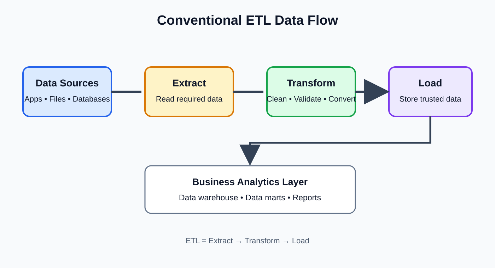

# Day 4: Data Architecture and Integration

**Phase:** 1 — Data Engineering Foundations  
**Learning time:** 2–3 hours  
**Level:** Absolute beginner  
**Mini-project:** ETL/ELT Architecture Designer

> **How to study this lesson:** Imagine that you have joined TechMart, an online shopping company, as a junior Data Engineer. The company stores orders in a database, receives payment updates from an API, keeps inventory files, and records website activity as events. Your job is to understand how these separate sources can work together to provide trusted business data. Read one section at a time. Draw the diagrams yourself. Do not try to memorize tool names before understanding the problem each tool solves.

---

## 1. What you will learn today

By the end of this lesson, you should be able to:

1. Explain what data architecture means in simple language.
2. Describe why companies need to integrate data from different systems.
3. Explain ETL using a business example and a step-by-step flow.
4. Explain ELT and compare it with ETL.
5. Identify the roles of a data lake, data warehouse and lakehouse.
6. Understand the difference between a storage system and a data pipeline.
7. Read a basic end-to-end data architecture diagram.
8. Explain where Kafka fits in event streaming.
9. Explain where dbt fits in warehouse transformations.
10. Select a reasonable architecture for a beginner-level business scenario.
11. Present your architecture decisions during an interview.

### Today's syllabus boundary

The approved syllabus lists these topics:

- ETL and ELT
- Data lakes
- Data warehouses
- Lakehouses
- Data pipelines
- Introduction to Kafka
- Introduction to dbt

Today is an introduction to architecture and integration. We will understand the purpose and position of each component. We will not build a production Kafka cluster or a complete dbt project today. Those require separate lessons and practical setup.

---

## 2. Start with a real business problem

### 2.1 Imagine TechMart

TechMart sells mobile phones, laptops, headphones and other products through a website.

A customer places an order. Several systems are involved:

| Business activity | Where the data may be stored | Example |
|---|---|---|
| Customer registration | Customer database | Customer ID C101 |
| Order placement | Order database | Order O501 |
| Payment | Payment application/API | Payment P901 |
| Product stock | Inventory system | 12 headphones available |
| Website activity | Event tracking system | Customer viewed a product |
| Delivery | Delivery partner API | Package dispatched |

Notice something important.

The information about one customer is not necessarily stored in one place.

The order system knows the order. The payment system knows whether the payment succeeded. The inventory system knows the stock. The delivery partner knows the shipment status.

### 2.2 What problem does this create?

The business manager asks:

> How much revenue did we generate yesterday, how many orders were successfully paid, and how many orders are still waiting for delivery?

Can we answer this question by looking only at the order database?

Not reliably.

The order database may say that an order was created. It may not know whether the payment was successful or whether the package was delivered.

We need to combine information from multiple systems.

This is the business reason for **data integration**.

### 2.3 What is data integration?

Data integration is the process of bringing data from different sources together so that it can be used consistently.

Think of it like collecting marks from different subject teachers into one student result sheet.

- Mathematics teacher has mathematics marks.
- English teacher has English marks.
- Science teacher has science marks.
- The school combines them into one result.

In a company:

- Order system provides order details.
- Payment system provides payment details.
- Inventory system provides stock details.
- Delivery system provides shipment details.
- A data integration process combines the information.

### 2.4 A simple integration example

Suppose the source systems contain these records.

**Orders**

| order_id | customer_id | amount |
|---|---|---:|
| O501 | C101 | 2500 |
| O502 | C102 | 1800 |

**Payments**

| payment_id | order_id | payment_status |
|---|---|---|
| P901 | O501 | SUCCESS |
| P902 | O502 | FAILED |

**Deliveries**

| delivery_id | order_id | delivery_status |
|---|---|---|
| D701 | O501 | DELIVERED |
| D702 | O502 | NOT_SHIPPED |

After integration, a business-friendly view may look like this:

| order_id | customer_id | amount | payment_status | delivery_status |
|---|---|---:|---|---|
| O501 | C101 | 2500 | SUCCESS | DELIVERED |
| O502 | C102 | 1800 | FAILED | NOT_SHIPPED |

Now the manager can ask meaningful questions:

- How many orders were paid successfully?
- What is the revenue from successful payments?
- How many paid orders are not delivered?
- Which orders need customer support follow-up?

**Remember:** Integration does not mean blindly copying every table into one large table. We must understand the meaning, keys, timing and quality of the data before combining it.

---

## 3. What is data architecture?

### 3.1 Simple definition

Data architecture is the overall design that explains:

- Where data comes from.
- How data moves.
- Where data is stored.
- How data is transformed.
- Who or what uses the data.
- How data is protected and monitored.

Imagine constructing a house.

Before construction, an architect prepares a plan:

- Where are the rooms?
- Where are the doors?
- Where does electricity flow?
- Where are water pipes installed?
- How will people move between rooms?

A data architect or Data Engineer also needs a plan.

- Which systems are the data sources?
- How will data be extracted?
- Where will raw data be stored?
- Where will cleaning happen?
- Where will reporting tables be stored?
- How will failures be detected?

### 3.2 Architecture versus implementation

These two terms are related, but they are not the same.

| Term | Meaning | Example |
|---|---|---|
| Architecture | The design or plan | Orders flow from PostgreSQL to object storage and then to a warehouse |
| Implementation | Building the design | Writing Python code, SQL models and deployment configuration |

A diagram is not a working pipeline. It is a plan that guides the implementation.

### 3.3 Why should a Data Engineer understand architecture?

A Data Engineer should not start writing code without understanding the flow.

For example, imagine that a company wants to build a daily sales report.

Before writing a script, ask:

1. Which system owns the order data?
2. Which system owns payment status?
3. How often does the report need to refresh?
4. How much historical data must be retained?
5. Where should raw data be stored?
6. Where should cleaned data be stored?
7. Who will consume the final result?
8. What should happen if the payment API is unavailable?
9. How will duplicate records be handled?
10. Who is allowed to see customer information?

These questions influence the architecture.

### 3.4 Architecture is not a list of fashionable tools

A beginner may say:

> I will use Kafka, Spark, Airflow, Snowflake, dbt and Kubernetes.

That is not an architecture explanation.

A stronger answer is:

> The business receives a high volume of events continuously, so I would consider an event-streaming platform such as Kafka. I would store the incoming data in a durable storage layer, transform it according to business rules, and publish curated tables for analytics. I would choose the exact processing and orchestration tools after checking volume, latency, skills, cost and operational requirements.

**The requirement comes first. The tool comes second.**

---

## 4. Understand the complete data architecture flow

### 4.1 The big picture

A common analytical data architecture can be understood as:

`Source Systems -> Ingestion -> Raw Storage -> Transformation -> Curated Data -> Reporting`

Let's understand each stage.

| Stage | Beginner explanation | TechMart example |
|---|---|---|
| Source systems | Where business data is created | Orders, payments, inventory |
| Ingestion | Bringing data into the data platform | Extract orders every hour |
| Raw storage | Keeping a copy of received data | Original order files in object storage |
| Transformation | Cleaning and changing data | Standardize status values |
| Curated data | Data prepared for trusted use | Clean sales and payment tables |
| Consumption | People or applications use data | Dashboards and reports |

### 4.2 Read the flow from left to right

**Step 1 — Source systems**

Data is created by applications, databases, APIs, files and event systems.

**Step 2 — Ingestion**

A process reads data from a source and brings it into the data platform.

Ingestion can be:

- Batch: collect a group of records at scheduled intervals.
- Streaming: process events continuously or in small ongoing flows.

**Step 3 — Raw storage**

The platform may preserve the original incoming data.

Why keep it?

- We may need to investigate a source issue.
- A transformation rule may change later.
- We may need to replay historical data.
- We may need an audit trail.

**Step 4 — Transformation**

We clean, validate, standardize, join, filter or aggregate data.

Example:

- Convert different date formats into one standard.
- Remove exact duplicate records when appropriate.
- Validate that order amount is not negative.
- Match payment records with order records.

**Step 5 — Curated data**

Curated data is prepared for a known use case.

Examples:

- Daily sales summary.
- Customer purchase history.
- Product inventory snapshot.
- Delivery performance table.

**Step 6 — Consumption**

The final data may be used by:

- Business Intelligence dashboards.
- Analysts writing SQL.
- Machine learning workflows.
- Finance and operations teams.
- Applications and data products.

### 4.3 Important distinction: source system versus analytical platform

A source system is usually designed to run a business operation.

For example, the order application must accept orders quickly and update order status correctly.

An analytical platform is designed to combine and analyze data.

For example, the warehouse may calculate monthly revenue across millions of orders.

The two systems have different responsibilities.

Do not assume that every report should run directly against a busy production application database.

---

## 5. ETL — Extract, Transform, Load

### 5.1 First understand the three words

ETL stands for:

- **Extract:** Read data from a source.
- **Transform:** Clean or change the data.
- **Load:** Write the prepared data into a target.

The order is important:

`Extract -> Transform -> Load`

### 5.2 Use a simple classroom analogy

Imagine a fruit shop.

1. The shop receives apples from a supplier. This is extraction.
2. Workers remove damaged apples and sort them by size. This is transformation.
3. The sorted apples are placed on shelves. This is loading.

The fruit is prepared before it reaches the final shelf.

In data engineering:

1. Read order records.
2. validate and standardize the records.
3. Load the prepared records into the warehouse.

### 5.3 TechMart ETL example

Suppose the order database contains:

| order_id | amount | order_status |
|---|---:|---|
| O501 | 2500 | paid |
| O502 | -100 | paid |
| O503 | 1800 | PAID |

We want a reporting table containing valid paid orders.

A simple transformation rule might be:

- Amount must be greater than zero.
- Status should be standardized to uppercase.
- Only paid orders should enter this reporting table.

**Extract:** Read all three records from the order source.

**Transform:**

- O501: amount is valid; status becomes PAID.
- O502: amount is negative; reject it or send it to a rejected-record area for investigation.
- O503: amount is valid; status is already PAID.

**Load:** Write the accepted records to the target table.

Expected curated result:

| order_id | amount | order_status |
|---|---:|---|
| O501 | 2500 | PAID |
| O503 | 1800 | PAID |

Do not silently delete rejected records in a real pipeline. Record why they were rejected so that the source or business owner can investigate.

### 5.4 ETL architecture diagram



```text
Order Database
      |
      v
   EXTRACT
      |
      v
Transformation Engine
      |
      +---- Validate amount
      |
      +---- Standardize status
      |
      +---- Separate invalid records
      |
      v
    LOAD
      |
      v
Data Warehouse
```

### 5.5 Where does transformation happen in ETL?

In a traditional ETL design, transformation happens in a processing layer before data is loaded into the final target.

That processing layer may be:

- A Python application.
- A dedicated ETL tool.
- A distributed processing engine.
- A managed cloud data integration service.

The important idea is not the brand of the tool. The important idea is that data is transformed before it reaches the target.

### 5.6 When might ETL be useful?

ETL can be useful when:

1. Data must be cleaned before entering the target.
2. The target system should receive only prepared records.
3. Sensitive fields need to be removed or masked before loading.
4. Transformation is performed by a separate processing engine.
5. The target has limited transformation capability.

Example:

A source contains customer email, phone number and purchase details. The reporting target only needs customer region and sales totals. The processing layer can remove unnecessary personal fields before loading the reporting dataset.

### 5.7 Advantages of ETL

- The target receives data that has already passed defined transformations.
- Sensitive or unnecessary fields can be filtered before loading.
- Transformation logic can be managed in a separate processing environment.
- It can be suitable when the destination is not designed for heavy transformations.

### 5.8 Limitations of ETL

- A separate transformation layer must be operated.
- Large transformations may require additional compute infrastructure.
- If raw data is not retained, changing business rules later may require extracting the source again.
- The architecture may become more complex if many transformation stages are added.

### 5.9 Beginner check

**Question:** In ETL, does transformation happen before or after loading into the final target?

**Answer:** Before loading into the final target.

**Why?** The letters represent Extract, Transform, Load. The prepared result is loaded after transformation.

---

## 6. ELT — Extract, Load, Transform

### 6.1 What does ELT mean?

ELT stands for:

- **Extract:** Read data from the source.
- **Load:** Bring the data into the target platform.
- **Transform:** Prepare it inside the target platform.

The order is:

`Extract -> Load -> Transform`

### 6.2 A simple analogy

Imagine that a warehouse receives boxes of mixed products.

1. The boxes arrive.
2. The warehouse records and stores them.
3. Workers sort and label the products inside the warehouse.

The sorting happens after the items arrive.

In ELT:

1. Extract source data.
2. Load it into a data platform.
3. Transform it using the platform's processing capabilities.

### 6.3 TechMart ELT example

Suppose TechMart extracts raw order records and loads them into a cloud analytical platform.

Raw table:

| order_id | amount | order_status |
|---|---:|---|
| O501 | 2500 | paid |
| O502 | -100 | paid |
| O503 | 1800 | PAID |

After loading, SQL transformations inside the platform create a curated table.

Conceptual SQL:

```sql
SELECT
    order_id,
    amount,
    UPPER(order_status) AS order_status
FROM raw_orders
WHERE amount > 0
  AND UPPER(order_status) = 'PAID';
```

Expected result:

| order_id | amount | order_status |
|---|---:|---|
| O501 | 2500 | PAID |
| O503 | 1800 | PAID |

This is a conceptual example. Exact SQL syntax can vary slightly between database platforms.

### 6.4 ELT architecture diagram

```text
Order Database
      |
      v
   EXTRACT
      |
      v
Load raw records
      |
      v
Analytical Data Platform
      |
      +---- Raw tables
      |
      +---- SQL transformations
      |
      +---- Validation and business rules
      |
      v
Curated tables
      |
      v
Dashboards and analytics
```

### 6.5 Why is ELT popular in modern analytical platforms?

Many modern cloud analytical platforms provide scalable storage and compute.

This can make it practical to load raw data first and transform it inside the platform.

Potential benefits:

- Raw data can be retained for future use.
- Different teams can create different curated models from the same raw data.
- SQL transformations can run close to the stored data.
- The processing capacity can be scaled according to platform capabilities.

However, ELT does not automatically make every architecture cheaper or better. Storage, compute, governance and data volume still matter.

### 6.6 When might ELT be useful?

ELT may be a good fit when:

1. The destination platform has strong transformation capabilities.
2. The organization wants to retain raw data.
3. Multiple analytical teams need different views of the same source.
4. Transformations are primarily SQL-based.
5. The platform can scale compute for the workload.

### 6.7 Advantages of ELT

- Raw source data can be retained in the analytical platform.
- New transformation rules can be applied to retained data.
- SQL models can be version-controlled and tested.
- Different curated datasets can be created from shared raw tables.

### 6.8 Limitations and risks of ELT

- Raw data may contain sensitive information; access controls are essential.
- Loading unnecessary data can increase storage and compute costs.
- Poorly designed transformations can consume significant warehouse resources.
- Raw data still needs validation, documentation and ownership.
- Loading first does not mean ignoring security or quality checks.

### 6.9 Beginner check

**Question:** In ELT, where does the transformation happen?

**Answer:** After loading, commonly inside the analytical data platform.

**Question:** Does ELT mean we never clean data before loading?

**Answer:** No. Critical security, safety and ingestion checks may still happen before or during loading. ELT describes the overall order of the main transformation workflow; it does not require unsafe raw ingestion.

---

## 7. ETL versus ELT — understand the difference

### 7.1 Comparison table

| Area | ETL | ELT |
|---|---|---|
| Full form | Extract, Transform, Load | Extract, Load, Transform |
| Main order | Transform before final load | Load before main target-side transformation |
| Transformation location | Separate processing layer or ETL engine | Usually inside target analytical platform |
| Raw data retention | Depends on design | Often retained in raw landing tables or storage |
| Common transformation style | Tool-based, Python, distributed processing | Often SQL and platform-native processing |
| Useful when | Data must be prepared before target loading | Target platform can efficiently transform loaded data |
| Main consideration | Processing layer design and operations | Target compute, cost, governance and access control |

### 7.2 Same requirement, two possible designs

Business requirement:

> Prepare a daily sales table from orders and payments.

**ETL approach**

1. Extract orders.
2. Extract payments.
3. Join and validate records in a processing layer.
4. Load the prepared sales table into the warehouse.

**ELT approach**

1. Extract orders and payments.
2. Load them into raw warehouse tables.
3. Join and validate using SQL models in the warehouse.
4. Publish the curated sales table.

Both approaches can solve the business problem.

### 7.3 Which one should a Data Engineer choose?

Do not answer with “ELT is always better” or “ETL is old.”

Ask these questions:

1. What is the target platform?
2. Can it handle the required transformation workload?
3. How much data arrives?
4. How quickly must the result be ready?
5. Is raw data retention required?
6. Are there privacy rules that require filtering before loading?
7. Which tools can the team operate reliably?
8. What are the expected storage and compute costs?

**Interview-ready answer:**

ETL transforms data before loading it into the final target, while ELT loads source data first and performs the main transformations inside the target platform. I would choose based on the target's capabilities, data volume, security requirements, transformation complexity, cost and operational needs.

---

## 8. Data lake — understand the storage idea

### 8.1 What is a data lake?

A data lake is a storage architecture that can hold large amounts of data in different formats.

It may store:

- CSV files.
- JSON files.
- Parquet files.
- Images.
- Audio and video.
- Application logs.
- Event data.
- Exported database records.

A data lake often uses scalable object storage.

### 8.2 A simple analogy

Think about a large library.

The library receives books, newspapers, magazines, maps and research documents.

It stores many types of material. Different people may later organize and study them for different purposes.

A data lake is similar in the sense that it can store different kinds of data before every possible use is known.

But a real data lake still needs organization, permissions, metadata and quality controls. It should not become an uncontrolled dumping ground.

### 8.3 TechMart data lake example

TechMart receives:

| Source | Incoming data | Possible stored form |
|---|---|---|
| Order database | Order records | CSV or Parquet export |
| Payment API | Payment response | JSON |
| Website | Click events | JSON |
| Customer support | Conversation exports | Text or JSON |
| Product catalog | Product images | Image files |

A data lake can store these different data types in one governed storage environment.

### 8.4 Why keep raw data?

Suppose the company initially calculates sales using one business rule.

Three months later, Finance changes the definition of a refund-adjusted sale.

If the original data is retained, the team may be able to reprocess historical records with the new rule.

Other reasons to retain raw data:

- Reprocessing after a bug fix.
- Auditing how a result was produced.
- Investigating source-system changes.
- Supporting a new analytics requirement.
- Training or evaluating data science workflows where permitted.

Raw retention must still follow retention policies, privacy rules and access controls.

### 8.5 Common data lake zones

A common design separates data into zones. Names differ between organizations.

| Zone | Meaning | Example |
|---|---|---|
| Raw / Bronze | Data as received, with limited changes | Original payment API response |
| Cleaned / Silver | Validated and standardized data | Consistent payment records |
| Curated / Gold | Business-ready datasets | Daily paid sales summary |

Do not assume every company uses exactly these names. They are common naming conventions, not a universal law.

### 8.6 Example folder structure

```text
techmart-data-lake/
|
+-- raw/
|   +-- orders/
|   |   +-- order_date=2026-11-09/
|   +-- payments/
|   +-- website_events/
|
+-- cleaned/
|   +-- orders/
|   +-- payments/
|
+-- curated/
    +-- daily_sales/
    +-- customer_activity/
```

This is an illustrative folder layout. The exact structure depends on storage technology, partitioning strategy and governance standards.

### 8.7 What is a data lake not?

A data lake is not automatically:

- A data warehouse.
- A database with relational tables.
- A backup system.
- A guarantee that all stored data is correct.
- A guarantee that data is easy to discover.

Without ownership, metadata, access controls and lifecycle policies, a data lake can become difficult to use.

### 8.8 Data lake advantages

- Supports diverse file formats.
- Can retain detailed raw data.
- Can scale to large storage requirements.
- Supports multiple processing and analytical use cases.
- Can separate storage from compute in many architectures.

### 8.9 Data lake challenges

- Users may not know what a file contains.
- Schemas may change over time.
- Duplicate or invalid data may accumulate.
- Access controls can become difficult.
- Poor folder and metadata design makes discovery harder.
- Query performance depends on formats, partitioning, file sizes and engines.

---

## 9. Data warehouse — understand the analytical database

### 9.1 What is a data warehouse?

A data warehouse is a system designed to store integrated, structured data for analysis and reporting.

It commonly contains:

- Cleaned business data.
- Historical records.
- Fact tables.
- Dimension tables.
- Aggregated reporting datasets.

A warehouse is designed for analytical questions, not primarily for handling each individual business transaction.

### 9.2 Simple analogy

Imagine a school.

The admission system records each student registration. The fee system records payments. The examination system records marks.

The principal may need a report showing:

- Total students by department.
- Fees collected by month.
- Average marks by subject.
- Students with unpaid fees.

A reporting database can combine and organize the information for analysis.

### 9.3 TechMart warehouse example

A warehouse may contain:

**fact_sales**

| order_id | customer_key | product_key | sales_amount |
|---|---|---|---:|
| O501 | 101 | 501 | 2500 |
| O503 | 102 | 502 | 1800 |

**dim_customer**

| customer_key | customer_id | city |
|---:|---|---|
| 101 | C101 | Hyderabad |
| 102 | C102 | Bengaluru |

**dim_product**

| product_key | product_name | category |
|---:|---|---|
| 501 | Headphones | Audio |
| 502 | Keyboard | Accessories |

A report can combine these tables to answer sales questions by customer city or product category.

We will study fact tables and dimension tables in detail in the Data Warehousing and Modeling phase. Today, understand why the warehouse organizes data for analysis.

### 9.4 What is OLAP?

OLAP means Online Analytical Processing.

It refers to analytical workloads that examine data across dimensions such as:

- Time.
- Region.
- Product.
- Customer segment.
- Sales channel.

Example questions:

- What were monthly sales by city?
- Which product category grew fastest?
- How did revenue change compared with last year?

### 9.5 Data warehouse characteristics

A warehouse commonly emphasizes:

1. Integrated data from multiple sources.
2. Consistent definitions and formats.
3. Historical analysis.
4. Structured analytical datasets.
5. Read-heavy reporting and query workloads.
6. Data quality and governance.

Different warehouse products implement these capabilities differently.

### 9.6 Data warehouse versus operational database

| Area | Operational database | Data warehouse |
|---|---|---|
| Main purpose | Run business applications | Analyze business performance |
| Typical workload | Frequent inserts and updates | Analytical reads and aggregations |
| Data scope | Often focused on one application | Often integrated from many sources |
| Example | Create an order | Analyze yearly sales |
| Design focus | Transaction correctness and application response | Analytical query performance and consistency |

An operational database is often called an OLTP system. A warehouse is commonly associated with OLAP workloads.

### 9.7 Why not run every analytical report on the application database?

Heavy analytical queries can compete with the application for CPU, memory and I/O.

A warehouse can isolate analytical workloads from the operational application.

This is not an absolute rule: architecture depends on scale, workload and platform. But separating operational and analytical workloads is a common design choice.

---

## 10. Lakehouse — combining lake and warehouse ideas

### 10.1 What is a lakehouse?

A lakehouse is an architecture that combines the flexible storage approach of a data lake with table-management and analytical capabilities commonly associated with data warehouses.

The exact features depend on the platform and table format.

It may provide capabilities such as:

- Table metadata.
- Schema enforcement or evolution.
- Transaction support.
- Versioning or time-travel features.
- SQL analytics.
- Support for multiple processing engines.

### 10.2 Simple analogy

A data lake is like a large storage library that can hold many kinds of material.

A warehouse is like a carefully organized reference section where information is prepared for reliable reporting.

A lakehouse aims to combine flexible storage with stronger table and analytical management.

### 10.3 Why did lakehouse architectures become useful?

Organizations often want to:

- Store raw files at scale.
- Process structured and semi-structured data.
- Support analytics and data science.
- Avoid unnecessary copies between separate systems.
- Apply stronger reliability and governance to data stored in a lake.

A lakehouse architecture attempts to address these needs.

### 10.4 Compare lake, warehouse and lakehouse

| Feature | Data lake | Data warehouse | Lakehouse |
|---|---|---|---|
| Main idea | Flexible large-scale data storage | Curated analytical data platform | Lake storage with managed table and analytical capabilities |
| Data formats | Many formats | Usually structured tables | Files plus managed table formats |
| Raw data | Commonly retained | May retain raw or staging data, depending on design | Commonly supports raw and managed analytical data |
| Governance | Must be designed and enforced | Usually strong structured governance capabilities | Depends on platform and implementation |
| Typical use | Raw storage, exploration, data science | BI, reporting, SQL analytics | Combined data engineering, analytics and data science |
| Important caution | Can become a data swamp | Can require additional ingestion and storage layers | Not every lakehouse has identical features |

### 10.5 Important: lakehouse is not automatically better

A small company with a few thousand records may not need a complex lakehouse architecture.

A simple database and scheduled pipeline may be enough.

Choose architecture according to:

- Data volume.
- Data variety.
- Query requirements.
- Latency requirements.
- Team skills.
- Governance.
- Cost.
- Operational complexity.

---

## 11. Understand data pipelines

### 11.1 What is a data pipeline?

A data pipeline is a sequence of connected steps that moves data from a source to a destination and may transform, validate or deliver it along the way.

A simple pipeline:

`Read Orders -> Validate -> Transform -> Store Results`

A pipeline can run:

- Once.
- Every hour.
- Every day.
- Continuously.
- When a new event or file arrives.

### 11.2 Pipeline versus architecture

These terms are related but different.

| Data architecture | Data pipeline |
|---|---|
| Overall design of the data platform | A specific flow of processing steps |
| Shows systems, storage and relationships | Shows how a particular dataset moves and changes |
| May contain many pipelines | Is one workflow within the architecture |

Example:

TechMart architecture may contain order ingestion, payment ingestion, inventory ingestion and reporting pipelines.

### 11.3 Example: daily sales pipeline

Business requirement:

> Every morning, Finance needs the previous day's paid sales.

Possible steps:

1. Read orders from the order database.
2. Read payment records from the payment source.
3. Validate required columns.
4. Match payments to orders.
5. Keep successful payments.
6. Calculate daily sales.
7. Save the result in a reporting table.
8. Record how many rows were processed.
9. Alert the support team if the pipeline fails.

### 11.4 Pipeline flow diagram

```text
       Order Source       Payment Source
             |                  |
             v                  v
          Extract            Extract
             |                  |
             +--------+---------+
                      |
                      v
                Validate Data
                      |
                      v
                 Join Records
                      |
                      v
              Apply Business Rules
                      |
                      v
                Daily Sales Table
                      |
                      v
                 Finance Report
```

### 11.5 A pipeline is more than a script

A script that reads a file and writes another file is a useful starting point.

A production pipeline must also consider:

- What if the source is unavailable?
- What if a file arrives twice?
- What if a required column disappears?
- What if only half the records are processed?
- How do we know the pipeline completed?
- Can we safely rerun it?
- Who receives an alert?
- How long should the data be retained?

We will study these reliability and operational practices in later days.

---

## 12. Batch integration and streaming integration

### 12.1 Batch integration

Batch processing collects data and processes it as a group.

Example:

- Orders are extracted every night at 1:00 AM.
- The pipeline processes all records received during the day.
- The sales report is ready in the morning.

Advantages:

- Often simpler to design and operate.
- Efficient for large groups of records.
- Suitable when immediate updates are not required.

Limitations:

- Results are not continuously updated.
- A failed batch may delay the report.
- Large batches can take longer to process.

### 12.2 Streaming integration

Streaming integration processes events continuously or in small ongoing groups as they arrive.

Example:

- A customer places an order.
- The order system publishes an event.
- A consumer receives the event.
- A downstream process updates a near-real-time view.

Advantages:

- Lower delay between event creation and processing.
- Useful for monitoring and event-driven applications.
- Can support immediate operational reactions.

Limitations:

- More operational complexity.
- Event ordering, duplicate delivery and recovery need attention.
- Monitoring and troubleshooting require careful design.

### 12.3 Batch versus streaming

| Area | Batch | Streaming |
|---|---|---|
| Processing | Groups of records | Continuous or ongoing events |
| Timing | Scheduled | Event-driven or continuous |
| Example | Nightly sales report | Live order monitoring |
| Complexity | Often lower | Often higher |
| Latency | Minutes or hours, depending on schedule | Often seconds or less, depending on design |
| Best fit | Periodic reporting | Time-sensitive event use cases |

Streaming is not automatically the right choice. If Finance needs one report each morning, a reliable daily batch may be more appropriate than a complex streaming platform.

---

## 13. Introduction to Apache Kafka

### 13.1 What problem does Kafka help solve?

Imagine TechMart receives thousands of events:

- OrderCreated.
- PaymentCompleted.
- PaymentFailed.
- ProductViewed.
- InventoryUpdated.
- ShipmentDispatched.

Several systems may need to react to the same events.

For example, when an order is created:

- Inventory service may reserve stock.
- Notification service may send an email.
- Analytics service may record the order.
- Fraud detection may evaluate the transaction.

If every system directly calls every other system, the connections can become difficult to manage.

Kafka provides a platform for publishing, storing and consuming event streams.

### 13.2 Simple definition

Apache Kafka is a distributed event-streaming platform. Applications can publish event records to Kafka, and other applications can read those records.

Kafka is commonly used for:

- Event streaming.
- Data integration.
- Real-time data pipelines.
- Event-driven architectures.
- Streaming analytics.

### 13.3 Simple analogy: a notice board

Imagine a college notice board.

1. A teacher posts a notice.
2. Many students can read it.
3. The teacher does not need to personally deliver a separate copy to every student.

Kafka is not literally a notice board, but this analogy helps explain publishing and consuming events.

A producer publishes an event. Consumers read events from the stream.

### 13.4 Important Kafka terms

| Term | Beginner explanation |
|---|---|
| Event / record | A piece of information that something happened |
| Producer | Application that publishes events |
| Consumer | Application that reads events |
| Topic | Named stream where related events are stored |
| Partition | Ordered section of a topic that supports parallelism |
| Broker | Kafka server that stores and serves topic data |
| Consumer group | Consumers working together to read a topic |
| Offset | Position of a record within a partition |

### 13.5 Understand producer and consumer

Example event:

```json
{
  "event_type": "OrderCreated",
  "order_id": "O501",
  "customer_id": "C101",
  "amount": 2500
}
```

- The order application is the producer.
- It publishes the OrderCreated event.
- Kafka stores the record in a topic.
- An analytics consumer reads the event.
- An inventory consumer may also read the event.

### 13.6 What is a topic?

A topic is a named stream of related records.

Examples:

- orders
- payments
- inventory
- website-events

Think of topics as separate named channels.

An order event should normally be published to an order-related topic, not mixed without reason into an unrelated payment topic.

### 13.7 What is a partition?

A topic can be divided into partitions.

Partitions help Kafka distribute data and allow parallel consumption.

A simplified view:

```text
Topic: orders
|
+-- Partition 0: record 0, record 1, record 2
|
+-- Partition 1: record 0, record 1, record 2
|
+-- Partition 2: record 0, record 1, record 2
```

Important beginner rule:

Kafka ordering is guaranteed within a partition, not as one global order across every partition.

A record key can influence which partition receives a record. For example, using order_id as a key may keep records for the same order in the same partition, depending on the partitioning configuration.

### 13.8 What is a consumer group?

A consumer group is a group of consumers that share the work of reading a topic.

For example, one analytics application may use a consumer group with multiple consumers to process partitions in parallel.

A partition is assigned to at most one consumer within the same consumer group at a time. Different consumer groups can independently read the same topic.

### 13.9 What is an offset?

An offset identifies a record's position within a partition.

A consumer tracks its progress using offsets.

This helps the consumer know which records it has already processed and where to continue.

Offset management and delivery behavior require careful design. Do not assume that every event is processed exactly once merely because Kafka is used.

### 13.10 Kafka flow for TechMart

```text
Order Application
       |
       | Producer publishes OrderCreated
       v
   Kafka Topic: orders
       |
       +--------------------+
       |                    |
       v                    v
Inventory Consumer    Analytics Consumer
       |                    |
       v                    v
Stock Reservation     Sales Event Storage
```

### 13.11 Is Kafka a database or a data warehouse?

Kafka is not normally used as a replacement for a relational database or analytical warehouse.

Kafka is an event-streaming platform. It can retain event records for configured periods and allow consumers to read them.

A consumer may write the events into:

- A database.
- A data lake.
- A data warehouse.
- A search index.
- Another application.

### 13.12 When might Kafka be useful?

Consider Kafka when:

- Many applications need to consume business events.
- Events arrive continuously.
- The business needs low-latency event distribution.
- Producers and consumers should be loosely coupled.
- Event streams need to be retained and replayed within configured retention limits.

Do not introduce Kafka just because a project is called data engineering. For a small daily file load, a scheduled batch process may be simpler and more reliable.

### 13.13 Kafka beginner questions

**Q: Who sends messages to Kafka?**  
A: Producers.

**Q: Who reads messages from Kafka?**  
A: Consumers.

**Q: What is a topic?**  
A: A named stream of related records.

**Q: What is a partition?**  
A: A subdivision of a topic that supports distribution and parallelism.

**Q: What is an offset?**  
A: A record's position within a partition.

**Q: Does Kafka itself define the business meaning of an event?**  
A: No. The producing and consuming applications must agree on event structure and meaning.

---

## 14. Introduction to dbt

### 14.1 What problem does dbt solve?

Imagine TechMart has loaded raw data into a warehouse.

The raw tables are:

- raw_orders
- raw_payments
- raw_customers

The analytics team needs:

- clean_orders
- successful_payments
- daily_sales
- customer_sales_summary

The team could write SQL manually and run it in different ways. But as the number of transformations grows, it becomes difficult to manage dependencies, tests, documentation and changes.

dbt helps teams manage SQL-based data transformations in supported data platforms.

### 14.2 Simple definition

dbt is a data transformation tool that helps organize SQL models, dependencies, tests and documentation.

In a typical ELT workflow:

1. Data is extracted from source systems.
2. Data is loaded into a warehouse or supported platform.
3. dbt runs SQL transformations in that platform.
4. Curated models are made available to analysts and other consumers.

### 14.3 Understand a dbt model

A dbt model is commonly a SQL file that defines a transformation.

Example model file: `clean_orders.sql`

```sql
SELECT
    order_id,
    customer_id,
    amount,
    UPPER(order_status) AS order_status
FROM raw_orders
WHERE amount > 0
```

This SQL describes the rows and columns that should appear in the model.

dbt uses project configuration and materialization settings to decide how to build the model in the target platform.

### 14.4 What does dbt add beyond writing SQL in a query editor?

Depending on project setup, dbt helps with:

- Organizing SQL transformations into models.
- Defining dependencies between models.
- Running models in the correct order.
- Adding data tests.
- Generating documentation.
- Showing lineage between models.
- Managing changes through version control.

### 14.5 Understand model dependencies

Suppose:

- `stg_orders` cleans the raw orders.
- `stg_payments` cleans raw payments.
- `fct_sales` combines the cleaned models.

Flow:

```text
raw_orders          raw_payments
     |                   |
     v                   v
stg_orders          stg_payments
     |                   |
     +---------+---------+
               |
               v
            fct_sales
               |
               v
         Sales Dashboard
```

The final model depends on the staging models.

A dbt project can represent these dependencies so the correct models are built in the required order.

### 14.6 What is a dbt test?

A test checks whether data meets a defined expectation.

Examples:

- order_id should not be null.
- order_id should be unique in a model where one row per order is expected.
- customer_id should match a known customer record.
- payment_status should contain allowed values.

Tests help detect data problems. They do not prove that every business definition is correct.

### 14.7 What is data lineage?

Data lineage explains where data came from and how it moved through transformations.

Example:

```text
orders source
     |
     v
raw_orders
     |
     v
stg_orders
     |
     v
fct_sales
     |
     v
sales dashboard
```

If the sales dashboard shows an unexpected value, lineage helps the engineer trace the result back through its upstream models and source.

### 14.8 dbt versus Kafka

| Kafka | dbt |
|---|---|
| Event streaming platform | SQL transformation tool |
| Moves and distributes event records | Builds transformed data models |
| Producers publish and consumers read | Models define transformations and dependencies |
| Often used for streaming integration | Commonly used after data is available in an analytical platform |
| Works with event streams | Works with supported data platforms and SQL transformations |

Kafka and dbt solve different problems. They can be used in the same architecture.

### 14.9 Important beginner caution

dbt does not automatically extract data from every source system. In a typical workflow, another ingestion tool or process brings source data into the warehouse first.

dbt then manages transformations in the target platform.

---

## 15. How the components work together

### 15.1 One possible modern architecture

TechMart wants to combine daily database data and continuous website events.

A possible high-level design:

```text
        BUSINESS SOURCE SYSTEMS
   +------------+-------------+-------------+
   | Orders DB  | Payments API| Web Events  |
   +------------+-------------+-------------+
          |           |             |
          |           |             v
          |           |        Event Producer
          |           |             |
          |           |             v
          |           |         Kafka Topic
          |           |             |
          +-----------+-------------+
                      |
                      v
                 INGESTION
                      |
                      v
             RAW STORAGE / LAKE
                      |
                      v
             ANALYTICAL PLATFORM
                      |
                      v
                dbt MODELS
                      |
                      v
              CURATED DATA TABLES
                      |
                      v
             BI / REPORTS / ANALYTICS
```

This is one possible design, not a mandatory architecture for every company.

### 15.2 Explain the architecture in plain English

1. Orders and payments are created in business systems.
2. Website activity is published as events.
3. Ingestion processes bring the data into the data platform.
4. Raw data is retained according to business and governance rules.
5. Analytical transformations prepare consistent datasets.
6. dbt may manage SQL models and their dependencies.
7. Curated tables are used by dashboards and analysts.

### 15.3 Where can ETL or ELT appear?

ETL or ELT describes the order of extraction, transformation and loading.

Kafka describes event streaming.

dbt helps manage SQL transformations.

A data lake or warehouse describes storage and analytical architecture.

These are different concepts. They can be combined.

For example:

- A Kafka stream can deliver events into raw storage.
- A batch ingestion job can extract orders from a database.
- Data can be loaded into a warehouse.
- dbt can transform the loaded data.

Do not treat these terms as competing products that all do the same job.

---

## 16. Architecture decision practice

### Scenario 1 — Daily finance report

**Requirement:** Finance needs yesterday's sales report by 8 AM.

**Possible design:**

1. Extract orders and payments every night.
2. Validate and integrate the records.
3. Load prepared data into the warehouse.
4. Publish a daily sales table.
5. Refresh the dashboard before 8 AM.

**Reasoning:** A scheduled batch pipeline may be sufficient. Kafka is not automatically required because the report is not asking for continuous updates.

### Scenario 2 — Live order monitoring

**Requirement:** Operations wants to see new orders within seconds.

**Possible design:**

1. Order application publishes order events.
2. An event-streaming platform distributes the events.
3. A consumer processes the events.
4. The monitoring application updates its view.

**Reasoning:** Streaming may be appropriate because the business requirement is time-sensitive.

### Scenario 3 — Store original records for future analysis

**Requirement:** Data Science and Analytics teams need access to historical files in multiple formats.

**Possible design:**

1. Ingest source data.
2. Retain governed raw copies in a data lake.
3. Validate and organize data.
4. Create curated datasets for specific teams.

**Reasoning:** A data lake may be useful for diverse data and historical retention. Access and retention controls are essential.

### Scenario 4 — Centralized business reporting

**Requirement:** Leadership wants consistent revenue reports across sales channels.

**Possible design:**

1. Integrate source data.
2. Standardize business definitions.
3. Store analytical tables in a warehouse.
4. Publish governed reporting models.

**Reasoning:** A warehouse is suitable for structured, consistent analytical reporting.

### Scenario 5 — SQL transformations are becoming difficult to manage

**Requirement:** The analytics team has many SQL scripts and cannot easily track dependencies or tests.

**Possible design:**

1. Organize SQL transformations as models.
2. Define upstream and downstream dependencies.
3. Add tests for key expectations.
4. Generate documentation and lineage.
5. Run changes through version control and deployment practices.

**Reasoning:** dbt may help manage the transformation workflow.

---

## 17. Architecture mistakes beginners should avoid

### Mistake 1: Choosing tools before understanding requirements

**Incorrect thinking:** Every data engineering project needs Kafka and Spark.

**Better thinking:** First understand volume, latency, data type, reliability, team skills and cost. Select tools only when they solve a real requirement.

### Mistake 2: Thinking ETL and ELT are storage systems

ETL and ELT describe processing order. A data lake and warehouse describe storage and analytical platform patterns.

### Mistake 3: Thinking a data lake is just a folder

A lake needs data organization, metadata, ownership, security, lifecycle policies and discoverability.

### Mistake 4: Thinking a warehouse is only a database server

A warehouse is an analytical data platform and design approach. It includes integrated data, models, governance and workloads.

### Mistake 5: Thinking Kafka is a replacement for SQL

Kafka distributes event streams. SQL is a language used to query and transform data in supported systems. They serve different purposes.

### Mistake 6: Thinking dbt extracts all data from source systems

dbt commonly manages transformations after data has been made available in a supported analytical platform. Ingestion is a separate responsibility in many architectures.

### Mistake 7: Ignoring data quality

Moving incorrect data faster does not make it correct. Validation, reconciliation and monitoring must be designed into the pipeline.

### Mistake 8: Ignoring security

Raw data may contain personal or confidential information. Use access controls, encryption, masking and retention policies appropriate to the data.

### Mistake 9: Assuming every pipeline is real-time

Many business requirements are satisfied by hourly or daily batch processing. Streaming adds complexity and should be justified by latency requirements.

### Mistake 10: Drawing a diagram without explaining it

A good architecture explanation describes what each component does, why it exists and how data moves between components.

---

## 18. Mini-project — ETL/ELT Architecture Designer

### 18.1 Project objective

Design a simple architecture for TechMart that combines order, payment, inventory and website data so business teams can create trusted reports.

You are not expected to deploy cloud infrastructure today. The goal is to demonstrate that you can understand requirements and design a sensible data flow.

### 18.2 Business scenario

TechMart has four sources:

| Source | Data | Update pattern |
|---|---|---|
| PostgreSQL order database | Orders and customers | New records throughout the day |
| Payment API | Payment status and amount | API updates throughout the day |
| Inventory CSV | Product stock | File delivered every hour |
| Website event stream | Product views and clicks | Continuous events |

Business users need:

- Daily paid sales.
- Product stock status.
- Customer purchase summaries.
- Website product popularity.

### 18.3 Step 1 — Identify the sources

Write each source, owner, format and update frequency.

Example:

| Source name | Source type | Data format | Frequency |
|---|---|---|---|
| Orders | Relational database | Tables | Incremental / hourly extraction |
| Payments | REST API | JSON | Periodic API extraction |
| Inventory | File delivery | CSV | Hourly |
| Website events | Event stream | JSON records | Continuous |

Why record this?

Because the source type affects how we extract data. A database, API, file and event stream do not use the same extraction method.

### 18.4 Step 2 — Define the business requirement

Write a short statement:

> The platform must combine order, payment, inventory and website activity data to provide daily business reports and support near-real-time monitoring of website events.

Separate the two timing needs:

- Daily business reports: batch may be sufficient.
- Website event monitoring: streaming may be appropriate.

This prevents us from forcing one processing pattern onto every source.

### 18.5 Step 3 — Choose storage responsibilities

A possible design:

| Layer | Responsibility |
|---|---|
| Raw storage / lake | Retain source data in its original or minimally changed form |
| Cleaned layer | Validate and standardize records |
| Warehouse | Organize integrated analytical tables |
| Reporting layer | Provide trusted datasets for dashboards |

Explain why each layer exists. Do not add a layer only to make the diagram look complex.

### 18.6 Step 4 — Choose ETL or ELT

For the warehouse reporting data, assume the target platform supports scalable SQL transformations.

A reasonable choice is ELT:

1. Extract source data.
2. Load it into raw tables.
3. Transform it inside the analytical platform.
4. Publish curated tables.

But if sensitive information must be removed before entering the warehouse, apply that protection during ingestion or in a controlled preprocessing step.

### 18.7 Step 5 — Decide whether Kafka is needed

The website activity stream is continuous and may need low-latency distribution.

Kafka could be considered for that event flow.

The hourly inventory file does not need Kafka merely because Kafka is part of the architecture diagram.

The decision must match the requirement.

### 18.8 Step 6 — Decide where dbt fits

If the team uses SQL transformations in a supported warehouse, dbt may manage:

- Cleaned staging models.
- Integrated sales models.
- Customer summary models.
- Tests and documentation.
- Dependencies and lineage.

### 18.9 Step 7 — Draw the architecture

Use this as a starting point and improve it:

```text
PostgreSQL Orders ----+
                      |
Payment API ----------+----> Ingestion ----> Raw Lake / Raw Tables
                      |                            |
Inventory CSV --------+                            v
                                           Cleaning / Validation
Website Events --> Kafka (if required)             |
                                                   v
                                           Warehouse Models
                                                   |
                                                   v
                                               dbt SQL
                                                   |
                                                   v
                                           Curated Data Tables
                                                   |
                                                   v
                                           Reports / Analytics
```

### 18.10 Step 8 — Explain your design

Write one or two sentences for each decision:

- Why did you select batch for inventory?
- Why might streaming be useful for website events?
- Why retain raw records?
- Why use a warehouse for business reporting?
- Why use dbt for SQL transformations?
- What security controls are required?
- What happens when a source is unavailable?

A design is not complete until you can explain the reasoning.

### 18.11 Project deliverables

Submit these items:

1. Source inventory table.
2. Business requirements statement.
3. ETL or ELT decision with reasoning.
4. Data lake, warehouse or lakehouse selection with reasoning.
5. Kafka decision with reasoning.
6. dbt responsibility description.
7. End-to-end architecture diagram.
8. Three risks and how you would reduce them.

### 18.12 Project evaluation checklist

| Evaluation area | What a good submission demonstrates |
|---|---|
| Source understanding | Correctly identifies databases, APIs, files and events |
| Processing choice | Explains batch versus streaming based on latency |
| ETL/ELT | Correctly shows the transformation order |
| Storage choice | Explains lake and warehouse responsibilities |
| Kafka | Uses it only where event streaming is justified |
| dbt | Places it in the SQL transformation layer |
| Data quality | Includes validation and rejected-record handling |
| Security | Mentions access control and sensitive data protection |
| Communication | Diagram is readable and decisions are explained |

---

## 19. Revision — explain these concepts without memorizing

Try to answer each question aloud.

1. Why does a company need data integration?
2. What does data architecture describe?
3. What are the three steps in ETL?
4. What are the three steps in ELT?
5. Where does transformation happen in ETL?
6. Where does transformation commonly happen in ELT?
7. What is a data lake?
8. What is a data warehouse?
9. What is a lakehouse?
10. What is the difference between a data lake and a data warehouse?
11. What is a data pipeline?
12. What is the difference between batch and streaming?
13. What problem does Kafka help solve?
14. What is a Kafka producer?
15. What is a Kafka consumer?
16. What is a Kafka topic?
17. What is a Kafka partition?
18. What is an offset?
19. What is dbt?
20. Why do dbt models have dependencies?

### Quick answers

| Question | Short answer |
|---|---|
| Data integration | Bringing data from different sources together consistently |
| Data architecture | Overall design for data sources, movement, storage, transformation, security and use |
| ETL | Extract, Transform, Load |
| ELT | Extract, Load, Transform |
| Data lake | Flexible storage for diverse data |
| Data warehouse | Integrated analytical platform for reporting and analysis |
| Lakehouse | Lake storage combined with managed table and analytical capabilities |
| Pipeline | Connected steps that move and process data |
| Batch | Process records in groups |
| Streaming | Process ongoing events |
| Kafka | Distributed event-streaming platform |
| Producer | Publishes events |
| Consumer | Reads events |
| Topic | Named event stream |
| Partition | Subdivision of a topic |
| Offset | Position within a partition |
| dbt | Manages SQL-based data transformations, dependencies, tests and documentation |

---

## 20. Day 4 knowledge check

### Question 1

A company extracts data, cleans it in Python, and then loads the cleaned data into a warehouse. Which pattern is this?

A. ELT  
B. ETL  
C. Streaming  
D. Data modeling

**Correct answer: B — ETL.**

The data is transformed before it is loaded into the final warehouse target.

### Question 2

A company loads raw records into a warehouse and then uses SQL models inside the warehouse to clean and combine them. Which pattern is this?

A. ETL  
B. ELT  
C. Backup  
D. OLTP

**Correct answer: B — ELT.**

The data is loaded before the main target-side transformations.

### Question 3

Which architecture is designed to store diverse raw data such as CSV, JSON, images and logs?

A. Data lake  
B. Primary key  
C. OLTP transaction  
D. SQL index

**Correct answer: A — Data lake.**

A lake can store multiple types of data, provided it is properly governed and organized.

### Question 4

Which platform is commonly designed for integrated business reporting and analytical queries?

A. Data warehouse  
B. Web browser  
C. Message producer  
D. File extension

**Correct answer: A — Data warehouse.**

### Question 5

Which Kafka component publishes events?

A. Consumer  
B. Producer  
C. Offset  
D. Partition

**Correct answer: B — Producer.**

### Question 6

What is the main role of dbt in a common ELT architecture?

A. Replace every source database  
B. Manage SQL transformations and related project workflows  
C. Replace Kafka  
D. Host the company's website

**Correct answer: B.**

### Question 7

A business needs a report every morning. Does it automatically need Kafka?

**Correct answer:** No. A scheduled batch pipeline may be enough. The architecture should match the latency requirement.

### Question 8

A company wants to distribute continuous order events to several applications. Which technology from today's lesson may help?

**Correct answer:** Kafka may help distribute event streams to multiple consumers.

---

## 21. Common interview explanation framework

When asked to design a data architecture, do not immediately list tools.

Use this order:

1. **Requirement:** What business problem are we solving?
2. **Sources:** Where is the data created?
3. **Frequency:** Is data arriving in batches or continuously?
4. **Ingestion:** How will data enter the platform?
5. **Storage:** Where will raw and curated data live?
6. **Transformation:** Where will business rules run?
7. **Consumption:** Who uses the final data?
8. **Quality:** How will invalid or missing data be detected?
9. **Reliability:** How will failures and reruns be handled?
10. **Security:** Who can access sensitive data?
11. **Trade-offs:** Why is this design suitable for the requirement?

This structure helps you give a clear, practical answer even when you are a fresher.

---

## 22. Day 4 summary

Today you learned that data architecture is the plan for how data moves from business systems into useful and trusted data products.

The most important distinctions are:

- Data integration combines information from different sources.
- ETL transforms data before loading it into the final target.
- ELT loads data first and performs the main transformations in the target platform.
- A data lake stores diverse data and often retains raw records.
- A data warehouse organizes integrated data for analytics and reporting.
- A lakehouse combines flexible lake storage with managed table and analytical capabilities.
- A data pipeline is a sequence of connected data-processing steps.
- Kafka distributes event streams between producers and consumers.
- dbt helps manage SQL transformations, dependencies, tests and documentation.

### Final reminder

A good Data Engineer does not choose a tool because it is popular. A good Data Engineer understands the business requirement, designs the data flow, considers quality and security, and then selects tools that the team can operate reliably.

**Next lesson:** Day 5 — Data Pipeline Fundamentals  
**Mini-project:** Pipeline Requirements Document
