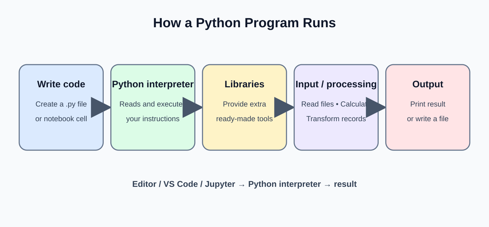

# Day 6: Python Introduction and Environment

**Phase:** 2 — Python for Data Engineering  
**Mini-project:** Data Processing Utility  
**Learning time:** 2–3 hours

## 1. Learning outcomes

By the end of this lesson, you can:

- Explain why Python is used in data engineering and where SQL fits.
- Check Python installation and identify the interpreter used by a project.
- Create and run a `.py` file from Windows Command Prompt or a terminal.
- Understand variables, common data types and basic type conversion.
- Store related records using lists and dictionaries.
- Inspect a small set of order records and calculate useful totals.

## 2. Why Python is important in data engineering

A data pipeline moves data from a source to a destination. Python is often used to connect the steps.

**Example retail flow**

`Orders CSV -> Python validation -> Python transformation -> Database / Parquet output`

Python is useful for:

- Reading and writing files.
- Calling REST APIs.
- Connecting to databases.
- Applying business rules that are awkward to express as one SQL query.
- Scheduling and automating repeatable tasks.
- Validating records before loading them.

SQL remains essential for querying and transforming relational data. Python and SQL are complementary, not competitors.

## 3. Understand the development environment



| Term | Simple meaning | Example |
|---|---|---|
| Python interpreter | Program that executes Python instructions | CPython |
| Source file | File containing Python code | `main.py` |
| Terminal | Place to run system commands | Windows CMD |
| Editor / IDE | Place to write and inspect code | VS Code |
| Notebook | Interactive document with code and output cells | Jupyter |
| Package | Reusable code installed into Python | pandas |
| Virtual environment | Isolated package area for one project | `.venv` |

**Important:** Installing a package into one Python interpreter does not automatically install it into every other interpreter on your computer.

## 4. Check whether Python is installed

Open Windows Command Prompt.

```bash
python --version
```

Example output (your version may differ):

```text
Python 3.12.4
```

If Windows cannot find `python`, try:

```bash
py --version
```

Example output:

```text
Python 3.12.4
```

Check which executable is used:

```bash
where python
```

Example output varies by machine. It may show a path such as:

```text
C:\Users\Student\AppData\Local\Programs\Python\Python312\python.exe
```

Do not copy the example path as if it must exist on your computer.

## 5. Run your first Python statement

In a terminal, enter:

```bash
python -c "print('Hello, Data Engineering')"
```

Expected output:

```text
Hello, Data Engineering
```

- `python` starts the interpreter.
- `-c` tells Python to execute the code supplied as text.
- `print()` displays a value.

If you use the Windows launcher, the equivalent command is:

```bash
py -c "print('Hello, Data Engineering')"
```

## 6. Create and run a Python file

Create a folder named `day06_python`. Inside it, create `first_program.py`.

Code in `first_program.py`:

```python
print("Welcome to Python")
print("We are learning data engineering")
```

Run it from the folder:

```bash
python first_program.py
```

Expected output:

```text
Welcome to Python
We are learning data engineering
```

A script is useful when you want to save, rerun and version-control a repeatable program.

## 7. Comments and readable code

Comments explain intent to a human reader. Python ignores a comment beginning with `#`.

```python
# Number of orders received from the source system
order_count = 125

print(order_count)
```

Expected output:

```text
125
```

Prefer meaningful names such as `order_count` over unclear names such as `x1`.

## 8. Variables

A variable is a name that refers to a value.

```python
customer_name = "Asha"
order_id = 501
order_amount = 1250.50
is_paid = True

print(customer_name)
print(order_id)
print(order_amount)
print(is_paid)
```

Expected output:

```text
Asha
501
1250.5
True
```

Python creates the variable when the assignment statement runs. You do not declare a fixed type in advance.

### Variable naming rules

- Names may contain letters, digits and underscores.
- A name cannot begin with a digit.
- Names are case-sensitive: `order_id` and `Order_Id` are different.
- Do not use Python reserved words such as `for`, `class` or `if`.
- Use descriptive `snake_case` names in ordinary Python code.

## 9. Inspect data types

```python
customer_name = "Asha"
order_id = 501
order_amount = 1250.50
is_paid = True

print(type(customer_name))
print(type(order_id))
print(type(order_amount))
print(type(is_paid))
```

Expected output:

```text
<class 'str'>
<class 'int'>
<class 'float'>
<class 'bool'>
```

| Type | Meaning | Example |
|---|---|---|
| `str` | Text | `"Hyderabad"` |
| `int` | Whole number | `501` |
| `float` | Decimal number | `1250.50` |
| `bool` | True/false value | `True` |
| `NoneType` | Missing / no value | `None` |

## 10. Strings

Strings represent text. They can use single or double quotes.

```python
customer_name = "Asha"
city = "Hyderabad"

print(customer_name)
print(customer_name.upper())
print(customer_name.lower())
print(len(customer_name))
print(customer_name + " lives in " + city)
```

Expected output:

```text
Asha
ASHA
asha
4
Asha lives in Hyderabad
```

- `upper()` returns an uppercase copy.
- `lower()` returns a lowercase copy.
- `len()` returns the number of characters.
- `+` joins strings.

### f-strings

Use an f-string to insert values into readable text.

```python
customer_name = "Asha"
order_amount = 1250.50

message = f"Customer {customer_name} placed an order worth {order_amount}"
print(message)
```

Expected output:

```text
Customer Asha placed an order worth 1250.5
```

## 11. Numeric data and calculations

```python
quantity = 3
unit_price = 250
discount = 50

gross_amount = quantity * unit_price
net_amount = gross_amount - discount

print(gross_amount)
print(net_amount)
```

Expected output:

```text
750
700
```

Common operators:

| Operator | Meaning | Example result |
|---|---|---|
| `+` | Addition | `10 + 2 = 12` |
| `-` | Subtraction | `10 - 2 = 8` |
| `*` | Multiplication | `10 * 2 = 20` |
| `/` | Division | `10 / 2 = 5.0` |
| `//` | Floor division | `11 // 2 = 5` |
| `%` | Remainder | `11 % 2 = 1` |
| `**` | Power | `2 ** 3 = 8` |

## 12. Type conversion

Data arriving from a CSV or API may be represented as text even when it looks numeric.

```python
quantity_text = "4"
price_text = "125.50"

quantity = int(quantity_text)
price = float(price_text)

total = quantity * price

print(quantity)
print(price)
print(total)
print(type(quantity))
```

Expected output:

```text
4
125.5
502.0
<class 'int'>
```

The conversion functions:

- `int(value)`: convert a compatible value to an integer.
- `float(value)`: convert a compatible value to a decimal number.
- `str(value)`: convert a value to text.
- `bool(value)`: convert according to Python truthiness rules.

Invalid conversions raise an exception:

```python
quantity = int("four")
```

Expected result: Python raises `ValueError` because `"four"` is not a valid integer representation. Do not silently replace invalid business data with zero.

## 13. Lists: keep ordered records

A list stores multiple values in order.

```python
order_amounts = [250, 500, 125, 800]

print(order_amounts)
print(order_amounts[0])
print(order_amounts[-1])
print(len(order_amounts))
```

Expected output:

```text
[250, 500, 125, 800]
250
800
4
```

Indexes start at zero. The first item is at index `0`; `-1` means the last item.

### Add and update list values

```python
order_amounts = [250, 500, 125]
order_amounts.append(800)
order_amounts[0] = 300

print(order_amounts)
```

Expected output:

```text
[300, 500, 125, 800]
```

- `append(value)` adds one item at the end.
- `order_amounts[0] = 300` replaces the first item.

## 14. Dictionaries: represent named fields

A dictionary stores key-value pairs. It is useful for one structured record.

```python
order = {
    "order_id": 501,
    "customer": "Asha",
    "amount": 1250.50,
    "status": "PAID"
}

print(order["order_id"])
print(order["customer"])
print(order["amount"])
```

Expected output:

```text
501
Asha
1250.5
```

A key gives meaning to a value. This is clearer than remembering that position 0 means order ID and position 1 means customer.

### Safely access an optional key

```python
order = {"order_id": 501, "status": "PAID"}

print(order.get("customer", "UNKNOWN"))
print(order.get("status"))
```

Expected output:

```text
UNKNOWN
PAID
```

`get(key, default)` returns a default when a key is absent. Direct access such as `order["customer"]` raises `KeyError` if the key does not exist.

## 15. Tuples and sets

A tuple is an ordered collection that cannot be changed after creation.

```python
source_columns = ("order_id", "customer", "amount")
print(source_columns)
print(source_columns[0])
```

Expected output:

```text
('order_id', 'customer', 'amount')
order_id
```

A set stores unique values and is useful for simple uniqueness checks.

```statuses = {"PAID", "PENDING", "PAID", "CANCELLED"}
print(sorted(statuses))
```

Expected output:

```text
['CANCELLED', 'PAID', 'PENDING']
```

A set does not preserve duplicate entries. Sorting is used here to make the displayed order predictable.

## 16. Loop through records

A loop repeats a block for each item.

```python
order_amounts = [250, 500, 125]

for amount in order_amounts:
    print(amount)
```

Expected output:

```text
250
500
125
```

The variable `amount` receives one list value during each iteration.

## 17. Mini-project: Data Processing Utility

**Business scenario:** A retail company receives a small list of order records. Before learning files and databases, create a basic in-memory utility that checks each order and calculates order totals.

### Step 1 — Create sample order records

```python
orders = [
    {"order_id": 1001, "customer": "Asha", "quantity": 2, "unit_price": 250},
    {"order_id": 1002, "customer": "Ravi", "quantity": 1, "unit_price": 800},
    {"order_id": 1003, "customer": "Meena", "quantity": 3, "unit_price": 150}
]

print(len(orders))
print(orders[0])
```

Expected output:

```text
3
{'order_id': 1001, 'customer': 'Asha', 'quantity': 2, 'unit_price': 250}
```

Each list item is a dictionary representing one order.

### Step 2 — Inspect every order

```python
for order in orders:
    print(order["order_id"], order["customer"])
```

Expected output:

```text
1001 Asha
1002 Ravi
1003 Meena
```

The loop reads one dictionary at a time. The keys make each field explicit.

### Step 3 — Calculate each order amount

```python
for order in orders:
    order_amount = order["quantity"] * order["unit_price"]
    print(order["order_id"], order_amount)
```

Expected output:

```text
1001 500
1002 800
1003 450
```

The calculation is quantity multiplied by unit price. Real projects may also need discounts, tax, refunds and currency rules.

### Step 4 — Add the calculated amount to each record

```python
for order in orders:
    order["order_amount"] = order["quantity"] * order["unit_price"]

print(orders)
```

Expected output:

```text
[{'order_id': 1001, 'customer': 'Asha', 'quantity': 2, 'unit_price': 250, 'order_amount': 500}, {'order_id': 1002, 'customer': 'Ravi', 'quantity': 1, 'unit_price': 800, 'order_amount': 800}, {'order_id': 1003, 'customer': 'Meena', 'quantity': 3, 'unit_price': 150, 'order_amount': 450}]
```

The new key is added to each dictionary. The original records in memory are modified.

### Step 5 — Calculate total sales

```python
total_sales = 0

for order in orders:
    total_sales = total_sales + order["order_amount"]

print(total_sales)
```

Expected output:

```text
1750
```

The running total starts at zero and increases for every order. This is an aggregation pattern used frequently in data processing.

### Step 6 — Find high-value orders

```python
for order in orders:
    if order["order_amount"] >= 500:
        print(order["order_id"], order["order_amount"])
```

Expected output:

```text
1001 500
1002 800
```

The condition includes values equal to 500 because the operator is `>=`.

### Step 7 — Produce a small summary

```python
order_count = len(orders)
total_sales = 0

for order in orders:
    total_sales += order["order_amount"]

average_order_value = total_sales / order_count

print("Order count:", order_count)
print("Total sales:", total_sales)
print("Average order value:", average_order_value)
```

Expected output:

```text
Order count: 3
Total sales: 1750
Average order value: 583.3333333333334
```

The repeating decimal is normal floating-point display. For currency presentation, use formatting such as `round(average_order_value, 2)`; financial systems may require decimal arithmetic for exact monetary calculations.

## 18. Common beginner mistakes

| Mistake | Why it happens | Better approach |
|---|---|---|
| `"10" + 5` | Text and integer cannot be added directly | Convert intentionally with `int()` |
| `order[customer]` | Text key is not quoted | Use `order["customer"]` |
| IndexError | List index is outside its range | Check `len(list)` and valid indexes |
| KeyError | Dictionary key is absent | Check schema or use `.get()` |
| Wrong Python version | Different interpreter is used | Check `python --version` and executable path |
| Package not found | Package installed in another environment | Install using the same interpreter: `python -m pip` |

## 19. Practical exercises

1. Create a list of five product prices and print the first and last values.
2. Create a dictionary for a customer with ID, name and city.
3. Convert the text value `"250"` into an integer and add 50.
4. Given three order dictionaries, calculate each line amount.
5. Calculate the total and average order amount.
6. Identify orders with an amount greater than 1,000.

## 20. Interview revision

- Python is a general-purpose language used for automation, integration and data transformation.
- A variable is a name referring to a value.
- Lists are ordered and mutable; tuples are ordered and immutable; sets contain unique values; dictionaries map keys to values.
- `type()` inspects a value's type.
- `int()`, `float()` and `str()` perform explicit conversions.
- A loop processes collection members one at a time.
- Python is dynamically typed; values have types, while variable names can be reassigned to values of different types.

**Day 6 checkpoint:** You should be able to run a Python script, explain common data types, work with lists and dictionaries, and calculate a simple order summary without copying a complete solution blindly.


---

# Beginner Teaching Extension — Day 6

This extension gives students additional guided practice before they move to functions and modules. Complete the steps in order. Do not skip to the final mini-project until each small task is understood.

## A. Understand what happens when Python runs a file

When you type `python first_program.py`, the following happens:

1. The terminal receives the command.
2. The operating system locates the Python executable.
3. Python opens the file named `first_program.py`.
4. Python reads and executes the statements in order.
5. Output from `print()` appears in the terminal.
6. If Python encounters an error, it displays an error message and stops that run unless the program handles the error.

**Important distinction:** the terminal is not Python itself. The terminal starts Python; Python executes the Python statements.

### Guided experiment

Create `execution_order.py`:

```python
print("Step 1: Read source")
print("Step 2: Validate data")
print("Step 3: Prepare output")
```

Run:

```bash
python execution_order.py
```

Expected output:

```text
Step 1: Read source
Step 2: Validate data
Step 3: Prepare output
```

Change the order of the three print statements and run again. Python follows the order in the file. This is called sequential execution.

## B. Variables are labels, not boxes with permanent types

Consider:

```python
record_count = 10
print(record_count)
print(type(record_count))

record_count = "ten"
print(record_count)
print(type(record_count))
```

Expected output:

```text
10
<class 'int'>
ten
<class 'str'>
```

The name `record_count` first refers to an integer and later refers to text. Python allows this because it is dynamically typed. In a real data pipeline, changing a variable from a number to text unexpectedly can cause a calculation or database load to fail. Use clear names and validate incoming values.

## C. Distinguish a value from its printed representation

```python
city = "Hyderabad"
order_count = 3

print(city)
print("city")
print(order_count)
print("order_count")
```

Expected output:

```text
Hyderabad
city
3
order_count
```

- `city` without quotes means the variable.
- `"city"` with quotes means the literal text city.
- The same rule applies to `order_count`.

This is one of the most common beginner mistakes.

## D. Read and predict expressions before running them

```python
quantity = 3
unit_price = 120
discount = 20

subtotal = quantity * unit_price
final_amount = subtotal - discount

print(subtotal)
print(final_amount)
```

Expected output:

```text
360
340
```

Read the expression from left to right:
- `quantity * unit_price` means 3 multiplied by 120.
- The result is stored in `subtotal`.
- `subtotal - discount` subtracts 20 from 360.
- The result is stored in `final_amount`.

Python evaluates the right side of an assignment first, then stores the result under the name on the left.

## E. Understand list indexing and slicing

```python
daily_sales = [120, 250, 180, 300, 150]

print(daily_sales[0])
print(daily_sales[2])
print(daily_sales[-1])
print(daily_sales[1:4])
```

Expected output:

```text
120
180
150
[250, 180, 300]
```

For the slice `[1:4]`, Python starts at index 1 and stops before index 4. The stop position is excluded. This is why the values at positions 1, 2 and 3 are returned.

## F. Understand dictionary keys and values

```python
customer = {
    "customer_id": 201,
    "name": "Asha",
    "city": "Hyderabad"
}

print(customer.keys())
print(customer.values())
print(customer.items())
```

Expected output:

```text
dict_keys(['customer_id', 'name', 'city'])
dict_values([201, 'Asha', 'Hyderabad'])
dict_items([('customer_id', 201), ('name', 'Asha'), ('city', 'Hyderabad')])
```

- `keys()` provides the field names.
- `values()` provides the stored values.
- `items()` provides key-value pairs.

These are useful when inspecting an unfamiliar record structure. In production code, confirm that the expected keys exist before relying on them.

## G. Build a small data-quality check using only beginner Python

A data engineer should not calculate a business total before checking whether the inputs are usable.

```python
orders = [
    {"order_id": 1, "quantity": 2, "price": 100},
    {"order_id": 2, "quantity": 0, "price": 250},
    {"order_id": 3, "quantity": 3, "price": 50}
]

for order in orders:
    if order["quantity"] <= 0:
        print("Invalid quantity for order:", order["order_id"])
    else:
        amount = order["quantity"] * order["price"]
        print("Valid order:", order["order_id"], "Amount:", amount)
```

Expected output:

```text
Valid order: 1 Amount: 200
Invalid quantity for order: 2
Valid order: 3 Amount: 150
```

Explanation:
- The list contains three order dictionaries.
- The loop takes one dictionary at a time.
- The condition checks whether quantity is zero or negative.
- Invalid data is identified instead of included in the total.
- The `else` block runs only when the condition is false.

This is a first introduction to validation. Day 16 will teach a more systematic validation design.

## H. Common errors — what the message is telling you

| Error | Beginner example | Meaning | First thing to check |
|---|---|---|---|
| `NameError` | `print(order_total)` before creating it | The name is not defined | Spelling and execution order |
| `TypeError` | `"10" + 5` | Operation is not supported for these types | Inspect types and convert intentionally |
| `ValueError` | `int("ten")` | Type is suitable but the value cannot be converted | Validate the raw value |
| `IndexError` | `items[5]` when only 2 items exist | Position is outside the list | Check list length |
| `KeyError` | `order["amount"]` when key is absent | Dictionary does not contain the key | Inspect record keys |
| `SyntaxError` | Missing closing bracket | Python cannot parse the statement | Check quotes, brackets and colons |

### Error-reading practice

Code:

```python
amount_text = "one hundred"
amount = int(amount_text)
print(amount)
```

Expected behavior: Python raises `ValueError` on the conversion line. It does not reach the print statement.

A good engineer reads the last lines of the traceback first, identifies the exception type and failing line, then inspects the input that caused it.

## I. Mini-project acceptance checklist

Before calling the Data Processing Utility complete, verify:

- [ ] The script or notebook runs from the first cell without relying on hidden variables.
- [ ] Every order has an order ID, quantity and unit price.
- [ ] Each line amount is quantity multiplied by unit price.
- [ ] Invalid quantities are identified and not silently included.
- [ ] Total sales equals the sum of valid order amounts.
- [ ] The student can explain each collection used.
- [ ] The student can explain why a source value may need type conversion.
- [ ] The student can reproduce the expected output from a clean run.

## J. Independent practice with expected answers

**Task 1:** What is printed?

```python
value = "25"
print(type(value))
print(int(value) + 5)
```

Answer:

```text
<class 'str'>
30
```

The original value is text. `int(value)` creates an integer for the addition.

**Task 2:** What is printed?

```python
codes = ["IN", "US", "UK"]
print(codes[1])
print(len(codes))
```

Answer:

```text
US
3
```

**Task 3:** What is printed?

```python
item = {"name": "Keyboard", "price": 750}
print(item.get("quantity", 0))
```

Answer:

```text
0
```

The key is absent, so `get()` returns the supplied default value.

**Task 4:** Calculate the total.

```python
amounts = [100, 200, 50]
total = 0

for amount in amounts:
    total += amount

print(total)
```

Answer:

```text
350
```

## K. Instructor guidance — how to know the student is ready

Ask the student to explain, without reading the notes:

1. How does a Python file get executed?
2. Why does `"5"` behave differently from `5`?
3. When would you use a list rather than a dictionary?
4. Why does list indexing start at zero?
5. What happens if a dictionary key does not exist?
6. Why should invalid source values be identified instead of silently changed?
7. How did the student calculate the order total?

If the student cannot explain these in their own words, repeat the relevant small experiment. Do not move forward just because the code ran once.
