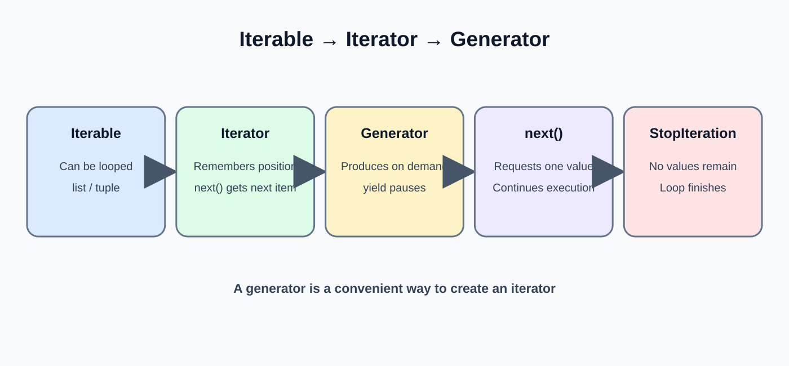
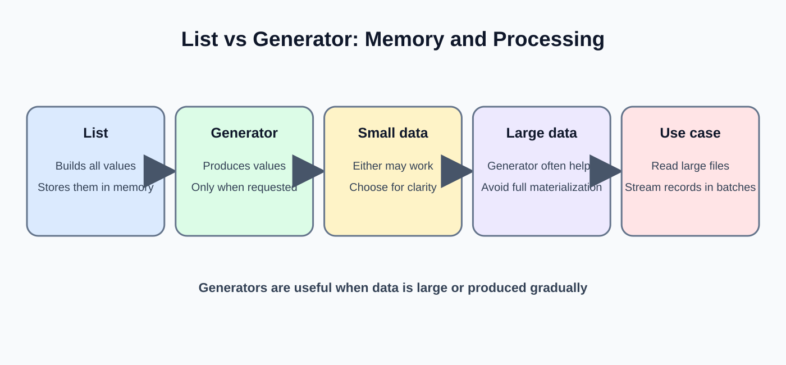
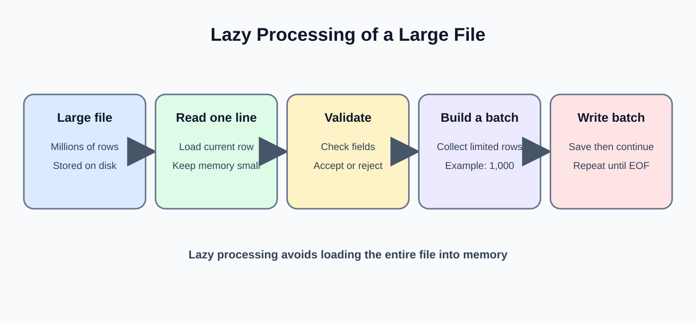

# Day 11: Iterators and Generators

**Phase:** 2 — Python for Data Engineering  
**Mini-project:** Large File Reader  
**Learning time:** 2–3 hours

## 1. Learning outcomes

- Explain iterable, iterator and generator in simple terms.
- Use `iter()`, `next()` and `StopIteration`.
- Create generator functions using `yield`.
- Explain lazy evaluation and memory use.
- Read a file line by line instead of loading all rows at once.
- Process a large file in manageable batches.

## 2. Why memory efficiency matters

A file with 100 rows may fit comfortably in memory. A file with tens of millions of rows may not. Loading an entire file can consume too much RAM and terminate a pipeline.

A memory-aware pipeline processes a manageable portion, writes or aggregates its result, then moves to the next portion.

**Basic idea:** `Read a small part -> Process -> Save result -> Continue`

## 3. What is an iterable?

An iterable is an object that can provide its members one at a time. Lists, tuples, strings and file objects are iterable.

```python
order_ids = [501, 502, 503]

for order_id in order_ids:
    print(order_id)
```

Expected output:

```text
501
502
503
```

A `for` loop obtains each value automatically.

## 4. What is an iterator?



An iterator remembers its current position and returns the next item when requested.

```python
order_ids = [501, 502, 503]
order_iterator = iter(order_ids)

print(next(order_iterator))
print(next(order_iterator))
print(next(order_iterator))
```

Expected output:

```text
501
502
503
```

- `iter()` obtains an iterator from an iterable.
- `next()` requests the next value.
- The iterator advances after each call.

## 5. StopIteration

After all values are consumed, another call to `next()` raises `StopIteration`.

```python
order_ids = [501]
order_iterator = iter(order_ids)

print(next(order_iterator))
print(next(order_iterator))
```

Expected result: the first call prints `501`; the second raises `StopIteration`.

A normal `for` loop handles this completion signal automatically. You rarely need to catch it yourself.

## 6. Generator functions

A generator function uses `yield` to produce a value and pause its execution state.

```python
def order_id_generator():
    yield 501
    yield 502
    yield 503

orders = order_id_generator()

print(next(orders))
print(next(orders))
print(next(orders))
```

Expected output:

```text
501
502
503
```

Calling the generator function creates a generator object. Its body runs as values are requested.

## 7. Compare return and yield



`return` finishes a function and sends back its result. `yield` produces a value while preserving the generator's state so it can continue later.

```python
def get_small_list():
    return [10, 20, 30]

def get_values_one_by_one():
    yield 10
    yield 20
    yield 30

print(get_small_list())
print(list(get_values_one_by_one()))
```

Expected output:

```text
[10, 20, 30]
[10, 20, 30]
```

The displayed values look the same after converting the generator to a list. The difference is how the values are produced and stored.

## 8. Lazy evaluation



Lazy evaluation means a value is produced only when it is requested.

```python
def number_generator():
    print("Preparing first value")
    yield 1
    print("Preparing second value")
    yield 2

numbers = number_generator()
print("Generator created")
print(next(numbers))
print(next(numbers))
```

Expected output:

```text
Generator created
Preparing first value
1
Preparing second value
2
```

Notice that creating the generator did not print the messages inside its body. The body ran when `next()` requested each value.

## 9. Use a generator expression

```python
order_amounts = [100, 200, 300, 400]

large_amounts = (amount for amount in order_amounts if amount >= 300)

print(next(large_amounts))
print(next(large_amounts))
```

Expected output:

```text
300
400
```

The parentheses create a generator expression. It filters values as they are requested.

## 10. Read a text file line by line

Create `orders.txt`:

```text
1001,250
1002,500
1003,150
```

Read it:

```python
with open("orders.txt", "r", encoding="utf-8") as file:
    for line in file:
        print(line.strip())
```

Expected output:

```text
1001,250
1002,500
1003,150
```

A file object is iterable. The loop requests one line at a time; it does not need to create a list containing every line.

## 11. Compare read() and iteration

```python
with open("orders.txt", "r", encoding="utf-8") as file:
    all_text = file.read()

print(type(all_text))
print(len(all_text))
```

Expected type:

```text
<class 'str'>
```

The character count depends on the exact newline format in the file. `read()` loads the entire file content into one string.

For a large file, prefer line iteration or a chunked reader when the downstream operation can process incrementally.

## 12. Build a generator that reads rows

```python
def read_order_rows(file_path):
    with open(file_path, "r", encoding="utf-8") as file:
        for line in file:
            order_id, amount = line.strip().split(",")
            yield {
                "order_id": int(order_id),
                "amount": float(amount)
            }

for order in read_order_rows("orders.txt"):
    print(order)
```

Expected output:

```text
{'order_id': 1001, 'amount': 250.0}
{'order_id': 1002, 'amount': 500.0}
{'order_id': 1003, 'amount': 150.0}
```

The generator yields one dictionary at a time. This simple teaching example assumes every line has two valid comma-separated fields; production code must validate malformed rows.

## 13. Process records in batches

Batching groups a limited number of records together. This is useful when a destination accepts bulk writes.

```python
def read_batches(file_path, batch_size):
    batch = []

    with open(file_path, "r", encoding="utf-8") as file:
        next(file)  # Skip the CSV header

        for line in file:
            batch.append(line.strip())

            if len(batch) == batch_size:
                yield batch
                batch = []

    if batch:
        yield batch

for batch in read_batches("orders.txt", 2):
    print(batch)
```

Expected output:

```text
['1001,250', '1002,500']
['1003,150']
```

- `batch_size` controls the maximum number of lines in a full batch.
- The final `if batch` emits a smaller remaining batch.
- Memory use is bounded by the batch size, not the full file size.

## 14. Understand memory trade-offs

| Approach | Behavior | Suitable use |
|---|---|---|
| `read()` | Loads whole file into one string | Small text files |
| `readlines()` | Loads all lines into a list | Small files needing random access |
| File iteration | Reads lines incrementally | Large text files |
| Generator | Produces values on demand | Lazy transformations |
| Batch generator | Produces bounded groups | Bulk processing and loading |

Generators reduce the need to hold all generated values at once. They do not guarantee an entire pipeline uses little memory: a downstream step may still collect all values into a list.

## 15. Mini-project: Large File Reader

**Scenario:** A retail source sends a daily order file. The pipeline must process the file in batches and calculate sales without loading every row into a list.

### Step 1 — Create sample data

Create `large_orders.csv`:

```csv
order_id,amount
1001,250
1002,500
1003,150
1004,700
1005,300
1006,450
1007,900
```

### Step 2 — Read one row at a time

```python
with open("large_orders.csv", "r", encoding="utf-8") as file:
    header = next(file)

    for line in file:
        print(line.strip())
```

Expected output:

```text
1001,250
1002,500
1003,150
1004,700
1005,300
1006,450
1007,900
```

The header is consumed separately. Each remaining line is processed as it is read.

### Step 3 — Create a generator for parsed rows

```python
def read_orders(file_path):
    with open(file_path, "r", encoding="utf-8") as file:
        next(file)

        for line in file:
            order_id, amount = line.strip().split(",")
            yield {
                "order_id": int(order_id),
                "amount": float(amount)
            }

for order in read_orders("large_orders.csv"):
    print(order)
```

Expected output:

```text
{'order_id': 1001, 'amount': 250.0}
{'order_id': 1002, 'amount': 500.0}
{'order_id': 1003, 'amount': 150.0}
{'order_id': 1004, 'amount': 700.0}
{'order_id': 1005, 'amount': 300.0}
{'order_id': 1006, 'amount': 450.0}
{'order_id': 1007, 'amount': 900.0}
```

The function returns a generator. The loop requests one parsed order at a time.

### Step 4 — Aggregate without storing all orders

```python
total_sales = 0
order_count = 0

for order in read_orders("large_orders.csv"):
    total_sales += order["amount"]
    order_count += 1

print("Orders processed:", order_count)
print("Total sales:", total_sales)
```

Expected output:

```text
Orders processed: 7
Total sales: 3250.0
```

Only the running total and count are retained. The full order collection is not stored in memory.

### Step 5 — Process in batches

```python
for batch in read_batches("large_orders.csv", 3):
    print("Batch size:", len(batch))
    print(batch)
```

The batch reader in Section 13 skips the CSV header before grouping data rows.

Expected batch sizes for seven data records and a batch size of three:

```text
3
3
1
```

The final batch contains the remaining single record.

### Step 6 — Add a running batch total

```python
batch_number = 0

for batch in read_batches("large_orders.csv", 3):
    batch_number += 1
    batch_total = 0

    for line in batch:
        order_id, amount = line.split(",")
        batch_total += float(amount)

    print("Batch", batch_number, "total:", batch_total)
```

Expected output:

```text
Batch 1 total: 900.0
Batch 2 total: 1450.0
Batch 3 total: 900.0
```

The reader skips the header, so every batch contains only data records. This distinction is an important reason to inspect the source format before processing.

## 16. Common mistakes

| Mistake | Why it happens | Better approach |
|---|---|---|
| StopIteration | Iterator is exhausted | Use a for loop or check availability |
| Generator appears empty | It was already consumed | Create a new generator when needed |
| Memory still grows | Results are appended to a list | Process and discard each batch |
| Last rows are missing | Final partial batch was not yielded | Add a final `if batch` |
| Header conversion error | Header treated as data | Read or skip the header separately |
| File closes too early | Generator yields after leaving the file context | Keep file open while yielding inside `with` |

## 17. Practical exercises

1. Create a generator that yields five order IDs.
2. Read a text file one line at a time.
3. Create a batch generator with batch size four.
4. Calculate a running total without creating a list of all records.
5. Explain why calling `list(generator)` removes the memory advantage for a very large result.
6. Add a final partial batch to a batch reader.

## 18. Interview revision

- An iterable can provide an iterator; an iterator returns the next item.
- `iter()` obtains an iterator and `next()` requests the next value.
- `StopIteration` signals that an iterator is exhausted.
- A generator function uses `yield` to produce values lazily.
- Lazy processing can reduce peak memory when downstream code also processes incrementally.
- File iteration is usually preferable to loading a huge file with `read()`.
- Batching provides a controllable unit for processing and bulk loading.
- Generators are single-pass unless the source is recreated.

**Day 11 checkpoint:** You should be able to explain lazy evaluation, create a generator, read a file incrementally and calculate totals without storing every record.


---

# Beginner Teaching Extension — Day 11

## A. Iterable, iterator and generator

An iterable is something a loop can read one item at a time, such as a list or file. An iterator remembers its current position and supplies the next item when asked. A generator is a convenient way to create an iterator, commonly using yield.

## B. Observe iteration

```python
order_ids = [501, 502, 503]
order_iterator = iter(order_ids)
print(next(order_iterator))
print(next(order_iterator))
print(next(order_iterator))
```

Expected output:

```text
501
502
503
```

iter() obtains an iterator. next() requests one value. Asking for another value after the iterator is exhausted raises StopIteration; a for loop handles that ending automatically.

## C. Build a generator

```python
def read_order_ids():
    yield 501
    yield 502
    yield 503

for order_id in read_order_ids():
    print(order_id)
```

Expected output:

```text
501
502
503
```

The function pauses at each yield and resumes when the next value is requested. Unlike returning a completed list, a generator can produce values gradually.

## D. Compare list and generator behavior

```python
def generate_numbers():
    for number in range(1, 4):
        print("Preparing:", number)
        yield number

numbers = generate_numbers()
print("Generator created")
print(next(numbers))
print(next(numbers))
```

Expected output:

```text
Generator created
Preparing: 1
1
Preparing: 2
2
```

Creating the generator does not execute the body. Each next() call advances it. This is lazy evaluation.

## E. Read a file line by line

```python
with open("orders.txt", "r", encoding="utf-8") as file:
    for line in file:
        clean_line = line.strip()
        if clean_line:
            print(clean_line)
```

The output is each non-empty line in the source file. The loop does not need to load the entire file into a list first. This reduces memory pressure for large files.

## F. Process records in batches

```python
def read_batches(records, batch_size):
    for start in range(0, len(records), batch_size):
        yield records[start:start + batch_size]

order_ids = [101, 102, 103, 104, 105]
for batch in read_batches(order_ids, 2):
    print(batch)
```

Expected output:

```text
[101, 102]
[103, 104]
[105]
```

The slice selects a manageable group. This example uses a list already in memory to teach batching; a production large-file reader should stream records from the source rather than first loading every record into a list.

## G. Important limitation

Generators reduce the need to hold all generated results at once, but they do not automatically make every pipeline memory-safe. If code converts the generator to list(), stores every result elsewhere, or accumulates an unbounded list, memory use can still grow.

## H. Readiness check

The student should explain iterable versus iterator, use iter() and next(), describe StopIteration, write a generator with yield, and explain why line-by-line reading is useful for large files.
