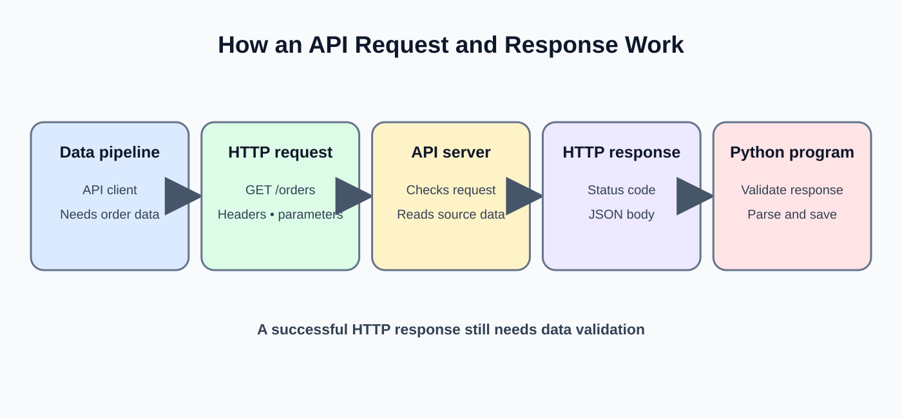
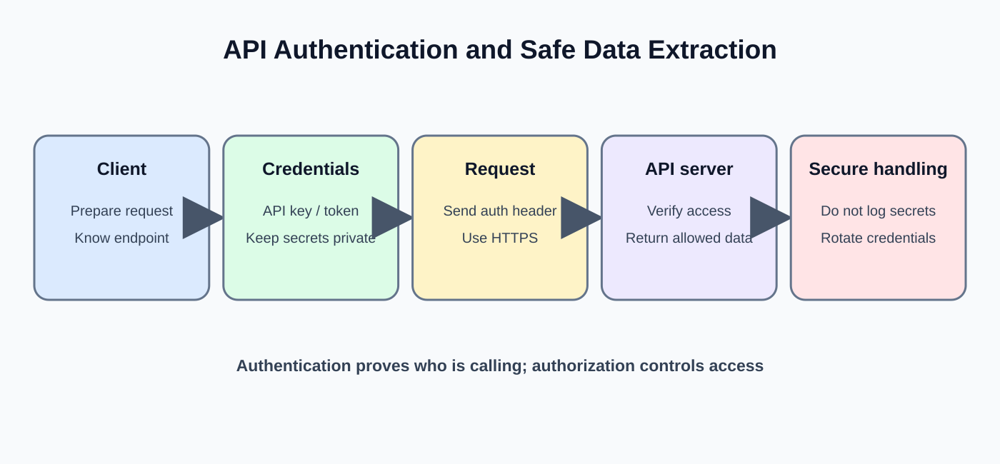
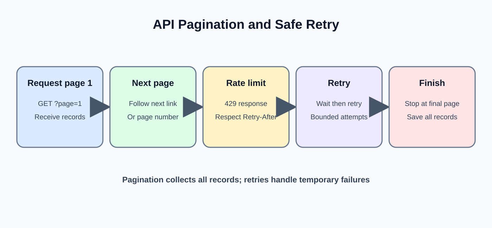

# Day 12: API Integration

**Phase:** 2 — Python for Data Engineering  
**Mini-project:** API Data Extractor  
**Learning time:** 2–3 hours

## 1. Learning outcomes

- Explain APIs, REST, HTTP requests and responses.
- Understand methods, endpoints, query parameters and headers.
- Make GET requests using Python's `requests` library.
- Read JSON responses and inspect status codes.
- Handle timeouts, HTTP errors and invalid responses.
- Understand pagination, rate limits and safe retries.
- Save extracted records for downstream processing.
- Build a small extractor using a local response first, then connect to a real API.

## 2. Why APIs matter in data engineering

A retailer may store orders in its own database but receive shipment updates from a logistics provider through an API. A data pipeline needs to request those updates, interpret the response, validate records and store them.

Typical flow:

```text
API endpoint -> HTTP request -> HTTP response -> JSON parsing
            -> validation -> transformation -> storage
```

An API is a contract between systems. It defines which operations are available, what inputs are accepted and what response structure is returned.

## 3. Understand the HTTP request



A request may contain:

| Part | Purpose | Example |
|---|---|---|
| Method | Operation requested | GET |
| URL | Resource endpoint | `https://service.example/orders` |
| Query parameters | Filters or pagination | `?page=2&limit=100` |
| Headers | Request metadata | Accept, Authorization |
| Body | Data sent to server | JSON body in POST |

A response commonly contains a status code, headers and a body.

## 4. HTTP methods

| Method | Typical meaning | Example |
|---|---|---|
| GET | Retrieve data | Get orders |
| POST | Create or submit | Create an order |
| PUT | Replace a resource | Replace a customer record |
| PATCH | Partially update | Change an order status |
| DELETE | Delete a resource | Remove a test record |

For extraction pipelines, GET is common. Do not use a method that changes remote state when the requirement is only to read data.

## 5. Common status codes

| Code | Meaning | Typical action |
|---:|---|---|
| 200 | OK | Parse the response |
| 201 | Created | Record creation result |
| 204 | No content | Do not try to parse a missing JSON body |
| 400 | Bad request | Correct parameters or payload |
| 401 | Unauthorized | Check authentication |
| 403 | Forbidden | Check permissions |
| 404 | Not found | Verify endpoint/resource |
| 408 | Request timeout | Investigate or retry cautiously |
| 429 | Too many requests | Respect retry guidance/rate limit |
| 500 | Server error | May be transient |
| 503 | Service unavailable | May be transient |

A successful HTTP response and valid business data are two different checks.

## 6. Prepare a local API-like response first

Classroom networks may block public APIs. We will first practise the extraction logic using a local Python dictionary. This makes the first steps fully runnable without internet access.

### 6.1 Create a sample response

```python
api_response = {
    "status": "success",
    "page": 1,
    "total_pages": 2,
    "data": [
        {"order_id": 701, "amount": 1200, "status": "PAID"},
        {"order_id": 702, "amount": 850, "status": "PENDING"}
    ]
}

print(api_response["status"])
print(len(api_response["data"]))
print(api_response["data"][0])
```

**Expected output**

```text
success
2
{'order_id': 701, 'amount': 1200, 'status': 'PAID'}
```

**Explanation**

- The outer dictionary represents a response object.
- `data` contains the records.
- `total_pages` tells the client that more records exist.
- This is a mock response, not a network request.

### 6.2 Extract the records

```python
orders = api_response["data"]

for order in orders:
    print(order["order_id"], order["amount"], order["status"])
```

**Expected output**

```text
701 1200 PAID
702 850 PENDING
```

**Interpretation:** The extraction logic reads records from the response payload. In a real API, the response body must first be parsed from JSON.

## 7. Install and import requests

`requests` is a third-party Python library for HTTP communication.

Install it in the same environment that runs your script or notebook:

```bash
python -m pip install requests
```

Verify:

```python
import requests

print(requests.__version__)
```

**Expected output:** The installed Requests version, for example `2.x.x`. The exact version depends on the environment.

If Jupyter reports `ModuleNotFoundError`, install into the notebook's active interpreter, then restart the kernel if needed.

## 8. Make a real GET request

For a classroom demonstration, JSONPlaceholder provides a public sample endpoint. Network access is required.

```python
import requests

url = "https://jsonplaceholder.typicode.com/posts/1"

response = requests.get(url, timeout=15)

print("Status:", response.status_code)
print("Content type:", response.headers.get("Content-Type"))
```

**Expected output when the service is reachable**

```text
Status: 200
Content type: application/json; charset=utf-8
```

The header value may include additional parameters. The request may fail in an offline or restricted network; the local mock exercises remain runnable.

**Parameter explanation**

- First argument: endpoint URL.
- `timeout=15`: maximum wait for the request according to Requests' timeout behavior.
- `response.status_code`: HTTP status returned by the server.
- `response.headers`: response metadata.
- `.get("Content-Type")`: safely reads a header that may be absent.

A timeout is essential: without one, a pipeline can wait unexpectedly long for a remote service.

## 9. Parse JSON response data

```python
post = response.json()

print(type(post))
print(post["id"])
print(post["title"])
```

**Expected output**

```text
<class 'dict'>
1
sunt aut facere repellat provident occaecati excepturi optio reprehenderit
```

**Explanation**

- `response.json()` parses the response body as JSON.
- The parsed object is a Python dictionary for this endpoint.
- The API's schema determines which keys are available.

Do not assume every endpoint returns a dictionary. Some APIs return a list, a nested object or an empty body.

## 10. Check the response before using it

### 10.1 Raise an error for unsuccessful status codes

```python
response = requests.get(url, timeout=15)
response.raise_for_status()

post = response.json()
print(post["id"])
```

**Expected output when successful**

```text
1
```

`raise_for_status()` raises an HTTP error for unsuccessful 4xx/5xx responses. It does not validate the JSON schema or business values.

### 10.2 Check required keys

```python
required_keys = {"userId", "id", "title", "body"}
missing_keys = required_keys - set(post.keys())

print("Missing keys:", missing_keys)
```

**Expected output**

```text
Missing keys: set()
```

**Interpretation:** The response contains the expected fields. A complete pipeline should also validate data types, nulls and business constraints.

## 11. Query parameters

APIs commonly use query parameters for filtering and pagination. Use the `params` argument rather than manually concatenating strings.

```python
url = "https://jsonplaceholder.typicode.com/posts"
parameters = {"userId": 1}

response = requests.get(url, params=parameters, timeout=15)
response.raise_for_status()

posts = response.json()
print("Records:", len(posts))
print("First post ID:", posts[0]["id"])
```

**Expected output**

```text
Records: 10
First post ID: 1
```

The endpoint returns posts for user 1. Query parameters are encoded into the URL by Requests.

## 12. Headers and authentication concepts



Headers communicate metadata. An API may require an access token.

```python
headers = {
    "Accept": "application/json"
}

response = requests.get(
    "https://jsonplaceholder.typicode.com/posts/1",
    headers=headers,
    timeout=15
)

print(response.status_code)
```

**Expected output when reachable**

```text
200
```

A protected API may require a bearer token:

```python
import os

api_token = os.environ["ORDERS_API_TOKEN"]

headers = {
    "Accept": "application/json",
    "Authorization": f"Bearer {api_token}"
}
```

This cell expects an environment variable named `ORDERS_API_TOKEN`. Do not paste real credentials into notebooks, commit them to Git or print them in output. If the variable is missing, Python raises `KeyError`, which is preferable to silently sending an unauthenticated request.

## 13. Handle network and HTTP errors

Remote systems can fail for several reasons. Handle known error categories and make the failure visible.

```python
import requests

try:
    response = requests.get(url, timeout=10)
    response.raise_for_status()
    data = response.json()
    print("Records received:", len(data))

except requests.exceptions.Timeout:
    print("Request timed out")

except requests.exceptions.HTTPError as error:
    print("HTTP error:", error)

except requests.exceptions.ConnectionError:
    print("Could not connect to the API")

except requests.exceptions.JSONDecodeError:
    print("Response body was not valid JSON")
```

**Expected output:** Depends on the network and server response. When the request succeeds, the output reports the number of records. When it fails, the matching message is printed.

**Why separate exceptions?**

- Timeout: the server did not respond within the configured wait.
- HTTPError: the server responded with an unsuccessful HTTP status.
- ConnectionError: DNS, network or connection setup failed.
- JSONDecodeError: response body could not be parsed as JSON.

Do not catch every error and pretend the extraction succeeded. A pipeline must communicate failure to its scheduler or operator.

## 14. Understand pagination



A large API response is often split into pages to limit response size.

Common pagination styles:

- Page number: `page=1`, `page=2`.
- Offset and limit: `offset=0&limit=100`.
- Cursor: next request uses a token returned by the previous response.
- Next URL: response includes a URL for the next page.

### 14.1 Simulate page responses locally

```python
mock_pages = {
    1: {
        "data": [{"order_id": 801}, {"order_id": 802}],
        "next_page": 2
    },
    2: {
        "data": [{"order_id": 803}],
        "next_page": None
    }
}

all_orders = []
current_page = 1

while current_page is not None:
    page_response = mock_pages[current_page]
    all_orders.extend(page_response["data"])
    current_page = page_response["next_page"]

print(all_orders)
print("Total records:", len(all_orders))
```

**Expected output**

```text
[{'order_id': 801}, {'order_id': 802}, {'order_id': 803}]
Total records: 3
```

**Line-by-line explanation**

- `all_orders` stores the records gathered across pages.
- `current_page` starts at page 1.
- The loop continues while a next page exists.
- `extend()` adds each page's records to the list.
- A `None` next-page marker ends the loop.

This example is intentionally local. It demonstrates the control flow without relying on a particular vendor's pagination contract.

### 14.2 Pagination using an API page parameter

The following pattern applies only when the API documents page-number pagination and returns a list on each page.

```python
all_posts = []
page_number = 1
page_size = 10

while True:
    page_response = requests.get(
        "https://jsonplaceholder.typicode.com/posts",
        params={"_page": page_number, "_limit": page_size},
        timeout=15
    )
    page_response.raise_for_status()
    page_records = page_response.json()

    if not page_records:
        break

    all_posts.extend(page_records)
    print("Page", page_number, "records:", len(page_records))
    page_number += 1

print("Total extracted:", len(all_posts))
```

**Expected output:** The number of records per page and the total count, if the public endpoint supports the parameters and is reachable. Pagination parameter names differ by API; always follow the API documentation.

**Production caution:** Set a maximum page count or use a documented termination condition. A broken API that repeats the same page can otherwise create an infinite loop.

## 15. Rate limits and retry behavior

A rate limit controls how frequently a client may call an API. A server may respond with HTTP 429 and provide a `Retry-After` header.

Good practices:

- Respect documented request quotas.
- Inspect `Retry-After` when supplied.
- Use bounded retries, not endless retries.
- Add delay/backoff between attempts.
- Do not retry permanent errors such as invalid credentials without correcting them.
- Make extraction restartable using page/cursor checkpoints.

For production, use a retry policy that matches the provider's documentation. A retry is not automatically safe for every HTTP method or operation.

## 16. Save extracted data

A simple JSON output can be written using Python's standard library.

```python
import json

sample_extracted_orders = [
    {"order_id": 701, "amount": 1200, "status": "PAID"},
    {"order_id": 702, "amount": 850, "status": "PENDING"}
]

with open("extracted_orders.json", "w", encoding="utf-8") as file:
    json.dump(sample_extracted_orders, file, indent=2)

print("Saved records:", len(sample_extracted_orders))
```

**Expected output**

```text
Saved records: 2
```

This local example is repeatable. In a real extractor, save only after validating the response and define what happens if the process stops during writing.

## 17. Mini-project: API Data Extractor

### 17.1 Requirement

A retail data team wants to retrieve order records from an external service. The extractor must:

1. Request one page.
2. check the HTTP response.
3. Parse JSON.
4. Verify the expected response structure.
5. collect records across pages.
6. Save the result.
7. Report record counts and failures clearly.

### 17.2 First build the response contract locally

```python
mock_api_pages = {
    1: {"data": [
        {"order_id": 901, "amount": 500, "status": "PAID"},
        {"order_id": 902, "amount": 750, "status": "PENDING"}
    ], "next_page": 2},
    2: {"data": [
        {"order_id": 903, "amount": 300, "status": "PAID"}
    ], "next_page": None}
}

print("Pages prepared:", len(mock_api_pages))
```

**Expected output**

```text
Pages prepared: 2
```

### 17.3 Extract records and validate basic structure

```python
extracted_orders = []
page_number = 1

while page_number is not None:
    payload = mock_api_pages[page_number]

    if "data" not in payload or "next_page" not in payload:
        raise ValueError("Unexpected API response structure")

    for record in payload["data"]:
        required = {"order_id", "amount", "status"}
        if not required.issubset(record):
            raise ValueError("Order record is missing required fields")

        extracted_orders.append(record)

    page_number = payload["next_page"]

print("Extracted records:", len(extracted_orders))
print("Order IDs:", [record["order_id"] for record in extracted_orders])
```

**Expected output**

```text
Extracted records: 3
Order IDs: [901, 902, 903]
```

### 17.4 Save and verify the output

```python
output_file = "api_orders_output.json"

with open(output_file, "w", encoding="utf-8") as file:
    json.dump(extracted_orders, file, indent=2)

with open(output_file, "r", encoding="utf-8") as file:
    saved_orders = json.load(file)

print("Saved and reloaded:", len(saved_orders))
print("IDs match:", [r["order_id"] for r in saved_orders] == [r["order_id"] for r in extracted_orders])
```

**Expected output**

```text
Saved and reloaded: 3
IDs match: True
```

### 17.5 Project interpretation

The extractor collected records from two pages, checked the expected keys, saved the output and reloaded it for verification. In a real project, replace the local dictionary with HTTP requests, use the actual pagination contract, authenticate securely and persist a checkpoint so a failed run can resume safely.

## 18. Common mistakes

| Mistake | Why it is a problem | Better approach |
|---|---|---|
| No timeout | Request may block for too long | Set a connect/read timeout |
| Ignore status code | Error page may be treated as data | Call `raise_for_status()` |
| Assume JSON always exists | 204 or HTML error response may not contain JSON | Check status and content type |
| Hard-code API token | Credential can leak to Git | Use environment/secret manager |
| Stop after first page | Dataset is incomplete | Implement documented pagination |
| Retry forever | Can overload service or stall job | Bounded backoff and maximum attempts |
| Ignore schema drift | Downstream code may break | Validate keys and types |
| Log full response | May expose personal/confidential data | Log safe metadata and counts |

## 19. Day 12 revision

- An API defines how systems exchange data.
- HTTP requests include method, URL, headers and sometimes parameters/body.
- Check status codes before parsing response data.
- Use timeouts and handle network errors.
- JSON parsing does not replace schema validation.
- Pagination is required when the API splits results.
- Protect credentials and respect rate limits.
- Day 13 applies Python integration patterns to relational databases.


---

# Beginner Teaching Extension — Day 12

## A. Understand the request and response

An API is a contract that lets one application request information or an action from another. A client sends an HTTP request to an endpoint. The server returns a response containing a status code, headers and usually a body.

## B. Learn the pieces of a GET request

- Method: GET asks the server to retrieve information.
- Endpoint: the URL identifying the resource.
- Query parameters: values that filter or paginate a request.
- Headers: metadata such as accepted response format or authorization.
- Response body: returned content, often JSON.

## C. Practice parsing a local response before using the internet

```python
import json

response_text = '{"orders": [{"order_id": 101, "amount": 500}, {"order_id": 102, "amount": 800}]}'
response_data = json.loads(response_text)

print(response_data["orders"][0]["order_id"])
print(len(response_data["orders"]))
```

Expected output:

```text
101
2
```

loads() parses JSON text into Python objects. This local example lets students understand the response shape without network, authentication or rate-limit issues.

## D. Make a real GET request

Install requests:

```bash
python -m pip install requests
```

A public test endpoint can be used for practice when internet access is available:

```python
import requests

url = "https://jsonplaceholder.typicode.com/posts/1"
response = requests.get(url, timeout=10)
print(response.status_code)
print(response.json()["id"])
```

Expected response for this public test service is status 200 and ID 1, provided the service is reachable. Network availability can change, so this is not a guaranteed offline exercise.

- requests.get() sends a GET request.
- timeout=10 limits how long the client waits.
- status_code is the HTTP response status.
- json() parses a JSON response body; it can fail if the body is not valid JSON.

## E. Check for HTTP errors

```python
import requests

response = requests.get("https://jsonplaceholder.typicode.com/posts/1", timeout=10)
response.raise_for_status()
post = response.json()
print(post["title"])
```

raise_for_status() raises an HTTPError for unsuccessful HTTP status codes. A network request may also raise a connection or timeout exception. Handle these deliberately in a complete extractor.

## F. Understand pagination

An API may return only a limited number of records per request. Pagination asks for successive pages or uses a cursor supplied by the service. Do not assume every API uses the same parameter names or pagination scheme; follow its documentation.

A simple page loop is only valid when the API documents page and limit parameters:

```python
for page in range(1, 4):
    print("Request page:", page)
```

Expected output:

```text
Request page: 1
Request page: 2
Request page: 3
```

This demonstrates iteration only; actual extraction must send the documented parameters and stop according to the API's next-page signal.

## G. Safe API integration practices

- Set a timeout on requests.
- Check HTTP status before trusting the body.
- Validate the response schema and required fields.
- Respect rate limits and retry guidance.
- Keep API keys out of source code and logs.
- Use bounded retries for transient errors, not every failure.
- Track page or cursor progress to avoid missing or duplicating records.

## H. Readiness check

The student should explain endpoint, method, headers, query parameters, status code, response body, JSON parsing, timeout and pagination. They should be able to explain why a local mock is useful before a live integration test.
