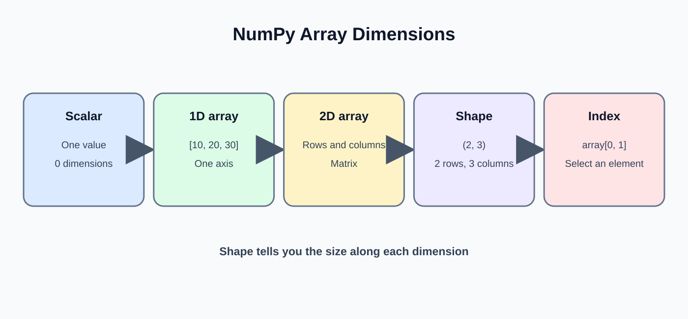
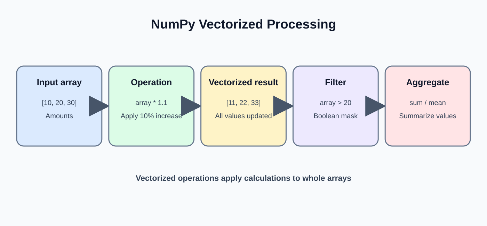
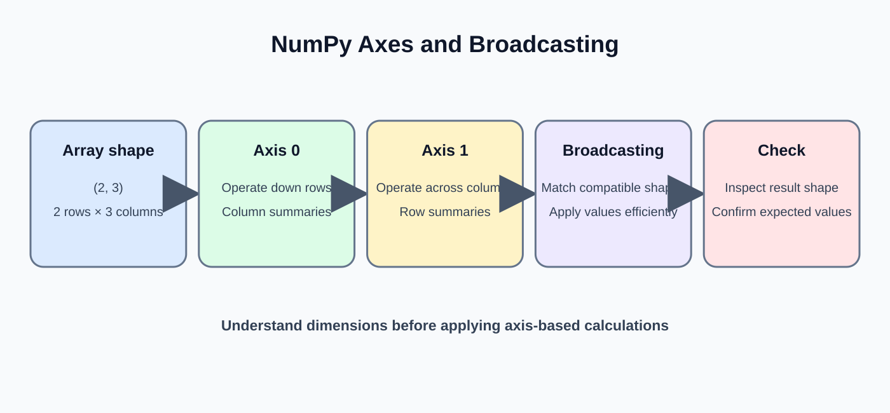

# Day 15: NumPy and Numerical Processing

**Phase:** 2 — Python for Data Engineering  
**Mini-project:** Numerical Transformation Lab  
**Learning time:** 2–3 hours

## 1. Learning outcomes

- Explain why NumPy arrays are useful for numerical data.
- Install NumPy and create one-dimensional and two-dimensional arrays.
- Inspect array dimensions, shape, size and data type.
- Select elements using indexing, slicing and boolean masks.
- Perform vectorized calculations and aggregations.
- Understand axes and broadcasting.
- Handle missing numerical values and basic precision concerns.
- Build a numerical sales transformation exercise.

## 2. Why NumPy?

NumPy is a Python library for numerical computing. It provides the `ndarray`, an efficient multidimensional array type.

Data engineers may encounter NumPy when:
- Preparing numeric columns for processing.
- Applying calculations to many values.
- Working with Pandas and scientific Python packages.
- Converting data to formats expected by numerical libraries.

A NumPy array is not a replacement for a database or a full data pipeline. It is a useful tool for numerical operations in memory.

## 3. Install NumPy

Run in the terminal associated with your Python environment:

```bash
python -m pip install numpy
```

Check the installed version:

```bash
python -c "import numpy as np; print(np.__version__)"
```

The version number depends on the environment. If import fails, check that NumPy was installed using the same Python interpreter that runs the notebook or script.

## 4. Create your first array



```python
import numpy as np

quantities = np.array([2, 3, 1, 5])
prices = np.array([100.0, 250.0, 500.0, 80.0])

print(quantities)
print(prices)
print(type(quantities))
```

Expected output:

```text
[2 3 1 5]
[100. 250. 500.  80.]
<class 'numpy.ndarray'>
```

- `np.array()` converts a sequence into an array.
- `ndarray` means N-dimensional array.
- The two arrays have matching positions: quantity at index 0 belongs with price at index 0.

## 5. Inspect array properties

```python
print(quantities.ndim)
print(quantities.shape)
print(quantities.size)
print(quantities.dtype)
```

Expected output:

```text
1
(4,)
4
int64
```

The exact integer dtype can vary by platform and NumPy build.

| Property | Meaning |
|---|---|
| `ndim` | Number of dimensions |
| `shape` | Length along each dimension |
| `size` | Total number of elements |
| `dtype` | Data type stored in the array |

## 6. Create common arrays

```python
print(np.zeros(4))
print(np.ones(3))
print(np.arange(1, 6))
print(np.linspace(0, 1, 5))
```

Expected output:

```text
[0. 0. 0. 0.]
[1. 1. 1.]
[1 2 3 4 5]
[0.   0.25 0.5  0.75 1.  ]
```

- `zeros(n)` creates n zero values.
- `ones(n)` creates n one values.
- `arange(start, stop)` generates values up to, but not including, stop.
- `linspace(start, stop, num)` generates a chosen number of evenly spaced values.

## 7. One-dimensional indexing and slicing

```python
amounts = np.array([100, 250, 400, 150, 900])

print(amounts[0])
print(amounts[-1])
print(amounts[1:4])
```

Expected output:

```text
100
900
[250 400 150]
```

The slice `1:4` includes index 1 and excludes index 4.

## 8. Update an array element

```python
amounts = np.array([100, 250, 400])
amounts[1] = 300

print(amounts)
```

Expected output:

```text
[100 300 400]
```

NumPy arrays are mutable. Assigning to an index changes that element.

## 9. Two-dimensional arrays

A two-dimensional array can represent rows and columns.

```python
sales = np.array([
    [100, 120, 150],
    [200, 180, 220]
])

print(sales)
print(sales.ndim)
print(sales.shape)
print(sales.size)
```

Expected output:

```text
[[100 120 150]
 [200 180 220]]
2
(2, 3)
6
```

The shape `(2, 3)` means two rows and three columns.

## 10. Select rows and columns

```python
sales = np.array([
    [100, 120, 150],
    [200, 180, 220]
])

print(sales[0])
print(sales[1, 2])
print(sales[:, 0])
```

Expected output:

```text
[100 120 150]
220
[100 200]
```

- `sales[0]` selects the first row.
- `sales[1, 2]` selects row 1, column 2.
- `sales[:, 0]` selects every row from column 0.
- A colon means select all values along that dimension.

## 11. Vectorized arithmetic



Vectorization applies an operation to an array without writing a Python loop for every element.

```python
quantities = np.array([2, 3, 1, 5])
prices = np.array([100, 250, 500, 80])

line_amounts = quantities * prices

print(line_amounts)
```

Expected output:

```text
[200 750 500 400]
```

NumPy multiplies corresponding positions. The arrays must have compatible shapes.

## 12. Compare vectorized operations with a loop

```python
amounts = np.array([200, 750, 500, 400])

discounted_amounts = amounts * 0.90

print(discounted_amounts)
```

Expected output:

```text
[180. 675. 450. 360.]
```

The multiplication is applied to every array element. Vectorized operations are concise and often faster than explicit Python loops for large numerical arrays.

## 13. Aggregation functions

```python
amounts = np.array([200, 750, 500, 400])

print(np.sum(amounts))
print(np.mean(amounts))
print(np.min(amounts))
print(np.max(amounts))
print(np.std(amounts))
```

Expected output (standard deviation shown approximately):

```text
1850
462.5
200
750
198.037... 
```

- `sum`: total.
- `mean`: arithmetic average.
- `min` and `max`: smallest and largest values.
- `std`: standard deviation; by default NumPy uses population standard deviation (`ddof=0)).

Use the statistical definition appropriate to the business question. Sample standard deviation uses `ddof=1`.

## 14. Boolean filtering

```python
amounts = np.array([200, 750, 500, 400])

high_value_mask = amounts >= 500

print(high_value_mask)
print(amounts[high_value_mask])
```

Expected output:

```text
[False  True  True False]
[750 500]
```

The comparison creates a Boolean array. Using it as an index returns only matching values.

## 15. Combine multiple conditions

```python
amounts = np.array([200, 750, 500, 400])
selected = amounts[(amounts >= 400) & (amounts < 700)]

print(selected)
```

Expected output:

```text
[500 400]
```

Use `&` for element-wise AND and `|` for element-wise OR. Put each comparison in parentheses. Do not use Python's `and` with full NumPy arrays.

## 16. Understand axes



An axis tells NumPy which dimension to reduce when aggregating.

```python
sales = np.array([
    [100, 120, 150],
    [200, 180, 220]
])

print(np.sum(sales, axis=0))
print(np.sum(sales, axis=1))
```

Expected output:

```text
[300 300 370]
[370 600]
```

- `axis=0`: collapse rows and calculate a result for each column.
- `axis=1`: collapse columns and calculate a result for each row.

Think of it as the direction being reduced, not simply "row" or "column".

## 17. Broadcasting

Broadcasting allows compatible shapes to participate in an operation without manually repeating values.

```python
monthly_sales = np.array([
    [100, 200, 300],
    [150, 250, 350]
])

monthly_target = np.array([120, 220, 320])

difference = monthly_sales - monthly_target

print(difference)
```

Expected output:

```text
[[-20 -20 -20]
 [ 30  30  30]]
```

The one-dimensional target has three values, matching the three columns. NumPy applies it to each row.

Incompatible shapes raise a broadcasting error. Always inspect `.shape` when an array operation fails.

## 18. Missing numerical values

NumPy commonly represents a missing floating-point number using `np.nan`.

```python
temperatures = np.array([28.5, 29.0, np.nan, 30.5])

print(np.isnan(temperatures))
print(np.nanmean(temperatures))
```

Expected output:

```text
[False False  True False]
29.333333333333332
```

- `np.isnan()` identifies missing numerical values.
- `np.nanmean()` calculates a mean while ignoring NaN values.
- Ordinary `np.mean()` returns NaN when the array contains NaN.

Do not replace missing values with zero unless zero is genuinely the correct business meaning.

## 19. Data types and precision

```python
values = np.array([1, 2, 3])
decimal_values = values.astype(float)

print(values.dtype)
print(decimal_values.dtype)
print(decimal_values)
```

Expected output (integer dtype name can vary):

```text
int64
float64
[1. 2. 3.]
```

`astype()` creates an array converted to the requested dtype. Converting a decimal to an integer can discard the fractional part, so choose types intentionally.

Floating-point numbers cannot represent every decimal fraction exactly. For financial systems that require exact decimal arithmetic, use Python's `decimal.Decimal` or an appropriate database decimal type rather than assuming binary floats are exact.

## 20. Mini-project: Numerical Transformation Lab

**Scenario:** A retail company wants to calculate line sales, apply a promotional discount, compare sales with targets and summarize results by month.

### Step 1 — Prepare arrays

```python
import numpy as np

quantities = np.array([2, 1, 3, 4, 2])
unit_prices = np.array([250, 800, 150, 100, 300])
months = np.array(["Jan", "Jan", "Feb", "Feb", "Mar"])

print(quantities.shape)
print(unit_prices.shape)
print(months.shape)
```

Expected output:

```text
(5,)
(5,)
(5,)
```

All three arrays have five corresponding positions. Index 0 in each array describes the same order.

### Step 2 — Calculate line sales

```python
line_sales = quantities * unit_prices
print(line_sales)
```

Expected output:

```text
[500 800 450 400 600]
```

Each line amount is quantity multiplied by unit price.

### Step 3 — Apply a 10% promotional discount

```python
net_sales = line_sales * 0.90
print(net_sales)
```

Expected output:

```text
[450. 720. 405. 360. 540.]
```

The discount is applied to each order. In a real business pipeline, eligibility rules and currency rounding must be explicit.

### Step 4 — Identify high-value orders

```python
high_value = net_sales >= 500
print(high_value)
print(net_sales[high_value])
```

Expected output:

```text
[False  True False False  True]
[720. 540.]
```

Two orders have net sales of at least 500.

### Step 5 — Calculate overall metrics

```python
print("Total net sales:", np.sum(net_sales))
print("Average order:", np.mean(net_sales))
print("Highest order:", np.max(net_sales))
print("Lowest order:", np.min(net_sales))
```

Expected output:

```text
Total net sales: 2475.0
Average order: 495.0
Highest order: 720.0
Lowest order: 360.0
```

These metrics summarize the five orders.

### Step 6 — Aggregate by month

```python
for month in ["Jan", "Feb", "Mar"]:
    month_total = np.sum(net_sales[months == month])
    print(month, month_total)
```

Expected output:

```text
Jan 1170.0
Feb 765.0
Mar 540.0
```

The Boolean condition selects orders belonging to each month. This loop is appropriate because there are only three month labels; the numeric aggregation itself remains vectorized.

### Step 7 — Compare actual sales with a target

```python
monthly_actual = np.array([1170.0, 765.0, 540.0])
monthly_target = np.array([1100.0, 800.0, 600.0])

variance = monthly_actual - monthly_target

print(variance)
```

Expected output:

```text
[ 70. -35. -60.]
```

January is above target by 70; February is below by 35; March is below by 60.

## 21. Common mistakes

| Mistake | Cause | Fix |
|---|---|---|
| Shape mismatch | Arrays do not align | Inspect `.shape` before arithmetic |
| Wrong axis | Reduction direction misunderstood | Test on a tiny 2D array |
| NaN result | Missing values included in ordinary mean | Inspect NaN and choose a deliberate policy |
| Unexpected integer conversion | Fractional part discarded | Select dtype before conversion |
| Ambiguous financial precision | Binary floating-point rounding | Use Decimal or database decimal types for exact money |
| Wrong Boolean syntax | Using `and` instead of `&` | Parenthesize comparisons and use element-wise operators |

## 22. Practical exercises

1. Create a NumPy array of six daily sales values.
2. Calculate total, average, minimum and maximum.
3. Select values greater than the average.
4. Create a two-dimensional array for two stores and three months.
5. Calculate totals by store and by month using the correct axis.
6. Add a NaN value and compare `mean()` with `nanmean()`.
7. Explain why a shape mismatch occurs in broadcasting.

## 23. Interview revision

- NumPy's main array structure is `ndarray`.
- `shape` describes dimensions; `ndim` counts dimensions; `dtype` describes stored values.
- Vectorization applies operations to arrays without an explicit Python loop over every element.
- Boolean masks select records meeting a condition.
- Broadcasting supports operations on compatible shapes.
- `axis=0` reduces rows; `axis=1` reduces columns for a two-dimensional array.
- NaN is a special floating-point missing value.
- NumPy is useful for numerical computation, while Pandas provides higher-level labeled tabular operations.

**Day 15 checkpoint:** You should be able to create arrays, inspect shapes, calculate vectorized values, filter with masks, aggregate along axes and explain how missing values affect numerical results.


---

# Beginner Teaching Extension — Day 15

## A. Why NumPy arrays?

A NumPy array stores values in a structured, typed, multidimensional container. It is designed for numerical operations and can perform many calculations across an array without writing a Python loop for every element. NumPy is an in-memory numerical tool, not a database or distributed storage system.

## B. Create an array and inspect it

```python
import numpy as np

sales = np.array([100, 200, 300, 400])
print(sales)
print(sales.ndim)
print(sales.shape)
print(sales.size)
print(sales.dtype)
```

Expected output:

```text
[100 200 300 400]
1
(4,)
4
int64
```

The exact integer dtype can vary by platform. ndim is the number of dimensions, shape gives the size along each dimension, and size is the total number of elements.

## C. Two-dimensional arrays

```python
sales_by_day = np.array([[100, 120], [200, 220], [300, 320]])
print(sales_by_day)
print(sales_by_day.shape)
print(sales_by_day[0, 1])
```

Expected output:

```text
[[100 120]
 [200 220]
 [300 320]]
(3, 2)
120
```

There are three rows and two columns. Index [0, 1] selects the first row and second column.

## D. Vectorized calculations

```python
prices = np.array([100, 200, 300])
quantities = np.array([2, 1, 3])
amounts = prices * quantities
print(amounts)
print(amounts.sum())
```

Expected output:

```text
[200 200 900]
1300
```

The multiplication is applied element by element. sum() adds all array elements. The arrays must have compatible shapes for element-wise operations.

## E. Boolean filtering

```python
amounts = np.array([200, 200, 900])
large_orders = amounts[amounts >= 500]
print(large_orders)
```

Expected output: [900]. The comparison creates a Boolean mask, and the mask selects only matching elements.

## F. Understand axes

```python
matrix = np.array([[10, 20, 30], [40, 50, 60]])
print(matrix.sum(axis=0))
print(matrix.sum(axis=1))
```

Expected output:

```text
[50 70 90]
[ 60 150]
```

For this two-dimensional array, axis=0 reduces down the rows and returns one result per column. axis=1 reduces across columns and returns one result per row. Draw the table and trace the addition rather than memorizing the numbers.

## G. Broadcasting

```python
prices = np.array([100, 200, 300])
with_tax = prices * 1.05
print(with_tax)
```

Expected output:

```text
[105. 210. 315.]
```

NumPy broadcasts the single scalar 1.05 across the array. More complex broadcasting requires compatible dimensions; incompatible shapes raise an error rather than guessing the intended alignment.

## H. Missing numerical values

```python
values = np.array([10.0, np.nan, 30.0])
print(np.isnan(values))
print(np.nanmean(values))
```

Expected output:

```text
[False  True False]
20.0
```

NaN represents a missing or undefined numerical value in many numerical workflows. nanmean ignores NaN values; decide whether ignoring missing values is appropriate for the business metric.

## I. Mini-project: Numerical Transformation Lab

Create arrays for daily units sold and unit prices. Calculate line revenue using vectorized multiplication, filter high-value days, calculate total revenue and average, and compare the result with a small manual calculation. Include one missing value and explain the selected policy.

## J. Common mistakes

- Confusing shape with size.
- Using an invalid index.
- Combining arrays with incompatible shapes.
- Assuming axis=0 means rows are returned; test with a small matrix.
- Ignoring NaN without a business decision.
- Using floating-point values for exact financial accounting without an appropriate decimal/rounding strategy.

## K. Readiness check

The student can create 1D and 2D arrays, inspect shape and dtype, index values, perform vectorized operations, use Boolean masks, explain axes and identify NaN.
