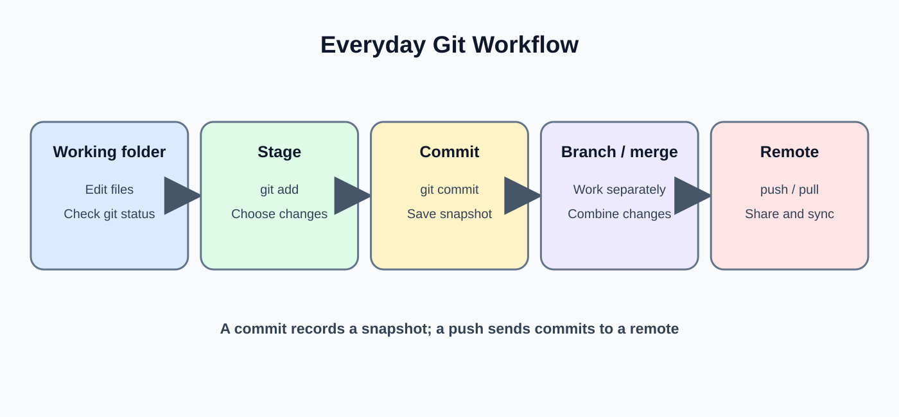
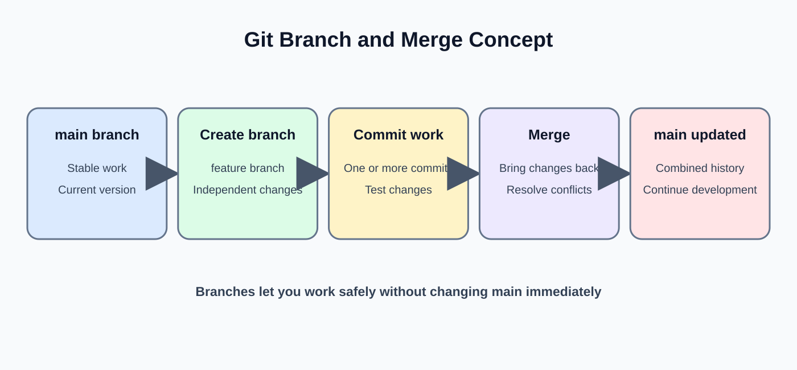
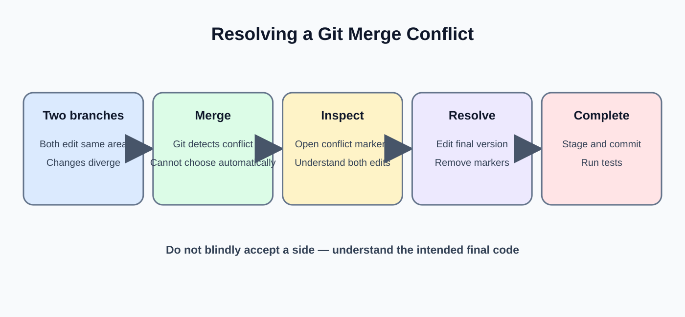

# Day 18: Git and Code Organization

**Phase:** 2 — Python for Data Engineering  
**Mini-project:** Version-Controlled ETL Project  
**Learning time:** 2–3 hours

## 1. Learning outcomes

- Explain version control and why data engineers use Git.
- Understand repository, working tree, staging area, commit, branch and remote.
- Configure Git and create a local repository.
- Stage and commit selected changes.
- Create a feature branch and merge it.
- Understand and resolve a simple merge conflict.
- Use `.gitignore` to exclude generated files and local secrets.
- Organize a small ETL project for collaboration.

## 2. Why version control?

Git records how code changes over time. It helps engineers:
- Review who changed code and why.
- Restore an earlier working version.
- Develop features independently.
- Collaborate without sending files back and forth.
- Connect code changes to reviews and deployments.

Git is distributed. Each clone contains repository history. GitHub is a hosting and collaboration service that commonly stores a shared remote repository.

## 3. Important Git concepts

| Term | Meaning |
|---|---|
| Repository | Project files and version history |
| Working tree | Current checked-out files |
| Staging area | Changes selected for the next commit |
| Commit | Recorded snapshot of staged changes |
| Branch | Movable line of development |
| Merge | Integrate changes from another branch |
| Remote | Named reference to a hosted repository |
| Clone | Copy a remote repository locally |
| Fetch | Download remote history without integrating it |
| Pull | Fetch and integrate remote changes |
| Push | Publish local commits to a remote |

## 4. Install and verify Git

Download Git for your operating system from the official Git website if it is not installed. Then open CMD:

```bash
git --version
```

Example output:

```text
git version 2.46.0.windows.1
```

Your installed version will differ.

## 5. Configure your identity

```bash
git config --global user.name "Your Name"
git config --global user.email "you@example.com"
```

Verify:

```bash
git config --global --list
```

The email should be an address you intend to associate with your commits. Do not place passwords or access tokens in Git configuration.

## 6. Create a project folder

```bash
mkdir retail_etl_project
cd retail_etl_project
```

Initialize Git:

```bash
git init
```

Expected output includes a message similar to:

```text
Initialized empty Git repository in .../retail_etl_project/.git/
```

The exact path depends on your computer.

## 7. Understand git status



```bash
git status
```

Expected key message for a new empty repository:

```text
On branch main
No commits yet
nothing to commit
```

Some Git installations may initially name the default branch `master`. You can rename it:

```bash
git branch -M main
```

## 8. Create a source file

Create `pipeline.py`:

```python
orders = [
    {"order_id": 1001, "amount": 250},
    {"order_id": 1002, "amount": 500}
]

total_sales = 0

for order in orders:
    total_sales += order["amount"]

print("Total sales:", total_sales)
```

Run it:

```bash
python pipeline.py
```

Expected output:

```text
Total sales: 750
```

## 9. Stage a file

Check status:

```bash
git status
```

The new file appears as untracked. Stage it:

```bash
git add pipeline.py
```

Check status again:

```bash
git status
```

Expected key message:

```text
Changes to be committed:
    new file:   pipeline.py
```

Staging selects what will be included in the next commit. It does not yet create a commit.

## 10. Create a commit

```bash
git commit -m "Add initial retail sales pipeline"
```

Expected output contains a commit summary similar to:

```text
[main (root-commit) abc1234] Add initial retail sales pipeline
 1 file changed, 10 insertions(+)
 create mode 100644 pipeline.py
```

The short commit ID and insertion count depend on your file and repository.

## 11. Review history

```bash
git log --oneline
```

Example output:

```text
abc1234 Add initial retail sales pipeline
```

Your commit ID will be different. A useful commit message describes the change, not just "update".

## 12. Modify a tracked file

Add this line at the end of `pipeline.py`:

```python
print("Pipeline completed")
```

Check the difference:

```bash
git diff
```

Expected diff includes the added line prefixed by `+`.

`git diff` shows unstaged changes. After staging, use `git diff --staged` to inspect what is prepared for commit.

## 13. Stage and commit the update

```bash
git add pipeline.py
git diff --staged
git commit -m "Print pipeline completion status"
```

The new commit records the update. The previous commit remains in history.

## 14. Create a feature branch



A branch lets you work on a change without immediately changing the main branch.

```bash
git switch -c feature/order-summary
```

Expected output:

```text
Switched to a new branch 'feature/order-summary'
```

Check:

```bash
git branch
```

The current branch is marked with an asterisk.

## 15. Make a branch change

Add to `pipeline.py`:

```python
average_order = total_sales / len(orders)
print("Average order:", average_order)
```

Run:

```bash
python pipeline.py
```

Expected output:

```text
Total sales: 750
Pipeline completed
Average order: 375.0
```

Stage and commit the feature:

```bash
git add pipeline.py
git commit -m "Add average order summary"
```

## 16. Merge a feature branch

Return to main:

```bash
git switch main
```

Merge the feature:

```bash
git merge feature/order-summary
```

If main has not changed the same lines, Git may perform a fast-forward merge. The feature commit becomes part of main's history.

Check:

```bash
git log --oneline --all
```

## 17. Understand a merge conflict



A merge conflict happens when Git cannot automatically combine competing edits.

Example:
- Main changes a line to `tax_rate = 0.05`.
- A feature branch changes the same line to `tax_rate = 0.08`.
- Git needs a human to decide the correct business rule.

Conflict markers look like:

```text
<<<<<<< HEAD
tax_rate = 0.05
=======
tax_rate = 0.08
>>>>>>> feature/tax-change
```

Edit the file to keep the intended final value and remove all marker lines. Then:

```bash
git add pipeline.py
git commit -m "Resolve tax rate merge conflict"
```

Do not choose a tax value arbitrarily. Confirm the business rule with the responsible owner.

## 18. Use gitignore

Generated files, local environments and secrets usually should not be committed.

Create `.gitignore`:

```text
.venv/
__pycache__/
*.pyc
.env
.ipynb_checkpoints/
data/raw/
```

This excludes virtual environments, Python cache files, environment-variable files, notebook checkpoints and raw data folder contents.

Be careful: if a file is already tracked, adding it to `.gitignore` does not automatically remove it from Git history or tracking.

## 19. Never commit secrets

Do not commit:
- Database passwords.
- API keys and access tokens.
- Private certificates.
- Personal credentials.
- Production connection strings containing secrets.

Use environment variables or a managed secret store. If a secret is accidentally pushed, removing it from the latest file is not enough; rotate or revoke the exposed credential.

## 20. Clone a repository

To copy an existing repository:

```bash
git clone https://github.com/owner/repository.git
cd repository
```

Replace the URL with the real repository address. The clone command creates a local copy and configures a remote commonly named `origin`.

## 21. Inspect remote settings

```bash
git remote -v
```

Example output:

```text
origin  https://github.com/owner/repository.git (fetch)
origin  https://github.com/owner/repository.git (push)
```

The URL is an example. Your actual remote depends on the repository you cloned or configured.

## 22. Push and pull

Push a local branch:

```bash
git push -u origin main
```

The `-u` option sets the upstream relationship so future pushes and pulls can use the configured branch.

Get and integrate remote changes:

```bash
git pull
```

In a team, inspect your working tree and coordinate before pulling or pushing. Never overwrite another person's work without understanding the branch history.

## 23. Mini-project: Version-Controlled ETL Project

**Scenario:** A junior data engineer creates a small order transformation script and tracks each meaningful improvement in Git.

### Step 1 — Create project structure

```text
retail_etl_project/
    pipeline.py
    README.md
    .gitignore
```

### Step 2 — Add a simple pipeline

In `pipeline.py`:

```python
orders = [
    {"order_id": 1001, "quantity": 2, "unit_price": 250},
    {"order_id": 1002, "quantity": 1, "unit_price": 800},
    {"order_id": 1003, "quantity": 3, "unit_price": 150}
]

total_sales = 0

for order in orders:
    order_amount = order["quantity"] * order["unit_price"]
    total_sales += order_amount

print("Orders processed:", len(orders))
print("Total sales:", total_sales)
```

Expected output:

```text
Orders processed: 3
Total sales: 1750
```

### Step 3 — Document the project

In `README.md`:

```markdown
# Retail ETL Project

A beginner project that calculates sales from sample order records.

## Run

python pipeline.py
```

### Step 4 — Ignore local files

In `.gitignore`:

```text
.venv/
__pycache__/
*.pyc
.env
```

### Step 5 — Initialize and commit

```bash
git init
git branch -M main
git add pipeline.py README.md .gitignore
git commit -m "Create retail ETL starter project"
```

### Step 6 — Create a feature branch

```bash
git switch -c feature/order-count
```

Add a count or summary to the script, run it, and verify the output before committing.

### Step 7 — Commit and merge

```bash
git add pipeline.py
git commit -m "Add order processing summary"
git switch main
git merge feature/order-count
```

### Step 8 — Verify the final history

```bash
git status
git log --oneline --all
```

Expected status after a clean merge:

```text
nothing to commit, working tree clean
```

The history should show the initial project commit and the feature commit.

## 24. Common mistakes

| Mistake | Why it happens | Fix |
|---|---|---|
| Changes missing from commit | File was not staged | Run `git status` and `git add` |
| Wrong branch updated | Current branch was not checked | Run `git branch` before editing |
| Merge conflict left unresolved | Conflict markers remain | Edit file, remove markers, test, stage and commit |
| Secret committed | `.env` not ignored or secret copied into code | Rotate credential and use a secret store |
| Huge files committed | Data folders not excluded | Review `.gitignore` and staged changes |
| Push rejected | Remote contains commits not present locally | Fetch, inspect and integrate safely |

## 25. Practical exercises

1. Initialize a Git repository for a Python script.
2. Make two commits with meaningful messages.
3. Create a feature branch and add a small improvement.
4. Merge the branch into main.
5. Create a `.gitignore` for Python and local environment files.
6. Explain the difference between `git add`, `git commit` and `git push`.
7. Explain why deleting an exposed API key from the latest file does not make it safe.

## 26. Interview revision

- Git is a distributed version control system.
- A repository contains project files and history.
- The staging area selects content for the next commit.
- A commit records a snapshot of staged changes.
- A branch supports isolated development.
- A merge integrates branch changes.
- A merge conflict requires a deliberate human resolution.
- `.gitignore` excludes untracked matching files but does not erase tracked history.
- Secrets should never be committed; exposed credentials must be rotated.
- GitHub hosts repositories and adds collaboration features; Git itself is the version control tool.

**Day 18 checkpoint:** You should be able to create a repository, stage and commit changes, work on a feature branch, merge it, resolve a basic conflict and protect local secrets and generated files.


---

# Beginner Teaching Extension — Day 18

## A. Understand version control

Git records changes to project files over time. It helps a team review what changed, restore earlier versions and work on features separately. Git is the version-control tool; GitHub hosts repositories and provides collaboration features.

## B. Configure Git once on a computer

```bash
git --version
git config --global user.name "Student Name"
git config --global user.email "student@example.com"
```

The name and email identify commits. Use an email address you are comfortable associating with your Git commits. The version output depends on the installed Git release.

## C. Create a repository

```bash
mkdir order_pipeline
cd order_pipeline
git init
```

Expected terminal message indicates an empty Git repository was initialized. Git creates a hidden .git directory containing repository metadata and history.

## D. Understand the three important areas

- Working directory: files you are editing.
- Staging area: selected changes prepared for the next commit.
- Repository history: committed snapshots.

Check status:

```bash
git status
```

Create README.md, then stage and commit:

```bash
echo # Order Pipeline > README.md
git add README.md
git status
git commit -m "Add project README"
```

The status command shows staged and unstaged changes. A commit records the staged snapshot with a message. In Windows CMD, if shell quoting for the echo command differs, create the README in an editor instead.

## E. Inspect history and differences

```bash
git log --oneline
git diff
```

log shows commit history. diff shows unstaged changes relative to the index. Use git diff --staged to inspect changes already staged.

## F. Create and switch to a branch

```bash
git switch -c feature/add-validation
```

A branch is a movable reference to a line of development. Make a change, stage and commit it, then return to the main branch and merge the feature branch:

```bash
git switch main
git merge feature/add-validation
```

Some new repositories use master instead of main; use the branch name that actually exists in your repository.

## G. Understand a merge conflict

A conflict occurs when Git cannot automatically combine overlapping edits. Git marks the conflicted file. Open it, decide the correct combined content, remove conflict markers, save, then stage and complete the merge commit. Do not blindly choose one side without understanding the intended change.

## H. Protect secrets and generated files

Create .gitignore for items such as .venv/, __pycache__/, *.pyc and local .env files. Never commit passwords, API keys or database credentials. If a secret is committed, removing it in a later commit does not make the exposed secret safe; rotate it and follow the repository's secret-removal process.

## I. Connect to GitHub

A remote is a named reference to a hosted repository. After creating an empty GitHub repository, add its URL and push the branch using the commands shown by GitHub. Authentication may use a browser sign-in, credential manager or SSH key; do not paste access tokens into code or chat.

## J. Mini-project: Version-Controlled ETL Project

Create a small project with README.md, a Python transformation file, a sample input file and .gitignore. Initialize Git, commit the initial version, create a feature branch, add a validation improvement, commit it, merge it back, and inspect the final log. Confirm that local secrets and virtual-environment folders are not tracked.

## K. Readiness check

The student can explain working tree, staging, commit, branch, merge, remote, .gitignore and secret rotation. They can show the repository history and describe the changes made on a feature branch.
