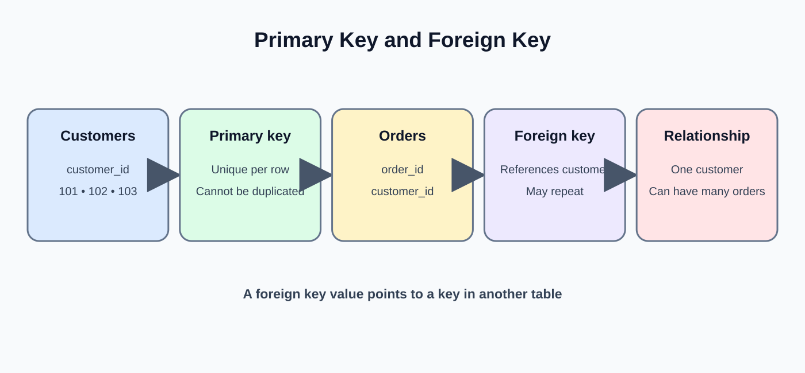
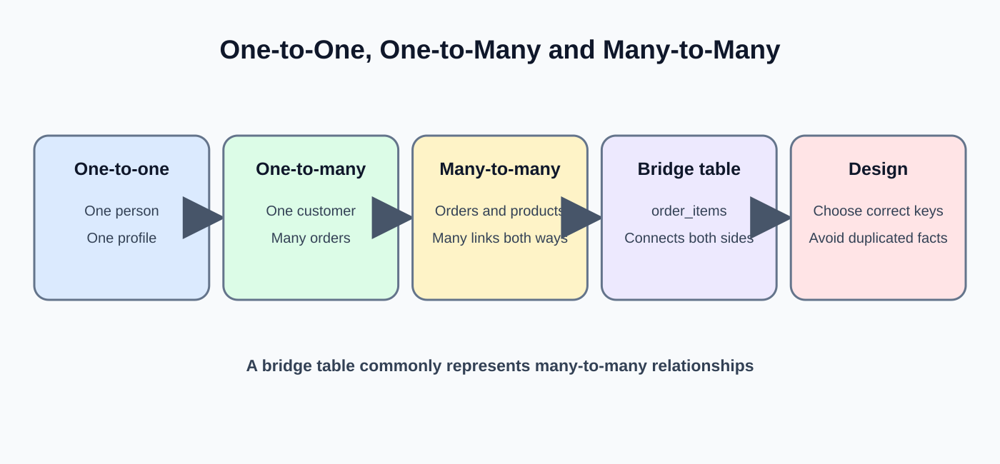
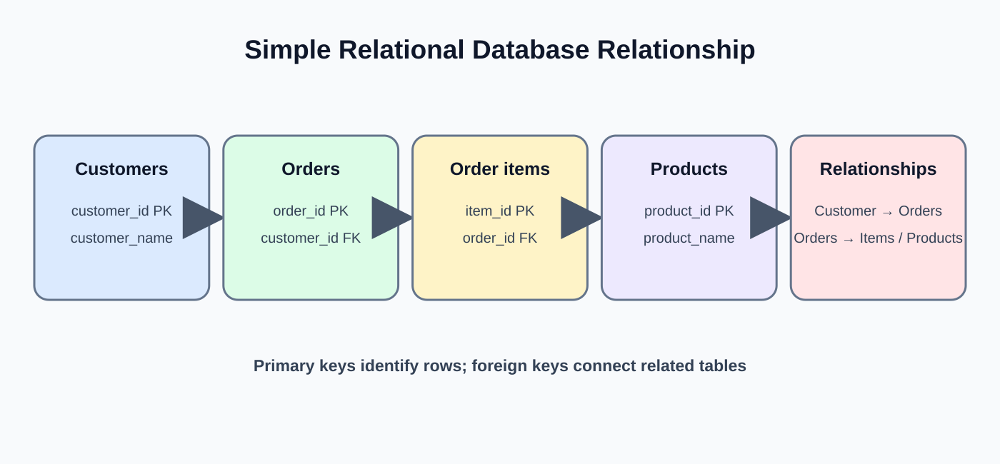

# Day 19: Database Fundamentals

**Pathway:** TechPhile.ai — Data Engineer Career Pathway  
**Phase:** 3 — SQL and Database Engineering  
**Level:** Beginner  
**Estimated learning time:** 2–3 hours  
**Syllabus topic:** Database Fundamentals  
**Mini-project:** Operational Database Design

---

## 1. Learning objectives

By the end of this lesson, students should be able to:

- Explain what a database is and why applications use databases.
- Distinguish data, a database, a DBMS and a relational database.
- Explain tables, rows, columns and records.
- Understand primary keys and foreign keys.
- Identify one-to-one, one-to-many and many-to-many relationships.
- Read a simple Entity Relationship Diagram (ERD).
- Convert a small business requirement into tables and relationships.
- Choose suitable data types at a conceptual level.
- Recognize NULL, duplicate records and referential integrity.
- Explain why database design should happen before writing application queries.

**What we are not doing today:** We are not learning all SQL commands today. CREATE, ALTER, INSERT, UPDATE, DELETE and constraints are covered in Day 20. Today we first understand how relational data is organized.

---

## 2. Start with a real business situation

Imagine an online retail company called **TechStore**.

Customers visit the website and place orders. Each order may contain multiple products. The company needs to store:

- Customer details.
- Product details.
- Order details.
- The products included in each order.
- The quantity of each product ordered.
- The price charged at the time of purchase.

A beginner may try to store everything in one spreadsheet:

| customer_name | customer_email | order_id | order_date | product_name | quantity | unit_price |
|---|---|---|---|---|---:|---:|
| Ravi | ravi@example.com | 5001 | 2026-11-01 | Keyboard | 1 | 1200 |
| Ravi | ravi@example.com | 5001 | 2026-11-01 | Mouse | 2 | 500 |
| Priya | priya@example.com | 5002 | 2026-11-02 | Monitor | 1 | 9000 |

This table looks understandable because it is small. But imagine that the company has 5 million customers and 50 million orders.

### 2.1 Problems with storing everything in one table

**Problem 1 — Repeated customer details**

If Ravi places 100 orders, his name and email may be repeated in 100 or more rows.

**Problem 2 — Updating information becomes difficult**

If Ravi changes his email address, many rows may need to be updated. If one row is missed, the database contains conflicting email addresses.

**Problem 3 — Insertion becomes awkward**

The company may want to add a new product before anyone orders it. In a single order table, there may be no natural order row in which to store that product.

**Problem 4 — Deletion may remove useful information**

If the company deletes the only order containing a product, it may accidentally lose the only stored copy of that product's details.

**Problem 5 — Data becomes harder to validate**

The same customer may appear with different spellings or email addresses. Reports become less reliable.

The solution is not simply to create more columns. We organize related information into separate tables and connect those tables using keys.

---

## 3. What is data?

**Data** means recorded facts or observations.

Examples:

- Customer name: Ravi.
- Product price: 1200.
- Order date: 2026-11-01.
- Quantity sold: 2.
- Delivery status: Shipped.

Data may be stored in:

- Files such as CSV and JSON.
- Relational databases.
- NoSQL databases.
- Data warehouses.
- Cloud object storage.

A database is a structured collection of data that can be stored, retrieved, managed and updated.

### 3.1 Data versus information

| Data | Information |
|---|---|
| 1200, 1500, 1800 | Average selling price is 1500 |
| 25 orders | The company received 25 orders today |
| Hyderabad | The customer is located in Hyderabad |

Data is the raw recorded value. Information is the useful meaning derived from data.

A Data Engineer must help ensure that source data is stored and delivered accurately so that downstream systems can produce trustworthy information.

---

## 4. What is a database?

A **database** is an organized collection of related data.

For example, an e-commerce database may contain:

- Customers.
- Products.
- Orders.
- Payments.
- Shipments.

These entities are related. An order belongs to a customer. An order may contain several products. A payment is associated with an order.

A database helps an organization store this information in a consistent and manageable way.

### 4.1 Why do companies use databases?

1. **Storage:** Keep business records in an organized place.
2. **Retrieval:** Find required records without manually searching many files.
3. **Updates:** Change records in a controlled manner.
4. **Consistency:** Apply rules to reduce invalid or conflicting data.
5. **Relationships:** Connect customers, orders and products.
6. **Security:** Control who can read or modify information.
7. **Concurrency:** Allow multiple users and applications to work with data.
8. **Recovery:** Support backup and restoration after failures.
9. **Transactions:** Group related operations so they succeed or fail together.
10. **Scalability:** Support growing amounts of data and workload.

### 4.2 Example: without a database

A small shop stores customer details in several Excel files.

- customer_january.xlsx
- customer_february.xlsx
- customer_march.xlsx

The files may contain different column names, duplicate customers and inconsistent values.

When the shop grows, combining and maintaining those files becomes difficult.

### 4.3 Example: with a database

The shop stores customer records in a Customers table. Orders are stored in an Orders table. Both tables are connected through a customer identifier.

The application can retrieve a customer's orders without repeating all customer information in every order record.

---

## 5. What is a DBMS?

**DBMS** stands for **Database Management System**.

A DBMS is software that helps users and applications create, store, retrieve, update, secure and manage databases.

Think of the database as the organized data, and the DBMS as the software that manages access to that data.

### 5.1 Examples of DBMS software

| DBMS | General description | Common use |
|---|---|---|
| MySQL | Relational DBMS | Web applications and operational systems |
| PostgreSQL | Relational DBMS | Applications requiring rich SQL and database features |
| SQLite | Lightweight relational DBMS | Local applications, learning and embedded use |
| Microsoft SQL Server | Relational DBMS | Enterprise applications and reporting |
| Oracle Database | Relational DBMS | Large enterprise systems |
| MongoDB | Document-oriented database | Applications storing document-shaped records |

**Important:** MongoDB is a DBMS, but it is not a relational DBMS. This course's SQL and relational database lessons focus mainly on relational concepts.

### 5.2 Database versus DBMS

| Database | DBMS |
|---|---|
| Collection of organized data | Software that manages the data |
| Contains tables or other data structures | Provides tools to create and manage those structures |
| Example: a retail database | Example: PostgreSQL |
| Stores business records | Controls access, queries, updates and recovery |

### 5.3 What happens when an application requests data?

A simplified flow:

`Application -> DBMS -> Database`

The application sends a request. The DBMS checks the request and permissions, processes it, accesses the stored data and returns a result.

For a relational database, SQL is commonly used to communicate with the DBMS.

---

## 6. What is a relational database?

A **relational database** stores data in tables and represents relationships between those tables.

A table is made of rows and columns.

Example: Customers table.

| customer_id | customer_name | email | city |
|---:|---|---|---|
| 101 | Ravi | ravi@example.com | Hyderabad |
| 102 | Priya | priya@example.com | Chennai |
| 103 | Arjun | arjun@example.com | Bengaluru |

Example: Orders table.

| order_id | customer_id | order_date | order_status |
|---:|---:|---|---|
| 5001 | 101 | 2026-11-01 | Shipped |
| 5002 | 102 | 2026-11-02 | Processing |
| 5003 | 101 | 2026-11-03 | Delivered |

Notice that customer_id appears in both tables.

- In Customers, customer_id identifies a customer.
- In Orders, customer_id tells us which customer placed the order.

This is how relational tables are connected.

### 6.1 Why is it called relational?

The word **relation** comes from relational database theory. In practical SQL learning, students commonly work with tables and the relationships between them.

A customer can be related to many orders. An order can be related to one customer.

### 6.2 Important characteristics

- Data is organized into tables.
- Each table represents a type of entity or relationship.
- Columns describe attributes.
- Rows represent individual records.
- Keys identify records and connect tables.
- Constraints help protect data quality.
- SQL is used to define, retrieve and manipulate data.

---

## 7. Understand tables, rows and columns

These three terms are used constantly in database work.

### 7.1 Table

A **table** stores records about one subject or one relationship.

Examples:

- customers
- products
- orders
- order_items

A well-designed table should have a clear purpose.

### 7.2 Row

A **row** is one record in a table.

In the Customers table, this is one row:

| customer_id | customer_name | city |
|---:|---|---|
| 101 | Ravi | Hyderabad |

It represents one customer.

Other names for a row include record and tuple. In everyday SQL work, "row" and "record" are commonly used.

### 7.3 Column

A **column** represents one attribute of the table's subject.

In Customers:

- customer_id
- customer_name
- email
- city

Other names include field and attribute.

### 7.4 Understand a table visually

| Table part | Meaning | Example |
|---|---|---|
| Table | Collection of related records | Customers |
| Row | One customer record | 101, Ravi, Hyderabad |
| Column | One property | customer_name |
| Cell | One value at a row-column intersection | Ravi |

### 7.5 A table is not just an Excel sheet

A database table may look similar to a spreadsheet, but a relational database can also enforce rules such as:

- A customer identifier must be unique.
- An order must refer to an existing customer.
- A required customer name cannot be missing.
- A quantity must be positive.

These rules are enforced through database constraints, which we will study on Day 20.

---

## 8. Understand a database schema

A **schema** describes how a database is organized.

It can define:

- Table names.
- Column names.
- Data types.
- Primary keys.
- Foreign keys.
- Constraints.
- Relationships.

Example schema at a high level:

`Database: retail_db`

`customers(customer_id, customer_name, email, city)`

`orders(order_id, customer_id, order_date, order_status)`

`products(product_id, product_name, category, current_price)`

`order_items(order_item_id, order_id, product_id, quantity, unit_price)`

This is a structural description, not executable SQL.

### 8.1 Why do we design a schema first?

Imagine writing queries before deciding:

- What uniquely identifies a customer?
- Can an order exist without a customer?
- Can an order contain multiple products?
- Where should the quantity be stored?
- Should product price be copied into an order item?

If these decisions are unclear, the tables and queries may need major changes later.

A schema gives developers, analysts and Data Engineers a shared understanding of the data.

### 8.2 Database schema versus database instance

| Schema | Instance |
|---|---|
| Structure or design | Actual data at a particular time |
| Table and column definitions | Rows currently stored |
| Changes less frequently | Changes whenever data is inserted, updated or deleted |
| Example: Orders has order_id and order_date | Example: order 5001 was placed on 2026-11-01 |

---

## 9. Understand data types at a beginner level

A data type tells the database what kind of value a column is expected to store.

The exact type names and supported ranges vary between database systems.

| Data category | Example value | Common SQL type |
|---|---|---|
| Whole number | 101 | INTEGER |
| Large whole number | 9000000000 | BIGINT |
| Text | Ravi | VARCHAR |
| Longer text | Delivery instructions | TEXT |
| Decimal amount | 1299.50 | DECIMAL |
| Date | 2026-11-10 | DATE |
| Date and time | 2026-11-10 10:30:00 | TIMESTAMP |
| True/false | TRUE | BOOLEAN |

### 9.1 INTEGER

Use an integer for whole-number values such as:

- Quantity.
- Age in completed years.
- Count of attempts.
- Numeric identifiers, when appropriate.

Example:

`quantity = 3`

Do not use an integer for a value that can contain a fractional part.

### 9.2 VARCHAR

VARCHAR stores text with a declared maximum length in systems that support this type.

Examples:

- Customer name.
- Email address.
- City.
- Product code.

Example design:

`customer_name VARCHAR(100)`

This is a schema illustration. The exact syntax will be practiced on Day 20.

### 9.3 DECIMAL

DECIMAL is useful for exact decimal values such as financial amounts.

Example:

`unit_price DECIMAL(10, 2)`

The two digits after the decimal point represent the scale in this example.

**Industry note:** Avoid using approximate floating-point types for financial values when exact decimal representation is required. Floating-point values can have representation and rounding behavior that surprises beginners.

### 9.4 DATE and TIMESTAMP

- DATE stores a calendar date.
- TIMESTAMP stores a date and time.

Examples:

- order_date: 2026-11-10
- created_at: 2026-11-10 10:30:00

A Data Engineer should understand the difference between a date and a timestamp, especially when loading records from systems in different time zones.

### 9.5 Choosing data types carefully

Ask these questions:

1. Is the value numeric or textual?
2. Can it contain decimal places?
3. Is it a date or a date and time?
4. What is the expected range?
5. Does exact decimal precision matter?
6. Is it an identifier rather than a value used for arithmetic?

**Important identifier example:** A postal code such as 005001 should usually be stored as text, not as a number, because leading zeroes are meaningful and arithmetic is not required.

---

## 10. What is a key in a database?



A **key** is one or more columns used to identify records or establish relationships.

Keys help answer two important questions:

1. How can we identify one record reliably?
2. How can one table refer to a record in another table?

The most important keys for today's lesson are primary keys and foreign keys.

---

## 11. Primary key

A **primary key** is a column, or a combination of columns, that uniquely identifies every row in a table.

Example: Customers.

| customer_id | customer_name | city |
|---:|---|---|
| 101 | Ravi | Hyderabad |
| 102 | Priya | Chennai |
| 103 | Arjun | Bengaluru |

Here, customer_id is the primary key.

### 11.1 Why do we need a primary key?

Suppose two customers have the same name:

| customer_name | city |
|---|---|
| Ravi | Hyderabad |
| Ravi | Pune |

If we use only customer_name to identify a customer, which Ravi do we mean?

A unique identifier removes this ambiguity.

### 11.2 Primary key rules

A primary key must:

- Be unique for each row.
- Not contain NULL.
- Identify one row reliably.
- Be stable enough to serve as a record identifier.

### 11.3 What happens if a primary key is duplicated?

A database rejects a duplicate primary-key value because it would no longer uniquely identify a row.

The exact error message depends on the DBMS.

### 11.4 Can a table have multiple primary keys?

A table has one primary-key constraint. That primary key can contain more than one column. This is called a **composite primary key**.

We will distinguish composite keys from single-column keys later in the curriculum.

---

## 12. Foreign key

A **foreign key** is a column, or group of columns, in one table that refers to a candidate or primary key in another table.

Example:

**Customers**

| customer_id | customer_name |
|---:|---|
| 101 | Ravi |
| 102 | Priya |

**Orders**

| order_id | customer_id |
|---:|---:|
| 5001 | 101 |
| 5002 | 102 |
| 5003 | 101 |

In Orders, customer_id refers to Customers.customer_id.

Therefore:

- Customers.customer_id is the primary key.
- Orders.customer_id is a foreign key.

### 12.1 Why do we need a foreign key?

Suppose someone tries to create an order for customer_id 9999, but customer 9999 does not exist.

A foreign-key rule can reject that invalid reference.

This protects **referential integrity**.

### 12.2 Referential integrity

Referential integrity means that relationships between records remain valid.

For example:

- An order should not refer to a nonexistent customer.
- An order item should not refer to a nonexistent order.
- An order item should not refer to a nonexistent product.

### 12.3 Primary key versus foreign key

| Primary key | Foreign key |
|---|---|
| Identifies a row in its own table | Refers to a row in another or the same table |
| Must be unique | May repeat |
| Cannot be NULL | May be NULL if the relationship is optional and the schema allows it |
| One primary-key constraint per table | A table can have multiple foreign-key constraints |
| Example: Customers.customer_id | Example: Orders.customer_id |

### 12.4 Can a foreign key contain duplicate values?

Yes.

A customer may place many orders. Therefore customer_id = 101 can appear in multiple rows of Orders.

### 12.5 Can a foreign key contain NULL?

It depends on the business rule and column definition.

For example, if an order must always belong to a customer, the foreign key should also be required. If the relationship is optional, NULL may be allowed.

A foreign key and a NOT NULL rule answer different questions:

- Foreign key: Does the referenced record exist?
- NOT NULL: Must a value be supplied?

Day 20 explains how to define these constraints.

---

## 13. Other key concepts

### 13.1 Candidate key

A candidate key is a minimal set of columns that can uniquely identify a row.

For example, a customer table might have:

- customer_id.
- email.

If both are guaranteed unique and neither needs another column to identify a customer, both may be candidate keys.

One candidate key is selected as the primary key.

### 13.2 Alternate key

A candidate key that is not selected as the primary key is commonly called an alternate key.

Example:

- customer_id is the primary key.
- email is an alternate key if it is guaranteed unique.

### 13.3 Composite key

A composite key uses two or more columns together to identify a row.

Example: A student-course enrollment table.

| student_id | course_id | enrollment_date |
|---:|---:|---|
| 1 | 101 | 2026-06-01 |
| 1 | 102 | 2026-06-02 |
| 2 | 101 | 2026-06-03 |

The combination (student_id, course_id) may uniquely identify an enrollment if a student can enroll in a course only once.

Neither column alone is unique:

- student_id repeats because a student can enroll in many courses.
- course_id repeats because many students can enroll in one course.

### 13.4 Natural key

A natural key is based on a meaningful real-world value.

Examples:

- A government-issued identifier.
- An ISBN for a book.
- A product code assigned by a business.

Natural keys need careful evaluation. A value that looks meaningful may change, may be entered incorrectly or may not be unique across systems.

### 13.5 Surrogate key

A surrogate key is an identifier generated for database use, without direct business meaning.

Example:

- customer_id = 101
- customer_id = 102

A surrogate key can provide a stable internal identifier even when customer attributes change.

**Do not confuse:** Primary key describes the role of a key in a table. Natural and surrogate describe where the key's value comes from.

---

## 14. Relationships between tables



Relational databases connect tables through relationships.

The three common relationship patterns are:

1. One-to-one.
2. One-to-many.
3. Many-to-many.

### 14.1 One-to-one relationship (1:1)

One record in Table A is associated with at most one record in Table B, and vice versa.

Example:

- One employee has one employee identity-card record.
- One identity-card record belongs to one employee.

Simplified view:

`Employee 1 -------- 1 IdentityCard`

Possible tables:

**Employees**

| employee_id | employee_name |
|---:|---|
| 1 | Ravi |
| 2 | Priya |

**EmployeeCards**

| card_id | employee_id | card_number |
|---:|---:|---|
| 501 | 1 | CARD-001 |
| 502 | 2 | CARD-002 |

The employee_id in EmployeeCards must be unique if each employee can have only one card.

**When useful:** When optional or sensitive details are separated from the main record, or when the business rule genuinely requires one-to-one ownership.

### 14.2 One-to-many relationship (1:M)

One record in Table A can be associated with many records in Table B. Each record in Table B belongs to one record in Table A.

Example:

- One customer can place many orders.
- Each order belongs to one customer.

`Customer 1 -------- Many Orders`

Customers:

| customer_id | customer_name |
|---:|---|
| 101 | Ravi |
| 102 | Priya |

Orders:

| order_id | customer_id |
|---:|---:|
| 5001 | 101 |
| 5002 | 101 |
| 5003 | 102 |

The foreign key is placed on the many side: Orders.customer_id.

This is one of the most common relationship patterns in operational databases.

### 14.3 Many-to-many relationship (M:N)

Many records in Table A can be associated with many records in Table B.

Example:

- One order can contain many products.
- One product can appear in many orders.

`Orders Many -------- Many Products`

A relational design normally resolves this using a junction table, also called a bridge or associative table.

### 14.4 Junction table example

**Orders**

| order_id | customer_id |
|---:|---:|
| 5001 | 101 |
| 5002 | 102 |

**Products**

| product_id | product_name |
|---:|---|
| 201 | Keyboard |
| 202 | Mouse |
| 203 | Monitor |

**Order_Items**

| order_item_id | order_id | product_id | quantity | unit_price |
|---:|---:|---:|---:|---:|
| 1 | 5001 | 201 | 1 | 1200 |
| 2 | 5001 | 202 | 2 | 500 |
| 3 | 5002 | 203 | 1 | 9000 |

Order_Items connects Orders and Products.

- order_id is a foreign key to Orders.
- product_id is a foreign key to Products.
- quantity describes how many units were purchased.
- unit_price records the price for this order item.

### 14.5 Why not store product IDs in a comma-separated column?

A poor design might store this in Orders:

| order_id | product_ids |
|---:|---|
| 5001 | 201,202,205 |

Problems:

- Finding one product becomes difficult.
- Validating each product reference becomes difficult.
- Updating one product within the list becomes awkward.
- Aggregating quantities and prices becomes harder.
- The database cannot enforce an ordinary foreign key for each comma-separated value.

Use a separate Order_Items table instead.

---

## 15. Cardinality and optionality

**Cardinality** describes how many records can participate in a relationship.

Common examples:

- One-to-one.
- One-to-many.
- Many-to-many.

**Optionality** describes whether participation is required or optional.

Example business rules:

- A customer may have zero orders.
- Every order must belong to exactly one customer.
- An order must contain at least one order item.
- A product may exist before it is included in an order.

When designing tables, do not assume that every relationship is mandatory in both directions.

### 15.1 Read the relationship in both directions

For Customers and Orders:

- One customer can have zero or many orders.
- Each order must have one customer.

This is more precise than simply saying "Customers and Orders have a one-to-many relationship."

---

## 16. NULL and missing values

**NULL** represents the absence of a value or an unknown/not-applicable value, depending on context.

Example:

| customer_id | customer_name | alternate_phone |
|---:|---|---|
| 101 | Ravi | NULL |
| 102 | Priya | 9876543210 |

Ravi has no alternate phone recorded.

### 16.1 NULL is not the same as zero

- 0 is a numeric value.
- NULL means no value is recorded or the value is unknown/not applicable.

### 16.2 NULL is not the same as an empty string

- Empty string: text value with zero characters.
- NULL: missing or absent value.

### 16.3 Why NULL needs attention

If a Data Engineer treats missing values as zero, business calculations can become incorrect.

Example:

- Actual quantity = 0 means no units.
- Quantity = NULL may mean the quantity has not been supplied.

Those meanings are different.

SQL handles NULL comparisons differently from ordinary values. We will practice NULL checks in Day 21.

---

## 17. Database design mistakes beginners should avoid

### Mistake 1 — Using customer name as the only identifier

Two customers can have the same name.

**Better:** Use a stable customer identifier.

### Mistake 2 — Repeating customer details in every order row

This creates unnecessary repetition and update problems.

**Better:** Store customer details in Customers and refer to the customer using a key.

### Mistake 3 — Putting multiple products in one cell

Comma-separated values make relationships and queries difficult.

**Better:** Create Order_Items.

### Mistake 4 — Forgetting foreign keys

An order could refer to a customer that does not exist.

**Better:** Define and validate the relationship.

### Mistake 5 — Choosing the wrong data type

Storing a date as arbitrary text makes date filtering and calculations harder.

**Better:** Choose a suitable date type.

### Mistake 6 — Assuming every ID is meaningful

A numeric ID is usually an identifier, not a measurement.

**Better:** Do not calculate averages of customer IDs or order IDs.

### Mistake 7 — Treating NULL as zero

This changes the meaning of the data.

**Better:** Decide what missing values mean in the business context.

### Mistake 8 — Designing tables only around one report

A database design should represent the business entities and rules, not just one query output.

**Better:** Understand the source business process before defining tables.

---

## 18. Read a simple Entity Relationship Diagram (ERD)



An **Entity Relationship Diagram (ERD)** is a visual representation of entities, their attributes and their relationships.

### 18.1 Main ERD terms

| Term | Meaning | Example |
|---|---|---|
| Entity | A thing about which data is stored | Customer |
| Attribute | A property of an entity | customer_name |
| Relationship | Association between entities | Customer places Order |
| Primary key | Unique row identifier | customer_id |
| Foreign key | Reference to another entity | Orders.customer_id |

### 18.2 Text-based ERD for TechStore

```text
CUSTOMERS
---------
PK customer_id
   customer_name
   email
   city
       |
       | one customer can place many orders
       |
       v
ORDERS
------
PK order_id
FK customer_id
   order_date
   order_status
       |
       | one order contains many order items
       |
       v
ORDER_ITEMS
-----------
PK order_item_id
FK order_id
FK product_id
   quantity
   unit_price
       ^
       | one product can appear in many order items
       |
PRODUCTS
--------
PK product_id
   product_name
   category
   current_price
```

### 18.3 How to read this diagram

1. Customers has a primary key named customer_id.
2. Orders has its own primary key named order_id.
3. Orders also has customer_id as a foreign key.
4. Order_Items connects Orders and Products.
5. Products has product_id as its primary key.
6. Order_Items stores the quantity and price for each ordered product.

### 18.4 Why is Order_Items a separate entity?

Because an order can contain multiple products, and a product can be part of multiple orders.

The relationship itself has useful attributes:

- quantity
- unit_price
- discount, if required
- item-level status, if required

These values belong to the order-product association, not simply to the product master record.

---

## 19. Database design workflow

When a business asks you to design a database, do not immediately start creating tables.

Follow a simple sequence:

`Business requirement -> Entities -> Attributes -> Keys -> Relationships -> Data types -> Constraints -> Schema`

### Step 1 — Understand the business requirement

Ask:

- What business process are we storing?
- Which people or systems create the data?
- What records must be retained?
- Which records are related?
- Which rules must always be true?

### Step 2 — Identify entities

For TechStore:

- Customer.
- Product.
- Order.
- Order Item.

Payment and Shipment could be separate entities if the requirements include those processes.

### Step 3 — Identify attributes

Customer:

- customer_id
- customer_name
- email
- city

Product:

- product_id
- product_name
- category
- current_price

Order:

- order_id
- customer_id
- order_date
- order_status

Order Item:

- order_item_id
- order_id
- product_id
- quantity
- unit_price

### Step 4 — Select primary keys

- Customers: customer_id.
- Products: product_id.
- Orders: order_id.
- Order_Items: order_item_id.

### Step 5 — Identify foreign keys

- Orders.customer_id -> Customers.customer_id.
- Order_Items.order_id -> Orders.order_id.
- Order_Items.product_id -> Products.product_id.

### Step 6 — Identify relationship cardinality

- Customers to Orders: one-to-many.
- Orders to Order_Items: one-to-many.
- Products to Order_Items: one-to-many.
- Orders to Products: many-to-many, resolved through Order_Items.

### Step 7 — Select data types

Choose types based on meaning and expected values.

### Step 8 — Identify business constraints

Examples:

- Customer email may need to be unique.
- Customer name is required.
- Quantity must be greater than zero.
- Unit price cannot be negative.
- Every order must refer to an existing customer.

The exact SQL implementation comes in Day 20.

### Step 9 — Review with sample records

Try a few realistic examples:

- A customer with no orders.
- A customer with several orders.
- An order with one product.
- An order with three products.
- A product that has not yet been sold.

If the design cannot represent these cases clearly, revisit the relationships.

---

## 20. Practical database design walkthrough

Let's design the TechStore database from the business requirement.

### 20.1 Business requirement

The company needs to store customers, products and sales orders. A customer can place multiple orders. Each order can include multiple products. A product can appear in multiple orders.

### 20.2 Identify the entities

| Entity | Why is it needed? |
|---|---|
| Customers | Store customer information once |
| Products | Store product master information |
| Orders | Store each order header |
| Order_Items | Store products and quantities inside each order |

### 20.3 Design the Customers table

| Column | Meaning | Suggested type | Key |
|---|---|---|---|
| customer_id | Unique customer identifier | INTEGER | PK |
| customer_name | Customer's name | VARCHAR | — |
| email | Customer email | VARCHAR | Candidate/alternate key if unique |
| city | Customer city | VARCHAR | — |

### 20.4 Design the Products table

| Column | Meaning | Suggested type | Key |
|---|---|---|---|
| product_id | Unique product identifier | INTEGER | PK |
| product_name | Product name | VARCHAR | — |
| category | Product category | VARCHAR | — |
| current_price | Current listed price | DECIMAL | — |

### 20.5 Design the Orders table

| Column | Meaning | Suggested type | Key |
|---|---|---|---|
| order_id | Unique order identifier | INTEGER | PK |
| customer_id | Customer who placed the order | INTEGER | FK |
| order_date | Date the order was placed | DATE | — |
| order_status | Current order status | VARCHAR | — |

### 20.6 Design the Order_Items table

| Column | Meaning | Suggested type | Key |
|---|---|---|---|
| order_item_id | Unique order-line identifier | INTEGER | PK |
| order_id | Related order | INTEGER | FK |
| product_id | Related product | INTEGER | FK |
| quantity | Number of units | INTEGER | — |
| unit_price | Price charged per unit | DECIMAL | — |

### 20.7 Why store unit_price in Order_Items?

Suppose a keyboard costs 1200 today. Next month, its current price changes to 1400.

An old order must still show the price the customer actually paid.

Therefore:

- Products.current_price represents the current product price.
- Order_Items.unit_price represents the price recorded for that particular order line.

This is an important real-world data modeling decision.

### 20.8 Sample records

**Customers**

| customer_id | customer_name | email | city |
|---:|---|---|---|
| 101 | Ravi | ravi@example.com | Hyderabad |
| 102 | Priya | priya@example.com | Chennai |

**Products**

| product_id | product_name | category | current_price |
|---:|---|---|---:|
| 201 | Keyboard | Accessories | 1400.00 |
| 202 | Mouse | Accessories | 550.00 |
| 203 | Monitor | Electronics | 9000.00 |

**Orders**

| order_id | customer_id | order_date | order_status |
|---:|---:|---|---|
| 5001 | 101 | 2026-11-01 | Delivered |
| 5002 | 102 | 2026-11-02 | Processing |

**Order_Items**

| order_item_id | order_id | product_id | quantity | unit_price |
|---:|---:|---:|---:|---:|
| 1 | 5001 | 201 | 1 | 1200.00 |
| 2 | 5001 | 202 | 2 | 500.00 |
| 3 | 5002 | 203 | 1 | 9000.00 |

### 20.9 Validate the design using questions

**Question:** Can Ravi place another order?

Yes. Add another row to Orders with customer_id 101.

**Question:** Can order 5001 contain another product?

Yes. Add another row to Order_Items with order_id 5001 and the new product_id.

**Question:** Can a product be sold in many orders?

Yes. The same product_id can appear in multiple Order_Items records.

**Question:** Can an order refer to a customer that does not exist?

It should not. A foreign-key constraint protects this relationship.

**Question:** Can the current product price change without changing old order prices?

Yes. Old prices are stored in Order_Items.unit_price.

**Question:** Can a product exist before it is sold?

Yes. Products is independent of Orders.

---

## 21. What is a database transaction? (Preview)

A transaction is a group of database operations treated as one logical unit of work.

Example: transferring money between two accounts.

1. Subtract 500 from Account A.
2. Add 500 to Account B.

Both operations should succeed together. If one fails, the database should not leave the transfer half-completed.

Transactions and ACID principles are taught in Day 24. For now, remember that relational databases support controlled changes to business records.

---

## 22. Relational databases versus non-relational databases

| Relational database | Non-relational database |
|---|---|
| Commonly stores data in related tables | May store documents, key-value pairs, graphs or wide-column records |
| Often uses a predefined schema | Some systems support more flexible record structures |
| SQL is widely used | Query methods depend on the database |
| Strong fit for structured relationships and transactions | Can fit particular flexible or specialized access patterns |
| Examples: PostgreSQL, MySQL | Example: MongoDB, Redis |

**Important:** Do not say that relational databases are always better or that NoSQL databases have no schema. The right choice depends on data shape, consistency needs, query patterns, scale and operational requirements.

---

## 23. Operational databases and analytical databases (preview)

An **operational database** supports day-to-day business operations.

Examples:

- Creating a customer.
- Placing an order.
- Updating an order status.
- Recording a payment.

An **analytical database** supports reporting and analysis across larger sets of historical data.

Examples:

- Monthly sales by region.
- Product performance over a year.
- Customer purchasing trends.

This distinction was introduced in Phase 1. In this phase, we focus on relational database engineering and SQL.

---

## 24. Industry scenario: customer and order data quality

A Data Engineer receives two source tables.

**Source Customers**

| customer_id | customer_name |
|---:|---|
| 101 | Ravi |
| 102 | Priya |

**Source Orders**

| order_id | customer_id |
|---:|---:|
| 5001 | 101 |
| 5002 | 102 |
| 5003 | 999 |

The third order refers to customer 999, who is not present in the Customers source.

This is an orphan reference.

### What should the Data Engineer do?

1. Identify the invalid reference.
2. Confirm whether customer 999 exists in another source or arrived late.
3. Check whether the source data is incomplete.
4. Apply the agreed data-quality rule.
5. Quarantine or reject the invalid record when required.
6. Report the issue to the source owner.
7. Avoid silently inventing a customer record.

### Why is this important?

If invalid relationships enter the database, reports may contain incomplete customer information. Referential integrity protects the system, while ingestion validation helps detect issues before loading.

---

## 25. Day 19 revision

| Concept | Remember |
|---|---|
| Database | Organized collection of data |
| DBMS | Software used to manage databases |
| Relational database | Stores data in related tables |
| Table | Collection of rows and columns |
| Row | One record |
| Column | One attribute |
| Schema | Database structure |
| Primary key | Uniquely identifies a row |
| Foreign key | References a key in another table |
| Referential integrity | Keeps references valid |
| One-to-one | One record relates to one record |
| One-to-many | One record relates to many records |
| Many-to-many | Many records relate to many records |
| Junction table | Resolves a many-to-many relationship |
| NULL | Missing, unknown or not-applicable value |
| ERD | Diagram of entities and relationships |
| Natural key | Business-meaningful identifier |
| Surrogate key | Generated technical identifier |
| Composite key | Key made from multiple columns |

---

## 26. Common beginner questions

### Is a database the same as a table?

No. A database can contain many tables. A table stores records about a particular subject or relationship.

### Is a row the same as a column?

No. A row is one record. A column is one attribute shared by records.

### Can two rows have the same name?

Yes. Names are not necessarily unique. Use a suitable primary key to identify each row.

### Can a foreign key repeat?

Yes. In a one-to-many relationship, the foreign key normally repeats on the many side.

### Can a table have more than one foreign key?

Yes. Order_Items has foreign keys to both Orders and Products.

### Can a table have a primary key and foreign key?

Yes. Order_Items has its own primary key and foreign keys to other tables.

### Is NULL the same as zero?

No. Zero is a value. NULL represents absence, unknown or not-applicable data.

### Does every table need a primary key?

A well-designed relational table should have a reliable way to identify records. In practical database design, defining a primary key is strongly recommended and often essential.

### Is a foreign key always required?

No. A foreign-key column may be optional if the business relationship is optional and the database design allows NULL. Mandatory relationships need additional rules.

### Why do we need a junction table?

It represents a many-to-many relationship in a relational design and gives us a place to store attributes of that relationship.

---

## 27. Mini-project: Operational Database Design

**Project name:** Operational Database Design

### Business problem

TechStore needs a relational database design for customers, products and orders.

The company requires:

- One customer can place multiple orders.
- One order can contain multiple products.
- One product can appear in multiple orders.
- The quantity and selling price must be recorded for each product in an order.
- Product master information should not be repeated in every order.
- Old order prices must remain unchanged when the current product price changes.

### Step 1 — Identify entities

Required entities:

1. Customers.
2. Products.
3. Orders.
4. Order_Items.

### Step 2 — Identify attributes

Use the four table designs from Section 20.

### Step 3 — Select keys

| Table | Primary key | Foreign keys |
|---|---|---|
| Customers | customer_id | None |
| Products | product_id | None |
| Orders | order_id | customer_id |
| Order_Items | order_item_id | order_id, product_id |

### Step 4 — Define relationships

- Customers 1:M Orders.
- Orders 1:M Order_Items.
- Products 1:M Order_Items.
- Orders M:N Products, resolved through Order_Items.

### Step 5 — Define business rules

- customer_id must identify one customer.
- order_id must identify one order.
- product_id must identify one product.
- Every order must belong to an existing customer.
- Every order item must refer to an existing order and product.
- Quantity must be greater than zero.
- Unit price must not be negative.
- Old order-item prices must not be overwritten when the product's current price changes.

### Step 6 — Review sample scenarios

| Scenario | Expected design behavior |
|---|---|
| Customer has no orders | Customer record can exist without an order |
| Customer places 3 orders | Three Orders rows refer to the same customer_id |
| Order contains 4 products | Four Order_Items rows refer to the same order_id |
| Product is sold in 100 orders | Its product_id appears in 100 order-item rows |
| Product price changes | Old Order_Items.unit_price values remain unchanged |
| Order refers to unknown customer | Reject or quarantine the invalid reference |

### Step 7 — Deliverable

Prepare a database design document containing:

- Business requirement summary.
- Entity list.
- Attribute list.
- Primary-key and foreign-key definitions.
- Relationship cardinalities.
- Data-type choices.
- Business constraints.
- Text-based ERD.
- Sample records.
- Explanation of design decisions.

**Do not create SQL tables in this project yet.** Day 20 will teach how to implement the design using DDL and constraints.

---

## 28. Day 19 knowledge check

1. What is the difference between a database and a DBMS?
2. What is a relational database?
3. What is the difference between a row and a column?
4. What is a schema?
5. Why does a table need a primary key?
6. Can a primary key contain NULL?
7. Can a foreign key contain duplicate values?
8. What is referential integrity?
9. What is the difference between one-to-many and many-to-many?
10. Why do we create a junction table?
11. Why should product_ids not be stored as comma-separated values?
12. What is the difference between NULL and zero?
13. Why might an email address be a candidate key?
14. What is a surrogate key?
15. Why do we store the order-time price separately from the current product price?

### Suggested answers

1. A database stores organized data; a DBMS is software that manages it.
2. A database that organizes data in related tables.
3. A row is one record; a column is one attribute.
4. The structure and organization of database objects.
5. To identify each row uniquely.
6. No.
7. Yes, if multiple child rows refer to the same parent.
8. It ensures references between related records remain valid.
9. One-to-many connects one parent to many child records; many-to-many connects multiple records on both sides.
10. To represent a many-to-many relationship in relational tables.
11. It makes validation, searching and querying difficult.
12. Zero is a value; NULL represents missing or unknown information.
13. If the business guarantees that each email is unique.
14. A generated identifier with no direct business meaning.
15. To preserve the historical price charged for the order.

---

## 29. What comes next?

Today we designed the database structure without writing executable SQL.

In **Day 20 — SQL DDL, DML and Constraints**, we will implement database structures and work with commands such as:

- CREATE TABLE.
- ALTER TABLE.
- DROP TABLE.
- INSERT.
- UPDATE.
- DELETE.
- NOT NULL.
- UNIQUE.
- CHECK.
- PRIMARY KEY.
- FOREIGN KEY.

The Day 19 design will become the foundation for the SQL exercises in the next lesson.
