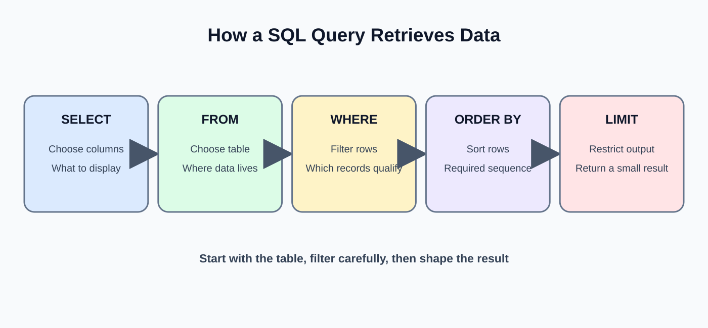
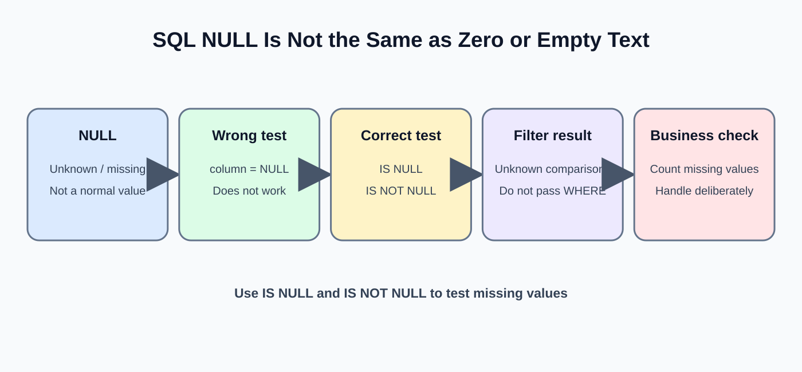
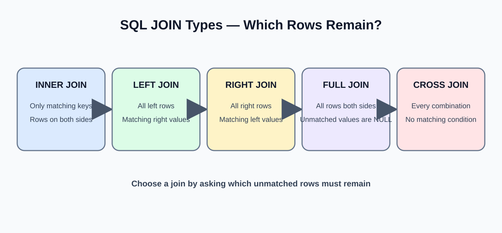
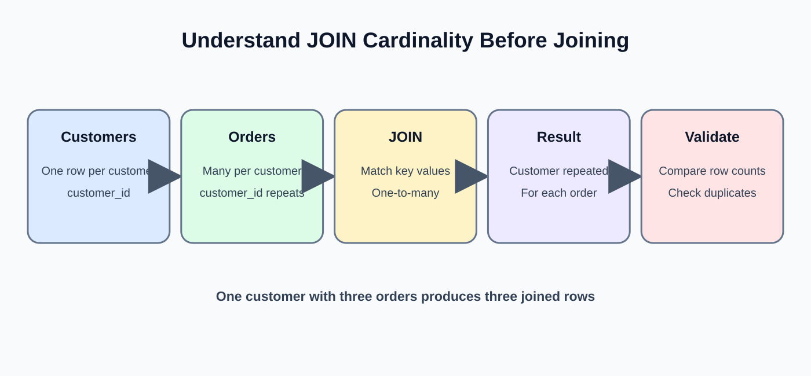

# Day 21: SQL Data Extraction
**Phase:** 3 — SQL and Database Engineering  
**Mini-project:** Multi-Table Extraction Queries  
**Learning time:** 2–3 hours  
**Audience:** Students who are new to SQL and relational databases  
**SQL dialect:** PostgreSQL for execution; portable SQL is used where possible.

---

## 1. What you will learn today

In Day 19, you learned why databases store data in related tables. In Day 20, you created tables and inserted records. Today, you will learn how to **read the information back**.

Imagine you work as a junior Data Engineer at TechStore, an online shopping company. The operations manager asks:

- Show me all customers.
- Show only customers from Hyderabad.
- Show the most expensive products first.
- Show every order with the customer's name.
- Show all customers, even customers who have never ordered.
- Show each product purchased in every order.

These are data-extraction tasks. SQL's SELECT statement is the main tool.

Do not try to memorize all the queries at once. We will start with one table and one condition, then gradually combine tables.

### Learning outcomes

By the end, you should be able to:

1. Explain SELECT and FROM in your own words.
2. Select only the columns a task needs.
3. Filter records with WHERE.
4. Combine conditions with AND, OR and NOT.
5. Use IN, BETWEEN, LIKE and IS NULL.
6. Remove duplicate result combinations with DISTINCT.
7. Sort results using ORDER BY.
8. Limit and paginate result sets.
9. Explain why relational tables are joined.
10. Write INNER JOIN, LEFT JOIN and RIGHT JOIN queries.
11. Read a multi-table query without getting lost.
12. Detect duplicate rows caused by one-to-many relationships.
13. Validate an extract before delivering it to another system.

---

## 2. First understand the business problem

A database can contain thousands or millions of records. A manager rarely needs every record and every column.

For example, the customers table may contain customer ID, name, email and city. If the manager asks for customer names and cities, returning passwords, phone numbers or unrelated fields would be unnecessary and potentially unsafe.

A Data Engineer should ask four questions before writing an extraction query:

1. **Which table contains the information?**
2. **Which columns are required?**
3. **Which rows should be included?**
4. **How should the result be ordered?**

When more than one table is needed, ask one more question:

5. **Which key connects the tables?**

This simple checklist prevents many beginner mistakes.

---

## 3. Prepare and inspect the TechStore training database

We will continue using the same TechStore database created in Day 20. The expected training records are shown below. If you have not completed Day 20, complete its setup first.

### 3.1 Customers table

| customer_id | customer_name | email | city |
|---:|---|---|---|
| 1 | Asha | asha@example.com | Hyderabad |
| 2 | Ravi | ravi@example.com | Chennai |
| 3 | Meena | meena@example.com | Bengaluru |

Meaning: one row represents one customer. customer_id identifies the customer.

### 3.2 Products table

| product_id | product_name | category | price |
|---:|---|---|---:|
| 101 | Keyboard | Accessories | 1200 |
| 102 | Mouse | Accessories | 700 |
| 103 | Monitor | Electronics | 8500 |
| 104 | Laptop Stand | Accessories | 1500 |

Meaning: one row represents one product in the store catalogue.

### 3.3 Orders table

| order_id | customer_id | order_date | order_status |
|---:|---:|---|---|
| 5001 | 1 | 2026-11-01 | PLACED |
| 5002 | 2 | 2026-11-02 | SHIPPED |
| 5003 | 1 | 2026-11-03 | PLACED |

Notice that customer_id is stored here too. It tells us which customer placed each order.

### 3.4 Order items table

| order_item_id | order_id | product_id | quantity | unit_price |
|---:|---:|---:|---:|---:|
| 1 | 5001 | 101 | 1 | 1200 |
| 2 | 5001 | 102 | 2 | 700 |
| 3 | 5002 | 103 | 1 | 8500 |
| 4 | 5003 | 104 | 2 | 1500 |

An order can contain multiple products. Therefore, order_id can repeat in order_items. This is not a duplicate mistake; it represents multiple lines in one order.

### 3.5 Check that your database contains the expected rows

Run one query at a time:

```sql
SELECT * FROM customers;
```

Expected: 3 rows.

```sql
SELECT * FROM products;
```

Expected: 4 rows.

```sql
SELECT * FROM orders;
```

Expected: 3 rows.

```sql
SELECT * FROM order_items;
```

Expected: 4 rows.

If your results differ, do not blindly continue. Check whether the Day 20 setup was completed, whether you are connected to the correct database, and whether the sample rows were inserted successfully.

---

## 4. What is a SQL query?

A query is a request sent to a database. It asks the database to return information or perform an operation.

For example:

```sql
SELECT customer_name
FROM customers;
```

Read it like a sentence:

"Select the customer_name column from the customers table."

- SELECT tells the database what information to return.
- customer_name is the column we want.
- FROM tells the database where to get the information.
- customers is the table name.
- The semicolon marks the end of the SQL statement in common SQL clients.

SQL is declarative. You describe the result you want; the database engine chooses an execution plan.

---

## 5. SELECT: choose the columns



### 5.1 Return one column

Task: The manager wants only customer names.

```sql
SELECT customer_name
FROM customers;
```

Expected result:

| customer_name |
|---|
| Asha |
| Ravi |
| Meena |

Explanation:

1. SQL opens the customers table as the source.
2. It returns the customer_name value from each qualifying row.
3. It does not return email or city because we did not request those columns.

The database does not delete or change the other columns. They are simply not included in this result.

### 5.2 Return more than one column

Task: Show each customer's name and city.

```sql
SELECT customer_name, city
FROM customers;
```

Expected result:

| customer_name | city |
|---|---|
| Asha | Hyderabad |
| Ravi | Chennai |
| Meena | Bengaluru |

A comma separates selected columns. The order in the SELECT list controls the order of columns in the output.

Try changing the order:

```sql
SELECT city, customer_name
FROM customers;
```

Now city appears first. The stored table has not changed.

### 5.3 What does SELECT * mean?

The asterisk means all columns.

```sql
SELECT *
FROM customers;
```

Expected columns: customer_id, customer_name, email, city.

This is useful when learning a new table or inspecting a small sample. However, avoid using SELECT * by default in production extraction jobs.

Why?

- It returns columns the next step may not need.
- A new column added to the table can unexpectedly change the output.
- It may transfer unnecessary data across the network.
- Sensitive fields may be exposed accidentally.
- Downstream code can break if the output schema changes.

**Beginner rule:** Use SELECT * for quick inspection; use explicit column names for a reliable extract.

### 5.4 Give a result column a readable name with AS

Task: The report should display customer_name as customer.

```sql
SELECT customer_name AS customer,
       city AS customer_city
FROM customers;
```

Expected headings: customer, customer_city.

AS creates an alias for the output column. It does not rename the original database column.

You can also alias a table:

```sql
SELECT c.customer_name
FROM customers AS c;
```

Here c is a short name for customers. It is useful in multi-table queries.

---

## 6. WHERE: choose which rows to return

SELECT chooses columns. WHERE chooses rows.

Imagine the customers table has 10,000 customers. The manager asks for customers from Hyderabad only. We should not manually inspect all 10,000 rows.

### 6.1 Filter with equality

```sql
SELECT customer_name, city
FROM customers
WHERE city = 'Hyderabad';
```

Expected result:

| customer_name | city |
|---|---|
| Asha | Hyderabad |

The equals sign compares the city value with the text Hyderabad.

Text values are written inside single quotes. Column names are not placed inside quotes.

Correct: city = 'Hyderabad'  
Incorrect: 'city' = 'Hyderabad'

The incorrect version compares two text constants; it does not refer to the city column.

### 6.2 Filter numeric values

Task: Show products costing more than 1,000.

```sql
SELECT product_name, price
FROM products
WHERE price > 1000;
```

Expected result:

| product_name | price |
|---|---:|
| Keyboard | 1200 |
| Monitor | 8500 |
| Laptop Stand | 1500 |

The Mouse is excluded because 700 is not greater than 1000.

### 6.3 Comparison operators

| Operator | Meaning | Example |
|---|---|---|
| = | Equal to | price = 700 |
| <> | Not equal to | city <> 'Chennai' |
| != | Not equal to in many DBMSs | city != 'Chennai' |
| > | Greater than | price > 1000 |
| < | Less than | price < 1000 |
| >= | Greater than or equal | price >= 1200 |
| <= | Less than or equal | price <= 1200 |

For portable SQL, prefer <> for not equal.

### 6.4 Greater than or equal

```sql
SELECT product_name, price
FROM products
WHERE price >= 1200;
```

Expected: Keyboard, Monitor and Laptop Stand.

Notice that Keyboard at exactly 1200 is included. The equals part matters.

### 6.5 Not equal

```sql
SELECT customer_name, city
FROM customers
WHERE city <> 'Chennai';
```

Expected: Asha/Hyderabad and Meena/Bengaluru.

This excludes Ravi because his city is Chennai.

---

## 7. AND: both conditions must be true

Task: Find Accessories products costing more than 1,000.

```sql
SELECT product_name, category, price
FROM products
WHERE category = 'Accessories'
  AND price > 1000;
```

Expected:

| product_name | category | price |
|---|---|---:|
| Keyboard | Accessories | 1200 |
| Laptop Stand | Accessories | 1500 |

AND means both conditions must be true for a row to qualify.

Check each product:

| Product | Is Accessories? | Price > 1000? | Included? |
|---|---|---|---|
| Keyboard | Yes | Yes | Yes |
| Mouse | Yes | No | No |
| Monitor | No | Yes | No |
| Laptop Stand | Yes | Yes | Yes |

This table is how you should reason about a WHERE condition before writing more complicated SQL.

---

## 8. OR: at least one condition must be true

Task: Find customers from Hyderabad or Bengaluru.

```sql
SELECT customer_name, city
FROM customers
WHERE city = 'Hyderabad'
   OR city = 'Bengaluru';
```

Expected: Asha/Hyderabad and Meena/Bengaluru.

OR includes a row if either condition is true.

### 8.1 AND and OR together

Task: Find Accessories products that cost more than 1,000 OR the Monitor.

```sql
SELECT product_name, category, price
FROM products
WHERE category = 'Accessories'
  AND price > 1000
   OR product_name = 'Monitor';
```

SQL evaluates AND before OR. The condition is interpreted as:

(category = Accessories AND price > 1000) OR (product_name = Monitor).

Expected: Keyboard, Monitor and Laptop Stand.

### 8.2 Use parentheses to make the intention clear

Suppose the business asks for Accessories products that cost more than 1,000 or equal 700. The intended meaning is category must be Accessories, and either price condition may qualify.

```sql
SELECT product_name, price
FROM products
WHERE category = 'Accessories'
  AND (price > 1000 OR price = 700);
```

Expected: Keyboard, Mouse and Laptop Stand.

Parentheses group conditions. Use them whenever mixed AND/OR logic could be misunderstood.

---

## 9. IN: match one value from a list

A long OR condition becomes difficult to read.

Instead of:

```sql
SELECT customer_name, city
FROM customers
WHERE city = 'Hyderabad'
   OR city = 'Bengaluru'
   OR city = 'Chennai';
```

Use IN:

```sql
SELECT customer_name, city
FROM customers
WHERE city IN ('Hyderabad', 'Bengaluru', 'Chennai');
```

Expected: all three customers.

IN means the value must match at least one item in the list.

A value not present in the list is excluded.

### 9.1 NOT IN

```sql
SELECT customer_name, city
FROM customers
WHERE city NOT IN ('Chennai');
```

Expected: Asha and Meena.

Important NULL warning: NOT IN can behave unexpectedly if the list or subquery contains NULL. SQL uses three-valued logic (TRUE, FALSE, UNKNOWN). For anti-join logic, NOT EXISTS is often safer when NULLs may occur.

---

## 10. BETWEEN: filter an inclusive range

Task: Find products priced from 700 to 1,500.

```sql
SELECT product_name, price
FROM products
WHERE price BETWEEN 700 AND 1500
ORDER BY price;
```

Expected:

| product_name | price |
|---|---:|
| Mouse | 700 |
| Keyboard | 1200 |
| Laptop Stand | 1500 |

BETWEEN includes both endpoints. It is equivalent to:

```sql
WHERE price >= 700 AND price <= 1500
```

For timestamps, be careful. BETWEEN includes the ending timestamp too. For a full calendar day in timestamp columns, a half-open range is usually safer:

```sql
WHERE order_date >= TIMESTAMP '2026-11-01 00:00:00'
  AND order_date <  TIMESTAMP '2026-11-02 00:00:00'
```

This includes the first day and excludes midnight at the start of the next day.

---

## 11. LIKE: search for a text pattern

LIKE is useful when the business does not know the full text value.

Two important wildcard characters:

- % means zero or more characters.
- _ means exactly one character.

### 11.1 Names beginning with A

```sql
SELECT customer_name
FROM customers
WHERE customer_name LIKE 'A%';
```

Expected: Asha.

The pattern A% means the first character must be A; anything may follow.

### 11.2 Names ending with a

```sql
SELECT customer_name
FROM customers
WHERE customer_name LIKE '%a';
```

Expected: Asha and Meena.

### 11.3 Names containing vi

```sql
SELECT customer_name
FROM customers
WHERE customer_name LIKE '%vi%';
```

Expected: Ravi.

### 11.4 One-character wildcard

```sql
SELECT product_name
FROM products
WHERE product_name LIKE 'M_use';
```

Expected: Mouse.

The underscore represents exactly one character between M and use.

### 11.5 Case sensitivity

In PostgreSQL, LIKE is case-sensitive. ILIKE performs a case-insensitive pattern match.

```sql
SELECT customer_name
FROM customers
WHERE customer_name ILIKE 'a%';
```

Expected: Asha.

ILIKE is PostgreSQL-specific. MySQL's default case behavior depends on the collation. Always understand the database's text comparison rules.

---

## 12. NULL: understand missing or unknown values



NULL is not the number zero. NULL is not an empty string. NULL means the value is missing or unknown.

SQL cannot test NULL using = NULL.

Incorrect:

```sql
SELECT customer_name
FROM customers
WHERE city = NULL;
```

Correct:

```sql
SELECT customer_name
FROM customers
WHERE city IS NULL;
```

To find rows where city has a value:

```sql
SELECT customer_name
FROM customers
WHERE city IS NOT NULL;
```

The current sample has no NULL city, so the first query returns zero rows and the second returns three.

### 12.1 Why does = NULL not work?

A comparison with NULL generally produces UNKNOWN, not TRUE or FALSE. WHERE keeps only rows where the condition is TRUE.

This is called three-valued logic:

- TRUE
- FALSE
- UNKNOWN

This is why IS NULL and IS NOT NULL are required.

### 12.2 A safe NULL demonstration

Use a temporary result without changing the main customer data:

```sql
SELECT
    CASE
        WHEN NULL IS NULL THEN 'Missing value detected'
        ELSE 'Value exists'
    END AS null_check;
```

Expected: Missing value detected.

---

## 13. DISTINCT: remove duplicate result combinations

Imagine the orders table has many rows and you want the list of cities represented by customers who ordered. A normal query may repeat a city. DISTINCT removes duplicate combinations from the selected output.

```sql
SELECT city
FROM customers
ORDER BY city;
```

Expected: Bengaluru, Chennai, Hyderabad.

Now imagine customers can share the same city. This query would show repeated city names.

```sql
SELECT DISTINCT city
FROM customers
ORDER BY city;
```

DISTINCT returns one copy of each distinct selected value.

Important: DISTINCT applies to the complete selected column combination.

```sql
SELECT DISTINCT city, customer_name
FROM customers;
```

This does not mean one row per city. Since each customer name differs, the pairs are different.

Do not use DISTINCT to hide an incorrect JOIN. First understand why duplicates exist.

---

## 14. ORDER BY: sort the result

Without ORDER BY, SQL does not promise a particular row order.

Task: Show products from cheapest to most expensive.

```sql
SELECT product_name, price
FROM products
ORDER BY price ASC;
```

Expected:

| product_name | price |
|---|---:|
| Mouse | 700 |
| Keyboard | 1200 |
| Laptop Stand | 1500 |
| Monitor | 8500 |

ASC means ascending order. It is the default when no direction is specified.

### 14.1 Descending order

```sql
SELECT product_name, price
FROM products
ORDER BY price DESC;
```

Expected: Monitor, Laptop Stand, Keyboard, Mouse.

DESC means descending order, from highest to lowest for numeric values.

### 14.2 Sort using more than one column

```sql
SELECT category, product_name, price
FROM products
ORDER BY category ASC, price DESC;
```

First, rows are grouped in category order. Within each category, products are sorted by price from high to low.

### 14.3 Stable ordering

If two rows have the same price, ordering only by price does not define which tied row appears first. Add a unique tie-breaker:

```sql
SELECT product_id, product_name, price
FROM products
ORDER BY price DESC, product_id ASC;
```

This gives deterministic ordering for the sample.

---

## 15. LIMIT and OFFSET: control how many rows are returned

Task: Show the two most expensive products.

```sql
SELECT product_name, price
FROM products
ORDER BY price DESC
LIMIT 2;
```

Expected: Monitor and Laptop Stand.

LIMIT 2 means return at most two rows.

Without ORDER BY, LIMIT may return any two rows according to the chosen execution plan. Always define an order when the business asks for top or latest records.

### 15.1 OFFSET

```sql
SELECT product_name, price
FROM products
ORDER BY price DESC
LIMIT 2 OFFSET 1;
```

Expected: Laptop Stand and Keyboard.

OFFSET 1 skips the first row, then LIMIT 2 returns the next two.

### 15.2 Pagination

A report page may show 10 rows at a time.

- Page 1: LIMIT 10 OFFSET 0
- Page 2: LIMIT 10 OFFSET 10
- Page 3: LIMIT 10 OFFSET 20

Large OFFSET values can become inefficient because the database may still need to find and skip earlier rows. If data changes while pages are being fetched, rows can shift between pages.

For large and changing datasets, keyset pagination is often more reliable.

### 15.3 Keyset pagination idea

Suppose order_id is unique and increasing. After reading the last order_id 5002, ask for the next page:

```sql
SELECT order_id, order_date
FROM orders
WHERE order_id > 5002
ORDER BY order_id
LIMIT 100;
```

This is a simple keyset pattern. In a production system, use the correct stable ordering key or a composite cursor when ordering by multiple columns.

---

## 16. Why do we need JOIN?

Until now, we have read one table at a time.

But business questions often need information stored in different tables.

Example: The orders table contains order_id and customer_id. It does not contain the customer's name.

The customers table contains customer_id and customer_name.

We need to connect these tables using customer_id.

### 16.1 Understand the relationship first

Customers:

| customer_id | customer_name |
|---:|---|
| 1 | Asha |
| 2 | Ravi |
| 3 | Meena |

Orders:

| order_id | customer_id |
|---:|---:|
| 5001 | 1 |
| 5002 | 2 |
| 5003 | 1 |

The matching values are:

- Customer 1 matches orders 5001 and 5003.
- Customer 2 matches order 5002.
- Customer 3 has no matching order.

The customer_id in orders is a foreign key referencing customers.customer_id.

A JOIN combines rows based on a relationship condition.

---

## 17. INNER JOIN: return matching rows only



Think of INNER JOIN as: "Show me records where the relationship exists in both tables."

### 17.1 First INNER JOIN

```sql
SELECT customers.customer_name,
       orders.order_id
FROM customers
INNER JOIN orders
    ON customers.customer_id = orders.customer_id;
```

Expected matching rows:

| customer_name | order_id |
|---|---:|
| Asha | 5001 |
| Ravi | 5002 |
| Asha | 5003 |

Meena is not shown because no order matches customer_id 3.

### 17.2 Understand each line

- SELECT chooses the output columns.
- FROM customers makes customers the left/source table.
- INNER JOIN orders asks SQL to match rows from orders.
- ON defines how the two tables are related.
- customers.customer_id = orders.customer_id compares the key values.

A JOIN without the correct ON condition can produce incorrect results.

### 17.3 Use table aliases

Long table names make queries harder to read.

```sql
SELECT c.customer_name,
       o.order_id
FROM customers AS c
INNER JOIN orders AS o
    ON c.customer_id = o.customer_id;
```

c means customers. o means orders.

The output is the same as the previous query.

### 17.4 Why does Asha appear twice?

Asha placed two orders. The relationship is one customer to many orders.

One row in customers can match multiple rows in orders. SQL returns one result row for each matching pair.

This is expected behavior, not necessarily duplication.

### 17.5 INNER JOIN with a filter

Task: Show orders placed by customers from Hyderabad.

```sql
SELECT c.customer_name,
       c.city,
       o.order_id,
       o.order_status
FROM customers AS c
INNER JOIN orders AS o
    ON c.customer_id = o.customer_id
WHERE c.city = 'Hyderabad'
ORDER BY o.order_id;
```

Expected: Asha, Hyderabad, 5001, PLACED and Asha, Hyderabad, 5003, PLACED.

The JOIN first connects the related rows logically; WHERE filters the resulting qualifying rows. The optimizer may choose a different physical execution order.

---

## 18. LEFT JOIN: keep every row from the left table

Business question: Show all customers and their orders. Include customers even if they have never ordered.

INNER JOIN cannot show Meena because she has no matching order.

LEFT JOIN preserves every row from the left table.

```sql
SELECT c.customer_name,
       o.order_id
FROM customers AS c
LEFT JOIN orders AS o
    ON c.customer_id = o.customer_id
ORDER BY c.customer_id, o.order_id;
```

Expected:

| customer_name | order_id |
|---|---:|
| Asha | 5001 |
| Asha | 5003 |
| Ravi | 5002 |
| Meena | NULL |

Meena is retained. Since no order matches, the order columns contain NULL in the result.

### 18.1 How to remember LEFT JOIN

The left table is the table immediately after FROM.

In this query:

```sql
FROM customers AS c
LEFT JOIN orders AS o
```

customers is on the left. Every customer is preserved.

If you reverse the tables, the preserved side changes.

### 18.2 Find customers who have never ordered

A useful anti-join pattern is LEFT JOIN plus IS NULL on a non-nullable right-side key.

```sql
SELECT c.customer_id,
       c.customer_name
FROM customers AS c
LEFT JOIN orders AS o
    ON c.customer_id = o.customer_id
WHERE o.order_id IS NULL;
```

Expected: Meena only.

Why does it work?

1. LEFT JOIN keeps all customers.
2. Customers with orders receive a matching order_id.
3. Customers without orders receive NULL for order columns.
4. WHERE keeps only rows where order_id is NULL.

Use a right-side column that cannot be NULL for a real matching row, such as the order primary key.

### 18.3 A common LEFT JOIN mistake

Consider:

```sql
SELECT c.customer_name, o.order_status
FROM customers AS c
LEFT JOIN orders AS o
    ON c.customer_id = o.customer_id
WHERE o.order_status = 'PLACED';
```

This removes customers with no order because their order_status is NULL and the WHERE condition is not TRUE.

If the requirement is to keep all customers and attach only PLACED orders, put the status filter in ON:

```sql
SELECT c.customer_name, o.order_status
FROM customers AS c
LEFT JOIN orders AS o
    ON c.customer_id = o.customer_id
   AND o.order_status = 'PLACED'
ORDER BY c.customer_id;
```

Now customers without a PLACED order remain.

This difference is one of the most important LEFT JOIN interview topics.

---

## 19. RIGHT JOIN: preserve every row from the right table

RIGHT JOIN is the mirror image of LEFT JOIN.

```sql
SELECT c.customer_name,
       o.order_id
FROM customers AS c
RIGHT JOIN orders AS o
    ON c.customer_id = o.customer_id
ORDER BY o.order_id;
```

Expected: three rows for orders 5001, 5002 and 5003.

Every row from the right table (orders) is preserved. In this sample, every order has a valid customer because of the foreign key.

### 19.1 Rewrite RIGHT JOIN as LEFT JOIN

Many teams prefer LEFT JOIN because it is easier to read consistently.

The equivalent query is:

```sql
SELECT c.customer_name,
       o.order_id
FROM orders AS o
LEFT JOIN customers AS c
    ON c.customer_id = o.customer_id
ORDER BY o.order_id;
```

The preserved table is now orders on the left.

RIGHT JOIN is valid SQL, but a LEFT JOIN rewrite often makes query flow easier to follow.

---

## 20. Understand JOIN row counts before writing reports



A JOIN does not always return the same number of rows as either input table.

In our sample:

- customers contains 3 rows.
- orders contains 3 rows.
- order_items contains 4 rows.

A customer may have multiple orders. An order may have multiple order items.

If a customer has two orders and each order has three items, joining customer to order items through orders can produce six rows for that customer.

This is called one-to-many row multiplication.

It is not automatically wrong. It becomes a problem when you expect one row per customer but receive one row per order item.

### 20.1 Count the joined rows

```sql
SELECT COUNT(*) AS joined_rows
FROM customers AS c
INNER JOIN orders AS o
    ON c.customer_id = o.customer_id;
```

Expected: 3.

### 20.2 Count distinct customers

```sql
SELECT COUNT(DISTINCT c.customer_id) AS customers_with_orders
FROM customers AS c
INNER JOIN orders AS o
    ON c.customer_id = o.customer_id;
```

Expected: 2.

COUNT(*) counts joined rows. COUNT(DISTINCT customer_id) counts unique customer IDs.

Do not assume these counts are interchangeable.

---

## 21. JOIN three or more tables

Business question: Show the customer name, order ID and product name for every product line purchased.

We need four tables:

1. customers gives customer names.
2. orders connects customers to orders.
3. order_items connects orders to product lines.
4. products gives product names.

### 21.1 Build the query one relationship at a time

First connect customers and orders:

```sql
SELECT c.customer_name, o.order_id
FROM customers AS c
JOIN orders AS o
  ON c.customer_id = o.customer_id;
```

Expected: three customer-order rows.

Next add order_items:

```sql
SELECT c.customer_name,
       o.order_id,
       oi.product_id,
       oi.quantity
FROM customers AS c
JOIN orders AS o
  ON c.customer_id = o.customer_id
JOIN order_items AS oi
  ON o.order_id = oi.order_id;
```

Expected: four order-item rows.

Finally add products:

```sql
SELECT c.customer_name,
       o.order_id,
       p.product_name,
       oi.quantity
FROM customers AS c
JOIN orders AS o
  ON c.customer_id = o.customer_id
JOIN order_items AS oi
  ON o.order_id = oi.order_id
JOIN products AS p
  ON oi.product_id = p.product_id
ORDER BY o.order_id, oi.order_item_id;
```

Expected:

| customer_name | order_id | product_name | quantity |
|---|---:|---|---:|
| Asha | 5001 | Keyboard | 1 |
| Asha | 5001 | Mouse | 2 |
| Ravi | 5002 | Monitor | 1 |
| Asha | 5003 | Laptop Stand | 2 |

Notice Asha appears three times because she has three order-item lines across two orders.

### 21.2 Add a calculated output column

A line total is quantity multiplied by unit price.

```sql
SELECT o.order_id,
       p.product_name,
       oi.quantity,
       oi.unit_price,
       oi.quantity * oi.unit_price AS line_total
FROM orders AS o
JOIN order_items AS oi
  ON o.order_id = oi.order_id
JOIN products AS p
  ON oi.product_id = p.product_id
ORDER BY o.order_id, oi.order_item_id;
```

Expected line totals:

| order_id | product_name | quantity | unit_price | line_total |
|---:|---|---:|---:|---:|
| 5001 | Keyboard | 1 | 1200 | 1200 |
| 5001 | Mouse | 2 | 700 | 1400 |
| 5002 | Monitor | 1 | 8500 | 8500 |
| 5003 | Laptop Stand | 2 | 1500 | 3000 |

The AS line_total alias labels the calculated expression. It does not create a stored column.

---

## 22. CROSS JOIN and Cartesian products

A CROSS JOIN returns every possible combination of rows from two inputs.

If the first table has 3 rows and the second has 4 rows, the result has 3 × 4 = 12 rows.

```sql
SELECT c.customer_name,
       p.product_name
FROM customers AS c
CROSS JOIN products AS p;
```

Expected: 12 combinations.

This can be useful when deliberately creating a customer-product matrix, but it is usually a mistake when a relationship condition was forgotten.

A query like:

```sql
SELECT c.customer_name, o.order_id
FROM customers AS c, orders AS o;
```

also creates a Cartesian product because no join condition was provided.

**Debugging clue:** If a query unexpectedly returns far more rows than expected, inspect every JOIN condition and row relationship.

---

## 23. Common JOIN mistakes and their corrections

### Mistake 1: Missing the ON condition

Problem: unrelated rows combine.

Correction: identify the primary key and matching foreign key, then write the correct ON expression.

### Mistake 2: Joining columns with different meanings

Problem: customer_id is accidentally matched with order_id.

Correction: inspect table definitions and relationships before joining.

### Mistake 3: Forgetting that one-to-many relationships create multiple rows

Problem: the student expects one row per customer but sees one row per order.

Correction: decide the intended output grain first. If the report needs one row per customer, aggregate or select one record per customer after understanding the business rule.

### Mistake 4: Using DISTINCT to hide duplicates

Problem: DISTINCT hides an incorrect join rather than fixing it.

Correction: inspect row counts, keys and join conditions.

### Mistake 5: Filtering the right table in WHERE after LEFT JOIN

Problem: unmatched left rows disappear.

Correction: if the filter should limit matching right-side records while preserving all left rows, move the condition into ON.

### Mistake 6: Selecting ambiguous column names

Problem: both tables have customer_id and the query uses an unqualified name.

Correction: write c.customer_id or o.customer_id.

### Mistake 7: Assuming output order

Problem: the query has no ORDER BY but the report expects a fixed sequence.

Correction: specify a complete ORDER BY, including tie-breakers if required.

### Mistake 8: Using SELECT * in a multi-table join

Problem: duplicate column names and unnecessary fields make the result difficult to use.

Correction: select and alias the required fields explicitly.

---

## 24. How SQL logically processes a query

A useful beginner mental model for a SELECT statement is:

1. FROM and JOIN identify the source rows.
2. ON determines matching rows.
3. WHERE filters rows.
4. GROUP BY forms groups if aggregation is used.
5. HAVING filters groups.
6. SELECT produces requested expressions.
7. DISTINCT removes duplicate output combinations.
8. ORDER BY sorts the final result.
9. LIMIT and OFFSET restrict the returned page.

This is a logical explanation, not a promise about the database's physical execution order. The query optimizer can choose a different plan while preserving the query's meaning.

---

## 25. Data extraction quality checks

A Data Engineer should not send a query result to another system without checking it.

### Check 1: Does the result have the expected columns?

Read the SELECT list and confirm the output schema.

### Check 2: Is the row count reasonable?

```sql
SELECT COUNT(*)
FROM orders;
```

Expected: 3.

Compare the expected count with the result of the extraction query.

### Check 3: Are key values duplicated unexpectedly?

```sql
SELECT order_id, COUNT(*) AS line_count
FROM order_items
GROUP BY order_id
ORDER BY order_id;
```

Expected: order 5001 has 2 lines, order 5002 has 1, order 5003 has 1.

This repetition is valid because the output grain is one order item.

### Check 4: Are unmatched relationships present?

```sql
SELECT o.order_id
FROM orders AS o
LEFT JOIN customers AS c
  ON o.customer_id = c.customer_id
WHERE c.customer_id IS NULL;
```

Expected: zero rows, assuming the foreign key is enforced.

### Check 5: Do business totals reconcile?

```sql
SELECT SUM(quantity * unit_price) AS total_order_line_value
FROM order_items;
```

Expected: 14100.

A multi-table extract should not accidentally change this total because of an incorrect join.

---

## 26. Mini-project: Multi-Table Extraction Queries

### Business situation

The TechStore operations manager wants a small extract for a weekly business review. You are responsible for writing SQL queries that return correct and useful data.

### Task 1: Customer directory

Return customer ID, customer name and city, sorted by name.

```sql
SELECT customer_id, customer_name, city
FROM customers
ORDER BY customer_name;
```

Expected: Asha, Meena, Ravi.

### Task 2: Hyderabad customers

Return customers from Hyderabad.

```sql
SELECT customer_id, customer_name, email
FROM customers
WHERE city = 'Hyderabad';
```

Expected: Asha only.

### Task 3: Product price list

Return all products from highest price to lowest price.

```sql
SELECT product_id, product_name, price
FROM products
ORDER BY price DESC, product_id;
```

Expected order: Monitor, Laptop Stand, Keyboard, Mouse.

### Task 4: Mid-range products

Return products priced between 700 and 1500 inclusive.

```sql
SELECT product_name, price
FROM products
WHERE price BETWEEN 700 AND 1500
ORDER BY price;
```

Expected: Mouse, Keyboard, Laptop Stand.

### Task 5: Orders with customer names

```sql
SELECT o.order_id,
       o.order_date,
       c.customer_name,
       o.order_status
FROM orders AS o
INNER JOIN customers AS c
  ON o.customer_id = c.customer_id
ORDER BY o.order_date, o.order_id;
```

Expected: three orders with Asha, Ravi and Asha.

### Task 6: All customers, including those without orders

```sql
SELECT c.customer_id,
       c.customer_name,
       o.order_id
FROM customers AS c
LEFT JOIN orders AS o
  ON c.customer_id = o.customer_id
ORDER BY c.customer_id, o.order_id;
```

Expected: four rows, including Meena with NULL order_id.

### Task 7: Customers with no orders

```sql
SELECT c.customer_id, c.customer_name
FROM customers AS c
LEFT JOIN orders AS o
  ON c.customer_id = o.customer_id
WHERE o.order_id IS NULL;
```

Expected: Meena.

### Task 8: Detailed order lines

```sql
SELECT o.order_id,
       o.order_date,
       c.customer_name,
       p.product_name,
       oi.quantity,
       oi.unit_price,
       oi.quantity * oi.unit_price AS line_total
FROM orders AS o
JOIN customers AS c
  ON o.customer_id = c.customer_id
JOIN order_items AS oi
  ON o.order_id = oi.order_id
JOIN products AS p
  ON oi.product_id = p.product_id
ORDER BY o.order_id, oi.order_item_id;
```

Expected: four detail rows with line totals 1200, 1400, 8500 and 3000.

### Task 9: Top two products by price

```sql
SELECT product_name, price
FROM products
ORDER BY price DESC, product_id
LIMIT 2;
```

Expected: Monitor and Laptop Stand.

### Task 10: Unique product categories

```sql
SELECT DISTINCT category
FROM products
ORDER BY category;
```

Expected: Accessories and Electronics.

### Project submission checklist

- [ ] Save every query in a file named day21_extraction_lab.sql.
- [ ] Run each query in the TechStore training database.
- [ ] Save screenshots or result exports.
- [ ] Write the expected row count next to each task.
- [ ] Explain why each task uses INNER JOIN or LEFT JOIN.
- [ ] Explain why order 5001 appears twice in the detail extract.
- [ ] Verify the total line value is 14100.
- [ ] Do not use DISTINCT to hide unexplained row multiplication.

---

## 27. Beginner practice exercises

Try these without looking at the solutions first.

1. Return all product names.
2. Return customers from Chennai.
3. Find products costing less than 1,500.
4. Find products in Accessories category.
5. Find customers from Hyderabad or Chennai.
6. Find products priced from 1,000 to 8,500.
7. Find customer names beginning with M.
8. Sort customers by city and then customer name.
9. Return the cheapest two products.
10. Show each order with its customer name.
11. Show every customer, including customers without an order.
12. Find customers who never placed an order.
13. Show every order item with the product name.
14. Explain why the order-item report contains four rows.
15. Explain why a CROSS JOIN between customers and products contains twelve rows.

### Exercise answers

1. SELECT product_name FROM products;
2. SELECT customer_name FROM customers WHERE city = 'Chennai';
3. SELECT product_name, price FROM products WHERE price < 1500;
4. SELECT product_name FROM products WHERE category = 'Accessories';
5. SELECT customer_name, city FROM customers WHERE city IN ('Hyderabad', 'Chennai');
6. SELECT product_name, price FROM products WHERE price BETWEEN 1000 AND 8500;
7. SELECT customer_name FROM customers WHERE customer_name LIKE 'M%';
8. SELECT customer_name, city FROM customers ORDER BY city, customer_name;
9. SELECT product_name, price FROM products ORDER BY price LIMIT 2;
10. INNER JOIN customers and orders on customer_id.
11. LEFT JOIN customers to orders.
12. LEFT JOIN and filter where orders.order_id IS NULL.
13. JOIN order_items to products using product_id.
14. There are four order-item records in the sample.
15. Three customers multiplied by four products equals twelve combinations.

---

## 28. Interview preparation: explain these concepts aloud

1. What is SELECT and why should production queries avoid unnecessary SELECT *?
2. What is the difference between selecting columns and filtering rows?
3. Explain WHERE with a business example.
4. Explain AND and OR with a truth-based example.
5. What is the difference between IN and multiple OR conditions?
6. Why is BETWEEN inclusive?
7. Explain the % and _ wildcards in LIKE.
8. Why do we use IS NULL?
9. What does DISTINCT remove?
10. Why is ORDER BY important when using LIMIT?
11. What is the difference between INNER JOIN and LEFT JOIN?
12. What is the purpose of the ON clause?
13. Why can one customer appear more than once after a JOIN?
14. What is a Cartesian product?
15. How can a LEFT JOIN accidentally behave like an INNER JOIN?
16. Why can DISTINCT hide a data problem?
17. What is the difference between OFFSET pagination and keyset pagination?
18. How would you validate a multi-table extract before sending it downstream?

Use the separate Day 21 interview guide for complete model answers, follow-up questions and scenario discussions.

---

## 29. Day 21 final revision

Remember these ideas:

- SELECT chooses columns.
- FROM identifies the source table.
- WHERE filters rows.
- AND requires both conditions; OR requires at least one.
- IN matches a list of values.
- BETWEEN includes both endpoints.
- LIKE searches text patterns.
- IS NULL checks missing values.
- DISTINCT removes duplicate selected combinations.
- ORDER BY sorts results.
- LIMIT restricts returned rows.
- OFFSET skips rows.
- INNER JOIN returns matching rows.
- LEFT JOIN preserves every row from the left input.
- RIGHT JOIN preserves every row from the right input.
- ON defines the relationship between tables.
- One-to-many joins can legitimately increase row counts.
- A correct extract must be checked for row counts, duplicates, missing relationships and business totals.

**You are ready for Day 22 when you can write a SELECT query, filter data, sort the result and join the four TechStore tables without copying the examples.**
