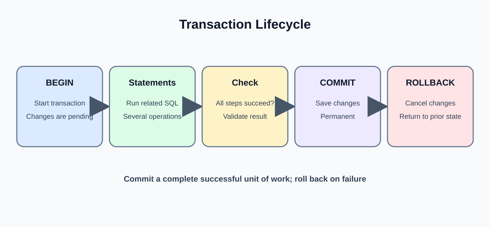
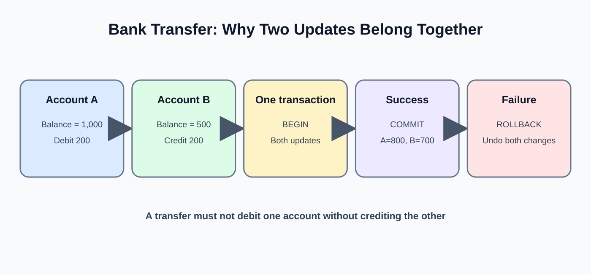
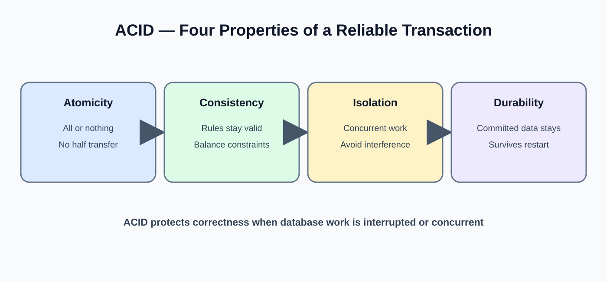
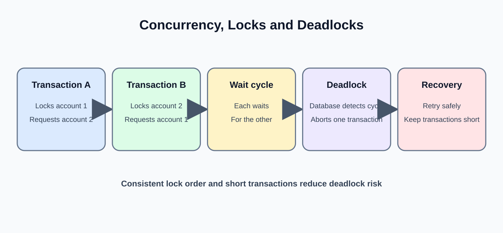

# Day 24: Transactions and ACID Principles
**Phase:** 3 — SQL and Database Engineering  
**Mini-project:** Transaction Simulation  
**Learning time:** 2–3 hours  
**Audience:** Beginners progressing to junior Data Engineer level  
**SQL dialect:** PostgreSQL for the main lab. Concepts also apply to other relational databases, with implementation differences.

---

## 1. Why transactions matter

Imagine a customer transfers ₹1,000 from Bank Account A to Bank Account B.

Two changes are required:
1. Subtract ₹1,000 from Account A.
2. Add ₹1,000 to Account B.

What if the first update succeeds but the second fails?

The database would show money removed from A but not added to B. That is an incomplete business operation.

A transaction groups related database operations so they succeed together or are cancelled together.

Transactions are important in:
- Banking transfers.
- Order placement and inventory reservation.
- Payment processing.
- Ticket booking.
- Updating related business records.
- Data loading jobs that must not leave partial results.

### Learning outcomes

By the end, you can:
1. Explain a database transaction.
2. Use BEGIN, COMMIT and ROLLBACK.
3. Explain ACID: Atomicity, Consistency, Isolation and Durability.
4. Use SAVEPOINT.
5. Understand transaction boundaries.
6. Explain concurrent sessions.
7. Understand dirty reads, non-repeatable reads and phantom reads.
8. Identify isolation levels conceptually.
9. Explain locking and deadlocks at a beginner level.
10. Build a safe transaction simulation.
11. Explain why a Data Engineer must design transaction handling in loaders.

---

## 2. What is a transaction?



A transaction is a group of one or more database operations treated as one logical unit of work.

Think of a food delivery order:
- Create the order.
- Reserve inventory.
- Record payment status.

If the operation cannot be completed according to the business rule, the database should not leave an inconsistent half-finished result.

A transaction normally follows this pattern:

```text
BEGIN
   SQL operation 1
   SQL operation 2
   SQL operation 3
COMMIT
```

If an error occurs before COMMIT, the application may issue ROLLBACK.

Important: a transaction is not automatically a backup. Once committed, ROLLBACK cannot normally undo it. Recovery from committed mistakes requires a compensating operation, point-in-time recovery or another recovery method.

---

## 3. Prepare a disposable practice table

Do not practise transaction experiments on real business data. We will create a small table specifically for this lesson.

Run:

```sql
DROP TABLE IF EXISTS demo_accounts;

CREATE TABLE demo_accounts (
    account_id INTEGER PRIMARY KEY,
    account_holder VARCHAR(80) NOT NULL,
    balance NUMERIC(12, 2) NOT NULL CHECK (balance >= 0)
);

INSERT INTO demo_accounts (account_id, account_holder, balance)
VALUES
    (1, 'Asha', 5000.00),
    (2, 'Ravi', 3000.00);
```

Expected: the table is created and two rows are inserted.

Inspect the starting state:

```sql
SELECT * FROM demo_accounts ORDER BY account_id;
```

Expected:

| account_id | account_holder | balance |
|---:|---|---:|
| 1 | Asha | 5000.00 |
| 2 | Ravi | 3000.00 |

Starting total = ₹8,000.

We will use this table for every demonstration. If your client is already inside an open transaction from a previous error, issue ROLLBACK first.

---

## 4. Understand BEGIN

BEGIN starts a transaction explicitly in PostgreSQL.

```sql
BEGIN;
```

The database starts a transaction for the current session. Subsequent statements belong to that transaction until it is committed or rolled back.

Many database clients run statements in autocommit mode by default. In autocommit mode, a statement outside an explicit transaction is committed automatically when it succeeds. BEGIN lets you group multiple statements.

---

## 5. COMMIT: make changes permanent

Task: Add ₹500 to Asha's balance.

```sql
BEGIN;

UPDATE demo_accounts
SET balance = balance + 500
WHERE account_id = 1;

SELECT * FROM demo_accounts ORDER BY account_id;

COMMIT;
```

Before COMMIT, the current session sees Asha's balance as 5,500. After COMMIT, the change is permanent and visible to other sessions according to normal transaction visibility rules.

Expected final table:

| account_id | account_holder | balance |
|---:|---|---:|
| 1 | Asha | 5500.00 |
| 2 | Ravi | 3000.00 |

The total is now ₹8,500.

**Line explanation:**
- BEGIN starts the unit of work.
- UPDATE changes Asha's row inside the transaction.
- WHERE account_id = 1 limits the update to Asha.
- SELECT lets us inspect the result in the current session.
- COMMIT makes the transaction's changes durable.

---

## 6. ROLLBACK: cancel uncommitted changes

We will now attempt to subtract ₹1,000 from Asha, but cancel the change.

```sql
BEGIN;

UPDATE demo_accounts
SET balance = balance - 1000
WHERE account_id = 1;

SELECT * FROM demo_accounts WHERE account_id = 1;

ROLLBACK;
```

Inside the transaction, Asha's balance appears as 4,500. After ROLLBACK, inspect the table:

```sql
SELECT * FROM demo_accounts ORDER BY account_id;
```

Expected: Asha is back to 5,500 and Ravi remains 3,000.

Rollback cancels changes made in the current uncommitted transaction.

### Important distinction

- ROLLBACK cancels uncommitted work.
- COMMIT completes the transaction.
- ROLLBACK after COMMIT does not undo the committed change.

---

## 7. A two-step transfer simulation



We want to transfer ₹1,000 from Asha to Ravi.

Business rules:
- Asha must have enough money.
- Both updates must succeed together.
- The total balance should remain ₹8,500.

### 7.1 Inspect the initial state

```sql
SELECT * FROM demo_accounts ORDER BY account_id;
```

Expected:
- Asha: 5,500
- Ravi: 3,000
- Total: 8,500

### 7.2 Perform the transfer

```sql
BEGIN;

UPDATE demo_accounts
SET balance = balance - 1000
WHERE account_id = 1
  AND balance >= 1000;

UPDATE demo_accounts
SET balance = balance + 1000
WHERE account_id = 2;

SELECT * FROM demo_accounts ORDER BY account_id;

COMMIT;
```

Expected after commit:

| account_id | account_holder | balance |
|---:|---|---:|
| 1 | Asha | 4500.00 |
| 2 | Ravi | 4000.00 |

Total remains ₹8,500.

### 7.3 Why is the condition balance >= 1000 important?

It prevents the debit statement from reducing Asha below the allowed amount. The CHECK constraint also protects the table from negative balances.

However, a production application must check whether the debit actually updated one row. If no row was updated, the application should not continue with the credit. In a real application, check the affected row count and roll back if the debit did not happen.

### 7.4 A safer SQL-only demonstration with a validation check

PostgreSQL supports procedural blocks, but those are not required for today's basic transaction lesson. The practical rule is:

1. Start a transaction.
2. Execute the debit with a sufficient-balance condition.
3. Verify exactly one row was updated.
4. Execute the credit.
5. Verify the final balances and total.
6. Commit only if every check succeeds; otherwise roll back.

A database driver can inspect the affected-row count and make the commit/rollback decision.

---

## 8. ACID: the four transaction properties



ACID describes four important properties of reliable transactions.

| Letter | Property | Simple meaning |
|---|---|---|
| A | Atomicity | All required changes happen, or none happen |
| C | Consistency | Rules and constraints remain valid |
| I | Isolation | Concurrent transactions do not interfere incorrectly |
| D | Durability | Committed changes survive failures according to the database's durability guarantees |

### 8.1 Atomicity

Atomicity means the transaction is treated as one unit.

For a transfer:
- Debit Asha.
- Credit Ravi.

Both should be committed together. If the credit fails and the application rolls back, the debit should not remain as a partial transfer.

### 8.2 Consistency

Consistency means a transaction moves the database from one valid state to another valid state, respecting declared constraints and application rules.

Examples:
- A primary key remains unique.
- A foreign key references a valid parent row.
- A balance CHECK constraint is satisfied.
- A transfer preserves the business rule that total funds are conserved, assuming no fees or external adjustments.

A database constraint can enforce some rules. Other business rules may require transaction logic or application validation.

### 8.3 Isolation

Isolation concerns concurrent transactions. Multiple users may read and update the database at the same time.

The database must control what each transaction can observe and how conflicting updates are handled.

Without suitable isolation, one transaction might read inconsistent intermediate results or make decisions based on stale data.

### 8.4 Durability

Durability means that once a transaction is successfully committed, the database is designed to preserve that committed change despite a crash, according to its configuration and guarantees.

Durability is supported by mechanisms such as write-ahead logging and recovery. Backups are still needed for disaster recovery and accidental deletion.

---

## 9. SAVEPOINT: create a rollback point inside a transaction

Sometimes a transaction contains several steps, and you want to undo only the later steps while keeping earlier work.

SAVEPOINT creates a named point inside the transaction.

```sql
BEGIN;

UPDATE demo_accounts
SET balance = balance + 200
WHERE account_id = 1;

SAVEPOINT after_asha_credit;

UPDATE demo_accounts
SET balance = balance + 500
WHERE account_id = 2;

ROLLBACK TO SAVEPOINT after_asha_credit;

COMMIT;
```

Effect:
- Asha's ₹200 credit remains committed.
- Ravi's ₹500 credit is cancelled.
- The transaction itself is committed.

Inspect the table to verify the balances.

### 9.1 RELEASE SAVEPOINT

After you no longer need a savepoint, you can release it:

```sql
RELEASE SAVEPOINT after_asha_credit;
```

A savepoint is not a separate transaction. It exists inside the surrounding transaction.

---

## 10. What happens when a statement fails?

In PostgreSQL, an error inside a transaction puts the transaction into an aborted state. You cannot simply continue issuing normal statements as if nothing happened. You need to roll back the transaction or roll back to a savepoint created before the error.

Demonstration:

```sql
BEGIN;

INSERT INTO demo_accounts
    (account_id, account_holder, balance)
VALUES
    (1, 'Duplicate Asha', 100.00);
```

This fails because account_id 1 already exists.

The transaction is now in an aborted state. Issue:

```sql
ROLLBACK;
```

Then continue with a new transaction.

This behavior is important for Python database integration in Day 29. Catching an exception does not automatically make a PostgreSQL transaction usable again; the application must roll it back.

---

## 11. Understand concurrency: two users at the same time

A database may have many active sessions. A session is a connection to the database.

Imagine:
- Session A reads Asha's balance.
- Session B also reads Asha's balance.
- Both try to update the balance.

If the application performs read-modify-write incorrectly, one update can overwrite another. This is a lost update problem.

### 11.1 Open two SQL sessions

Use two separate query windows connected to the same training database.

**Session A:**

```sql
BEGIN;
SELECT balance
FROM demo_accounts
WHERE account_id = 1;
```

**Session B:**

```sql
BEGIN;
SELECT balance
FROM demo_accounts
WHERE account_id = 1;
```

Both sessions can read the current committed balance, subject to isolation level and timing.

Now try an update in Session A:

```sql
UPDATE demo_accounts
SET balance = balance + 100
WHERE account_id = 1;
```

Session A has not committed yet.

In Session B, try:

```sql
UPDATE demo_accounts
SET balance = balance + 200
WHERE account_id = 1;
```

The second update may wait for the row lock held by Session A. Commit Session A:

```sql
COMMIT;
```

Session B can then continue. Commit Session B:

```sql
COMMIT;
```

The final balance should reflect both increments, assuming both updates complete successfully.

This example illustrates how the database coordinates conflicting writes. Exact waiting and visibility behavior depends on the isolation level and database engine.

---

## 12. Common concurrency anomalies

### 12.1 Dirty read

A dirty read occurs when one transaction reads data written by another transaction that has not committed.

If the writing transaction later rolls back, the reader has used a value that never became committed data.

PostgreSQL does not allow dirty reads; its READ UNCOMMITTED level behaves like READ COMMITTED.

### 12.2 Non-repeatable read

A transaction reads the same row twice and sees different committed values because another transaction updated and committed that row between the reads.

### 12.3 Phantom read

A transaction repeats a query for a set of rows and finds new or removed matching rows because another transaction inserted or deleted qualifying records.

### 12.4 Lost update

Two transactions make changes based on overlapping reads and one update overwrites the other's work. Databases use locks, concurrency control and appropriate update patterns to prevent or detect this.

---

## 13. Isolation levels

SQL defines common isolation level names. Database engines differ in their exact implementation and guarantees.

| Isolation level | General idea |
|---|---|
| READ UNCOMMITTED | Lowest standard isolation; dirty reads may be possible in some systems |
| READ COMMITTED | A statement sees committed data as of its statement snapshot |
| REPEATABLE READ | Repeated reads are more stable within the transaction; exact phantom behavior differs by implementation |
| SERIALIZABLE | Strongest standard isolation goal; concurrent transactions behave as if serialized, with possible retries |

### 13.1 PostgreSQL behavior

PostgreSQL supports READ COMMITTED, REPEATABLE READ and SERIALIZABLE. READ UNCOMMITTED is treated as READ COMMITTED.

PostgreSQL uses MVCC (Multi-Version Concurrency Control) so readers and writers can often proceed without blocking each other for ordinary reads and writes.

### 13.2 Set the transaction isolation level

Example:

```sql
BEGIN;
SET TRANSACTION ISOLATION LEVEL REPEATABLE READ;

SELECT * FROM demo_accounts ORDER BY account_id;

COMMIT;
```

Set the isolation level before performing the transaction's data operations. Client and database behavior may vary, so use the database documentation for production settings.

### 13.3 Does SERIALIZABLE mean no errors?

No. A serializable transaction may be aborted by the database when it detects a serialization conflict. The application must be prepared to retry the entire transaction safely.

This is an important production concept: transaction retries must not accidentally duplicate external side effects such as sending a payment request.

---

## 14. Locks and SELECT FOR UPDATE

A lock coordinates access to data being modified.

In PostgreSQL, SELECT ... FOR UPDATE locks selected rows against conflicting updates or locking reads until the transaction ends.

Example:

```sql
BEGIN;

SELECT account_id, balance
FROM demo_accounts
WHERE account_id = 1
FOR UPDATE;

UPDATE demo_accounts
SET balance = balance - 100
WHERE account_id = 1;

COMMIT;
```

The row lock helps protect a read-then-update workflow. Other sessions attempting conflicting updates may wait.

Use locks carefully:
- Keep transactions short.
- Lock only the rows needed.
- Access multiple rows in a consistent order where possible.
- Do not leave a transaction open while waiting for a user or external API.

---

## 15. Deadlocks



A deadlock occurs when transactions wait on each other in a cycle.

Example:
- Transaction A locks account 1, then requests account 2.
- Transaction B locks account 2, then requests account 1.
- A waits for B, and B waits for A.

The database detects the cycle and aborts one transaction so the other can continue.

How to reduce deadlocks:
1. Access rows in a consistent order.
2. Keep transactions short.
3. Avoid unnecessary locks.
4. Retry a transaction when the database reports a retryable deadlock error.
5. Do not perform slow network calls while holding database locks.

---

## 16. Autocommit and transaction boundaries

Many SQL clients and database drivers use autocommit by default or offer an autocommit setting.

With autocommit enabled, each successful statement outside an explicit transaction is committed automatically.

With an explicit transaction:
- BEGIN starts the transaction.
- Statements belong to it.
- COMMIT completes it.
- ROLLBACK cancels its uncommitted changes.

A Data Engineer should know exactly where the transaction begins and ends in a loader. If each inserted row is committed independently, a failure halfway through can leave a partial batch. If a very large load is one enormous transaction, it can hold locks and consume resources for too long. Batch boundaries require deliberate design.

---

## 17. Transactions in data pipelines

Consider a daily load of 10,000 order records.

A naive loader inserts rows one by one and commits each row. If row 7,000 fails, the first 6,999 rows remain committed. A retry may insert duplicates unless the pipeline is idempotent.

A transaction can group a logical batch:
1. Read and validate source data.
2. Begin a database transaction.
3. Insert or update the batch.
4. Validate counts and constraints.
5. Commit if the batch passes.
6. Roll back if it fails.

For very large data volumes, use staging tables, batch commits and a documented recovery strategy. One giant transaction is not always the best answer.

---

## 18. Mini-project: Transaction Simulation

### Business requirement

Simulate a bank transfer from Asha to Ravi using the demo_accounts table.

Initial expected balances:
- Asha: 5,500 (after the earlier commit exercise)
- Ravi: 3,000
- Total: 8,500

If you have run later experiments, reset the data first:

```sql
UPDATE demo_accounts SET balance = 5500.00 WHERE account_id = 1;
UPDATE demo_accounts SET balance = 3000.00 WHERE account_id = 2;
```

### Task 1: inspect balances

```sql
SELECT account_holder, balance
FROM demo_accounts
ORDER BY account_id;
```

### Task 2: transfer ₹1,000

```sql
BEGIN;

UPDATE demo_accounts
SET balance = balance - 1000
WHERE account_id = 1
  AND balance >= 1000;

UPDATE demo_accounts
SET balance = balance + 1000
WHERE account_id = 2;

SELECT account_holder, balance
FROM demo_accounts
ORDER BY account_id;

COMMIT;
```

Expected final state: Asha 4,500; Ravi 4,000. Total remains 8,500.

### Task 3: demonstrate rollback

```sql
BEGIN;

UPDATE demo_accounts
SET balance = balance - 500
WHERE account_id = 1;

ROLLBACK;
```

Verify Asha's balance remains 4,500.

### Task 4: demonstrate savepoint

```sql
BEGIN;

UPDATE demo_accounts
SET balance = balance + 100
WHERE account_id = 1;

SAVEPOINT before_second_change;

UPDATE demo_accounts
SET balance = balance + 200
WHERE account_id = 2;

ROLLBACK TO SAVEPOINT before_second_change;

COMMIT;
```

Expected: Asha increases by 100; Ravi's second update is cancelled.

### Task 5: explain the ACID properties

Write one paragraph for each:
- Atomicity: both transfer updates succeed or are rolled back.
- Consistency: account constraints and transfer business rules remain valid.
- Isolation: concurrent transfers are coordinated safely.
- Durability: committed balances are persisted according to database guarantees.

### Project checklist

- [ ] I can start a transaction.
- [ ] I can commit a successful change.
- [ ] I can roll back an uncommitted change.
- [ ] I can create and use a savepoint.
- [ ] I can explain what happens after a PostgreSQL statement error.
- [ ] I can describe a two-session update conflict.
- [ ] I can explain all four ACID properties.
- [ ] I can explain why a loader needs a transaction boundary.
- [ ] I can verify balances and the total after the transfer.

---

## 19. Common beginner mistakes

1. Thinking ROLLBACK can undo a committed transaction.
2. Forgetting to COMMIT after successful explicit work.
3. Leaving a transaction open for a long time.
4. Assuming a failed SQL statement automatically rolls back every previous committed statement.
5. Catching a PostgreSQL error in Python but forgetting to roll back the failed transaction.
6. Updating without a WHERE clause.
7. Assuming a transaction automatically enforces every business rule.
8. Treating isolation levels as identical across database products.
9. Locking too many rows.
10. Calling external APIs while holding database locks.
11. Retrying a transaction without considering duplicate external side effects.
12. Committing every row without considering partial-batch recovery.

---

## 20. Practice questions

1. What is a transaction?
2. What does BEGIN do?
3. What does COMMIT do?
4. What does ROLLBACK do?
5. Can ROLLBACK undo a committed transaction?
6. What is a SAVEPOINT?
7. Explain atomicity with a bank transfer.
8. Explain consistency with a CHECK constraint.
9. Explain isolation with two users updating one account.
10. Explain durability.
11. What is a dirty read?
12. What is a non-repeatable read?
13. What is a phantom read?
14. What is a deadlock?
15. What does SELECT FOR UPDATE do?
16. Why should transactions be short?
17. Why might a data loader use batch transactions?
18. What should a Python application do after a database statement fails inside a transaction?

### Answer hints

1. A group of database operations treated as one unit.
2. Starts an explicit transaction.
3. Makes the transaction's changes permanent.
4. Cancels uncommitted changes.
5. No; use recovery or a compensating transaction.
6. A rollback point inside a transaction.
7. Debit and credit must succeed together.
8. A balance cannot violate the allowed non-negative rule.
9. The database coordinates conflicting reads and writes.
10. A committed change survives failures according to durability guarantees.
11. Reading another transaction's uncommitted change.
12. Re-reading a row and seeing a different committed value.
13. Re-running a predicate query and seeing a changed set of rows.
14. Transactions wait on each other in a cycle.
15. Locks selected rows against conflicting updates/locks.
16. To reduce lock duration, contention and resource use.
17. To balance atomicity and resource consumption.
18. Roll back the failed transaction before continuing.

---

## 21. Day 24 revision

- A transaction is a logical unit of database work.
- BEGIN starts an explicit transaction.
- COMMIT completes it.
- ROLLBACK cancels uncommitted changes.
- SAVEPOINT provides a partial rollback point.
- ACID means Atomicity, Consistency, Isolation and Durability.
- Concurrent sessions require isolation and locking.
- PostgreSQL does not permit dirty reads.
- SELECT FOR UPDATE locks selected rows.
- Deadlocks occur when transactions wait in a cycle.
- Transactions should be short and have clear boundaries.
- Data loaders need safe commit, rollback and retry behavior.

**You are ready for Day 25 when you can explain ACID and safely demonstrate COMMIT, ROLLBACK and SAVEPOINT using the practice table.**
