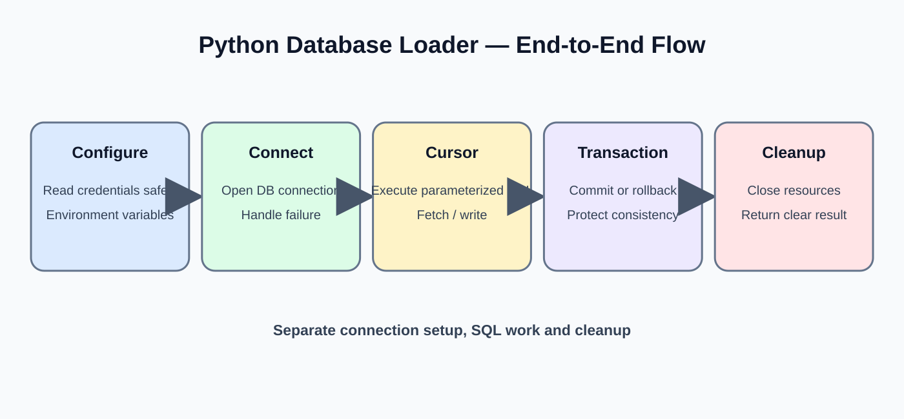
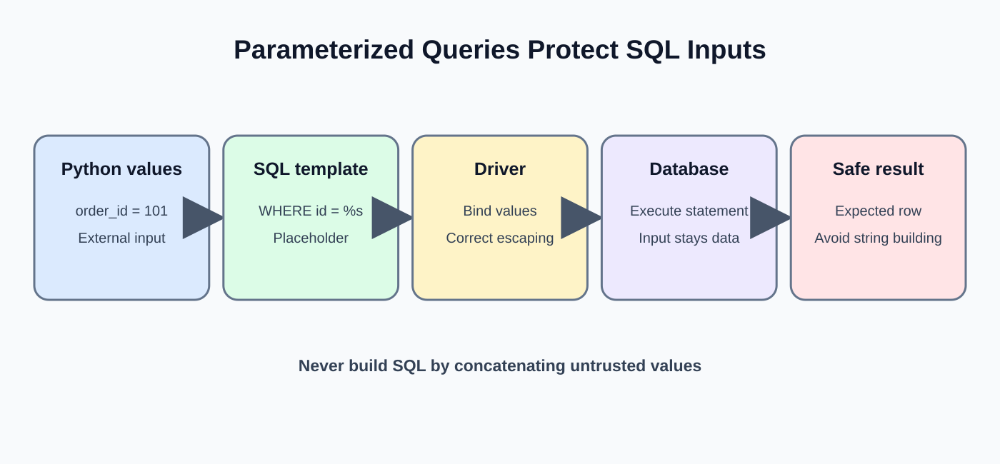
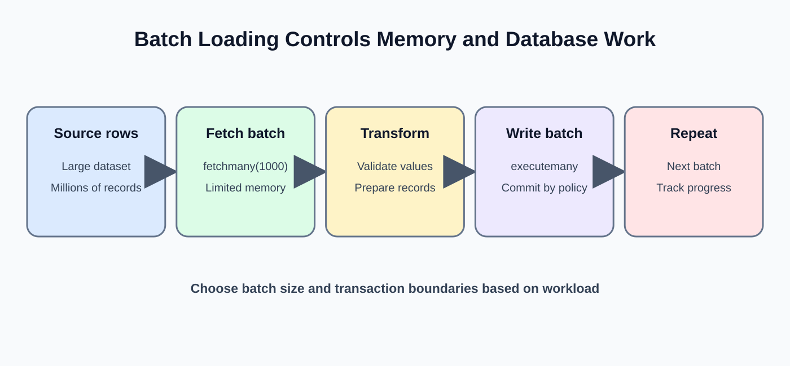
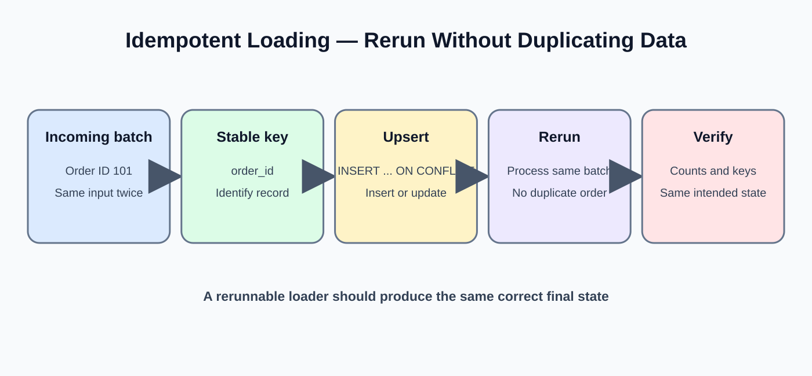
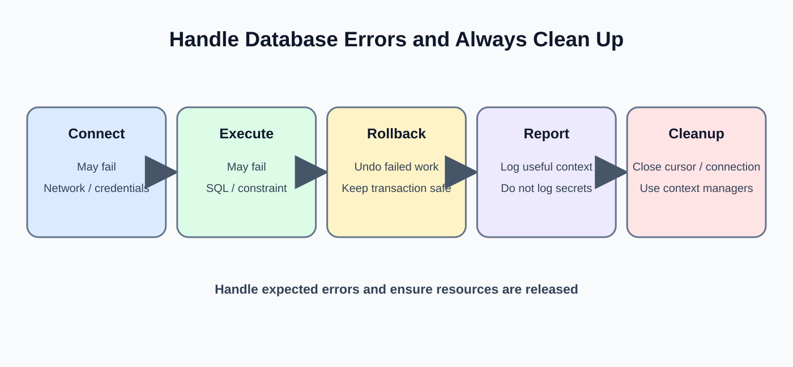

# Day 29: Python and Database Integration
**Phase:** 3 — SQL and Database Engineering  
**Mini-project:** Database Loader  
**Learning time:** 2–3 hours  
**Audience:** Beginners progressing to junior Data Engineer level  
**Python:** Python 3  
**Database:** PostgreSQL  
**Driver:** Psycopg 3

---

## 1. Why connect Python to a database?

In earlier Python lessons, you learned variables, lists, dictionaries, files and data validation. In SQL lessons, you learned how relational databases store, query and protect data.

A real Data Engineer often needs both.

Example pipeline:

```text
CSV / API / Source system
          |
          v
       Python
          |
          v
   Validate and transform
          |
          v
   PostgreSQL database
          |
          v
   Verify loaded records
```

Python can read files, call APIs, validate incoming records and coordinate a load. PostgreSQL stores structured data and enforces keys, constraints and transactions.

### Learning outcomes

By the end, you can:
1. Explain a database driver.
2. Install Psycopg 3.
3. Understand connection parameters.
4. Connect Python to PostgreSQL.
5. Create a table from Python.
6. Execute SELECT, INSERT and UPDATE statements.
7. Understand connections and cursors.
8. Use parameterized SQL safely.
9. Fetch query results.
10. Insert multiple records.
11. Understand batch loading.
12. Commit and roll back transactions.
13. Handle common connection and SQL errors.
14. Verify loaded data.
15. Build a small repeatable database loader.

---

## 2. Understand the important terms

| Term | Beginner explanation |
|---|---|
| Database driver | Python package that lets Python communicate with a database |
| Connection | Active session between Python and PostgreSQL |
| Cursor | Object used to execute SQL and retrieve results |
| SQL statement | Database command such as SELECT or INSERT |
| Parameter | A value supplied separately to a SQL statement |
| Transaction | Group of database operations managed together |
| Commit | Make successful transaction changes permanent |
| Rollback | Cancel uncommitted changes |
| Batch | A group of records processed together |
| Constraint | Database rule that protects data quality |

Psycopg is a PostgreSQL driver for Python. It sends SQL statements to PostgreSQL and returns results to Python.

---

## 3. Prepare the environment

You need:
- Python installed.
- PostgreSQL server running.
- A practice database such as techstore.
- A database role allowed to connect and create or insert into the target table.
- Psycopg 3 installed.

### 3.1 Check Python

Open Windows CMD:

```bash
python --version
```

Example output:

```text
Python 3.12.x
```

Your patch version may differ.

### 3.2 Install Psycopg 3

```bash
python -m pip install "psycopg[binary]"
```

This installs Psycopg 3 and its binary distribution suitable for a straightforward learning environment.

Verify installation:

```bash
python -c "import psycopg; print(psycopg.__version__)"
```

Expected: a Psycopg 3 version number. The exact version may change.

If CMD says No module named psycopg, check that pip installed into the same Python interpreter used to run your script.

---

## 4. Prepare the project folder

Create this folder structure:

```text
day29_database_loader/
|
|-- .env
|-- .gitignore
|-- 01_test_connection.py
|-- 02_create_table.py
|-- 03_insert_one_record.py
|-- 04_read_records.py
|-- 05_insert_multiple_records.py
|-- 06_transaction_rollback.py
|-- 07_database_loader.py
|-- 08_verify_load.py
```

We separate the steps so a beginner can run one file, inspect the output and understand what happened.

Do not put real passwords into Python source files or commit them to GitHub.

---

## 5. Configure database credentials safely



For this class, we will use environment variables. A production project may use a secret manager.

Create a file named .env in the project folder:

```text
DB_HOST=localhost
DB_PORT=5432
DB_NAME=techstore
DB_USER=postgres
DB_PASSWORD=replace_with_your_local_password
```

Replace the password with your local training password.

Create .gitignore:

```text
.env
__pycache__/
*.pyc
```

This prevents the local credentials file and Python cache from being committed to Git.

### 5.1 Install python-dotenv

```bash
python -m pip install python-dotenv
```

This package reads environment values from a .env file into the process environment for local development.

In deployed systems, configure secrets in the runtime environment or secret manager rather than relying on a committed .env file.

---

## 6. First connection: understand each part

Create 01_test_connection.py:

```python
import os
import psycopg
from dotenv import load_dotenv

load_dotenv()

connection = psycopg.connect(
    host=os.getenv("DB_HOST"),
    port=os.getenv("DB_PORT"),
    dbname=os.getenv("DB_NAME"),
    user=os.getenv("DB_USER"),
    password=os.getenv("DB_PASSWORD")
)

print("Connected to PostgreSQL successfully")

connection.close()

print("Database connection closed")
```

Run from CMD:

```bash
python 01_test_connection.py
```

Expected output:

```text
Connected to PostgreSQL successfully
Database connection closed
```

### 6.1 Line-by-line explanation

- import os loads Python's operating-system interface. We use it to read environment variables.
- import psycopg loads the PostgreSQL database driver.
- from dotenv import load_dotenv imports the function that reads .env.
- load_dotenv() loads the local .env values into the process environment.
- psycopg.connect(...) opens a database connection.
- host identifies the database server.
- port identifies the server port.
- dbname identifies the database.
- user identifies the database account.
- password supplies the credential.
- print displays a message after the connection succeeds.
- connection.close() closes the connection.

If connection creation fails, Python raises an exception before printing the success message.

### 6.2 Why close the connection?

An open connection uses database and application resources. Close it when the work is complete.

For longer applications, use connection context managers or a connection pool so resource cleanup happens reliably.

---

## 7. Use a connection context manager

Psycopg supports context managers. They help manage connection lifecycle and transaction behavior.

Example:

```python
import os
import psycopg
from dotenv import load_dotenv

load_dotenv()

with psycopg.connect(
    host=os.getenv("DB_HOST"),
    port=os.getenv("DB_PORT"),
    dbname=os.getenv("DB_NAME"),
    user=os.getenv("DB_USER"),
    password=os.getenv("DB_PASSWORD")
) as connection:
    print("Connected and ready")

print("Connection context finished")
```

The connection context manager commits the transaction on successful exit and rolls it back if an exception occurs. The connection is then closed when the context exits.

This is a useful pattern for short database jobs.

---

## 8. Understand the cursor

A connection represents the database session. A cursor is used to execute statements and fetch query results.

Create 02_create_table.py:

```python
import os
import psycopg
from dotenv import load_dotenv

load_dotenv()

with psycopg.connect(
    host=os.getenv("DB_HOST"),
    port=os.getenv("DB_PORT"),
    dbname=os.getenv("DB_NAME"),
    user=os.getenv("DB_USER"),
    password=os.getenv("DB_PASSWORD")
) as connection:

    with connection.cursor() as cursor:
        cursor.execute("""
            CREATE TABLE IF NOT EXISTS python_loader_orders (
                order_id INTEGER PRIMARY KEY,
                customer_name VARCHAR(100) NOT NULL,
                amount NUMERIC(12, 2) NOT NULL CHECK (amount >= 0),
                order_status VARCHAR(30) NOT NULL
            )
        """)

        print("Table is ready")
```

Run:

```bash
python 02_create_table.py
```

Expected:

```text
Table is ready
```

### 8.1 Understand the nested with blocks

- The outer with manages the connection transaction and cleanup.
- The inner with manages the cursor.
- cursor.execute() sends SQL to PostgreSQL.
- CREATE TABLE IF NOT EXISTS creates the table if it is not already present.
- The primary key prevents duplicate order_id values.
- NOT NULL prevents missing required values.
- CHECK prevents negative amounts.

The connection context commits when the block completes successfully. If an error escapes the block, the transaction is rolled back.

---

## 9. Insert one record using Python



Create 03_insert_one_record.py:

```python
import os
import psycopg
from dotenv import load_dotenv

load_dotenv()

with psycopg.connect(
    host=os.getenv("DB_HOST"),
    port=os.getenv("DB_PORT"),
    dbname=os.getenv("DB_NAME"),
    user=os.getenv("DB_USER"),
    password=os.getenv("DB_PASSWORD")
) as connection:

    with connection.cursor() as cursor:
        cursor.execute(
            """
            INSERT INTO python_loader_orders
                (order_id, customer_name, amount, order_status)
            VALUES (%s, %s, %s, %s)
            """,
            (1001, "Asha", 2500.00, "PAID")
        )

        print("Inserted rows:", cursor.rowcount)
```

Run:

```bash
python 03_insert_one_record.py
```

Expected first run:

```text
Inserted rows: 1
```

If you run the same script again, PostgreSQL reports a duplicate primary key because order_id 1001 already exists. This is expected. We will learn how to make a loader safe to rerun later.

### 9.1 Understand parameterized SQL

The SQL contains %s placeholders. The values are passed separately as a tuple.

Correct:

```python
cursor.execute(
    "SELECT * FROM python_loader_orders WHERE order_id = %s",
    (1001,)
)
```

Do not build SQL by concatenating user-provided text:

```python
# Unsafe pattern — do not use
query = "SELECT * FROM python_loader_orders WHERE order_id = " + user_input
```

Parameterized queries keep SQL code separate from data values and help prevent SQL injection.

Important: Psycopg uses %s placeholders for values. Do not put quotes around the placeholder in SQL. Identifiers such as table and column names are not value parameters; dynamic identifiers require safe identifier composition using Psycopg's SQL composition tools.

---

## 10. Read data using SELECT

Create 04_read_records.py:

```python
import os
import psycopg
from dotenv import load_dotenv

load_dotenv()

with psycopg.connect(
    host=os.getenv("DB_HOST"),
    port=os.getenv("DB_PORT"),
    dbname=os.getenv("DB_NAME"),
    user=os.getenv("DB_USER"),
    password=os.getenv("DB_PASSWORD")
) as connection:

    with connection.cursor() as cursor:
        cursor.execute("""
            SELECT order_id, customer_name, amount, order_status
            FROM python_loader_orders
            ORDER BY order_id
        """)

        rows = cursor.fetchall()

        for row in rows:
            print(row)
```

Expected after the first insert:

```text
(1001, 'Asha', Decimal('2500.00'), 'PAID')
```

The amount may be returned as Python Decimal because PostgreSQL NUMERIC is a decimal type. Decimal is preferred for financial values where exact decimal representation matters.

### 10.1 Understand fetchall

fetchall() retrieves all rows returned by the query and stores them in a Python list of row tuples.

A row tuple might look like:

```python
(1001, "Asha", Decimal("2500.00"), "PAID")
```

Each position corresponds to a column in the SELECT list.

### 10.2 Use fetchone

If you need only one row:

```python
cursor.execute(
    """
    SELECT order_id, customer_name
    FROM python_loader_orders
    WHERE order_id = %s
    """,
    (1001,)
)

row = cursor.fetchone()
print(row)
```

fetchone() returns the next row or None if there is no row.

### 10.3 Use fetchmany

For a small batch of rows:

```python
cursor.execute("""
    SELECT order_id, customer_name
    FROM python_loader_orders
    ORDER BY order_id
""")

rows = cursor.fetchmany(2)
print(rows)
```

fetchmany(2) returns up to two rows from the result set.

For very large datasets, do not fetch millions of rows into memory at once. Use batching or server-side cursor strategies appropriate to the driver and workload.

---

## 11. Insert multiple records

A source file often contains many records. Inserting one record per execute call can be inefficient for large loads.

Create 05_insert_multiple_records.py:

```python
import os
import psycopg
from dotenv import load_dotenv

load_dotenv()

new_orders = [
    (1002, "Ravi", 1800.00, "PAID"),
    (1003, "Meena", 3200.00, "PENDING"),
    (1004, "Asha", 4500.00, "PAID")
]

with psycopg.connect(
    host=os.getenv("DB_HOST"),
    port=os.getenv("DB_PORT"),
    dbname=os.getenv("DB_NAME"),
    user=os.getenv("DB_USER"),
    password=os.getenv("DB_PASSWORD")
) as connection:

    with connection.cursor() as cursor:
        cursor.executemany(
            """
            INSERT INTO python_loader_orders
                (order_id, customer_name, amount, order_status)
            VALUES (%s, %s, %s, %s)
            """,
            new_orders
        )

        print("Inserted rows:", cursor.rowcount)
```

Expected first run:

```text
Inserted rows: 3
```

The connection context commits after the block completes successfully.

If one row violates a constraint, the transaction fails and the context rolls back the batch unless the exception is caught and handled inside the transaction.

### 11.1 Understand the data structure

new_orders is a Python list.

Each item is a tuple containing four values:
1. order_id
2. customer_name
3. amount
4. order_status

The tuple positions match the column order in the INSERT statement.

### 11.2 Verify inserted rows

```sql
SELECT COUNT(*)
FROM python_loader_orders;
```

Expected after the single insert and three-row batch: 4 rows.

---

## 12. Understand executemany and bulk loading



executemany executes a parameterized statement for multiple parameter sets. It is convenient for a beginner batch insert.

For very large loads, Psycopg and PostgreSQL support more efficient approaches such as COPY. The right method depends on volume, validation needs and database environment.

### 12.1 When to use each method

| Method | Typical use |
|---|---|
| execute | One statement or one parameter set |
| executemany | Several parameter sets for the same statement |
| COPY | High-throughput bulk data transfer |
| Batch loop | Process data in controlled chunks |

Do not assume executemany is always the fastest method. Measure realistic data sizes.

---

## 13. Transactions from Python

Database operations must be committed or rolled back safely.

Psycopg connection context managers help manage transactions:
- If the block finishes successfully, the transaction is committed.
- If an exception escapes, the transaction is rolled back.
- The connection context then closes the connection.

### 13.1 Demonstrate rollback

Create 06_transaction_rollback.py:

```python
import os
import psycopg
from dotenv import load_dotenv

load_dotenv()

try:
    with psycopg.connect(
        host=os.getenv("DB_HOST"),
        port=os.getenv("DB_PORT"),
        dbname=os.getenv("DB_NAME"),
        user=os.getenv("DB_USER"),
        password=os.getenv("DB_PASSWORD")
    ) as connection:

        with connection.cursor() as cursor:
            cursor.execute(
                """
                INSERT INTO python_loader_orders
                    (order_id, customer_name, amount, order_status)
                VALUES (%s, %s, %s, %s)
                """,
                (1999, "Rollback Test", 100.00, "TEST")
            )

            print("Test row inserted inside transaction")

            raise ValueError("Simulated failure")

except ValueError as error:
    print("Application error:", error)

print("Transaction block finished")
```

Expected output:

```text
Test row inserted inside transaction
Application error: Simulated failure
Transaction block finished
```

Verify the row:

```sql
SELECT *
FROM python_loader_orders
WHERE order_id = 1999;
```

Expected: zero rows.

The ValueError escapes the connection context. Psycopg rolls back the transaction before the exception is caught outside the context.

### 13.2 Why catch the exception outside the context?

The connection context must see the exception so it can roll back. If you catch and suppress a database exception inside the transaction without rolling back, the transaction may remain aborted in PostgreSQL.

A safe pattern is to let the exception reach the transaction manager or explicitly roll back before continuing.

---

## 14. Update a record safely

Example:

```python
import os
import psycopg
from dotenv import load_dotenv

load_dotenv()

with psycopg.connect(
    host=os.getenv("DB_HOST"),
    port=os.getenv("DB_PORT"),
    dbname=os.getenv("DB_NAME"),
    user=os.getenv("DB_USER"),
    password=os.getenv("DB_PASSWORD")
) as connection:

    with connection.cursor() as cursor:
        cursor.execute(
            """
            UPDATE python_loader_orders
            SET order_status = %s
            WHERE order_id = %s
            """,
            ("SHIPPED", 1002)
        )

        print("Updated rows:", cursor.rowcount)
```

Expected: Updated rows: 1, if order 1002 exists.

Always use a suitable WHERE clause. An UPDATE without WHERE can modify every row.

---

## 15. Build a repeatable, idempotent loader



A pipeline may be retried after a network failure. If it inserts the same records again, primary-key errors or duplicate data can occur.

Idempotency means running the same logical operation more than once produces the same intended final state, rather than applying the effect repeatedly.

PostgreSQL supports INSERT ... ON CONFLICT.

Example:

```sql
INSERT INTO python_loader_orders
    (order_id, customer_name, amount, order_status)
VALUES
    (1001, 'Asha', 2500.00, 'PAID')
ON CONFLICT (order_id)
DO UPDATE SET
    customer_name = EXCLUDED.customer_name,
    amount = EXCLUDED.amount,
    order_status = EXCLUDED.order_status;
```

EXCLUDED refers to the proposed row that conflicted with an existing row.

This statement inserts a new order or updates the existing row with the same order_id.

Use this only when updating an existing record is the correct business behavior. Some pipelines should ignore duplicates, reject them, or maintain history instead.

### 15.1 Psycopg parameterized upsert

```python
cursor.execute(
    """
    INSERT INTO python_loader_orders
        (order_id, customer_name, amount, order_status)
    VALUES (%s, %s, %s, %s)
    ON CONFLICT (order_id)
    DO UPDATE SET
        customer_name = EXCLUDED.customer_name,
        amount = EXCLUDED.amount,
        order_status = EXCLUDED.order_status
    """,
    (1001, "Asha", 2500.00, "PAID")
)
```

Run the same statement twice. The table still has one row for order_id 1001.

---

## 16. Batch processing: do not load an unlimited dataset at once

A large file may contain millions of records. Keeping every record in one Python list can consume too much memory.

A batch strategy processes a limited number of rows at a time.

Concept:

```text
Source data
   |
   v
Read 1,000 records
   |
   v
Validate batch
   |
   v
Insert batch
   |
   v
Verify batch
   |
   v
Read next 1,000 records
```

Batch size is a design choice. It depends on record width, memory, network, database capacity and recovery requirements.

### 16.1 Example batch list

```python
orders_batch_1 = [
    (2001, "Asha", 1000.00, "PAID"),
    (2002, "Ravi", 2000.00, "PAID")
]

orders_batch_2 = [
    (2003, "Meena", 3000.00, "PENDING"),
    (2004, "Asha", 4000.00, "PAID")
]
```

Each batch can be validated and inserted separately. If the project requires each batch to be atomic, insert the batch in one transaction and commit only after validation.

---

## 17. Handle common errors



### 17.1 Connection refused

Possible causes:
- PostgreSQL service is stopped.
- Wrong host or port.
- Network access is blocked.

Check the server service and connection parameters.

### 17.2 Authentication failed

Possible causes:
- Wrong username.
- Wrong password.
- Authentication policy rejects the connection.

Do not print passwords into logs or screenshots. Verify credentials securely.

### 17.3 Database does not exist

Check DB_NAME and confirm the database has been created.

### 17.4 Relation does not exist

PostgreSQL could not find the referenced table in the search path/schema. Check the table name and schema. Use schema-qualified names when appropriate.

### 17.5 Duplicate key error

The primary key already exists. Decide whether the row should be rejected, ignored or updated with an upsert.

### 17.6 Check constraint violation

The inserted amount may be negative. Validate incoming data and preserve the database constraint.

### 17.7 Transaction is aborted

A prior SQL statement failed inside the transaction. Roll back before attempting further work.

---

## 18. Final mini-project: Database Loader

### Business requirement

A CSV or source process provides order records. You must validate them and load them into PostgreSQL safely.

For the teaching project, we use a Python list so students can focus on database integration first. A later file-ingestion lesson can replace the list with a CSV reader.

### Step 1: source records

```python
source_orders = [
    (3001, "Asha", 1500.00, "PAID"),
    (3002, "Ravi", 2800.00, "SHIPPED"),
    (3003, "Meena", 900.00, "PENDING"),
    (3004, "Asha", 4500.00, "PAID")
]
```

### Step 2: inspect the source

```python
print("Source record count:", len(source_orders))
print("First source record:", source_orders[0])
```

Expected:

```text
Source record count: 4
First source record: (3001, 'Asha', 1500.0, 'PAID')
```

### Step 3: validate the records

For this beginner exercise, use simple loops and conditions.

```python
valid_orders = []
rejected_orders = []

for order in source_orders:
    order_id = order[0]
    customer_name = order[1]
    amount = order[2]
    order_status = order[3]

    if order_id <= 0:
        rejected_orders.append((order, "Invalid order ID"))
    elif customer_name == "":
        rejected_orders.append((order, "Customer name is missing"))
    elif amount < 0:
        rejected_orders.append((order, "Amount cannot be negative"))
    elif order_status not in ["PAID", "SHIPPED", "PENDING"]:
        rejected_orders.append((order, "Invalid order status"))
    else:
        valid_orders.append(order)

print("Valid records:", len(valid_orders))
print("Rejected records:", len(rejected_orders))
```

Expected:

```text
Valid records: 4
Rejected records: 0
```

Line explanation:
- valid_orders stores records that pass all rules.
- rejected_orders stores records with a reason.
- for order in source_orders visits one tuple at a time.
- order[0] reads order_id from the first tuple position.
- each if/elif checks one business rule.
- append adds the record to the appropriate list.

A production validator should also handle None, whitespace-only names, decimal parsing, duplicate IDs within the source batch, date formats and status normalization.

### Step 4: connect and load the valid records

Create 07_database_loader.py:

```python
import os
import psycopg
from dotenv import load_dotenv

load_dotenv()

source_orders = [
    (3001, "Asha", 1500.00, "PAID"),
    (3002, "Ravi", 2800.00, "SHIPPED"),
    (3003, "Meena", 900.00, "PENDING"),
    (3004, "Asha", 4500.00, "PAID")
]

valid_orders = []
rejected_orders = []

for order in source_orders:
    order_id = order[0]
    customer_name = order[1]
    amount = order[2]
    order_status = order[3]

    if order_id <= 0:
        rejected_orders.append((order, "Invalid order ID"))
    elif customer_name == "":
        rejected_orders.append((order, "Customer name is missing"))
    elif amount < 0:
        rejected_orders.append((order, "Amount cannot be negative"))
    elif order_status not in ["PAID", "SHIPPED", "PENDING"]:
        rejected_orders.append((order, "Invalid order status"))
    else:
        valid_orders.append(order)

print("Valid records:", len(valid_orders))
print("Rejected records:", len(rejected_orders))

with psycopg.connect(
    host=os.getenv("DB_HOST"),
    port=os.getenv("DB_PORT"),
    dbname=os.getenv("DB_NAME"),
    user=os.getenv("DB_USER"),
    password=os.getenv("DB_PASSWORD")
) as connection:

    with connection.cursor() as cursor:
        cursor.executemany(
            """
            INSERT INTO python_loader_orders
                (order_id, customer_name, amount, order_status)
            VALUES (%s, %s, %s, %s)
            ON CONFLICT (order_id)
            DO UPDATE SET
                customer_name = EXCLUDED.customer_name,
                amount = EXCLUDED.amount,
                order_status = EXCLUDED.order_status
            """,
            valid_orders
        )

        print("Loaded records:", cursor.rowcount)

print("Database load completed")
```

Run:

```bash
python 07_database_loader.py
```

Expected first run:

```text
Valid records: 4
Rejected records: 0
Loaded records: 4
Database load completed
```

Run it a second time. The same four IDs are upserted, so the table should still contain one row per order ID. This is a simple demonstration of rerun safety.

### Step 5: verify the database load

Create 08_verify_load.py:

```python
import os
import psycopg
from dotenv import load_dotenv

load_dotenv()

with psycopg.connect(
    host=os.getenv("DB_HOST"),
    port=os.getenv("DB_PORT"),
    dbname=os.getenv("DB_NAME"),
    user=os.getenv("DB_USER"),
    password=os.getenv("DB_PASSWORD")
) as connection:

    with connection.cursor() as cursor:
        cursor.execute("""
            SELECT
                COUNT(*) AS total_rows,
                SUM(amount) AS total_amount
            FROM python_loader_orders
            WHERE order_id BETWEEN 3001 AND 3004
        """)

        result = cursor.fetchone()

        print("Loaded row count:", result[0])
        print("Loaded amount total:", result[1])
```

Expected:

```text
Loaded row count: 4
Loaded amount total: 9700.00
```

Calculation:
1,500 + 2,800 + 900 + 4,500 = 9,700.

### Step 6: verify the individual rows

```sql
SELECT order_id, customer_name, amount, order_status
FROM python_loader_orders
WHERE order_id BETWEEN 3001 AND 3004
ORDER BY order_id;
```

Expected four records in order ID sequence.

### Step 7: test a rejected record

Add an invalid record such as:

```python
(3005, "Test", -100.00, "PAID")
```

The validator should reject it because the amount is negative. It should not be sent to the database.

### Project checklist

- [ ] Psycopg 3 installed.
- [ ] Environment values configured without committing secrets.
- [ ] Connection test succeeded.
- [ ] Table created from Python.
- [ ] One record inserted.
- [ ] Rows selected and fetched.
- [ ] Multiple records inserted.
- [ ] Parameterized SQL used.
- [ ] Rollback demonstration verified.
- [ ] Validation separated valid and rejected records.
- [ ] Loader used an explicit transaction.
- [ ] Loader could be rerun without duplicate primary keys.
- [ ] Row count and amount total were reconciled.

---

## 19. Common beginner mistakes

1. Installing psycopg into one Python interpreter and running another.
2. Using the wrong host, port, database or username.
3. Hardcoding database passwords in source code.
4. Forgetting to close a connection.
5. Confusing a connection with a cursor.
6. Concatenating user values into SQL.
7. Forgetting the one-element tuple comma: (1001,).
8. Forgetting that PostgreSQL NUMERIC may be returned as Decimal.
9. Fetching an unlimited result set into memory.
10. Committing every row without considering partial-batch behavior.
11. Catching a database error but not rolling back the transaction.
12. Retrying an INSERT without an idempotency strategy.
13. Assuming executemany is always the fastest bulk-loading option.
14. Failing to verify row counts and business totals after loading.

---

## 20. Practice questions

1. What is a database driver?
2. What is Psycopg?
3. What is a database connection?
4. What is a cursor?
5. What does cursor.execute do?
6. What is a parameterized query?
7. Why is string concatenation unsafe for SQL values?
8. What is the difference between fetchone, fetchmany and fetchall?
9. What is executemany?
10. What is a transaction?
11. How does a Psycopg connection context manager handle success and failure?
12. What happens after a PostgreSQL statement error?
13. What is an upsert?
14. What is idempotency?
15. Why should a loader validate records before insertion?
16. Why use batches?
17. When might COPY be preferable to executemany?
18. Why should a loader verify row counts and totals?
19. How should secrets be supplied to a deployed pipeline?
20. What would you do if a load fails halfway through?

### Answer hints

1. Package enabling application-to-database communication.
2. Python PostgreSQL driver.
3. Active database session.
4. Object used to execute SQL and fetch results.
5. Sends a SQL statement with parameters.
6. SQL code and values are supplied separately.
7. It can allow SQL injection and malformed queries.
8. One row, up to N rows, or all rows.
9. Execute a statement for multiple parameter sets.
10. Group of database operations managed together.
11. Commit on successful exit; rollback on exception; close connection.
12. Transaction becomes aborted until rollback or rollback to savepoint.
13. Insert or update on a key conflict.
14. Repeating the same operation does not create unintended repeated effects.
15. Prevent invalid data from entering downstream tables.
16. Control memory, network and transaction scope.
17. High-throughput bulk data transfer.
18. Prove expected data was loaded correctly.
19. Secret manager or secure environment configuration.
20. Roll back or use documented batch checkpoints and safe retry behavior.

---

## 21. Day 29 revision

- Psycopg 3 connects Python to PostgreSQL.
- A connection represents a database session.
- A cursor executes SQL and retrieves results.
- Use parameterized SQL for values.
- fetchone, fetchmany and fetchall retrieve query results.
- executemany handles multiple parameter sets.
- Transactions commit successful work and roll back failed work.
- PostgreSQL transactions need rollback after a statement error.
- Upsert can make a load safe to rerun when update-on-conflict is the correct business rule.
- Validate data before loading.
- Process large data in suitable batches.
- Verify row counts and business totals.
- Keep passwords out of source control.

**You are ready to complete Phase 3 when you can explain relational database design, write SQL queries, use window functions, manage transactions, understand indexes and load data from Python into PostgreSQL safely.**
