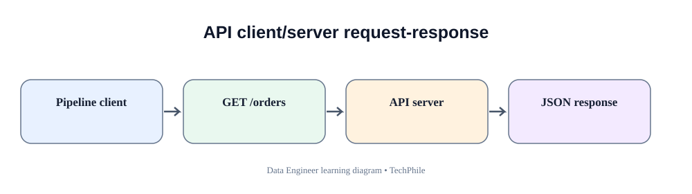
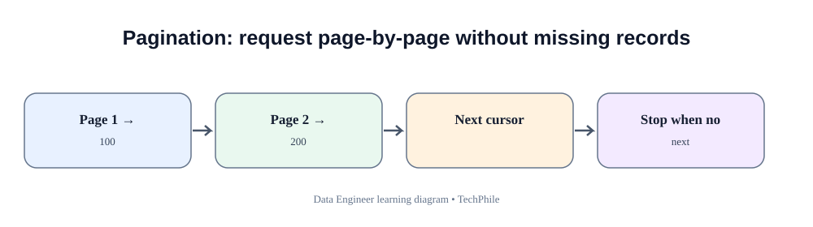
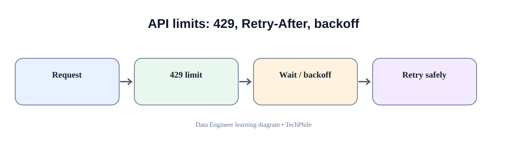

# Day 32: API-Based Data Ingestion
**Phase:** 4 — Data Processing and Pipelines  
**Learning time:** 2–3 hours  
**Audience:** Complete beginners and freshers  
**Topic boundary:** This is the API ingestion class lesson only. The guided project workbook and interview guide remain separate files.

> Follow the cells in order. API ingestion is not just sending a request. A reliable Data Engineer must understand the source contract, request the correct records, handle pagination, respect rate limits, validate the response and prove that the extraction is complete.

## Learning outcomes

At the end of this lesson, you should be able to:
- explain what an API is and why companies expose APIs;
- understand client, server, endpoint, request, response, HTTP method and status code;
- understand URLs, query parameters, headers, authentication and JSON response bodies;
- install and use the Python `requests` package;
- send GET requests with explicit timeouts;
- inspect status codes and response headers;
- parse JSON and validate its structure;
- understand pagination and why one request may not return every record;
- implement simple page-based and cursor-based pagination demonstrations;
- handle timeouts, connection failures, rate limits and server errors safely;
- avoid logging credentials and sensitive response data;
- validate record counts, unique keys and page completeness;
- distinguish a successful HTTP response from a correct and complete data extract.

## Today's flow

`Business request -> API documentation -> Endpoint -> Request -> Response -> Parse -> Validate -> Paginate -> Save -> Reconcile`

---

# 1. Understand APIs from zero

## 1.1 What is an API?

API stands for **Application Programming Interface**.

An API is an agreed way for one software application to request information or an action from another application.

Imagine TechStore wants the latest delivery status for an order. The courier company owns the delivery system. TechStore does not need direct access to the courier's database. The courier may expose an API that allows approved applications to request delivery information.

Simple flow:

`TechStore Python program -> Courier API -> Courier server -> JSON response -> TechStore Python program`

The API is the communication contract between the two applications.

## 1.2 Real-world examples

| Business need | API source | Data returned |
|---|---|---|
| Track an order | Courier provider | Delivery status and timestamp |
| Get payment settlement | Payment provider | Payment ID, amount, status |
| Get product catalogue | Marketplace | Product ID, price, availability |
| Get exchange rates | Currency service | Currency pair and rate |
| Get customer profile | Internal customer service | Approved customer fields |

An API is not automatically public. Many APIs require an account, a key, a token or an approved network.

## 1.3 What is a client?

A **client** is the application that sends the request.

In today's examples, the Python program is the client.

## 1.4 What is a server?

A **server** receives the request, performs the permitted operation and sends a response.

The courier company's application is the server in our example.

## 1.5 What is an endpoint?

An **endpoint** is a particular API address used to access a resource or operation.

Example:

`https://api.example.com/v1/orders`

This is an illustrative address, not a real endpoint to call.

The parts:
- `https` is the communication scheme;
- `api.example.com` is the host;
- `/v1/orders` is the path;
- `v1` commonly indicates an API version;
- `orders` identifies the resource.

Different endpoints can provide different resources:
- `/orders`;
- `/customers`;
- `/payments`;
- `/deliveries`.

Use the endpoint documented by the provider. Do not guess endpoint names.

## 1.6 What is an HTTP request?

HTTP is a protocol used to communicate between clients and servers.

An HTTP request contains:
- a method;
- a URL;
- optional query parameters;
- optional headers;
- sometimes a request body.

The server sends an HTTP response containing:
- a status code;
- response headers;
- usually a response body.

## 1.7 What is a response body?

The response body contains the data or message returned by the server.

For a data API, the body is often JSON.

Example:

```json
{
  "order_id": "O-1001",
  "status": "SHIPPED"
}
```

A response body may also contain an error message, an empty result or a different structure. Never assume every response is a list of records.

---

# 2. Understand HTTP methods

An HTTP method describes the kind of operation requested.

| Method | Common purpose | Data engineering example |
|---|---|---|
| GET | Retrieve information | Read orders |
| POST | Submit data or request creation | Create a record or submit a query |
| PUT | Replace a resource | Replace a complete resource |
| PATCH | Partially update a resource | Change delivery status |
| DELETE | Delete a resource | Remove a resource when permitted |

Today's extraction lessons mainly use GET.

## 2.1 GET request

A GET request asks the server to return information.

Example concept:

`GET /v1/orders`

This asks for orders according to the endpoint's documented behavior.

A GET request should not be used to perform an undocumented destructive action.

## 2.2 POST request

A POST request sends a body to the server. It may create a resource or submit a search/report request, depending on the API contract.

Do not assume every POST creates a record. Read the provider documentation.

## 2.3 Why should an extraction pipeline prefer read-only access?

A Data Engineer extracting source data normally needs read permissions.

Read-only access reduces the risk of accidentally changing operational records.

Ask the API owner for the minimum permissions required.

---

# 3. Understand URLs, query parameters and headers

## 3.1 URL

A URL identifies a resource or endpoint.

Illustrative URL:

`https://api.example.com/v1/orders?status=PAID&limit=100`

This contains:
- scheme: HTTPS;
- host: api.example.com;
- path: /v1/orders;
- query parameter status: PAID;
- query parameter limit: 100.

## 3.2 Query parameters

Query parameters pass filters or options in the URL.

Examples:
- `status=PAID`;
- `limit=100`;
- `page=2`;
- `created_after=2026-11-01`.

The meaning of each parameter is defined by the API provider.

## 3.3 Why not build query strings manually?

Manually concatenating values can create encoding bugs, especially when a value contains spaces, ampersands or other special characters.

Use the `params` argument in Requests. It encodes values safely.

## 3.4 HTTP headers

Headers carry metadata about the request or response.

Common request headers:
- `Accept`: preferred response format;
- `Authorization`: credentials or token;
- `Content-Type`: media type of a request body.

Example header:

`Accept: application/json`

It tells the server that the client expects JSON when supported.

## 3.5 Authentication

Authentication helps the API identify the caller.

Common patterns:
- API key;
- bearer token;
- OAuth access token;
- signed request.

Never copy a real token into a public notebook or Git repository.

For practice, use only public test endpoints or synthetic placeholder values.

## 3.6 Authentication is not authorization

Authentication answers: “Who is making this request?”

Authorization answers: “What is this caller allowed to do?”

A valid token can still receive a 403 Forbidden response when it lacks permission.

---

# 4. HTTP status codes from zero

A status code tells the client the broad result of the HTTP request.

| Range | Meaning | Examples |
|---|---|---|
| 2xx | Request succeeded | 200, 201, 204 |
| 3xx | Redirection | 301, 302 |
| 4xx | Client/request problem | 400, 401, 403, 404, 429 |
| 5xx | Server-side problem | 500, 502, 503, 504 |

## 4.1 Status 200 — OK

The request succeeded. The response may contain data.

But 200 does not prove:
- all pages were fetched;
- all expected records were returned;
- the data follows the business contract;
- no records were filtered incorrectly.

## 4.2 Status 201 — Created

The server reports that a resource was created. It is common for some POST operations.

## 4.3 Status 204 — No Content

The request succeeded but there is no response body. Do not try to parse JSON blindly when the response has no content.

## 4.4 Status 400 — Bad Request

The server considers the request invalid.

Possible reasons:
- missing required parameter;
- invalid date format;
- invalid filter;
- malformed request body.

Check the API documentation and error response.

## 4.5 Status 401 — Unauthorized

The request is not authenticated successfully.

Possible reasons:
- missing token;
- expired token;
- invalid API key;
- incorrect authentication format.

Do not repeatedly retry the same invalid credential.

## 4.6 Status 403 — Forbidden

The caller is known but does not have permission for the requested resource or operation.

Ask the API owner to review the permission scope. Do not try to bypass access controls.

## 4.7 Status 404 — Not Found

The endpoint or resource may not exist, or the requested resource may not be visible to the caller.

Check the documented URL and resource identifier.

## 4.8 Status 429 — Too Many Requests

The client has exceeded a rate limit or request quota.

The response may include a `Retry-After` header. Respect the provider's instructions instead of sending more requests immediately.

## 4.9 Status 500 — Internal Server Error

The server encountered an unexpected problem.

The issue may be temporary, but repeated retries without limits can make the situation worse.

## 4.10 Status 503 — Service Unavailable

The service is temporarily unable to handle the request. A bounded retry may be appropriate when the operation is safe to retry.

---

# 5. Prepare the Python environment

## 5.1 Check Python

Open CMD and run:

```bat
python --version
```

The exact version depends on your installation.

## 5.2 Create a learning folder

```bat
mkdir day32_api_ingestion
cd day32_api_ingestion
mkdir data
mkdir output
mkdir notebook
```

Folder meaning:
- `data`: saved API response samples;
- `output`: validated extracted records;
- `notebook`: learning notebook.

## 5.3 Install Requests

Run in CMD or the notebook terminal:

```bat
python -m pip install requests
```

Requests is a third-party Python package used to send HTTP requests.

If installation fails:
1. check internet access;
2. check the active Python environment;
3. run `python -m pip --version`;
4. confirm the notebook uses the same interpreter;
5. read the exact error before retrying.

## 5.4 Import Requests

```python
import requests

print("Requests is ready")
```

Expected output:

```text
Requests is ready
```

The import makes the package's request methods available in this Python session.

## 5.5 Use a safe test API

For learning, a commonly used public test service is JSONPlaceholder. Its sample resources are synthetic and are intended for demonstration, not production business data.

Example endpoint:

`https://jsonplaceholder.typicode.com/posts`

The service and its availability can change. If it is unavailable, continue using the offline mock-response examples later in this lesson. Do not interpret a network failure as a Python syntax failure.

---

# 6. Send your first GET request

## 6.1 Make a request

```python
import requests

url = "https://jsonplaceholder.typicode.com/posts"

response = requests.get(url, timeout=20)

print(response.status_code)
```

Typical successful output:

```text
200
```

The live result depends on the public service and network at execution time. Do not assume a live API will always return 200.

Line-by-line:
- `import requests` loads the HTTP client library.
- `url` stores the endpoint address.
- `requests.get(...)` sends an HTTP GET request.
- `timeout=20` prevents the client from waiting forever for the connection/response.
- `response` stores the response object.
- `status_code` gives the HTTP status code.

## 6.2 Why timeout is important

Without a timeout, a pipeline can wait much longer than intended when a server or network stops responding.

A timeout is a maximum waiting policy for the request operation. The correct value depends on the API's expected response time and workload.

## 6.3 Inspect the response type

```python
print(type(response))
```

The output identifies a Requests Response object.

This object contains status, headers, body and other request metadata.

## 6.4 Inspect a small portion of the body

```python
print(response.text[:300])
```

This displays only the first 300 characters of the response text.

Do not print entire production responses if they may contain personal or confidential information.

## 6.5 Inspect response headers

```python
print(response.headers.get("Content-Type"))
```

A JSON endpoint commonly returns a content type containing `application/json`.

The header is useful evidence, but the body should still be parsed and validated.

---

# 7. Check status before processing the body

## 7.1 Basic status condition

```python
if response.status_code == 200:
    print("Request succeeded")
else:
    print("Request did not return HTTP 200")
```

This distinguishes one expected status from other statuses.

Some APIs use other successful status codes. Read the endpoint contract rather than requiring 200 for every possible operation.

## 7.2 Use raise_for_status

```python
response.raise_for_status()
print("No HTTP error status was raised")
```

For unsuccessful 4xx or 5xx responses, Requests raises an HTTPError.

This is useful because the pipeline can route failures through an exception-handling path.

## 7.3 Catch HTTP errors

```python
try:
    response.raise_for_status()
    print("HTTP request succeeded")

except requests.exceptions.HTTPError as error:
    print("HTTP error:", error)
```

The exception message helps diagnose the HTTP status. In a production pipeline, also capture a safe request identifier and endpoint name.

## 7.4 Why not parse every response as JSON?

An error response may be HTML or plain text. A 204 response may have no body. Calling `response.json()` without checking can raise a JSON decoding error.

The safe order is:
1. inspect status;
2. handle HTTP errors;
3. check whether a response body is expected;
4. parse JSON;
5. validate the returned structure.

---

# 8. Convert a JSON response into Python objects

## 8.1 Parse the response

```python
data = response.json()

print(type(data))
```

For the posts endpoint, the response is normally a list.

## 8.2 Inspect the number of records

```python
print(len(data))
```

The count depends on the endpoint's current sample response. Do not hardcode a count as a guaranteed result unless the provider contract fixes it.

## 8.3 Inspect one record

```python
print(data[0])
```

A sample post may look like:

```text
{'userId': 1, 'id': 1, 'title': '...', 'body': '...'}
```

The exact text is service data.

## 8.4 Access one field

```python
first_record = data[0]

print(first_record["id"])
print(first_record["title"])
```

A list index selects a record. A dictionary key selects a field.

## 8.5 Inspect JSON-to-Python types

```python
print(type(data))
print(type(data[0]))
print(type(data[0]["id"]))
print(type(data[0]["title"]))
```

A JSON array becomes a Python list. Each JSON object becomes a dictionary. Numeric JSON values become numeric Python values.

## 8.6 Parse failure handling

```python
try:
    data = response.json()
    print("Response JSON parsed")

except requests.exceptions.JSONDecodeError as error:
    print("Response body is not valid JSON")
    print(error)
```

A JSON parsing error is different from an HTTP error. Keep the failure categories separate so the team knows whether the server rejected the request or returned an unexpected body.

---

# 9. Use query parameters to filter API data

## 9.1 Why filters matter

An API may contain millions of orders. Downloading every record when we need only one date range wastes time, bandwidth and provider quota.

Use documented filters when available.

## 9.2 Pass parameters with Requests

```python
params = {
    "userId": 1
}

response = requests.get(
    "https://jsonplaceholder.typicode.com/posts",
    params=params,
    timeout=20
)

print(response.url)
print(response.status_code)
```

Explanation:
- `params` is a dictionary of query parameter names and values.
- Requests encodes the values into the URL.
- `response.url` shows the final URL used.
- The timeout controls waiting time.

## 9.3 Multiple parameters

```python
params = {
    "userId": 1,
    "id": 1
}

response = requests.get(
    "https://jsonplaceholder.typicode.com/posts",
    params=params,
    timeout=20
)

print(response.url)
```

The service applies its documented filtering behavior. Different APIs may interpret repeated or combined filters differently.

## 9.4 Date filters

An order API might document parameters such as:
- `created_from`;
- `created_to`;
- `updated_after`.

Do not invent parameter names. Read the API documentation.

For time-based extraction, clarify:
- timezone;
- inclusive or exclusive boundaries;
- timestamp precision;
- late-arriving updates;
- maximum permitted date range.

## 9.5 URL encoding

A value containing spaces or symbols must be encoded correctly. Requests handles this when parameters are passed through `params`.

Do not manually concatenate raw user input into a URL.

---

# 10. Understand API response contracts

A response contract defines what the API promises to return.

Example contract for an order endpoint:

| Field | Expected type | Meaning |
|---|---|---|
| order_id | string | Stable order identifier |
| customer_id | integer or string | Customer reference |
| amount | number/string per provider contract | Order amount |
| status | string | Current business status |
| updated_at | timestamp string | Last update time |

The provider may return additional metadata:
- page number;
- total count;
- next-page URL;
- cursor;
- request ID.

## 10.1 A valid JSON response can still be invalid business data

This JSON is syntactically valid:

```json
{
  "order_id": "",
  "amount": "not-money",
  "status": "UNKNOWN"
}
```

But it may violate the order API contract.

Parsing proves that the text is valid JSON. It does not prove the values are valid.

## 10.2 Check the root type

```python
if isinstance(data, list):
    print("Response contains a list")
elif isinstance(data, dict):
    print("Response contains an object")
else:
    print("Unexpected response root type")
```

Do not assume all endpoints return lists. Some return an object containing a `data` field.

## 10.3 Validate required keys

```python
required_keys = ["userId", "id", "title", "body"]

for record in data:
    missing_keys = []

    for key in required_keys:
        if key not in record:
            missing_keys.append(key)

    if len(missing_keys) == 0:
        print("Record has required keys")
    else:
        print("Missing keys:", missing_keys)
```

This is a structural check. Add type and business-rule checks separately.

## 10.4 Check a field's type

```python
for record in data:
    if isinstance(record.get("id"), int):
        print("ID type is valid")
    else:
        print("ID type is not valid")
```

The expected type must come from the API contract. Some systems represent identifiers as strings even when they contain digits.

## 10.5 Check required values

```python
for record in data:
    if record.get("title") is None or str(record.get("title")).strip() == "":
        print("Title is missing")
    else:
        print("Title is present")
```

This checks missing and blank text values. It does not check whether the title is meaningful.

---

# 11. Understand pagination

## 11.1 Why pagination exists

An API may not return every matching record in one response.

Reasons:
- response size limits;
- server performance;
- network efficiency;
- provider quota;
- database query cost.

Instead, the API returns a manageable group of records called a page.

Example:

`Page 1 -> records 1–100`

`Page 2 -> records 101–200`

`Page 3 -> records 201–250`

If a pipeline fetches only page 1, it has an incomplete extract even when the response status is 200.

## 11.2 Common pagination styles

| Style | How it works |
|---|---|
| Page number | Request page 1, page 2, page 3 |
| Offset and limit | Request records after a starting offset |
| Cursor/token | Server returns a token for the next request |
| Next URL | Response provides a complete next-page link |

Use the style documented by the provider.

## 11.3 Page-number example

Illustrative request parameters:

```python
params = {
    "page": 1,
    "limit": 100
}
```

The meaning of `page` and `limit` is provider-specific.

## 11.4 Offset and limit

An API may support:
- offset = 0, limit = 100;
- offset = 100, limit = 100;
- offset = 200, limit = 100.

Offset tells the server where to start. Limit tells it how many records to return.

## 11.5 Cursor pagination

A response may look like:

```json
{
  "data": [
    {"id": "A-1"},
    {"id": "A-2"}
  ],
  "next_cursor": "cursor-token-example"
}
```

The next request sends the cursor value according to the API documentation.

A cursor is an opaque token. Do not attempt to construct or modify it.

## 11.6 Next URL pagination

A response may contain:

```json
{
  "data": [],
  "next": "https://api.example.com/v1/orders?cursor=next-token"
}
```

The client should follow the provided next link only when it is trusted and permitted by the API contract. Validate host and scheme according to security requirements.

---

# 12. Build an offline page-pagination example

This section does not require internet access. We will simulate API pages using Python dictionaries so that you can understand the loop.

## 12.1 Create three sample pages

```python
mock_pages = {
    1: [{"id": 101}, {"id": 102}],
    2: [{"id": 103}, {"id": 104}],
    3: [{"id": 105}]
}
```

This dictionary represents a mock service:
- key 1 maps to page 1;
- key 2 maps to page 2;
- key 3 maps to page 3.

## 12.2 Read the first page

```python
page_number = 1
page_records = mock_pages[page_number]

print(page_records)
```

Expected output:

```text
[{'id': 101}, {'id': 102}]
```

## 12.3 Move to the next page

```python
page_number = 2
page_records = mock_pages[page_number]

print(page_records)
```

Expected output:

```text
[{'id': 103}, {'id': 104}]
```

The page number changes. The service returns a different group of records.

## 12.4 Loop through all known pages

```python
all_records = []

for page_number in mock_pages:
    page_records = mock_pages[page_number]
    all_records.extend(page_records)

print(all_records)
print("Total records:", len(all_records))
```

Expected output:

```text
[{'id': 101}, {'id': 102}, {'id': 103}, {'id': 104}, {'id': 105}]
Total records: 5
```

Line-by-line:
- `all_records` begins as an empty list.
- The loop visits each page key.
- The current page's records are selected.
- `extend` adds every record from that page to the combined list.
- `len` counts the combined records.

This simulation demonstrates pagination. A real API must tell us when another page exists.

## 12.5 Why a fixed page count is dangerous

If the source grows from three pages to four, code that always requests only three pages misses data.

Use a documented next-page indicator, total count or termination rule.

---

# 13. Stop pagination correctly

A common pattern is to stop when the API returns no records or no next-page token. The exact rule must match the provider contract.

## 13.1 Stop on an empty page — simulation

```python
mock_pages = {
    1: [{"id": 1}, {"id": 2}],
    2: [{"id": 3}],
    3: []
}

all_records = []
page_number = 1

while True:
    page_records = mock_pages.get(page_number, [])

    if len(page_records) == 0:
        break

    all_records.extend(page_records)
    page_number = page_number + 1

print(all_records)
```

Expected output:

```text
[{'id': 1}, {'id': 2}, {'id': 3}]
```

Explanation:
- `while True` starts a loop that must be stopped explicitly.
- `get(page_number, [])` returns the requested page or an empty list.
- If the page has no records, `break` exits the loop.
- Otherwise, records are added and the page number increases.

This pattern is appropriate only if the provider documents an empty page as the end condition.

## 13.2 Stop on a next cursor

A cursor API may return a null or missing next cursor when no more data exists.

Do not assume that an empty data page always means the end if the provider can return temporary empty pages with a continuation token.

## 13.3 Protect against infinite pagination

A broken API or incorrect loop can repeatedly request the same page.

Controls:
- check that the cursor changes;
- track page count;
- define a maximum safety limit;
- log page number and returned record count;
- stop and alert if the API violates its pagination contract.

A safety limit is a guard, not a replacement for correct termination logic.

---

# 14. Understand rate limits and quotas

## 14.1 What is a rate limit?

A rate limit restricts how many requests a client can make during a period.

Example:
- 100 requests per minute;
- 10 requests per second;
- 10,000 requests per day.

These are illustrative limits. Every provider defines its own policy.

## 14.2 Why do providers use rate limits?

They protect:
- service availability;
- shared infrastructure;
- database capacity;
- fair usage across customers;
- security controls.

## 14.3 What happens when the limit is exceeded?

The API may return HTTP 429.

The response may include:
- Retry-After;
- remaining quota;
- reset time;
- provider-specific rate-limit headers.

## 14.4 Respect Retry-After

If the provider tells you when to retry, follow that instruction within the permitted job window.

Do not send repeated requests immediately after a 429 response.

## 14.5 Avoid unnecessary API calls

Good practices:
- use server-side filters;
- use pagination correctly;
- request only required fields when supported;
- avoid re-fetching unchanged data;
- use incremental extraction when the API supports it;
- cache reference data when policy allows.

---

# 15. Handle timeouts and connection failures

## 15.1 Timeout

A timeout means the client did not receive the expected response within the configured time.

Possible causes:
- slow server;
- network delay;
- service overload;
- large response;
- incorrect timeout choice.

## 15.2 Catch a timeout

```python
try:
    response = requests.get(
        "https://jsonplaceholder.typicode.com/posts",
        timeout=0.001
    )
    print(response.status_code)

except requests.exceptions.Timeout:
    print("The request timed out")
```

This tiny timeout is deliberately chosen to demonstrate error handling. It may or may not time out on every computer, so do not treat the exact output as guaranteed.

## 15.3 Connection error

A connection error can occur when:
- the host cannot be reached;
- DNS resolution fails;
- the connection is refused;
- a network connection is unavailable.

Catch and record the exception category. Do not disguise a connection failure as an empty successful dataset.

## 15.4 Distinguish error types

| Error | Meaning | Typical response |
|---|---|---|
| Timeout | Response took too long | Bounded retry if safe |
| Connection error | Could not connect | Check network/service; bounded retry |
| HTTP 401 | Authentication failed | Fix credentials; do not retry blindly |
| HTTP 403 | Permission denied | Request correct authorization |
| HTTP 404 | Endpoint/resource not found | Check URL or resource |
| HTTP 429 | Rate limit | Respect Retry-After |
| HTTP 5xx | Server-side failure | Bounded retry where appropriate |
| JSON decode error | Body is not valid JSON | Inspect response and contract |

---

# 16. Retry safely

## 16.1 What is a retry?

A retry repeats an operation after a failure.

Retries can help with temporary network or server problems. They cannot fix every error.

## 16.2 Transient and permanent failures

**Transient failure:** May disappear without changing the request, such as a short network interruption.

**Permanent failure:** Requires correction, such as invalid credentials or an incorrect endpoint.

Retrying a permanent error wastes time and may worsen provider throttling.

## 16.3 Simple bounded retry demonstration

```python
import time
import requests

for attempt in range(1, 4):
    try:
        response = requests.get(
            "https://jsonplaceholder.typicode.com/posts",
            timeout=10
        )
        response.raise_for_status()
        print("Request succeeded")
        break

    except requests.exceptions.Timeout:
        print("Timeout on attempt", attempt)

        if attempt == 3:
            raise

        time.sleep(attempt * 2)
```

Explanation:
- The loop allows at most three attempts.
- Each attempt sends the request.
- `raise_for_status()` converts HTTP error statuses into exceptions.
- The timeout handler catches a timeout specifically.
- If the third attempt fails, `raise` sends the error to the caller.
- The wait increases between attempts.

This is a teaching example, not a complete production retry policy. A production policy should classify status codes, respect Retry-After, cap total elapsed time, add jitter and record retry metrics.

## 16.4 Why retrying every exception is dangerous

A broad retry can repeat:
- invalid authentication;
- permission errors;
- malformed request errors;
- requests that create duplicate side effects.

Retry only failures that are understood and safe to repeat.

## 16.5 GET and retry safety

GET is designed for retrieval and is generally safer to retry than a non-idempotent create operation. Still, provider behavior and request cost matter. A repeated GET can consume quota and return different data if the source changes between requests.

---

# 17. Understand authentication without exposing secrets

## 17.1 API key concept

An API key is a credential issued by the provider.

It should be treated like a password.

Never:
- paste a real key into a public notebook;
- commit a key to Git;
- print the key in logs;
- share a key in screenshots;
- send a key to an unrelated service.

## 17.2 Use an environment variable

On Windows CMD for the current terminal session:

```bat
set PARTNER_API_KEY=replace_with_your_test_key
```

This is a placeholder. Do not type a real production key into a shared screen or public training repository.

## 17.3 Read the variable in Python

```python
import os

api_key = os.getenv("PARTNER_API_KEY")

if api_key is None:
    print("API key is not configured")
else:
    print("API key is configured")
```

We deliberately do not print the key value.

## 17.4 Send a bearer token header

```python
headers = {
    "Authorization": f"Bearer {api_key}",
    "Accept": "application/json"
}
```

The API provider defines the required authentication format. Some use a different header or query parameter. Follow the official documentation.

## 17.5 Secret rotation

If a key is exposed:
1. notify the owner;
2. revoke or rotate the credential;
3. remove it from active configuration;
4. review logs and repository history;
5. investigate unauthorized use.

Deleting the visible line from the latest file does not erase the secret from Git history.

---

# 18. Save API data to a JSON file

## 18.1 Save the parsed response

```python
import json
from pathlib import Path

output_path = Path("output/posts.json")

with output_path.open("w", encoding="utf-8") as file:
    json.dump(data, file, indent=2)

print("JSON output saved")
```

Explanation:
- `json.dump` serializes a Python object into JSON text in a file.
- `indent=2` makes the file easier for a human to inspect.
- The output folder must exist before writing.

## 18.2 Reload the saved file

```python
with output_path.open("r", encoding="utf-8") as file:
    saved_data = json.load(file)

print(len(saved_data))
```

This confirms the file can be parsed again. It does not prove that every record is correct.

## 18.3 Save as CSV

If the API returns a list of dictionaries with consistent fields:

```python
import csv

csv_path = Path("output/posts.csv")

if len(data) > 0:
    columns = list(data[0].keys())

    with csv_path.open("w", encoding="utf-8", newline="") as file:
        writer = csv.DictWriter(file, fieldnames=columns)
        writer.writeheader()
        writer.writerows(data)

    print("CSV output saved")
else:
    print("No records to write")
```

This assumes each record follows a compatible structure. Validate keys and types before writing a production extract.

---

# 19. Build a complete offline extraction flow

This section combines request, response validation, pagination simulation and reconciliation without requiring a live API.

## 19.1 Define mock responses

```python
mock_response_pages = [
    {
        "status_code": 200,
        "data": [
            {"order_id": "O-101", "amount": "100.00"},
            {"order_id": "O-102", "amount": "200.00"}
        ],
        "next_page": 2
    },
    {
        "status_code": 200,
        "data": [
            {"order_id": "O-103", "amount": "300.00"}
        ],
        "next_page": None
    }
]
```

Each dictionary represents one response:
- status_code describes the HTTP result;
- data contains the current records;
- next_page identifies the next page;
- None means there is no next page in this mock contract.

## 19.2 Read the first mock page

```python
first_page = mock_response_pages[0]

print(first_page["status_code"])
print(first_page["data"])
print(first_page["next_page"])
```

Expected output:

```text
200
[{'order_id': 'O-101', 'amount': '100.00'}, {'order_id': 'O-102', 'amount': '200.00'}]
2
```

## 19.3 Combine mock pages

```python
all_orders = []

for page in mock_response_pages:
    if page["status_code"] != 200:
        print("Page failed")
        break

    all_orders.extend(page["data"])

print("Orders collected:", len(all_orders))
```

Expected output:

```text
Orders collected: 3
```

This example assumes the mock list contains all pages in order. A real API must be requested page by page using the provider's continuation rule.

## 19.4 Validate each record

```python
accepted_orders = []
rejected_orders = []

for order in all_orders:
    if order.get("order_id") is None or order.get("order_id") == "":
        rejected_orders.append({
            "record": order,
            "reason": "order_id is missing"
        })
    elif order.get("amount") is None:
        rejected_orders.append({
            "record": order,
            "reason": "amount is missing"
        })
    else:
        accepted_orders.append(order)

print("Accepted:", len(accepted_orders))
print("Rejected:", len(rejected_orders))
```

Expected output for the supplied mock records:

```text
Accepted: 3
Rejected: 0
```

This is only a structural demonstration. It does not yet validate amount conversion, allowed ranges or duplicate IDs.

## 19.5 Reconcile the mock extraction

```python
input_count = len(all_orders)
accepted_count = len(accepted_orders)
rejected_count = len(rejected_orders)

print(input_count == accepted_count + rejected_count)
```

Expected output:

```text
True
```

The result proves that every collected mock record was classified as accepted or rejected. It does not prove the API returned every source record.

---

# 20. Prove pagination completeness

A common production mistake is to report success after the first page.

A completeness check should use evidence supplied by the API or the source owner.

Possible evidence:
- API-provided total count;
- next-page link is absent;
- next cursor is absent;
- documented page count reached;
- source export manifest;
- independent count endpoint;
- reconciliation against a known source total.

## 20.1 Compare received count with API total

Suppose the API says total_count = 250 and the pipeline collected 250 records.

That is useful evidence, but also check:
- duplicate IDs;
- missing IDs;
- filters applied consistently;
- whether the total count can change during extraction;
- whether the API's count uses the same filter.

## 20.2 Detect duplicate IDs after pagination

```python
order_ids = [order["order_id"] for order in all_orders]

unique_order_ids = set(order_ids)

print("Rows:", len(order_ids))
print("Unique IDs:", len(unique_order_ids))
```

If the counts differ, one or more identifiers repeat.

A repeated ID may be an error, or the API may represent multiple versions/events. Follow the endpoint contract.

## 20.3 Detect gaps when IDs are sequential

Some systems have sequential identifiers, but many do not. Never assume that an ID gap proves missing data unless the provider guarantees sequential IDs with no gaps.

For event streams, deleted records or filtered records can make gaps normal.

---

# 21. API consistency and changing source data

The source can change while pages are being extracted.

Example:
1. Page 1 is read.
2. A new order is inserted.
3. Page 2 is requested using offset pagination.
4. Records shift positions.
5. A record may be repeated or skipped.

This is one reason cursor pagination is often safer for changing datasets, depending on how the provider implements it.

Ask the API owner:
- Is pagination a stable snapshot?
- Can records be inserted during extraction?
- Does the cursor represent a stable position?
- Is there a maximum extraction window?
- Can updates occur after the initial creation date?

For incremental ingestion, an update timestamp or change cursor may be required. That topic is developed further in the later incremental-loading lesson.

---

# 22. Security and safe API consumption

## 22.1 Use HTTPS

HTTPS protects data in transit between client and server when configured correctly.

Do not disable certificate verification merely to make a request work. Investigate certificate and trust configuration.

## 22.2 Do not expose tokens

Do not include tokens in:
- source code;
- notebooks committed to Git;
- screenshots;
- exception messages;
- URLs that may be logged;
- shared documents.

Use approved secret storage in real deployments.

## 22.3 Minimize returned data

Request only the fields needed when the API supports field selection.

Less data can mean:
- lower network usage;
- lower storage;
- lower exposure risk;
- easier validation.

## 22.4 Validate next-page URLs

If an API returns a next URL, do not blindly follow arbitrary external hosts. Validate that the URL belongs to the expected provider and uses HTTPS according to the integration's security policy.

## 22.5 Treat API content as untrusted input

A trusted provider can still return malformed, unexpected or compromised content. Validate types, lengths, allowed values and structure before using the response.

---

# 23. Common API ingestion mistakes

## Mistake 1 — No timeout

**Problem:** The pipeline may wait indefinitely or longer than the job's allowed window.

**Correction:** Set connect/read timeouts according to the API's service expectations.

## Mistake 2 — Treat every 200 as complete

**Problem:** The response may contain only one page or an empty result.

**Correction:** Follow pagination and verify completeness.

## Mistake 3 — Parse JSON before checking the response

**Problem:** Error pages or empty responses may not contain JSON.

**Correction:** Handle status and expected body type first.

## Mistake 4 — Ignore rate limits

**Problem:** The provider may throttle or block the client.

**Correction:** Respect quotas and Retry-After.

## Mistake 5 — Retry every failure

**Problem:** Invalid requests and credentials do not become valid through repetition.

**Correction:** Classify failures and retry only appropriate transient errors.

## Mistake 6 — Hardcode a token

**Problem:** The credential may leak into source control.

**Correction:** Use environment variables or approved secret storage.

## Mistake 7 — Assume response types

**Problem:** An endpoint may return an object instead of a list.

**Correction:** Validate the root structure.

## Mistake 8 — Ignore duplicate records

**Problem:** Pagination or source behavior may produce repeated IDs.

**Correction:** Apply the documented identity rule and reconcile.

## Mistake 9 — Use offset pagination without understanding source changes

**Problem:** Inserts during extraction may shift pages.

**Correction:** Understand snapshot/cursor behavior and use a stable extraction boundary.

## Mistake 10 — Log complete response bodies

**Problem:** Logs may expose personal or confidential data.

**Correction:** Log counts, request IDs and safe error summaries.

---

# 24. Debugging guide

When an API extraction fails, follow this order.

1. Confirm the endpoint URL matches the official documentation.
2. Confirm the HTTP method.
3. Confirm required query parameters.
4. Confirm authentication is configured without printing the secret.
5. Confirm network connectivity.
6. Check the HTTP status code.
7. Inspect safe response headers and error text.
8. Check the response content type.
9. Parse the body only when expected.
10. Validate the JSON root type.
11. Validate required fields and types.
12. Check pagination termination.
13. Compare page and record counts.
14. Check duplicate identifiers.
15. Confirm the output was written and can be read again.

Do not change five things at once. Change one suspected cause, rerun the smallest reproducible test and record the result.

---

# 25. Learning exercises with expected reasoning

## Exercise 1 — Explain API

A payment provider gives TechStore a documented URL to retrieve settlements. What is the API?

**Expected reasoning:** It is the agreed interface through which TechStore's application requests settlement information from the provider's system.

## Exercise 2 — Identify the client and server

A Python program requests delivery status from a courier endpoint.

**Expected answer:** Python is the client. The courier application is the server.

## Exercise 3 — Interpret status 401

What should you inspect?

**Expected answer:** Authentication configuration, token validity, token expiry and required authorization format. Do not retry the same invalid credential blindly.

## Exercise 4 — Interpret status 429

What should the pipeline do?

**Expected answer:** Respect the rate limit, inspect Retry-After or provider quota headers, wait as directed and use bounded retries.

## Exercise 5 — Explain timeout

Why should every network request have a timeout?

**Expected answer:** So the pipeline does not wait without a defined limit when the remote service or network is slow or unavailable.

## Exercise 6 — Explain pagination

The API returns 100 records per response, but the source contains 450. How many full/partial pages are needed?

**Expected answer:** Four full pages of 100 would be 400, and one final page of 50: five pages total.

## Exercise 7 — Explain JSON parsing

What does `response.json()` do?

**Expected answer:** It parses a JSON response body into Python objects such as dictionaries, lists, strings and numbers.

## Exercise 8 — Explain validation

A response parses successfully but an order has no order_id. Is it valid?

**Expected answer:** No, not under a contract that requires order_id. JSON parsing and business validation are different.

## Exercise 9 — Explain safe retry

Should a 401 response be retried three times?

**Expected answer:** Usually no. Correct the credential or authorization issue first.

## Exercise 10 — Explain completeness

The first API request returned HTTP 200 and 100 rows. Can the pipeline report that all orders were extracted?

**Expected answer:** No. It must determine whether more pages exist and follow the pagination contract.

## Exercise 11 — Explain API key security

Why should a token not be committed to GitHub?

**Expected answer:** Anyone with access to the repository or its history may be able to use the credential. Use secret storage and rotate exposed credentials.

## Exercise 12 — Explain the difference between API and database connection

Why might a company expose an API instead of giving a partner database credentials?

**Expected answer:** An API provides a controlled interface with authentication, authorization, validation, versioning and limited operations. It avoids giving direct database access.

---

# 26. Day 32 revision checklist

Before moving on, confirm that you can explain:

- API, client, server and endpoint;
- HTTP request and response;
- GET and POST;
- URL path and query parameters;
- request headers and response headers;
- authentication and authorization;
- status code groups 2xx, 3xx, 4xx and 5xx;
- 200, 401, 403, 404, 429 and 5xx;
- Requests installation and import;
- `requests.get`;
- request timeout;
- `response.status_code`;
- `response.raise_for_status`;
- `response.json`;
- JSON parsing versus contract validation;
- page, offset, cursor and next URL pagination;
- rate limits and Retry-After;
- timeout and connection exceptions;
- safe retry rules;
- secret handling;
- output saving;
- row count and unique-key reconciliation;
- why a successful HTTP status does not prove completeness.

If any item is unclear, rerun the corresponding example before proceeding.

---

# 27. Key takeaways

1. An API is a documented interface for applications to communicate.
2. The Python program is the client; the provider application is the server.
3. An endpoint identifies the resource or operation.
4. HTTP methods describe the requested operation.
5. Query parameters filter or control the request.
6. Headers carry request and response metadata.
7. Status codes must be interpreted before processing the body.
8. Always configure a timeout.
9. JSON parsing does not replace schema and business validation.
10. One successful page does not prove a complete extraction.
11. Pagination must follow the provider's exact contract.
12. Rate limits protect the provider and must be respected.
13. Retry only failures that are safe and likely to be temporary.
14. Never expose API credentials in notebooks or logs.
15. Reconcile counts, keys and pagination evidence before declaring success.

## What comes next

Day 33 moves from an HTTP API source to a database source. You will learn how to connect to a database, execute safe read queries, fetch records in batches, avoid loading too much data into memory, and verify the extracted result.

**End of Day 32 class notes.**

---

## Visual Learning Diagrams

### API request and response


### API pagination


### API rate-limit handling

