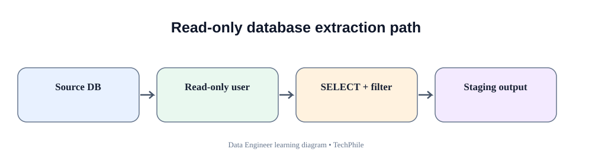
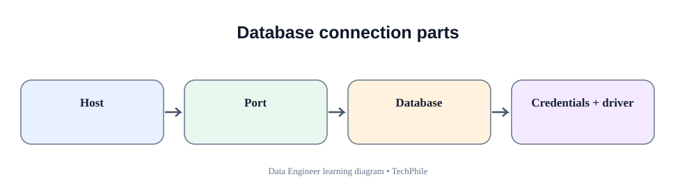
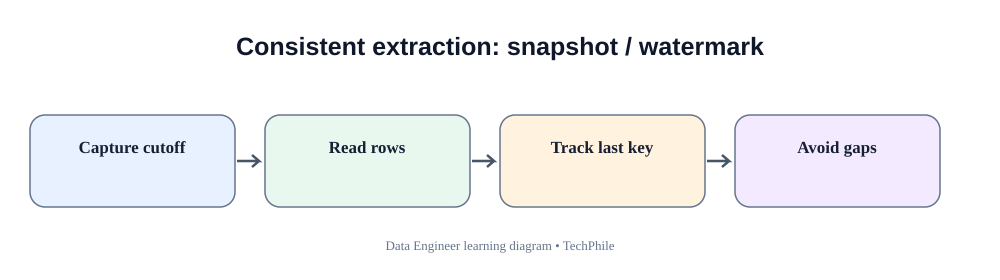

# Day 33: Database Ingestion
**Phase:** 4 — Data Processing and Pipelines  
**Learning time:** 2–3 hours  
**Audience:** Complete beginners and freshers  
**Topic boundary:** These are class notes only. The project workbook and interview guide are separate learning resources.

> Today we move from files and APIs to a database source. Follow each step in order. The goal is not only to run SELECT, but to understand how a Data Engineer connects safely, retrieves the correct rows, fetches them without exhausting memory, writes the extract and proves what was collected.

## Learning outcomes

By the end of this class, you should be able to:
- explain database ingestion and the role of a source database;
- distinguish a database, server, database name, schema, table, row and column;
- understand connection details and database credentials;
- connect Python to PostgreSQL using Psycopg 3;
- inspect a source table before extracting;
- execute SELECT queries safely;
- use parameterized SQL rather than string concatenation;
- understand cursor, execute, fetchone, fetchmany and fetchall;
- process records in bounded batches;
- write extracted rows to CSV without collecting the entire dataset in memory;
- compare source counts and output counts;
- understand full extraction and incremental extraction;
- recognize timestamp ties, late-arriving changes and source consistency concerns;
- handle database errors and close resources safely.

## Today's flow

`Source database -> Inspect schema -> Connect -> Execute SELECT -> Fetch batch -> Write output -> Verify -> Record extraction progress`

---

# 1. Understand database ingestion

## 1.1 What is database ingestion?

Database ingestion is the process of retrieving data from a database source and making it available to another system or processing stage.

Example:
- TechStore stores orders in PostgreSQL.
- The analytics platform needs order records for reporting.
- A Python pipeline connects to PostgreSQL.
- It selects the required rows and columns.
- It writes the extracted records to a file or another destination.
- It checks whether the extract is complete.

The source database remains the owner of the original operational records.

## 1.2 Why do companies use databases as sources?

Companies store structured business records in databases because databases provide:
- organized tables;
- constraints and relationships;
- query capabilities;
- concurrent access controls;
- transactions;
- permissions;
- backup and recovery features.

A Data Engineer often reads data from operational databases, application databases, reporting databases and cloud-managed databases.

## 1.3 Database extraction is not the same as database migration

**Extraction** reads selected data from a source.

**Migration** moves data or systems from one platform or structure to another.

Today's lesson focuses on extraction. We will not change the operational schema or migrate the source.

## 1.4 Read-only principle

A pipeline that only needs to extract data should normally use a database account with read-only permissions.

Do not connect to a production database using an administrator account just because it is convenient.

Minimum permission reduces accidental damage.

---

# 2. Understand database connection vocabulary

| Term | Beginner meaning | Example |
|---|---|---|
| Database server | Software/service that accepts database connections | PostgreSQL server |
| Host | Machine name or address | localhost |
| Port | Network endpoint number | PostgreSQL commonly uses 5432 |
| Database | Named database inside the server | techstore |
| Schema | Namespace that groups database objects | public |
| Table | Structured collection of rows and columns | orders |
| Username | Account used to connect | etl_reader |
| Password | Secret used to authenticate | Never hardcode it |
| Driver | Software that lets Python communicate with the database | Psycopg |
| Connection | Active session between Python and database | connection object |
| Cursor | Object used to execute statements and fetch results | cursor object |

## 2.1 Host

The host tells Python which machine or database service to contact.

- `localhost` means the same computer.
- A company database may use a DNS name.
- A cloud database may use a provider hostname.

Do not assume that localhost is correct for every environment.

## 2.2 Port

A port identifies a network service on a host.

PostgreSQL commonly uses port 5432, but administrators can configure another port.

## 2.3 Database name

A PostgreSQL server can host multiple databases. The connection must identify the correct database.

## 2.4 Username and password

The username identifies the database account. The password or another authentication mechanism proves the account's identity.

Credentials must be kept out of public code.

## 2.5 Driver

Python does not automatically understand every database's wire protocol.

A database driver provides the communication layer.

For PostgreSQL we use Psycopg 3.

---

# 3. Prepare PostgreSQL and Python

## 3.1 Confirm PostgreSQL is installed and running

Open pgAdmin or your approved SQL client.

Connect to the local PostgreSQL server.

If the server is not running, start the PostgreSQL service using the approved system administration method. Do not reinstall the database without first understanding the error.

## 3.2 Understand the database used in class

The examples use a practice database named `techstore` and a table named `orders`.

If your earlier database lessons created the TechStore schema, inspect that database first.

Do not run the sample extraction against a real business database without permission.

## 3.3 Create a small practice table if needed

Run this SQL in the practice database only:

```sql
CREATE TABLE IF NOT EXISTS orders (
    order_id INTEGER PRIMARY KEY,
    customer_id INTEGER NOT NULL,
    created_at TIMESTAMP NOT NULL,
    status VARCHAR(30) NOT NULL,
    total_amount NUMERIC(12, 2) NOT NULL
);
```

Understand each line:
- `CREATE TABLE` asks PostgreSQL to create a table.
- `IF NOT EXISTS` avoids an error if the table already exists.
- `orders` is the table name.
- `order_id` is an integer and primary key.
- `customer_id` is a required integer.
- `created_at` stores a date and time.
- `status` stores text with a maximum declared length.
- `total_amount` stores a decimal number with precision and scale.
- `NOT NULL` prevents the field from being stored as NULL.
- The final parenthesis closes the table definition.

If your Day 19/20 table uses different columns or types, inspect and use your actual schema. Do not create a second conflicting table unnecessarily.

## 3.4 Insert a tiny practice dataset if the table is empty

Only run the following in a disposable practice database:

```sql
INSERT INTO orders (order_id, customer_id, created_at, status, total_amount)
VALUES
    (101, 501, TIMESTAMP '2026-11-10 09:00:00', 'PAID', 1250.50),
    (102, 502, TIMESTAMP '2026-11-10 10:15:00', 'SHIPPED', 800.00),
    (103, 503, TIMESTAMP '2026-11-10 11:30:00', 'PENDING', 250.00),
    (104, 504, TIMESTAMP '2026-11-11 08:00:00', 'PAID', 400.00)
ON CONFLICT (order_id) DO NOTHING;
```

Explanation:
- INSERT INTO identifies the destination table for this setup operation.
- The column list defines which fields receive values.
- Each parenthesized group represents one row.
- TIMESTAMP creates a timestamp literal.
- NUMERIC values represent money-like decimal values.
- ON CONFLICT handles a duplicate primary key.
- DO NOTHING leaves the existing row unchanged.

This setup statement is not part of the read-only extraction query. It is only for creating sample data in a practice database.

## 3.5 Inspect the table using SQL

```sql
SELECT *
FROM orders
ORDER BY order_id;
```

Expected rows depend on the existing practice database. For the four sample rows above, you should see order IDs 101, 102, 103 and 104 if the table contained no conflicting sample IDs.

## 3.6 Count the source rows

```sql
SELECT COUNT(*) AS source_rows
FROM orders;
```

The exact count depends on your database contents.

COUNT(*) returns the number of rows visible to the query. It does not validate every field value.

---

# 4. Inspect the source before connecting Python

A Data Engineer should understand the source table before writing an extraction query.

## 4.1 Inspect table columns

```sql
SELECT
    column_name,
    data_type,
    is_nullable
FROM information_schema.columns
WHERE table_name = 'orders'
ORDER BY ordinal_position;
```

Explanation:
- `information_schema.columns` contains metadata about database columns.
- `column_name` returns the field name.
- `data_type` returns the declared type.
- `is_nullable` indicates whether NULL is allowed.
- WHERE filters metadata to the orders table.
- ORDER BY makes the output order predictable.

If multiple schemas contain a table named orders, filter by table_schema too.

## 4.2 Inspect a few rows

```sql
SELECT order_id, customer_id, created_at, status, total_amount
FROM orders
ORDER BY order_id
LIMIT 5;
```

Use explicit columns. A pipeline should not depend on every current and future source column unless that is an intentional contract.

## 4.3 Why inspect before coding?

Inspection helps you discover:
- actual field names;
- actual data types;
- nullable fields;
- primary key;
- date/time fields;
- whether the table is empty;
- unexpected source values.

Do not guess a column name and then build an entire pipeline around it.

---

# 5. Install the PostgreSQL Python driver

## 5.1 Install Psycopg 3

Open CMD in the Python environment used for this lesson:

```bat
python -m pip install "psycopg[binary]"
```

Psycopg 3 is a PostgreSQL adapter for Python. The binary extra simplifies installation for many learning environments.

If your environment uses an organization-approved package process, follow that process instead.

## 5.2 Confirm the import

```python
import psycopg

print("Psycopg is ready")
```

Expected output:

```text
Psycopg is ready
```

## 5.3 Confirm the installed version

```python
print(psycopg.__version__)
```

The exact version depends on what was installed.

Do not compare a version number copied from an old tutorial and assume it is the only correct version.

---

# 6. Configure database credentials safely

## 6.1 Why hardcoding credentials is unsafe

This is a bad practice:

```python
password = "my_real_database_password"
```

If the notebook is shared or committed to Git, the credential may be exposed.

A password should not be stored in:
- public source code;
- notebooks committed to Git;
- screenshots;
- log messages;
- shared chat messages.

## 6.2 Set environment variables in Windows CMD

For a local learning session, set values in the current CMD window:

```bat
set DB_HOST=localhost
set DB_PORT=5432
set DB_NAME=techstore
set DB_USER=postgres
set DB_PASSWORD=replace_with_your_local_password
```

Replace the placeholder with your local practice password. Do not publish it.

These values apply to the current CMD session. A new terminal may require setting them again.

## 6.3 Read environment variables in Python

```python
import os

db_host = os.getenv("DB_HOST")
db_port = os.getenv("DB_PORT")
db_name = os.getenv("DB_NAME")
db_user = os.getenv("DB_USER")
db_password = os.getenv("DB_PASSWORD")

print(db_host)
print(db_port)
print(db_name)
print(db_user)
print(db_password is not None)
```

Expected output for the example configuration:

```text
localhost
5432
techstore
postgres
True
```

We check only whether the password is configured. We do not print the password.

## 6.4 Validate configuration before connecting

```python
required_settings = [
    db_host,
    db_port,
    db_name,
    db_user,
    db_password
]

if all(required_settings):
    print("Database settings are present")
else:
    print("One or more database settings are missing")
```

The `all` function returns True only when every item is truthy. This prevents a confusing connection error caused by a missing setting.

---

# 7. Make the first database connection

## 7.1 Connect to PostgreSQL

```python
import psycopg
import os

connection = psycopg.connect(
    host=os.getenv("DB_HOST"),
    port=os.getenv("DB_PORT"),
    dbname=os.getenv("DB_NAME"),
    user=os.getenv("DB_USER"),
    password=os.getenv("DB_PASSWORD")
)

print("Database connection opened")
```

Explanation:
- `psycopg.connect` opens a database connection.
- `host` identifies the database server.
- `port` identifies the PostgreSQL service port.
- `dbname` identifies the database.
- `user` identifies the database account.
- `password` supplies the configured credential.
- `connection` stores the connection object.

A successful connection means Python established a session. It does not prove that the account can read every table.

## 7.2 What if connection fails?

Common reasons:
- PostgreSQL service is stopped;
- host or port is wrong;
- database name is wrong;
- username or password is wrong;
- firewall or network blocks the connection;
- account is not permitted to connect;
- database does not exist.

Read the actual exception. Fix the specific cause instead of changing every setting.

## 7.3 Close the connection

```python
connection.close()
print("Database connection closed")
```

Close resources when they are no longer needed.

An open connection consumes database and application resources.

## 7.4 Prefer context managers

A context manager can manage connection and cursor resources.

```python
with psycopg.connect(
    host=db_host,
    port=db_port,
    dbname=db_name,
    user=db_user,
    password=db_password
) as connection:
    print("Connection is available inside this block")
```

When the block ends, Psycopg manages the connection lifecycle. Psycopg connection context behavior also includes transaction handling; understand the driver's documented behavior before using it for write operations.

---

# 8. Understand a cursor

A **cursor** is an object used to execute SQL statements and retrieve query results.

Think of the connection as the session with PostgreSQL and the cursor as the object used to send a query and fetch its result.

## 8.1 Create a cursor

```python
with psycopg.connect(
    host=db_host,
    port=db_port,
    dbname=db_name,
    user=db_user,
    password=db_password
) as connection:
    with connection.cursor() as cursor:
        print("Cursor is ready")
```

The nested context managers manage the connection and cursor resources.

## 8.2 Execute a SELECT query

```python
with psycopg.connect(
    host=db_host,
    port=db_port,
    dbname=db_name,
    user=db_user,
    password=db_password
) as connection:
    with connection.cursor() as cursor:
        cursor.execute(
            "SELECT order_id, status FROM orders ORDER BY order_id"
        )
        print("Query executed")
```

The SQL statement is sent to PostgreSQL. The cursor now has a result set that can be fetched.

## 8.3 Fetch one row

```python
with psycopg.connect(
    host=db_host,
    port=db_port,
    dbname=db_name,
    user=db_user,
    password=db_password
) as connection:
    with connection.cursor() as cursor:
        cursor.execute(
            "SELECT order_id, status FROM orders ORDER BY order_id"
        )

        first_row = cursor.fetchone()
        print(first_row)
```

Example output:

```text
(101, 'PAID')
```

The exact first row depends on the source table.

`fetchone()` returns one row. When no rows remain, it returns None.

## 8.4 Fetch another row

```python
second_row = cursor.fetchone()
```

This must be executed while the cursor is still open and after a query has produced rows.

Each fetch advances the result position.

## 8.5 Fetch all rows

```python
cursor.execute(
    "SELECT order_id, status FROM orders ORDER BY order_id"
)

all_rows = cursor.fetchall()

print(all_rows)
```

`fetchall()` returns all remaining rows in a list.

It is convenient for small results. It can consume large amounts of memory for a large source table.

## 8.6 Fetch a limited number of rows

```python
cursor.execute(
    "SELECT order_id, status FROM orders ORDER BY order_id"
)

first_two_rows = cursor.fetchmany(2)

print(first_two_rows)
```

`fetchmany(2)` asks for up to two rows from the remaining result.

The requested number is a fetch size, not a filter on the SQL source query.

---

# 9. Understand execute and SQL parameters

## 9.1 Why parameterized queries matter

Suppose the user wants orders for customer 501.

Do not build SQL by inserting user input into the query string.

Unsafe pattern:

```python
customer_id = "501"
query = "SELECT * FROM orders WHERE customer_id = " + customer_id
```

String concatenation can create SQL injection risks and quoting errors.

## 9.2 Use a parameter placeholder

With Psycopg, use `%s` as the value placeholder:

```python
customer_id = 501

cursor.execute(
    "SELECT order_id, customer_id, total_amount FROM orders WHERE customer_id = %s",
    (customer_id,)
)
```

Important:
- SQL text contains a placeholder.
- The value is supplied separately.
- The one-item tuple needs a trailing comma.
- Psycopg sends the value separately from SQL structure.

## 9.3 Why not use Python f-strings for SQL values?

This is unsafe for untrusted values:

```python
query = f"SELECT * FROM orders WHERE customer_id = {customer_id}"
```

The value becomes part of the SQL text. Use parameter binding for values.

## 9.4 Parameters are for values, not table names

A placeholder cannot safely represent arbitrary SQL syntax such as a table name or sort direction.

If dynamic identifiers are genuinely required, use the driver's identifier-composition utilities and strict allowlists. Beginners should use fixed, reviewed SQL statements.

## 9.5 Filter by status

```python
status = "PAID"

cursor.execute(
    "SELECT order_id, status FROM orders WHERE status = %s ORDER BY order_id",
    (status,)
)

paid_orders = cursor.fetchall()
print(paid_orders)
```

The status is passed as a parameter, not pasted into the SQL string.

## 9.6 Filter by date range

```python
start_time = "2026-11-10 00:00:00"
end_time = "2026-11-11 00:00:00"

cursor.execute(
    """
    SELECT order_id, created_at, total_amount
    FROM orders
    WHERE created_at >= %s
      AND created_at < %s
    ORDER BY created_at, order_id
    """,
    (start_time, end_time)
)

daily_orders = cursor.fetchall()
```

The start boundary is inclusive. The end boundary is exclusive.

This includes every timestamp on the selected business date without relying on a guessed final second.

In production, agree the business timezone and pass timezone-aware values when the source column and contract require them.

---

# 10. Understand fetchone, fetchmany and fetchall

| Method | What it returns | Good use |
|---|---|---|
| fetchone() | One next row or None | Inspect one row |
| fetchmany(n) | Up to n next rows | Process bounded groups |
| fetchall() | All remaining rows | Small result sets |

## 10.1 Fetchone demonstration

```python
cursor.execute("SELECT order_id FROM orders ORDER BY order_id")

row = cursor.fetchone()
print(row)
```

Only one row is fetched.

## 10.2 Fetchmany demonstration

```python
cursor.execute("SELECT order_id FROM orders ORDER BY order_id")

rows = cursor.fetchmany(2)
print(rows)
```

Up to two rows are returned.

## 10.3 Fetchall demonstration

```python
cursor.execute("SELECT order_id FROM orders ORDER BY order_id")

rows = cursor.fetchall()
print(rows)
```

All remaining rows are returned.

Do not call fetchall after already consuming some rows unless you intentionally want only the remaining rows.

---

# 11. Why batch extraction is important

## 11.1 What is a batch?

A batch is a manageable group of records processed together.

Instead of loading 10 million rows into one Python list, a pipeline can fetch 5,000 rows, process them, write them, and then fetch the next 5,000.

## 11.2 Memory comparison

Imagine:
- source table contains 5 million rows;
- each row contains several fields;
- Python objects consume more memory than the raw database representation.

Calling fetchall may exhaust application memory.

Batching controls the amount of data held at one time.

## 11.3 Fetch in batches

```python
cursor.execute(
    "SELECT order_id, customer_id, status, total_amount FROM orders ORDER BY order_id"
)

batch_size = 2

while True:
    batch = cursor.fetchmany(batch_size)

    if len(batch) == 0:
        break

    print("Batch size:", len(batch))
    print(batch)
```

For the four-row sample, the expected batch sizes are 2 and 2.

Explanation:
- `batch_size` stores the maximum number requested per fetch.
- `fetchmany` retrieves the next group.
- An empty list means no rows remain.
- `break` exits the loop.
- Each batch is handled before the next is requested.

## 11.4 Batch size is a trade-off

| Small batch | Large batch |
|---|---|
| Lower memory per batch | More memory per batch |
| More fetch operations | Fewer fetch operations |
| Smaller retry unit | Larger retry unit |
| May increase overhead | May improve throughput until resource limits |

Do not choose a batch size only because a tutorial uses 1,000. Measure source, network, Python memory and destination behavior.

## 11.5 Stable ordering matters

Use an ORDER BY with a deterministic key when batching through a result set.

Without a defined order, the order of returned rows is not guaranteed.

For a unique order_id, ORDER BY order_id provides a stable ordering for a fixed source snapshot.

---

# 12. Write database batches to CSV

The objective is to fetch a batch and write it immediately, rather than collecting all rows first.

## 12.1 Define output columns

```python
output_columns = [
    "order_id",
    "customer_id",
    "status",
    "total_amount"
]
```

These names must match the selected fields.

## 12.2 Execute the query and write the header

```python
import csv
from pathlib import Path

output_path = Path("output/database_orders.csv")

with psycopg.connect(
    host=db_host,
    port=db_port,
    dbname=db_name,
    user=db_user,
    password=db_password
) as connection:
    with connection.cursor() as cursor:
        cursor.execute(
            """
            SELECT order_id, customer_id, status, total_amount
            FROM orders
            ORDER BY order_id
            """
        )

        with output_path.open("w", encoding="utf-8", newline="") as file:
            writer = csv.writer(file)
            writer.writerow(output_columns)

            while True:
                batch = cursor.fetchmany(2)

                if len(batch) == 0:
                    break

                writer.writerows(batch)

print("Database extract written")
```

Line-by-line:
- Import csv for CSV writing.
- Path identifies the output location.
- Open a database connection.
- Open a cursor.
- Execute a read-only SELECT query.
- Open the output file in write mode.
- Create a CSV writer.
- Write the header once.
- Fetch two rows at a time.
- Stop when the batch is empty.
- Write the current batch.
- Close the output file, cursor and connection through context managers.

This example uses a tiny batch size so you can see the loop. Increase it only after understanding memory and performance.

## 12.3 Verify the output file exists

```python
print(output_path.exists())
print(output_path.stat().st_size)
```

Expected:
- True if the file was created;
- a byte count that depends on its contents.

A file existing does not prove the correct rows were written.

## 12.4 Read the output back

```python
with output_path.open("r", encoding="utf-8", newline="") as file:
    reader = csv.DictReader(file)

    for row in reader:
        print(row)
```

Inspect the values and compare them with the source query.

---

# 13. Verify a database extraction

## 13.1 Count source rows using the same filter

```sql
SELECT COUNT(*) AS source_count
FROM orders;
```

If the extract uses a date filter, the count query must use the same date filter.

Comparing an unfiltered source count with a filtered output count is not meaningful.

## 13.2 Count rows in the output CSV

```python
with output_path.open("r", encoding="utf-8", newline="") as file:
    reader = csv.DictReader(file)
    output_count = sum(1 for row in reader)

print("Output count:", output_count)
```

The header is not counted as a data row.

## 13.3 Compare counts

```python
if source_count == output_count:
    print("Count reconciliation passed")
else:
    print("Count reconciliation failed")
```

The source_count variable must have been obtained from the same query filter and appropriate source view.

## 13.4 Count equality is not enough

Imagine source rows:
- O-101;
- O-102;
- O-103.

Output rows:
- O-101;
- O-102;
- O-999.

Both counts are 3, but the output is wrong.

Also compare:
- unique keys;
- minimum and maximum keys or timestamps;
- important totals;
- null counts;
- source and target schema;
- expected date boundaries.

## 13.5 Check key uniqueness in the output

```python
order_ids = []

with output_path.open("r", encoding="utf-8", newline="") as file:
    reader = csv.DictReader(file)

    for row in reader:
        order_ids.append(row["order_id"])

print("Rows:", len(order_ids))
print("Unique IDs:", len(set(order_ids)))
```

If row count differs from unique ID count, at least one order ID is repeated.

This check assumes order_id is the unique business key for the extracted dataset.

---

# 14. Full extraction and incremental extraction

## 14.1 Full extraction

A full extraction reads all rows in the defined source scope.

Example:
- all orders currently in the orders table;
- all customers in a customer table.

Advantages:
- simple conceptual model;
- can rebuild a destination from source data.

Disadvantages:
- repeated work;
- more source load;
- more network and storage;
- may be too large for daily processing.

## 14.2 Incremental extraction

An incremental extraction reads only records that are new or changed since a previous successful point.

Example:
- orders with order_id greater than the last processed ID;
- records updated after a saved timestamp;
- change events after a source cursor.

It reduces repeated work, but requires careful progress tracking.

## 14.3 ID watermark

A watermark is a saved value that describes how far extraction has progressed.

For an append-only table with increasing IDs, the last successfully processed ID can be a simple watermark.

Suppose last processed ID is 102.

The next query might be:

```sql
SELECT order_id, customer_id, status, total_amount
FROM orders
WHERE order_id > 102
ORDER BY order_id;
```

This retrieves rows with larger IDs.

## 14.4 Why ID watermarks have limitations

An ID watermark works only when:
- new records receive increasing IDs;
- existing records do not need to be re-extracted after updates;
- IDs are assigned consistently;
- the source does not insert late records with old IDs.

If an order with ID 90 is updated after watermark 102, the query `order_id > 102` will not find it.

## 14.5 Bound an incremental run

Suppose the maximum ID at the start of the run is 120 and the saved watermark is 102.

Use:

```sql
SELECT order_id, customer_id, status, total_amount
FROM orders
WHERE order_id > 102
  AND order_id <= 120
ORDER BY order_id;
```

This defines a bounded range for the run.

New rows inserted after the upper boundary can be processed in the next run.

## 14.6 Why record the upper boundary?

Without a fixed upper boundary, new rows may continue appearing while extraction is running.

A bounded range makes the run easier to explain and reconcile.

The upper boundary must be captured consistently with the source query and the watermark strategy.

---

# 15. Timestamp-based incremental extraction

## 15.1 Updated timestamp

Some tables contain an `updated_at` field.

It changes when a record is inserted or updated.

An incremental query may use:

```sql
SELECT order_id, customer_id, status, total_amount, updated_at
FROM orders
WHERE updated_at > TIMESTAMP '2026-11-10 00:00:00'
ORDER BY updated_at, order_id;
```

This retrieves records updated after the supplied timestamp.

## 15.2 Why timestamp ties matter

Two records may have exactly the same updated_at value.

If the pipeline saves only the timestamp and uses a strict greater-than comparison, records sharing the boundary timestamp can be missed.

Example:
- Record 101 updated at 10:00:00.
- Record 102 updated at 10:00:00.
- Watermark saved as 10:00:00 after processing only record 101.
- Next query uses updated_at > 10:00:00.
- Record 102 is excluded.

## 15.3 Composite cursor concept

A safer cursor can combine:
- updated_at;
- a unique key such as order_id.

The comparison becomes a lexicographic boundary:

```sql
WHERE
    updated_at > %s
    OR (updated_at = %s AND order_id > %s)
ORDER BY updated_at, order_id;
```

The saved checkpoint contains both timestamp and order ID.

The exact implementation depends on database type and source guarantees.

## 15.4 Overlap window

Another approach is to re-read a small time range before the saved watermark, then deduplicate/upsert using a stable key.

Example:
- saved watermark = 12:00;
- next extraction starts at 11:55;
- already-seen records may appear again;
- target upsert handles duplicates safely.

This can help with late-arriving updates but requires idempotent target behavior and a carefully chosen overlap duration.

## 15.5 Late-arriving data

A record may be inserted today with a business date from yesterday.

Filtering by business date may miss it if the pipeline assumes the business date equals arrival time.

Understand which timestamp means:
- created time;
- last updated time;
- event time;
- business date;
- ingestion time.

They are not interchangeable.

---

# 16. Source consistency and long-running extracts

## 16.1 Source changes during extraction

A database table can change while a query is running.

Questions to ask:
- Does the query see a consistent snapshot?
- What transaction isolation level is used?
- Can rows be inserted while the extract is running?
- Can updates change the result set?
- Is a read replica being used?
- Can the replica lag behind the primary?

## 16.2 Snapshot concept

A consistent snapshot means the extraction sees a defined view of data according to the database's transaction rules.

This is important when multiple queries are used for:
- source count;
- data extraction;
- totals;
- validation.

If these queries see different source states, their counts may differ even when the extraction code is correct.

## 16.3 Read replica

A read replica is a copy of a database used to serve read workloads.

Benefits:
- reduces read pressure on the primary;
- can support analytics extraction.

Risks:
- replication lag;
- slightly stale data;
- failover and connection behavior.

Do not assume a replica contains every latest transaction.

## 16.4 Query only required fields

Selecting every column increases:
- network transfer;
- memory use;
- processing time;
- exposure of unnecessary data.

Use explicit columns and documented filters.

---

# 17. Database errors and recovery

## 17.1 Connection error

Possible causes:
- server unavailable;
- incorrect host or port;
- authentication problem;
- network restriction.

Check configuration and service health.

## 17.2 Permission error

The account may not have SELECT permission on the table or schema.

Ask the database owner for the minimum required read permission.

Do not request administrator privileges to bypass the issue.

## 17.3 Undefined table or column

The SQL refers to an object that does not exist in the connected database/schema.

Check:
- database name;
- schema name;
- table name;
- column name;
- spelling;
- schema search path.

## 17.4 Query timeout or cancellation

A query may run longer than allowed.

Investigate:
- missing filters;
- large scans;
- missing indexes;
- source load;
- query plan;
- network issues.

Do not increase timeouts indefinitely without understanding why the query is slow.

## 17.5 Network interruption while fetching

A connection may fail after some batches were written.

The pipeline must know:
- which range was extracted;
- which output file is complete;
- whether the current batch was fully written;
- whether the watermark was advanced;
- how to safely rerun.

Never advance a checkpoint merely because the first batch succeeded.

---

# 18. Safe checkpoint order

For incremental ingestion, the order of operations matters.

Safe conceptual sequence:

`Read bounded source range -> Write destination -> Verify destination -> Commit/publish -> Save checkpoint`

Why?
- If the checkpoint is saved first and the output later fails, the next run may skip missing data.
- If output is written but checkpoint is not saved, the next run may replay the range.
- Replay is safer when the destination operation is idempotent.

A common design is at-least-once extraction plus deduplication/upsert. Do not claim exactly-once behavior without explaining how destination writes and progress are coordinated.

---

# 19. Resource management

## 19.1 Close cursors

A cursor uses resources. Close it after the query work is complete.

## 19.2 Close connections

Connections consume database resources and may hold transaction state.

Use context managers where appropriate.

## 19.3 Avoid opening too many connections

Creating a new connection for every record is inefficient.

For a simple batch extraction, one connection and one cursor can be used for the extraction scope. Larger applications may use a connection pool with controlled limits.

## 19.4 Keep extraction queries read-only

The lesson uses SELECT. Do not add UPDATE, DELETE or INSERT to an extraction account unless the task specifically requires a separately approved operation.

---

# 20. Practical exercises

## Exercise 1 — Identify connection fields

What does each setting mean?
- host;
- port;
- dbname;
- user;
- password.

Expected reasoning:
- host identifies the server;
- port identifies the service endpoint;
- dbname selects the database;
- user identifies the account;
- password authenticates the account.

## Exercise 2 — Choose the correct fetch method

You need to inspect one record. Which method is appropriate?

Expected answer: fetchone.

You need to process 2,000,000 rows in manageable groups. Which method is more suitable?

Expected answer: fetchmany or a server-side cursor/batched extraction strategy, not fetchall.

## Exercise 3 — Parameterize a customer filter

Write a query to retrieve rows for customer 501.

Expected SQL:

```sql
SELECT order_id, customer_id
FROM orders
WHERE customer_id = %s;
```

Pass the value separately through the driver's execute parameters.

## Exercise 4 — Explain the batch loop

Why does the loop stop when fetchmany returns an empty list?

Expected answer: no rows remain in the current result set, so there is no next batch to process.

## Exercise 5 — Detect a wrong count

The source query returns 500 rows. The output file has 480 rows. What should you inspect?

Expected reasoning:
- filters differ;
- fetch loop stopped early;
- output writing failed;
- records were rejected or skipped;
- the source changed between count and extraction;
- the output count excluded/handled records differently.

## Exercise 6 — Explain why count equality is not enough

The source and output both contain 500 rows, but one order ID is missing and another is duplicated.

Expected answer: counts match but key-level reconciliation fails. Compare unique keys and source/output key sets.

## Exercise 7 — Explain an ID watermark limitation

The saved watermark is 500. An existing row with ID 200 is updated. Will `WHERE order_id > 500` return it?

Expected answer: no. ID watermark only captures later IDs, not updates to older records.

## Exercise 8 — Explain timestamp ties

Two rows share the exact same updated_at timestamp. Why can a strict greater-than watermark miss one?

Expected answer: after saving the shared timestamp, the next query excludes rows equal to the watermark. A composite cursor or overlap strategy may be needed.

## Exercise 9 — Explain read replica lag

Why might a row committed on the primary not appear immediately on a replica?

Expected answer: replication is asynchronous or delayed, so the replica may not yet have replayed the change.

## Exercise 10 — Explain resource closure

Why should a cursor and connection be closed?

Expected answer: they consume resources and can retain session or transaction state. Context managers help manage their lifecycle.

---

# 21. Debugging checklist

When database extraction fails, check in this order:

1. Is PostgreSQL running?
2. Is the host correct?
3. Is the port correct?
4. Does the database exist?
5. Are the credentials configured?
6. Is the account allowed to connect?
7. Does the account have SELECT permission?
8. Is the correct schema selected?
9. Does the table exist?
10. Do the selected columns exist?
11. Does the SQL filter match the intended business range?
12. Are values passed as parameters?
13. Is the query ordered deterministically?
14. Is the batch loop reaching an empty result?
15. Is the output file being written?
16. Does the output reopen successfully?
17. Do source and output counts match under the same filter?
18. Do unique keys and totals reconcile?
19. Was the checkpoint saved only after verified output?
20. Could source changes or replica lag explain a mismatch?

Change one cause at a time and keep the failing query or input small enough to inspect.

---

# 22. Day 33 revision checklist

You should be able to explain:
- database server, database, schema and table;
- host, port, username and password;
- database driver;
- Psycopg 3;
- environment variables;
- connection and cursor;
- execute;
- SELECT and explicit columns;
- parameterized SQL and `%s`;
- fetchone, fetchmany and fetchall;
- why fetchall can be dangerous for large tables;
- batch size;
- deterministic ordering;
- writing batches to CSV;
- source/output count reconciliation;
- unique-key reconciliation;
- full versus incremental extraction;
- ID watermark;
- timestamp watermark;
- timestamp ties;
- late-arriving updates;
- read replica lag;
- source snapshot consistency;
- safe checkpoint ordering;
- resource closure and read-only permissions.

---

# 23. Key takeaways

1. A database extraction pipeline reads data from a database under an agreed contract.
2. Understand the source schema before writing the query.
3. Use a database driver to connect Python to PostgreSQL.
4. Keep credentials outside source code.
5. Use read-only permissions for extraction where possible.
6. Use parameterized SQL for values.
7. Use explicit columns and predictable ordering.
8. fetchone retrieves one row; fetchmany retrieves a bounded group; fetchall retrieves all remaining rows.
9. Batch processing helps control memory.
10. Verify the saved output, not just the intended write.
11. Count equality is useful but must be supplemented with key and value checks.
12. ID watermarks do not capture updates to older IDs.
13. Timestamp watermarks need tie and late-arrival handling.
14. Source consistency and replica lag can affect extraction results.
15. Save progress only after output is durable and verified.

## What comes next

Day 34 focuses on data transformation and business rules. After data is extracted, a Data Engineer must standardize values, derive useful fields, apply approved business logic and keep rejected data visible.

**End of Day 33 class notes.**

---

## Visual Learning Diagrams

### Read-only database extraction


### Database connection parts


### Consistent extraction cutoff

