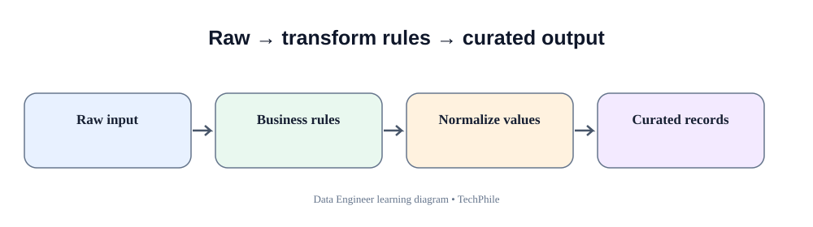
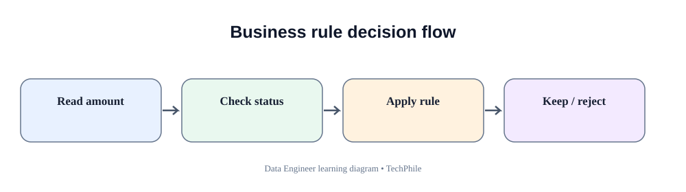
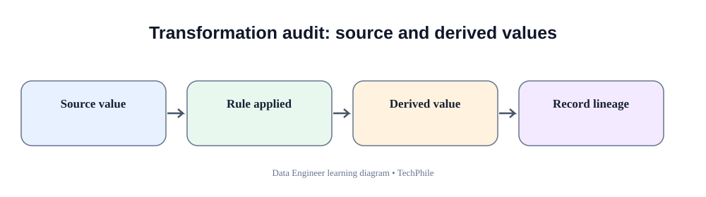

# Day 34: Data Transformation and Business Rules
**Phase:** 4 — Data Processing and Pipelines  
**Learning time:** 2–3 hours  
**Audience:** Complete beginners and freshers  
**Topic boundary:** These are class notes only. The guided project workbook and interview guide are separate.

> Extraction brings source data into the pipeline. Transformation changes its representation or derives useful values under approved rules. A Data Engineer must never guess business meaning. Every transformation should be explainable, repeatable and testable.

## Learning outcomes

By the end of this lesson, you should be able to:
- explain raw data, transformed data and business rules;
- inspect a dataset before changing it;
- distinguish cleaning, standardization, conversion and derivation;
- trim whitespace and standardize text safely;
- convert numeric and date values with error handling;
- use Decimal for money calculations;
- map source codes to approved business values;
- derive line totals and order-level measures;
- apply cross-field validation;
- preserve raw values and rejection reasons;
- reconcile counts and amounts after transformation;
- explain why transformation order matters.

## Today's flow

`Raw source -> Inspect -> Normalize -> Convert -> Apply business rules -> Derive -> Validate -> Accepted/rejected -> Reconcile`

---

# 1. What is data transformation?

Data transformation is the process of changing data from its source representation into a form that is useful and consistent for the next system or business purpose.

Example:
- source status is `paid`;
- target standard status is `PAID`;
- source amount is text `"1250.50"`;
- target amount is a decimal value;
- source has quantity and unit price;
- target has a calculated line total.

Transformation can:
- standardize text;
- convert data types;
- derive new fields;
- map codes;
- apply approved business calculations;
- reshape data;
- validate relationships between fields.

## 1.1 Why raw data is not always ready

Different systems may represent the same business concept differently.

| Source A | Source B | Meaning |
|---|---|---|
| paid | PAID | Payment complete |
| Shipped | SHIPPED | Order dispatched |
| 1250.50 | "1250.50" | Amount represented differently |
| 2026-11-10 | 10/11/2026 | Date format may be ambiguous |

The data engineer must understand the source and target contracts before standardizing.

## 1.2 Transformation is not arbitrary correction

Suppose the amount is `"one thousand"`.

Changing it to 1000 because it seems likely is not a safe transformation unless a documented rule explicitly supports that conversion.

A transformation should be deterministic:
- same input;
- same rule;
- same output.

If the input cannot be interpreted safely, reject or quarantine it.

---

# 2. Understand the business scenario

TechStore receives order line records.

| order_id | product_id | quantity | unit_price | status |
|---|---|---:|---:|---|
| O-101 | PR-10 | 2 | 500.00 | paid |
| O-102 | PR-11 | 1 | 800.00 | Shipped |
| O-103 | PR-12 | 3 | 100.00 | PENDING |

The analytics team wants:
- uppercase standard statuses;
- numeric quantity;
- decimal unit price;
- calculated line total;
- accepted records only when required fields and business rules pass.

Before coding, clarify:
1. Is quantity allowed to be zero?
2. Are returns represented as negative quantities or separate events?
3. Is unit price before or after discount?
4. Are taxes included?
5. Which status values are valid?
6. What currency is used?
7. What should happen to unknown status values?

The business owner defines these rules. The engineer implements them.

---

# 3. Raw data and transformed data

## 3.1 Raw data

Raw data is the data as received from the source, before applying transformation rules.

Example:

```python
raw_record = {
    "order_id": " O-101 ",
    "status": "paid ",
    "quantity": "2",
    "unit_price": "500.00"
}
```

Notice:
- order_id has spaces;
- status has trailing whitespace;
- quantity is text;
- unit_price is text.

## 3.2 Transformed data

After approved rules:

```python
transformed_record = {
    "order_id": "O-101",
    "status": "PAID",
    "quantity": 2,
    "unit_price": "500.00",
    "line_total": "1000.00"
}
```

The target representation is consistent.

## 3.3 Keep the raw values

Do not overwrite the only copy of the source values.

Keeping raw values helps:
- investigate disputes;
- reproduce transformations;
- correct transformation logic;
- compare source and target;
- satisfy audit requirements.

A common design keeps immutable raw data and writes transformed data separately.

---

# 4. Prepare the Python workspace

Create a folder:

```bat
mkdir day34_transformation
cd day34_transformation
mkdir data
mkdir output
```

Create a notebook or Python file in this folder.

Use a small sample dataset first. Small examples make it easier to see exactly what each transformation does.

## 4.1 Create sample records

```python
records = [
    {
        "order_id": " O-101 ",
        "product_id": "PR-10",
        "quantity": "2",
        "unit_price": "500.00",
        "status": "paid "
    },
    {
        "order_id": "O-102",
        "product_id": "PR-11",
        "quantity": "1",
        "unit_price": "800.00",
        "status": "Shipped"
    },
    {
        "order_id": "O-103",
        "product_id": "PR-12",
        "quantity": "3",
        "unit_price": "100.00",
        "status": "PENDING"
    }
]

print(len(records))
```

Expected output:

```text
3
```

There are three dictionaries inside the list. Each dictionary represents one order line.

## 4.2 Inspect one record

```python
print(records[0])
```

Expected output:

```text
{'order_id': ' O-101 ', 'product_id': 'PR-10', 'quantity': '2', 'unit_price': '500.00', 'status': 'paid '}
```

Before transforming, inspect the actual values. Do not assume that every row follows the same pattern.

---

# 5. Inspect before transforming

## 5.1 Count records

```python
print("Rows:", len(records))
```

The row count provides a baseline for later reconciliation.

## 5.2 Inspect keys

```python
print(records[0].keys())
```

This shows the field names in the first dictionary.

Check all records if the source structure may vary.

## 5.3 Inspect values in one field

```python
for record in records:
    print(record["status"])
```

This helps discover casing and whitespace differences.

## 5.4 Inspect types

```python
for record in records:
    print(type(record["quantity"]), type(record["unit_price"]))
```

Expected output shows both values are strings.

The source representation matters because conversion must be deliberate.

---

# 6. Standardize text

## 6.1 Remove leading and trailing spaces

```python
status_text = " paid "
clean_status = status_text.strip()

print(clean_status)
```

Expected output:

```text
paid
```

`strip()` removes whitespace from both ends. It does not remove spaces inside the text.

## 6.2 Convert text to uppercase

```python
clean_status = clean_status.upper()

print(clean_status)
```

Expected output:

```text
PAID
```

`upper()` changes alphabetic characters to uppercase.

## 6.3 Apply both steps

```python
status_text = " shipped "
standard_status = status_text.strip().upper()

print(standard_status)
```

Expected output:

```text
SHIPPED
```

The order is understandable: remove surrounding whitespace, then standardize case.

## 6.4 Handle None safely

```python
status_text = None

if status_text is None:
    standard_status = None
else:
    standard_status = status_text.strip().upper()

print(standard_status)
```

Expected output:

```text
None
```

Calling `strip()` directly on None raises an AttributeError. Check missing values before using string methods.

## 6.5 Do not change business meaning

Trimming whitespace and standardizing case are usually presentation normalizations.

Changing `CANCELLED` to `PAID` is not normalization. It changes the business meaning and must never be done without an approved mapping.

---

# 7. Convert numeric values safely

## 7.1 Understand numeric text

A CSV or API may send:
- `"2"`;
- `"3.5"`;
- `"unknown"`;
- `""`.

The pipeline must decide which forms are valid for each field.

## 7.2 Convert quantity to integer

```python
quantity_text = "2"
quantity = int(quantity_text)

print(quantity)
print(type(quantity))
```

Expected output:

```text
2
<class 'int'>
```

An integer conversion is suitable when the business contract requires whole units.

If fractional quantities are allowed, integer conversion is wrong. Confirm the business rule.

## 7.3 Invalid integer

```python
quantity_text = "two"
quantity = int(quantity_text)
```

This raises ValueError.

Do not silently replace invalid quantity with zero. Zero has a business meaning and may create false reports.

## 7.4 Validate before conversion

```python
quantity_text = "two"

try:
    quantity = int(quantity_text)
    print("Quantity:", quantity)

except ValueError:
    print("Quantity must be a whole number")
```

The exception handler makes the failure understandable. A complete pipeline should store the original record and rejection reason.

## 7.5 Convert money using Decimal

```python
from decimal import Decimal

price_text = "500.00"
unit_price = Decimal(price_text)

print(unit_price)
print(type(unit_price))
```

Expected output:

```text
500.00
<class 'decimal.Decimal'>
```

Use Decimal for financial values when exact decimal arithmetic is required.

## 7.6 Why float can be risky for money

Floating-point numbers use binary representation. Some decimal fractions cannot be represented exactly.

For financial calculations, Decimal is usually a safer choice.

Do not create Decimal from an already converted float. Create it from the original decimal text.

## 7.7 Validate negative values

```python
unit_price = Decimal("500.00")

if unit_price < 0:
    print("Price cannot be negative")
else:
    print("Price is valid")
```

Whether negative values are invalid depends on the field. A refund event may legitimately be negative. A product catalogue unit price may not.

Always use the rule for the actual business concept.

---

# 8. Parse dates and timestamps

## 8.1 Why date formats matter

These values can be ambiguous:
- 10/11/2026;
- 11/10/2026.

One system may mean 10 November; another may mean October 11.

Use an agreed format such as ISO 8601 where possible.

## 8.2 Parse an ISO date

```python
from datetime import date

date_text = "2026-11-10"
order_date = date.fromisoformat(date_text)

print(order_date)
```

Expected output:

```text
2026-11-10
```

## 8.3 Parse a timestamp

```python
from datetime import datetime

timestamp_text = "2026-11-10 09:30:00"
created_at = datetime.fromisoformat(timestamp_text)

print(created_at)
```

Expected output:

```text
2026-11-10 09:30:00
```

## 8.4 Timezone awareness

A timestamp without timezone information is often called naive.

A timezone-aware timestamp identifies an offset or timezone context.

For global pipelines, clarify whether the source sends UTC, local business time or an explicit offset.

Do not assume that a timestamp without timezone means UTC.

## 8.5 Invalid date handling

```python
date_text = "2026-15-40"

try:
    order_date = date.fromisoformat(date_text)
    print(order_date)

except ValueError:
    print("Invalid calendar date")
```

The string resembles a date but is not a valid calendar date.

---

# 9. Apply approved business mappings

## 9.1 Why mapping is needed

A partner may use codes different from the company's standard vocabulary.

Example source values:
- `P`;
- `S`;
- `W`;
- `C`.

The business owner may define:
- P -> PAID;
- S -> SHIPPED;
- W -> PENDING;
- C -> CANCELLED.

Do not invent these meanings.

## 9.2 Create an approved mapping

```python
status_mapping = {
    "P": "PAID",
    "S": "SHIPPED",
    "W": "PENDING",
    "C": "CANCELLED"
}
```

The dictionary stores the approved source-to-standard relationship.

## 9.3 Apply the mapping

```python
source_status = "S"
standard_status = status_mapping.get(source_status)

print(standard_status)
```

Expected output:

```text
SHIPPED
```

`get` returns the mapped value or None when the source code is not present.

## 9.4 Handle an unknown code

```python
source_status = "X"
standard_status = status_mapping.get(source_status)

if standard_status is None:
    print("Unknown status code")
else:
    print(standard_status)
```

Expected output:

```text
Unknown status code
```

Do not map an unknown value to a default status without an approved rule.

## 9.5 Mapping version

In a real system, record which mapping version was used. If the business later changes a mapping, the team should be able to explain why historical output differs.

---

# 10. Derive business values

A derived field is calculated from existing fields.

## 10.1 Calculate line total

For one order line:

`line_total = quantity × unit_price`

Example:
- quantity = 2;
- unit price = 500.00;
- line total = 1000.00.

## 10.2 Calculate with Decimal

```python
from decimal import Decimal

quantity = 2
unit_price = Decimal("500.00")

line_total = Decimal(quantity) * unit_price

print(line_total)
```

Expected output:

```text
1000.00
```

Explanation:
- quantity is an integer;
- Decimal(quantity) converts the whole number to Decimal;
- multiplication calculates the total;
- the result remains Decimal.

## 10.3 Calculate discount amount

Suppose the approved discount is 10 percent.

```python
from decimal import Decimal

line_total = Decimal("1000.00")
discount_rate = Decimal("0.10")

discount_amount = line_total * discount_rate

print(discount_amount)
```

Expected output:

```text
100.0000
```

The number of decimal places can depend on the Decimal inputs and context. Financial output should follow the currency's rounding policy.

## 10.4 Calculate net amount

```python
net_amount = line_total - discount_amount

print(net_amount)
```

Expected output:

```text
900.0000
```

## 10.5 Rounding is a business rule

Should the system round:
- each line;
- each tax amount;
- the order total;
- the invoice total?

Different policies can produce different results. Do not choose rounding behavior without a documented finance rule.

## 10.6 Tax calculation example

If the approved tax rate is 18 percent:

```python
tax_rate = Decimal("0.18")
tax_amount = net_amount * tax_rate

print(tax_amount)
```

The arithmetic is straightforward. Whether tax applies before or after discount is a business rule and may vary by jurisdiction and transaction type.

---

# 11. Validate relationships between fields

A record can contain individually valid fields but still be inconsistent.

## 11.1 Quantity and price

A positive quantity and positive unit price can produce a valid line total.

But if quantity is zero, should the line be accepted? That depends on whether zero-quantity records have a business meaning.

## 11.2 Status and amount

A CANCELLED order with a positive captured amount may require review. It is not necessarily invalid because refunds may be processed later.

Do not reject it without understanding the lifecycle.

## 11.3 Date relationships

An order's updated_at timestamp should not normally be earlier than its created_at timestamp.

This is a cross-field rule:

`updated_at >= created_at`

If the source violates it, record the issue for investigation.

## 11.4 Check a date relationship

```python
from datetime import datetime

created_at = datetime.fromisoformat("2026-11-10 09:00:00")
updated_at = datetime.fromisoformat("2026-11-10 10:00:00")

if updated_at < created_at:
    print("Update time is earlier than creation time")
else:
    print("Timestamp order is valid")
```

Expected output:

```text
Timestamp order is valid
```

---

# 12. Transform one complete record step by step

We will now apply the transformations to one row.

## 12.1 Input record

```python
raw_record = {
    "order_id": " O-101 ",
    "product_id": "PR-10",
    "quantity": "2",
    "unit_price": "500.00",
    "status": "paid "
}
```

## 12.2 Start with a separate output dictionary

```python
transformed_record = {}
```

Do not modify the only raw copy.

## 12.3 Clean the order ID

```python
transformed_record["order_id"] = raw_record["order_id"].strip()
```

The output key receives the trimmed value.

## 12.4 Copy the product ID after checking it

```python
transformed_record["product_id"] = raw_record["product_id"].strip()
```

This assumes product_id is a text identifier and trimming is approved.

## 12.5 Convert quantity

```python
transformed_record["quantity"] = int(raw_record["quantity"])
```

The string `"2"` becomes integer 2.

## 12.6 Convert unit price

```python
transformed_record["unit_price"] = Decimal(raw_record["unit_price"])
```

The money value becomes Decimal.

## 12.7 Standardize status

```python
transformed_record["status"] = raw_record["status"].strip().upper()
```

The output status becomes PAID.

## 12.8 Derive line total

```python
transformed_record["line_total"] = (
    transformed_record["quantity"] *
    transformed_record["unit_price"]
)
```

The result is quantity multiplied by unit price.

## 12.9 Inspect the transformed record

```python
print(transformed_record)
```

Expected values:

```text
order_id: O-101
product_id: PR-10
quantity: 2
unit_price: 500.00
status: PAID
line_total: 1000.00
```

The exact dictionary display order follows insertion order in modern Python.

---

# 13. Transform a list of records

## 13.1 Prepare output collections

```python
accepted_records = []
rejected_records = []
```

Each source record must end up in one clearly defined outcome.

## 13.2 Understand validation order

A sensible order:
1. check required fields exist;
2. check required text is not blank;
3. convert numeric values;
4. check allowed values;
5. apply business calculations;
6. validate cross-field relationships;
7. add to accepted output.

Do not calculate line_total before quantity and unit_price have been safely converted.

## 13.3 Validate one record before appending

For each record, collect errors. If errors exist, store the raw record and reasons in rejected output. Otherwise, store the transformed record.

A production implementation must also handle unexpected data types and missing keys without crashing.

---

# 14. Understand nulls and missing values

## 14.1 None is not the same as zero

- None means no value is available.
- 0 is a numeric value.
- Empty string is text with no characters.
- The string "0" is text representing zero.

These values have different meanings.

## 14.2 Do not replace every missing amount with zero

If a payment amount is missing, replacing it with zero may make financial reports incorrect.

Use a default only when the business contract explicitly defines that default.

## 14.3 Optional fields

An optional coupon code may be missing without rejecting the order.

A required order ID should not be missing.

Validation depends on the field's role.

---

# 15. Reconcile after transformation

Transformation changes values and may reject records. We need evidence that the result is accounted for.

## 15.1 Record count reconciliation

`Input count = Accepted count + Rejected count`

If 1,000 source records produce 970 accepted and 30 rejected, the equation passes.

## 15.2 Compare financial totals

If transformation does not intentionally change the total amount, compare source and output totals.

If transformation applies discounts or taxes, define the expected relationship rather than expecting equality.

## 15.3 Count by status

Compare source and transformed status distributions. A mapping error may convert too many records into one status.

## 15.4 Check unique identifiers

Verify that the output has no duplicate order-line identity.

An order can contain multiple products, so order_id alone may not be unique at the line level. The key may need to be order_id plus line_id or another approved combination.

## 15.5 Why count reconciliation is not enough

Counts can match even if:
- values are swapped;
- an amount is wrong;
- one row is duplicated and another omitted;
- status mapping is incorrect.

Use multiple checks that reflect the business meaning.

---

# 16. Transformation order matters

Consider:
1. trim whitespace;
2. convert text to number;
3. calculate line total.

If conversion is attempted before trimming, some values may fail unnecessarily.

Consider:
1. validate quantity;
2. calculate line total.

If quantity is invalid, calculating first may create an exception or incorrect output.

A good transformation pipeline makes dependencies explicit.

---

# 17. Common transformation mistakes

## Mistake 1 — Convert invalid numeric values to zero

**Risk:** False financial or quantity data.

**Better:** Reject with the original value and reason.

## Mistake 2 — Use float for financial arithmetic

**Risk:** Binary floating-point approximation.

**Better:** Use Decimal and an approved rounding policy.

## Mistake 3 — Guess unknown status codes

**Risk:** Incorrect business meaning.

**Better:** Use an approved mapping and reject unknown values.

## Mistake 4 — Modify raw records in place

**Risk:** Original evidence is lost.

**Better:** Preserve raw values and create transformed output.

## Mistake 5 — Apply transformations before inspecting data

**Risk:** Unexpected source patterns are missed.

**Better:** Profile values and types first.

## Mistake 6 — Treat missing as zero

**Risk:** Changes business meaning.

**Better:** Handle nulls according to the field contract.

## Mistake 7 — Ignore cross-field rules

**Risk:** Individually valid values may form an impossible record.

**Better:** Validate relationships and lifecycle rules.

## Mistake 8 — Change rounding without approval

**Risk:** Totals differ from financial systems.

**Better:** Document the rounding level and currency precision.

---

# 18. Debugging guide

When a transformation result looks wrong:

1. Inspect the original source record.
2. Confirm the source field names.
3. Print the raw value and its Python type.
4. Check whitespace and casing.
5. Verify the conversion rule.
6. Inspect the approved mapping table.
7. Check numeric precision and rounding.
8. Confirm the formula uses the correct fields.
9. Check null behavior.
10. Check cross-field rules.
11. Compare accepted and rejected counts.
12. Compare key sets and business totals.
13. Re-run a small sample after changing one rule.

Never debug only from the final aggregate. Return to the smallest source record that demonstrates the issue.

---

# 19. Practice exercises with expected reasoning

## Exercise 1 — Standardize text

Input: `" paid "`

Expected standardized value: `PAID`.

## Exercise 2 — Convert quantity

Input: `"3"`

Expected Python type: int.

Input: `"three"`

Expected result: conversion error; record should be rejected with a reason.

## Exercise 3 — Money calculation

Quantity = 4, unit price = 25.50.

Expected line total = 102.00.

Use Decimal for the amount.

## Exercise 4 — Unknown status

Input code: `X`.

Expected result: unknown mapping; do not guess a standard status.

## Exercise 5 — Missing value

Amount is None.

Expected reasoning: amount is missing. Do not replace it with zero unless the contract says so.

## Exercise 6 — Date validation

updated_at is earlier than created_at.

Expected reasoning: cross-field timestamp rule fails and the record should be reviewed or rejected according to policy.

## Exercise 7 — Record accounting

Input 500, accepted 492, rejected 8.

Expected: count reconciliation passes because 500 = 492 + 8.

## Exercise 8 — Duplicate line identity

Two records share the same order_id but have different line_id values.

Expected reasoning: they may be separate order lines. Do not deduplicate by order_id alone if the source grain is order line.

---

# 20. Day 34 revision checklist

You should be able to explain:
- raw versus transformed data;
- why transformation rules must be approved;
- profiling before transformation;
- whitespace trimming;
- case standardization;
- None versus empty string versus zero;
- integer conversion;
- Decimal conversion;
- date and timestamp parsing;
- timezone awareness;
- source-to-standard mappings;
- unknown code handling;
- derived fields;
- line total, discount and tax concepts;
- rounding policy;
- cross-field validation;
- accepted and rejected records;
- preserving raw values;
- count, key and total reconciliation;
- transformation order;
- common conversion and mapping failures.

---

# 21. Key takeaways

1. Transformation changes data under documented rules.
2. Inspect the source before changing it.
3. Preserve raw values.
4. Normalize only when the rule is clear.
5. Convert types explicitly.
6. Use Decimal for money.
7. Do not guess missing or unknown business values.
8. Derive fields only from approved formulas.
9. Validate relationships between fields.
10. Keep rejected records and reasons.
11. Reconcile counts, keys and business totals.
12. Make every transformation repeatable and explainable.

## What comes next

Day 35 focuses on data cleaning and schema evolution. You will learn how to profile dirty datasets, handle duplicates and missing values, detect changes in incoming columns, and manage schema changes without silently breaking the pipeline.

**End of Day 34 class notes.**

---

## Visual Learning Diagrams

### Raw to transformed data


### Business-rule decision flow


### Transformation audit trail

