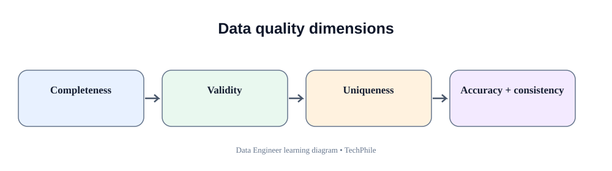
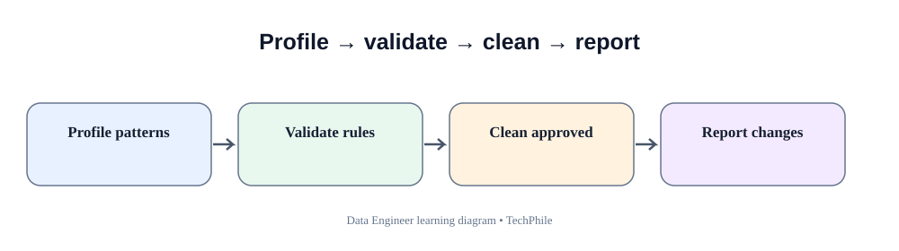
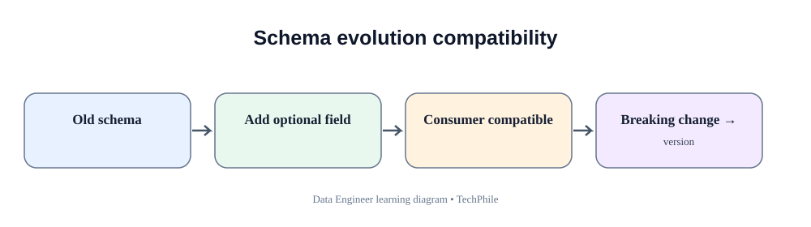

# Day 35: Data Cleaning and Schema Evolution
**Phase:** 4 — Data Processing and Pipelines  
**Learning time:** 2–3 hours  
**Audience:** Complete beginners and freshers  
**Topic boundary:** This document is the class lesson only. The project workbook and interview guide remain separate.

> Cleaning is not deleting every row that looks unusual. It is understanding the source, applying documented quality rules, preserving evidence and deciding safely what can be accepted. Schema evolution is managing changes to the structure of incoming data.

## Learning outcomes

By the end, you should be able to:
- explain data quality and data cleaning;
- distinguish profiling, validation, cleaning and transformation;
- inspect a dataset before changing it;
- measure missing values, duplicates and inconsistent values;
- distinguish a duplicate row from a duplicate business key;
- handle whitespace, casing, invalid numbers and dates;
- decide when to reject, quarantine or correct a record;
- compare an incoming schema with an expected schema;
- identify missing, extra, renamed and type-changed columns;
- apply only approved schema mappings;
- understand backward-compatible and breaking schema changes;
- preserve raw data and create a cleaning report;
- reconcile accepted, rejected and output records.

## Today's flow

`Raw data -> Profile -> Compare schema -> Identify quality issues -> Apply approved cleaning -> Quarantine invalid rows -> Reconcile -> Publish`

---

# 1. What is data quality?

Data quality describes whether data is fit for its intended use.

A dataset can be technically readable but still be poor quality.

Examples:
- customer_id is missing;
- amount contains text;
- the same transaction appears twice;
- status uses five spellings for the same approved value;
- order_date is outside the expected range;
- a source system changes a column name without notice.

Data quality is not one single number. It includes several dimensions.

## 1.1 Common data quality dimensions

| Dimension | Beginner meaning | Example |
|---|---|---|
| Completeness | Required information is present | order_id is not blank |
| Validity | Values follow allowed rules | amount is numeric |
| Uniqueness | Business keys are not duplicated | one record per event_id |
| Consistency | Related values agree | updated_at is not before created_at |
| Accuracy | Values represent reality | delivered status matches courier evidence |
| Timeliness | Data arrives when needed | daily feed arrives before reporting deadline |
| Integrity | Relationships are preserved | order customer exists in customer reference |

A pipeline can check completeness and validity. Accuracy may require external business evidence that the pipeline does not possess.

## 1.2 Why data cleaning is necessary

Data comes from:
- manual entry;
- partner exports;
- application databases;
- APIs;
- spreadsheets;
- legacy systems.

Different producers may have different rules and levels of control.

The purpose of cleaning is to make the data usable without hiding or inventing facts.

## 1.3 Cleaning is not deleting

Suppose 1,000 rows arrive and 20 contain invalid amounts.

Deleting those 20 rows without recording them creates unexplained data loss.

A controlled process should:
- retain the raw input;
- identify the invalid rows;
- record why they failed;
- send them to a quarantine/rejected area;
- report accepted and rejected counts;
- allow correction and reprocessing under control.

---

# 2. Understand the difference between profiling, validation and cleaning

| Activity | What it does | Example |
|---|---|---|
| Profiling | Describes the data | Count missing customer IDs |
| Validation | Checks rules | customer_id must not be blank |
| Cleaning | Applies approved corrections | Trim surrounding spaces |
| Transformation | Changes representation or derives values | Convert amount text to Decimal |
| Quarantine | Isolates records that cannot be accepted | Write invalid row with reason |

These activities are related but not identical.

## 2.1 Profiling comes first

If you clean before profiling, you may remove evidence of the problem.

Example:
- raw status values: `paid`, `PAID`, `Paid `, `P`, `unknown`;
- profiling reveals five patterns;
- business owner confirms the approved mapping;
- cleaning applies the approved mapping;
- unknown remains rejected.

## 2.2 Validation comes before acceptance

A row should not be accepted just because Python did not raise an exception.

Acceptance means it passed the required data contract and business rules.

## 2.3 Cleaning rules need ownership

A developer may safely trim accidental surrounding whitespace if the contract allows it.

A developer should not invent a missing customer ID or guess a transaction amount.

---

# 3. Prepare the learning environment

Create a folder:

```bat
mkdir day35_data_quality
cd day35_data_quality
mkdir input
mkdir output
mkdir rejected
```

Install Pandas if it is not already installed:

```bat
python -m pip install pandas
```

Open Jupyter Notebook or VS Code using the Python environment where Pandas is installed.

## 3.1 Import Pandas

```python
import pandas as pd

print("Pandas is ready")
```

Expected output:

```text
Pandas is ready
```

## 3.2 Create a small dirty dataset

```python
data = {
    "order_id": ["O-101", "O-102", "O-103", "O-103", "O-105", None],
    "customer_id": [501, 502, 503, 503, None, 506],
    "status": [" paid ", "SHIPPED", "pending", "pending", "Paid", "UNKNOWN"],
    "amount": ["100.00", "250.00", "bad-value", "300.00", "0.00", "75.00"],
    "order_date": [
        "2026-11-10",
        "2026-11-10",
        "2026-11-11",
        "2026-11-11",
        "not-a-date",
        "2026-11-12"
    ]
}

df = pd.DataFrame(data)

print(df)
```

The DataFrame contains deliberate quality problems:
- missing order_id;
- missing customer_id;
- inconsistent status formatting;
- invalid amount text;
- repeated order_id;
- invalid date text.

The dataset is synthetic. Do not use real customer data in a public learning notebook.

## 3.3 Understand DataFrame

A Pandas DataFrame is a labeled two-dimensional table.

- Rows are records.
- Columns are fields.
- Index identifies row positions/labels.
- Each column has a data type.
- A DataFrame can hold missing values.

---

# 4. Profile the dataset before cleaning

## 4.1 Check shape

```python
print(df.shape)
```

Expected output:

```text
(6, 5)
```

The result means six rows and five columns.

## 4.2 Check column names

```python
print(df.columns.tolist())
```

This displays the field names in the received dataset.

## 4.3 Check data types

```python
print(df.dtypes)
```

The exact inferred types depend on the sample values. Amount is likely object because it contains text values.

## 4.4 Inspect first rows

```python
print(df.head())
```

`head()` displays the first five rows by default.

## 4.5 Inspect last rows

```python
print(df.tail())
```

`tail()` helps inspect the end of the dataset. Some corruptions appear only near the end of a file.

## 4.6 Summary information

```python
df.info()
```

This reports:
- row index range;
- column names;
- non-null counts;
- inferred types;
- memory usage.

It does not tell you whether a value is business-valid.

## 4.7 Summary statistics

```python
print(df.describe(include="all"))
```

This produces summary information. Numeric and text columns have different statistics.

Treat statistics as clues. A strange minimum or maximum may indicate a data problem, but it may also represent a valid business event.

---

# 5. Find missing values

## 5.1 What is a missing value?

A missing value means the dataset does not contain a usable value for that field.

Pandas commonly represents missing data with NaN or None-like values.

Missing is not automatically zero, false or an empty string.

## 5.2 Check missing values per cell

```python
print(df.isna())
```

The result is a Boolean table:
- True means missing;
- False means a value is present.

## 5.3 Count missing values per column

```python
print(df.isna().sum())
```

This counts missing values in each column.

## 5.4 Calculate missing percentage

```python
missing_percentage = (df.isna().sum() / len(df)) * 100

print(missing_percentage)
```

The result is the percentage of rows missing a value in each column.

For very small samples, one record can create a large percentage. Interpret the number in context.

## 5.5 Distinguish blank strings from nulls

An empty string is not always recognized as a missing value in a DataFrame created directly from dictionaries.

Example:

```python
sample = pd.DataFrame({
    "customer_id": ["501", "", None, "504"]
})

print(sample.isna().sum())
```

The empty string may not be counted as NaN.

Normalize blank strings only when the contract defines them as missing.

## 5.6 Convert blank text to missing

```python
sample["customer_id"] = sample["customer_id"].replace("", pd.NA)

print(sample.isna().sum())
```

This explicitly treats empty strings as missing.

Do not apply this to a field where an empty string has a legitimate business meaning.

---

# 6. Decide how to handle missing values

There is no universal rule that says every missing value should be deleted or filled.

Possible actions:
- reject the record;
- quarantine for correction;
- keep missing if the field is optional;
- use an approved default;
- derive the value from a trusted source;
- request a corrected delivery.

## 6.1 Required field

If order_id is required, a missing order_id normally makes the record unidentifiable.

Do not invent an ID.

## 6.2 Optional field

If coupon_code is optional, a missing value may be acceptable.

## 6.3 Filling a numeric value

Replacing missing amount with zero can change financial meaning.

Only use zero if the source contract says missing means zero, which is uncommon and must be explicit.

## 6.4 Filling a category

Replacing a missing status with UNKNOWN may be useful for reporting only if the target contract defines that category. It does not mean the source status has been discovered.

## 6.5 Preserve the original missingness

If a default is applied, consider recording:
- original value;
- transformed value;
- default rule;
- reason;
- rule version.

This allows downstream users to distinguish observed values from imputed values.

---

# 7. Detect duplicate rows and duplicate business keys

## 7.1 Exact duplicate row

Two rows are exact duplicates when all compared column values are the same.

```python
print(df.duplicated())
```

The Boolean result marks repeated rows after the first matching row.

## 7.2 Count exact duplicates

```python
print(df.duplicated().sum())
```

This counts rows considered duplicates across all columns.

## 7.3 Duplicate business key

A business key identifies a business record. For this example, order_id is treated as the key.

```python
print(df["order_id"].duplicated())
```

This checks duplicate values in order_id.

## 7.4 Count duplicate keys

```python
print(df["order_id"].duplicated().sum())
```

Missing keys require separate validation. Do not treat two missing IDs as valid duplicates of a real order.

## 7.5 Find every row with a repeated key

```python
duplicate_mask = df["order_id"].duplicated(keep=False)

print(df[duplicate_mask])
```

`keep=False` marks all occurrences of repeated values, not only the later occurrence.

## 7.6 Why dropping duplicates can be dangerous

```python
df.drop_duplicates()
```

This returns a DataFrame with exact duplicate rows removed. It does not automatically understand business identity.

If two records share order_id but have different amounts, they are not exact duplicates. You need a business rule to decide which is correct.

## 7.7 First row or latest row?

Keeping the first row is safe only if the contract says first occurrence wins.

Keeping the latest row requires a trustworthy version, update timestamp or source ordering.

Never choose first or last just because the method is convenient.

---

# 8. Standardize text values

## 8.1 Remove surrounding whitespace

```python
df["status_clean"] = df["status"].str.strip()
```

This creates a new column containing trimmed text.

## 8.2 Standardize case

```python
df["status_clean"] = df["status_clean"].str.upper()
```

Now PAID, paid and Paid become PAID.

## 8.3 Inspect distinct values

```python
print(df["status_clean"].value_counts(dropna=False))
```

This counts each distinct value and includes missing values when dropna=False.

## 8.4 Apply approved values

```python
allowed_statuses = ["PAID", "SHIPPED", "PENDING", "CANCELLED"]

valid_status_mask = df["status_clean"].isin(allowed_statuses)

print(valid_status_mask)
```

`isin` checks whether each value belongs to the approved list.

## 8.5 Unknown values

```python
unknown_statuses = df[~valid_status_mask]

print(unknown_statuses[["order_id", "status"]])
```

The tilde reverses the Boolean mask. These rows do not have an approved status under the current list.

Do not convert unknown status values into PAID or another guessed category.

---

# 9. Convert numeric columns safely

## 9.1 Inspect raw amount values

```python
print(df["amount"].unique())
```

This shows the distinct source representations.

## 9.2 Convert with errors set to coerce

```python
df["amount_numeric"] = pd.to_numeric(df["amount"], errors="coerce")

print(df[["amount", "amount_numeric"]])
```

When conversion fails, Pandas places a missing numeric value in amount_numeric.

This is useful for identifying invalid values, but do not forget the original amount column.

## 9.3 Identify conversion failures

```python
conversion_failed = df["amount"].notna() & df["amount_numeric"].isna()

print(df[conversion_failed][["order_id", "amount"]])
```

This finds rows where a non-missing source amount could not be converted.

## 9.4 Distinguish invalid from missing

A missing amount and an invalid text amount are different:
- missing: no value was supplied;
- invalid: a value was supplied but could not be interpreted.

Keep separate rejection reasons.

## 9.5 Check negative amounts

```python
negative_amounts = df[df["amount_numeric"] < 0]

print(negative_amounts)
```

Whether negative amount is invalid depends on whether the dataset represents orders, refunds, adjustments or ledger events.

Do not reject a valid refund because the value is negative.

---

# 10. Parse dates safely

## 10.1 Convert date text

```python
df["order_date_parsed"] = pd.to_datetime(
    df["order_date"],
    format="%Y-%m-%d",
    errors="coerce"
)

print(df[["order_date", "order_date_parsed"]])
```

The format is explicit. Invalid values become NaT.

## 10.2 Identify invalid dates

```python
invalid_dates = df["order_date"].notna() & df["order_date_parsed"].isna()

print(df[invalid_dates][["order_id", "order_date"]])
```

This separates supplied-but-invalid dates from missing dates.

## 10.3 Why specify a format?

A format prevents ambiguous interpretation and makes the contract visible.

If the producer sends a different format, handle that as a schema/data-contract issue rather than guessing.

## 10.4 Timezone handling

For timestamp columns, decide whether the source provides:
- UTC;
- an explicit offset;
- local business time;
- timezone-naive values.

Do not silently mix timezones in one column.

---

# 11. Build a record-level quality decision

A record can fail more than one rule.

Possible rules:
- order_id is required;
- customer_id is required;
- amount must be numeric;
- date must be valid;
- status must be approved;
- order_id must be unique.

## 11.1 Create a copy for analysis

```python
working = df.copy()
```

This preserves the original DataFrame for comparison.

## 11.2 Build validation masks

```python
missing_order_id = working["order_id"].isna()

missing_customer_id = working["customer_id"].isna()

invalid_amount = working["amount_numeric"].isna()

invalid_date = working["order_date_parsed"].isna()

invalid_status = ~working["status_clean"].isin(allowed_statuses)
```

Each variable stores a Boolean result for every row.

## 11.3 Combine invalid conditions

```python
invalid_mask = (
    missing_order_id
    | missing_customer_id
    | invalid_amount
    | invalid_date
    | invalid_status
)
```

The vertical bar means OR for Pandas Boolean Series. A row is invalid if any listed condition is True.

Parentheses are important because of operator precedence.

## 11.4 Split accepted and rejected rows

```python
accepted = working[~invalid_mask].copy()
rejected = working[invalid_mask].copy()

print("Accepted:", len(accepted))
print("Rejected:", len(rejected))
```

The accepted DataFrame contains rows that passed all listed checks. The rejected DataFrame contains rows that failed at least one check.

This is a teaching rule set. A real feed may have optional fields and different business rules.

## 11.5 Add rejection reasons

```python
rejected["rejection_reason"] = ""

rejected.loc[missing_order_id[invalid_mask], "rejection_reason"] += "missing order_id; "
```

This begins a reason column. In a complete implementation, add each applicable reason using masks aligned to the rejected DataFrame's original index.

The important idea is to explain each rejection, not merely label it invalid.

---

# 12. Understand schema evolution

A schema describes the structure of data:
- field names;
- types;
- required/optional status;
- nested structure;
- sometimes constraints and semantics.

**Schema evolution** is the process of managing changes to that structure over time.

Examples:
- a new column is added;
- a column is removed;
- a column is renamed;
- a data type changes;
- a nested JSON object changes;
- a field becomes optional or required.

## 12.1 Why schema changes happen

Business systems evolve:
- a new product attribute is introduced;
- a partner renames a field;
- a new status code is added;
- an application changes its data model;
- a timestamp field changes representation.

The pipeline must handle approved changes without silently corrupting data.

## 12.2 Expected schema

```python
expected_columns = [
    "order_id",
    "customer_id",
    "status",
    "amount",
    "order_date"
]
```

This list represents the contract expected by this lesson.

## 12.3 Received schema

```python
received_columns = list(df.columns)

print(received_columns)
```

Compare the incoming names with the contract.

## 12.4 Find missing columns

```python
missing_columns = set(expected_columns) - set(received_columns)

print(missing_columns)
```

A missing required column may make the entire file invalid.

## 12.5 Find unexpected columns

```python
extra_columns = set(received_columns) - set(expected_columns)

print(extra_columns)
```

Extra columns are not always an error. The contract may allow additive fields. Decide whether to ignore, preserve or reject them.

## 12.6 Column order change

A file can have the same fields in a different order.

When reading CSV by header names, column order may not matter. When reading by fixed position, it matters greatly.

Use named fields where possible and validate names explicitly.

---

# 13. Understand breaking and non-breaking changes

## 13.1 Additive optional column

Adding an optional field can be backward-compatible if existing consumers ignore unknown fields safely.

Example:
- old schema: order_id, amount;
- new schema: order_id, amount, coupon_code.

## 13.2 Additive required column

Adding a required field can break existing producers or consumers if they do not supply or understand it.

## 13.3 Rename a column

Renaming `customer_id` to `buyer_id` is often breaking for consumers that expect the old name.

A temporary compatibility mapping may be approved.

## 13.4 Remove a column

Removing a field can break downstream transformations and reports.

## 13.5 Change a data type

Changing amount from decimal to text may break calculations and validation.

Even when the new text contains numeric characters, the schema contract has changed.

## 13.6 Change meaning without changing name

This is especially dangerous.

A field named `created_at` may change from local time to UTC while retaining the same name and type.

Schema checks alone may not detect semantic changes. Contract documentation and producer communication are necessary.

---

# 14. Apply an approved rename mapping

Suppose the producer has approved a transition from `buyer_id` to `customer_id`.

## 14.1 Inspect the received columns

```python
incoming = pd.DataFrame({
    "order_id": ["O-201"],
    "buyer_id": [601],
    "amount": ["500.00"]
})

print(incoming.columns.tolist())
```

## 14.2 Define the approved mapping

```python
approved_renames = {
    "buyer_id": "customer_id"
}
```

The mapping is explicit and reviewable.

## 14.3 Apply the mapping

```python
normalized = incoming.rename(columns=approved_renames)

print(normalized.columns.tolist())
```

Expected output:

```text
['order_id', 'customer_id', 'amount']
```

Do not create a mapping for every unknown field automatically. Each rename should be approved because two names may have different meanings.

## 14.4 Detect collisions

If both buyer_id and customer_id exist, renaming buyer_id to customer_id creates duplicate column names.

Check for collisions before applying a mapping.

A safe schema-evolution process must define what happens when old and new names appear together.

---

# 15. Additive schema changes and defaults

Suppose the source adds `coupon_code`.

If it is optional, the consumer may add the column with a missing value for older files.

```python
if "coupon_code" not in incoming.columns:
    incoming["coupon_code"] = pd.NA
```

This is safe only if:
- coupon_code is approved as optional;
- missing means no coupon or unknown according to the contract;
- downstream consumers can handle missing values.

Do not apply defaults to required fields without an approved rule.

---

# 16. Type changes and schema drift

## 16.1 What is schema drift?

Schema drift is an unexpected difference between the received structure and the expected contract.

Examples:
- amount changes from number to text;
- order_date changes format;
- a required column disappears;
- a new nested object appears.

## 16.2 Compare Pandas dtypes

```python
print(incoming.dtypes)
```

This shows Pandas' inferred types.

Automatic inference may vary with sample content. Use explicit validation for critical fields.

## 16.3 Type validation is more than dtype display

A column may have object dtype because it contains mixed values.

Inspect actual values and attempt controlled conversion.

## 16.4 Stop or continue?

Possible schema-drift policies:
- stop the whole batch for a missing required column;
- allow an approved optional new column;
- quarantine a record with an invalid value;
- alert and request producer confirmation for a type change.

The policy depends on whether the change affects the meaning or safety of the data.

---

# 17. Preserve raw, accepted and rejected data

A robust cleaning pipeline keeps separate representations.

| Layer | Purpose |
|---|---|
| Raw | Original data exactly as received |
| Profile | Statistics and detected issues |
| Accepted | Records that passed the contract |
| Rejected/quarantine | Records that failed with reasons |
| Curated | Cleaned data ready for downstream use |
| Audit metadata | Counts, source, run ID and rule version |

Do not overwrite raw data with cleaned data.

## 17.1 Why quarantine matters

Quarantine allows:
- source correction;
- controlled reprocessing;
- issue investigation;
- audit evidence;
- monitoring of recurring producer problems.

## 17.2 Do not expose sensitive data in error reports

Rejection files may contain personal or financial information. Restrict access and mask fields where appropriate.

---

# 18. Reconcile the cleaning process

## 18.1 Input equals accepted plus rejected

`input_count = accepted_count + rejected_count`

This checks record accounting.

## 18.2 Compare output counts

After writing accepted and rejected files, reopen them and count their rows.

Do not trust only in-memory counts.

## 18.3 Compare keys

Check:
- accepted keys are unique;
- rejected keys are preserved where present;
- no source record disappears without a reason;
- the expected key set is represented across accepted and rejected outputs.

## 18.4 Compare amount totals carefully

If cleaning only standardizes formatting, source and accepted amount totals may be comparable after invalid values are excluded.

If transformations apply business calculations, define the expected total relationship.

---

# 19. Common cleaning and schema mistakes

## Mistake 1 — Drop every row containing any missing value

**Risk:** Valid records may be lost because an optional field is empty.

**Correction:** Apply field-specific required/optional rules.

## Mistake 2 — Replace missing numbers with zero

**Risk:** Changes meaning and can distort totals.

**Correction:** Use an approved default or reject/quarantine.

## Mistake 3 — Drop duplicate keys without investigating

**Risk:** Different versions or valid detail rows may be removed.

**Correction:** Define the business grain and duplicate policy.

## Mistake 4 — Automatically rename unknown columns

**Risk:** Different concepts may be merged incorrectly.

**Correction:** Use an approved mapping.

## Mistake 5 — Accept every extra column

**Risk:** Unexpected schema changes may flow downstream unnoticed.

**Correction:** Define additive-field policy and monitor schema changes.

## Mistake 6 — Rely only on Pandas inferred dtypes

**Risk:** Mixed or small samples can produce misleading inference.

**Correction:** Validate critical types and values explicitly.

## Mistake 7 — Overwrite raw data

**Risk:** Source evidence disappears.

**Correction:** Preserve immutable raw input.

## Mistake 8 — Report only rejected row count

**Risk:** Operators cannot understand why records failed.

**Correction:** Store reason codes and safe context.

---

# 20. Practical exercises with expected reasoning

## Exercise 1 — Profile a dataset

Given 100 rows and 5 missing customer IDs, calculate missing percentage.

Expected reasoning: 5 out of 100 means 5 percent.

## Exercise 2 — Distinguish null and zero

An amount is None. Should it be changed to 0?

Expected answer: not unless the business contract explicitly defines that behavior.

## Exercise 3 — Duplicate grain

An order has three product lines with the same order_id. Are these duplicates?

Expected answer: not necessarily. The dataset grain may be order line, so a composite key is required.

## Exercise 4 — Invalid numeric

Amount is `bad-value`. What should happen?

Expected answer: preserve raw value, mark conversion failure, reject/quarantine with a reason.

## Exercise 5 — New optional column

The partner adds optional coupon_code. What should the pipeline do?

Expected answer: follow the approved additive-schema policy and provide a missing value for older deliveries if that is the documented contract.

## Exercise 6 — Missing required column

The partner removes order_id. Should the pipeline continue?

Expected answer: usually stop or quarantine the file because the record identity is unavailable.

## Exercise 7 — Rename

The partner changes customer_id to buyer_id. What is the first step?

Expected answer: confirm semantic equivalence and obtain an approved mapping from the source owner.

## Exercise 8 — Reconciliation

Input = 1,000, accepted = 970, rejected = 30.

Expected answer: record-count reconciliation passes.

## Exercise 9 — Type drift

A numeric amount column becomes text. Is this automatically harmless?

Expected answer: no. Validate the values and confirm the schema change with the source owner.

## Exercise 10 — Accuracy

A row has a valid customer ID and valid amount. Does that prove the order is real?

Expected answer: no. Technical validity does not independently prove business accuracy.

---

# 21. Debugging checklist

When cleaning results are unexpected:

1. Keep the original raw input unchanged.
2. Inspect the received columns.
3. Inspect row count and column count.
4. Profile nulls and blank strings separately.
5. Inspect distinct categorical values.
6. Check exact duplicates and business-key duplicates separately.
7. Inspect invalid numeric values before conversion.
8. Inspect invalid dates and timestamp timezone assumptions.
9. Confirm required and optional fields.
10. Compare expected and received schema.
11. Confirm every rename mapping is approved.
12. Check type conversions and failed conversions.
13. Review cross-field business rules.
14. Inspect accepted and rejected examples.
15. Reconcile input, accepted and rejected counts.
16. Reopen outputs and verify them.
17. Record schema/rule version and source file identity.

---

# 22. Day 35 revision checklist

You should be able to explain:
- data quality dimensions;
- profiling, validation, cleaning and transformation;
- missing values and blank strings;
- required and optional fields;
- exact duplicate versus duplicate business key;
- uniqueness and dataset grain;
- text standardization;
- safe numeric conversion;
- invalid versus missing values;
- date parsing;
- approved schema mapping;
- missing, extra, renamed and type-changed columns;
- schema drift;
- additive and breaking changes;
- raw, accepted, rejected and curated layers;
- quarantine and reprocessing;
- count, key and total reconciliation.

---

# 23. Key takeaways

1. Profile before cleaning.
2. Data quality has multiple dimensions.
3. Missing, blank and zero are different.
4. Duplicate row and duplicate business key are different.
5. Cleaning rules must reflect business meaning.
6. Preserve raw input.
7. Keep invalid rows with clear rejection reasons.
8. Validate schema before applying transformations.
9. Schema changes need producer communication and approved mappings.
10. Additive changes may be compatible; renames and type changes can break consumers.
11. Count reconciliation is necessary but not sufficient.
12. A clean-looking dataset is not automatically accurate.

## What comes next

Day 36 introduces batch processing and partitioning. You will learn how to process large datasets in manageable chunks, organize data into partitions, choose partition keys and understand the small-file and skew problems.

**End of Day 35 class notes.**

---

## Visual Learning Diagrams

### Data quality dimensions


### Profile → validate → clean


### Schema evolution compatibility

