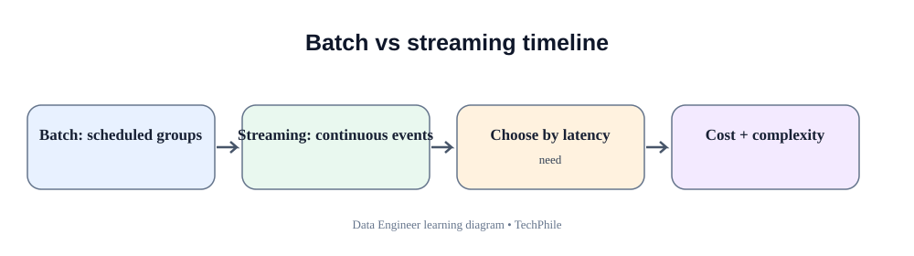
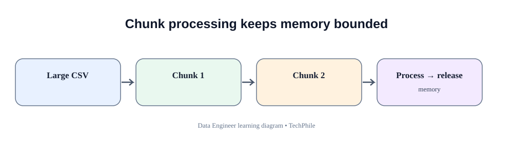
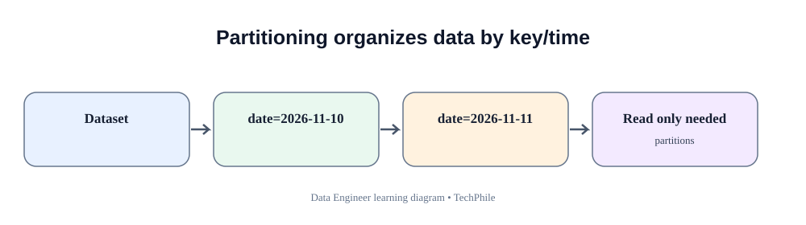

# Day 36: Batch Processing and Partitioning
**Phase:** 4 — Data Processing and Pipelines  
**Learning time:** 2–3 hours  
**Audience:** Complete beginners and freshers  
**Topic boundary:** This file contains class teaching notes only. The separate project workbook and interview guide are not included.

> Large datasets should not be processed as if they were tiny classroom lists. Today you will understand how to divide work into manageable batches and organize stored data into partitions so later queries can read only what they need.

## Learning outcomes

By the end of this lesson, you should be able to:
- explain batch processing and how it differs from streaming;
- understand why large datasets cannot always be loaded into memory at once;
- process records in bounded batches;
- read CSV files in Pandas chunks;
- understand batch size trade-offs;
- explain partitioning and partition keys;
- partition data by a date field;
- understand folder-based partition layouts;
- write and read Parquet datasets;
- explain partition pruning;
- recognize small-file and data-skew problems;
- reconcile records across batches and partitions;
- identify common errors in batch processing.

## Today's flow

`Large source -> Define bounded batch -> Process batch -> Write output -> Repeat -> Partition storage -> Prune unnecessary partitions -> Reconcile`

---

# 1. What is batch processing?

Batch processing means collecting or selecting a group of records and processing that group as one unit of work.

Examples:
- process yesterday's orders every morning;
- calculate daily payment totals;
- ingest one partner file;
- process 50,000 records per batch;
- build a weekly customer report.

A batch has a defined scope:
- source range;
- file;
- time window;
- page;
- partition;
- number of records.

## 1.1 Why do we need batches?

Imagine a source contains 10 million records.

If Python loads every record into a list:
- memory use can become very large;
- the process may run out of memory;
- restarting after failure may repeat a huge amount of work;
- output may not be available until the entire read completes.

With batches:
- memory is bounded;
- work is easier to measure;
- failures can be isolated to a smaller unit;
- progress can be tracked;
- output can be written progressively.

## 1.2 Batch processing in a business

TechStore receives orders all day. The analytics team needs yesterday's sales report by 07:00.

A batch pipeline might:
1. define yesterday's time range;
2. read matching orders;
3. process 10,000 rows at a time;
4. validate and calculate fields;
5. write each completed batch;
6. reconcile the full day;
7. publish the report.

## 1.3 Batch is a processing pattern, not a file format

A batch can come from:
- a database query;
- a CSV file;
- an API page;
- a set of Parquet files;
- a message range;
- a date partition.

The important idea is bounded work.

---

# 2. Batch processing versus streaming

| Batch processing | Stream processing |
|---|---|
| Works on bounded groups | Handles events continuously or near-continuously |
| Often scheduled | Often always running |
| Has a defined batch boundary | Has event/time windows and ongoing state |
| Good for daily/hourly reports | Good for fast event reactions |
| Can process historical files | Processes incoming events as they arrive |

Examples:
- Daily sales report: batch.
- Detect a card payment fraud event immediately: streaming use case.
- Hourly inventory reconciliation: batch.
- Live sensor alert: streaming.

Neither approach is automatically better. Choose based on business latency, volume, cost and complexity.

## 2.1 Near-real-time is not always streaming

A job that runs every five minutes is still commonly described as micro-batch processing.

It is not necessarily a continuously processed event stream.

## 2.2 Why not stream everything?

Streaming systems introduce:
- event-time handling;
- late events;
- state management;
- checkpointing;
- replay;
- ordering concerns;
- operational complexity.

If a daily batch meets the business requirement, a simpler batch design may be better.

---

# 3. Understand memory before processing large data

## 3.1 What is memory?

RAM is the working memory used by running programs.

Python objects occupy memory while they are in use.

A file of 1 GB does not necessarily become a 1 GB Python object. Parsed rows, strings, dictionaries and DataFrames can use considerably more memory than the original text file.

## 3.2 Load all CSV rows into memory

```python
import pandas as pd

data = pd.read_csv("orders.csv")

print(data.shape)
```

This loads the dataset into one DataFrame.

For a small file this is convenient. For a huge file it may exceed available memory.

## 3.3 Read one row at a time with csv

```python
import csv

with open("orders.csv", "r", encoding="utf-8", newline="") as file:
    reader = csv.DictReader(file)

    for row in reader:
        print(row["order_id"])
```

The CSV reader produces records as the loop requests them. This avoids storing every row in a list.

## 3.4 Read chunks with Pandas

Pandas supports chunked reading:

```python
import pandas as pd

for chunk in pd.read_csv("orders.csv", chunksize=1000):
    print(chunk.shape)
```

Each chunk contains up to 1,000 rows.

The final chunk may contain fewer rows.

## 3.5 What is a chunk?

A chunk is one portion of a larger dataset read at a time.

For example, 4,500 rows with chunksize 1,000 produces:
- chunk 1: 1,000 rows;
- chunk 2: 1,000 rows;
- chunk 3: 1,000 rows;
- chunk 4: 1,000 rows;
- chunk 5: 500 rows.

## 3.6 Why chunksize is not a universal constant

A chunk of 1,000 wide records may consume more memory than 100,000 very narrow records.

Choose chunk size based on:
- number of columns;
- average value size;
- transformation complexity;
- available RAM;
- destination throughput;
- retry cost.

Measure the real workload.

---

# 4. Create a practice dataset

We will generate a small dataset so the code can run without downloading data.

## 4.1 Create sample rows

```python
import pandas as pd

orders = pd.DataFrame({
    "order_id": [101, 102, 103, 104, 105, 106],
    "customer_id": [501, 502, 503, 504, 505, 506],
    "order_date": [
        "2026-11-10",
        "2026-11-10",
        "2026-11-11",
        "2026-11-11",
        "2026-11-12",
        "2026-11-12"
    ],
    "amount": [100, 200, 150, 300, 250, 400]
})

print(orders)
```

The DataFrame contains six order records across three dates.

## 4.2 Save the sample CSV

```python
orders.to_csv("orders.csv", index=False)
```

`index=False` prevents Pandas from writing its DataFrame index as an extra CSV column.

## 4.3 Read the CSV back

```python
data = pd.read_csv("orders.csv")

print(data.shape)
```

Expected output:

```text
(6, 4)
```

The sample contains six rows and four columns.

---

# 5. Process a dataset in batches

## 5.1 Read a chunk

```python
for chunk in pd.read_csv("orders.csv", chunksize=2):
    print(chunk)
```

Expected chunk sizes:
- 2 rows;
- 2 rows;
- 2 rows.

The dataset contains six rows, so three equal chunks are produced.

## 5.2 Understand the loop

- Pandas opens the CSV reader.
- chunksize requests up to two rows per chunk.
- The for loop receives one DataFrame at a time.
- The current chunk is displayed.
- The loop requests the next chunk.
- The loop ends when no chunks remain.

## 5.3 Count rows across chunks

```python
total_rows = 0

for chunk in pd.read_csv("orders.csv", chunksize=2):
    total_rows = total_rows + len(chunk)

print("Total rows:", total_rows)
```

Expected output:

```text
Total rows: 6
```

This counts all records seen across the chunks.

## 5.4 Transform each chunk

```python
for chunk in pd.read_csv("orders.csv", chunksize=2):
    chunk["amount_with_tax"] = chunk["amount"] * 1.18
    print(chunk)
```

Each chunk receives a derived column.

This example assumes an 18 percent rate for teaching arithmetic. A real tax calculation must follow the relevant business and legal rules.

## 5.5 Write each chunk to output

```python
first_chunk = True

for chunk in pd.read_csv("orders.csv", chunksize=2):
    chunk["amount_with_tax"] = chunk["amount"] * 1.18

    chunk.to_csv(
        "orders_with_tax.csv",
        mode="w" if first_chunk else "a",
        header=first_chunk,
        index=False
    )

    first_chunk = False
```

Explanation:
- `first_chunk` tracks whether the output file has been created.
- First chunk uses write mode.
- Later chunks use append mode.
- Header is written only once.
- DataFrame index is not written.

For production, use a temporary output path and publish only after the entire run is verified. If a run fails after appending some chunks, blindly rerunning can duplicate rows.

## 5.6 Verify the output

```python
output_data = pd.read_csv("orders_with_tax.csv")

print(output_data.shape)
```

Expected output:

```text
(6, 5)
```

There are six records and five columns after adding amount_with_tax.

---

# 6. Choose a batch size

## 6.1 Small batch

Advantages:
- lower memory use;
- small retry unit;
- easier to inspect.

Disadvantages:
- more loop iterations;
- more read/write overhead;
- potentially lower throughput.

## 6.2 Large batch

Advantages:
- fewer iterations;
- less per-batch overhead;
- may improve throughput.

Disadvantages:
- more memory;
- larger retry unit;
- longer processing time per batch;
- possible memory pressure.

## 6.3 Measure instead of guessing

Test several chunk sizes using representative data:
- 1,000;
- 5,000;
- 10,000;
- another value based on memory.

Measure:
- total elapsed time;
- peak memory;
- number of chunks;
- output throughput;
- failure and retry behavior.

Do not select the largest batch just because it is fastest in one small test.

---

# 7. Understand partitioning

Partitioning divides a dataset into separate logical or physical groups using one or more fields.

Example: store orders by order date.

`order_date=2026-11-10`

`order_date=2026-11-11`

`order_date=2026-11-12`

A query for 11 November may then read only the relevant date partition when the storage engine and query plan can prune other partitions.

## 7.1 Why partition data?

Partitioning can:
- reduce the amount of data scanned;
- organize large datasets;
- simplify retention by time range;
- support parallel processing;
- make incremental writes easier.

Partitioning does not automatically make every query faster.

## 7.2 What is a partition key?

A partition key is the field used to divide the data.

Common examples:
- event_date;
- order_date;
- country;
- region;
- tenant_id.

Choose a key that matches common query filters and creates manageable partition sizes.

## 7.3 Date partitioning

Date partitioning is common in analytics because users frequently filter by date.

Example:
- daily sales;
- monthly transactions;
- hourly events.

## 7.4 High-cardinality partition key

A field with many distinct values is high-cardinality.

Partitioning by order_id may create millions of tiny partitions. That is usually a poor design.

## 7.5 Low-cardinality partition key

A field with only a few values is low-cardinality.

Partitioning only by country may create a few very large partitions if the data volume is uneven.

Choose based on actual data distribution and query patterns.

---

# 8. Prepare a date partition column

## 8.1 Convert order_date to datetime

```python
orders["order_date"] = pd.to_datetime(orders["order_date"])
```

Pandas now recognizes the column as datetime values.

## 8.2 Create a partition value

```python
orders["partition_date"] = orders["order_date"].dt.strftime("%Y-%m-%d")

print(orders[["order_id", "partition_date"]])
```

The new field contains date strings suitable for the folder example.

## 8.3 Why use a clear partition name?

A name such as `partition_date` makes the storage organization visible.

In a production data model, the partition field should have a documented meaning and timezone rule.

---

# 9. Create date-based folders

A common partition layout is:

```text
orders/
    order_date=2026-11-10/
    order_date=2026-11-11/
    order_date=2026-11-12/
```

Each folder stores the records for one partition value.

## 9.1 Create one folder per date

```python
from pathlib import Path

base_folder = Path("partitioned_orders")
base_folder.mkdir(exist_ok=True)

for partition_value in orders["partition_date"].unique():
    partition_folder = base_folder / f"order_date={partition_value}"
    partition_folder.mkdir(parents=True, exist_ok=True)
    print(partition_folder)
```

Explanation:
- Path represents the root folder.
- mkdir creates the folder if it does not exist.
- unique returns distinct partition values.
- the loop creates a folder for each date.
- parents=True allows missing parent directories.
- exist_ok=True avoids an error if the folder already exists.

## 9.2 Write one CSV file per date

```python
for partition_value in orders["partition_date"].unique():
    partition_data = orders[orders["partition_date"] == partition_value]

    partition_folder = base_folder / f"order_date={partition_value}"
    partition_path = partition_folder / "part-000.csv"

    partition_data.to_csv(partition_path, index=False)

    print("Written:", partition_path)
```

Each partition folder receives the rows for its date.

This simple example creates one file per date. A large production partition may contain multiple files.

## 9.3 Inspect folder contents

```python
for path in sorted(base_folder.rglob("*.csv")):
    print(path)
```

`rglob` searches recursively below the base folder.

---

# 10. Understand Parquet

Parquet is a columnar storage file format commonly used in analytics and data engineering.

## 10.1 Row-oriented versus columnar storage

A CSV file stores text rows.

A columnar format stores values organized by columns within its file structure.

Columnar storage can be efficient when a query reads only a few columns from a wide dataset.

## 10.2 Why Parquet is useful

Benefits can include:
- efficient compression;
- typed columns;
- column projection;
- analytics engine compatibility;
- nested data support.

Parquet is not automatically best for every use case. CSV remains useful for simple interchange and human inspection.

## 10.3 Install PyArrow

```bat
python -m pip install pyarrow
```

PyArrow provides Parquet support for Pandas and other data tools.

## 10.4 Write one Parquet file

```python
orders.to_parquet("orders.parquet", index=False)
```

The DataFrame is saved in Parquet format.

## 10.5 Read the Parquet file

```python
parquet_data = pd.read_parquet("orders.parquet")

print(parquet_data.head())
```

The DataFrame is loaded back from Parquet.

## 10.6 Compare file sizes

```python
from pathlib import Path

print("CSV bytes:", Path("orders.csv").stat().st_size)
print("Parquet bytes:", Path("orders.parquet").stat().st_size)
```

The result depends on data and encoding. Do not assume Parquet is always smaller for every tiny sample.

---

# 11. Write partitioned Parquet data

## 11.1 Use Pandas partition_cols

```python
orders.to_parquet(
    "orders_parquet_dataset",
    engine="pyarrow",
    partition_cols=["partition_date"],
    index=False
)
```

Pandas writes a Parquet dataset organized by the partition field.

The resulting directory structure can resemble:

```text
orders_parquet_dataset/
    partition_date=2026-11-10/
    partition_date=2026-11-11/
    partition_date=2026-11-12/
```

The actual file names are generated by the writer.

## 11.2 Why is this a dataset folder?

A partitioned Parquet dataset may contain multiple Parquet files under one root directory. The root represents the logical dataset.

Do not assume the dataset is one single .parquet file.

## 11.3 Read the dataset

```python
partitioned_data = pd.read_parquet("orders_parquet_dataset")

print(partitioned_data.shape)
```

Pandas reads the dataset and combines the partition data into a DataFrame.

---

# 12. Understand partition pruning

Partition pruning means skipping partitions that cannot contain rows matching the query filter.

Suppose the dataset has:
- 10 years of daily order partitions;
- a query asks for one day.

A query engine may read only the partition for that day instead of scanning all dates.

## 12.1 Filter one partition in Pandas

```python
selected_date = "2026-11-11"

selected_orders = partitioned_data[
    partitioned_data["partition_date"] == selected_date
]

print(selected_orders)
```

This filters the DataFrame after it has been read. It demonstrates the result but does not prove that the storage engine skipped other partition files.

## 12.2 Important distinction

Filtering after reading all files is not the same as storage-level partition pruning.

To benefit from pruning, use a reader/query engine that can push the partition filter down to the dataset scan.

## 12.3 Partition pruning depends on layout

The folder structure must encode the partition field correctly, and the query engine must understand that layout.

A random folder name does not automatically become a recognized partition.

## 12.4 Why partition pruning helps

If a query reads only one month out of five years, skipping irrelevant partitions can reduce:
- bytes read;
- scan time;
- compute cost.

Actual improvement depends on storage, file sizes, metadata, query engine and data distribution.

---

# 13. Choose partition keys carefully

## 13.1 Query pattern first

Ask:
- Do users filter by date?
- Do they filter by region?
- Do they filter by customer?
- How much data arrives per partition?
- How many distinct partition values exist?
- How often are old partitions updated?

The key should support common access patterns.

## 13.2 Date key

A date key is useful when most queries filter by date.

Daily partitioning can be appropriate for high-volume feeds. Monthly partitioning may be better for smaller datasets.

## 13.3 Region key

A region key may help when users frequently query one region and data is distributed reasonably evenly.

If one region contains 95% of records, partition sizes may be unbalanced.

## 13.4 Composite partitioning

Some systems use multiple partition fields, such as year and month.

Do not create too many levels without measuring the resulting number and size of files.

---

# 14. Understand the small-file problem

## 14.1 What is a small file?

A small file contains very little data relative to the storage and metadata overhead.

If a pipeline creates one Parquet file for every tiny batch, a dataset may contain millions of small files.

## 14.2 Why are many small files harmful?

They can increase:
- file listing time;
- metadata overhead;
- query planning time;
- storage operation count;
- scheduling overhead.

## 14.3 Example

Suppose 1 million records are written:
- one file per record creates 1 million files;
- one file per 100,000 records creates 10 files.

The second layout may be more manageable, depending on the platform and workload.

## 14.4 Compact small files

A compaction job reads small files and rewrites them into larger files.

Compaction must preserve:
- all records;
- schema;
- partition values;
- deduplication rules;
- atomic publication behavior.

Do not delete source files until the compacted output is verified and safely published.

---

# 15. Understand data skew

Data skew means records are distributed unevenly across partitions or processing groups.

Example:
- Hyderabad: 90% of records;
- Chennai: 5%;
- Bengaluru: 5%.

If processing is partitioned by city, one partition may take much longer than the others.

## 15.1 Why skew matters

In parallel processing, one large partition can become the slowest task and delay the whole job.

## 15.2 Detect skew

Inspect counts by partition key:

```python
print(orders.groupby("partition_date").size())
```

For a region example:

```python
print(orders.groupby("region").size())
```

Look for large differences between groups.

## 15.3 Do not partition by a random high-cardinality field

A unique transaction ID can create too many tiny partitions.

Choose partition fields based on query access and balanced data volume.

---

# 16. Reconcile batches and partitions

## 16.1 Count input rows

Record the total number of source rows before processing.

## 16.2 Count rows per batch

For every batch, record:
- batch number;
- source range;
- rows read;
- rows accepted;
- rows rejected;
- rows written;
- status.

## 16.3 Count rows per partition

```python
partition_counts = orders.groupby("partition_date").size()

print(partition_counts)
print("Total:", partition_counts.sum())
```

The sum of partition counts should equal the number of rows assigned to those partitions.

## 16.4 Compare total count

```python
if partition_counts.sum() == len(orders):
    print("Partition count reconciliation passed")
else:
    print("Partition count reconciliation failed")
```

This checks row accounting. It does not prove the values are correct.

## 16.5 Check key uniqueness

Compare row count and unique business keys. Ensure the key represents the actual dataset grain.

## 16.6 Reconcile after compaction

Before replacing old files:
- count source rows;
- count compacted rows;
- compare keys;
- compare important totals;
- validate schema;
- verify partition coverage.

---

# 17. Failure handling in batch jobs

## 17.1 A batch can fail halfway

Suppose five batches are expected:
- batches 1 and 2 succeed;
- batch 3 fails;
- batches 4 and 5 are not processed.

Do not mark the whole job successful.

## 17.2 Track batch status

A run manifest can contain:
- run_id;
- batch_id;
- source start/end;
- rows read;
- rows written;
- output path;
- status;
- error summary.

## 17.3 Safe rerun

A rerun should not blindly append the same batch again.

Options:
- write to a unique run-specific temporary path;
- overwrite a known batch output after validating ownership;
- use a stable partition overwrite strategy;
- use idempotent destination writes.

The correct choice depends on the destination.

## 17.4 Publish only after validation

A downstream process should not read an incomplete dataset as if it were complete.

Use a completion marker or manifest when appropriate.

---

# 18. Common batch and partition mistakes

## Mistake 1 — Load the entire large file

**Risk:** Memory exhaustion.

**Correction:** Stream or process in chunks.

## Mistake 2 — Choose batch size without measurement

**Risk:** Slow processing or memory pressure.

**Correction:** Benchmark representative data.

## Mistake 3 — Create one file per tiny batch

**Risk:** Small-file problem.

**Correction:** Write manageable files and compact when needed.

## Mistake 4 — Partition by unique ID

**Risk:** Too many tiny partitions.

**Correction:** Choose a query-aligned partition key.

## Mistake 5 — Assume filtering proves pruning

**Risk:** The system may have read every file first.

**Correction:** Use a partition-aware engine and inspect scan behavior.

## Mistake 6 — Ignore skew

**Risk:** One partition dominates processing time.

**Correction:** Measure distribution and redesign partitioning when necessary.

## Mistake 7 — Append on rerun without deduplication

**Risk:** Duplicate output.

**Correction:** Use stable batch identity and idempotent publication.

## Mistake 8 — Delete source files before verification

**Risk:** Data loss and no recovery evidence.

**Correction:** Retain source until output is verified and retention policy permits deletion.

---

# 19. Practical exercises

## Exercise 1 — Calculate batch count

A file has 12,500 rows and chunk size is 1,000.

Expected reasoning: 12 full chunks contain 12,000 rows, and one final chunk contains 500 rows. Total 13 chunks.

## Exercise 2 — Choose a partition key

A sales dashboard filters mainly by order date.

Expected answer: a date-based partition may be useful, with daily or monthly granularity selected according to volume and query behavior.

## Exercise 3 — Identify high cardinality

Would order_id usually be a good partition key?

Expected answer: no, because it is likely unique or nearly unique and can create too many tiny partitions.

## Exercise 4 — Explain partition pruning

A query filters for one date. Why might only one date folder be read?

Expected answer: a partition-aware query engine can skip other date partitions because their partition values cannot match the filter.

## Exercise 5 — Identify small-file risk

A job writes one file for every 10 records across 100 million records.

Expected answer: it creates an enormous number of small files and metadata overhead. Batch output should be larger and compaction may be required.

## Exercise 6 — Identify skew

One region has 900,000 rows and nine other regions have 10,000 each.

Expected answer: region-based partitioning is skewed; one partition may dominate processing.

## Exercise 7 — Reconcile partitions

Three partitions contain 100, 200 and 300 rows. Input has 600 rows.

Expected answer: count reconciliation passes because the partition counts sum to 600.

## Exercise 8 — Safe rerun

A batch wrote half its output and failed. Should the next run append the full batch?

Expected answer: not blindly. It may duplicate the first half. Use a controlled temporary output, batch replacement or idempotent write strategy.

---

# 20. Debugging checklist

When a batch or partitioned job is slow or incorrect:

1. Check source row count.
2. Confirm chunk size and number of chunks.
3. Inspect memory use.
4. Confirm every chunk was processed.
5. Check whether the last chunk is smaller.
6. Verify output write mode.
7. Check whether a rerun appended duplicates.
8. Inspect partition folder names.
9. Confirm partition values are correct.
10. Check partition counts.
11. Inspect distribution for skew.
12. Count files per partition.
13. Inspect file sizes.
14. Verify Parquet schema.
15. Confirm the query engine can recognize partition columns.
16. Distinguish post-read filtering from true partition pruning.
17. Reconcile source and output keys and totals.
18. Confirm incomplete outputs are not marked complete.

---

# 21. Day 36 revision checklist

You should be able to explain:
- batch processing;
- streaming and micro-batch;
- memory use;
- row-by-row reading;
- Pandas chunksize;
- batch size trade-offs;
- partition and partition key;
- date partitioning;
- partition folder layout;
- Parquet and columnar storage;
- partitioned Parquet datasets;
- partition pruning;
- high-cardinality keys;
- low-cardinality keys;
- small-file problem;
- compaction;
- data skew;
- per-batch and per-partition reconciliation;
- safe batch reruns;
- completion markers and manifests.

---

# 22. Key takeaways

1. A batch is a bounded unit of work.
2. Large files should not always be loaded entirely into memory.
3. Chunked processing keeps memory use manageable.
4. Batch size is a measured trade-off.
5. Partitioning organizes large datasets by useful keys.
6. Date is a common partition key for analytics.
7. Parquet is a columnar analytics format.
8. Partition pruning skips irrelevant partitions when the query engine supports it.
9. Too many tiny files create operational overhead.
10. Skew creates uneven work across partitions.
11. Reconcile batch and partition counts.
12. Make reruns safe and publish only verified output.

## What comes next

Day 37 teaches incremental loading and upserts. You will learn how to process only new or changed records, track progress with watermarks, update existing destination records and make reruns safe.

**End of Day 36 class notes.**

---

## Visual Learning Diagrams

### Batch vs streaming


### Chunk processing and memory


### Data partitioning

