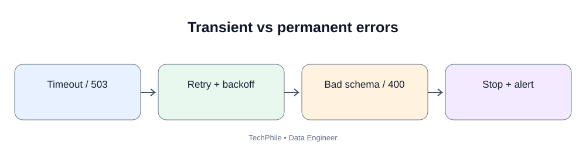
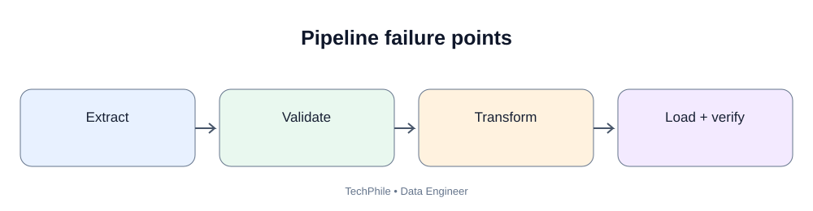
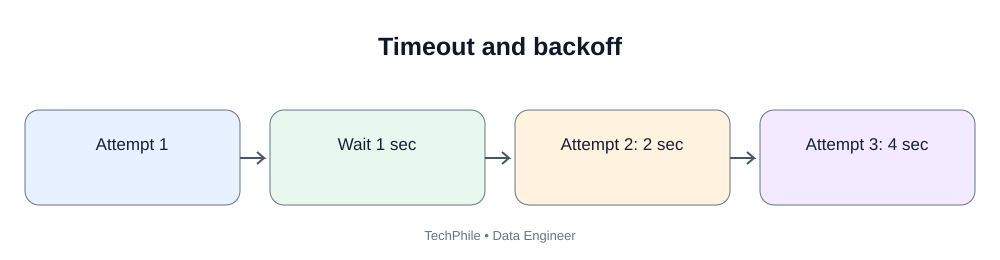

# Day 38: Pipeline Reliability and Failure Handling
**Phase:** 4 — Data Processing and Pipelines  
**Learning time:** 2–3 hours  
**Audience:** Complete beginners and freshers  
**Topic boundary:** This file contains class notes only. The separate project workbook and interview guide remain separate.

> A pipeline is not reliable merely because it works once. A production pipeline must behave safely when the network fails, a source is unavailable, a process crashes halfway through a batch or an operator reruns a job. Today we learn to design for failure instead of pretending failure will never happen.

## Learning outcomes

By the end of this lesson, you should be able to:
- explain pipeline reliability and failure handling;
- identify failure points across a pipeline;
- distinguish transient and permanent failures;
- understand timeout, retry, backoff and jitter;
- design bounded retry behavior;
- explain idempotency and safe replay;
- understand partial writes and atomic publication;
- use transactions to protect database changes;
- explain checkpoint ordering;
- isolate invalid records using quarantine/dead-letter patterns;
- test failures deliberately;
- reconcile output after recovery;
- understand why exactly-once claims require careful proof.

## Today's flow

`Receive -> Validate -> Process -> Persist -> Verify -> Checkpoint`

Failure paths must be designed for every stage.

---

# 1. What does reliability mean?

A reliable data pipeline produces correct, complete and traceable results repeatedly, including after expected failures.

Reliability is not just uptime. A job that runs every day but silently loses 2% of its records is not reliable.

A reliable pipeline should:
- process the intended source range;
- preserve data during failures;
- avoid unintended duplicates;
- expose errors clearly;
- recover from known failure types;
- retain evidence of completed work;
- avoid advancing progress before safe completion.

## 1.1 A simple pipeline

`Database -> Extract -> Transform -> Validate -> Load -> Report`

Every arrow is a possible failure point.

Examples:
- database connection fails;
- extraction query times out;
- malformed record breaks transformation;
- target database rejects an insert;
- process crashes after some rows are written;
- checkpoint is saved incorrectly;
- report reads an incomplete output.

## 1.2 What is a partial failure?

A partial failure happens when some work succeeds and later work fails.

Example:
- 10 batches are expected;
- batches 1 to 6 are written;
- batch 7 fails;
- batches 8 to 10 are not processed.

The pipeline must not mark the full run successful.

## 1.3 Why success messages are not enough

A script may print `Completed` even if:
- no rows were read;
- only one page was fetched;
- rejected records were discarded;
- output was written to the wrong location;
- the checkpoint advanced too far.

Success must be supported by verification evidence.

---

# 2. Map the pipeline failure points

Use this example:

`Source -> Extract -> Validate -> Transform -> Load -> Reconcile -> Checkpoint`

At each stage, ask what can fail.

| Stage | Example failure | Safe response |
|---|---|---|
| Source | Database unavailable | Stop/retry within policy |
| Extract | Timeout | Retry if safe |
| Validate | Required field missing | Reject/quarantine record |
| Transform | Invalid conversion | Record reason |
| Load | Destination unavailable | Retry or stop batch |
| Reconcile | Count mismatch | Do not publish/checkpoint |
| Checkpoint | State store unavailable | Replay safely |

A failure response should be designed before the incident happens.

## 2.1 Failure classification

Common categories:
- transient infrastructure failure;
- permanent configuration failure;
- authentication/authorization failure;
- malformed source data;
- schema incompatibility;
- destination constraint failure;
- resource exhaustion;
- software defect;
- operator error.

Different categories need different responses.

---

# 3. Transient versus permanent errors

## 3.1 Transient error

A transient error may disappear without changing the request.

Examples:
- short network interruption;
- temporary service overload;
- database connection reset;
- HTTP 503 during a brief outage.

A bounded retry may help.

## 3.2 Permanent error

A permanent error requires a correction.

Examples:
- invalid SQL;
- missing required column;
- expired credential;
- insufficient permission;
- unsupported data type;
- invalid endpoint.

Repeating the same request does not solve the underlying issue.

## 3.3 Why classification matters

If every error is retried:
- permanent errors waste time;
- API quotas may be consumed;
- the source may be overloaded;
- the pipeline hides a configuration defect;
- recovery takes longer.

Retry only errors that are understood and safe to retry.

---

# 4. Understand timeouts

A timeout limits how long a program waits for an operation.

Examples:
- database connection timeout;
- HTTP connect timeout;
- HTTP read timeout;
- query execution timeout;
- task execution timeout.

## 4.1 Why no timeout is dangerous

A pipeline may wait for a remote system for an uncontrolled period.

This can:
- hold a worker;
- hold a database connection;
- block downstream tasks;
- miss a reporting deadline.

## 4.2 Choose a timeout based on the operation

A tiny metadata request may need a short timeout.

A large export may need a longer read timeout.

Do not set every timeout to one hour simply to avoid failures. Understand expected service behavior and job deadlines.

## 4.3 Distinguish timeout types

A connection timeout means the client could not establish a connection in time.

A read timeout means the connection was established but the response did not arrive in time.

The recovery path may differ.

---

# 5. Understand retry

A retry repeats an operation after a failure.

Retries are useful for transient failures when repeating the operation is safe.

## 5.1 One retry example

```python
attempt = 1

while attempt <= 3:
    print("Attempt:", attempt)
    attempt = attempt + 1
```

Expected output:

```text
Attempt: 1
Attempt: 2
Attempt: 3
```

This demonstrates a bounded attempt counter. It does not call an external service.

## 5.2 Why bound the number of attempts?

Without a limit, a pipeline may retry forever.

A bounded policy defines:
- maximum attempts;
- maximum elapsed time;
- delay between attempts;
- error categories eligible for retry;
- final failure behavior.

## 5.3 Retry does not guarantee success

A retry can fail again. After the permitted attempts, the pipeline must stop, alert or route work for manual recovery.

Do not print success simply because a retry loop ended.

---

# 6. Understand exponential backoff

Exponential backoff increases the waiting time between attempts.

Example sequence:
- first retry waits 2 seconds;
- second retry waits 4 seconds;
- third retry waits 8 seconds.

This reduces repeated pressure on an unavailable service.

## 6.1 Calculate a simple delay

```python
for attempt in range(1, 4):
    delay_seconds = 2 ** attempt
    print(delay_seconds)
```

Expected output:

```text
2
4
8
```

The exponent operator `**` means power.

## 6.2 Why cap the delay?

An exponential value can grow very large.

A production policy normally defines a maximum delay and maximum total retry duration.

## 6.3 What is jitter?

Jitter adds a random variation to retry delays.

If many workers fail together and all retry at exactly the same time, they may overload the service again.

Jitter spreads retries over time.

For a beginner lesson, remember:
- backoff increases waiting;
- cap prevents unlimited delay;
- jitter avoids synchronized retry spikes.

---

# 7. Retry only safe operations

## 7.1 Read request

A GET request is generally designed to retrieve data and is often safe to retry. It can still consume quota and return a different result if source data changes.

## 7.2 Insert operation

An insert may create a duplicate if the first request succeeded but the response was lost.

Before retrying, the pipeline must know how it identifies an already-created record.

## 7.3 Payment or external side effect

A payment request must not be blindly repeated. It may charge twice unless the provider supports an idempotency key and the client uses it correctly.

## 7.4 Database upsert

A database upsert using a stable unique key can support safe replay when update rules are deterministic.

The whole workflow must still account for transactions and checkpoint state.

---

# 8. Understand idempotency

An operation is idempotent when repeating it produces the same intended final state as performing it once.

Example:
- write order 101 with status PAID;
- repeat the same write;
- destination still has one order 101 with status PAID.

## 8.1 Non-idempotent example

```python
total = 0

total = total + 100
total = total + 100

print(total)
```

Expected output:

```text
200
```

Repeating the operation changes the total again.

## 8.2 Idempotent assignment example

```python
order_status = {}

order_status[101] = "PAID"
order_status[101] = "PAID"

print(order_status)
```

Expected output:

```text
{101: 'PAID'}
```

The stable key and assignment produce one final state for this example.

## 8.3 Idempotency key

Some APIs accept a unique idempotency key for a request.

The provider uses the key to recognize a repeated operation.

The client must follow the provider's exact rules for key scope, retention and reuse.

## 8.4 Idempotency is end-to-end

A database write may be idempotent while a notification sent after the write is not.

Consider every side effect:
- database row;
- file publication;
- email;
- message;
- external API call;
- checkpoint.

Do not claim a pipeline is idempotent because one step is idempotent.

---

# 9. Understand atomicity and partial writes

Atomicity means an operation happens completely or not at all from the perspective of the protected transaction.

## 9.1 Database transaction

A database transaction can group multiple changes.

If all statements succeed, COMMIT makes the changes durable according to database guarantees.

If a failure occurs before commit, ROLLBACK can undo the transaction's uncommitted changes.

## 9.2 Why transactions matter

Suppose a pipeline writes:
- order header;
- order lines;
- payment summary.

If only the header is written and the rest fails, the destination may be inconsistent.

A transaction can protect related database writes when they belong in one transaction boundary.

## 9.3 Transaction example

```sql
BEGIN;

INSERT INTO target_orders (order_id, status)
VALUES (101, 'PAID');

UPDATE target_customers
SET last_order_id = 101
WHERE customer_id = 501;

COMMIT;
```

The example demonstrates two changes in one transaction. Use a practice database and confirm the schema before running it.

## 9.4 Rollback example

```sql
BEGIN;

UPDATE target_orders
SET status = 'CANCELLED'
WHERE order_id = 101;

ROLLBACK;
```

The update is rolled back instead of being committed.

## 9.5 Transaction size trade-off

One huge transaction can:
- hold locks for a long time;
- consume resources;
- increase rollback cost.

Very small transactions can:
- increase commit overhead;
- complicate consistency across related records.

Choose transaction boundaries based on business consistency and database capacity.

---

# 10. Publish files safely

A file write can fail after part of the output has been written.

If downstream systems read the final filename while it is incomplete, they may consume partial data.

## 10.1 Temporary file pattern

Conceptual steps:
1. write to a temporary file;
2. close the file;
3. validate the file;
4. rename it to the final name;
5. publish a completion marker or manifest.

## 10.2 Why use a temporary filename?

The final output name should mean that the output is complete and ready.

A temporary file communicates that processing is still in progress.

## 10.3 Atomic rename caveat

A rename may be atomic on the same filesystem, but guarantees differ across filesystems and object stores.

Cloud object storage may require a manifest or commit marker rather than a filesystem rename.

Do not assume local filesystem behavior applies to cloud storage.

---

# 11. Understand checkpoint ordering

A checkpoint records progress.

Unsafe sequence:

`Save checkpoint -> Output write -> Crash`

The next run may start after data that was never safely published.

Safer sequence:

`Extract -> Process -> Persist -> Verify -> Commit/publish -> Save checkpoint`

## 11.1 Output succeeds but checkpoint fails

The next run may replay the same data.

Idempotent writes allow the pipeline to process the same source range again without creating duplicate effects.

## 11.2 Checkpoint succeeds but output fails

This is dangerous. The pipeline may skip records that never reached the destination.

Checkpoint advancement must depend on durable output evidence.

## 11.3 Separate source and target transactions

When the source database and target database are different systems, one ordinary database transaction cannot automatically commit both.

The architecture must use a safe pattern such as:
- idempotent writes;
- durable batch manifest;
- outbox/inbox pattern where appropriate;
- staged publication;
- recovery/reconciliation.

Do not claim one atomic transaction spans unrelated systems unless the architecture actually provides it.

---

# 12. Handle bad records with quarantine

Not every failure should stop an entire batch.

Some record-level failures can be isolated:
- invalid amount;
- missing optional mapping;
- unsupported status;
- malformed individual event.

A quarantine area stores the record and the reason for rejection.

## 12.1 Record-level versus batch-level failure

**Record-level failure:** One row is invalid while the file structure is still usable.

**Batch-level failure:** The file cannot be trusted as a whole, such as a missing required column or incomplete transfer.

A batch-level schema failure may require stopping the entire delivery.

## 12.2 What is a dead-letter queue?

A dead-letter queue (DLQ) is a location for messages or records that cannot be processed successfully after the defined policy.

It may be implemented using:
- a message queue;
- a database table;
- object storage;
- a rejected file.

A DLQ should retain enough safe metadata to diagnose and reprocess the item.

## 12.3 Rejection metadata

Useful fields:
- source identifier;
- source record key;
- run ID;
- failure stage;
- error code;
- rejection reason;
- received time;
- rule version;
- original payload location.

Do not put secrets or unnecessary personal data into the error record.

---

# 13. Simulate a retry with Python

## 13.1 Simulate attempts without a network

```python
attempt = 0
maximum_attempts = 3
success = False

while attempt < maximum_attempts:
    attempt = attempt + 1
    print("Attempt", attempt)

    if attempt == 3:
        success = True
        break

print("Success:", success)
```

Expected output:

```text
Attempt 1
Attempt 2
Attempt 3
Success: True
```

This is a deterministic teaching simulation. It does not prove a real API or database will succeed on the third attempt.

## 13.2 Simulate a permanent error

```python
error_type = "INVALID_CONFIGURATION"

if error_type == "TRANSIENT":
    print("Retry may be allowed")
else:
    print("Stop and correct the configuration")
```

Expected output:

```text
Stop and correct the configuration
```

The point is to classify the failure before deciding to retry.

---

# 14. Simulate a crash during a batch

Suppose a batch has five records.

The process writes two records and then crashes.

If the output file is treated as final, the destination may contain only part of the batch.

## 14.1 Track completed records

```python
source_records = [101, 102, 103, 104, 105]
written_records = []

for record in source_records:
    if record == 103:
        print("Simulated failure")
        break

    written_records.append(record)

print(written_records)
```

Expected output:

```text
Simulated failure
[101, 102]
```

The batch is incomplete. Do not mark it successful.

## 14.2 Why not save the checkpoint at 105?

Only records 101 and 102 were written in this simulation. Saving 105 would claim that records 103, 104 and 105 were processed when they were not.

## 14.3 Recovery options

- discard incomplete temporary output and replay the whole batch;
- resume from a verified per-record checkpoint;
- upsert all records again using stable keys;
- use a transaction if all writes are in one database.

Choose a method that can prove completeness.

---

# 15. Failure-point testing

A reliable pipeline should be tested by deliberately simulating expected failures.

Possible tests:
1. source connection unavailable;
2. API timeout;
3. malformed file;
4. missing required column;
5. invalid record;
6. destination write failure;
7. process crash after a partial batch;
8. checkpoint store unavailable;
9. repeated run with the same input;
10. duplicate source key.

For each test, define:
- setup;
- expected pipeline state;
- expected output;
- expected checkpoint;
- recovery action;
- evidence to inspect.

## 15.1 Test a missing source file

Expected behavior:
- job reports missing input;
- no false success output is published;
- checkpoint does not advance;
- operator receives a clear status.

## 15.2 Test invalid data

Expected behavior:
- invalid record is rejected with a reason;
- valid records may continue if the contract allows record-level isolation;
- input = accepted + rejected;
- rejection rate is measured.

## 15.3 Test destination failure

Expected behavior:
- batch is not marked committed;
- checkpoint does not advance;
- recovery can replay safely;
- no duplicate side effects occur.

---

# 16. Understand at-least-once and exactly-once claims

## 16.1 At-least-once processing

A record may be processed more than once, but the design aims not to lose it.

This is common in distributed systems because a process may not know whether a remote write succeeded before a connection failed.

## 16.2 At-most-once processing

The system avoids processing a record more than once, but failures can cause records to be lost if progress is advanced incorrectly.

## 16.3 Exactly-once effect

Exactly-once processing is difficult across independent systems.

A practical design often uses:
- at-least-once delivery;
- stable event identity;
- idempotent destination writes;
- durable checkpoints;
- reconciliation.

This can create an exactly-once *effect* for a specific destination operation, but only when the guarantees are correctly implemented.

Do not say “exactly once” without identifying:
- the system boundary;
- the delivery guarantee;
- the deduplication key;
- the transaction boundary;
- the failure/recovery behavior.

---

# 17. Common reliability mistakes

## Mistake 1 — Retry forever

**Risk:** The pipeline consumes resources and hides a permanent defect.

**Correction:** Set maximum attempts and maximum elapsed time.

## Mistake 2 — Retry every exception

**Risk:** Authentication, schema and programming errors repeat without benefit.

**Correction:** Classify errors and retry only safe transient failures.

## Mistake 3 — Retry a non-idempotent operation blindly

**Risk:** Duplicate side effects.

**Correction:** Use idempotency keys, stable IDs or reconciliation.

## Mistake 4 — Save checkpoint before destination commit

**Risk:** Records can be skipped permanently.

**Correction:** Checkpoint only after verified durable output.

## Mistake 5 — Mark partial output successful

**Risk:** Downstream systems consume incomplete data.

**Correction:** Use temporary outputs, manifests and reconciliation.

## Mistake 6 — Catch every error and continue

**Risk:** Serious defects become hidden data loss.

**Correction:** Handle known record errors; fail clearly on unexpected system errors.

## Mistake 7 — Claim exactly once without evidence

**Risk:** Replays may still duplicate or lose data.

**Correction:** State the actual delivery and idempotency guarantees.

---

# 18. Recovery runbook structure

A runbook is an operational guide for responding to a known failure.

A useful runbook includes:
- alert name;
- what failed;
- affected source and destination;
- how to inspect run ID;
- how to inspect the failing batch;
- whether checkpoint advanced;
- whether output was committed;
- whether replay is safe;
- steps to restore service;
- verification after recovery;
- escalation owner.

Do not tell operators to “rerun the job” without first checking whether partial output exists.

---

# 19. Practical exercises

## Exercise 1 — Classify failure

Database server is temporarily unavailable.

Expected answer: likely transient; use bounded retries and alert if exhausted.

## Exercise 2 — Classify failure

SQL references a column that does not exist.

Expected answer: permanent until query/schema is corrected. Do not retry unchanged SQL repeatedly.

## Exercise 3 — Checkpoint order

Output write fails. Should checkpoint advance?

Expected answer: no.

## Exercise 4 — Replay

The destination upsert succeeded but checkpoint save failed.

Expected answer: the next run may replay; stable-key idempotent upsert should prevent duplicate rows.

## Exercise 5 — Partial file

A process crashes halfway through writing final.csv.

Expected answer: downstream readers must not treat it as complete. Use temporary output and controlled publication.

## Exercise 6 — Bad record

One row has invalid amount but the rest of the file is structurally valid.

Expected answer: quarantine the row if the contract allows record-level rejection; retain its reason.

## Exercise 7 — API POST

A create request times out. Should it automatically be sent again?

Expected answer: only if the API supports a suitable idempotency mechanism or the client can safely determine whether the first request succeeded.

## Exercise 8 — Exactly once

A queue can deliver a message more than once. How can a database target avoid duplicate effects?

Expected answer: stable message ID, unique constraint and idempotent write, plus correct checkpoint/acknowledgment order.

---

# 20. Debugging checklist

When a pipeline fails:

1. Identify the run ID.
2. Identify the exact stage and batch.
3. Classify the failure.
4. Determine whether the operation is safe to retry.
5. Inspect whether any output was partially written.
6. Inspect whether the destination committed.
7. Inspect whether the checkpoint advanced.
8. Confirm rejected records were retained.
9. Check whether the source range is still available.
10. Choose replay, resume or manual correction.
11. Reconcile counts and keys after recovery.
12. Confirm the next run starts from the correct checkpoint.
13. Record the root cause and prevention action.

---

# 21. Day 38 revision checklist

You should be able to explain:
- pipeline reliability;
- partial failure;
- transient and permanent errors;
- timeout;
- retry and retry limit;
- exponential backoff;
- jitter;
- idempotency;
- idempotency key;
- database transaction;
- atomic file publication;
- checkpoint ordering;
- quarantine and dead-letter queue;
- failure-point testing;
- at-least-once and at-most-once;
- exactly-once effect and its limits;
- recovery runbook;
- post-recovery reconciliation.

---

# 22. Key takeaways

1. Reliability means correct and recoverable processing, not just a successful process exit.
2. Identify failure points before deployment.
3. Classify errors before retrying.
4. Use bounded retries, backoff and jitter.
5. Retry only operations that are safe to repeat.
6. Idempotency makes replay safer.
7. Use transactions or controlled file publication to protect partial writes.
8. Save checkpoints after durable and verified output.
9. Quarantine record-level failures with useful reasons.
10. Test failure scenarios deliberately.
11. State delivery guarantees precisely; do not casually promise exactly once.
12. Reconcile the destination after recovery.

## What comes next

Day 39 focuses on pipeline logging and observability. You will learn how to identify each run, measure row counts and durations, capture safe error context, define alerts and understand whether a pipeline is healthy.

**End of Day 38 class notes.**

---

# 23. Circuit breakers and protecting dependencies

A retry policy repeats an operation. A circuit breaker temporarily stops calls to a dependency that is repeatedly failing.

A circuit breaker commonly has three states:
- **Closed:** requests are allowed.
- **Open:** requests are blocked for a period because failures crossed a threshold.
- **Half-open:** a limited test request is allowed to check whether the dependency recovered.

## 23.1 Why use a circuit breaker?

If an API or database is down, hundreds of workers retrying continuously can make recovery harder. A circuit breaker reduces pressure and gives the dependency time to recover.

## 23.2 Circuit breaker versus retry

| Retry | Circuit breaker |
|---|---|
| Repeats one failed operation | Stops or limits future calls after repeated failures |
| Useful for short transient errors | Useful for sustained dependency failure |
| Has attempts and delays | Has state and recovery threshold |
| Can still overload a failing service | Helps protect a failing service |

A small local notebook may need only a timeout and bounded retry. A distributed pipeline with many workers may need a circuit breaker.

# 24. Concurrency and duplicate execution

Two copies of the same pipeline may start at the same time. Both can read the same checkpoint, extract the same range, write output and attempt to advance progress.

A stable key helps with duplicate writes, but it does not automatically solve checkpoint races.

## 24.1 Prevent overlapping runs

Possible controls:
- scheduler concurrency limit;
- database lock or lease;
- run registry with a unique active-run constraint;
- partition ownership;
- optimistic checkpoint version.

## 24.2 Checkpoint compare-and-set concept

A process reads checkpoint version 10. Before saving version 11, it verifies that the stored version is still 10. If another run already changed it, the first process must not overwrite the newer state.

This is an optimistic concurrency-control idea.

## 24.3 Why a unique run ID is not enough

A run ID identifies executions. It does not prevent two executions from processing the same source range. An explicit concurrency policy is required.

# 25. Retry budget and total elapsed time

A policy with three retries may still exceed the job deadline if each attempt waits a long time.

Define maximum attempts, connection/read timeout, delay between attempts, maximum total elapsed time and overall pipeline deadline.

## 25.1 Retry budget example

Suppose one request timeout is 10 seconds, three attempts are allowed, and waits are 2 and 4 seconds.

The approximate worst-case time is 36 seconds, excluding overhead:
- attempt 1: 10 seconds;
- wait: 2 seconds;
- attempt 2: 10 seconds;
- wait: 4 seconds;
- attempt 3: 10 seconds.

The exact duration depends on timeout behavior and execution overhead.

## 25.2 Why total time matters

A retry policy should not cause a 07:00 report to remain blocked until 10:00. Define when to stop retrying and escalate.

# 26. Recovery after destination commit but before acknowledgment

A common distributed failure:
1. destination write commits;
2. process crashes before recording success;
3. scheduler retries the same batch.

The pipeline cannot assume the write failed merely because it did not receive a success acknowledgment.

Recovery steps:
- identify the batch with a stable batch ID;
- use destination unique keys or idempotent writes;
- check destination state;
- replay safely;
- verify counts and keys;
- advance checkpoint only when the result is confirmed.

This is one of the main reasons idempotency matters.

# 27. Separate record failure from infrastructure failure

Record-level examples include invalid amount, missing required key and unsupported status.

Infrastructure-level examples include destination database unavailable, disk full, network outage, permission revoked and object storage unavailable.

A record-level failure may be quarantined while the batch continues if the contract permits it. An infrastructure failure usually means the batch cannot be declared complete.

Do not catch an infrastructure exception and label it as a rejected record.

# 28. Recovery decision table

| Failure | Retry? | Advance checkpoint? | Typical action |
|---|---|---|---|
| Temporary network timeout | Bounded retry | Only after verified write | Retry and reconcile |
| Invalid credential | No blind retry | No | Correct secret/permission |
| Invalid record | Usually not as-is | Depends on rejection contract | Quarantine |
| Missing required column | No | No | Stop batch and contact producer |
| Destination disk full | After recovery | No | Restore capacity, replay safely |
| Output committed, acknowledgment lost | Reconcile/idempotent replay | Only after confirmation | Check target and replay safely |
| Checkpoint store unavailable | Retry state write | Do not claim completion | Verify output and recover state |

# 29. Failure simulation checklist

For a pipeline, deliberately test:
- fail before extraction;
- fail after extraction but before transformation;
- fail halfway through a batch;
- fail during destination write;
- fail after destination commit;
- fail before checkpoint save;
- fail after checkpoint save;
- rerun the same batch;
- start two runs concurrently;
- send the same event twice.

The expected final state should be documented for each test. A test is not complete just because an exception was raised. Verify destination and checkpoint state after the failure.

# 30. Review your recovery design

Before deployment, answer:
1. Which errors are retryable?
2. What is the maximum attempt count?
3. What is the total retry budget?
4. Which operations are idempotent?
5. What happens after a partial file write?
6. What happens after destination commit but before acknowledgment?
7. Can two runs overlap?
8. How is the checkpoint protected from races?
9. How are record errors separated from infrastructure errors?
10. What evidence proves recovery is complete?

**End of expanded Day 38 teaching notes.**

---

## Visual Learning Diagrams

### Transient vs permanent failures


### Pipeline failure points


### Timeout and retry backoff

