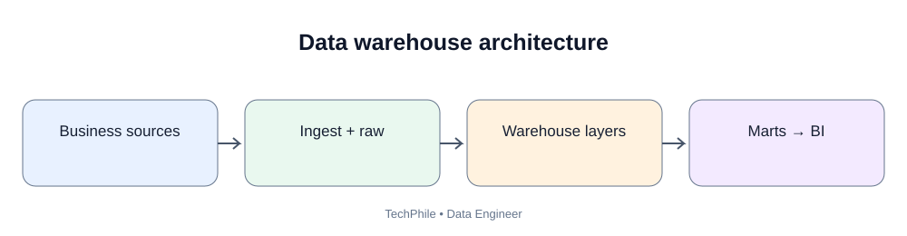
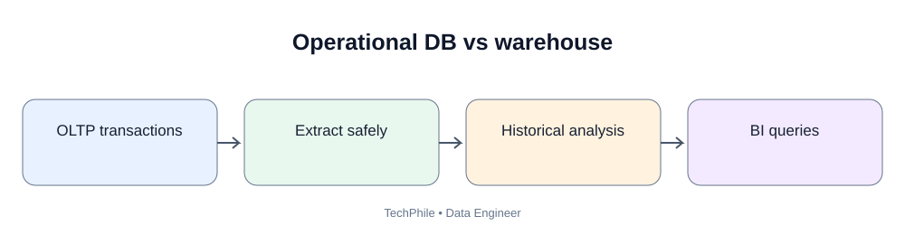

# Day 40: Data Warehouse Architecture

**Phase:** 5 — Data Warehousing and Modeling  
**Learning time:** 2–3 hours  
**Audience:** Complete beginners, freshers and junior Data Engineer candidates  
**Primary database for SQL examples:** PostgreSQL  
**Topic boundary:** These are class notes only. The project workbook and interview guide are separate files.

> Today we move from building pipelines that move data to designing a place where an organization can reliably analyze data. A data warehouse is not simply another database. It is an analytical environment designed around business questions, historical data, consistent definitions and reporting needs.

---

## Lesson map

By the end of this lesson, you should be able to:

1. Explain why organizations need a data warehouse.
2. Distinguish an operational database from an analytical warehouse.
3. Explain OLTP and OLAP using a familiar business example.
4. Describe a typical warehouse architecture from source to report.
5. Explain raw, staging, integration and presentation layers.
6. Understand the role of a data warehouse, data mart and semantic layer.
7. Explain the basic idea of dimensional modeling.
8. Recognize fact tables, dimension tables and grain before designing them in detail on Day 41.
9. Explain ETL and ELT in a warehouse context.
10. Understand what dbt does and where it fits.
11. Read a simple warehouse transformation model.
12. Identify common architecture mistakes and propose a safer design.

### Today's learning flow

`Business systems -> Source extraction -> Raw storage -> Staging -> Integrated warehouse -> Data marts -> BI reports`

Do not try to memorize the arrow. By the end of the lesson, you should be able to explain what each box stores, why it exists and who uses it.

---

# Part 1 — Why does a company need a data warehouse?

## 1. Start with a familiar company

Imagine an online shopping company called **TechStore**.

Customers use its website and mobile application to:

- create accounts;
- browse products;
- add products to a cart;
- place orders;
- make payments;
- request refunds;
- receive deliveries.

The company has different software systems for these activities.

| Business activity | Possible source system | Example information |
|---|---|---|
| Customer registration | Customer application | Customer ID, name, city |
| Orders | Order management system | Order ID, customer ID, order date |
| Payments | Payment service | Payment ID, order ID, amount, status |
| Products | Product catalog | Product ID, category, price |
| Delivery | Logistics system | Shipment ID, order ID, delivery date |

Each system is designed to perform its own operational job.

The sales manager now asks:

- How much revenue did we earn each month?
- Which product categories are growing?
- Which cities generate the most sales?
- How many customers purchased again?
- How long does delivery take?
- Did refunds increase this quarter?

These questions need information from several systems.

## 1.1 Why not ask each application directly?

A student may ask:

"Why can't the sales manager simply connect Power BI to the order database?"

Sometimes a small report can read from an operational database. But a large organization faces several problems.

### Problem A — Data is separated

The order system may know the order amount.

The payment system may know whether payment succeeded.

The delivery system may know whether the order arrived.

No single application necessarily contains the complete business story.

### Problem B — Different systems may use different definitions

For example:

- The order system records an order when it is placed.
- The payment system records a payment when it succeeds.
- The finance team may recognize revenue only after a business-approved event.

If every report uses a different definition of "sales", managers may receive conflicting numbers.

### Problem C — Operational systems are optimized for transactions

An order application must quickly save a new order.

A report may need to scan millions of orders and group them by month, city and category.

These are different workloads.

### Problem D — Historical information may be overwritten

A customer may move from Hyderabad to Bengaluru.

The operational customer table may update the city field.

If the company wants to know the city associated with a customer's purchase six months ago, it may need historical tracking rather than only the current value.

We will learn historical dimension techniques later in this phase.

### Problem E — Repeated analytical queries can affect application performance

A long-running report can compete with the application for CPU, memory, disk and database connections.

A separate analytical environment helps isolate workloads.

## 1.2 What is a data warehouse?

A **data warehouse** is a centralized analytical data environment that collects data from multiple sources, organizes it for analysis and supports reporting and decision-making.

Break the definition into parts:

| Phrase | Beginner meaning |
|---|---|
| Centralized | Relevant analytical data is brought into a managed environment |
| Analytical | Data is organized to answer business questions |
| Multiple sources | Data can come from applications, databases, files and APIs |
| Historical | Data can be retained so users can compare different periods |
| Consistent | Shared rules and definitions are applied |
| Decision-making | Business users can use the information to plan actions |

A warehouse is not automatically correct just because data has been copied into it. Data must still be validated, modeled, documented and governed.

## 1.3 A simple analogy

Think about a school.

- The admission office stores student registration.
- The accounts office stores fee payments.
- The examination office stores marks.
- The library stores borrowed books.

Each office needs its own operational records.

The principal may ask:

"Compare attendance, fee payment and examination performance by class."

The principal needs a combined analytical view.

A warehouse plays a similar role: it brings relevant information together so the organization can ask questions across departments.

**Important difference:** A real warehouse is not merely a folder containing copies. It has controlled ingestion, data models, history, quality checks, access rules and operational processes.

### Checkpoint 1

Answer in your own words:

1. Why can one operational application fail to answer a cross-department business question?
2. Why might a report need historical data?
3. Why should a heavy analytical query not always run on the order application's production database?

**Self-check:** Your answer should mention separate sources, historical changes and workload isolation.

---

# Part 2 — Operational database versus analytical warehouse

## 2. Understand an operational database

An operational database supports the day-to-day work of an application.

Examples:

- create a customer;
- place an order;
- update an address;
- record a payment;
- cancel a shipment.

These are usually small, frequent operations.

A typical operational table may look like this:

### Example: orders

| order_id | customer_id | order_date | status | total_amount |
|---:|---:|---|---|---:|
| 1001 | 501 | 2026-01-02 | PAID | 2500 |
| 1002 | 502 | 2026-01-02 | PENDING | 1200 |
| 1003 | 501 | 2026-01-03 | PAID | 800 |

When a customer places order 1004, the application needs to insert that row safely and quickly.

## 2.1 What is OLTP?

**OLTP** means Online Transaction Processing.

It describes systems that process operational transactions.

Typical characteristics:

- many small inserts, updates and deletes;
- frequent point lookups;
- current operational state;
- strong transaction consistency;
- many concurrent application users;
- normalized tables are common.

Examples:

- banking transactions;
- online orders;
- airline bookings;
- customer registration.

### Example OLTP task

A customer places an order.

The system may need to:

1. check product availability;
2. create the order;
3. create order-item rows;
4. reserve inventory;
5. record payment status.

These operations must be handled consistently. If the order is created but inventory reservation fails, the application needs a transaction strategy.

That is an operational transaction problem.

## 2.2 What is OLAP?

**OLAP** means Online Analytical Processing.

It describes systems and workloads designed to analyze data.

Typical characteristics:

- read-heavy analytical queries;
- aggregations across many rows;
- trends across days, months or years;
- comparisons across products, regions and customer groups;
- historical analysis;
- data models designed for understandable reporting.

Examples:

- monthly revenue by category;
- year-over-year sales comparison;
- customer retention analysis;
- delivery performance by region.

### Example OLAP task

The sales manager asks:

"Show total paid sales by product category for each month."

The query may need to combine orders, order items and products, filter valid paid orders, group by month and category, and calculate totals.

That is an analytical query.

## 2.3 OLTP and OLAP comparison

| Area | OLTP | OLAP |
|---|---|---|
| Main purpose | Run the business | Understand the business |
| Typical user | Application or operational employee | Analyst, manager, data scientist |
| Workload | Insert, update, delete, point lookup | Scan, join, aggregate, compare |
| Data focus | Current transaction state | Current and historical analytical data |
| Query size | Often small and selective | Often large and read-intensive |
| Design tendency | Normalize operational entities | Often use dimensional models |
| Example | Create an order | Analyze monthly revenue |
| Performance goal | Fast transaction response | Efficient analytical query |

Do not treat this table as an absolute rule. Modern databases can support mixed workloads. The distinction explains the design goals, not a strict limitation.

## 2.4 See the difference with SQL

The following is a small PostgreSQL learning example. It creates a temporary operational-style table.

Run this in pgAdmin Query Tool or a PostgreSQL SQL editor.

### Step 1 — Create the table

```sql
CREATE TEMP TABLE orders_demo (
    order_id INTEGER,
    customer_id INTEGER,
    order_date DATE,
    status VARCHAR(20),
    total_amount NUMERIC(10, 2)
);
```

Expected result:

```text
CREATE TABLE
```

Explanation:

- `CREATE TEMP TABLE` creates a temporary table for this database session.
- `orders_demo` is the table name.
- `order_id INTEGER` stores a whole-number order identifier.
- `customer_id INTEGER` stores the customer identifier.
- `order_date DATE` stores a calendar date.
- `status VARCHAR(20)` stores a short text status.
- `total_amount NUMERIC(10, 2)` stores a decimal amount with two digits after the decimal point.
- The comma separates column definitions.
- The semicolon ends the SQL statement.

A temporary table is useful for a lesson because it does not permanently change the database schema. It is removed when the session ends.

### Step 2 — Insert sample orders

```sql
INSERT INTO orders_demo
    (order_id, customer_id, order_date, status, total_amount)
VALUES
    (1001, 501, '2026-01-02', 'PAID', 2500.00),
    (1002, 502, '2026-01-02', 'PENDING', 1200.00),
    (1003, 501, '2026-01-03', 'PAID', 800.00),
    (1004, 503, '2026-02-01', 'PAID', 1500.00);
```

Expected result:

```text
INSERT 0 4
```

This indicates that four rows were inserted.

### Step 3 — Read one customer's orders

```sql
SELECT order_id, order_date, status, total_amount
FROM orders_demo
WHERE customer_id = 501
ORDER BY order_date;
```

Expected result:

| order_id | order_date | status | total_amount |
|---:|---|---|---:|
| 1001 | 2026-01-02 | PAID | 2500.00 |
| 1003 | 2026-01-03 | PAID | 800.00 |

Explanation:

- `SELECT` chooses the columns to return.
- `FROM` identifies the table.
- `WHERE` filters rows to customer 501.
- `ORDER BY` sorts the matching rows by date.

This is a selective operational-style query: find a customer's orders.

### Step 4 — Run an analytical aggregation

```sql
SELECT
    DATE_TRUNC('month', order_date)::date AS sales_month,
    SUM(total_amount) AS total_order_value,
    COUNT(*) AS order_count
FROM orders_demo
WHERE status = 'PAID'
GROUP BY DATE_TRUNC('month', order_date)
ORDER BY sales_month;
```

Expected result:

| sales_month | total_order_value | order_count |
|---|---:|---:|
| 2026-01-01 | 3300.00 | 2 |
| 2026-02-01 | 1500.00 | 1 |

Explanation:

- `DATE_TRUNC('month', order_date)` groups each date into its month.
- `::date` converts the month boundary to a date for display.
- `SUM(total_amount)` adds the paid order amounts.
- `COUNT(*)` counts paid orders.
- `WHERE status = 'PAID'` excludes the pending order.
- `GROUP BY` creates one group per month.
- `ORDER BY` sorts the monthly result.

Output walkthrough:

- January has order 1001 for 2,500 and order 1003 for 800. Total = 3,300; count = 2.
- February has order 1004 for 1,500. Total = 1,500; count = 1.
- Order 1002 is pending, so it is not included.

This second query scans and groups multiple rows to answer a business question. It represents an analytical workload.

**PostgreSQL note:** `DATE_TRUNC` and the `::date` cast are PostgreSQL syntax. Other databases may use different date functions.

### Common mistake

**Mistake:** Adding the pending order to paid sales.

**Cause:** Forgetting the business definition of the metric.

**Correction:** Confirm with the business whether "sales" means orders placed, paid orders, shipped orders or recognized revenue. Then encode that definition in the model and document it.

### Checkpoint 2

Change the query to show only February.

Expected result:

| sales_month | total_order_value | order_count |
|---|---:|---:|
| 2026-02-01 | 1500.00 | 1 |

One possible filter is:

```sql
WHERE status = 'PAID'
  AND order_date >= DATE '2026-02-01'
  AND order_date < DATE '2026-03-01'
```

Using a start-inclusive and end-exclusive date range is a reliable pattern for timestamps too.

---

# Part 3 — Understand the warehouse architecture

## 3. What is data architecture?

Data architecture is the planned arrangement of data sources, storage, movement, transformation, access and governance.

A warehouse architecture answers questions such as:

- Where does data come from?
- How is it extracted?
- Where is the original copy stored?
- Where are types and formats standardized?
- Where are business rules applied?
- Where are facts and dimensions stored?
- How do reports access the data?
- Who can see sensitive information?
- How can an engineer trace a report value back to its source?

Architecture is not just a diagram. It is a set of decisions and responsibilities.

## 3.1 A simple warehouse flow

`Source systems -> Ingestion -> Raw layer -> Staging layer -> Core warehouse -> Data mart -> BI / analytics`

Let's understand every stage.

## 3.2 Source systems

A source system is where business data is first created or maintained.

Examples:

- PostgreSQL order database;
- MySQL customer database;
- payment API;
- CSV file from a supplier;
- JSON events from an application;
- spreadsheet uploaded by a finance team.

A source has its own schema, ownership, update frequency and reliability.

Before ingestion, record:

- source name;
- business owner;
- technical contact;
- extraction method;
- expected frequency;
- primary key or record identifier;
- update behavior;
- sensitive fields;
- expected data volume.

A Data Engineer should not assume that every source is reliable or that every field has a clear meaning.

## 3.3 Ingestion layer

Ingestion moves data from the source into the analytical platform.

Common methods:

| Method | Meaning | Example |
|---|---|---|
| Full load | Read all selected source rows | Load a small reference table |
| Incremental load | Read only new or changed rows | Read orders updated after a watermark |
| CDC | Capture database changes | Read insert/update/delete events |
| API extraction | Request data from an endpoint | Retrieve payment records |
| File ingestion | Read delivered files | Load daily supplier CSV |

You studied ingestion patterns in Phase 4. Today we focus on where the ingested data belongs in a warehouse.

An ingestion process should preserve enough metadata to identify:

- when the row was extracted;
- which source it came from;
- which ingestion run loaded it;
- which source record it represents;
- whether the record passed validation.

## 3.4 Raw layer

The raw layer stores source data close to the way it arrived.

It may preserve:

- original column names;
- source values;
- source timestamps;
- source identifiers;
- ingestion timestamp;
- file or batch name;
- run identifier.

### Why preserve raw data?

Suppose the source sends a customer's city as:

`"Hyderabad "`

A transformation later trims the extra space and stores:

`"Hyderabad"`

If a business user questions the transformation, the raw layer helps an engineer inspect what actually arrived.

Raw data also helps with controlled reprocessing after transformation logic changes.

### Does raw mean "accept everything without checks"?

No.

You still need security, access control, retention rules, malware/file safety checks where relevant, and basic structural validation. Raw means preserving the received representation; it does not mean ignoring safety.

### Raw layer design questions

1. Is the source payload preserved?
2. Is the ingestion time recorded?
3. Can the original batch be identified?
4. Can a failed batch be replayed safely?
5. Is sensitive data protected?
6. Is retention defined?
7. Can records be traced to the source?

## 3.5 Staging layer

The staging layer prepares raw data for consistent downstream processing.

Common tasks:

- rename columns to a consistent naming style;
- convert source strings into correct data types;
- parse dates;
- standardize status values;
- trim unnecessary whitespace;
- remove exact technical duplicates when rules permit;
- identify invalid records;
- apply basic structural checks.

Example:

Raw source:

| order_no | order_dt | order_total | order_state |
|---|---|---:|---|
| 1001 | 2026-01-02 | "2500.00" | "paid " |
| 1002 | 2026-01-03 | "1200.00" | "pending" |

Staged result:

| order_id | order_date | order_amount | order_status |
|---:|---|---:|---|
| 1001 | 2026-01-02 | 2500.00 | PAID |
| 1002 | 2026-01-03 | 1200.00 | PENDING |

What changed?

- `order_no` became `order_id`.
- `order_dt` became `order_date`.
- `order_total` became a numeric field.
- `order_state` became `order_status`.
- Status text was trimmed and standardized to uppercase.

The staging layer should not silently invent business meaning. If "paid" and "settled" are different states in the source system, do not merge them without an approved mapping.

## 3.6 Core or integration layer

The core warehouse combines and manages consistent business entities.

Examples:

- customer;
- product;
- order;
- payment;
- shipment;
- calendar date.

It resolves differences between source systems and applies agreed business rules.

Example:

The customer application uses customer number `C-501`.

The loyalty platform uses member number `L-991`.

A governed mapping may identify that both represent the same customer. The integration process must use an approved identity rule; matching names alone is not safe.

The core layer should make shared business definitions reusable.

## 3.7 Presentation layer

The presentation layer organizes data for business analysis.

Examples:

- sales mart;
- finance mart;
- customer analytics mart;
- delivery performance mart.

It may contain fact and dimension tables designed for reporting.

A report writer should not need to understand every raw source system to calculate monthly sales.

## 3.8 BI and analytics layer

Business Intelligence tools and analytical users access approved warehouse models.

Examples:

- Power BI;
- Tableau;
- Looker;
- SQL notebooks;
- Python analysis tools.

The reporting layer should expose understandable names, stable definitions and documented relationships.

### Checkpoint 3

For each task, identify the likely layer:

1. Preserve the supplier's original CSV.
2. Convert `order_total` from text to decimal.
3. Match customer identifiers from two applications.
4. Create a sales-by-month reporting table.
5. Display the sales report in Power BI.

**Self-check:** raw, staging, core/integration, presentation, BI/analytics.

---

# Part 4 — Warehouse, data lake, data mart and lakehouse

## 4.1 Data warehouse

A data warehouse is an analytical data environment that stores integrated, structured or modeled information for reporting and analysis.

Typical use:

- business reporting;
- historical analysis;
- governed metrics;
- dimensional models.

## 4.2 Data lake

A data lake stores data in many formats, often in object storage.

It may contain:

- CSV;
- JSON;
- Parquet;
- images;
- logs;
- event data;
- raw and processed files.

A lake can store data before it is transformed into business-ready tables.

A lake is not automatically well governed. Without cataloging, ownership, quality and lifecycle rules, it can become a confusing collection of files.

## 4.3 Data mart

A data mart is a focused analytical area for a subject or business team.

Examples:

- sales data mart;
- finance data mart;
- marketing data mart;
- supply-chain data mart.

A sales mart may expose order, product, customer, date and sales measures.

A data mart should use shared definitions where possible. Two departments should not independently invent incompatible versions of revenue.

## 4.4 Lakehouse

A lakehouse combines data-lake storage flexibility with warehouse-like management and analytical capabilities.

The exact features depend on the platform and table format.

A lakehouse is an architectural approach, not one single product.

## 4.5 Comparison

| Concept | Main purpose | Typical contents |
|---|---|---|
| Data lake | Store diverse data at scale | Raw and processed files |
| Data warehouse | Governed analytical data | Integrated analytical tables |
| Data mart | Serve a business subject/team | Sales, finance or customer models |
| Lakehouse | Combine lake storage and managed analytical tables | Files plus managed table structures |

### Common confusion

A data mart is not necessarily a separate physical database. It can be a logical area, schema, set of models or managed product inside a larger platform.

---

# Part 5 — Understand warehouse modeling

## 5. What is data modeling?

Data modeling is the process of deciding how data entities, attributes and relationships should be represented.

A model helps answer:

- What does one row represent?
- Which fields identify a record?
- How are entities related?
- Which values are descriptive?
- Which values can be measured?
- How should history be represented?
- Which business questions should the model support?

A poor model makes reports confusing and can produce incorrect totals.

## 5.1 Operational model versus analytical model

An operational model often organizes data around business transactions and update consistency.

An analytical model often organizes data around measurable business events and descriptive context.

For example:

- Operational: order header, order item, customer, product.
- Analytical: sales fact, customer dimension, product dimension, date dimension.

We will design these structures in detail on Day 41.

## 5.2 What is dimensional modeling?

Dimensional modeling is an approach to organizing analytical data using:

- **Fact tables:** store business events or measurements.
- **Dimension tables:** store descriptive context used to filter, group and label facts.

Example business question:

"How much did each product category sell in each city every month?"

The model needs:

- sales amount;
- product/category;
- customer/city;
- date/month.

The sales event is represented in a fact table. Product, customer and date provide descriptive context through dimensions.

## 5.3 What is a fact?

A fact is a measurable business event or observation.

Examples:

- one order line;
- one payment;
- one shipment;
- one website visit;
- one inventory snapshot.

Facts often contain numeric measures, but not every fact column is additive.

Examples of measures:

- quantity;
- sales amount;
- discount amount;
- shipping cost.

## 5.4 What is a dimension?

A dimension describes the context of a business event.

Examples:

- customer;
- product;
- date;
- store;
- region;
- sales channel.

Dimension attributes help users filter and group results.

For example, a product dimension may contain:

| product_id | product_name | category | brand |
|---:|---|---|---|
| 10 | Laptop A | Electronics | Brand X |
| 11 | Phone B | Electronics | Brand Y |
| 12 | Chair C | Furniture | Brand Z |

A report can group sales by category or brand without repeating these descriptions in every reporting query.

## 5.5 What is grain?

**Grain** describes exactly what one row in a fact table represents.

This is one of the most important ideas in dimensional modeling.

Examples:

- one row per order;
- one row per order item;
- one row per payment transaction;
- one row per product per warehouse per day.

These grains are not interchangeable.

Suppose order 1001 contains three products.

At order grain, it may be one row.

At order-item grain, it is three rows.

If an engineer joins an order-level amount to three item rows and sums it, the order amount may be counted three times.

That is a fan-out/double-counting problem.

**Rule:** Declare the grain before selecting measures or designing joins.

We will practice grain in detail on Day 41.

### Checkpoint 4

An order contains:

- Laptop: quantity 1;
- Mouse: quantity 2;
- Keyboard: quantity 1.

How many rows should a fact table contain if its grain is one row per order item?

**Answer:** Three rows. The grain is one row per individual order line.

---

# Part 6 — ETL and ELT in a warehouse

## 6.1 ETL

ETL means:

1. Extract data from a source.
2. Transform data before loading it into the target.
3. Load the transformed result.

Flow:

`Source -> Extract -> Transform -> Load -> Warehouse`

Example:

- extract orders from a source database;
- standardize date and amount fields in a processing engine;
- load curated tables into the warehouse.

## 6.2 ELT

ELT means:

1. Extract data.
2. Load it into the target platform.
3. Transform it inside the target platform.

Flow:

`Source -> Extract -> Load raw data -> Transform in warehouse`

Example:

- copy source orders into a raw warehouse schema;
- use SQL models to standardize and aggregate the data inside the warehouse.

## 6.3 ETL versus ELT

| Area | ETL | ELT |
|---|---|---|
| Transformation location | Before target load | Inside target platform |
| Initial target data | Often transformed output | Often raw/landed source data |
| Compute | External transformation engine may be used | Warehouse compute is commonly used |
| Reprocessing | Depends on retained source/staging data | Raw landed data can support rebuilding models |
| Typical fit | Legacy systems, constrained targets, specialized processing | Modern analytical platforms with scalable SQL compute |

Neither is universally better. Choose based on platform capabilities, data sensitivity, volume, cost, latency and operational requirements.

## 6.4 A practical decision

Suppose a company receives a 2 GB supplier file.

The file contains:

- customer email;
- product code;
- quantity;
- price;
- delivery date.

The company must validate the file before it enters a shared analytical environment.

It may perform security and structural checks before loading anything.

Then it may preserve the accepted source payload in a raw area and use warehouse SQL for downstream transformations.

This is a hybrid architecture. Real systems often combine ETL and ELT rather than following one label rigidly.

---

# Part 7 — dbt introduction

## 7. What problem does dbt solve?

As warehouse transformations grow, engineers may create many SQL queries.

Without organization, problems appear:

- SQL is copied into several reports;
- one change breaks another model;
- dependencies are unclear;
- tests are forgotten;
- documentation becomes outdated;
- engineers cannot easily identify which model depends on a table.

**dbt** is a transformation tool used to develop, test, document and manage SQL transformations in supported data platforms.

dbt does not usually extract data from every source system by itself. In a common architecture, ingestion tools load data first; dbt then transforms data inside the warehouse.

## 7.1 Where dbt fits

`Source application -> Ingestion tool -> Warehouse raw tables -> dbt models -> Curated models -> BI`

Responsibilities:

| Component | Responsibility |
|---|---|
| Source application | Creates operational data |
| Ingestion tool | Moves source data |
| Warehouse | Stores analytical data and runs SQL |
| dbt | Organizes and executes SQL transformations, tests and documentation |
| BI tool | Presents approved data to users |

## 7.2 What is a dbt model?

A dbt model is commonly a SQL file that defines a transformation.

Example file:

`models/staging/stg_orders.sql`

```sql
SELECT
    order_id,
    customer_id,
    order_date,
    CAST(total_amount AS NUMERIC(10, 2)) AS total_amount,
    UPPER(TRIM(status)) AS order_status
FROM raw_orders
```

This model selects columns and standardizes two fields.

The file is not automatically a physical table merely because it exists. dbt materialization configuration determines whether it is built as a view, table, incremental model or another supported form.

## 7.3 Understand a model line by line

- `SELECT` begins the output column list.
- `order_id` passes through the order identifier.
- `customer_id` passes through the customer identifier.
- `order_date` passes through the order date.
- `CAST(total_amount AS NUMERIC(10, 2))` converts the amount to a decimal type.
- `UPPER(TRIM(status))` removes leading/trailing spaces and converts status text to uppercase.
- `FROM raw_orders` reads from the raw source relation.

Example input:

| order_id | customer_id | order_date | total_amount | status |
|---:|---:|---|---|---|
| 1001 | 501 | 2026-01-02 | 2500.00 | paid |
| 1002 | 502 | 2026-01-03 | 1200.00 | pending |

Expected transformed rows:

| order_id | customer_id | order_date | total_amount | order_status |
|---:|---:|---|---:|---|
| 1001 | 501 | 2026-01-02 | 2500.00 | PAID |
| 1002 | 502 | 2026-01-03 | 1200.00 | PENDING |

The exact database output formatting depends on the SQL client. The values shown are the expected logical result.

## 7.4 What is a dbt source?

A source declares an upstream table or view that dbt reads.

It helps document where raw data comes from and allows models to refer to the declared source.

Example YAML:

```yaml
version: 2

sources:
  - name: raw
    schema: public
    tables:
      - name: raw_orders
```

This is a simplified declaration. The schema and table must exist in the connected database.

A model can refer to the source using dbt's source reference syntax:

```sql
SELECT *
FROM {{ source('raw', 'raw_orders') }}
```

The expression is resolved by dbt when it compiles the model. It is not ordinary SQL syntax that PostgreSQL understands by itself.

## 7.5 What is ref?

The `ref()` function identifies another dbt model and creates a dependency.

Example:

```sql
SELECT *
FROM {{ ref('stg_orders') }}
```

This says that the current model depends on the model named `stg_orders`.

dbt can use these dependencies to determine build order and generate a lineage graph.

Do not confuse:

- `source()`: refers to a declared upstream source relation.
- `ref()`: refers to another dbt model.

## 7.6 What is materialization?

Materialization controls how dbt builds a model in the data platform.

Common types:

| Materialization | Beginner explanation | Typical use |
|---|---|---|
| view | Stores a query definition; data is read when queried | Lightweight transformations |
| table | Stores the query result as a table | Reused or performance-sensitive models |
| incremental | Processes new or changed data according to model logic | Large datasets with a reliable incremental strategy |
| ephemeral | Represents a model as a SQL expression included in downstream models | Small reusable SQL logic |

A view is not always faster than a table. An incremental model is not automatically correct. The choice depends on query cost, data volume, update behavior and platform support.

## 7.7 dbt project setup — understand before running

dbt has multiple adapters for different warehouse platforms. The commands and installation package depend on the adapter.

Do not copy a BigQuery, Snowflake, Redshift or PostgreSQL configuration interchangeably.

For this course, the examples explain the general workflow. Before installing, identify:

1. the warehouse platform;
2. the matching dbt adapter;
3. the supported Python version;
4. the connection method;
5. the credentials and environment configuration.

Never place production passwords or tokens in a model file or public Git repository.

## 7.8 Common dbt commands

The exact behavior depends on the installed dbt version and adapter.

| Command | Purpose |
|---|---|
| `dbt debug` | Check project and connection configuration |
| `dbt parse` | Parse project files and validate project structure |
| `dbt compile` | Compile models into SQL |
| `dbt run` | Build selected models |
| `dbt test` | Run configured data tests |
| `dbt docs generate` | Generate project documentation artifacts |
| `dbt docs serve` | Serve generated documentation locally |

Do not run `dbt run` against a production target just to experiment. Use a development schema or isolated training database.

## 7.9 What does a dbt test check?

A test checks an expectation about data.

Examples:

- order ID should not be null;
- order ID should be unique;
- customer ID should match a valid customer;
- status should belong to an approved set.

A test does not prove every business rule is correct. Tests must represent explicit expectations.

### Checkpoint 5

Choose the correct concept:

1. A SQL file that standardizes raw orders — dbt model.
2. A declaration of an upstream database table — source.
3. A dependency on another dbt model — ref.
4. A choice to build a model as a view or table — materialization.
5. A check that order IDs are unique — data test.

---

# Part 8 — Architecture design exercise

## 8.1 Business request

TechStore wants a monthly sales dashboard.

The dashboard must show:

- monthly paid sales;
- number of paid orders;
- sales by product category;
- sales by customer city;
- refund amount;
- last successful data refresh.

The data comes from:

- order database;
- order item database table;
- customer database table;
- product catalog;
- payment/refund system.

## 8.2 First identify the business questions

Do not start by creating tables.

Write the questions first:

1. What does "sales" mean?
2. Are pending orders excluded?
3. Are cancelled orders excluded?
4. Are refunds subtracted from gross sales or shown separately?
5. Which date determines the reporting month?
6. Should a customer's current city or city at order time be shown?
7. How should late-arriving payments be handled?
8. What is the dashboard's freshness requirement?

A Data Engineer must clarify definitions rather than guess.

## 8.3 Map source to warehouse

| Business information | Source | Raw landing object | Staging responsibility |
|---|---|---|---|
| Order header | Order DB | raw_orders | Standardize IDs, dates and status |
| Order line | Order DB | raw_order_items | Standardize quantity and price |
| Customer | Customer DB | raw_customers | Standardize customer attributes |
| Product | Product catalog | raw_products | Standardize category and product attributes |
| Payment/refund | Payment system | raw_payments | Standardize amount, type and status |

## 8.4 Propose layers

| Layer | Example object | Responsibility |
|---|---|---|
| Raw | raw_orders | Preserve extracted order data |
| Staging | stg_orders | Clean types and naming |
| Core | int_order_payments | Combine approved order/payment logic |
| Presentation | fct_sales | Store measurable sales events |
| Presentation | dim_customer | Provide customer context |
| Presentation | dim_product | Provide product context |
| Presentation | dim_date | Provide calendar context |
| BI | Monthly Sales Dashboard | Present approved metrics |

These are illustrative names. The exact model is designed and validated in later lessons.

## 8.5 Draw the architecture

`Order DB -----------┐`
  
`Order Items DB -----+`
  
`Customer DB --------+--> Ingestion --> Raw --> Staging --> Core --> Sales Mart --> BI`
  
`Product Catalog ----+`
  
`Payment System -----┘`

The architecture should also include operational controls:

- access permissions;
- secrets management;
- data quality tests;
- run metadata;
- failure alerts;
- lineage;
- backup and retention;
- cost monitoring.

## 8.6 What could go wrong?

| Failure | Impact | Control |
|---|---|---|
| Payment feed is delayed | Sales dashboard is incomplete | Freshness check and visible last-refresh time |
| Order status changes | Old status may remain in warehouse | Incremental update strategy |
| Product category is renamed | Historical reports may change unexpectedly | Approved history policy |
| Duplicate order lines arrive | Sales may be overstated | Business-key and duplicate checks |
| Refunds are ignored | Net sales may be overstated | Explicit refund model and reconciliation |
| Customer city is overwritten | Historical city analysis may be wrong | Define historical attribute behavior |

---

# Part 9 — SQL practice: build a tiny staging model

This practice demonstrates a transformation outside dbt first. Learn the SQL before adding tool-specific syntax.

## 9.1 Create a raw table

```sql
CREATE TEMP TABLE raw_orders (
    order_id INTEGER,
    customer_id INTEGER,
    order_date TEXT,
    total_amount TEXT,
    status TEXT
);
```

Expected result:

```text
CREATE TABLE
```

The date and amount are text deliberately. We are simulating inconsistent source data.

## 9.2 Insert sample rows

```sql
INSERT INTO raw_orders VALUES
    (2001, 601, '2026-03-01', '4500.00', 'paid '),
    (2002, 602, '2026-03-02', '900.00', 'pending'),
    (2003, 603, '2026-03-03', '1250.50', 'PAID');
```

Expected result:

```text
INSERT 0 3
```

## 9.3 Inspect the raw rows

```sql
SELECT *
FROM raw_orders
ORDER BY order_id;
```

Expected result:

| order_id | customer_id | order_date | total_amount | status |
|---:|---:|---|---|---|
| 2001 | 601 | 2026-03-01 | 4500.00 | paid |
| 2002 | 602 | 2026-03-02 | 900.00 | pending |
| 2003 | 603 | 2026-03-03 | 1250.50 | PAID |

The first status contains a trailing space. The amount and date are text.

## 9.4 Create a staging view

```sql
CREATE TEMP VIEW stg_orders AS
SELECT
    order_id,
    customer_id,
    CAST(order_date AS DATE) AS order_date,
    CAST(total_amount AS NUMERIC(10, 2)) AS total_amount,
    UPPER(TRIM(status)) AS order_status
FROM raw_orders;
```

Expected result:

```text
CREATE VIEW
```

## 9.5 Read the staged result

```sql
SELECT *
FROM stg_orders
ORDER BY order_id;
```

Expected result:

| order_id | customer_id | order_date | total_amount | order_status |
|---:|---:|---|---:|---|
| 2001 | 601 | 2026-03-01 | 4500.00 | PAID |
| 2002 | 602 | 2026-03-02 | 900.00 | PENDING |
| 2003 | 603 | 2026-03-03 | 1250.50 | PAID |

## 9.6 Calculate paid order value

```sql
SELECT
    SUM(total_amount) AS paid_order_value,
    COUNT(*) AS paid_order_count
FROM stg_orders
WHERE order_status = 'PAID';
```

Expected result:

| paid_order_value | paid_order_count |
|---:|---:|
| 5750.50 | 2 |

Walkthrough:

- Order 2001 is PAID: 4,500.00.
- Order 2002 is PENDING: excluded.
- Order 2003 is PAID: 1,250.50.
- Total = 4,500.00 + 1,250.50 = 5,750.50.
- Two rows match the filter.

## 9.7 What this example does not do

This tiny example does not yet provide:

- a durable raw storage design;
- invalid-row quarantine;
- source-to-target reconciliation;
- incremental loading;
- historical dimension tracking;
- a fact/dimension model;
- production security;
- automated dbt tests.

Those topics are covered later in the phase or were introduced in earlier phases.

### Debugging clinic

**Error:** invalid input syntax for type numeric.

**Possible cause:** a source amount contains text such as `"unknown"`.

**Safe response:** do not silently replace every invalid amount with zero. Identify the invalid row, preserve the original value, record the rejection reason and follow an approved business rule.

**Error:** invalid input syntax for type date.

**Possible cause:** a date is malformed or uses a format not accepted by the conversion.

**Safe response:** inspect the raw value and source format. Use an explicit parsing rule and reject values that cannot be interpreted safely.

**Error:** relation does not exist.

**Possible cause:** the temporary table was created in a different database session, or the table name/schema is wrong.

**Safe response:** run the setup cells in the same SQL session and verify the table name.

---

# Part 10 — Architecture mistakes and better decisions

## 10.1 Copying every source table directly into BI

Why it is risky:

- report authors must understand source-specific fields;
- business definitions are repeated;
- source changes can break reports;
- sensitive fields may be exposed unnecessarily.

Better approach:

- preserve raw data;
- standardize staging;
- create governed business models;
- expose approved reporting tables or views.

## 10.2 Treating raw data as trusted data

Why it is risky:

- source values may be malformed;
- duplicate events may arrive;
- identifiers may be missing;
- timestamps may use different time zones.

Better approach:

- validate at appropriate boundaries;
- retain rejection reasons;
- reconcile counts;
- document assumptions.

## 10.3 Designing tables before clarifying the business question

Why it is risky:

- the grain may be wrong;
- a measure may be double-counted;
- business definitions may be inconsistent.

Better approach:

`Business question -> Metric definition -> Grain -> Facts/dimensions -> SQL model -> Validation`

## 10.4 Building one enormous warehouse table

Why it is risky:

- repeated attributes;
- confusing relationships;
- difficult history management;
- unnecessary duplication;
- poor reuse across business questions.

Better approach:

- identify reusable dimensions;
- define facts at a clear grain;
- design subject-area marts;
- test joins and totals.

## 10.5 Assuming dbt replaces ingestion

dbt is primarily a transformation workflow tool. It does not automatically solve every extraction, API, CDC, orchestration or storage requirement.

Better approach:

- choose an ingestion method;
- land source data;
- use dbt or another transformation tool for modeled transformations;
- orchestrate and monitor the complete workflow.

## 10.6 No ownership or documentation

A table without an owner, definition or freshness expectation becomes difficult to trust.

Better approach:

Every important model should document:

- purpose;
- grain;
- owner;
- source;
- refresh schedule;
- key fields;
- metric definitions;
- quality checks;
- sensitive fields;
- known limitations.

---

# Part 11 — Junior Data Engineer decision guide

When asked to design a warehouse, do not immediately start writing SQL.

Use this sequence:

1. Understand the business question.
2. Identify the users and decisions supported.
3. Identify source systems and owners.
4. Understand source keys, update behavior and history.
5. Clarify metric definitions.
6. Estimate volume and refresh frequency.
7. Choose the storage and warehouse platform.
8. Define raw, staging, core and presentation responsibilities.
9. Identify security and privacy requirements.
10. Design facts, dimensions and grain.
11. Define loading and transformation strategy.
12. Add quality checks and reconciliation.
13. Document lineage and ownership.
14. Plan monitoring, recovery and cost controls.

### Example decision

**Request:** "The CEO wants a sales dashboard by 8 AM every day."

Before choosing tools, ask:

- What is the official definition of sales?
- Which time zone defines the business day?
- Are refunds included?
- What happens when payment data arrives late?
- How much history is required?
- What is the acceptable refresh delay?
- Who approves the metric?
- What happens if the pipeline fails before 8 AM?

This is engineering work. The SQL is only one part of the solution.

---

# Part 12 — Practice exercises with answers

## Exercise 1 — Identify OLTP or OLAP

Classify each task.

1. Save a new customer address.
2. Calculate monthly revenue by region.
3. Update an order status.
4. Compare five years of product sales.
5. Find one order using its order ID.

**Answers:**

1. OLTP — an operational update.
2. OLAP — an analytical aggregation.
3. OLTP — an operational state change.
4. OLAP — a historical analytical comparison.
5. Usually OLTP — a selective operational lookup, although the same query could be run in a warehouse for analysis.

## Exercise 2 — Identify the layer

1. Original JSON payment payload.
2. Payment amount converted from text to decimal.
3. Reconciled payment and order business entity.
4. Finance reporting model.
5. Finance dashboard.

**Answers:** raw, staging, core/integration, presentation, BI/analytics.

## Exercise 3 — Choose ETL or ELT

A warehouse platform can scale SQL compute. The company wants to preserve raw source data and build transformations in SQL inside the platform.

**Suggested answer:** ELT is a natural fit. Ingest and land the source data, then transform it inside the warehouse. Still apply security and structural checks before data is made available.

## Exercise 4 — Identify a missing architecture control

The dashboard shows a successful refresh time, but the source payment feed was not received.

**What is missing?**

A source freshness/completeness check. A successful job status alone does not prove all required sources arrived.

## Exercise 5 — Explain dbt

Write a three-sentence explanation.

**Model answer:**

dbt helps data teams organize and run SQL transformations inside supported analytical data platforms. It provides model dependencies, tests and documentation workflows. It normally works after data has been ingested into the warehouse or platform; it is not a complete replacement for source extraction.

---

# Part 13 — Revision map

| Concept | Remember |
|---|---|
| Data warehouse | Integrated analytical environment |
| OLTP | Operational transaction processing |
| OLAP | Analytical processing |
| Raw layer | Preserve source representation with ingestion metadata |
| Staging layer | Standardize and validate source data |
| Core layer | Integrate shared business entities and rules |
| Presentation layer | Serve analytical use cases |
| Data mart | Focused subject-area analytical data |
| Data lake | Store diverse data at scale |
| Lakehouse | Combine lake storage with managed analytical capabilities |
| Fact | Business event or measurement |
| Dimension | Descriptive context |
| Grain | Exactly what one fact row represents |
| ETL | Transform before loading to target |
| ELT | Load first, transform inside target |
| dbt model | SQL transformation managed by dbt |
| dbt source | Declared upstream relation |
| dbt ref | Dependency on another dbt model |
| Materialization | How a model is built in the platform |

---

# Part 14 — Glossary

| Term | Beginner definition |
|---|---|
| Analytical workload | Queries used to understand patterns and business performance |
| Business metric | A measurable value defined by business rules |
| Core warehouse | Integrated area containing consistent business data |
| Data architecture | Plan for how data is collected, stored, transformed, accessed and governed |
| Data lake | Storage environment for data in many formats |
| Data mart | Focused analytical area for a subject or team |
| Data warehouse | Managed environment for integrated analysis and reporting |
| dbt | Tool for managing SQL transformations, tests and documentation |
| Dimension | Descriptive information used to filter or group facts |
| ELT | Extract, load, transform |
| ETL | Extract, transform, load |
| Fact | Business event or measurable observation |
| Grain | Meaning of one row in a fact table |
| Lakehouse | Architecture combining data-lake flexibility and managed analytical capabilities |
| Lineage | Information about where data came from and how it was transformed |
| OLAP | Online Analytical Processing |
| OLTP | Online Transaction Processing |
| Raw layer | Area that preserves data close to its source representation |
| Staging layer | Area for standardizing and preparing source data |
| Transformation | Changing data into a required structure or business meaning |

---

# Final competency checklist

Before moving to Day 41, confirm that you can:

- [ ] Explain why a warehouse is needed.
- [ ] Compare OLTP and OLAP with business examples.
- [ ] Draw a source-to-report warehouse architecture.
- [ ] Explain raw, staging, core and presentation layers.
- [ ] Distinguish a warehouse, lake, mart and lakehouse.
- [ ] Explain facts, dimensions and grain at a basic level.
- [ ] Compare ETL and ELT.
- [ ] Explain where dbt fits and what it does not replace.
- [ ] Read a simple SQL staging transformation.
- [ ] Identify at least five architecture risks and controls.

**Next lesson — Day 41: Fact and Dimension Tables.** We will design a sales model from a business scenario, declare its grain, create fact and dimension tables, and compare Star Schema with Snowflake Schema using runnable SQL and expected outputs.

---

## Visual Learning Diagrams

### Data warehouse architecture


### Operational database vs warehouse


### Batch vs streaming

