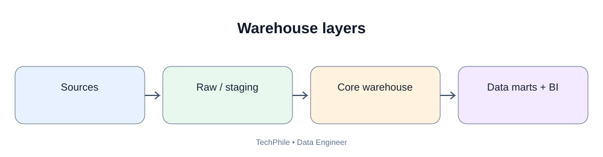
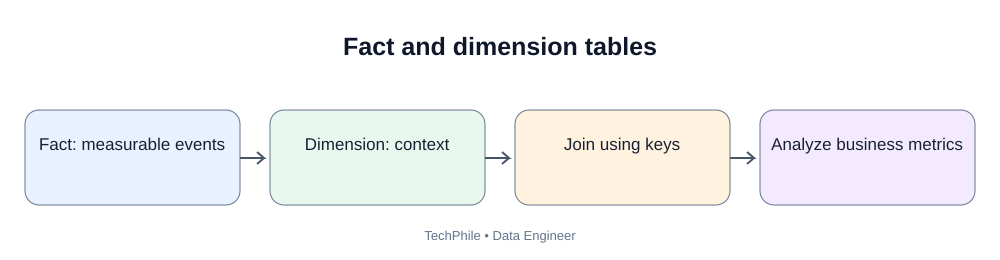
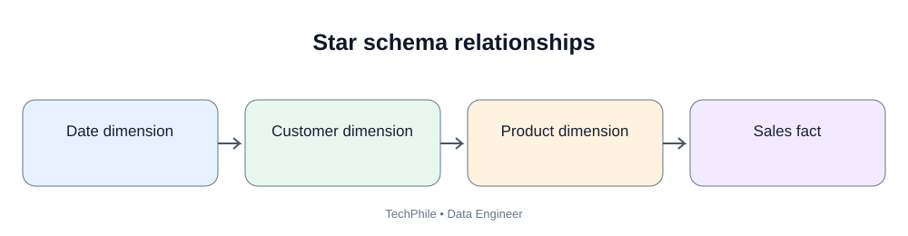

# Day 41: Fact and Dimension Tables

**Phase:** 5 — Data Warehousing and Modeling  
**Learning time:** 2–3 hours  
**Audience:** Complete beginners and junior Data Engineer candidates  
**Database:** PostgreSQL  
**Topic boundary:** Class notes only. The project workbook and interview guide are separate files.

> Yesterday you learned why a warehouse exists and how data moves through its layers. Today you will design the central structure used by many analytical warehouses: fact tables and dimension tables. We will not start by memorizing definitions. We will start with a business question, discover what one row must mean, and then build a model that answers the question without double-counting.

## Learning outcomes

By the end of this lesson, you should be able to:
- explain why analytical models use facts and dimensions;
- identify business events and descriptive context;
- define fact-table grain in one precise sentence;
- distinguish measures, attributes and keys;
- create a simple Star Schema in PostgreSQL;
- explain a Snowflake Schema and when it may be useful;
- join facts to dimensions safely;
- identify fan-out and double-counting;
- validate totals against the source;
- choose additive, semi-additive and non-additive measures;
- explain why a fact table should not mix different grains.

## Today's learning path

`Business question -> Business process -> Grain -> Dimensions -> Facts/measures -> Keys -> Schema -> SQL -> Validation`

Do not reverse this order. Creating columns first and deciding what they mean later is a common cause of warehouse defects.

---

# Part 1 — Begin with a business question

## 1.1 Meet TechStore

TechStore sells products through a website and mobile application.

A sales manager asks:

"Show the total paid sales for each month, product category and customer city."

This sounds simple, but a Data Engineer must clarify the meaning of each phrase.

### What does "sales" mean?

Possible definitions include:
- value of orders placed;
- value of orders paid;
- value of orders shipped;
- recognized revenue;
- paid amount after discounts;
- paid amount after refunds.

These definitions can produce different numbers.

For this lesson, use the following training definition:

**Paid order-line sales = quantity multiplied by unit selling price, for order lines whose parent order has PAID status.**

Refunds are not subtracted in this lesson. They will be modeled separately when the business requirement includes refunds.

This is a teaching definition, not a universal accounting rule.

### What does "each month" mean?

Possible dates:
- order creation date;
- payment date;
- shipment date;
- revenue recognition date.

For the training model, use order date.

### What does "product category" mean?

It is a descriptive attribute of the product.

### What does "customer city" mean?

It could mean:
- customer's current city;
- city recorded at the time of the order.

For this simple lesson, use the customer city supplied with the order event. A production design must make this choice explicit and may require historical dimension tracking.

## 1.2 Translate the question into data needs

| Business phrase | Data needed |
|---|---|
| Total paid sales | A numeric sales measure |
| Each month | A date dimension or order date |
| Product category | Product dimension |
| Customer city | Customer dimension |
| Paid only | Payment/order status rule |

The analytical model needs one measurable sales event and descriptive context for that event.

---

# Part 2 — Understand a fact table

## 2.1 What is a fact table?

A **fact table** stores measurable business events or observations at a declared level of detail.

Examples:
- one row per order item;
- one row per payment transaction;
- one row per shipment;
- one row per daily product inventory snapshot;
- one row per website session.

A fact table often contains:
- foreign keys to dimensions;
- numeric measures;
- event dates;
- degenerate identifiers such as order number;
- technical metadata such as load timestamp or source system.

A fact table is not simply a table containing numbers. Its rows must represent a clearly defined business event.

## 2.2 Identify the business process

The business process is the activity being measured.

For this lesson, the process is **sales order-line activity**.

Not customer registration. Not payment settlement. Not delivery.

One warehouse may contain multiple fact tables because a company has multiple business processes.

Examples:

| Business process | Possible fact |
|---|---|
| Sales | fact_sales |
| Payments | fact_payment |
| Deliveries | fact_shipment |
| Inventory | fact_inventory_snapshot |
| Website activity | fact_web_event |

Do not combine all these processes into one giant fact table. They have different grains and measures.

## 2.3 What is grain?

Grain is the exact meaning of one row in a fact table.

For today's model:

**One row represents one product line within one order.**

This is the grain statement.

It is precise because it answers:
- What event? A sales order line.
- At what level? One product line.
- Which identifier can distinguish it? An order-line identifier, or a valid combination such as order ID and line number.

### Example order

Order 5001 contains:

| order_id | line_number | product | quantity | unit_price |
|---:|---:|---|---:|---:|
| 5001 | 1 | Laptop | 1 | 50000 |
| 5001 | 2 | Mouse | 2 | 800 |
| 5001 | 3 | Keyboard | 1 | 1500 |

At order grain, there is one row for order 5001.

At order-line grain, there are three rows.

The sales fact uses order-line grain, so it must contain three rows.

### Why choose order-line grain?

Because the manager wants sales by product category.

An order may contain products from several categories. Order-line grain preserves the product-level detail needed for that analysis.

### Grain decision rule

Write the grain sentence before creating the table.

If you cannot explain what one row means, stop and clarify the business process.

## 2.4 What happens if grain is unclear?

Imagine the fact table contains:
- one row per order for some orders;
- one row per order line for other orders.

Then measures are not comparable.

A query may count an order twice or multiply an amount when joined to another table.

Mixed grain is a modeling defect, not a problem that should be hidden with `DISTINCT`.

---

# Part 3 — Understand measures

## 3.1 What is a measure?

A measure is a value that can be analyzed or calculated from a fact.

For the sales-line fact:
- quantity;
- unit selling price;
- discount amount;
- line sales amount.

Example:

Quantity = 2  
Unit selling price = 800  
Line sales amount = 1,600

The measure is stored at the same grain as the fact row.

## 3.2 Additive measures

An additive measure can be summed across all relevant dimensions.

Example: line sales amount.

You can sum it by:
- month;
- product;
- customer;
- city;
- category.

This is valid as long as the measure definition and grain are correct.

## 3.3 Semi-additive measures

A semi-additive measure can be summed across some dimensions but not all.

Example: account balance.

You may sum balances across accounts for one date. But summing daily closing balances across several dates usually does not represent a meaningful total.

Inventory quantity is another common example.

## 3.4 Non-additive measures

A non-additive measure should not be summed directly.

Examples:
- percentage;
- ratio;
- unit price;
- average delivery duration.

If three products have different unit prices, adding the prices does not give a meaningful business total.

Instead, calculate a weighted or correctly defined ratio from its components.

### Example: average selling price

Do not sum unit prices.

A simple weighted average is:

`Total sales amount / Total quantity`

For the training rows:
- total amount = 53,900;
- total quantity = 4;
- average selling price = 13,475.

The denominator must match the business definition.

## 3.5 Store components when useful

A robust fact may store:
- quantity;
- unit price;
- discount amount;
- line amount.

Storing the components helps reproduce and validate calculations.

Do not store a derived measure without understanding whether it can become inconsistent with its components.

---

# Part 4 — Understand a dimension table

## 4.1 What is a dimension?

A dimension table stores descriptive information that gives context to facts.

Examples:
- customer;
- product;
- date;
- store;
- sales channel;
- geography.

A product dimension may contain:

| product_key | product_id | product_name | category | brand |
|---:|---|---|---|---|
| 1 | P10 | Laptop A | Electronics | Brand X |
| 2 | P11 | Mouse B | Accessories | Brand Y |
| 3 | P12 | Keyboard C | Accessories | Brand Z |

A report uses these attributes to filter and group sales.

## 4.2 Dimension attributes

An attribute describes an entity.

Customer attributes:
- customer name;
- city;
- state;
- customer segment.

Product attributes:
- product name;
- category;
- brand;
- product size.

Date attributes:
- calendar date;
- day;
- month;
- quarter;
- year;
- weekday name.

Attributes are not necessarily measures. A category label is used to group facts, not to calculate a sum.

## 4.3 Why not repeat every description in the fact table?

Suppose every sales line repeats:
- customer name;
- city;
- state;
- product name;
- category;
- brand.

This can create:
- repeated text;
- inconsistent spellings;
- larger storage;
- difficult historical changes;
- update anomalies.

Dimensions store descriptive context in reusable tables.

The fact table stores dimension keys.

## 4.4 Dimension keys

A fact row usually stores a key that points to the relevant dimension row.

Example:

`fact_sales.product_key -> dim_product.product_key`

The dimension key is used for the join.

The detailed differences between natural, surrogate and composite keys are covered on Day 43.

---

# Part 5 — Star Schema

## 5.1 What is a Star Schema?

A Star Schema is a dimensional model in which a central fact table connects directly to surrounding dimension tables.

The diagram looks like a star:
- fact table in the center;
- dimension tables around it.

For the TechStore sales model:

`dim_date ----┐`
`dim_product -+`
`dim_customer +--> fact_sales`
`dim_channel -┘`

The diagram is conceptual. In the database, each fact foreign key references a dimension key.

## 5.2 Why is it called a star?

Because the central fact has direct relationships to several dimensions.

A typical query can:
1. filter a dimension;
2. join it to the fact;
3. aggregate fact measures.

## 5.3 Advantages

- easier for analysts to understand;
- fewer joins than a heavily normalized dimension design;
- clear fact grain;
- reusable dimensions;
- suitable for many BI tools.

## 5.4 Trade-offs

- dimension attributes may be repeated;
- dimension tables can be wider;
- history management still requires deliberate design;
- poor grain or joins can still produce incorrect totals.

Star Schema does not automatically guarantee correctness.

---

# Part 6 — Snowflake Schema

## 6.1 What is a Snowflake Schema?

A Snowflake Schema normalizes some dimension attributes into related sub-dimension tables.

Example:
- product dimension references category;
- category references department.

Instead of storing category and department descriptions repeatedly in every product row, the model stores them in separate tables.

## 6.2 Example structure

`fact_sales -> dim_product -> dim_category -> dim_department`

This adds joins.

## 6.3 Star versus Snowflake

| Area | Star Schema | Snowflake Schema |
|---|---|---|
| Dimension design | More denormalized | More normalized |
| Number of joins | Usually fewer | Usually more |
| Analyst simplicity | Often easier | Can be more complex |
| Repeated attributes | May repeat | Reduced |
| Maintenance | Straightforward for many marts | More tables and relationships |
| Typical use | BI-friendly dimensional marts | Hierarchical or governed dimensions where normalization helps |

Neither is always superior. Choose based on reporting needs, data governance, platform performance and maintainability.

---

# Part 7 — Build a Star Schema in PostgreSQL

We will create a small training model using temporary tables.

**Important:** Run all SQL blocks in the same PostgreSQL session. Temporary tables disappear when the session ends.

## 7.1 Create the date dimension

```sql
CREATE TEMP TABLE dim_date (
    date_key INTEGER PRIMARY KEY,
    calendar_date DATE NOT NULL,
    month_number INTEGER NOT NULL,
    month_name VARCHAR(20) NOT NULL,
    year_number INTEGER NOT NULL
);
```

Expected output:

```text
CREATE TABLE
```

Line-by-line:
- `CREATE TEMP TABLE` creates a session-only table.
- `dim_date` is the dimension name.
- `date_key` is the warehouse key for a date row.
- `PRIMARY KEY` prevents duplicate date keys.
- `calendar_date` stores the actual calendar date.
- `NOT NULL` means the value is required.
- `month_number` stores 1 through 12.
- `month_name` stores the readable month.
- `year_number` stores the calendar year.

## 7.2 Insert date rows

```sql
INSERT INTO dim_date VALUES
(20260102, '2026-01-02', 1, 'January', 2026),
(20260103, '2026-01-03', 1, 'January', 2026),
(20260201, '2026-02-01', 2, 'February', 2026);
```

Expected output:

```text
INSERT 0 3
```

A date dimension often contains more attributes than this small example, such as week, quarter, fiscal period and holiday indicator.

## 7.3 Create product dimension

```sql
CREATE TEMP TABLE dim_product (
    product_key INTEGER PRIMARY KEY,
    product_id VARCHAR(20) NOT NULL,
    product_name VARCHAR(100) NOT NULL,
    category VARCHAR(50) NOT NULL,
    brand VARCHAR(50)
);
```

Expected output:

```text
CREATE TABLE
```

The table has:
- a warehouse key;
- a source product identifier;
- descriptive attributes.

## 7.4 Insert products

```sql
INSERT INTO dim_product VALUES
(1, 'P10', 'Laptop A', 'Electronics', 'Brand X'),
(2, 'P11', 'Mouse B', 'Accessories', 'Brand Y'),
(3, 'P12', 'Keyboard C', 'Accessories', 'Brand Z');
```

Expected output:

```text
INSERT 0 3
```

## 7.5 Create customer dimension

```sql
CREATE TEMP TABLE dim_customer (
    customer_key INTEGER PRIMARY KEY,
    customer_id INTEGER NOT NULL,
    customer_name VARCHAR(100) NOT NULL,
    city VARCHAR(50) NOT NULL
);
```

Expected output:

```text
CREATE TABLE
```

## 7.6 Insert customers

```sql
INSERT INTO dim_customer VALUES
(1, 501, 'Asha', 'Hyderabad'),
(2, 502, 'Rahul', 'Bengaluru'),
(3, 503, 'Meera', 'Hyderabad');
```

Expected output:

```text
INSERT 0 3
```

## 7.7 Create the sales fact table

First declare the grain:

**One row represents one product line in one order.**

```sql
CREATE TEMP TABLE fact_sales (
    sales_line_id INTEGER PRIMARY KEY,
    order_id INTEGER NOT NULL,
    date_key INTEGER NOT NULL REFERENCES dim_date(date_key),
    product_key INTEGER NOT NULL REFERENCES dim_product(product_key),
    customer_key INTEGER NOT NULL REFERENCES dim_customer(customer_key),
    quantity INTEGER NOT NULL,
    unit_price NUMERIC(10, 2) NOT NULL,
    line_sales_amount NUMERIC(12, 2) NOT NULL
);
```

Expected output:

```text
CREATE TABLE
```

Explanation:
- `sales_line_id` uniquely identifies one fact row in this teaching model.
- `order_id` identifies the parent order.
- `date_key` links the fact to the date dimension.
- `product_key` links the fact to the product dimension.
- `customer_key` links the fact to the customer dimension.
- `quantity` records units sold on this line.
- `unit_price` records the selling price per unit.
- `line_sales_amount` records the line amount.
- Each `REFERENCES` clause creates a foreign-key relationship.
- `NOT NULL` prevents a required value from being omitted.

The foreign keys ensure that a fact row cannot reference a missing dimension key.

## 7.8 Insert sales fact rows

```sql
INSERT INTO fact_sales VALUES
(1, 5001, 20260102, 1, 1, 1, 50000.00, 50000.00),
(2, 5001, 20260102, 2, 1, 2, 800.00, 1600.00),
(3, 5002, 20260103, 3, 2, 1, 1500.00, 1500.00),
(4, 5003, 20260201, 2, 3, 3, 800.00, 2400.00);
```

Expected output:

```text
INSERT 0 4
```

Interpret the rows:

| sales_line_id | order_id | Product | Customer | Quantity | Line amount |
|---:|---:|---|---|---:|---:|
| 1 | 5001 | Laptop A | Asha | 1 | 50,000 |
| 2 | 5001 | Mouse B | Asha | 2 | 1,600 |
| 3 | 5002 | Keyboard C | Rahul | 1 | 1,500 |
| 4 | 5003 | Mouse B | Meera | 3 | 2,400 |

Notice that order 5001 has two fact rows because it has two product lines. This matches the declared grain.

## 7.9 Inspect the fact table

```sql
SELECT *
FROM fact_sales
ORDER BY sales_line_id;
```

Expected output is the four fact rows inserted above.

If the result contains only one row for order 5001, the table does not represent the declared order-line grain.

---

# Part 8 — Query the Star Schema

## 8.1 Sales by product category

```sql
SELECT
    p.category,
    SUM(f.line_sales_amount) AS total_sales
FROM fact_sales AS f
JOIN dim_product AS p
    ON f.product_key = p.product_key
GROUP BY p.category
ORDER BY p.category;
```

Expected result:

| category | total_sales |
|---|---:|
| Accessories | 5500.00 |
| Electronics | 50000.00 |

Walkthrough:
- Mouse sales = 1,600 + 2,400 = 4,000.
- Keyboard sales = 1,500.
- Accessories total = 5,500.
- Laptop sales = 50,000.
- Electronics total = 50,000.

The query joins the product description to each fact row and groups by category.

## 8.2 Sales by customer city

```sql
SELECT
    c.city,
    SUM(f.line_sales_amount) AS total_sales,
    COUNT(*) AS sales_line_count
FROM fact_sales AS f
JOIN dim_customer AS c
    ON f.customer_key = c.customer_key
GROUP BY c.city
ORDER BY c.city;
```

Expected result:

| city | total_sales | sales_line_count |
|---|---:|---:|
| Bengaluru | 1500.00 | 1 |
| Hyderabad | 54000.00 | 3 |

Hyderabad includes Asha's two lines (51,600) and Meera's one line (2,400). Total = 54,000.

## 8.3 Monthly sales

```sql
SELECT
    d.year_number,
    d.month_number,
    d.month_name,
    SUM(f.line_sales_amount) AS total_sales
FROM fact_sales AS f
JOIN dim_date AS d
    ON f.date_key = d.date_key
GROUP BY
    d.year_number,
    d.month_number,
    d.month_name
ORDER BY
    d.year_number,
    d.month_number;
```

Expected result:

| year_number | month_number | month_name | total_sales |
|---:|---:|---|---:|
| 2026 | 1 | January | 53100.00 |
| 2026 | 2 | February | 2400.00 |

January = 50,000 + 1,600 + 1,500 = 53,100.

February = 2,400.

## 8.4 Why use dimension attributes?

The fact table stores `date_key`, `product_key` and `customer_key`.

The dimension tables provide readable attributes:
- month name;
- product category;
- customer city.

This makes the fact table compact and lets multiple reports reuse the same descriptive definitions.

---

# Part 9 — Understand join fan-out and double-counting

## 9.1 What is fan-out?

Fan-out occurs when a join produces more rows than expected because one row on one side matches multiple rows on the other side.

This is not automatically wrong. It becomes dangerous when the engineer does not understand the relationship and sums a measure at the wrong grain.

## 9.2 A classic mistake

Suppose an order header table contains one row per order and an order item table contains several rows per order.

Joining the order amount to each order item repeats the order amount.

If the order amount is 10,000 and the order has three lines, the joined output may show 10,000 three times.

Summing that repeated amount produces 30,000.

## 9.3 Correct approach

Choose the correct grain and measure.

For product sales, use line-level amount.

For order-level totals, aggregate line values to order grain first, or use a separate order-grain model.

Do not fix a fan-out problem by adding `DISTINCT` without understanding the cause.

## 9.4 Diagnose row multiplication

Before joining, inspect:
- row count on the fact side;
- uniqueness of dimension keys;
- relationship cardinality;
- whether the dimension key is unique;
- whether the join predicate is complete.

A dimension key should identify one intended dimension row for the fact's applicable time/version.

---

# Part 10 — A simple Snowflake example

We will create a normalized product category hierarchy to see the additional relationship.

## 10.1 Create category table

```sql
CREATE TEMP TABLE dim_category (
    category_key INTEGER PRIMARY KEY,
    category_name VARCHAR(50) NOT NULL,
    department_name VARCHAR(50) NOT NULL
);
```

Expected output:

```text
CREATE TABLE
```

## 10.2 Insert category values

```sql
INSERT INTO dim_category VALUES
(1, 'Electronics', 'Technology'),
(2, 'Accessories', 'Technology');
```

Expected output:

```text
INSERT 0 2
```

## 10.3 Create a normalized product table

```sql
CREATE TEMP TABLE dim_product_snowflake (
    product_key INTEGER PRIMARY KEY,
    product_id VARCHAR(20) NOT NULL,
    product_name VARCHAR(100) NOT NULL,
    category_key INTEGER NOT NULL REFERENCES dim_category(category_key)
);
```

Expected output:

```text
CREATE TABLE
```

## 10.4 Insert products

```sql
INSERT INTO dim_product_snowflake VALUES
(1, 'P10', 'Laptop A', 1),
(2, 'P11', 'Mouse B', 2),
(3, 'P12', 'Keyboard C', 2);
```

Expected output:

```text
INSERT 0 3
```

## 10.5 Query product and department

```sql
SELECT
    p.product_name,
    c.category_name,
    c.department_name
FROM dim_product_snowflake AS p
JOIN dim_category AS c
    ON p.category_key = c.category_key
ORDER BY p.product_key;
```

Expected result:

| product_name | category_name | department_name |
|---|---|---|
| Laptop A | Electronics | Technology |
| Mouse B | Accessories | Technology |
| Keyboard C | Accessories | Technology |

The category and department descriptions are stored once in the category table.

**Teaching note:** This example demonstrates normalization of a dimension hierarchy. It is not automatically the preferred reporting model. More joins may make the model less convenient for some BI users.

---

# Part 11 — Fact table types

Different business processes require different fact-table patterns.

## 11.1 Transaction fact

One row per business event.

Examples:
- one order line;
- one payment;
- one shipment scan.

It records events as they happen.

## 11.2 Periodic snapshot fact

One row per entity or combination of entities at a regular time interval.

Example:
- product stock quantity per warehouse per day.

The row represents a snapshot at a point or period.

## 11.3 Accumulating snapshot fact

One row represents a process that moves through milestones.

Example: order fulfillment.

A row may contain:
- order created date;
- payment date;
- packed date;
- shipped date;
- delivered date.

The row is updated as the process progresses, according to the model's design.

## 11.4 Compare the types

| Type | Grain example | Typical use |
|---|---|---|
| Transaction | One order line | Sales events |
| Periodic snapshot | One product per warehouse per day | Inventory balance |
| Accumulating snapshot | One order fulfillment process | Order lifecycle duration |

Do not mix these grains in one fact table.

---

# Part 12 — Dimension table design considerations

## 12.1 Descriptive attributes

Include attributes that help users filter, group and understand the fact.

Avoid adding every source field without considering purpose, quality, security and ownership.

## 12.2 Unknown dimension members

A fact may arrive before its dimension record is available.

A warehouse can use a controlled unknown or pending dimension member, often represented by a reserved surrogate key.

This is not permission to ignore missing data. The pipeline should still record why the dimension was unresolved and apply a defined correction process.

## 12.3 Role-playing dimensions

One date dimension can be used for different date roles:
- order date;
- payment date;
- shipment date;
- delivery date.

The fact may contain multiple foreign keys to the same date dimension.

In SQL, use different aliases for each role.

## 12.4 Degenerate dimensions

A degenerate dimension is a business identifier stored directly in the fact table without a separate dimension table.

Example:
- order number.

It is useful for transaction-level identification and drill-through.

---

# Part 13 — Validate the model

A model is not correct just because the SQL runs.

## 13.1 Validate dimension keys

```sql
SELECT product_key, COUNT(*)
FROM dim_product
GROUP BY product_key
HAVING COUNT(*) > 1;
```

Expected result: zero rows.

The primary key already prevents duplicates in this training table. The query demonstrates the uniqueness check concept.

## 13.2 Validate fact foreign keys

The database foreign keys prevent missing referenced dimension keys in this example.

In warehouses where constraints are not physically enforced, implement explicit tests.

Example:

```sql
SELECT f.product_key
FROM fact_sales AS f
LEFT JOIN dim_product AS p
    ON f.product_key = p.product_key
WHERE p.product_key IS NULL;
```

Expected result: zero rows.

## 13.3 Validate measure calculation

```sql
SELECT
    sales_line_id,
    quantity,
    unit_price,
    line_sales_amount,
    quantity * unit_price AS calculated_amount
FROM fact_sales
WHERE line_sales_amount <> quantity * unit_price;
```

Expected result: zero rows for this training dataset.

## 13.4 Validate total sales

```sql
SELECT SUM(line_sales_amount) AS total_sales
FROM fact_sales;
```

Expected result:

| total_sales |
|---:|
| 55500.00 |

Recalculate from the four rows:
50,000 + 1,600 + 1,500 + 2,400 = 55,500.

If the result differs, inspect source rows, joins, filters and grain.

---

# Part 14 — Common beginner mistakes

| Mistake | Why it is wrong | Better approach |
|---|---|---|
| Designing tables before declaring grain | Measures may be counted at the wrong level | Write one-row meaning first |
| Putting category text in every fact row without reason | Repeats descriptions and complicates history | Use a product dimension |
| Summing unit prices | Unit price is not additive | Use amount and quantity to calculate weighted average |
| Joining facts without checking cardinality | Can multiply rows | Validate key uniqueness and relationship |
| Using `DISTINCT` to hide duplicates | Hides the root cause | Diagnose source and join grain |
| Mixing payments and order lines in one fact | Different business events and grain | Use separate facts |
| Assuming Star Schema prevents all errors | Bad grain still causes wrong totals | Validate grain and measures |
| Treating Snowflake as always better | Extra joins may add complexity | Choose based on use case |
| Ignoring unknown dimension keys | Facts may disappear from reports | Use governed unknown-member handling |
| Treating a successful SQL query as proof | Query may still calculate the wrong business metric | Reconcile with an independent source |

---

# Part 15 — Student practice

## Exercise 1: Declare grain

A retail store records each item scanned at checkout.

Write a grain statement.

**Expected answer:** One row represents one scanned product line within one checkout transaction.

## Exercise 2: Identify fact or dimension

Classify:

1. Product category.
2. Quantity sold.
3. Customer city.
4. Discount amount.
5. Calendar month.
6. Shipment event.

**Answers:**
1. Dimension attribute.
2. Fact measure.
3. Dimension attribute.
4. Fact measure.
5. Date dimension attribute.
6. Candidate transaction fact event.

## Exercise 3: Identify measure type

Classify:

- sales amount;
- account balance at month end;
- percentage discount;
- unit price.

**Answers:**
- Sales amount: usually additive.
- Month-end account balance: semi-additive across time.
- Percentage discount: non-additive.
- Unit price: non-additive.

## Exercise 4: Detect a grain problem

One order contains four order lines. A fact table has one row per order, but the product category is stored as a single field.

Can it correctly answer sales by category when orders contain products from multiple categories?

**Answer:** Not reliably. The order-level grain does not preserve the category-level line detail. Use an order-line fact or another clearly defined model.

## Exercise 5: Explain Star Schema

Draw one central sales fact and connect date, product, customer and channel dimensions. Write the grain below the fact table.

**Expected grain:** One row per order line.

## Exercise 6: Query change

Modify the category query to show only Accessories.

Expected result:

| category | total_sales |
|---|---:|
| Accessories | 5500.00 |

Add:

```sql
WHERE p.category = 'Accessories'
```

Place the WHERE clause before GROUP BY.

---

# Part 16 — Revision notes

- A fact table records business events or observations.
- A dimension table provides descriptive context.
- Grain defines exactly what one fact row represents.
- Measures must be interpreted according to their additive behavior.
- A Star Schema connects a central fact directly to dimensions.
- A Snowflake Schema normalizes dimension hierarchies into additional tables.
- Transaction facts record events.
- Periodic snapshots record state at regular intervals.
- Accumulating snapshots track a process across milestones.
- A join can multiply rows if the relationship is not understood.
- A successful query does not prove a correct business metric.
- Validate keys, grain, row counts and measures.

## Final competency checklist

- [ ] I can explain fact and dimension tables in my own words.
- [ ] I can write a precise grain statement.
- [ ] I can distinguish measures from descriptive attributes.
- [ ] I can identify additive and non-additive measures.
- [ ] I can draw a Star Schema.
- [ ] I can explain a Snowflake Schema.
- [ ] I can create a small fact and dimension model in PostgreSQL.
- [ ] I can join the fact to dimensions and calculate totals.
- [ ] I can identify a fan-out/double-counting risk.
- [ ] I can validate foreign keys and measure calculations.

**Next lesson — Day 42: Slowly Changing Dimensions.** We will learn how a warehouse handles customer and product attributes that change over time, using Type 1, Type 2 and Type 3 examples with effective dates and current-record indicators.

---

## Visual Learning Diagrams

### Warehouse layers


### Fact and dimension tables


### Star schema

