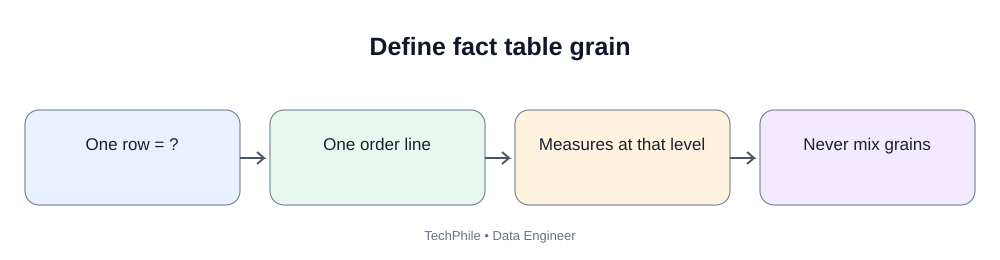
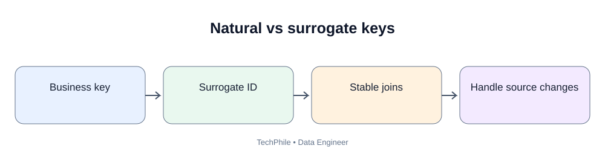
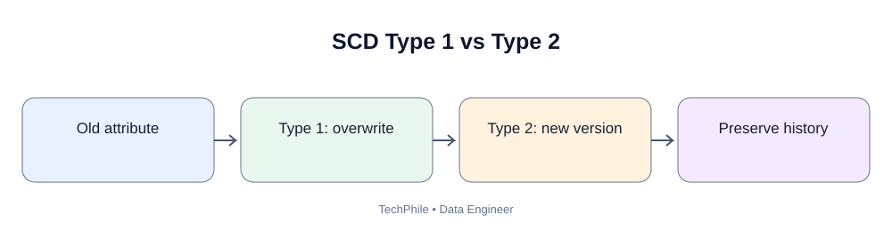

# Day 42: Slowly Changing Dimensions

**Phase:** 5 — Data Warehousing and Modeling  
**Learning time:** 2–3 hours  
**Audience:** Complete beginners and junior Data Engineer candidates  
**Database:** PostgreSQL  
**Topic boundary:** Class notes only. Project workbook and interview guide are separate files.

> Yesterday you designed facts and dimensions. Today we solve a real warehouse problem: business attributes change. A customer moves to another city, a product changes category, or a customer moves from Standard to Premium. Should the warehouse overwrite the old value, preserve the old value, or keep a limited previous value? Slowly Changing Dimensions (SCD) provide patterns for making this decision deliberately.

## Learning outcomes

By the end, you should be able to:
- explain why dimensions change;
- distinguish current-state and historical reporting;
- explain SCD Type 1, Type 2 and Type 3;
- choose a type based on a business question;
- implement Type 1 updates in PostgreSQL;
- implement Type 2 history with effective dates and a current flag;
- query the correct historical version;
- understand late-arriving facts and dimension records;
- identify overlapping or missing effective-date ranges;
- validate a Type 2 dimension;
- explain common SCD mistakes.

## Today's flow

`Source attribute changes -> Detect change -> Apply approved SCD rule -> Preserve/overwrite history -> Link fact to correct dimension version -> Validate`

---

# Part 1 — Why do dimensions change?

## 1.1 Customer example

A customer registers with TechStore.

On 10 January:
- customer ID: 501;
- name: Asha;
- city: Hyderabad;
- segment: Standard.

On 15 April, Asha moves to Bengaluru.

On 1 July, Asha becomes a Premium customer.

The customer dimension now has changing attributes.

The business may ask two different questions:

1. What is Asha's current city and segment?
2. Which city and segment did Asha have when she placed an order in March?

These are different reporting requirements.

If the warehouse overwrites Hyderabad with Bengaluru, it can answer the first question but may not answer the second.

If the warehouse preserves every version, it can support historical analysis.

## 1.2 What does "slowly changing" mean?

A Slowly Changing Dimension is a dimension whose attributes may change over time and for which the warehouse follows a defined history-handling strategy.

The word "slowly" is historical terminology. It does not mean changes must happen rarely. The important point is how the warehouse handles changes.

## 1.3 Identify the attribute before selecting an SCD type

Not every column needs the same history rule.

| Attribute | Possible treatment |
|---|---|
| Customer email typo | Correct current value; history may not be needed |
| Customer city | Preserve history if historical location analysis matters |
| Customer segment | Preserve history if segment-at-purchase matters |
| Product display description | Current value may be sufficient |
| Product category | Preserve history if old category reporting matters |
| Source technical timestamp | Track for audit and ingestion |

The business owner must approve the history requirement.

---

# Part 2 — SCD Type 1

## 2.1 What is Type 1?

Type 1 overwrites the old attribute value with the new value.

It does not preserve the old value in the dimension row.

Example:

Before:

| customer_id | customer_name | city |
|---:|---|---|
| 501 | Asha | Hyderabad |

After the city changes:

| customer_id | customer_name | city |
|---:|---|---|
| 501 | Asha | Bengaluru |

The old city is no longer stored in this dimension row.

## 2.2 When is Type 1 useful?

Examples:
- correcting a spelling mistake;
- correcting an invalid phone format;
- updating a description when only the current description matters;
- replacing an incorrect source value.

Type 1 is also appropriate when the business explicitly wants all reports to use the corrected current value.

## 2.3 Type 1 SQL example

Create a temporary table:

```sql
CREATE TEMP TABLE customer_type1 (
    customer_id INTEGER PRIMARY KEY,
    customer_name VARCHAR(100),
    city VARCHAR(50)
);
```

Expected output:

```text
CREATE TABLE
```

Insert the initial row:

```sql
INSERT INTO customer_type1
VALUES (501, 'Asha', 'Hyderabad');
```

Expected output:

```text
INSERT 0 1
```

Inspect:

```sql
SELECT * FROM customer_type1;
```

Expected result:

| customer_id | customer_name | city |
|---:|---|---|
| 501 | Asha | Hyderabad |

Update the city:

```sql
UPDATE customer_type1
SET city = 'Bengaluru'
WHERE customer_id = 501;
```

Expected output:

```text
UPDATE 1
```

Inspect again:

```sql
SELECT * FROM customer_type1;
```

Expected result:

| customer_id | customer_name | city |
|---:|---|---|
| 501 | Asha | Bengaluru |

The previous value is no longer available in this table.

## 2.4 Type 1 advantages

- simple to implement;
- one current row per business key;
- no effective-date range logic;
- corrections are straightforward;
- storage remains smaller than full history.

## 2.5 Type 1 limitations

- previous values are lost from this dimension;
- historical reports may show the new attribute for old facts if facts join to the current row;
- it cannot answer "what was the value at the time?";
- audit requirements may require another history mechanism.

## 2.6 Common mistake

Do not use Type 1 for customer city merely because an UPDATE is easy.

First ask: does the business need historical city analysis?

---

# Part 3 — SCD Type 2

## 3.1 What is Type 2?

Type 2 preserves history by creating a new dimension row when a tracked attribute changes.

The old row is closed. The new row becomes current.

A Type 2 dimension commonly includes:
- surrogate key;
- natural/business key;
- tracked attributes;
- effective start date/time;
- effective end date/time;
- current-record indicator.

## 3.2 Example history

Asha begins in Hyderabad.

On 15 April, she moves to Bengaluru.

The dimension contains:

| customer_key | customer_id | city | effective_from | effective_to | is_current |
|---:|---:|---|---|---|---|
| 1001 | 501 | Hyderabad | 2026-01-10 | 2026-04-14 | false |
| 1002 | 501 | Bengaluru | 2026-04-15 | 9999-12-31 | true |

Notice:
- customer_id remains 501 because it identifies the real customer;
- customer_key changes because each historical version is a separate dimension row;
- the old row is retained;
- the new row is current.

The end-date convention must be consistent. This lesson uses inclusive calendar dates in its simple example. Production timestamp models should generally use a clearly documented half-open interval such as [effective_from, effective_to), where the start is included and the end is excluded.

## 3.3 Why does Type 2 need a surrogate key?

The same customer business key can have multiple historical rows.

If the fact table references only customer_id = 501, it cannot distinguish the Hyderabad version from the Bengaluru version.

A unique dimension-version key allows a fact to point to the correct historical row.

Day 43 explains keys in detail.

## 3.4 Create a Type 2 table

```sql
CREATE TEMP TABLE dim_customer_scd2 (
    customer_key INTEGER PRIMARY KEY,
    customer_id INTEGER NOT NULL,
    customer_name VARCHAR(100) NOT NULL,
    city VARCHAR(50) NOT NULL,
    effective_from DATE NOT NULL,
    effective_to DATE NOT NULL,
    is_current BOOLEAN NOT NULL
);
```

Expected output:

```text
CREATE TABLE
```

## 3.5 Insert the first version

```sql
INSERT INTO dim_customer_scd2
VALUES (
    1001,
    501,
    'Asha',
    'Hyderabad',
    DATE '2026-01-10',
    DATE '9999-12-31',
    TRUE
);
```

Expected output:

```text
INSERT 0 1
```

The first version is current because no later version exists.

## 3.6 Close the old version

Asha moves on 15 April.

We close the old row on 14 April under the inclusive-date convention used in this example.

```sql
UPDATE dim_customer_scd2
SET
    effective_to = DATE '2026-04-14',
    is_current = FALSE
WHERE customer_id = 501
  AND is_current = TRUE;
```

Expected output:

```text
UPDATE 1
```

The old row remains in the table. It is no longer current.

## 3.7 Insert the new version

```sql
INSERT INTO dim_customer_scd2
VALUES (
    1002,
    501,
    'Asha',
    'Bengaluru',
    DATE '2026-04-15',
    DATE '9999-12-31',
    TRUE
);
```

Expected output:

```text
INSERT 0 1
```

Inspect the history:

```sql
SELECT
    customer_key,
    customer_id,
    customer_name,
    city,
    effective_from,
    effective_to,
    is_current
FROM dim_customer_scd2
ORDER BY effective_from;
```

Expected result:

| customer_key | customer_id | customer_name | city | effective_from | effective_to | is_current |
|---:|---:|---|---|---|---|---|
| 1001 | 501 | Asha | Hyderabad | 2026-01-10 | 2026-04-14 | false |
| 1002 | 501 | Asha | Bengaluru | 2026-04-15 | 9999-12-31 | true |

## 3.8 Find the current customer row

```sql
SELECT *
FROM dim_customer_scd2
WHERE customer_id = 501
  AND is_current = TRUE;
```

Expected result: the Bengaluru row with customer_key 1002.

## 3.9 Find the city on a historical date

Question: Which city was Asha associated with on 1 March 2026?

```sql
SELECT city
FROM dim_customer_scd2
WHERE customer_id = 501
  AND DATE '2026-03-01' >= effective_from
  AND DATE '2026-03-01' <= effective_to;
```

Expected result:

| city |
|---|
| Hyderabad |

The date falls inside the first version's effective range.

Question: Which city was associated on 1 May 2026?

Use the same query with 1 May.

Expected result:

| city |
|---|
| Bengaluru |

## 3.10 Type 2 with half-open timestamp intervals

For production event timestamps, a safer interval convention is often:

- effective_from is inclusive;
- effective_to is exclusive.

The condition becomes:

`event_time >= effective_from AND event_time < effective_to`

Example:
- old version: [2026-01-10 00:00, 2026-04-15 00:00);
- new version: [2026-04-15 00:00, infinity).

This avoids ambiguous boundary timestamps and does not require subtracting one second or one day.

Do not mix inclusive and exclusive conventions in one dimension.

---

# Part 4 — SCD Type 3

## 4.1 What is Type 3?

Type 3 stores a limited amount of previous attribute information in additional columns.

Example:

| customer_id | current_city | previous_city |
|---:|---|---|
| 501 | Bengaluru | Hyderabad |

The table stores the current and previous city, but not every historical city.

## 4.2 When is Type 3 useful?

Use it when the business needs a limited comparison, such as:
- current region versus previous region;
- current sales territory versus prior territory;
- current customer segment versus previous segment.

It is not suitable when the business needs a complete timeline of every change.

## 4.3 Type 3 SQL example

```sql
CREATE TEMP TABLE customer_type3 (
    customer_id INTEGER PRIMARY KEY,
    customer_name VARCHAR(100),
    current_city VARCHAR(50),
    previous_city VARCHAR(50)
);
```

Expected output:

```text
CREATE TABLE
```

Insert the initial row:

```sql
INSERT INTO customer_type3
VALUES (501, 'Asha', 'Hyderabad', NULL);
```

Expected output:

```text
INSERT 0 1
```

Update the city while preserving the previous value:

```sql
UPDATE customer_type3
SET
    previous_city = current_city,
    current_city = 'Bengaluru'
WHERE customer_id = 501;
```

Expected output:

```text
UPDATE 1
```

Inspect:

```sql
SELECT * FROM customer_type3;
```

Expected result:

| customer_id | customer_name | current_city | previous_city |
|---:|---|---|---|
| 501 | Asha | Bengaluru | Hyderabad |

If Asha moves again, the previous_city column will be overwritten with Bengaluru. Hyderabad will no longer be available in this table.

---

# Part 5 — Compare Type 1, Type 2 and Type 3

| Requirement | Type 1 | Type 2 | Type 3 |
|---|---|---|---|
| Overwrite current value | Yes | No | No |
| Preserve full history | No | Yes | No |
| Preserve limited previous value | No | Yes | Yes |
| New dimension row on change | No | Yes | Usually no |
| Effective dates | Not required | Commonly required | Not normally required |
| Current flag | Not required | Commonly used | Not required |
| Typical use | Correction/current value | Historical analysis | Current versus previous |

## Decision examples

- Fixing a spelling mistake: Type 1.
- Tracking every customer city over time: Type 2.
- Showing current and previous sales territory only: Type 3.

The business requirement decides the SCD type.

---

# Part 6 — Apply SCD Type 2 safely

A production SCD process must do more than run an UPDATE followed by an INSERT.

It should handle:
- multiple source records for one customer;
- repeated identical loads;
- two changes on the same day;
- late-arriving changes;
- concurrent runs;
- missing source identifiers;
- failed transactions;
- duplicate current rows.

## 6.1 Detect changed attributes

Compare the incoming tracked attributes with the current dimension row.

For example:
- incoming city = Bengaluru;
- current city = Hyderabad.

A change exists.

If the incoming city is still Hyderabad, do not create another version.

## 6.2 Do not create a new version for every load

Suppose the daily customer file contains Asha every day.

If the city is unchanged, inserting a new Type 2 row every day creates false history and unnecessary storage.

Only tracked attribute changes should create a new version.

## 6.3 Use a transaction

The close-old-row and insert-new-row operations should be atomic.

If the old row closes but the new row fails to insert, the dimension may have no current row.

If the new row inserts before the old row closes, the dimension may temporarily have two current rows.

A transaction protects the two operations as one unit.

Example pattern:

```sql
BEGIN;

UPDATE dim_customer_scd2
SET
    effective_to = DATE '2026-04-14',
    is_current = FALSE
WHERE customer_id = 501
  AND is_current = TRUE;

INSERT INTO dim_customer_scd2
VALUES (
    1002,
    501,
    'Asha',
    'Bengaluru',
    DATE '2026-04-15',
    DATE '9999-12-31',
    TRUE
);

COMMIT;
```

If an error occurs before COMMIT, issue ROLLBACK in the same session.

This example uses fixed training values. A real loader derives the incoming values and effective timestamp from validated source data.

## 6.4 Protect against concurrent updates

Two jobs may process the same customer at the same time.

Both may read the same current row and attempt to create a new version.

Production strategies include:
- serialize updates by business key;
- lock the current row within a transaction;
- enforce one-current-row rules;
- use deterministic staging and deduplication;
- handle unique-constraint conflicts safely.

The exact design depends on the warehouse platform and load concurrency.

## 6.5 One current row per business key

A Type 2 dimension normally expects at most one current row per customer.

Validation:

```sql
SELECT
    customer_id,
    COUNT(*) AS current_row_count
FROM dim_customer_scd2
WHERE is_current = TRUE
GROUP BY customer_id
HAVING COUNT(*) > 1;
```

Expected result: zero rows.

A missing current row is also a defect when the customer is expected to be active.

## 6.6 Check date-range overlaps

Two historical versions for the same customer should not overlap unless the model explicitly supports a special case.

A simple self-join can detect overlapping inclusive date ranges:

```sql
SELECT
    a.customer_id,
    a.customer_key AS version_a,
    b.customer_key AS version_b
FROM dim_customer_scd2 AS a
JOIN dim_customer_scd2 AS b
    ON a.customer_id = b.customer_id
   AND a.customer_key < b.customer_key
   AND a.effective_from <= b.effective_to
   AND b.effective_from <= a.effective_to;
```

Expected result: zero rows for the training data.

For half-open timestamp intervals, use the appropriate overlap predicate:
`a.start < b.end AND b.start < a.end`.

---

# Part 7 — How facts use Type 2 dimensions

## 7.1 Why must the fact use the correct version key?

Suppose Asha:
- lived in Hyderabad in March;
- lived in Bengaluru in May.

An order in March should reference the Hyderabad dimension version if the business wants city-at-order analysis.

An order in May should reference the Bengaluru version.

The fact table stores the dimension surrogate key that was valid for the event.

## 7.2 Resolve the dimension version by event date

A loader can find the applicable dimension row using the event date:

```sql
SELECT customer_key
FROM dim_customer_scd2
WHERE customer_id = 501
  AND DATE '2026-03-01' >= effective_from
  AND DATE '2026-03-01' <= effective_to;
```

Expected result:

| customer_key |
|---:|
| 1001 |

For 1 May 2026, expected key is 1002.

This lookup must return exactly one applicable row.

## 7.3 What if no dimension version matches?

Possible causes:
- dimension data arrived late;
- effective dates are incorrect;
- source business key is missing;
- fact event timestamp is outside retained history;
- time zone conversion is inconsistent.

Do not randomly select the current row. Record the unresolved key and apply the approved late-arriving-dimension process.

---

# Part 8 — Late-arriving changes

## 8.1 What is a late-arriving dimension change?

A source may tell the warehouse today that a customer moved last month.

The effective date is in the past, but the warehouse receives the information now.

This is different from a change that became effective today.

## 8.2 Why is it difficult?

Suppose:
- Asha moved to Bengaluru on 15 April;
- warehouse learns this on 20 May;
- orders were loaded for April and May.

Facts from 15 April onward may have been linked to the old Hyderabad version.

The warehouse may need to:
1. insert the new historical version with the correct effective date;
2. adjust the previous version's end;
3. identify affected facts;
4. update fact dimension keys if required;
5. reconcile historical reports.

This correction must be controlled and auditable.

## 8.3 Do not confuse load time and effective time

- **Effective time:** when the business change became true.
- **Load time:** when the warehouse learned or stored the change.

They are different timestamps.

Some advanced warehouses track both, enabling bitemporal history. That is beyond today's implementation, but understand why the distinction matters.

---

# Part 9 — SCD design choices by business requirement

| Business question | Recommended starting point |
|---|---|
| Only latest corrected spelling is needed | Type 1 |
| Need customer city at purchase time | Type 2 |
| Need full customer segment history | Type 2 |
| Need only current and immediately previous region | Type 3 |
| Need audit of source corrections and arrival time | Type 2 plus audit metadata, or a bitemporal design |
| Need historical reporting but no dimension changes | Regular dimension may be sufficient |

Never select Type 2 just because it sounds more advanced. History has storage and operational costs and must serve a real requirement.

---

# Part 10 — Common errors and debugging

## Error 1: Two current rows

**Symptom:** Query with `is_current = TRUE` returns two rows for one customer.

**Possible cause:** New version inserted but old version not closed, or concurrent updates.

**Fix:** Inspect the transaction, deduplicate the source change, close the correct old version and add a uniqueness control.

## Error 2: No current row

**Symptom:** Customer has historical versions but none is current.

**Possible cause:** Old version was closed but new insert failed or was committed separately.

**Fix:** Review transaction boundaries and restore the correct current version from approved source history.

## Error 3: Overlapping date ranges

**Symptom:** A historical event matches two dimension rows.

**Possible cause:** Incorrect effective_to or effective_from boundary.

**Fix:** Standardize inclusive or half-open interval rules and validate overlaps.

## Error 4: Every daily load creates a new version

**Symptom:** Dimension row count grows rapidly even though attributes did not change.

**Possible cause:** Loader compares ingestion timestamp or the entire row rather than tracked business attributes.

**Fix:** Compare only the attributes designated for history tracking.

## Error 5: Historical report changes unexpectedly

**Symptom:** Old orders display the customer's new city.

**Possible cause:** Fact joins to the current customer row rather than the historical version key.

**Fix:** Resolve and store the Type 2 dimension key valid at the fact event time.

## Error 6: Late change is ignored

**Symptom:** Old facts remain linked to an outdated version.

**Possible cause:** Loader assumes all source changes are effective on arrival date.

**Fix:** Separate effective time from load time and define a historical correction procedure.

---

# Part 11 — Practical design checklist

Before implementing a changing dimension, document:

1. Which attributes can change?
2. Which attributes require history?
3. Which attributes can be overwritten?
4. What is the natural/business key?
5. What is the surrogate key?
6. What is the effective-date convention?
7. How is the current row identified?
8. How are identical source records ignored?
9. How are multiple changes in one load ordered?
10. How are late-arriving changes handled?
11. How are facts linked to historical versions?
12. How are overlaps and gaps tested?
13. How are corrections audited?
14. How are concurrent runs controlled?

---

# Part 12 — Practice exercises

## Exercise 1

A customer changes a misspelled name from "Ashaa" to "Asha". The company wants only the corrected value.

**Answer:** Type 1 is appropriate.

## Exercise 2

A customer changes city three times. The company wants to report the city at the time of every order.

**Answer:** Type 2 is appropriate. Each city version needs a validity period and a unique dimension-version key.

## Exercise 3

A business user wants to compare only the current and previous customer segment.

**Answer:** Type 3 may be sufficient if no older history is required.

## Exercise 4

Why is customer_id not enough for a Type 2 fact lookup?

**Answer:** The same customer_id can have multiple historical dimension rows. The fact needs the surrogate key of the version valid at the event time.

## Exercise 5

What should happen if an incoming row has the same tracked attributes as the current dimension row?

**Answer:** Do not create a new Type 2 version. Record or update technical audit metadata according to the design, but do not manufacture a business change.

## Exercise 6

The source says a city change became effective on 1 March, but the warehouse receives it on 10 March. What is the effective date?

**Answer:** 1 March. The warehouse arrival/load date is 10 March. They must not be confused.

---

# Part 13 — Revision map

| Term | Remember |
|---|---|
| SCD | Strategy for handling changing dimension attributes |
| Type 1 | Overwrite old value |
| Type 2 | Add a new row and preserve history |
| Type 3 | Keep limited previous value in extra columns |
| Business key | Identifies the real source entity |
| Surrogate key | Identifies one warehouse dimension version |
| Effective start | When a version becomes valid |
| Effective end | When a version stops being valid |
| Current flag | Identifies the current version |
| Late-arriving change | Change received after its business effective date |
| Historical lookup | Find version valid at event time |
| Overlap | Two versions valid at the same time |
| Gap | No version valid for an expected time |

## Final competency checklist

- [ ] Explain why dimension history matters.
- [ ] Compare SCD Type 1, Type 2 and Type 3.
- [ ] Implement a Type 1 update.
- [ ] Create a Type 2 history row.
- [ ] Query the version valid for a historical date.
- [ ] Explain Type 3 limitations.
- [ ] Distinguish effective time from load time.
- [ ] Validate one current row per business key.
- [ ] Detect overlapping date ranges.
- [ ] Explain how facts reference the correct Type 2 version.

**Next lesson — Day 43: Keys and Data Relationships.** We will study natural, surrogate, composite, primary and foreign keys, and learn how a warehouse assigns and protects identifiers.

---

## Visual Learning Diagrams

### Define fact table grain


### Natural vs surrogate keys


### SCD Type 1 vs Type 2

