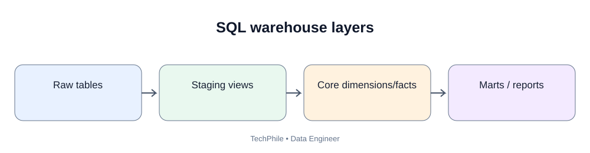
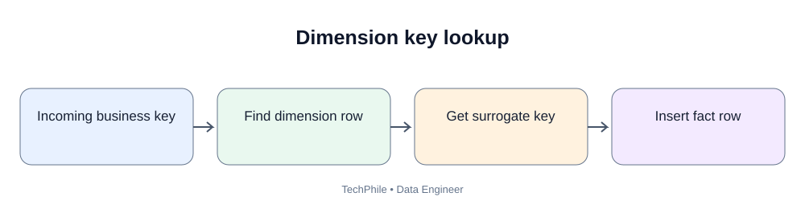
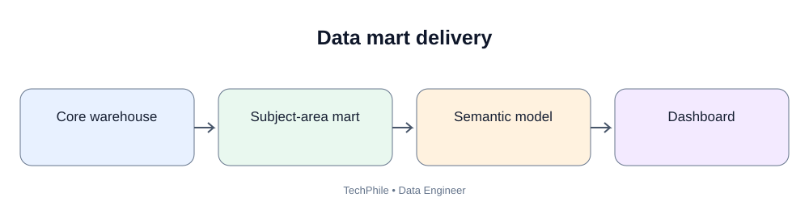

# Day 44: Data Marts and Subject-Oriented Modeling

**Phase:** 5 — Data Warehousing and Modeling  
**Learning time:** 2–3 hours  
**Audience:** Complete beginners and junior Data Engineer candidates  
**Database:** PostgreSQL  
**Topic boundary:** Class notes only. Project workbook and interview guide are separate files.

> A warehouse can contain thousands of tables and still be difficult for a business user. A data mart organizes trusted data around a business subject so a team can answer its questions without learning every source system. Today we will turn requirements into a focused sales mart, identify its users, choose facts and dimensions, define reusable metrics and validate the result.

## Learning outcomes

By the end, you should be able to:
- explain a data mart;
- distinguish subject-oriented modeling from source-system copying;
- identify business users and decisions;
- translate reporting requirements into a model;
- identify fact and dimension candidates;
- reuse conformed dimensions;
- understand a semantic layer and governed metrics;
- distinguish dependent and independent data marts;
- design a simple sales mart;
- document assumptions and ownership;
- validate the mart against source data;
- recognize common data mart design mistakes.

## Today's flow

`Business subject -> Users and decisions -> Questions -> Metrics -> Grain -> Facts/dimensions -> Data mart -> BI -> Validation`

---

# Part 1 — What is a data mart?

## 1.1 Beginner definition

A data mart is a focused analytical area organized around a business subject, such as sales, finance, marketing, customers or inventory.

It helps a specific group of users access data relevant to their work.

Examples:
- Sales mart: orders, products, customers, sales amounts.
- Finance mart: invoices, payments, costs, balances.
- Marketing mart: campaigns, leads, conversions.
- Inventory mart: stock levels, warehouses, replenishment.

A data mart can be a physical database, a schema, a set of warehouse tables, a collection of dbt models or a governed logical area. It does not always require a separate database server.

## 1.2 Why create a mart?

Imagine the TechStore warehouse has:
- raw API payloads;
- customer source tables;
- product source tables;
- order headers;
- order lines;
- payment transactions;
- refund events;
- delivery scans;
- staging models;
- integration models;
- technical audit tables.

A sales manager does not need to understand all of these structures.

The manager needs:
- sales amount;
- order count;
- product category;
- customer city;
- sales date;
- refund amount;
- refresh status.

A sales mart exposes the approved analytical data for those questions.

## 1.3 Data mart versus data warehouse

| Area | Warehouse | Data mart |
|---|---|---|
| Scope | Broad enterprise analytical environment | Focused business subject |
| Users | Multiple teams | Specific team or use case |
| Data | Integrated across domains | Selected and modeled for a subject |
| Example | Enterprise analytics warehouse | Sales mart |
| Relationship | May contain or serve marts | Often built from warehouse data |

A mart should not create a second conflicting definition of an enterprise metric.

---

# Part 2 — Subject-oriented modeling

## 2.1 What does subject-oriented mean?

It means organizing data around a business subject rather than mirroring the layout of source applications.

Source-oriented thinking:
- customer application table;
- order application table;
- payment application table.

Subject-oriented thinking:
- sales analysis;
- customer analysis;
- payment performance;
- inventory analysis.

The business subject determines the model's purpose.

## 2.2 Identify the subject

The sales manager requests:
"Show monthly paid sales by category, city and sales channel."

The subject is sales.

The model should focus on sales events and the dimensions required to analyze them.

## 2.3 Identify the users

Possible users:
- sales manager;
- regional sales lead;
- category manager;
- finance analyst;
- business analyst.

Each may ask different questions.

| User | Question |
|---|---|
| Sales manager | What are total paid sales this month? |
| Regional lead | Which cities are growing? |
| Category manager | Which product category performs best? |
| Finance analyst | How do refunds compare with paid sales? |
| Business analyst | Which channels have the highest average order value? |

A good mart supports clearly defined use cases.

## 2.4 Identify decisions, not just charts

A dashboard is useful when it helps someone make a decision.

Examples:
- increase inventory for a growing category;
- investigate a city with declining sales;
- change a promotion;
- investigate unusual refund rates;
- compare online and mobile sales channels.

Ask what decision the metric supports. This prevents building tables that have no clear business purpose.

---

# Part 3 — Convert requirements into a model

## 3.1 Write the questions first

For the sales mart:

1. What were paid sales by month?
2. How many paid orders were placed?
3. Which categories generated the most sales?
4. Which cities generated the most sales?
5. How did sales vary by channel?
6. What amount was refunded?
7. When was the mart last refreshed?

## 3.2 Define each metric

A metric is not just a SQL expression. It needs a business definition.

| Metric | Draft definition | Clarification needed |
|---|---|---|
| Paid sales | Sum of eligible paid sales-line amounts | Treatment of discounts, cancellations and refunds |
| Paid order count | Distinct paid order IDs | Whether partially paid orders count |
| Units sold | Sum of eligible line quantities | Treatment of returns |
| Refund amount | Sum of approved refund amounts | Refund date or original order date |
| Average order value | Paid sales divided by distinct paid orders | Currency and partial payment rules |

Do not assume the draft is approved.

## 3.3 Define the reporting date

The same transaction can be grouped by:
- order date;
- payment date;
- shipment date;
- recognized revenue date.

The sales mart must document which date each metric uses.

If a report mixes date roles without explaining them, two users may interpret the same month differently.

## 3.4 Define the grain

The sales fact from Day 41 uses one row per order line.

The mart can aggregate this fact to month/category/city/channel in a view or model.

Do not change the base fact grain merely because a dashboard displays monthly totals.

## 3.5 Map dimensions

Candidate dimensions:
- date;
- product;
- customer;
- sales channel;
- store or region, if relevant.

Candidate facts:
- sales order line;
- payment transaction;
- refund transaction.

Keep different business processes separate when their grains differ.

---

# Part 4 — Conformed dimensions

## 4.1 What is a conformed dimension?

A conformed dimension is a shared dimension used consistently by multiple facts or data marts.

Example: the same date dimension can be used by:
- sales mart;
- payment mart;
- delivery mart;
- inventory mart.

A shared product dimension can be used by sales and inventory analysis.

## 4.2 Why conformed dimensions matter

Suppose the sales team calls a product category "Electronics".

The inventory team calls the same category "Electronic Goods".

If each team creates its own unrelated category logic, reports may disagree.

A governed shared product dimension provides consistent attributes and definitions.

## 4.3 Example

`fact_sales -> dim_product`

`fact_inventory -> dim_product`

Both facts use the same product dimension key strategy and category definitions.

A report can compare sales and inventory by the same product category, subject to compatible time and grain definitions.

## 4.4 Do not force unrelated dimensions to be shared

A dimension should be conformed when the business meaning and key mapping are genuinely shared.

Two columns both named "status" may represent different processes:
- order status;
- payment status;
- delivery status.

They should not be merged just because their names match.

---

# Part 5 — Dependent and independent data marts

## 5.1 Dependent mart

A dependent data mart is built from an integrated enterprise warehouse.

Flow:

`Source systems -> Enterprise warehouse -> Sales mart -> BI`

Advantages:
- shared definitions;
- common keys;
- easier cross-domain analysis;
- centralized governance.

Trade-off:
- the enterprise integration layer must exist and be maintained.

## 5.2 Independent mart

An independent mart is built directly from source systems without relying on a shared enterprise warehouse.

Flow:

`Source systems -> Independent sales mart -> BI`

Advantages:
- can be delivered quickly for a focused requirement;
- may be suitable for a small isolated use case.

Risks:
- duplicated ingestion;
- inconsistent keys;
- conflicting metrics;
- repeated transformations;
- difficult cross-mart reporting.

Independent marts can create silos if they grow without shared governance.

## 5.3 Comparison

| Area | Dependent | Independent |
|---|---|---|
| Upstream source | Enterprise warehouse | Source systems |
| Shared definitions | Easier to reuse | Must be recreated or governed separately |
| Delivery dependency | Depends on warehouse | Can be faster for isolated use case |
| Duplication risk | Lower when well designed | Higher |
| Cross-domain consistency | Usually stronger | More difficult |

---

# Part 6 — Understand the semantic layer

## 6.1 What is a semantic layer?

A semantic layer provides business-friendly definitions and relationships on top of underlying data models.

It helps users work with concepts such as:
- paid sales;
- active customers;
- refund rate;
- order count;
- gross margin.

Instead of every report author writing a different SQL expression, a shared semantic definition can standardize calculations.

The exact implementation depends on the BI or analytics platform.

## 6.2 Why semantic definitions matter

Suppose:
- Report A excludes cancelled orders.
- Report B includes cancelled orders.
- Report C uses payment date.
- Report D uses order date.

All reports are labeled "Monthly Sales".

The business sees conflicting numbers.

A semantic layer or governed metric model should document:
- name;
- definition;
- formula;
- grain;
- filters;
- date role;
- owner;
- refresh expectation.

## 6.3 Metric contract example

**Metric:** Paid Sales

**Definition:** Sum of eligible paid order-line amounts.

**Grain of source:** One row per order line.

**Date role:** Order date for this training example.

**Exclusions:** Pending and cancelled orders.

**Refunds:** Report separately; do not silently subtract unless the approved metric definition says to calculate net sales.

**Owner:** Sales/Finance business owner to be assigned.

**Refresh:** Daily by agreed deadline.

This is an example contract, not an accounting policy.

---

# Part 7 — Design the TechStore sales mart

## 7.1 Mart requirements

The sales mart should expose:
- monthly sales;
- order count;
- units;
- category;
- city;
- channel;
- refund information;
- last refresh time.

## 7.2 Candidate model

`fct_sales_line`
- sales_line_key;
- order_id;
- date_key;
- product_key;
- customer_key;
- channel_key;
- quantity;
- line_sales_amount.

Dimensions:
- dim_date;
- dim_product;
- dim_customer;
- dim_channel.

Refunds should be represented as a separate event model if refund transaction grain differs from sales-line grain.

## 7.3 Why a separate refund fact?

One order line can have multiple refund events.

If refund amounts are joined directly to order lines without controlling the relationship, sales rows may multiply.

A separate refund fact can represent one row per refund event or refund line, with a shared order/product/customer context where appropriate.

This preserves business process grain.

## 7.4 Example sales channel dimension

| channel_key | channel_code | channel_name |
|---:|---|---|
| 1 | WEB | Website |
| 2 | APP | Mobile App |
| 3 | STORE | Physical Store |

The channel dimension turns a code into a readable reporting attribute.

## 7.5 Example reporting view

Use the Day 41 training tables if they exist in the same PostgreSQL session.

```sql
CREATE TEMP VIEW mart_sales_by_category AS
SELECT
    d.year_number,
    d.month_number,
    d.month_name,
    p.category,
    SUM(f.line_sales_amount) AS paid_sales_amount,
    SUM(f.quantity) AS units_sold,
    COUNT(*) AS sales_line_count
FROM fact_sales AS f
JOIN dim_date AS d
    ON f.date_key = d.date_key
JOIN dim_product AS p
    ON f.product_key = p.product_key
GROUP BY
    d.year_number,
    d.month_number,
    d.month_name,
    p.category;
```

Expected output:

```text
CREATE VIEW
```

This example assumes fact_sales contains only the training paid sales rows. In a production mart, status and refund eligibility must be modeled explicitly.

## 7.6 Query the mart

```sql
SELECT *
FROM mart_sales_by_category
ORDER BY year_number, month_number, category;
```

Expected result:

| year_number | month_number | month_name | category | paid_sales_amount | units_sold | sales_line_count |
|---:|---:|---|---|---:|---:|---:|
| 2026 | 1 | January | Accessories | 3100.00 | 3 | 2 |
| 2026 | 1 | January | Electronics | 50000.00 | 1 | 1 |
| 2026 | 2 | February | Accessories | 2400.00 | 3 | 1 |

Walkthrough:
- January Accessories = Mouse 1,600 + Keyboard 1,500 = 3,100.
- January Electronics = Laptop 50,000.
- February Accessories = Mouse 2,400.
- Units sold = 2 + 1 = 3 for January Accessories.
- The sales_line_count counts order-line rows, not distinct orders.

## 7.7 Why is sales_line_count not order_count?

Order 5001 contains two sales lines.

Counting rows gives two.

Counting distinct order IDs gives one.

If the dashboard needs paid order count, use:

```sql
COUNT(DISTINCT f.order_id)
```

Do not label a line count as an order count.

## 7.8 Example order count query

```sql
SELECT
    d.year_number,
    d.month_number,
    COUNT(DISTINCT f.order_id) AS paid_order_count
FROM fact_sales AS f
JOIN dim_date AS d
    ON f.date_key = d.date_key
GROUP BY
    d.year_number,
    d.month_number
ORDER BY
    d.year_number,
    d.month_number;
```

Expected result:

| year_number | month_number | paid_order_count |
|---:|---:|---:|
| 2026 | 1 | 2 |
| 2026 | 2 | 1 |

---

# Part 8 — Data mart ownership and documentation

Every important mart should have an owner and contract.

Document:
- mart name;
- business purpose;
- users;
- business owner;
- technical owner;
- upstream models;
- grain of each fact;
- dimension definitions;
- metric definitions;
- refresh schedule;
- data quality checks;
- security classification;
- known limitations.

A mart is a product used by people. It should be maintained like a product, not treated as a one-time SQL task.

---

# Part 9 — Common mistakes

| Mistake | Why it causes trouble | Better approach |
|---|---|---|
| Building a mart without user requirements | Tables may not answer real questions | Start with decisions and questions |
| Copying source tables directly | Business definitions remain scattered | Model the subject area |
| Duplicating shared dimensions | Different teams get inconsistent values | Use conformed dimensions where meanings match |
| Combining sales and refund events blindly | Different grains can multiply rows | Model separate facts and reconcile |
| Calling line count order count | Metric is mislabeled | Use distinct order IDs |
| Creating independent marts everywhere | Conflicting definitions and duplicated logic | Reuse enterprise models where practical |
| No owner | No one approves changes or definitions | Assign business and technical owners |
| No freshness definition | Users cannot judge data recency | Publish refresh expectation and last complete refresh |
| Hiding assumptions | Users misinterpret metrics | Document definitions and exclusions |

---

# Part 10 — Practice exercises

## Exercise 1

The finance team wants invoice balances. The sales team wants product sales. Should both use the same fact table?

**Answer:** Not automatically. Invoice balance and sales order-line activity have different business processes and grains. They may share conformed dimensions but should usually have separate fact models.

## Exercise 2

What is a dependent mart?

**Answer:** A subject-area model built from an integrated enterprise warehouse.

## Exercise 3

What is a conformed dimension?

**Answer:** A shared dimension with consistent business meaning and key mapping across facts or marts.

## Exercise 4

Why is a metric contract important?

**Answer:** It documents the definition, grain, filters, date role, owner and refresh expectation so reports do not independently invent conflicting calculations.

## Exercise 5

Why should refunds be modeled carefully?

**Answer:** A single order line can have multiple refund events. Joining refund rows to sales rows without controlling grain may multiply sales measures.

---

# Part 11 — Revision map

| Term | Remember |
|---|---|
| Data mart | Focused analytical area for a subject |
| Subject-oriented | Organized around business topics and decisions |
| Dependent mart | Built from integrated warehouse data |
| Independent mart | Built directly from sources |
| Conformed dimension | Shared dimension with consistent meaning |
| Semantic layer | Business-friendly definitions and relationships |
| Metric contract | Documented metric meaning and calculation rules |
| Mart owner | Person accountable for business or technical model |
| Grain | Meaning of one fact row |
| Sales mart | Focused model for sales analysis |

## Final competency checklist

- [ ] Explain a data mart.
- [ ] Identify users and decisions.
- [ ] Translate reporting questions into metrics and dimensions.
- [ ] Explain conformed dimensions.
- [ ] Compare dependent and independent marts.
- [ ] Explain a semantic layer and metric contract.
- [ ] Design a simple sales mart.
- [ ] Distinguish order count from sales-line count.
- [ ] Explain why refund events may need a separate fact.
- [ ] Document mart ownership and refresh expectations.

**Next lesson — Day 45: Data Quality and Validation.** We will build checks for accuracy, completeness, consistency, uniqueness, validity and freshness, then learn how to stop bad warehouse data from reaching reports.

---

## Visual Learning Diagrams

### Warehouse SQL layers


### Dimension key lookup


### Data mart delivery

