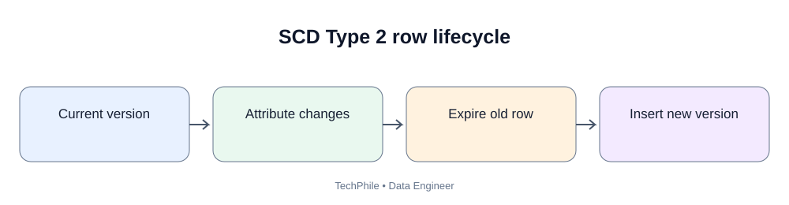
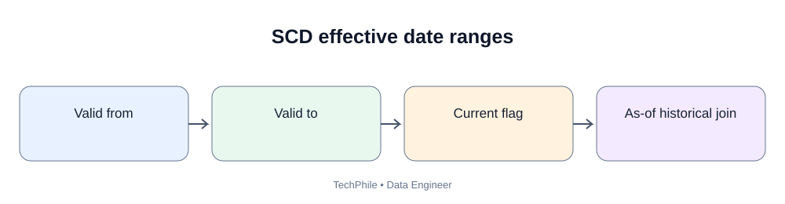
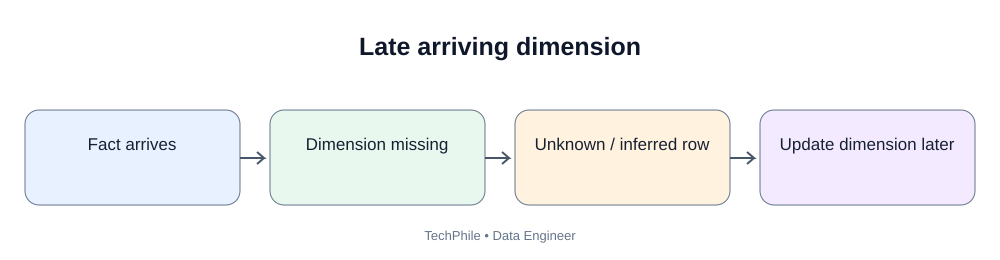

# Day 45: Data Quality and Validation

**Phase:** 5 — Data Warehousing and Modeling  
**Learning time:** 2–3 hours  
**Audience:** Complete beginners and junior Data Engineer candidates  
**Database:** PostgreSQL  
**Topic boundary:** Class notes only. Project workbook and interview guide are separate files.

> A pipeline can run successfully, load every row and still publish incorrect data. Data quality is the discipline of checking whether data is fit for its intended use. Today we learn the main quality dimensions, turn business expectations into rules, write SQL validation checks, understand rejected records and design a quality gate before data reaches reports.

## Learning outcomes

By the end, you should be able to:
- explain data quality in business terms;
- distinguish accuracy, completeness, consistency, validity, uniqueness and freshness;
- translate a business expectation into a testable rule;
- write SQL checks for nulls, duplicates, ranges and allowed values;
- understand referential integrity checks;
- distinguish warning and blocking failures;
- preserve rejected records and reasons;
- build a basic quality summary;
- understand thresholds and false positives;
- design a quality gate for a warehouse model;
- explain why technical success is not data correctness.

## Today's flow

`Business expectation -> Quality dimension -> Rule -> Test -> Result -> Threshold -> Alert/block -> Correction -> Re-test`

---

# Part 1 — What is data quality?

## 1.1 Beginner definition

Data quality describes how well data meets the requirements of its intended use.

A customer address may be acceptable for a rough regional report but not acceptable for shipping a package.

Quality depends on the business purpose.

A Data Engineer should not simply say "the data looks clean". They should identify the expectation and show evidence that it passed.

## 1.2 Example: TechStore order data

A sales dashboard receives these rows:

| order_id | customer_id | order_date | amount | status |
|---:|---:|---|---:|---|
| 1001 | 501 | 2026-01-02 | 2500 | PAID |
| 1002 | NULL | 2026-01-03 | 900 | PAID |
| 1002 | 502 | 2026-01-03 | 900 | PAID |
| 1004 | 503 | 2026-01-04 | -500 | PAID |
| 1005 | 504 | 2026-01-05 | 1200 | UNKNOWN |

Possible issues:
- missing customer ID;
- duplicate order ID;
- negative amount;
- unapproved status.

The pipeline may still load all five rows. That does not mean the data is ready for reporting.

## 1.3 Quality is not the same as perfection

Some fields can be legitimately optional.

For example:
- a guest order may not have a registered customer ID;
- a refund may have a negative amount under a particular convention;
- an order may have a status such as PENDING.

Do not write a test just because a value looks unusual.

First understand the business rule.

---

# Part 2 — Six important quality dimensions

## 2.1 Accuracy

Accuracy asks: does the value correctly represent the real-world fact?

Example:
- source says customer city is Hyderabad;
- actual verified city is Bengaluru.

The value is inaccurate if the business fact is Bengaluru.

A database cannot prove accuracy by checking only data type or null status. Accuracy often requires a trusted source, reconciliation or external verification.

## 2.2 Completeness

Completeness asks: are required values or records present?

Examples:
- order ID must be present;
- every expected daily source file must arrive;
- every paid order should have a payment reference under the business rule.

Completeness can be measured at field, record, table and source-delivery levels.

## 2.3 Consistency

Consistency asks: do related values agree across records and systems?

Examples:
- order says PAID but payment system says FAILED;
- customer ID maps to two different active identities;
- one report says a category is Electronics while another says Home.

Consistency requires comparison across related data and shared definitions.

## 2.4 Validity

Validity asks: does the value follow an allowed format, type, range or rule?

Examples:
- email follows the agreed basic format;
- quantity is a positive integer;
- status belongs to an approved list;
- order date is not beyond an allowed future boundary.

A value can be valid in format but inaccurate in reality.

For example, a syntactically valid email may not belong to the customer.

## 2.5 Uniqueness

Uniqueness asks: does a record appear only once according to its business identity?

Examples:
- order_id should be unique in an order-header table;
- (order_id, line_number) should be unique in an order-line table;
- a source event ID should not be loaded twice.

Do not confuse duplicate rows with duplicate values in a field that is allowed to repeat.

Many orders can have the same customer_id. That is not a duplicate-order defect.

## 2.6 Freshness

Freshness asks: how recently does the data reflect the source?

Examples:
- daily sales data should be updated by 8 AM;
- inventory data should be no more than 15 minutes old;
- a payment feed should arrive within its delivery window.

A table can be accurate but stale.

## 2.7 Summary

| Dimension | Main question | Example check |
|---|---|---|
| Accuracy | Is it correct? | Reconcile amount to trusted source |
| Completeness | Is required data present? | Required field not null |
| Consistency | Do related values agree? | Payment/order status comparison |
| Validity | Does it follow rules? | Status in allowed list |
| Uniqueness | Is identity duplicated? | Unique business key |
| Freshness | Is it recent enough? | Latest source timestamp |

---

# Part 3 — Convert expectations into rules

## 3.1 Start with a requirement

Business statement:

"Every paid order must have a positive amount and a customer reference."

Convert it into rules:

1. status = PAID;
2. amount must be greater than zero;
3. customer reference must be present.

The test should be clear enough that two engineers would implement it the same way.

## 3.2 Define rule metadata

For every important check, document:
- rule ID;
- dataset/table;
- column or relationship;
- business expectation;
- test logic;
- severity;
- owner;
- failure action;
- exception policy.

Example:

| Field | Value |
|---|---|
| Rule ID | ORD-001 |
| Dataset | stg_orders |
| Column | order_id |
| Expectation | Required and unique |
| Severity | Blocking |
| Failure action | Do not publish sales mart |
| Owner | Order data owner |

## 3.3 Blocking versus warning checks

A blocking check prevents publication when the failure makes the output unsafe.

Examples:
- duplicate primary business key;
- missing required source;
- failed reconciliation;
- impossible amount under the approved rule.

A warning check reports a problem but allows controlled continuation.

Examples:
- optional description missing;
- small increase in non-critical rejection rate;
- a new but approved informational category.

Severity must be agreed with the business owner.

Do not make every warning a failure. Do not make critical failures warnings just to keep a green dashboard.

---

# Part 4 — Create a training dataset

Run in PostgreSQL.

```sql
CREATE TEMP TABLE quality_orders (
    order_id INTEGER,
    customer_id INTEGER,
    order_date DATE,
    amount NUMERIC(10, 2),
    status VARCHAR(20)
);
```

Expected output:

```text
CREATE TABLE
```

Insert training rows:

```sql
INSERT INTO quality_orders VALUES
(1001, 501, DATE '2026-01-02', 2500.00, 'PAID'),
(1002, NULL, DATE '2026-01-03', 900.00, 'PAID'),
(1002, 502, DATE '2026-01-03', 900.00, 'PAID'),
(1004, 503, DATE '2026-01-04', -500.00, 'PAID'),
(1005, 504, DATE '2026-01-05', 1200.00, 'UNKNOWN'),
(1006, 505, DATE '2026-01-06', 0.00, 'PENDING');
```

Expected output:

```text
INSERT 0 6
```

Inspect:

```sql
SELECT *
FROM quality_orders
ORDER BY order_id;
```

There are six rows. We intentionally inserted quality problems for learning.

---

# Part 5 — Completeness checks

## 5.1 Find missing required order IDs

```sql
SELECT *
FROM quality_orders
WHERE order_id IS NULL;
```

Expected result: zero rows.

## 5.2 Find missing customer IDs

```sql
SELECT *
FROM quality_orders
WHERE customer_id IS NULL;
```

Expected result:

| order_id | customer_id | order_date | amount | status |
|---:|---|---|---:|---|
| 1002 | NULL | 2026-01-03 | 900.00 | PAID |

One row has a missing customer reference.

## 5.3 Count missing values

```sql
SELECT
    COUNT(*) AS total_rows,
    COUNT(customer_id) AS rows_with_customer,
    COUNT(*) - COUNT(customer_id) AS missing_customer_rows
FROM quality_orders;
```

Expected result:

| total_rows | rows_with_customer | missing_customer_rows |
|---:|---:|---:|
| 6 | 5 | 1 |

COUNT(column) ignores NULL values. COUNT(*) counts rows.

## 5.4 Is a missing customer always invalid?

Not necessarily. A guest checkout may have no registered customer ID.

The business rule must decide whether:
- guest orders are allowed;
- a guest customer dimension member is used;
- customer_id is required only for registered orders.

A test should reflect the actual contract.

---

# Part 6 — Uniqueness checks

## 6.1 Find duplicate order IDs

```sql
SELECT
    order_id,
    COUNT(*) AS row_count
FROM quality_orders
GROUP BY order_id
HAVING COUNT(*) > 1;
```

Expected result:

| order_id | row_count |
|---:|---:|
| 1002 | 2 |

The source table may intentionally contain multiple order lines per order. In that case order_id is not unique at line grain.

For this training table, the intended grain is one row per order header, so the duplicate is a defect.

## 6.2 Check a composite key

If the table is at order-line grain, test the pair order_id and line_number.

```sql
SELECT
    order_id,
    line_number,
    COUNT(*) AS row_count
FROM order_items
GROUP BY order_id, line_number
HAVING COUNT(*) > 1;
```

This example assumes an order_items table with those columns. Use the actual source schema.

## 6.3 Do not check the wrong key

customer_id repeats because one customer can place many orders.

This is not a uniqueness defect in an order table.

The correct key depends on table grain.

---

# Part 7 — Validity checks

## 7.1 Check allowed status values

```sql
SELECT *
FROM quality_orders
WHERE status NOT IN ('PAID', 'PENDING', 'CANCELLED');
```

Expected result:

| order_id | customer_id | order_date | amount | status |
|---:|---:|---|---:|---|
| 1005 | 504 | 2026-01-05 | 1200.00 | UNKNOWN |

This identifies the unapproved status.

If status can be NULL, handle NULL separately because SQL comparisons with NULL evaluate to unknown.

## 7.2 Check positive paid amount

```sql
SELECT *
FROM quality_orders
WHERE status = 'PAID'
  AND amount <= 0;
```

Expected result:

| order_id | customer_id | order_date | amount | status |
|---:|---:|---|---:|---|
| 1004 | 503 | 2026-01-04 | -500.00 | PAID |

The negative amount violates the training rule.

A refund table may legitimately contain negative values. Do not apply an order rule to a refund fact.

## 7.3 Check date boundaries

```sql
SELECT *
FROM quality_orders
WHERE order_date > CURRENT_DATE;
```

Expected output depends on the date when the query is run. This is a dynamic check, so do not write a fixed expected row count.

A production rule may allow future-dated orders for preorders. Clarify the business rule.

## 7.4 Check text length or format

Example: a status field should not be blank.

```sql
SELECT *
FROM quality_orders
WHERE status IS NULL
   OR TRIM(status) = '';
```

Expected result: zero rows in this fixture.

---

# Part 8 — Consistency checks

## 8.1 Compare related business states

Suppose an order says PAID but no successful payment exists.

A consistency check may compare the order and payment models.

Conceptual query:

```sql
SELECT o.order_id
FROM stg_orders AS o
LEFT JOIN stg_payments AS p
    ON o.order_id = p.order_id
   AND p.payment_status = 'SUCCESS'
WHERE o.order_status = 'PAID'
  AND p.order_id IS NULL;
```

This is a conceptual example. It assumes those staging models and columns exist.

The result identifies paid orders without a matching successful payment.

Before treating this as an error, clarify:
- split payments;
- delayed settlement;
- payment reversals;
- cash-on-delivery;
- source update timing.

## 8.2 Cross-report consistency

If two reports calculate sales differently, compare:
- filters;
- date roles;
- grain;
- refund treatment;
- currency;
- source freshness;
- metric definitions.

A consistency test should compare equivalent scopes, not simply compare two totals with different definitions.

---

# Part 9 — Accuracy and reconciliation

Accuracy is difficult to prove with only the target table.

Use a trusted reference where possible.

Examples:
- source transaction total;
- finance-approved control total;
- payment settlement statement;
- independently calculated sample.

For a source-to-target comparison, align:
- same time window;
- same status filters;
- same currency;
- same grain;
- same late-arrival cutoff.

A matching total is useful evidence but does not prove every row is correct. Two wrong values can cancel each other.

Use multiple checks:
- counts;
- unique keys;
- amount totals;
- sampled records;
- business invariants.

---

# Part 10 — Freshness checks

## 10.1 What is freshness?

Freshness measures how recently the target reflects the source according to a defined expectation.

Example:
- source last updated at 07:30;
- warehouse load completed at 07:50;
- dashboard published at 08:00.

The data may meet an 08:00 deadline.

## 10.2 Query latest data timestamp

```sql
SELECT MAX(order_date) AS latest_order_date
FROM quality_orders;
```

Expected result for the fixed fixture:

| latest_order_date |
|---|
| 2026-01-06 |

This checks the latest business date in the fixture, not the pipeline's last successful run time.

## 10.3 Business freshness versus technical freshness

- Business freshness: how recent are the events represented?
- Technical freshness: when did the pipeline last load successfully?

Both matter.

A pipeline can run now but load old source data.

## 10.4 Freshness SLA example

Requirement:
"Sales mart must contain all source orders received by 07:00 and publish by 08:00."

A good monitor should check:
- source delivery completed;
- extraction reached the expected watermark;
- warehouse load completed;
- quality checks passed;
- mart publication completed.

A job status alone is not sufficient.

---

# Part 11 — Build a quality summary

## 11.1 Count records by status

```sql
SELECT
    status,
    COUNT(*) AS row_count
FROM quality_orders
GROUP BY status
ORDER BY status;
```

Expected result:

| status | row_count |
|---|---:|
| PAID | 4 |
| PENDING | 1 |
| UNKNOWN | 1 |

## 11.2 Count quality exceptions

```sql
SELECT
    SUM(CASE WHEN customer_id IS NULL THEN 1 ELSE 0 END) AS missing_customer,
    SUM(CASE WHEN amount <= 0 AND status = 'PAID' THEN 1 ELSE 0 END) AS invalid_paid_amount,
    SUM(CASE WHEN status NOT IN ('PAID', 'PENDING', 'CANCELLED') THEN 1 ELSE 0 END) AS invalid_status
FROM quality_orders;
```

Expected result:

| missing_customer | invalid_paid_amount | invalid_status |
|---:|---:|---:|
| 1 | 1 | 1 |

This is a compact summary. It does not replace detailed rejected-row evidence.

## 11.3 Store quality results

A production system may write test results to an audit table with:
- run_id;
- dataset;
- rule_id;
- evaluated_at;
- failed_count;
- total_count;
- severity;
- status.

This makes quality trends measurable over time.

---

# Part 12 — Reject, quarantine or block?

A failed quality rule needs an action.

Possible actions:

1. **Reject the record:** Do not allow it into the accepted dataset.
2. **Quarantine the record:** Preserve it separately with a reason for investigation.
3. **Block the batch:** Prevent publication if the dataset is unsafe.
4. **Warn:** Allow publication while reporting a non-critical issue.
5. **Correct under an approved rule:** Apply a documented transformation and retain audit evidence.

Do not delete invalid records silently.

## 12.1 Example rejection reason

| order_id | rejected_field | rejected_value | reason |
|---:|---|---|---|
| 1004 | amount | -500.00 | PAID_ORDER_AMOUNT_MUST_BE_POSITIVE |
| 1005 | status | UNKNOWN | STATUS_NOT_IN_ALLOWED_SET |

A rejection table should retain enough safe context to investigate without exposing secrets or unnecessary personal information.

---

# Part 13 — Data quality in dbt

dbt supports tests on models and columns. Exact syntax depends on dbt version and project configuration.

Common built-in test concepts:
- unique;
- not_null;
- accepted_values;
- relationships.

Example YAML:

```yaml
version: 2

models:
  - name: stg_orders
    columns:
      - name: order_id
        data_tests:
          - not_null
          - unique

      - name: status
        data_tests:
          - accepted_values:
              arguments:
                values: ['PAID', 'PENDING', 'CANCELLED']
```

Some earlier dbt project versions use `tests:` instead of `data_tests:`. Use the syntax supported by the installed dbt version and verify it with the project's documentation and `dbt parse`.

A relationship test can ensure every non-null customer key matches a row in the referenced dimension.

A custom SQL test can encode a business rule such as positive paid order amounts.

## 13.1 What does a passing dbt test mean?

It means the tested condition passed for the evaluated data at that time.

It does not prove:
- every business definition is correct;
- source data is accurate;
- every row is complete;
- the pipeline is fresh;
- all downstream reports are correct.

Tests cover explicit expectations only.

---

# Part 14 — Quality gates

A quality gate is a decision point that determines whether data can move to the next stage.

Example:

`Raw -> Structural checks -> Staging -> Business checks -> Curated mart -> BI`

Possible policy:
- missing required source: block;
- duplicate order key: block;
- unknown optional product description: warn;
- critical reconciliation mismatch: block;
- freshness beyond agreed limit: mark stale and alert.

The policy must be documented and agreed with data owners.

## 14.1 Avoid alert fatigue

An alert should be:
- actionable;
- assigned to an owner;
- linked to evidence;
- deduplicated where possible;
- prioritized by business impact.

Do not send an urgent alert for every harmless missing optional description.

---

# Part 15 — Common mistakes

| Mistake | Why it is wrong | Better approach |
|---|---|---|
| Checking only NULLs | Misses wrong values and duplicates | Use multiple quality dimensions |
| Treating all missing values as errors | Some fields are optional | Confirm business contract |
| Using DISTINCT to hide duplicates | Hides source or join defect | Test the correct business key |
| Replacing invalid amounts with zero | Changes business meaning | Quarantine or apply approved rule |
| Treating latest job time as data freshness | Source may be stale | Compare source event/update timestamps |
| Treating one matching total as full accuracy proof | Errors can offset | Combine counts, keys, totals and samples |
| Making all tests blocking | Creates unnecessary outages | Define severity and thresholds |
| Making all tests warnings | Bad data reaches users | Block critical defects |
| Testing wrong grain | False failures or missed duplicates | Define grain before key tests |
| Logging rejected personal data | Privacy/security risk | Store only necessary protected context |

---

# Part 16 — Practice exercises

## Exercise 1

A customer table has a missing optional middle_name.

Which dimension may be affected?

**Answer:** Completeness, but whether it is a failure depends on whether middle_name is required.

## Exercise 2

Two order-header rows have the same order_id.

Which dimension?

**Answer:** Uniqueness, assuming order_id is the intended key and the table grain is one row per order.

## Exercise 3

A paid order has amount -100.

Which rule?

**Answer:** Validity/business-rule check. Under today's training rule, paid order amount must be positive.

## Exercise 4

A source feed has not updated for 36 hours, but the pipeline ran successfully five minutes ago.

Which quality dimension is at risk?

**Answer:** Freshness. Technical run time does not prove source data is recent.

## Exercise 5

A source-to-target total matches, but the target has duplicate rows and missing rows that cancel each other in the total.

Is the data correct?

**Answer:** No. Aggregate agreement alone does not prove row-level correctness. Validate keys, counts, samples and business rules.

## Exercise 6

A new order status appears: ON_HOLD.

What should the engineer do?

**Answer:** Check the source contract and business owner. Update the accepted status set only after approval, then update documentation and tests. Do not silently map it to another status.

---

# Part 17 — Revision map

| Term | Remember |
|---|---|
| Data quality | Fitness for intended business use |
| Accuracy | Correctness against a trusted reference |
| Completeness | Required data is present |
| Consistency | Related values and systems agree |
| Validity | Values follow agreed rules |
| Uniqueness | Business identity is not duplicated |
| Freshness | Data is recent enough |
| Quality rule | Testable expectation |
| Blocking test | Prevents unsafe publication |
| Warning test | Reports an issue without blocking |
| Quarantine | Preserves rejected records for investigation |
| Quality gate | Decision point before data moves forward |
| Reconciliation | Compare source and target evidence |
| Metric contract | Documented business definition |

## Final competency checklist

- [ ] Explain the six quality dimensions.
- [ ] Convert business requirements into testable rules.
- [ ] Write null, duplicate, range and accepted-value checks.
- [ ] Explain why accuracy needs a trusted reference.
- [ ] Distinguish business freshness from technical freshness.
- [ ] Design reject, quarantine and block actions.
- [ ] Explain dbt data tests.
- [ ] Design a quality gate.
- [ ] Build a quality summary and interpret it.
- [ ] Explain why a successful pipeline is not proof of correct data.

**Next lesson — Day 46: Data Reconciliation and Lineage.** We will trace source records to warehouse outputs, compare counts and totals, investigate mismatches and document where every important value came from.


---

# Part 18 — Your first complete quality-validation run

The earlier sections introduced individual checks. In this section, combine them into a small workflow similar to the quality gate used before a warehouse table is published.

A Data Engineer must combine checks, interpret their results and make a release decision—not merely write separate SELECT statements.

## 18.1 Understand the job before writing SQL

Imagine TechStore receives order records every morning. Before publishing its sales dashboard, the Data Engineer must confirm:

1. Every order has an order ID.
2. An order ID appears only once in this order-header dataset.
3. Every paid order has a customer ID.
4. Every paid order has an amount greater than zero.
5. Status is one of the approved values.
6. The data is not unexpectedly empty.

For today's training fixture, approved statuses are PAID, PENDING and CANCELLED. The training policy says missing IDs, duplicate order IDs, missing customer IDs on paid orders, invalid paid amounts and unknown statuses are blocking issues. A real company must approve its own rules.

## 18.2 Where should you run this lesson?

Use either pgAdmin (open Query Tool for your PostgreSQL database) or psql (connect to your database through the command line).

Run the statements in order and keep them in the same database session. Temporary tables are session-specific. If you disconnect, recreate them.

Execution sequence:

Connect -> Create training table -> Insert rows -> Run checks -> Review failures -> Decide whether to publish

In pgAdmin, select the database, open Query Tool, paste one code block and click Execute. Read the result or Messages panel before moving to the next block.

## 18.3 Confirm the input data

~~~sql
SELECT
    COUNT(*) AS total_rows,
    COUNT(DISTINCT order_id) AS distinct_order_ids
FROM quality_orders;
~~~

Expected result:

| total_rows | distinct_order_ids |
|---:|---:|
| 6 | 5 |

Interpretation:
- Six records are present.
- Only five different non-null order IDs are present.
- The difference suggests a repeated ID, but this query alone does not tell us which ID is repeated.
- Run the duplicate-detail query from Part 6 to identify it.

COUNT(DISTINCT column) ignores NULL. That is why a separate null check is required.

## 18.4 Build a detailed exception list

A quality exception is one specific record failing one specific rule. A record may fail more than one rule. Preserve each reason rather than stopping after the first failure.

~~~sql
CREATE TEMP TABLE quality_exceptions AS
SELECT
    order_id,
    'ORDER_ID_MISSING'::VARCHAR(100) AS rule_id,
    'order_id is required'::VARCHAR(250) AS reason
FROM quality_orders
WHERE order_id IS NULL

UNION ALL

SELECT
    order_id,
    'CUSTOMER_ID_MISSING_FOR_PAID_ORDER',
    'Paid order must have a customer_id'
FROM quality_orders
WHERE status = 'PAID'
  AND customer_id IS NULL

UNION ALL

SELECT
    order_id,
    'DUPLICATE_ORDER_ID',
    'order_id appears more than once'
FROM quality_orders
WHERE order_id IN (
    SELECT order_id
    FROM quality_orders
    WHERE order_id IS NOT NULL
    GROUP BY order_id
    HAVING COUNT(*) > 1
)

UNION ALL

SELECT
    order_id,
    'INVALID_PAID_AMOUNT',
    'Paid order amount must be greater than zero'
FROM quality_orders
WHERE status = 'PAID'
  AND (amount IS NULL OR amount <= 0)

UNION ALL

SELECT
    order_id,
    'INVALID_STATUS',
    'Status is not in the approved list'
FROM quality_orders
WHERE status IS NULL
   OR status NOT IN ('PAID', 'PENDING', 'CANCELLED');
~~~

Expected command message:

~~~text
SELECT 4
~~~

The exact message can vary by PostgreSQL client. This fixture should create four exception rows:

| order_id | rule_id | reason |
|---:|---|---|
| 1002 | CUSTOMER_ID_MISSING_FOR_PAID_ORDER | Paid order must have a customer_id |
| 1002 | DUPLICATE_ORDER_ID | order_id appears more than once |
| 1004 | INVALID_PAID_AMOUNT | Paid order amount must be greater than zero |
| 1005 | INVALID_STATUS | Status is not in the approved list |

There are four exceptions but only three affected business IDs:
- Order 1002 fails two rules.
- Order 1004 fails one rule.
- Order 1005 fails one rule.

Exception count means the number of rule failures. Affected-record count means the number of different records with at least one failure.

Inspect the table:

~~~sql
SELECT *
FROM quality_exceptions
ORDER BY order_id, rule_id;
~~~

Expected result is the four-row table shown above.

## 18.5 Count failures by rule

~~~sql
SELECT
    rule_id,
    COUNT(*) AS failed_records
FROM quality_exceptions
GROUP BY rule_id
ORDER BY rule_id;
~~~

Expected result:

| rule_id | failed_records |
|---|---:|
| CUSTOMER_ID_MISSING_FOR_PAID_ORDER | 1 |
| DUPLICATE_ORDER_ID | 1 |
| INVALID_PAID_AMOUNT | 1 |
| INVALID_STATUS | 1 |

A production report should also show total rows evaluated, run identifier, evaluation time and rule severity.

## 18.6 Count distinct affected orders

~~~sql
SELECT COUNT(DISTINCT order_id) AS affected_orders
FROM quality_exceptions;
~~~

Expected result:

| affected_orders |
|---:|
| 3 |

This counts distinct non-null order IDs. If a rule can fail for a row whose order_id is NULL, use a stable source-row identifier to count affected records accurately. A missing business key cannot uniquely identify its source row.

## 18.7 Make a publish decision

For this training policy, any exception is blocking.

~~~sql
SELECT
    CASE
        WHEN COUNT(*) = 0 THEN 'PASS'
        ELSE 'BLOCK'
    END AS quality_gate_status,
    COUNT(*) AS exception_count
FROM quality_exceptions;
~~~

Expected result:

| quality_gate_status | exception_count |
|---|---:|
| BLOCK | 4 |

The correct decision is BLOCK. The sales mart must not be published from this training dataset yet.

Do not confuse this with a database error. PostgreSQL successfully executed the SQL. The data quality decision is what failed.

## 18.8 A quality check can pass while another fails

Suppose the order table has six rows and the required source file arrived. Those checks may pass. However, duplicate-key and invalid-amount checks still fail.

A quality report should show each rule separately. Avoid a single green status that hides a critical failure.

| Status | Meaning | Example action |
|---|---|---|
| PASS | Rule evaluated and no failures found | Continue |
| FAIL | Rule evaluated and failures found | Apply severity policy |
| ERROR | Rule could not be evaluated | Investigate test or environment |
| SKIPPED | Rule intentionally not evaluated | Record why it was skipped |

A test that did not run is not a passing test.

---

# Part 19 — Understand NULL correctly in SQL quality checks

NULL is one of the most important beginner concepts in data validation.

## 19.1 NULL does not mean zero

| Value | Meaning |
|---|---|
| NULL | Value is missing or unknown |
| 0 | A known numeric value equal to zero |
| Empty text | A text value containing no characters |
| Space text | Text containing whitespace |

A quantity of zero may mean no units were sold. A NULL quantity may mean the source did not provide the quantity. Do not replace missing data with zero unless the business meaning explicitly allows it.

## 19.2 Why = NULL is incorrect

Do not write:

~~~sql
SELECT *
FROM quality_orders
WHERE customer_id = NULL;
~~~

This does not find NULL values. SQL uses three-valued logic: a comparison with NULL produces UNKNOWN, not TRUE.

Use:

~~~sql
SELECT *
FROM quality_orders
WHERE customer_id IS NULL;
~~~

To find values that are present:

~~~sql
SELECT *
FROM quality_orders
WHERE customer_id IS NOT NULL;
~~~

## 19.3 Why NOT IN needs NULL handling

This query:

~~~sql
SELECT *
FROM quality_orders
WHERE status NOT IN ('PAID', 'PENDING', 'CANCELLED');
~~~

does not return a row whose status is NULL. The comparison result is UNKNOWN.

If NULL is also invalid, write:

~~~sql
SELECT *
FROM quality_orders
WHERE status IS NULL
   OR status NOT IN ('PAID', 'PENDING', 'CANCELLED');
~~~

Validation rules must explicitly define how NULL should behave.

## 19.4 Test zero separately from missing

~~~sql
SELECT
    SUM(CASE WHEN amount IS NULL THEN 1 ELSE 0 END) AS missing_amounts,
    SUM(CASE WHEN amount = 0 THEN 1 ELSE 0 END) AS zero_amounts,
    SUM(CASE WHEN amount < 0 THEN 1 ELSE 0 END) AS negative_amounts
FROM quality_orders;
~~~

Expected result:

| missing_amounts | zero_amounts | negative_amounts |
|---:|---:|---:|
| 0 | 1 | 1 |

The fixture contains one zero amount and one negative amount. Neither is NULL.

---

# Part 20 — Measure quality with percentages and thresholds

A count alone may be misleading when dataset sizes differ. Four rejected rows out of ten is very different from four out of ten million.

## 20.1 Calculate a failure percentage

~~~sql
SELECT
    COUNT(*) AS total_rows,
    SUM(CASE WHEN customer_id IS NULL THEN 1 ELSE 0 END) AS missing_customer_rows,
    ROUND(
        100.0 * SUM(CASE WHEN customer_id IS NULL THEN 1 ELSE 0 END)
        / NULLIF(COUNT(*), 0),
        2
    ) AS missing_customer_percent
FROM quality_orders;
~~~

Expected result:

| total_rows | missing_customer_rows | missing_customer_percent |
|---:|---:|---:|
| 6 | 1 | 16.67 |

Understand each part:
- COUNT(*) counts all rows.
- SUM(CASE WHEN ... THEN 1 ELSE 0 END) counts matching rows.
- 100.0 ensures decimal percentage calculation.
- NULLIF(COUNT(*), 0) prevents division by zero.
- ROUND(..., 2) keeps two decimal places.

If the table is empty, the percentage becomes NULL rather than causing division by zero. An empty table should have its own blocking or warning rule.

## 20.2 What is a threshold?

A threshold is an agreed limit used to decide whether a result is acceptable.

| Rule | Example threshold | Severity |
|---|---|---|
| Missing order ID | 0 allowed | Blocking |
| Duplicate order ID | 0 allowed | Blocking |
| Missing optional description | Up to 5% | Warning |
| Late source feed | More than 30 minutes | Alert or block |
| Failed reconciliation | Difference must be 0 | Blocking |

Thresholds must be based on business impact, source behavior and service expectations. Do not choose a percentage just because it makes the test pass.

## 20.3 Zero-row datasets

A percentage test can be misleading if no rows arrived. Zero missing values out of zero rows does not prove completeness.

Always check:
- Was the source expected to deliver data?
- Did extraction return any rows?
- Is an empty result normal for this date?
- Did a filter accidentally remove all records?

An expected-empty business day may be valid. An unexpectedly empty feed is usually a source-delivery or pipeline issue.

---

# Part 21 — Rejected records and quarantine design

The exception list tells us why records failed. A quarantine dataset preserves the original record for investigation.

## 21.1 What should quarantine contain?

A practical quarantine record may contain:
- source record identifier;
- source system or file name;
- ingestion batch ID;
- received timestamp;
- original source values needed for investigation;
- failed rule ID;
- rejection reason;
- processing status.

Avoid copying unnecessary personal or sensitive fields into a quarantine table. Apply the same access controls and retention policy as the source data.

## 21.2 Create a simple quarantine table

For this exercise, preserve the original order fields and the reason.

~~~sql
CREATE TEMP TABLE quality_quarantine AS
SELECT
    q.order_id,
    q.customer_id,
    q.order_date,
    q.amount,
    q.status,
    e.rule_id,
    e.reason
FROM quality_orders AS q
JOIN quality_exceptions AS e
    ON q.order_id = e.order_id;
~~~

Expected command message:

~~~text
SELECT 4
~~~

The query creates four rows because order 1002 appears twice in the exception list—once for each failed rule.

Inspect:

~~~sql
SELECT *
FROM quality_quarantine
ORDER BY order_id, rule_id;
~~~

Do not assume one row in quarantine always equals one rejected source record. A record may have multiple failure reasons. In a production design, keep a stable source-row identifier and decide whether the quarantine model is one row per record or one row per record-rule pair.

## 21.3 Why not silently delete bad rows?

Deleting a bad row removes evidence. Later, a business user may ask:
- Why is order 1004 missing from the dashboard?
- Was it rejected or never received?
- Which rule rejected it?
- Has it been corrected and replayed?

Quarantine helps answer these questions.

## 21.4 Correct and replay safely

A correction process should be controlled:

1. Identify the source of truth.
2. Confirm the correct value with the owner.
3. Record who approved the correction and why.
4. Correct the source or create an approved correction record.
5. Reprocess the affected batch or record.
6. Re-run the same quality checks.
7. Confirm the record is accepted exactly once.
8. Preserve the original failure and correction evidence.

Never update a warehouse value just to make a quality test green.

---

# Part 22 — Test the quality rules with edge cases

A validation rule should be tested with normal data and unusual but possible data.

| Case | Example | Question to ask |
|---|---|---|
| Normal | PAID with positive amount | Does it pass? |
| Missing | customer_id is NULL | Is it required for this order type? |
| Duplicate | Same order_id twice | Is the table grain one row per order? |
| Boundary | amount = 0 | Is zero allowed for this status? |
| Negative | amount = -50 | Could this be a refund or correction? |
| Unknown category | status = ON_HOLD | Is the new value approved? |
| Empty text | status = '' | Should blank text be treated as missing? |
| Whitespace | status = ' PAID ' | Should whitespace be normalized before testing? |
| Empty batch | no rows received | Is an empty batch expected today? |
| Late record | yesterday's order arrives today | Is late arrival allowed? |

## 22.1 Test a boundary value

The current rule says paid amount must be greater than zero.

Therefore:
- 100.00 passes;
- 0.00 fails;
- -1.00 fails;
- NULL fails if amount is required.

A boundary test checks the exact edge of the rule. It often catches mistakes that normal examples do not.

## 22.2 Normalize only when the rule permits it

The source may send a status with spaces and lowercase letters. A staging transformation may standardize it:

~~~sql
SELECT UPPER(TRIM(status)) AS standardized_status
FROM quality_orders;
~~~

But normalization must not hide an unknown business value. After normalization, validate against the approved list.

---

# Part 23 — Operationalize the quality gate

A SQL query is a check. A production quality process also needs ownership, history and a response.

## 23.1 A simple quality run record

A production design can store one row per rule per execution.

| Column | Purpose |
|---|---|
| run_id | Identifies one pipeline execution |
| dataset_name | Identifies the table or model |
| rule_id | Identifies the quality rule |
| evaluated_at | Time the rule ran |
| total_rows | Number of rows evaluated |
| failed_rows | Number of failures |
| severity | BLOCKING or WARNING |
| result_status | PASS, FAIL or ERROR |

A separate exception table can store record-level details. Do not put every failed row into the summary table.

## 23.2 Example quality result table

~~~sql
CREATE TEMP TABLE quality_rule_results (
    run_id VARCHAR(40),
    dataset_name VARCHAR(100),
    rule_id VARCHAR(100),
    evaluated_at TIMESTAMP,
    total_rows INTEGER,
    failed_rows INTEGER,
    severity VARCHAR(20),
    result_status VARCHAR(20)
);
~~~

Expected output:

~~~text
CREATE TABLE
~~~

Insert a result for the duplicate check:

~~~sql
INSERT INTO quality_rule_results
SELECT
    'run-2026-01-06-001',
    'quality_orders',
    'DUPLICATE_ORDER_ID',
    CURRENT_TIMESTAMP,
    (SELECT COUNT(*) FROM quality_orders),
    COUNT(*),
    'BLOCKING',
    CASE WHEN COUNT(*) = 0 THEN 'PASS' ELSE 'FAIL' END
FROM (
    SELECT order_id
    FROM quality_orders
    WHERE order_id IS NOT NULL
    GROUP BY order_id
    HAVING COUNT(*) > 1
) AS duplicate_keys;
~~~

Expected command message:

~~~text
INSERT 0 1
~~~

Inspect:

~~~sql
SELECT
    run_id,
    dataset_name,
    rule_id,
    total_rows,
    failed_rows,
    severity,
    result_status
FROM quality_rule_results;
~~~

Expected result:

| run_id | dataset_name | rule_id | total_rows | failed_rows | severity | result_status |
|---|---|---|---:|---:|---|---|
| run-2026-01-06-001 | quality_orders | DUPLICATE_ORDER_ID | 6 | 1 | BLOCKING | FAIL |

The timestamp is generated at execution time, so its exact value depends on when you run the query.

## 23.3 Understand PASS, FAIL and ERROR

- PASS: the check ran and found no violations.
- FAIL: the check ran and found violations.
- ERROR: the check could not complete, for example because a required table or column was missing.
- SKIPPED: the check was intentionally not run under an approved condition.

Do not convert a technical test error into PASS. A missing table means the engineer has no evidence that the rule passed.

## 23.4 Who responds to a failure?

A quality rule should have an owner.

| Failure | Possible owner |
|---|---|
| Source field suddenly becomes NULL | Source application/data owner |
| Duplicate ingestion after retry | Data Engineering |
| Unknown business status | Business operations/data owner |
| Wrong dimension mapping | Warehouse/model owner |
| Stale source feed | Source integration owner |
| Dashboard uses wrong metric definition | Analytics/product owner |

Ownership prevents every issue from becoming an unassigned engineering alert.

---

# Part 24 — How quality checks fit into a warehouse pipeline

Consider this simplified warehouse flow:

Source system -> Raw layer -> Staging layer -> Curated warehouse -> Data mart -> Dashboard

Quality checks belong at more than one boundary.

| Pipeline point | Example checks | Why here? |
|---|---|---|
| Ingestion | File exists, schema, row count, file not empty | Detect delivery problems early |
| Raw to staging | Type conversion, required fields, duplicates | Check source data can be interpreted |
| Staging to curated | Business rules, relationships, accepted values | Protect warehouse models |
| Curated to mart | Grain, totals, metric definitions | Protect business reporting |
| Dashboard publication | Freshness, expected data period, reconciliation | Confirm the consumer receives usable data |

Do not wait until the dashboard stage to discover a malformed source file.

A record passing staging checks does not mean it is correct for every downstream use. A sales mart may require rules that an operational raw table does not.

## 24.1 Quality rules should follow the grain

Grain means what one row represents.

Examples:
- one row per order;
- one row per order line;
- one row per payment event;
- one row per customer per day.

A uniqueness rule is meaningful only after grain is defined.

For example:
- order_id should be unique in an order-header table;
- order_id can repeat in an order-line table;
- (order_id, line_number) may be unique in an order-line table.

Before writing a duplicate test, answer: What does one row represent in this table?

---

# Part 25 — A beginner's troubleshooting guide

When a check fails, do not immediately change the SQL or delete the row.

## 25.1 Step 1: Read the rule

Ask:
- What business expectation does the rule represent?
- Is it approved?
- Does it apply to every record or only a subset?
- What is the table grain?

## 25.2 Step 2: Inspect failed records

Run a query that returns actual values, not only a count.

~~~sql
SELECT *
FROM quality_orders
WHERE status IS NULL
   OR status NOT IN ('PAID', 'PENDING', 'CANCELLED');
~~~

This shows records violating the status rule.

## 25.3 Step 3: Check the source

Ask:
- Did the source send this value?
- Did ingestion change it?
- Did a join create duplicates?
- Did a cast or trim operation change the value?
- Did a new source status appear?

## 25.4 Step 4: Decide the correct action

Possible outcomes:
- correct a documented transformation;
- request a source correction;
- update an approved business rule;
- quarantine the record;
- block publication;
- accept a documented exception with an owner and expiry.

## 25.5 Step 5: Re-run and record evidence

After correction:
- run the same query again;
- compare before and after counts;
- verify affected business keys;
- confirm no new duplicates were introduced;
- record the run ID and resolution.

A test passing after an undocumented rule change is not sufficient evidence.

---

# Part 26 — Additional practice with worked answers

## Exercise 7 — Missing versus zero

A source sends discount_amount = 0 for customers who did not receive a discount. Another record has discount_amount = NULL. Are they the same?

**Worked answer:** No. Zero is a known value meaning no discount. NULL means the value is missing or unknown. Whether NULL is allowed depends on the source contract. Do not replace NULL with zero without an approved rule.

## Exercise 8 — Duplicate key

A table contains three rows with the same customer_id. Is it a duplicate defect?

**Worked answer:** Not automatically. If the table contains one row per order, a customer can legitimately have multiple orders. If the table is a customer master intended to contain one current row per customer, repeated customer_id may be a defect. First define the grain.

## Exercise 9 — Test error

A scheduled quality query fails because the column order_status was renamed to status. Should the pipeline mark the quality test as PASS?

**Worked answer:** No. The test did not evaluate the data. Mark it ERROR, investigate the schema change, update the test after approval and rerun it. A test error is not evidence of quality.

## Exercise 10 — Small percentage, high impact

Only 0.01% of payment records have a missing payment reference. Can the team ignore it?

**Worked answer:** Not necessarily. If every payment reference is required for financial reconciliation, even one missing reference may be blocking. Thresholds must reflect business impact, not only percentage.

## Exercise 11 — New source value

The source starts sending RETURNED as an order status. The accepted list does not include it. What should the Data Engineer do?

**Worked answer:** Confirm the meaning with the source and business owner. Determine whether it is a valid new status, update the data contract and downstream logic after approval, add tests and document the change. Do not automatically classify it as PAID or CANCELLED.

## Exercise 12 — Empty input

A daily source file contains zero rows. The pipeline completes successfully. Is the dataset fresh and complete?

**Worked answer:** Not enough information. Check whether zero rows are expected for that business date, whether the file was delivered, whether extraction filters were correct and whether the source watermark advanced. A technically successful empty load may still be a business failure.

## Exercise 13 — One row, two failures

Order 2001 has a missing customer ID and an invalid status. How many failed rules and affected records are there?

**Worked answer:** Two failed rules and one affected source record. Keep these counts separate in the quality report.

## Exercise 14 — Equal totals

Source total is 50,000 and target total is 50,000. Is the target proven correct?

**Worked answer:** No. Different records or values can offset each other. Combine row counts, distinct keys, missing/extra key checks, grouped totals and field-level comparisons.

---

# Part 27 — Day 45 practical completion checklist

Before considering today's lesson complete, make sure you can do the following without copying blindly.

### Concepts
- [ ] Explain data quality in your own words.
- [ ] Explain accuracy, completeness, consistency, validity, uniqueness and freshness.
- [ ] Explain why data quality depends on business use.
- [ ] Define table grain before choosing a unique key.
- [ ] Explain the difference between a warning and a blocking rule.
- [ ] Explain why a test ERROR is not a PASS.

### PostgreSQL practice
- [ ] Create the temporary training table.
- [ ] Insert and inspect the six training records.
- [ ] Find NULL values using IS NULL.
- [ ] Find duplicates using GROUP BY and HAVING.
- [ ] Validate allowed values using IN and NOT IN.
- [ ] Check a numeric business rule.
- [ ] Calculate missing-value counts and percentages.
- [ ] Build a multi-rule exception list.
- [ ] Count failed rules and affected records separately.
- [ ] Create a quarantine table.
- [ ] Record a quality result for a run.

### Engineering decisions
- [ ] Explain which failures block the sales mart.
- [ ] Identify who should own each failure.
- [ ] Describe how to correct and replay a rejected record.
- [ ] Explain where quality checks belong in a warehouse pipeline.
- [ ] Describe the evidence needed before publishing a data mart.

## Final self-assessment

Try answering these questions without looking at the notes:

1. Why can a pipeline succeed while its data is wrong?
2. Why is COUNT(*) different from COUNT(customer_id)?
3. Why can NOT IN miss NULL values?
4. Why is DISTINCT not a safe way to hide duplicate business keys?
5. Why should one record be allowed to have more than one exception reason?
6. Why is a quality test that did not run an ERROR rather than a PASS?
7. What evidence would you collect before allowing a sales mart to publish?

If you cannot explain an answer, revisit the relevant part and run the SQL again. The goal is not to memorize query patterns; it is to understand what evidence each query provides and what decision that evidence supports.

**Next lesson — Day 46: Data Reconciliation and Lineage.** We will trace source records to warehouse outputs, compare counts and totals, investigate mismatches and document where every important value came from.

---

## Visual Learning Diagrams

### SCD Type 2 lifecycle


### SCD effective date ranges


### Late arriving dimension

