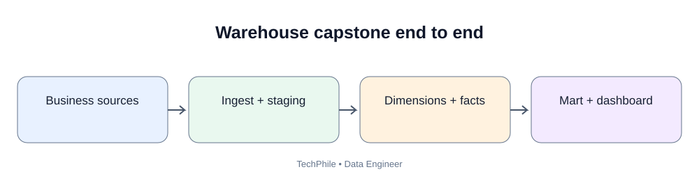
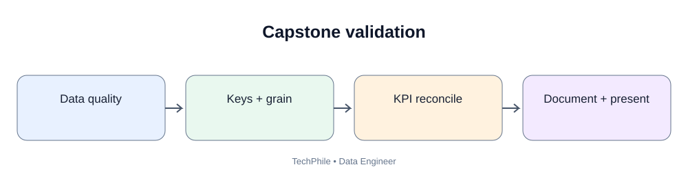
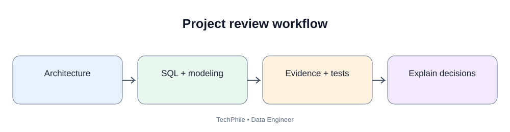

# Day 50: Cloud Data Engineering Fundamentals

**Phase:** 6 — Cloud and Distributed Processing  
**Learning time:** 2–3 hours  
**Audience:** Complete beginners, freshers and junior Data Engineer candidates  
**Primary cloud example:** Amazon Web Services (AWS)  
**Topic boundary:** Class notes only. The project workbook and interview guide are separate files.

> Until now, most examples have run on a laptop or a local database. Real companies often run data platforms on cloud infrastructure. Today you will learn what cloud computing means, why data engineers use it, how IaaS/PaaS/SaaS differ, what a basic cloud data architecture looks like, and how IAM and least-privilege access protect cloud resources.

## Learning outcomes

By the end of this lesson, you should be able to:
1. Explain cloud computing in simple words.
2. Compare on-premises infrastructure and cloud infrastructure.
3. Distinguish IaaS, PaaS and SaaS.
4. Explain public, private and hybrid cloud.
5. Understand regions and availability zones.
6. Recognize common AWS services used by data engineers.
7. Draw a basic cloud data engineering architecture.
8. Explain identity, authentication and authorization.
9. Understand IAM users, roles and policies.
10. Apply the principle of least privilege.
11. Identify common cloud security mistakes.
12. Distinguish a learning exercise from a deployment that may create charges.

### Today's learning flow

Business requirement -> Cloud identity -> Storage and compute -> Data pipeline -> Monitoring and security

---

# Part 1 — Why are we learning cloud data engineering?

## 1. Start with a company example

Imagine TechStore is an online shopping company. Customers use its website to create accounts, search products, place orders, make payments, request refunds and track deliveries.

Every activity creates data.

| System | Example data |
|---|---|
| Website | Page visits and clicks |
| Order application | Order ID, customer ID, order date |
| Payment service | Payment ID, amount, payment status |
| Delivery application | Shipment ID, delivery status |
| Customer support | Ticket ID, issue category |

The company wants a daily report that answers:
- How many orders were placed yesterday?
- What was yesterday's sales amount?
- Which products sold the most?
- Which deliveries are delayed?
- How many customers returned products?

A data engineer collects data from different systems, stores it, transforms it and makes it available for analysis.

A small laptop may be enough for a classroom example. A company may need storage for terabytes of data, compute for large transformations, secure access for many teams and reliable systems that operate continuously.

This is where cloud services can help.

## 2. What is cloud computing?

**Beginner definition:** Cloud computing means using computing resources over a network, usually the internet, instead of owning and managing every physical server yourself.

Computing resources can include:
- virtual machines;
- storage;
- databases;
- networks;
- application platforms;
- analytics services;
- monitoring tools.

A cloud provider owns and operates the underlying data-center infrastructure. Customers select and configure the services they need. Security and operations are shared responsibilities.

### 2.1 A simple real-life comparison

Think about electricity. You usually do not build a power station beside your home. You connect to an electricity provider and pay according to the applicable plan and usage.

Cloud computing has a similar service idea:
- the provider operates large infrastructure;
- you request computing or storage capacity;
- you use the resources;
- you pay according to the service and pricing model.

This is only an analogy. Cloud resources still need configuration, security, capacity planning and cost monitoring.

### 2.2 Before cloud and after cloud

| Area | Traditional on-premises approach | Cloud approach |
|---|---|---|
| Hardware | Company buys servers | Provider supplies infrastructure |
| Data center | Company manages facility | Provider operates data centers |
| Capacity | Purchase and install hardware | Provision supported resources |
| Maintenance | Company manages physical hardware | Provider manages underlying infrastructure; customer manages configured services |
| Cost | Large upfront investment may be needed | Often usage-based, but not automatically cheaper |
| Access | Company-managed network | Network and identity controls are essential |
| Scaling | May require hardware procurement | Often faster, within service limits and quotas |

**Important:** Cloud does not mean "no servers". Servers still exist. The difference is who owns and operates the underlying infrastructure and how customers consume it.

## 3. Why do data engineering teams use cloud?

### 3.1 Scalable storage

A company may store daily CSV exports, JSON API responses, Parquet files, application logs, historical transactions and machine learning datasets.

Cloud object storage can hold large volumes of files without requiring the data engineering team to buy and maintain local storage hardware.

### 3.2 Scalable compute

A transformation that takes several hours on a small machine may be run using larger or distributed compute resources.

Scaling is not unlimited or free. Compute size, runtime, data movement and service quotas matter.

### 3.3 Managed services

A managed database service can reduce the amount of infrastructure administration the application team performs.

The provider may manage underlying hardware and parts of maintenance. The customer still has responsibilities such as:
- schema design;
- access control;
- database configuration;
- backups and recovery choices;
- data protection;
- query performance;
- cost.

### 3.4 Global availability

A business may serve customers in multiple countries. Cloud regions allow organizations to choose infrastructure locations that suit latency, resilience, legal and business requirements.

Not every service is available in every region.

### 3.5 Automation

Cloud resources can be provisioned and managed using web consoles, command-line tools, APIs and infrastructure-as-code tools.

Automation helps teams create repeatable environments. It also means mistakes can be repeated quickly, so reviews and access controls matter.

## 4. When is cloud not automatically the best answer?

Cloud is useful, but it is not magic.

Possible disadvantages:
- ongoing usage charges;
- unexpected cost from forgotten resources;
- network dependency;
- data transfer charges;
- service limits;
- provider-specific designs;
- security misconfiguration;
- operational complexity;
- migration effort.

A good data engineer chooses services based on requirements, not because a service is popular.

---

# Part 2 — Understand cloud service models

## 5. What is IaaS?

IaaS means **Infrastructure as a Service**.

The provider offers basic computing infrastructure such as virtual machines, storage and networking.

The customer manages much of the software stack:
- operating system configuration;
- installed software;
- application runtime;
- application code;
- data;
- workload access.

**Example:** A team creates a virtual machine, installs Python, installs database client libraries and runs a data extraction script.

The cloud provider supplies the virtual machine infrastructure. The team still manages the operating system and application.

**Remember:** IaaS = You receive infrastructure and manage more of the software environment.

## 6. What is PaaS?

PaaS means **Platform as a Service**.

The provider offers a managed platform where developers can deploy or run applications without managing every server detail.

The platform may manage server provisioning, runtime infrastructure, platform maintenance and scaling features.

The customer still manages application code, configuration, data and access choices.

**Example:** A team deploys an application to a managed application platform instead of creating a virtual machine and configuring its runtime manually.

**Remember:** PaaS = You focus more on the application; the provider manages more of the platform.

## 7. What is SaaS?

SaaS means **Software as a Service**.

The provider delivers a complete application that users access through a browser, desktop client or API.

Examples include:
- email applications;
- online document applications;
- customer relationship management software;
- hosted collaboration platforms.

The customer generally configures and uses the software rather than managing its servers or runtime.

**Remember:** SaaS = You use the finished software.

## 8. Compare IaaS, PaaS and SaaS

| Question | IaaS | PaaS | SaaS |
|---|---|---|---|
| What do you receive? | Infrastructure | Managed application platform | Finished software |
| Who manages physical hardware? | Provider | Provider | Provider |
| Who manages much of the OS/runtime? | Customer | Provider | Provider |
| Who manages application code? | Customer | Customer | Usually provider |
| Typical user | Infrastructure/DevOps team | Developer | Business or end user |

The exact responsibility boundary depends on the service. Always read the provider's shared-responsibility documentation.

### 8.1 A simple memory trick

- IaaS: rent the building and arrange much of the inside.
- PaaS: rent a prepared workspace.
- SaaS: use a finished service.

These are learning analogies, not contractual definitions.

## 9. Check your understanding

**Question:** Your team creates a virtual server and installs Python and all required packages. Which model is closest?

**Answer:** IaaS, because the team manages the virtual machine's operating system and software environment.

**Question:** Your team uses a hosted business application through a browser and does not deploy its application code. Which model is closest?

**Answer:** SaaS.

**Question:** Your team deploys its application to a managed runtime and does not manage the underlying virtual machines. Which model is closest?

**Answer:** PaaS.

---

# Part 3 — Cloud deployment types

## 10. Public cloud

A public cloud is operated by a cloud provider and offers services to multiple customers.

Each customer's resources are logically isolated using the provider's security and infrastructure controls.

Examples of public cloud providers include AWS, Microsoft Azure and Google Cloud.

Public cloud does not mean that your data must be publicly accessible. Private access controls and network configuration are essential.

## 11. Private cloud

A private cloud environment is dedicated to one organization.

It may be operated by the organization or a service provider.

Organizations may choose private cloud arrangements for specific control, regulatory or operational requirements.

Private cloud does not automatically guarantee security. It still requires good identity, network, patching and data controls.

## 12. Hybrid cloud

Hybrid cloud combines a private environment with public cloud services.

Example:
- an organization keeps a sensitive operational system in its own data center;
- it copies approved analytical data to cloud storage;
- cloud compute processes the approved data;
- analysts use a controlled reporting environment.

Data movement, identity, network connectivity and governance must be designed carefully.

## 13. Compare deployment types

| Type | Beginner meaning | Example |
|---|---|---|
| Public cloud | Provider-operated services used by multiple customers | A company uses AWS services |
| Private cloud | Cloud environment dedicated to one organization | A bank operates a dedicated private cloud |
| Hybrid cloud | Combination of private and public environments | On-premises source plus cloud analytics |

---

# Part 4 — Cloud regions and availability zones

## 14. What is a cloud region?

A region is a geographic area where a cloud provider operates infrastructure.

Organizations choose regions based on:
- customer location;
- application latency;
- data residency requirements;
- service availability;
- disaster recovery design;
- pricing and business requirements.

A region name is provider-specific. Do not assume all services exist in every region.

## 15. What is an availability zone?

An availability zone (AZ) is an isolated location within a cloud region, designed to provide separation from other zones.

A region generally contains multiple availability zones.

A multi-AZ design can help improve availability when a zone has a problem, provided the application and data architecture are designed to use it.

### 15.1 Region versus availability zone

| Term | Meaning |
|---|---|
| Region | Geographic cloud location |
| Availability zone | Isolated location within a region |
| Multi-region | Architecture using more than one region |
| Multi-AZ | Architecture using more than one availability zone in a region |

### 15.2 Example

TechStore selects a region close to its main customers.

Its critical database is configured for a supported multi-AZ deployment.

The purpose is to reduce the impact of a single availability-zone failure. It does not automatically protect against every failure, accidental deletion, application bug or regional outage.

### 15.3 Beginner architecture picture

Region -> Availability Zone A + Availability Zone B + Availability Zone C

Think of a region as a geographic area and each AZ as a separate infrastructure location inside it.

---

# Part 5 — Meet AWS

## 16. What is AWS?

Amazon Web Services (AWS) is a cloud platform that provides infrastructure, storage, databases, networking, security, analytics and many other services.

A Data Engineer does not need to memorize every AWS service.

Start with the services that appear frequently in data platforms.

## 17. AWS services you should recognize

| Service | Beginner purpose | Data engineering use |
|---|---|---|
| IAM | Identity and access management | Control who can access data resources |
| S3 | Object storage | Store raw, processed and curated files |
| EC2 | Virtual servers | Run scripts or self-managed tools |
| RDS | Managed relational databases | Host application or metadata databases |
| Glue | Managed data integration/catalog capabilities | Catalog and transform data |
| Redshift | Cloud data warehouse | Analytical SQL workloads |
| Lambda | Serverless functions | Event-triggered lightweight processing |
| CloudWatch | Monitoring and logs | Observe services and workloads |
| VPC | Isolated virtual network | Control network placement and traffic |
| KMS | Key management service | Manage encryption keys |

These are introductory descriptions. Each service has different features, limits and pricing.

### 17.1 Which services are most important for this course?

- Day 50: Cloud concepts and IAM fundamentals.
- Day 51: Object storage and data lake layout.
- Day 52: S3 buckets, objects and storage management.
- Day 53: Managed cloud databases and connectivity.
- Day 54: Distributed processing concepts.
- Days 55–58: Apache Spark.
- Day 59: Integrating storage and distributed processing.

Do not try to learn all AWS services in one day.

---

# Part 6 — Shared responsibility and security basics

## 18. What is the shared responsibility model?

Cloud security is shared between the cloud provider and the customer.

The provider is responsible for security **of** the cloud, such as the underlying facilities and infrastructure.

The customer is responsible for security **in** the cloud, such as:
- identity and permissions;
- data classification;
- resource configuration;
- network rules selected by the customer;
- application security;
- credentials;
- workload-specific settings.

The exact boundary changes depending on whether the service is IaaS, PaaS or SaaS.

### Example

For a virtual machine:
- provider manages physical data-center infrastructure;
- customer manages the guest operating system, installed packages, application and configured access.

For a managed database:
- provider manages more of the underlying platform;
- customer still manages database users, permissions, data, configuration choices and application access.

## 19. What is IAM?

IAM means **Identity and Access Management**.

IAM answers two important questions:
1. Who or what is making the request?
2. What is that identity allowed to do?

Examples of identities:
- a human cloud administrator;
- a data engineer;
- an application;
- a scheduled pipeline;
- a virtual machine workload.

An identity should receive only the permissions required for its job.

## 20. Authentication versus authorization

| Term | Simple meaning | Example |
|---|---|---|
| Authentication | Prove who you are | Sign in using an approved identity |
| Authorization | Decide what you can do | Permission to read a specific storage bucket |

A successful sign-in does not mean the identity should be allowed to access every resource.

## 21. IAM users, groups, roles and policies

### IAM user

An IAM user represents an identity in an AWS account.

Long-lived access keys should not be casually created or shared. Prefer temporary credentials and approved identity mechanisms where possible.

### IAM group

A group collects IAM users so permissions can be managed together.

A group is not the same as a role. Workloads generally use roles rather than sharing a human user's credentials.

### IAM role

A role is an identity with permissions that can be assumed by an authorized principal.

Roles are commonly used by applications, virtual machines, cloud services, cross-account access and human users through approved federation.

A role can provide temporary credentials rather than requiring an application to store a long-lived secret.

### IAM policy

A policy is a permissions document that defines allowed or denied actions and, where applicable, the resources and conditions.

A policy is not a password. It describes permissions.

## 22. What is least privilege?

**Least privilege** means giving an identity only the minimum permissions needed to perform its task.

### Bad example

A daily reporting job only needs to read files from one approved data prefix, but it receives administrator-level access to the entire cloud account.

This is too much permission.

### Better design

Give the job a dedicated role that can:
- list only the required bucket or prefix where necessary;
- read only the approved input objects;
- write only to its approved output location if required;
- use only the other services it needs.

The exact policy must match the workload. A read-only task should not receive write or delete permission.

### 22.1 Why least privilege matters

If credentials are leaked or a workload is compromised, unnecessary permissions increase the possible damage.

Least privilege reduces the scope of accidental or malicious actions.

## 23. Read an IAM policy structure

An AWS IAM policy is commonly written as JSON.

This is a **teaching example only**, not a ready-to-deploy policy. The resource name is a placeholder and the required actions depend on the exact task.

~~~json
{
  "Version": "2012-10-17",
  "Statement": [
    {
      "Effect": "Allow",
      "Action": [
        "s3:GetObject"
      ],
      "Resource": "arn:aws:s3:::example-company-data/approved-input/*"
    }
  ]
}
~~~

Understand each field:

| Field | Meaning |
|---|---|
| Version | Policy language version |
| Statement | One or more permission statements |
| Effect | Allow or Deny |
| Action | Operation being controlled |
| Resource | Resource to which the statement applies |

This example grants an object-read action for objects matching the example path. It does not automatically grant permission to list a bucket. Listing and object reading are different actions.

### 23.1 Why does Resource matter?

A policy that grants an action on all resources may apply broadly.

A resource-specific policy narrows the scope where the service supports resource-level permissions.

Always verify the exact action/resource combination in the AWS service authorization reference before deploying a policy.

### 23.2 Explicit deny

An explicit Deny takes precedence over an Allow in IAM policy evaluation.

Do not assume that attaching one Allow policy guarantees access. Other policy types, boundaries, organization controls and explicit denies can affect the result.

---

# Part 7 — Cloud networking vocabulary

## 24. What is a VPC?

A Virtual Private Cloud (VPC) is a logically isolated network environment in AWS.

A VPC lets an organization define network boundaries and configure:
- IP address ranges;
- subnets;
- route tables;
- network gateways;
- security controls.

A VPC is not the same thing as an S3 bucket. A bucket is an object storage resource; a VPC is a network environment.

## 25. What is a subnet?

A subnet is a range of IP addresses inside a VPC.

Subnets are associated with availability zones.

A common design separates resources into different network areas, such as:
- public-facing components;
- private application components;
- private database components.

The labels "public" and "private" depend on routing and access configuration, not merely on the subnet's name.

## 26. What is a security group?

A security group is a virtual firewall associated with supported cloud resources, such as network interfaces.

It controls allowed inbound and outbound traffic using rules.

Example: A database should accept connections only from the approved application security group, not from every IP address on the internet.

Do not use an open-to-everyone inbound database rule as a beginner shortcut.

## 27. Why does networking matter to data engineers?

A pipeline may need to connect:
- from a compute service to object storage;
- from a Spark cluster to a database;
- from an orchestration service to an API;
- from an approved office or VPN network to a cloud database.

A correct username and password are not enough if the network path is blocked.

Likewise, an open network path does not grant database authorization.

---

# Part 8 — A simple cloud data engineering architecture

## 28. Business requirement

TechStore wants a daily sales report.

The source system exports order data every night.

The data engineering workflow should:
1. receive the source file;
2. store the original file;
3. validate the file;
4. transform the data;
5. store a curated result;
6. make the result available for reporting;
7. monitor failures;
8. restrict access.

## 29. Architecture components

| Layer | Example cloud capability | Responsibility |
|---|---|---|
| Source | Order application | Creates operational data |
| Ingestion | Scheduled extraction or event | Moves source data |
| Raw storage | Object storage | Keeps original files |
| Processing | Managed or distributed compute | Cleans and transforms |
| Curated storage | Object storage or warehouse | Stores trusted output |
| Analytics | Data warehouse/query service | Supports analytical queries |
| Monitoring | Logs and metrics service | Tracks health and failures |
| Security | IAM and network controls | Restricts access |

### 29.1 Flow

Order database -> Ingestion -> Raw object storage -> Processing -> Curated data -> Warehouse/BI

Monitoring and access controls apply across the workflow.

## 30. Why keep raw data?

Raw data is the original source copy received by the pipeline.

It can help with:
- reprocessing after a transformation bug;
- investigating source changes;
- comparing original and transformed values;
- audit requirements;
- recovering from downstream failures.

Raw storage still needs access control, retention rules, encryption, lifecycle management, data classification and deletion policies.

Do not keep sensitive raw data forever without a valid business and legal reason.

## 31. Why separate raw, processed and curated data?

A common data lake layout is:
- **Raw:** original source data.
- **Processed:** standardized, cleaned or conformed data.
- **Curated:** business-ready datasets with documented definitions.

The names and exact number of layers vary between organizations.

The goal is to make data state and quality clear.

## 32. Cloud architecture design questions

Before choosing a service, ask:
1. What business problem are we solving?
2. What is the source?
3. How much data arrives?
4. How often does it arrive?
5. How quickly must the result be available?
6. Is processing batch or streaming?
7. What data is sensitive?
8. Which identities need access?
9. How will failures be detected?
10. How will data be recovered?
11. What is the expected cost?
12. Who owns the pipeline?

A good architecture starts with requirements, not with a list of cloud product names.

---

# Part 9 — Cost and resource awareness

## 33. Is cloud free?

Not necessarily.

Some providers offer free usage allowances or credits subject to eligibility, service limits and time periods. Many resources can create charges even when a student is not actively using them.

Possible charge sources include:
- running virtual machines;
- managed database instances;
- storage;
- requests;
- network data transfer;
- logs and monitoring;
- public IP addresses;
- snapshots and backups;
- managed clusters.

Always check current pricing and account-specific free-tier conditions before creating resources.

## 34. Safe learning habits

Before creating a cloud resource:
1. identify the service;
2. read the pricing page;
3. choose the smallest suitable configuration;
4. understand the expected lifetime;
5. set a budget or billing alert where available;
6. avoid uploading sensitive personal or company data;
7. record the resource name and region;
8. delete resources when the exercise is finished;
9. verify that dependent resources were also removed;
10. review the billing dashboard.

A budget alert is not necessarily a hard spending cap. Do not treat an alert as a guarantee that charges cannot exceed the target.

## 35. Classroom practice without a cloud bill

You can learn many concepts without deploying a cloud resource.

For today's lesson:
- draw the architecture;
- classify IaaS/PaaS/SaaS examples;
- design an IAM permission matrix;
- review a sample policy;
- identify public and private network boundaries;
- estimate which services might create cost.

Actual AWS console practice can be done later with an approved training account and supervision.

---

# Part 10 — A guided IAM permission-design exercise

## 36. Scenario

TechStore has a daily reporting pipeline.

It reads order files from one approved input location and writes summary files to one approved output location.

There are three identities:

| Identity | Responsibility |
|---|---|
| Data engineer | Develop and troubleshoot the pipeline |
| Pipeline role | Run the scheduled data job |
| Reporting analyst | Read approved curated reports |

## 37. Design permissions before writing policies

| Identity | Needs | Does not need by default |
|---|---|---|
| Data engineer | Approved development access | Unrestricted production administrator access |
| Pipeline role | Read input, write output, required logs | Delete all source data, manage all IAM users |
| Reporting analyst | Read curated reports | Read raw sensitive files, modify pipeline resources |

This table is a permission design. The exact policy must be tested against the service and organization's access model.

## 38. Think through a security failure

A developer places a cloud access key directly inside a Python file and pushes the file to a public Git repository.

What is wrong?
- The credential can be copied by others.
- Removing it from the latest file may not remove it from Git history.
- The key may remain active.
- An attacker may use its permissions.
- The team may incur unexpected charges or expose data.

Safer response:
1. revoke or deactivate the exposed credential immediately;
2. investigate its use;
3. rotate credentials as required;
4. remove secrets from the repository and history using the organization's process;
5. move workloads to an approved role or secrets-management approach;
6. review and reduce permissions;
7. add secret scanning and review controls.

Never paste real cloud keys into notes, chat, screenshots or source code.

---

# Part 11 — Common beginner mistakes

| Mistake | Why it is a problem | Better practice |
|---|---|---|
| Cloud means no servers | Physical infrastructure still exists | Understand provider/customer responsibilities |
| Cloud is always cheaper | Usage and data transfer can be expensive | Estimate and monitor cost |
| Public cloud means public data | Public cloud resources can be private | Configure identity and network controls |
| IaaS, PaaS and SaaS are interchangeable | Responsibility differs | Identify what the provider manages |
| Authentication means full access | Sign-in and permission are different | Apply authorization policies |
| Give every job admin access | A mistake can affect the entire account | Use least privilege |
| Put keys in Python files | Secrets can leak | Use roles or approved secret management |
| Open database ports to everyone | Exposes the database | Restrict network sources |
| One AZ means resilient | A single location can fail | Design supported redundancy |
| Create resources without checking price | Charges can continue | Check cost and clean up |
| Choose services before requirements | Architecture may be unsuitable | Start with business and workload needs |

---

# Part 12 — Practice questions with explanations

## Exercise 1: Choose a service model

A company rents a virtual machine and installs its own operating system packages and Python application.

**Answer:** IaaS.

**Why:** The company is managing the operating system and application environment on top of provider infrastructure.

## Exercise 2: Choose a service model

A business uses a hosted email application through a browser.

**Answer:** SaaS.

**Why:** The provider delivers a finished software application.

## Exercise 3: Authentication or authorization?

A user signs in successfully but cannot read a protected data bucket.

**Answer:** Authentication succeeded, but authorization did not permit the requested action.

## Exercise 4: Identify least privilege

A pipeline only reads one input location but has administrator access to the account.

**Answer:** It violates least privilege. Give it only the required read and operational permissions.

## Exercise 5: Region or availability zone?

A company deploys resources in two isolated locations within one geographic cloud region.

**Answer:** It is using multiple availability zones in one region.

## Exercise 6: Shared responsibility

Who configures the permissions that determine which application identity can read a customer's data?

**Answer:** The customer is responsible for configuring the workload's identity and data access appropriately, even though the provider operates the underlying cloud infrastructure.

## Exercise 7: Cost

A student starts a managed database for practice and closes the browser without deleting the database.

**Answer:** The database may continue running and incur charges. Closing a browser tab does not stop a cloud resource.

## Exercise 8: Architecture

Where should original source files be retained before transformation in a common data lake design?

**Answer:** In a controlled raw layer, subject to retention, security and data governance requirements.

---

# Part 13 — Revision sheet

| Term | Remember this |
|---|---|
| Cloud computing | Consuming computing resources as services over a network |
| IaaS | Infrastructure service; customer manages more of the software stack |
| PaaS | Managed application platform |
| SaaS | Finished software service |
| Public cloud | Provider-operated cloud services used by multiple customers |
| Private cloud | Cloud environment dedicated to one organization |
| Hybrid cloud | Combination of private and public environments |
| Region | Geographic cloud location |
| Availability zone | Isolated location within a region |
| AWS | Amazon Web Services |
| IAM | Identity and Access Management |
| Authentication | Proving identity |
| Authorization | Checking permissions |
| IAM role | Assumable identity with permissions |
| IAM policy | Document describing permissions |
| Least privilege | Minimum access required for a task |
| VPC | Logically isolated virtual network |
| Subnet | IP address range within a VPC |
| Security group | Virtual firewall for supported resources |
| Shared responsibility | Provider and customer have different security duties |
| Raw layer | Original source data |
| Curated layer | Business-ready data |
| Cloud cost awareness | Understand, monitor and clean up resource usage |

## Final self-check

- [ ] Explain why a data engineering team may use cloud services.
- [ ] Compare on-premises infrastructure and cloud.
- [ ] Explain IaaS, PaaS and SaaS with examples.
- [ ] Compare public, private and hybrid cloud.
- [ ] Explain regions and availability zones.
- [ ] Describe IAM users, roles and policies.
- [ ] Explain authentication versus authorization.
- [ ] Explain least privilege using a pipeline example.
- [ ] Describe shared responsibility.
- [ ] Explain why VPCs, subnets and security groups matter.
- [ ] Draw a basic raw-to-curated cloud data flow.
- [ ] Explain why cloud cost and cleanup must be planned.

**Next lesson — Day 51: Object Storage and Data Lakes.** You will learn how files are stored as objects, why object storage is different from a traditional file system, and how to organize raw, processed and curated data in a data lake.

---

# Part 14 — Understand how a cloud request travels

The previous sections introduced cloud services and IAM. Now follow one data-engineering request from a developer's laptop to a cloud resource.

## 39. The request in plain language

Imagine a Python pipeline needs to read this object:

`s3://techstore-training/raw/orders/orders_2026_01_05.csv`

The pipeline must:
1. identify itself;
2. prove that it is allowed to make the request;
3. reach the storage service through an available network path;
4. request the object;
5. receive the object if all required checks succeed.

A failure at any step can prevent access.

## 40. Separate identity, permission and network

| Question | Area | Example failure |
|---|---|---|
| Who is making the request? | Identity | No valid credentials |
| Is this identity allowed to read the object? | Authorization | Access denied by policy |
| Can the workload reach the service? | Network/connectivity | DNS, route or endpoint problem |
| Does the requested object exist? | Resource/path | Wrong bucket or key |
| Is the service operating normally? | Service health | Temporary service issue |

Do not respond to every access failure by granting administrator permissions. First identify which layer failed.

## 41. A simple troubleshooting sequence

When a pipeline cannot read an object:

1. Confirm the account and environment are correct.
2. Confirm the role or identity used by the workload.
3. Confirm credentials are available through the approved mechanism.
4. Confirm the requested bucket and object key are correct.
5. Inspect identity-based and resource-based permissions where applicable.
6. Check organization controls, permission boundaries and explicit denies.
7. Check network route, DNS and endpoint configuration if the workload uses restricted networking.
8. Check encryption-key permissions if the object uses customer-managed encryption.
9. Review the service response and audit logs.
10. Retry only when the failure is transient and the operation is safe to retry.

**Checkpoint:** If a developer can sign in to AWS but a pipeline cannot read one S3 object, does successful sign-in prove that the pipeline has object-read permission?

**Answer:** No. Authentication and authorization are separate. The pipeline's own identity and effective permissions must be checked.

---

# Part 15 — Understand AWS account, region and resource boundaries

## 42. What is an AWS account?

An AWS account is a boundary for resources, access management, billing and service configuration.

An organization may use separate accounts for:
- development;
- testing;
- production;
- shared networking or security services.

The exact account structure depends on organizational needs.

A development account should not automatically have unrestricted access to production data.

## 43. What is a region?

A region is a geographic area in which AWS operates cloud infrastructure.

Examples include regions in Asia Pacific, Europe and North America. Region availability differs by service.

When creating a regional resource, the selected region matters:
- a database may exist in one region but not another;
- data transfer between regions may incur cost;
- latency depends partly on user and workload location;
- legal and organizational data-residency rules may apply.

Do not select a region only because its name looks familiar. Follow the organization's approved region and data-residency requirements.

## 44. What is an Availability Zone?

An Availability Zone (AZ) is an isolated location within a region.

A region contains multiple AZs. Services can use multiple AZs to improve resilience when designed and configured appropriately.

Important distinction:

- Region = geographic cloud area.
- Availability Zone = isolated location within a region.
- Subnet = IP address range associated with an AZ in a VPC.

Two AZs do not automatically make an application highly available. The application, storage, database, networking and failover behavior must also support the design.

## 45. Resource naming

Clear names help engineers identify ownership and purpose.

Example convention:

~~~text
<environment>-<team>-<purpose>-<region>
dev-dataeng-orders-apse1
test-dataeng-orders-apse1
prod-dataeng-orders-apse1
~~~

This is an example convention only. Follow the naming policy of the organization and the naming restrictions of each AWS service.

Useful tags may include:
- Environment;
- Owner;
- Application;
- CostCenter;
- DataClassification;
- ManagedBy.

Tags help with inventory and cost allocation, but a tag does not itself grant or deny access.

## 46. Development, test and production

| Environment | Purpose | Example data |
|---|---|---|
| Development | Build and experiment | Synthetic or approved masked data |
| Test | Validate changes before release | Controlled test dataset |
| Production | Serve real business workloads | Approved production data |

Do not use production credentials in a beginner's local notebook. Do not copy sensitive production records into a personal AWS account.

**Checkpoint:** A student creates a bucket in one region and cannot find it while viewing another region in the console. What should they check first?

**Answer:** Confirm the selected AWS account and region. Some resources are regional, and console views can be scoped to the selected region.

---

# Part 16 — Read an AWS architecture diagram

## 47. Architecture is a communication tool

A cloud architecture diagram is not decoration. It communicates:
- where data originates;
- how data moves;
- where it is stored;
- which component processes it;
- which identities access it;
- where monitoring and security controls apply.

## 48. A beginner data platform diagram

~~~text
                Business Order Database
                         |
                         v
                 Scheduled Extractor
                         |
                         v
                  Amazon S3 - RAW
                         |
                         v
                 Validation / Compute
                         |
                         v
                Amazon S3 - CURATED
                         |
                         v
              Warehouse / BI Reporting

      IAM controls identity and permissions
      Network controls connectivity where applicable
      Monitoring records health, errors and activity
      Encryption protects data at rest and in transit
~~~

This is a conceptual architecture. It does not imply that every component must be a separate AWS service.

## 49. Explain each arrow

**Database -> Extractor**

The extractor connects to the source using an approved identity and network path. It reads the agreed records or files.

**Extractor -> Raw storage**

The extractor writes the original extract to a controlled raw location. The pipeline records a batch ID and source boundary.

**Raw -> Validation/Compute**

A processing component reads the raw object, checks its schema and content, and applies approved transformations.

**Compute -> Curated storage**

The pipeline writes validated output using a documented file format and partition strategy.

**Curated -> Warehouse/BI**

A warehouse or query service makes the curated data available to approved analytical users.

## 50. Add operational controls to the diagram

A production diagram should also show:
- identity and access boundaries;
- encryption and key ownership;
- network boundaries;
- logs and metrics;
- alert destinations;
- retry and recovery path;
- data retention;
- cost ownership.

A diagram that shows only storage and compute is incomplete for production engineering.

---

# Part 17 — Understand AWS CLI without exposing credentials

AWS CLI is a command-line tool for interacting with AWS services. It is useful for repeatable administration and automation.

Today's lesson introduces the idea only. Later lessons will work with object storage more directly.

## 51. Check whether AWS CLI is installed

Open Command Prompt or PowerShell and run:

~~~bash
aws --version
~~~

If installed, the command prints the AWS CLI version and platform information.

If Windows says that aws is not recognized:
1. confirm whether AWS CLI is installed;
2. install it only from the official AWS distribution;
3. open a new terminal;
4. run the version command again.

Do not download installers from unknown websites.

## 52. Understand the identity check

When an approved training environment has configured credentials, this command can display the identity associated with the current CLI credentials:

~~~bash
aws sts get-caller-identity
~~~

The response includes account and principal identity information.

If credentials are not configured, the command fails. That is expected for a machine that has not been connected to an AWS identity.

Do not paste the complete response into a public repository or share account identifiers unnecessarily.

## 53. Why we do not put access keys in a script

Bad practice:

~~~python
aws_access_key_id = "PASTE_REAL_KEY_HERE"
aws_secret_access_key = "PASTE_REAL_SECRET_HERE"
~~~

Never store real credentials in source code, notebooks, screenshots or course submissions.

Preferred identity options depend on where the code runs:
- a managed workload role for supported AWS compute;
- an approved identity federation flow for a human developer;
- a managed credentials provider chain;
- an approved secrets-management mechanism where a secret is genuinely required.

For a local beginner exercise, use an instructor-approved account and credential setup. Never request or share another person's keys.

## 54. Credential troubleshooting

| Symptom | Possible reason | Safe check |
|---|---|---|
| Unable to locate credentials | No supported credentials configured | Follow approved setup |
| Expired token | Temporary credentials expired | Renew through approved sign-in |
| AccessDenied | Identity lacks effective permission | Inspect role and policy scope |
| Wrong account | Different profile or role selected | Check caller identity |
| Wrong region | Command targets another region | Confirm configured/explicit region |
| Network timeout | Connectivity or endpoint issue | Check network path and service status |

Do not solve credential errors by copying a teammate's access key.

---

# Part 18 — IAM policy reasoning lab

This section teaches students to read a permission request. It does not ask them to deploy a policy to a real account.

## 55. Business requirement

A scheduled job must:
- read objects from one approved input prefix;
- write result objects to one approved output prefix;
- send logs to its configured logging service.

The job does not need to:
- delete source files;
- create IAM users;
- change account settings;
- read unrelated customer exports.

## 56. Convert requirements into a permission matrix

| Operation | Required? | Reason |
|---|---|---|
| Read approved input objects | Yes | Pipeline needs source data |
| Write approved output objects | Yes | Pipeline publishes results |
| Delete all bucket objects | No | Not part of the task |
| Manage IAM policies | No | Pipeline does not administer identities |
| Read unrelated raw prefixes | No | Outside business requirement |
| Write required execution logs | Yes | Operational observability |

This matrix should be reviewed before a policy is created.

## 57. Understand actions and resources

An IAM policy generally describes:
- Effect: Allow or Deny;
- Action: API operation;
- Resource: resource scope;
- Condition: optional context-based restriction.

The action name and resource format are service-specific. Some actions do not support resource-level restrictions and require a wildcard resource. Verify every action against AWS documentation.

A policy that grants object reads does not necessarily grant bucket listing. A policy that grants listing does not automatically grant object reads.

## 58. Identity policy versus bucket policy

An identity-based policy is attached to an identity such as a user or role.

A bucket policy is a resource-based policy attached to an S3 bucket.

Access can depend on both policy types and other controls. Cross-account access commonly requires coordinated permissions on both sides.

An Allow in one policy does not override an applicable explicit Deny.

## 59. Least-privilege review questions

Before approving a policy, ask:
1. Which identity needs access?
2. Which actions are required?
3. Which exact resources are required?
4. Can access be restricted to a prefix?
5. Is read-only access sufficient?
6. Does the task need delete permission?
7. Is access time- or network-restricted where appropriate?
8. How will usage be audited?
9. Who owns the permission?
10. When should access be reviewed or removed?

**Checkpoint:** A reporting job only reads curated files. Should it receive permission to delete raw data?

**Answer:** No. Deletion is not part of the stated requirement and would violate least privilege.

---

# Part 19 — Security controls data engineers must recognize

## 60. Encryption in transit

Encryption in transit protects data while it moves between systems.

For example, a client may use TLS when connecting to an HTTPS endpoint or supported database connection.

A secure connection requires correct certificate and endpoint validation. Do not disable certificate checks just to make a connection succeed.

## 61. Encryption at rest

Encryption at rest protects stored data.

Cloud services may provide default encryption or allow customer-managed keys. The correct design depends on organizational policy, service capability and data classification.

Encryption does not replace access control. A user who is authorized to read decrypted data may still see sensitive content.

## 62. Key management

A key-management service helps manage cryptographic keys and their policies.

A customer-managed key can introduce additional permissions and operational responsibilities:
- key usage permissions;
- key rotation policy;
- key disablement and deletion controls;
- audit and ownership;
- recovery and availability considerations.

If a storage object is encrypted with a customer-managed key, a role may need both permission to read the object and permission to use the key for decryption.

## 63. Audit trails

Audit records help answer:
- who made a request;
- which service or resource was involved;
- what action was attempted;
- when it occurred;
- whether it succeeded or failed.

AWS CloudTrail is a service used to record AWS account activity. Logging configuration, event coverage, retention and access to logs must be designed.

Do not assume that every data read is recorded in every configuration by default. Confirm the event type and logging configuration required for the investigation.

## 64. Data classification affects architecture

| Classification example | Engineering consideration |
|---|---|
| Public product catalogue | Approved public distribution may be acceptable |
| Internal operational metrics | Restrict to organization users |
| Confidential sales transactions | Limit access to approved roles |
| Personal customer information | Apply privacy, masking, retention and access requirements |
| Credentials and secrets | Never place in analytical datasets or ordinary logs |

Use the organization's real classification policy. These labels are illustrative.

---

# Part 20 — Cloud cost estimation for a pipeline

## 65. What creates cost?

A data pipeline can create costs from:
- storage capacity and storage class;
- API requests;
- compute runtime;
- managed database uptime;
- data transfer;
- logs and metrics;
- backup and snapshots;
- encryption-key requests;
- orchestration and metadata services.

The cost model differs by service and region.

## 66. Estimate before deployment

For a simple daily file pipeline, write down:

| Question | Example answer to investigate |
|---|---|
| How much data arrives each day? | 2 GB |
| How long must raw data be retained? | 90 days |
| How often does the pipeline run? | Once daily |
| How long does processing take? | Measure in a test |
| How many objects are written? | Estimate from partition design |
| Is data transferred across regions? | Avoid unless required |
| How long are logs retained? | Follow operations policy |

The example values are hypothetical. They are not a cost quote.

## 67. Why object count matters

Two datasets can contain the same total bytes but have very different object counts.

For example:
- 100 files of 100 MB;
- 100,000 files of 100 KB.

Both total about 10 GB, but the second layout may create more listing, metadata and request overhead.

This becomes important in the later Spark and lakehouse lessons.

## 68. Cleanup checklist

After an approved training exercise:
- identify every resource created;
- stop or delete resources that are no longer needed;
- check dependent resources such as disks, snapshots, IP addresses and log groups;
- check object storage and retained files;
- check managed database instances;
- verify that no scheduled job will recreate resources;
- inspect billing and cost dashboards.

Deleting a compute instance does not necessarily delete every resource associated with it.

---

# Part 21 — Design review: choose the right cloud approach

## 69. Scenario A — Small daily CSV

A business receives one 20 MB CSV file per day. It needs a cleaned output by 08:00.

A simple scheduled process and object storage may be sufficient. A large distributed cluster would likely add unnecessary complexity and cost.

## 70. Scenario B — Large historical dataset

A company needs to process several terabytes of historical events and repeat the transformation daily.

Distributed processing may be appropriate, depending on transformation complexity, latency, team capability and cost.

Do not choose Spark solely because the dataset is described as "big". Measure the workload and consider simpler tools first.

## 71. Scenario C — Confidential customer data

A pipeline processes personal customer records.

The design must consider:
- approved region and residency requirements;
- least-privilege roles;
- encryption;
- restricted raw access;
- masking or minimization;
- retention and deletion;
- auditability;
- approved development/test data.

## 72. Scenario D — Daily job must recover after failure

The architecture should include:
- durable source capture;
- a batch/run identifier;
- checkpoint strategy;
- retry-safe writes;
- logs and metrics;
- reconciliation;
- alerting and ownership.

A cloud service does not automatically make a pipeline reliable. Reliability comes from the workflow design.

---

# Part 22 — Worked troubleshooting case

## 73. Incident

A scheduled pipeline failed at 06:00 with an access-denied response while reading a raw object.

The dashboard is not refreshed.

## 74. Beginner investigation

**Step 1 — Confirm the failed task**

Find the run ID, task name, timestamp and exact resource requested.

**Step 2 — Confirm the identity**

Identify which role or credentials the scheduled job actually used. Do not assume it used the same identity as the engineer's laptop.

**Step 3 — Confirm the resource**

Check the account, region, bucket name and object key. A typo or wrong environment can look like a permission problem.

**Step 4 — Check effective access**

Review relevant identity policies, bucket policy, organization restrictions, permission boundaries and explicit denies.

**Step 5 — Check encryption**

If the object uses a customer-managed key, verify that the job identity has the required key-use permission.

**Step 6 — Check the network only if relevant**

An explicit access-denied response usually points toward authorization, but confirm the actual error. A timeout or DNS failure points to connectivity.

**Step 7 — Recover safely**

After the authorized owner fixes the actual cause, retry the same batch using its stable run ID. Validate that the output was written once and matches the expected input.

**Step 8 — Record evidence**

Record the root cause, approved change, retry result, output counts and alert closure.

## 75. What not to do

- Do not attach AdministratorAccess as a quick fix.
- Do not make the bucket public.
- Do not paste keys into the job.
- Do not disable encryption.
- Do not delete the failed batch evidence.
- Do not mark the pipeline successful without validating the output.

---

# Part 23 — More practice exercises with worked answers

## Exercise 9 — Account and region

A resource is missing from the console. What should you confirm before assuming it was deleted?

**Worked answer:** Confirm the selected account, role and region. Also confirm the resource type is regional or global and that the identity can view it.

## Exercise 10 — Role versus user

A scheduled workload needs temporary access to read data. Should it share a developer's long-lived access key?

**Worked answer:** No. Use an approved workload identity or role mechanism that provides temporary credentials and the minimum required permissions.

## Exercise 11 — Bucket listing

A role can read an object when its exact key is known but cannot browse the bucket. Is this necessarily inconsistent?

**Worked answer:** No. Object-read and bucket-list operations are separate permissions.

## Exercise 12 — Encryption

A pipeline can access an object but cannot decrypt it. What else may be required?

**Worked answer:** If customer-managed encryption is used, the workload may need permission to use the relevant encryption key in addition to object access.

## Exercise 13 — Shared responsibility

Does a managed database remove the customer's responsibility for database users and data permissions?

**Worked answer:** No. The provider manages parts of the underlying service, but the customer remains responsible for its data, identities, access configuration and workload use.

## Exercise 14 — Cost alert

A budget alert is configured at a target amount. Does it guarantee that spending stops at that amount?

**Worked answer:** No. An alert notifies; it is not necessarily a hard spending limit or automatic shutdown.

## Exercise 15 — Two availability zones

A service runs in two AZs. Is it automatically highly available?

**Worked answer:** No. Failover, data replication, health checks, routing and application behavior must also be designed and tested.

## Exercise 16 — Cloud architecture

A team stores original files only after transformation. What recovery capability might it lose?

**Worked answer:** It may lose the ability to replay transformations from the original source extract or investigate what the source actually delivered.

---

# Part 24 — Day 50 practical design lab

You do not need to create billable AWS resources to complete this lab. Use the architecture and permission worksheets below. Actual account practice must use an approved training account.

## 76. Lab requirement

TechStore receives a daily orders export. The company wants a secure cloud data flow that prepares a curated file for analysts.

Your design must include:
- source;
- ingestion;
- raw storage;
- validation and processing;
- curated storage;
- consumer;
- workload identity;
- monitoring;
- cost and retention controls.

## 77. Complete the architecture worksheet

| Component | Your design decision | Reason |
|---|---|---|
| Source system |  |  |
| Ingestion method |  |  |
| Cloud region |  |  |
| Raw storage location |  |  |
| Processing method |  |  |
| Curated output |  |  |
| Consumer |  |  |
| Workload identity |  |  |
| Monitoring |  |  |
| Retention |  |  |
| Cost owner |  |  |

Example reasoning: a small daily CSV may not require a distributed cluster. Choose the simplest service combination that meets the workload's reliability, security and freshness requirements.

## 78. Complete the IAM worksheet

| Identity | Resource | Required action | Reason |
|---|---|---|---|
| Pipeline role | Raw input prefix | Read | Process incoming file |
| Pipeline role | Curated output prefix | Write | Publish approved output |
| Analyst role | Curated output prefix | Read | Prepare reports |
| Analyst role | Raw input prefix | No access by default | Raw access is not required |
| Pipeline role | IAM administration | No access | Job does not manage identities |

Review whether any additional permissions are necessary for logging, encryption keys, listing, or service execution. Do not copy this table into a live policy without checking the exact AWS service actions and resource requirements.

## 79. Define recovery behavior

Write answers to these questions:
1. Where is the original source file retained?
2. How is a batch uniquely identified?
3. What happens if validation fails?
4. What happens if the curated write fails?
5. How can the same batch be replayed safely?
6. When is a run marked successful?
7. Who receives an alert?
8. How is the final output reconciled?

## 80. Lab acceptance criteria

The design is complete when:
- [ ] The data flow is understandable from source to consumer.
- [ ] Every component has a clear responsibility.
- [ ] The region and account boundary are identified.
- [ ] Raw and curated data are separated.
- [ ] Each identity has a defined purpose.
- [ ] Permissions follow least privilege.
- [ ] Network access is restricted appropriately.
- [ ] Encryption and classification are considered.
- [ ] Logs and failure alerts are included.
- [ ] Retention and cleanup are defined.
- [ ] The design includes safe replay and validation.
- [ ] Cost ownership and resource cleanup are considered.

---

# Part 25 — Day 50 final revision and readiness

## 81. Explain these terms in your own words

| Term | Beginner explanation |
|---|---|
| Cloud computing | Using computing capabilities as services instead of owning every physical component |
| IaaS | Renting infrastructure while managing more of the software stack |
| PaaS | Using a managed platform to build or run applications |
| SaaS | Using a finished software application |
| Region | Geographic cloud area |
| Availability Zone | Isolated location within a region |
| Account | Resource, access and billing boundary |
| IAM | Identity and permission management |
| Role | An identity that an authorized principal can assume |
| Policy | Rules describing allowed or denied actions |
| Least privilege | Only the access required for the task |
| VPC | Isolated virtual network |
| Subnet | IP range within a VPC |
| Security group | Network traffic control for supported resources |
| Raw layer | Original received data |
| Curated layer | Validated, business-ready data |
| CloudTrail | AWS account activity recording service |
| Encryption at rest | Protecting stored data |
| Encryption in transit | Protecting data while moving |
| Cost allocation | Understanding which workload or team creates cloud cost |

## 82. Final self-assessment

Answer without reading the notes:

1. Why might a company use cloud services for data engineering?
2. How do IaaS, PaaS and SaaS differ in responsibility?
3. What is the difference between an AWS account, region and Availability Zone?
4. Why does a cloud workload need an identity?
5. How are authentication and authorization different?
6. Why is a role often safer for a workload than a shared long-lived access key?
7. Why is object-read permission different from bucket-list permission?
8. Why can an encryption key permission be needed in addition to object access?
9. What does least privilege mean in a pipeline?
10. What does the shared responsibility model mean?
11. Why should a data lake separate raw and curated data?
12. Which controls should appear in a cloud architecture diagram?
13. Why does a cloud resource continue to cost money after closing the browser?
14. How would you investigate an access-denied failure?
15. Why is a successful cloud upload not enough to declare a pipeline successful?

## 83. Readiness task

Explain your proposed TechStore architecture to another student in five minutes.

Your explanation should cover:
- business requirement;
- source and data movement;
- storage layers;
- processing;
- identity and access;
- monitoring and recovery;
- cost and cleanup.

If you can explain the design and justify the permission boundaries, you have achieved the Day 50 learning outcomes.

**Next lesson — Day 51: Object Storage and Data Lakes.** We will move from cloud architecture concepts to the object-storage model, bucket and object terminology, data lake layers, file naming, partition design and data organization.

---

## Visual Learning Diagrams

### Warehouse capstone end-to-end

### Capstone validation

### Project review workflow

