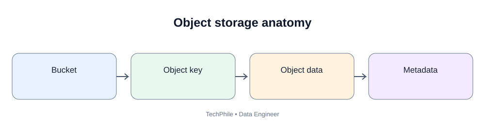
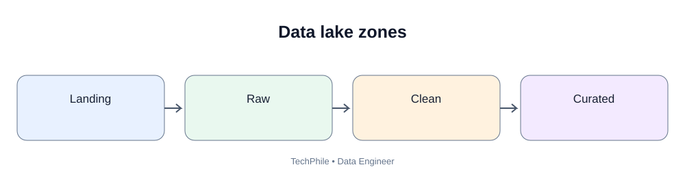
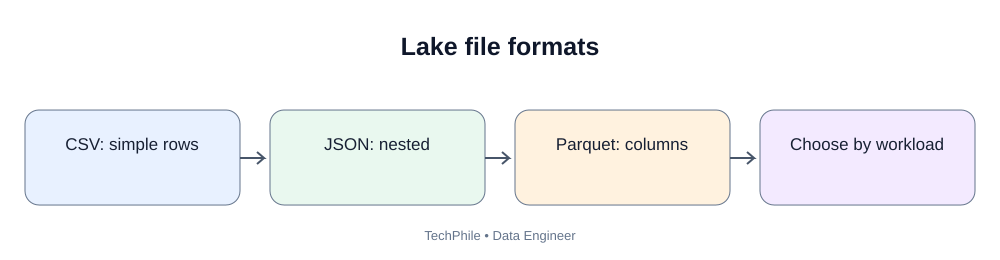

# Day 51: Object Storage and Data Lakes

**Phase:** 6 — Cloud and Distributed Processing  
**Learning time:** 2–3 hours  
**Audience:** Complete beginners and junior Data Engineer candidates  
**Topic boundary:** Class notes only. Project workbook and interview guide are separate.

> Yesterday you learned why companies use cloud platforms. Today we focus on a storage type used heavily in data engineering: object storage. You will learn what an object is, how it differs from a traditional file system and a relational database, how a data lake is organized, and how to design folders, partitions, file formats and retention rules.

## Learning outcomes

- Explain object storage in simple language.
- Identify an object, bucket, key and metadata.
- Compare object storage, file storage and block storage.
- Explain why object storage is useful for analytics.
- Explain what a data lake is.
- Design raw, processed and curated zones.
- Understand file naming and partitioning.
- Compare CSV, JSON, Parquet and Avro at a high level.
- Explain small-file and schema-evolution problems.
- Design basic retention and access boundaries.

## Today's flow

Source files -> Object storage bucket -> Raw zone -> Processing -> Processed zone -> Curated zone -> Analytics

---

# Part 1 — Begin with files

## 1. What does a data engineer receive?

TechStore receives files from multiple business systems.

| Source | Example file | Data |
|---|---|---|
| Order application | orders_2026_11_10.csv | Order details |
| Payment provider | payments_2026_11_10.json | Payment status |
| Website | click_events_2026_11_10.json | User activity |
| Product system | products.parquet | Product catalogue |

A file is a container for data. The format describes how the data is represented inside it.

A data engineer needs a place to store many files, organize them, protect them and make them available to processing engines.

## 2. What is object storage?

**Beginner definition:** Object storage stores data as objects inside containers called buckets (the exact container name varies by provider).

An object commonly includes:
1. the data itself;
2. a key or object name;
3. metadata describing the object.

For example, an object might contain a CSV file with 10,000 orders.

Object storage is designed for storing and retrieving objects using service APIs. It is not exactly the same as browsing a local hard drive.

## 3. Understand bucket, object and key

Imagine a bucket called techstore-data.

An object key could be:

~~~text
raw/orders/year=2026/month=11/day=10/orders_001.csv
~~~

| Term | Meaning |
|---|---|
| Bucket | Top-level object storage container |
| Object | Stored data plus its object attributes |
| Key | Name used to identify the object within a bucket |
| Metadata | Information describing the object |
| Prefix | A beginning portion of object keys used to group or search objects |

The key looks like a folder path, but many object storage systems use a flat object namespace. Slashes in keys are commonly used as prefixes to create a folder-like view in consoles and tools.

## 4. Is an object key a real folder path?

Not necessarily.

In a traditional file system:
- folders are directory objects;
- files are stored within directories;
- the operating system provides directory operations.

In object storage:
- the object is identified by its key;
- a slash in a key is often just a character;
- tools display prefixes as folders for convenience.

This difference matters when listing, renaming or moving objects. A move may actually be a copy followed by deletion rather than a simple filesystem rename.

## 5. What is object metadata?

Metadata describes an object.

Examples:
- content type;
- content length;
- last modified time;
- encryption information;
- custom business attributes, where supported.

Do not put every business field into object metadata. The row-level business data belongs in the file or a data catalogue/table format. Object metadata is for describing the stored object.

---

# Part 2 — Compare storage types

## 6. Object storage

Object storage is useful for:
- CSV, JSON, Parquet and Avro files;
- images and documents;
- application logs;
- backups;
- data lake datasets;
- long-term archives.

It is commonly accessed through APIs and provider tools.

## 7. File storage

File storage exposes data through a file and directory hierarchy.

Examples include:
- a shared network file system;
- a mounted file share;
- a local laptop drive.

Applications use paths and file operations such as opening, reading, writing and listing directories.

## 8. Block storage

Block storage provides storage volumes made of blocks that can be attached to compute systems.

It is commonly used for:
- operating system disks;
- database storage volumes;
- application disks.

A database engine manages its own data structures on top of block storage.

## 9. Compare object, file and block storage

| Feature | Object storage | File storage | Block storage |
|---|---|---|---|
| Data view | Objects and keys | Files and directories | Blocks/volumes |
| Typical access | API/HTTP or SDK | File protocols | Attached volume interface |
| Common use | Data lakes, backups, media | Shared files | OS and database disks |
| Folder behavior | Prefix-based view in many systems | Real directory hierarchy | Managed by filesystem above blocks |
| Best suited to | Large-scale unstructured/object data | Shared file access | Low-level disk workloads |

No storage type is best for every workload. Select based on access pattern, latency, sharing, durability, scale and cost.

---

# Part 3 — What is a data lake?

## 10. Beginner definition

A **data lake** is a storage environment designed to keep large amounts of data in its original or transformed forms so different processing and analytics tools can use it.

A data lake may contain:
- structured data such as CSV and Parquet;
- semi-structured data such as JSON;
- unstructured data such as images and documents.

Object storage is commonly used as the foundation of a cloud data lake.

A data lake is not automatically well organized. Without ownership, metadata, quality rules and access controls, it can become a data swamp.

## 11. Data lake versus data warehouse

| Area | Data lake | Data warehouse |
|---|---|---|
| Main purpose | Store varied data for multiple uses | Provide governed analytical structures |
| Data forms | Raw and transformed files, many formats | Tables and managed analytical structures |
| Schema approach | Often schema-on-read or flexible ingestion | Often curated schemas and models |
| Users | Data engineers, scientists, analysts | Analysts, BI and business users |
| Typical storage | Object storage | Warehouse-managed storage |
| Governance | Required | Required |

Modern lakehouse platforms combine lake storage with table-management and warehouse-like capabilities. We will study these patterns in later lessons.

## 12. Why keep different data zones?

A practical beginner layout has three zones:

1. Raw zone
2. Processed zone
3. Curated zone

These names are conventions. A company may use bronze/silver/gold or other naming.

## 13. Raw zone

The raw zone stores source data as received, with minimal changes.

Example:

~~~text
s3://techstore-data/raw/orders/ingest_date=2026-11-10/orders_001.csv
~~~

Why preserve raw data?
- reprocess after a transformation bug;
- compare source and target;
- investigate unexpected source changes;
- support audit needs;
- recover from downstream failures.

Raw does not mean "keep everything forever". Apply access control, retention and deletion policies.

## 14. Processed zone

The processed zone contains data that has been standardized or cleaned.

Possible actions:
- standardize date formats;
- normalize column names;
- convert types;
- remove invalid records into a quarantine location;
- deduplicate according to a documented key;
- convert CSV to Parquet.

The transformation rules must be documented. Do not silently discard source records.

## 15. Curated zone

The curated zone contains data shaped for known business use.

Examples:
- daily_sales;
- customer_orders;
- product_performance;
- delivery_sla_summary.

Curated data should have:
- a clear grain;
- documented columns;
- known owners;
- quality checks;
- freshness expectations;
- controlled access.

---

# Part 4 — Design an object storage layout

## 16. Why does layout matter?

A good layout helps engineers:
- locate datasets;
- separate environments;
- identify data state;
- filter by date;
- apply retention;
- grant access by prefix;
- debug failed jobs.

A poor layout makes data hard to find and can cause access or processing mistakes.

## 17. Start with a bucket naming plan

A bucket name should be:
- unique within the provider's naming scope;
- meaningful;
- environment-aware where appropriate;
- free of sensitive information;
- compliant with provider naming rules.

Example naming pattern:

~~~text
company-data-dev
company-data-test
company-data-prod
~~~

These are examples, not guaranteed available names. Real provider naming rules and uniqueness constraints apply.

## 18. Example lake layout

~~~text
company-data-prod/
    raw/
        orders/
            source_system=order_app/
                ingest_date=2026-11-10/
                    orders_001.csv
        payments/
            source_system=payment_api/
                ingest_date=2026-11-10/
                    payments_001.json
    processed/
        orders/
            order_date_year=2026/
                order_date_month=11/
                    part-000.parquet
    curated/
        sales_daily/
            sales_date_year=2026/
                sales_date_month=11/
                    part-000.parquet
    quarantine/
        orders/
            ingest_date=2026-11-10/
                invalid_orders.csv
~~~

Understand the levels:
- raw/processed/curated identifies the data zone;
- orders/payments/sales_daily identifies the dataset;
- source_system identifies origin;
- ingest_date identifies when the pipeline received data;
- date partitions may identify the business date represented by the records.

Do not confuse ingestion date with event date.

## 19. Ingestion date versus event date

Suppose an order was created on November 9 but the file arrived on November 10.

| Field | Value |
|---|---|
| order_date | 2026-11-09 |
| ingest_date | 2026-11-10 |

These dates answer different questions:
- event date: when did the business event happen?
- ingestion date: when did our platform receive the record?

Keeping both can help with late-arriving data and pipeline troubleshooting.

## 20. Naming conventions

Use names that are:
- consistent;
- readable;
- predictable;
- stable over time.

A common convention is lowercase names with underscores.

Avoid:
- spaces;
- random abbreviations;
- names such as final_final_v2;
- personal names;
- secrets or sensitive customer data in keys.

Example:

~~~text
orders_2026_11_10_001.parquet
~~~

The object name should help identify the file, but the data catalogue should hold the complete business definition.

---

# Part 5 — File formats in a data lake

## 21. CSV

CSV is a text format where rows and columns are represented using delimiters.

Example:

~~~csv
order_id,customer_id,amount
101,C001,250.00
102,C002,499.00
~~~

Advantages:
- easy to inspect;
- supported by many tools;
- convenient for simple exchange.

Limitations:
- data types are not strongly stored in the file;
- nested data is awkward;
- large scans can be inefficient;
- delimiter and quoting rules must be handled correctly.

## 22. JSON

JSON stores data as objects, arrays and values.

Example:

~~~json
{
  "order_id": 101,
  "customer": {
    "customer_id": "C001",
    "city": "Hyderabad"
  },
  "amount": 250.00
}
~~~

Advantages:
- supports nested structures;
- common in APIs;
- readable.

Limitations:
- repeated field names add storage overhead;
- inconsistent structures can complicate processing;
- type variation can create schema issues.

## 23. Parquet

Parquet is a columnar file format commonly used for analytical workloads.

In a columnar format, values for a column are stored together in column-oriented structures.

Benefits can include:
- reading only required columns;
- compression and encoding efficiency;
- typed schema information;
- good integration with analytical engines.

Parquet is not a database. It is a file format.

## 24. Avro

Avro is a row-oriented data serialization format with schema support.

It is often used in data exchange and event/data pipeline systems.

A schema helps readers understand how records are represented and how compatible schema changes are handled.

## 25. Compare common formats

| Format | Layout | Common use |
|---|---|---|
| CSV | Text rows and columns | Simple exchange and exports |
| JSON | Nested key-value structures | API responses and events |
| Parquet | Columnar | Analytical storage and scans |
| Avro | Row-oriented with schema | Data serialization and event pipelines |

Choose formats based on workload, compatibility, schema requirements and tools. Do not convert everything to Parquet without checking downstream consumers.

---

# Part 6 — Partitioning object data

## 26. What is partitioning?

Partitioning organizes data into separate groups based on one or more column values, often represented by key prefixes or table metadata.

Example:

~~~text
sales/order_year=2026/order_month=11/order_day=10/
~~~

A query for one date may read only the relevant partition if the query engine and table design support partition pruning.

## 27. Why partition?

Benefits may include:
- reducing the amount of data scanned;
- improving query organization;
- supporting incremental processing;
- simplifying retention by date;
- making data ownership easier to understand.

Partitioning is not automatically faster. The query must filter on useful partition columns and the engine must use the partition metadata.

## 28. Choose a useful partition key

Common candidates:
- event_date;
- order_date;
- ingest_date;
- region, if distribution and access patterns justify it.

Choose based on:
- common query filters;
- data volume;
- number of distinct values;
- late-arriving records;
- retention requirements;
- file size.

## 29. Avoid over-partitioning

Imagine one year of data is split into a separate partition for every customer ID.

If there are millions of customers, this may create too many tiny partitions or files.

Too many tiny files can increase:
- metadata operations;
- file listing;
- task scheduling overhead;
- query planning work.

Choose partition granularity based on data volume and access patterns.

## 30. Partition by ingestion date or business date?

Use ingestion date when the main question is when the platform received the data.

Use business/event date when queries commonly filter by when the event happened.

Some datasets need both, but adding every possible partition column can create excessive partitions. Keep the physical layout practical.

---

# Part 7 — Data lake reliability and governance

## 31. Schema-on-read

Schema-on-read means the structure is interpreted when data is read by a processing or query tool.

This flexibility helps store varied source data, but it does not remove the need for schema documentation and validation.

A reader may interpret the same file differently if type inference or parsing rules differ.

## 32. Schema-on-write

Schema-on-write means data is checked against an expected structure as it is written into a target.

It can prevent malformed data from entering a governed table, but the pipeline must decide what happens to invalid records.

Many real platforms use a combination of both approaches.

## 33. Schema evolution

Schema evolution means the data structure changes over time.

Example:
- yesterday's customer file had customer_id and city;
- today's file adds loyalty_tier.

The pipeline must decide:
- Is the new field optional?
- What default applies to old records?
- Does the target schema support the change?
- Will downstream reports break?
- Who approves the change?

Do not assume every file reader automatically handles every schema change.

## 34. Data quality in a lake

Possible checks:
- required file exists;
- file is not unexpectedly empty;
- schema matches expectation;
- required columns exist;
- primary business key is not null;
- duplicate rules are satisfied;
- numeric values are in valid ranges;
- event dates are plausible;
- source and target row counts reconcile.

A file landing successfully does not mean its data is correct.

## 35. Quarantine

Quarantine is a controlled location for records or files that fail validation.

Example:

~~~text
quarantine/orders/ingest_date=2026-11-10/invalid_orders.csv
~~~

A good quarantine process records:
- source file;
- rejected record or file;
- reason for rejection;
- processing time;
- pipeline run identifier;
- whether the issue can be replayed.

Do not silently delete rejected records.

## 36. Retention and lifecycle

Retention defines how long data is kept.

Lifecycle policies may transition or expire objects according to configured rules and provider support.

Before deleting data, confirm:
- legal and regulatory requirements;
- business retention needs;
- backup dependencies;
- downstream consumers;
- recovery expectations;
- whether a legal hold applies.

Never assume old data is safe to delete just because it is not queried often.

## 37. Access boundaries

A data lake may contain both public business metrics and sensitive personal information.

Possible access design:
- ingestion role writes to raw;
- transformation role reads raw and writes processed;
- curated reporting role reads curated datasets;
- analyst role reads only approved reporting data;
- administrators manage platform configuration through separate controlled access.

Use separate identities and narrow permissions. Do not give every analyst access to every bucket.

---

# Part 8 — Local practice: design and inspect a lake layout

This exercise does not create an AWS bucket. It helps you understand object keys and prefixes using local folders.

## 38. Create a local practice layout

In your practice project, create:

~~~text
cloud_data_lake/
    raw/
        orders/
        payments/
    processed/
        orders/
    curated/
        sales_daily/
    quarantine/
        orders/
~~~

These are local directories. They imitate the naming convention but are not actual cloud object storage.

## 39. Create sample source data

Create a file named orders.csv inside raw/orders.

~~~csv
order_id,customer_id,order_date,amount
101,C001,2026-11-10,250.00
102,C002,2026-11-10,499.00
103,C001,2026-11-11,100.00
~~~

Save the file.

## 40. Read the file with Python

~~~python
import pandas as pd

orders = pd.read_csv("cloud_data_lake/raw/orders/orders.csv")

print(orders)
~~~

Expected output:

~~~text
   order_id customer_id  order_date  amount
0       101        C001  2026-11-10   250.0
1       102        C002  2026-11-10   499.0
2       103        C001  2026-11-11   100.0
~~~

Explanation:
- import pandas loads the pandas library;
- read_csv opens the local CSV file;
- the DataFrame stores the rows and columns;
- print displays the data.

If pandas is not installed in the active environment, install it in the environment you use for this course. Do not install packages into a different Python environment by accident.

## 41. Inspect columns and data types

~~~python
print(orders.columns)
print(orders.dtypes)
print(orders.shape)
~~~

Expected output:

~~~text
Index(['order_id', 'customer_id', 'order_date', 'amount'], dtype='object')
order_id         int64
customer_id     object
order_date      object
amount         float64
dtype: object
(3, 4)
~~~

Your exact dtype display can vary by pandas version and input values.

## 42. Convert date column

~~~python
orders["order_date"] = pd.to_datetime(orders["order_date"])

print(orders.dtypes)
~~~

Expected date type:

~~~text
order_date    datetime64[ns]
~~~

This conversion is useful before date filtering or grouping.

## 43. Write a processed file

~~~python
orders.to_parquet(
    "cloud_data_lake/processed/orders/orders.parquet",
    index=False
)
~~~

Expected behavior: pandas writes a Parquet file if a compatible Parquet engine is installed, commonly pyarrow or fastparquet.

The command may raise an ImportError if no compatible engine is installed. Install and verify the required engine in your active environment.

## 44. Read the processed file

~~~python
processed_orders = pd.read_parquet(
    "cloud_data_lake/processed/orders/orders.parquet"
)

print(processed_orders)
~~~

Expected rows:

| order_id | customer_id | order_date | amount |
|---:|---|---|---:|
| 101 | C001 | 2026-11-10 | 250.00 |
| 102 | C002 | 2026-11-10 | 499.00 |
| 103 | C001 | 2026-11-11 | 100.00 |

The date display may differ depending on the library version.

## 45. Create a daily summary

~~~python
daily_sales = (
    processed_orders
    .groupby("order_date", as_index=False)["amount"]
    .sum()
)

daily_sales = daily_sales.rename(
    columns={"amount": "total_sales"}
)

print(daily_sales)
~~~

Expected result:

| order_date | total_sales |
|---|---:|
| 2026-11-10 | 749.00 |
| 2026-11-11 | 100.00 |

This is a simple example of creating a curated business result.

## 46. Save the curated result

~~~python
daily_sales.to_csv(
    "cloud_data_lake/curated/sales_daily/daily_sales.csv",
    index=False
)
~~~

The file is now stored in the local curated folder.

Remember: local folders are a learning simulation. Actual cloud object storage uses a provider service API, bucket, object keys, permissions and network access.

---

# Part 9 — Common mistakes

| Mistake | Why it is wrong | Better approach |
|---|---|---|
| Treat object storage as a normal hard drive | Object APIs and key semantics differ | Understand object, bucket and key |
| Assume slash means a real directory | Prefixes can be virtual folder views | Design stable object keys |
| Store every dataset in one folder | Hard to govern and locate | Separate zones and datasets |
| Mix ingestion date with event date | Late data becomes confusing | Keep both concepts explicit |
| Partition by every column | Creates too many tiny partitions | Choose based on query and volume |
| Use CSV for every analytical workload | Repeated text parsing can be expensive | Evaluate Parquet for analytics |
| Assume Parquet is a database | It is a file format | Use a query engine/table layer |
| Delete raw data immediately | Reprocessing and audit may be impossible | Define retention and recovery |
| Ignore schema changes | Downstream jobs can break | Validate and document evolution |
| Silently drop bad records | Data loss is hidden | Quarantine and report rejects |
| Give all analysts raw access | Sensitive data exposure | Use curated access boundaries |

---

# Part 10 — Practice questions

## Exercise 1

What are the three main parts of an object?

**Answer:** Data, key and metadata.

## Exercise 2

What is the difference between a bucket and an object?

**Answer:** A bucket is a container for objects. An object is an individual stored item identified by its key.

## Exercise 3

Why does object storage often display folders even when its namespace is key-based?

**Answer:** Tools interpret prefixes separated by slashes and display them as folder-like groupings.

## Exercise 4

Why preserve raw files?

**Answer:** To support replay, debugging, auditing and reprocessing, subject to access and retention controls.

## Exercise 5

A source file arrives on November 10 but contains orders from November 9. Which dates should be recorded?

**Answer:** Keep the business event/order date and the ingestion date separately.

## Exercise 6

Why is Parquet useful for analytical processing?

**Answer:** It is columnar and stores typed data, allowing analytical engines to read selected columns efficiently and use compression/encoding.

## Exercise 7

What can go wrong if every customer gets a separate partition?

**Answer:** Too many small partitions or files can increase metadata and scheduling overhead.

## Exercise 8

What is quarantine?

**Answer:** A controlled location for records or files that fail validation, with reasons and traceability.

---

# Part 11 — Revision sheet

| Term | Remember |
|---|---|
| Object storage | Stores data as objects |
| Bucket | Container for objects |
| Object key | Name identifying an object |
| Prefix | Beginning portion of object keys |
| Metadata | Information describing an object |
| File storage | Files arranged in directories |
| Block storage | Block-based storage volumes |
| Data lake | Storage environment for varied raw and transformed data |
| Raw zone | Original source data |
| Processed zone | Standardized or cleaned data |
| Curated zone | Business-ready data |
| CSV | Delimited text |
| JSON | Nested key-value data format |
| Parquet | Columnar analytical file format |
| Avro | Row-oriented serialization format with schema |
| Partition | Organized subset of a dataset |
| Schema evolution | Change in data structure over time |
| Quarantine | Controlled area for rejected data |
| Retention | How long data is kept |
| Small-file problem | Overhead from too many tiny files |

## Final self-check

- [ ] Explain object, bucket, key and metadata.
- [ ] Compare object, file and block storage.
- [ ] Explain a data lake and its zones.
- [ ] Design a clear bucket/prefix layout.
- [ ] Distinguish event date from ingestion date.
- [ ] Compare CSV, JSON, Parquet and Avro.
- [ ] Explain partitioning and over-partitioning.
- [ ] Explain schema evolution and quarantine.
- [ ] Describe retention and access controls.
- [ ] Run the local file-layout exercise and inspect its outputs.

**Next lesson — Day 52: AWS S3 and Storage Management.** We will connect the object-storage concepts to AWS S3 buckets, objects, storage classes, lifecycle policies, access control and safe upload/download workflows.

---

# Part 12 — Prepare the local data lake folders correctly

The earlier practice used a folder layout. Before running Python, make sure those folders actually exist.

## 47. Open the correct project folder

On Windows:
1. Open File Explorer.
2. Create a practice folder named `cloud_data_lake_lab`.
3. Open that folder.
4. Click the address bar, type `cmd`, and press Enter.

A Command Prompt opens in that folder.

Check the current location:

~~~bat
cd
~~~

The displayed path should end with `cloud_data_lake_lab`.

If it does not, navigate to the correct folder before creating files.

## 48. Create the directories

Run these commands in Command Prompt:

~~~bat
mkdir raw
mkdir raw\orders
mkdir raw\payments
mkdir processed
mkdir processed\orders
mkdir curated
mkdir curated\sales_daily
mkdir quarantine
mkdir quarantine\orders
~~~

These commands create the local folders. If a folder already exists, Windows may report that it already exists; that is not a data-processing failure.

The resulting layout is:

~~~text
cloud_data_lake_lab/
    raw/
        orders/
        payments/
    processed/
        orders/
    curated/
        sales_daily/
    quarantine/
        orders/
~~~

## 49. Create the input CSV

Open Notepad and paste:

~~~csv
order_id,customer_id,order_date,amount,status
101,C001,2026-11-10,250.00,PAID
102,C002,2026-11-10,499.00,PAID
103,C001,2026-11-11,100.00,PAID
104,C003,2026-11-11,300.00,PENDING
~~~

Save the file as:

`raw\orders\orders.csv`

In Notepad's Save As window:
- choose the `cloud_data_lake_lab` folder;
- open `raw`, then `orders`;
- enter `orders.csv`;
- set Save as type to **All Files** if Windows would otherwise add `.txt`;
- save.

Check the file exists:

~~~bat
dir raw\orders
~~~

You should see `orders.csv` in the listing.

**Common mistake:** If the file is named `orders.csv.txt`, pandas will not find the expected path. Turn on file-name extensions in File Explorer and correct the name.

---

# Part 13 — Build a beginner-friendly local raw-to-curated workflow

This is a local learning simulation. It does not upload files to AWS. The purpose is to understand the data lake stages before using S3 in Day 52.

## 50. Open Jupyter Notebook

From the project folder, start Jupyter using the Python environment used in your course.

For example:

~~~bat
jupyter notebook
~~~

Create a new Python notebook. Save it inside `cloud_data_lake_lab` as:

`day_51_data_lake_practice.ipynb`

Run the following cells in order.

## 51. Cell 1 — Import pandas

**Goal:** Load the library used to read and transform tabular files.

~~~python
import pandas as pd
~~~

**Expected output:** No printed output. A successful import normally produces no message.

**If you see ModuleNotFoundError:** pandas is not installed in the active notebook environment. Install it into that same environment, restart the kernel if required, and rerun the cell.

## 52. Cell 2 — Read the raw CSV

~~~python
orders = pd.read_csv("raw/orders/orders.csv")

print(orders)
~~~

Expected rows:

| order_id | customer_id | order_date | amount | status |
|---:|---|---|---:|---|
| 101 | C001 | 2026-11-10 | 250.00 | PAID |
| 102 | C002 | 2026-11-10 | 499.00 | PAID |
| 103 | C001 | 2026-11-11 | 100.00 | PAID |
| 104 | C003 | 2026-11-11 | 300.00 | PENDING |

Explanation:
- `pd.read_csv()` reads a CSV file into a DataFrame.
- The string is a relative file path.
- `orders` is the variable holding the DataFrame.
- `print()` displays the loaded rows.

If the file is not found, check the notebook's working directory and the exact path. A relative path is resolved from the notebook's current working directory, not necessarily from the location you remember.

## 53. Cell 3 — Inspect the data before transforming it

~~~python
print("Rows and columns:", orders.shape)
print("Column names:", list(orders.columns))
print("Missing values:")
print(orders.isna().sum())
~~~

Expected shape:

~~~text
Rows and columns: (4, 5)
~~~

The missing-value counts should be zero for all five columns in this sample.

What does `(4, 5)` mean?
- 4 rows;
- 5 columns.

Why inspect first? A pipeline should not assume that a source file has the expected columns or number of rows.

## 54. Cell 4 — Convert the columns to the intended types

~~~python
orders["order_id"] = orders["order_id"].astype("int64")
orders["amount"] = pd.to_numeric(orders["amount"], errors="coerce")
orders["order_date"] = pd.to_datetime(
    orders["order_date"],
    errors="coerce"
)

print(orders.dtypes)
~~~

Explanation:
- `astype("int64")` converts the identifier column to an integer type for this training dataset.
- `pd.to_numeric()` converts amount to a numeric value.
- `errors="coerce"` converts invalid numeric values to missing values rather than stopping the cell.
- `pd.to_datetime()` parses the date column.
- `dtypes` displays the detected column types.

Important: In a real source system, an identifier that contains leading zeros or letters should usually remain text. The integer conversion is appropriate only because this example uses numeric order IDs.

## 55. Cell 5 — Validate required columns

~~~python
required_columns = [
    "order_id",
    "customer_id",
    "order_date",
    "amount",
    "status"
]

missing_columns = []

for column in required_columns:
    if column not in orders.columns:
        missing_columns.append(column)

print("Missing required columns:", missing_columns)
~~~

Expected output:

~~~text
Missing required columns: []
~~~

Line-by-line:
- The list records the columns the pipeline expects.
- An empty list is created to collect missing names.
- The loop checks one expected column at a time.
- The `not in` condition detects a missing column.
- The final print shows the result.

If the output contains a column name, do not continue as if the file were valid. Confirm whether the source schema changed or the wrong file was delivered.

## 56. Cell 6 — Validate required values

~~~python
required_value_columns = [
    "order_id",
    "customer_id",
    "order_date",
    "amount",
    "status"
]

print(orders[required_value_columns].isna().sum())
~~~

For the supplied sample, each column should have zero missing values.

A missing amount is not the same as an amount of zero. Do not replace missing values with zero unless the business rule explicitly says that zero is the correct interpretation.

## 57. Cell 7 — Check duplicate order IDs

~~~python
duplicate_orders = orders[
    orders.duplicated(subset=["order_id"], keep=False)
]

print(duplicate_orders)
~~~

Expected output: an empty DataFrame for the supplied sample.

Explanation:
- `duplicated()` identifies repeated values.
- `subset=["order_id"]` says which column defines the duplicate check.
- `keep=False` marks every row in a duplicate group.
- The filter returns only those rows.

This example assumes one row per order. If the source grain is one row per order line, order_id is expected to repeat and the correct key may be order_id plus line_number.

## 58. Cell 8 — Separate invalid rows from valid rows

For this training example, define a valid row as one with all required fields, a positive amount and an approved status.

~~~python
valid_statuses = ["PAID", "PENDING", "CANCELLED"]

valid_mask = (
    orders["order_id"].notna()
    & orders["customer_id"].notna()
    & orders["order_date"].notna()
    & orders["amount"].notna()
    & (orders["amount"] > 0)
    & orders["status"].isin(valid_statuses)
)

valid_orders = orders[valid_mask].copy()
invalid_orders = orders[~valid_mask].copy()

print("Valid rows:", len(valid_orders))
print("Invalid rows:", len(invalid_orders))
~~~

Expected output for the supplied sample:

~~~text
Valid rows: 4
Invalid rows: 0
~~~

Understand the operators:
- `&` means every condition must be true;
- `notna()` checks that a value is present;
- `isin()` checks whether a value belongs to the approved list;
- `~` reverses the Boolean mask.

This sample treats PENDING and CANCELLED as structurally valid statuses. A later business aggregation may include only PAID orders. Data validity and business eligibility are separate decisions.

## 59. Cell 9 — Save rejected rows to quarantine

~~~python
invalid_orders.to_csv(
    "quarantine/orders/invalid_orders.csv",
    index=False
)
~~~

Expected behavior: the file is created. It has headers and zero data rows for this sample.

Why save it even when empty? In a production pipeline, a reject report can provide consistent evidence that validation ran. Some teams create the file only when rejects exist; either approach should be documented.

Do not silently discard invalid records.

## 60. Cell 10 — Save standardized records to processed

~~~python
valid_orders.to_parquet(
    "processed/orders/orders.parquet",
    index=False
)
~~~

Expected behavior: a Parquet file is written if a supported Parquet engine is installed.

If you see an error about pyarrow or fastparquet:
1. note the exact error;
2. install one supported engine in the notebook's active environment;
3. restart the kernel if needed;
4. rerun the cell.

Do not rename a CSV file to `.parquet`. A file extension does not convert its internal format.

## 61. Cell 11 — Read the processed file back

~~~python
processed_orders = pd.read_parquet(
    "processed/orders/orders.parquet"
)

print(processed_orders.shape)
print(processed_orders.head())
~~~

Expected shape:

~~~text
(4, 5)
~~~

Read-after-write validation proves that the output can be opened by the selected Parquet reader. It does not prove every business rule is correct.

## 62. Cell 12 — Create a curated paid-sales dataset

~~~python
paid_orders = processed_orders[
    processed_orders["status"] == "PAID"
].copy()

daily_sales = (
    paid_orders
    .groupby("order_date", as_index=False)["amount"]
    .sum()
)

daily_sales = daily_sales.rename(
    columns={"amount": "total_paid_sales"}
)

print(daily_sales)
~~~

Expected result:

| order_date | total_paid_sales |
|---|---:|
| 2026-11-10 | 749.00 |
| 2026-11-11 | 100.00 |

The PENDING order is not included because this metric is specifically paid sales.

The group-by operation:
1. filters to PAID records;
2. groups records by order_date;
3. sums amount within each date;
4. renames the result to make its business meaning clearer.

## 63. Cell 13 — Save the curated output

~~~python
daily_sales.to_parquet(
    "curated/sales_daily/daily_sales.parquet",
    index=False
)
~~~

The curated file now contains a business-ready daily paid-sales summary for this training example.

## 64. Cell 14 — Validate the curated result

~~~python
print("Curated row count:", len(daily_sales))
print("Total paid sales:", daily_sales["total_paid_sales"].sum())
print("Duplicate dates:", daily_sales["order_date"].duplicated().sum())
~~~

Expected output:

~~~text
Curated row count: 2
Total paid sales: 849.0
Duplicate dates: 0
~~~

Check the arithmetic:
- November 10: 250 + 499 = 749.
- November 11: 100.
- Total: 749 + 100 = 849.

The curated output has two date rows and no duplicate dates.

## 65. Cell 15 — Compare source and curated totals

~~~python
source_paid_total = orders.loc[
    orders["status"] == "PAID",
    "amount"
].sum()

curated_paid_total = daily_sales["total_paid_sales"].sum()

print("Source paid total:", source_paid_total)
print("Curated paid total:", curated_paid_total)
print("Totals match:", source_paid_total == curated_paid_total)
~~~

Expected output:

~~~text
Source paid total: 849.0
Curated paid total: 849.0
Totals match: True
~~~

This is one reconciliation check. In a real pipeline, also compare keys, date ranges, row counts, rejected records and the same source batch.

---

# Part 14 — Understand partitioning using a real example

## 66. Start with an unpartitioned dataset

Suppose a sales dataset contains records for 2025 and 2026.

A query asks for only November 2026.

Without useful partition organization, an engine may need to inspect many files to find those rows.

Partitioning organizes files by a selected field, such as year and month.

## 67. Create a partitioned Parquet dataset

Use the `processed_orders` DataFrame from the previous cells.

~~~python
processed_orders["order_year"] = processed_orders["order_date"].dt.year
processed_orders["order_month"] = processed_orders["order_date"].dt.month

processed_orders.to_parquet(
    "processed/orders_partitioned",
    index=False,
    partition_cols=["order_year", "order_month"]
)
~~~

Expected folder structure resembles:

~~~text
processed/
    orders_partitioned/
        order_year=2026/
            order_month=11/
                part-0.parquet
~~~

Exact file names and folder details can vary by pandas and Parquet-engine version.

Explanation:
- `dt.year` extracts the year from each date;
- `dt.month` extracts the month;
- `partition_cols` tells pandas to create separate directory groups;
- the partition values become part of the folder layout.

## 68. Read the partitioned dataset

~~~python
partitioned_orders = pd.read_parquet(
    "processed/orders_partitioned"
)

print(partitioned_orders.shape)
print(partitioned_orders[["order_id", "order_year", "order_month"]])
~~~

Expected shape: four rows and seven columns if both partition columns are restored by the reader.

A partition-aware query engine can use partition values to avoid reading unrelated partitions when a suitable filter is applied. A local pandas read is not a benchmark of cloud query pruning.

## 69. Choose partition granularity

Consider a dataset with 10 TB of events.

| Partition design | Possible benefit | Possible risk |
|---|---|---|
| One folder for all data | Simple layout | Large scans |
| One partition per year | Fewer partitions | Monthly queries may scan too much |
| One partition per month | Useful for many date queries | May be too coarse for very large monthly data |
| One partition per day | Fine date filtering | Can create many small files |
| One partition per customer | May isolate a customer | Often creates excessive partitions |

The right choice depends on:
- total data size;
- typical query filters;
- data arrival rate;
- expected file size;
- query engine;
- retention rules.

Do not choose a partition design based only on how easy it is to write the folder name.

## 70. Understand high-cardinality partition columns

Cardinality means the number of distinct values in a column.

Examples:
- status may have 4 values;
- country may have 200 values;
- customer_id may have millions of values.

A high-cardinality field such as customer_id can create a huge number of partitions. This often produces many small files and excessive metadata.

For a beginner lake, date-based partitioning is a common starting point, but it must still be sized to the data volume.

---

# Part 15 — Handle a source schema change

## 71. Today's source adds a column

Original file:

~~~csv
order_id,customer_id,amount
101,C001,250.00
102,C002,499.00
~~~

New file:

~~~csv
order_id,customer_id,amount,currency
103,C003,100.00,INR
104,C004,200.00,INR
~~~

The source has added a currency field.

Do not assume the new field is harmless. Ask:
- Is it required?
- Is it always INR?
- Can other currencies appear?
- What should historical rows use?
- Which downstream models need the field?
- Who approves the business meaning?

## 72. Inspect the new schema

~~~python
new_orders = pd.read_csv("raw/orders/orders_with_currency.csv")

print(new_orders.columns)
print(new_orders.dtypes)
~~~

Expected columns include:
- order_id;
- customer_id;
- amount;
- currency.

The exact inferred types depend on the values in the file.

## 73. Standardize old and new records

If the business owner confirms that all old training records were in INR, a training transformation can add that value to the old dataset.

~~~python
old_orders = pd.read_csv("raw/orders/orders.csv")

old_orders["currency"] = "INR"

combined_orders = pd.concat(
    [old_orders, new_orders],
    ignore_index=True
)

print(combined_orders[["order_id", "amount", "currency"]])
~~~

This is safe only because the training scenario explicitly defines the old rows as INR.

Never invent a currency for historical production data. If the currency cannot be established, preserve the unknown state and ask the business owner.

## 74. Schema evolution checklist

Before accepting a changed source schema:
1. detect added, removed and renamed fields;
2. compare data types;
3. check required and optional columns;
4. identify downstream dependencies;
5. decide how historical data is represented;
6. update the contract and dictionary;
7. test old and new file versions;
8. record the effective date;
9. monitor rejected records after release.

---

# Part 16 — Small-file problem and compaction

## 75. Why can many small files be slow?

Imagine a dataset contains 1 GB of data.

Option A:
- 10 files of approximately 100 MB.

Option B:
- 100,000 files of approximately 10 KB.

The total data size is similar, but Option B may require far more file discovery, metadata handling, task scheduling and open operations.

This is called the small-file problem.

## 76. What is compaction?

Compaction combines many small files into fewer larger files while preserving the intended records.

Example:

~~~text
Before:
part-0001.parquet
part-0002.parquet
part-0003.parquet
part-0004.parquet
...
part-1000.parquet

After:
part-0001.parquet
part-0002.parquet
part-0003.parquet
~~~

The exact target file size depends on the engine, storage system, data size and workload. Do not assume one universal file size is correct.

## 77. Compaction safety questions

Before compacting:
- Is the dataset being written concurrently?
- Can readers see a partial replacement?
- Is there a table format or transaction mechanism?
- How will old files be removed safely?
- Is there enough temporary storage?
- Are partition boundaries preserved?
- Can the operation be retried?
- How will row counts and totals be checked?

Simply concatenating files and deleting the originals can be unsafe if readers or writers are active.

---

# Part 17 — Data lake operational checklist

## 78. Before ingesting a file

- [ ] Confirm the source system and dataset.
- [ ] Record the source batch or file identifier.
- [ ] Confirm the expected file format.
- [ ] Confirm the schema and required columns.
- [ ] Record ingestion time and business event time separately.
- [ ] Check file size and whether it is unexpectedly empty.
- [ ] Check duplicate delivery and replay behavior.
- [ ] Confirm the raw destination and access policy.

## 79. Before publishing processed data

- [ ] Validate schema and types.
- [ ] Check required values.
- [ ] Apply documented deduplication rules.
- [ ] Record rejected rows and reasons.
- [ ] Confirm the output format.
- [ ] Choose partitions based on workload.
- [ ] Check file sizes and object counts.
- [ ] Reconcile source and processed data.

## 80. Before publishing curated data

- [ ] Document grain and business meaning.
- [ ] Confirm business filters and metric definitions.
- [ ] Validate primary business keys.
- [ ] Compare totals and date coverage.
- [ ] Check freshness.
- [ ] Apply approved access restrictions.
- [ ] Record owner and refresh expectations.
- [ ] Publish only after required checks pass.

---

# Part 18 — More practice exercises with worked answers

## Exercise 9 — Key versus prefix

An object is stored with key `raw/orders/2026/orders.csv`. Is `raw/orders/2026` necessarily a real directory?

**Worked answer:** No. It can be a prefix shared by object keys. The console may display it as a folder-like directory.

## Exercise 10 — Event time versus ingestion time

A click happened at 23:59 on Monday but arrived on Tuesday at 00:10. Which partition should be used?

**Worked answer:** It depends on the workload. Event-date partitions support business activity queries; ingestion-date partitions support arrival and recovery operations. Preserve both timestamps when useful.

## Exercise 11 — Partitioning by customer

A dataset has 20 million customers. Should each customer receive a separate partition?

**Worked answer:** Usually not without a very specific design reason. It can create excessive partitions and tiny files. Evaluate query patterns and use an appropriate date or other bounded partition key.

## Exercise 12 — Parquet conversion

A file is renamed from `orders.csv` to `orders.parquet`. Has it been converted?

**Worked answer:** No. Renaming changes only the file name. The data must be encoded using a Parquet writer.

## Exercise 13 — Raw retention

A transformation bug is found after two weeks. Why may the raw copy help?

**Worked answer:** The team can replay the original source data through the corrected transformation, subject to retention, security and source-version rules.

## Exercise 14 — Empty file

A daily source file arrives with zero bytes. Should the pipeline treat it as a successful empty business day?

**Worked answer:** Not automatically. Check the source contract. An empty file may mean no records, an incomplete delivery or an extraction failure.

## Exercise 15 — New column

The source adds `currency`. What should happen before the pipeline uses it?

**Worked answer:** Confirm its meaning and allowed values, update the schema contract and downstream mapping, test compatibility and define how older rows are represented.

## Exercise 16 — Small files

A Spark job spends more time listing files and starting tasks than processing records. What should you investigate?

**Worked answer:** The small-file problem. Inspect object count and file sizes and consider safe compaction.

## Exercise 17 — Quarantine

A row has a negative amount but the business rule requires positive order amounts. What should the pipeline do?

**Worked answer:** Route the row to a controlled reject/quarantine process with a reason and run identifier. Do not silently delete or change the amount.

---

# Part 19 — Day 51 practical completion checklist

### Object storage
- [ ] Explain an object, bucket, key, prefix and metadata.
- [ ] Explain why object prefixes can look like folders.
- [ ] Compare object, file and block storage.
- [ ] Explain why moving an object may involve copy and delete operations.

### Data lake design
- [ ] Explain a data lake and how it differs from a warehouse.
- [ ] Design raw, processed, curated and quarantine zones.
- [ ] Separate ingestion date from business event date.
- [ ] Create a readable bucket and prefix naming plan.
- [ ] Explain ownership, access and retention boundaries.

### Formats and partitions
- [ ] Compare CSV, JSON, Parquet and Avro.
- [ ] Explain columnar versus row-oriented storage.
- [ ] Partition a local Parquet dataset by date fields.
- [ ] Explain partition pruning and high-cardinality risk.
- [ ] Explain schema evolution and small-file overhead.

### Practical notebook
- [ ] Create the local folder layout.
- [ ] Read the raw CSV with pandas.
- [ ] Inspect shape, columns, types and missing values.
- [ ] Validate required columns and business keys.
- [ ] Separate valid and invalid rows.
- [ ] Write and read a processed Parquet file.
- [ ] Create and save a curated daily sales summary.
- [ ] Reconcile the source and curated totals.
- [ ] Explain why this local simulation is not an AWS upload.

## Final self-assessment

Without looking at the notes, explain:

1. What is an object and how is it identified?
2. Why are object-storage prefixes not necessarily real directories?
3. What is the difference between raw, processed and curated data?
4. Why should ingestion date and event date be separate?
5. Why is Parquet commonly used for analytical data?
6. How does partitioning reduce data scanned?
7. Why can too many partitions make a workload slower?
8. What should happen when a source schema changes?
9. Why is quarantine better than silently dropping invalid records?
10. What evidence shows that a curated dataset matches its source?

If you can complete the local notebook and explain the design decisions, you are ready for Day 52.

**Next lesson — Day 52: AWS S3 and Storage Management.** We will use the S3 service concepts directly, including bucket/object operations, storage classes, lifecycle policies, access controls and safe upload/download workflows.

---

## Visual Learning Diagrams

### Object storage anatomy

### Data lake zones

### Lake file formats

