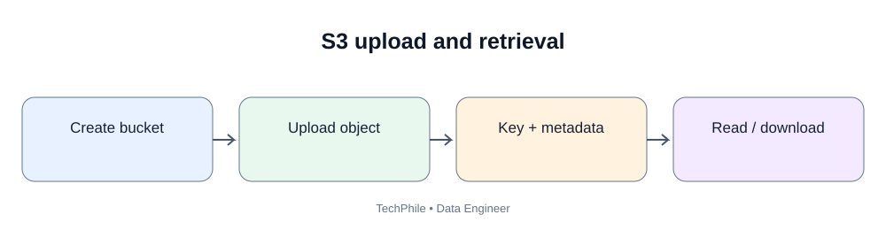
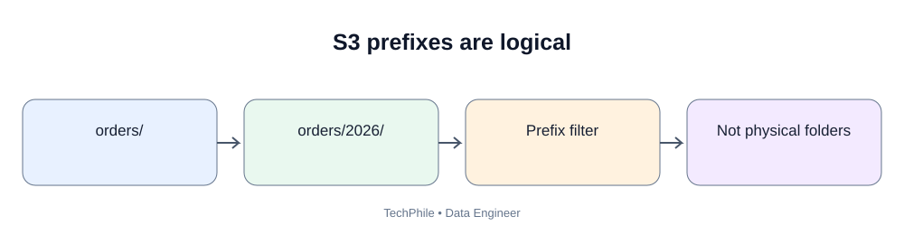
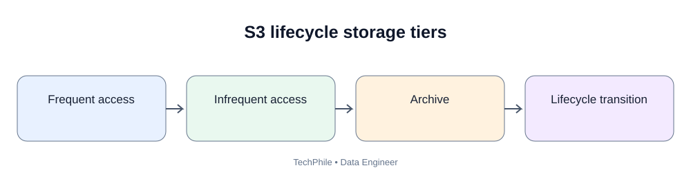

# Day 52: AWS S3 and Storage Management

**Phase:** 6 — Cloud and Distributed Processing  
**Learning time:** 2–3 hours  
**Audience:** Complete beginners and junior Data Engineer candidates  
**Cloud service:** Amazon Simple Storage Service (Amazon S3)  
**Topic boundary:** Class notes only. Project workbook and interview guide are separate files.

> Day 51 taught object storage and data lake design. Today we apply those ideas to Amazon S3. You will learn buckets, objects, prefixes, storage classes, lifecycle policies, encryption, access control, upload/download concepts and safe operational habits. You can complete the design and CLI reading exercises without creating an AWS resource.

## Learning outcomes

By the end, you should be able to:
1. Explain the purpose of Amazon S3.
2. Distinguish a bucket, object, key and prefix.
3. Explain bucket names and regions.
4. Understand object upload and download.
5. Recognize common S3 storage classes.
6. Explain lifecycle policies.
7. Explain versioning and delete markers.
8. Understand encryption at rest and in transit.
9. Explain S3 Block Public Access and least-privilege access.
10. Recognize common AWS CLI commands.
11. Understand upload/download using the AWS SDK conceptually.
12. Design safe storage operations and cleanup.

---

# Part 1 — What is Amazon S3?

## 1. What is S3?

Amazon Simple Storage Service (Amazon S3) is AWS object storage. It stores objects in buckets and provides APIs and tools to create, retrieve, list and manage those objects.

Data engineering teams use S3 to store:
- raw source files;
- processed datasets;
- curated analytical files;
- application logs;
- backups;
- model training data;
- exports and reports.

S3 is not a relational database. It does not provide SQL tables and row-level transactions in the same way as a relational database. Analytics engines can read files stored in S3.

## 2. Understand the S3 vocabulary

| Term | Meaning |
|---|---|
| Bucket | Container for objects |
| Object | Stored data and its object attributes |
| Key | Unique object name within a bucket |
| Prefix | Beginning part of object keys used to group/list objects |
| Region | AWS geographic region associated with the bucket |
| Version ID | Identifier for a stored object version when versioning is enabled |
| Storage class | Storage tier that affects access, durability design and cost |
| Lifecycle rule | Rule to transition or expire objects |
| Bucket policy | Resource-based policy attached to a bucket |

## 3. Example S3 object

Bucket:

~~~text
techstore-data-prod
~~~

Key:

~~~text
raw/orders/ingest_date=2026-11-10/orders_001.csv
~~~

S3 URI:

~~~text
s3://techstore-data-prod/raw/orders/ingest_date=2026-11-10/orders_001.csv
~~~

Understand the URI:
- s3:// identifies the S3 scheme;
- techstore-data-prod is the bucket;
- the remaining path is the object key.

A bucket name must satisfy AWS naming rules and be unique in the applicable namespace. The example name may already be taken and is not guaranteed to be available.

## 4. Is an S3 folder a real folder?

S3 is object storage. Object keys form a flat namespace within a bucket. A key containing slashes can be displayed as nested folders by the console and other tools.

For example:

~~~text
raw/orders/2026/11/orders.csv
~~~

The prefixes raw/, raw/orders/ and raw/orders/2026/ can be used to group and list objects.

Do not assume directory rename behaves like a local file system. Moving an object is generally implemented by copying it to a new key and deleting the old object, subject to permissions and tool behavior.

---

# Part 2 — Create and organize buckets

## 5. Bucket planning

Before creating a bucket, decide:
- environment: development, test or production;
- data owner;
- region;
- sensitivity classification;
- encryption requirements;
- public access posture;
- retention;
- versioning;
- logging and monitoring;
- expected storage and request volume.

Avoid putting personal information or secrets in bucket names.

## 6. Example naming convention

~~~text
company-data-dev
company-data-test
company-data-prod
~~~

These are illustrative names only. S3 bucket names have naming constraints and must be available.

## 7. Separate environments

A development pipeline should not accidentally overwrite production data.

Possible separation:
- separate buckets;
- separate AWS accounts;
- separate roles and policies;
- separate deployment configuration.

The right level of separation depends on the organization's security and operational design.

## 8. Example TechStore layout

~~~text
techstore-data-prod/
    raw/
        orders/
        payments/
        deliveries/
    processed/
        orders/
        payments/
    curated/
        sales_daily/
        product_performance/
    quarantine/
        orders/
    archive/
~~~

Each prefix should have a clear meaning and owner.

---

# Part 3 — Upload and download concepts

## 9. What does upload mean?

Upload means transferring a local file or generated data into an S3 object.

Example:
A nightly order export is created on a trusted processing host and uploaded to the raw/orders prefix.

Before upload, the pipeline should check:
- file creation completed;
- expected file name;
- file size;
- file format;
- checksum or integrity evidence where required;
- no accidental duplicate or overwrite;
- destination bucket and key;
- identity permissions.

## 10. What does download mean?

Download retrieves an S3 object to a local or compute environment.

Before download:
- verify the bucket and key;
- confirm that the identity is authorized;
- use a safe destination path;
- check available disk space;
- avoid exposing sensitive data in shared locations;
- validate the downloaded file.

## 11. Upload is not the same as copy

A local-to-S3 upload sends data from a local filesystem to an object.

An S3-to-S3 copy copies an object between keys or buckets.

A download copies an object from S3 to a local destination.

Large transfers may use multipart upload, where an object is transferred in multiple parts. The SDK or CLI can manage this automatically for supported operations.

## 12. Why object naming matters during upload

Suppose the pipeline uploads every daily file to:

~~~text
raw/orders/orders.csv
~~~

The next day's file may replace the previous object if the same key is used.

A safer date-based key could be:

~~~text
raw/orders/ingest_date=2026-11-10/orders.csv
raw/orders/ingest_date=2026-11-11/orders.csv
~~~

This preserves separate daily objects. Whether overwrites are allowed should be a deliberate pipeline decision.

---

# Part 4 — AWS CLI basics

## 13. What is AWS CLI?

AWS Command Line Interface (CLI) is a tool that lets you interact with AWS services from a terminal.

A data engineer may use the CLI to:
- list buckets;
- list objects;
- upload files;
- download files;
- copy objects;
- inspect configuration.

The CLI does not bypass permissions. It uses credentials or an identity mechanism configured for the command environment.

## 14. Check whether AWS CLI is installed

In Windows CMD or PowerShell:

~~~bash
aws --version
~~~

Example output (the exact version differs):

~~~text
aws-cli/2.x.x Python/3.x Windows/10 exe/AMD64
~~~

If the command is not recognized, the CLI may not be installed or may not be available in PATH.

Do not copy an example version and claim it is your installed version. Record the output from your own machine.

## 15. Check the active identity

~~~bash
aws sts get-caller-identity
~~~

This asks AWS Security Token Service to identify the caller represented by the current credentials.

The response typically contains account, ARN and user ID fields.

This is a useful safety check before running commands. Confirm that you are using the intended account and role.

## 16. Configure credentials safely

Preferred approaches depend on the environment and organization. Examples include:
- AWS IAM Identity Center and an approved SSO profile;
- an attached IAM role for a workload;
- temporary credentials supplied by an approved identity system.

Avoid hardcoding long-lived access keys in scripts, notebooks or Git repositories.

If an organization uses a named CLI profile, the profile can be selected with the appropriate CLI option. Follow the organization's approved setup instructions.

## 17. List buckets

~~~bash
aws s3 ls
~~~

This lists buckets visible to the current identity, subject to permissions.

If access is denied, possible causes include:
- the wrong identity;
- missing permission;
- organization-level controls;
- profile or region configuration;
- an explicit deny.

Do not respond to access denied by giving the identity administrator access. Investigate the required action and resource.

## 18. List objects in a bucket

~~~bash
aws s3 ls s3://example-company-data/
~~~

The bucket name is a placeholder. Replace it only with an approved bucket you own or are authorized to access.

A recursive listing can show objects under prefixes:

~~~bash
aws s3 ls s3://example-company-data/raw/orders/ --recursive
~~~

Large prefixes can return many results. Avoid repeatedly listing huge production paths without a reason.

## 19. Upload a file

~~~bash
aws s3 cp orders.csv s3://example-company-data/raw/orders/ingest_date=2026-11-10/orders.csv
~~~

Explanation:
- aws s3 cp invokes the S3 copy operation;
- orders.csv is the local source;
- the S3 URI is the destination.

Expected behavior: the CLI reports an upload when the operation succeeds. The exact transfer summary depends on the CLI version and file.

This command is a template. Do not execute it with an unknown bucket.

## 20. Download a file

~~~bash
aws s3 cp s3://example-company-data/raw/orders/orders.csv downloaded_orders.csv
~~~

The S3 URI is the source and the local file is the destination.

Expected behavior: the CLI reports a download if it succeeds.

## 21. Copy an object within S3

~~~bash
aws s3 cp s3://example-company-data/raw/orders/orders.csv s3://example-company-data/processed/orders/orders.csv
~~~

This creates a copy at the destination key. It does not transform the contents.

A production pipeline should not copy raw data into a processed zone and call it cleaned. The transformation must actually happen.

## 22. Sync a directory

~~~bash
aws s3 sync ./daily_exports s3://example-company-data/raw/daily_exports/
~~~

Sync compares source and destination and transfers files as needed.

Be careful with deletion options. A sync command with delete behavior can remove destination objects that are not present in the source. Never add destructive options without understanding the exact effect and testing in a safe location.

## 23. Check command help

~~~bash
aws s3 help
aws s3 cp help
~~~

Help output can vary by CLI version. Use it to inspect supported options in your installed version.

---

# Part 5 — S3 storage classes

## 24. Why does S3 have storage classes?

Not every object is accessed at the same frequency.

Examples:
- active daily sales files may be read often;
- old audit files may be read rarely;
- completed project archives may almost never be read.

Storage classes provide different cost and retrieval characteristics.

Do not select a class using storage price alone. Consider retrieval frequency, retrieval delay, minimum storage duration, retrieval charges and availability needs.

## 25. S3 Standard

S3 Standard is designed for frequently accessed data.

Typical example:
- active raw files;
- current curated reports;
- frequently queried datasets.

## 26. S3 Intelligent-Tiering

Intelligent-Tiering can automatically move eligible objects between access tiers based on access patterns, subject to its rules and monitoring/automation charges.

It may help when access patterns are uncertain.

It is not a universal choice. Check eligibility, tier behavior, monitoring charges and retrieval characteristics.

## 27. S3 Standard-Infrequent Access

Standard-IA is designed for data accessed less frequently but requiring rapid access when needed.

It has different pricing, including retrieval charges and minimum storage duration rules.

## 28. S3 One Zone-Infrequent Access

One Zone-IA stores data in a single availability zone and is intended for infrequently accessed data that can be recreated or for which another copy exists.

It is not the right choice for the only copy of irreplaceable data.

## 29. S3 Glacier storage classes

Glacier storage classes are intended for archive use cases. Retrieval can involve waiting periods and retrieval charges depending on the class and retrieval option.

A data engineer must confirm the recovery time requirement before archiving data.

## 30. Storage class comparison

| Class family | Typical access pattern | Key consideration |
|---|---|---|
| Standard | Frequent | General active data |
| Intelligent-Tiering | Unknown or changing | Monitoring/automation and tier behavior |
| Standard-IA | Infrequent | Retrieval charges and minimum duration |
| One Zone-IA | Infrequent, recreatable | Single-AZ storage design |
| Glacier classes | Archive | Retrieval delay and cost |

AWS can change service features and pricing. Always consult the current S3 pricing and storage class documentation before making a production decision.

---

# Part 6 — Lifecycle policies

## 31. What is a lifecycle policy?

A lifecycle policy applies rules to objects over time.

Possible actions include:
- transition objects to another storage class;
- expire objects after a retention period;
- manage noncurrent versions when versioning is enabled;
- abort incomplete multipart uploads.

A lifecycle rule can be scoped to a bucket or selected prefixes/tags, depending on the supported configuration.

## 32. Example business rule

TechStore decides:
- active daily files stay in an active storage class;
- older raw files move to a lower-cost class after an approved period;
- temporary export files expire after a short retention period;
- incomplete multipart uploads are cleaned up.

The exact number of days and storage class must be selected from current business, legal and cost requirements.

## 33. Lifecycle design questions

Before creating a lifecycle rule, ask:
1. Who owns the data?
2. Is the data still needed?
3. How often is it read?
4. How quickly must it be retrieved?
5. Is there a minimum storage duration?
6. Are there retrieval charges?
7. Are object versions enabled?
8. Does a legal hold or retention rule apply?
9. Does the data have another backup?
10. Who approved the expiration?

Do not create an expiration rule based only on a guess.

---

# Part 7 — Versioning and recovery

## 34. What is S3 versioning?

Versioning keeps multiple versions of an object in a versioning-enabled bucket.

If an object with the same key is uploaded again, S3 can retain the previous version and store a new version.

This can help recover from accidental overwrites or deletes.

Versioning does not replace backup planning, access control or retention governance.

## 35. What is a delete marker?

In a versioning-enabled bucket, a normal delete operation commonly adds a delete marker as the current version rather than permanently deleting all prior versions.

Older versions may remain and can incur storage charges.

Permanent deletion of a specific version is a different operation and requires appropriate permissions.

## 36. Why versioning can increase cost

Every retained version consumes storage.

If a pipeline overwrites a large object every day and retains every version indefinitely, storage can grow.

Lifecycle rules for noncurrent versions may be needed, subject to retention and recovery requirements.

---

# Part 8 — Security and encryption

## 37. What does encryption protect?

Encryption helps protect data from being read by unauthorized parties if storage or network access is exposed.

Two important categories:
- encryption in transit;
- encryption at rest.

## 38. Encryption in transit

Encryption in transit protects data while it moves between systems.

Use secure transport such as HTTPS/TLS for supported S3 requests.

Do not send credentials or data over insecure connections.

## 39. Encryption at rest

Encryption at rest protects stored objects.

S3 supports server-side encryption options, including S3-managed keys and AWS KMS key options. Exact options and defaults can evolve.

The organization should define:
- encryption requirements;
- key ownership;
- key access;
- rotation expectations;
- audit requirements;
- recovery behavior.

## 40. Server-side encryption

With server-side encryption, S3 encrypts object data at rest as part of the storage service behavior.

The application sends and retrieves objects through the service while encryption is managed according to the selected configuration.

Encryption does not replace IAM permissions. A user who is authorized to read an object may still receive decrypted data through the service.

## 41. KMS key permissions

When customer-managed KMS keys are used, key policies and IAM permissions can affect whether a principal can use the key.

A role may have permission to read an S3 object but still fail if it lacks the required KMS key permission.

Troubleshooting should check both storage permissions and encryption-key permissions.

## 42. Block Public Access

S3 Block Public Access settings help prevent public access to buckets and objects.

For private company data, keep public access blocked unless a documented, reviewed use case requires a different configuration.

Do not make a bucket public just to solve an application permission problem.

## 43. Bucket policy and IAM policy

An IAM identity policy is attached to an identity such as a user or role.

A bucket policy is a resource-based policy attached to a bucket.

Both can participate in access evaluation. Explicit denies and organization-level controls may also affect access.

## 44. Example access design

| Identity | Access |
|---|---|
| Ingestion role | Write new objects to raw/orders |
| Transformation role | Read raw/orders and write processed/orders |
| Reporting role | Read curated/sales_daily |
| General analyst | No raw customer data access by default |

This is a design example. The actual policy must account for listing, object reads/writes, encryption, prefixes and required service actions.

---

# Part 9 — Upload/download with Python SDK concepts

## 45. What is an SDK?

An SDK is a software development kit. It provides libraries that let application code call a cloud provider's APIs.

For AWS Python development, boto3 is a common AWS SDK for Python.

The SDK uses the credential provider chain and the identity available to the process. Do not paste access keys directly into the code.

## 46. Install boto3 in a practice environment

~~~bash
python -m pip install boto3
~~~

Expected output: pip reports installation or that the package is already installed. Exact output depends on the environment and package version.

## 47. Create an S3 client

~~~python
import boto3

s3 = boto3.client("s3")

print("S3 client created")
~~~

Expected output:

~~~text
S3 client created
~~~

Important:
- this creates a client object;
- it does not prove that credentials are valid;
- it does not prove the identity has access to a bucket;
- an API request is needed to verify access.

## 48. Upload with boto3

~~~python
import boto3

s3 = boto3.client("s3")

s3.upload_file(
    "orders.csv",
    "example-company-data",
    "raw/orders/orders.csv"
)

print("Upload request completed")
~~~

This is a template. It will only work if:
- the local file exists;
- the bucket exists;
- the process has valid credentials;
- the identity has required permissions;
- the destination and encryption requirements are correct.

Do not run it with an unknown bucket or production destination.

## 49. Download with boto3

~~~python
import boto3

s3 = boto3.client("s3")

s3.download_file(
    "example-company-data",
    "raw/orders/orders.csv",
    "downloaded_orders.csv"
)

print("Download request completed")
~~~

The bucket, key and local destination are explicit.

A successful download should still be followed by validation such as file size, checksum or row count where appropriate.

## 50. Handle errors

Cloud SDK calls can fail for several reasons:
- missing credentials;
- expired credentials;
- access denied;
- bucket or key not found;
- network timeout;
- throttling;
- encryption key permission;
- incorrect region or endpoint.

A production pipeline should handle known errors, retry only where safe, log context without exposing secrets and report final failure clearly.

Do not retry every error forever. Permission errors generally require configuration correction rather than repeated retries.

---

# Part 10 — Safe operational workflow

## 51. Before upload

- Confirm the source file is complete.
- Confirm its expected name and format.
- Validate required columns and row counts.
- Calculate checksum if required.
- Confirm destination bucket and prefix.
- Confirm the active AWS identity.
- Confirm overwrite behavior.
- Confirm encryption and retention requirements.

## 52. After upload

- Verify the object exists.
- Verify expected object size.
- Compare checksum where supported and appropriate.
- Record the object key and pipeline run ID.
- Record source file and ingestion timestamp.
- Emit success/failure metrics.
- Avoid logging credentials or sensitive row values.

## 53. Before delete

- Confirm the exact bucket and key.
- Confirm data owner approval.
- Check retention and legal hold requirements.
- Check versioning and prior versions.
- Confirm backups or replay capability.
- Test the deletion process in development.
- Record the operation.

A broad recursive delete can remove many objects. Never use destructive commands against production without review and safeguards.

---

# Part 11 — Common mistakes

| Mistake | Why it is a problem | Better practice |
|---|---|---|
| Treat S3 as a relational database | It stores objects, not relational rows | Use an appropriate query engine or database |
| Assume prefixes are real folders | Key namespace is object-based | Understand keys and prefix listing |
| Reuse the same key for every daily file | New upload may overwrite prior object | Use date/run-specific keys or versioning |
| Make bucket public to fix access denied | Exposes data | Correct identity and bucket permissions |
| Store access keys in Python | Secrets can leak | Use roles or approved temporary credentials |
| Choose archive tier only by storage price | Retrieval may be slow or costly | Check access and recovery needs |
| Ignore noncurrent versions | Storage can grow | Design version retention |
| Delete without checking versioning | Prior versions may remain | Understand delete markers and version deletion |
| Assume encryption gives authorization | Encryption and access control differ | Configure IAM and key permissions |
| Use sync delete without testing | Destination data may be removed | Test and review destructive options |
| Log full credentials or sensitive data | Exposes secrets | Log safe identifiers and status |

---

# Part 12 — Practice questions

## Exercise 1

What is an S3 object key?

**Answer:** The name that identifies an object inside a bucket.

## Exercise 2

Does an S3 prefix always represent a real directory?

**Answer:** No. It is a beginning portion of object keys. Tools commonly display prefixes as folders.

## Exercise 3

Why use different keys for daily files?

**Answer:** To preserve separate deliveries and avoid accidental overwrites.

## Exercise 4

What is a lifecycle policy?

**Answer:** A rule that can transition or expire objects over time and manage other supported lifecycle actions.

## Exercise 5

What does versioning help with?

**Answer:** Recovering from accidental overwrite or deletion by retaining object versions, subject to configuration and retention.

## Exercise 6

Does encryption replace IAM?

**Answer:** No. Encryption protects data at rest or in transit; IAM and resource policies control access.

## Exercise 7

Why check the active CLI identity?

**Answer:** To avoid running a command against the wrong account or with unintended permissions.

## Exercise 8

Why should a student avoid creating a bucket or database without checking pricing?

**Answer:** Cloud resources and requests may create charges. Cost and cleanup must be planned.

---

# Part 13 — Revision sheet

| Term | Remember |
|---|---|
| S3 | AWS object storage |
| Bucket | Container for objects |
| Object key | Object identifier within bucket |
| Prefix | Grouping portion of object keys |
| AWS CLI | Terminal tool for AWS services |
| boto3 | AWS SDK for Python |
| Storage class | Storage tier with different access/cost behavior |
| Lifecycle policy | Automated transition/expiration rules |
| Versioning | Retains object versions |
| Delete marker | Current marker created by a delete in a versioned bucket |
| Encryption in transit | Protects data while moving |
| Encryption at rest | Protects stored data |
| Block Public Access | Controls that help prevent public bucket/object access |
| Bucket policy | Resource-based bucket permissions |
| IAM policy | Identity permissions |
| Multipart upload | Transfers an object in multiple parts |
| KMS | AWS key management service |

## Final self-check

- [ ] Explain S3 buckets, objects, keys and prefixes.
- [ ] Explain upload, download, copy and sync.
- [ ] Recognize common AWS CLI commands.
- [ ] Explain common S3 storage class families.
- [ ] Explain lifecycle policies and versioning.
- [ ] Explain encryption in transit and at rest.
- [ ] Explain IAM and bucket policy roles.
- [ ] Describe safe upload and delete checks.
- [ ] Explain how boto3 uses an AWS identity.
- [ ] Identify common cost and security mistakes.

**Next lesson — Day 53: Cloud Database Fundamentals.** You will learn managed databases, database connectivity, endpoints, ports, security groups, credentials and safe application connections.

---

# Part 14 — Use the AWS Console safely

The CLI is useful for automation, but beginners should recognize the same concepts in the AWS Console.

## 54. Sign in to an approved training account

Use only an instructor-approved sandbox or organization account.

1. Open the sign-in page supplied by your instructor.
2. Confirm the account and role after signing in.
3. Never use another person's credentials.
4. Never share passwords, one-time codes or access keys.
5. Do not use production resources for this exercise.

The console is only an interface. It does not grant permissions that the signed-in identity does not already have.

## 55. Open Amazon S3

1. Use the AWS Console search bar and search for S3.
2. Open Amazon S3.
3. Review the bucket list.
4. Confirm the account and region context.
5. Open only a bucket assigned to you or one you are authorized to use.

If no bucket appears, possible reasons include no buckets existing or insufficient list permissions. Do not assume the service is broken.

## 56. Inspect a bucket

Look for the Objects, Properties, Permissions and Management areas. The console layout can change, so focus on what each area represents.

- Objects: keys and prefixes stored in the bucket.
- Properties: bucket-level configuration such as versioning and encryption settings.
- Permissions: public access settings and resource policies.
- Management: lifecycle and other storage-management features.

## 57. Upload a synthetic file

Use a small CSV containing invented training data only.

1. Open the approved development bucket.
2. Open the assigned raw/orders prefix or create it through the console.
3. Choose Upload and select the synthetic CSV.
4. Review the destination and encryption settings.
5. Start the upload.
6. Wait for completion.
7. Confirm the object name and size in the object list.

A console-created folder may be represented by a zero-byte object ending in a slash. Ordinary object keys can also create the same folder-like view.

## 58. Download and compare

1. Select the training object.
2. Download it to a dedicated practice folder.
3. Compare the downloaded file with the original.
4. Check byte size.
5. Calculate a checksum if the exercise requires stronger evidence.

Do not download sensitive production data to a personal device.

## 59. Delete only the training object

Delete is destructive. Do this only when the resource owner approves and only for the synthetic object you created.

Confirm the account, bucket and complete key. Check versioning before deleting. In a versioned bucket, a normal delete may create a delete marker while previous versions remain.

If no approved development bucket is available, skip the actual mutation. Complete the command-reading and design exercises instead.

---

# Part 15 — Safe AWS CLI practice on Windows

The commands below are templates. Replace the placeholder bucket only with an approved development bucket. Never run them against an unknown or production bucket.

## 60. Check the CLI installation

Open Windows CMD or PowerShell:

~~~bat
aws --version
~~~

If Windows reports that aws is not recognized, confirm installation and PATH. Open a new terminal after installation.

## 61. Confirm the active identity

~~~bat
aws sts get-caller-identity
~~~

Review the account and ARN. Confirm that they represent the approved training identity.

If credentials are missing or expired, stop and use the approved sign-in flow. Do not paste keys into the command line or code.

## 62. Set a temporary bucket variable in CMD

~~~bat
set BUCKET=your-approved-development-bucket
echo %BUCKET%
~~~

The first command sets a variable for the current CMD session. The second prints it so you can check the value.

PowerShell uses different variable syntax. Do not copy CMD syntax into PowerShell unchanged.

## 63. List one prefix

~~~bat
aws s3 ls s3://%BUCKET%/raw/orders/
~~~

The command lists visible objects under the prefix. An empty result may simply mean that no objects are stored there.

If access is denied, identify the missing action and resource. Do not attach administrator access as a shortcut.

## 64. Create a synthetic local file

Create `orders_training.csv` in your current folder:

~~~csv
order_id,order_date,amount,status
501,2026-11-10,250.00,PAID
502,2026-11-10,499.00,PAID
503,2026-11-11,100.00,PENDING
~~~

Save and close the file before uploading it. Confirm it exists:

~~~bat
dir orders_training.csv
~~~

## 65. Upload to a date-specific key

~~~bat
aws s3 cp orders_training.csv s3://%BUCKET%/raw/orders/ingest_date=2026-11-11/orders_training.csv
~~~

The command reports success if the file, destination and permissions are valid.

Use date/run-specific keys when each delivery must be preserved. Reusing a generic key can replace the current object.

## 66. Confirm the destination

~~~bat
aws s3 ls s3://%BUCKET%/raw/orders/ingest_date=2026-11-11/
~~~

Confirm the object name and size. If it is missing, check the upload result, active identity, bucket, key and permissions.

## 67. Download to a different local name

~~~bat
aws s3 cp s3://%BUCKET%/raw/orders/ingest_date=2026-11-11/orders_training.csv downloaded_orders_training.csv
~~~

Do not download over the original input file. Compare the files:

~~~bat
fc orders_training.csv downloaded_orders_training.csv
~~~

If the files match, CMD normally reports that no differences were found.

## 68. Copy within S3

~~~bat
aws s3 cp s3://%BUCKET%/raw/orders/ingest_date=2026-11-11/orders_training.csv s3://%BUCKET%/processed/orders/ingest_date=2026-11-11/orders_training.csv
~~~

This copies bytes to a new key. It does not validate, clean, convert or transform the data. A copied raw file is not automatically a processed dataset.

## 69. Understand sync

~~~bat
aws s3 sync ./training_exports s3://%BUCKET%/raw/training_exports/
~~~

Sync compares local and remote paths and transfers files as needed. Options that delete destination objects are dangerous. Test direction and behavior in a small development prefix before any production use.

Never copy a recursive delete or sync-with-delete command without understanding its exact target and impact.

---

# Part 16 — Verify object integrity

## 70. Inspect metadata with HeadObject

~~~bash
aws s3api head-object --bucket your-approved-development-bucket --key raw/orders/ingest_date=2026-11-11/orders_training.csv
~~~

This requests metadata for one object without downloading the full contents. The response can include content length, last-modified time, ETag and encryption-related details.

Do not assume an ETag is always an MD5 checksum. Multipart upload and encryption configuration can change its meaning.

## 71. Compare local file sizes

~~~bat
dir orders_training.csv
dir downloaded_orders_training.csv
~~~

Equal byte size is useful evidence, but it does not prove the files are byte-for-byte identical.

## 72. Calculate SHA-256 on Windows

~~~bat
certutil -hashfile orders_training.csv SHA256
certutil -hashfile downloaded_orders_training.csv SHA256
~~~

If both files are identical, their SHA-256 digests should match. The actual digest must come from your machine; never copy an invented hash into a report.

For production integrity checks, use a checksum feature supported and configured for the chosen S3 upload method. Record the algorithm and value consistently.

## 73. Understand multipart upload

Large objects can be uploaded in parts. Conceptually:
1. initiate the multipart upload;
2. transfer the parts;
3. complete the upload;
4. S3 assembles the object.

If a transfer fails before completion, incomplete parts can remain and incur storage charges. Lifecycle configuration can abort incomplete multipart uploads after an approved period.

Choose that period based on maximum expected transfer duration and recovery needs.

---

# Part 17 — Select storage classes using business requirements

## 74. Active daily data

Current order files are read by daily transformations and may need replay. A frequently accessible class such as S3 Standard may fit. Confirm actual usage and cost.

## 75. Uncertain access pattern

An audit dataset is sometimes read frequently and sometimes not read for months. Intelligent-Tiering may be worth evaluating. Check eligible object sizes, tier behavior, monitoring charges and retrieval characteristics.

## 76. Infrequent but rapid access

An old dataset is rarely read but must be available quickly when requested. An infrequent-access class may fit if retrieval charges and minimum storage duration are acceptable.

## 77. Long-term archive

A compliance archive is retained for years and rarely retrieved. Evaluate Glacier storage classes against:
- required retrieval time;
- retrieval mode and charges;
- minimum storage duration;
- restore workflow;
- legal retention;
- recovery testing.

Do not archive data before confirming who will request a restore and how long the restore can take.

## 78. Storage class decision table

| Question | Why it matters |
|---|---|
| How often is the object read? | Helps choose an access tier |
| How quickly must it be available? | Archive retrieval can take longer |
| How long will it remain stored? | Minimum duration can affect cost |
| Are retrieval requests charged? | Low storage price may not mean low total cost |
| Is the object replaceable? | A single-AZ design may be unsuitable for irreplaceable data |
| Is another copy available? | Recovery design affects storage decisions |
| Is there a legal hold? | Expiration may be prohibited |

Always check current AWS pricing and feature documentation before a production choice.

---

# Part 18 — Lifecycle rules and version recovery

## 79. What can a lifecycle rule do?

Depending on configuration, lifecycle rules can:
- transition objects to another storage class;
- expire objects after a retention period;
- manage noncurrent versions;
- abort incomplete multipart uploads.

A lifecycle rule may apply to a bucket or selected prefixes/tags. The scope must be reviewed carefully.

## 80. Example lifecycle planning

| Dataset | Possible action | Approval needed |
|---|---|---|
| Temporary exports | Expire after an approved short period | Owner and retention policy |
| Older raw data | Transition to an archive/infrequent tier | Recovery-time and cost review |
| Noncurrent versions | Expire after approved retention | Recovery and audit review |
| Incomplete multipart uploads | Abort after safe period | Transfer and retry requirements |

This is a planning example, not a ready-to-deploy policy.

## 81. Lifecycle review checklist

Before enabling a rule, ask:
1. Which prefix or tags does it match?
2. Does it apply to current or noncurrent versions?
3. Does it transition or expire objects?
4. What happens to delete markers?
5. What happens to incomplete multipart uploads?
6. Does the rule conflict with retention or legal holds?
7. How will the team test its effect?
8. Who owns and approves the rule?

Do not expire data merely because it is old or rarely queried.

## 82. Versioning and overwrite

Suppose `raw/orders/orders.csv` first contains 100 rows and is later uploaded again with 80 rows.

Without versioning, the new object may replace the current object. With versioning enabled, S3 can retain the earlier version and make the new version current.

Versioning supports recovery but increases storage when old versions are retained.

## 83. Delete markers

In a versioned bucket, a normal delete commonly adds a delete marker as the current version. Earlier versions may remain stored.

Permanent deletion of a specific version is a separate operation requiring appropriate permission.

Before recovery:
1. confirm the bucket and exact key;
2. identify the correct version;
3. verify its time, size and business batch;
4. confirm restore authority;
5. promote/copy the version through the approved process;
6. validate row counts and totals;
7. record the recovery.

Do not permanently delete versions just to make the bucket look tidy.

---

# Part 19 — Security and access review

## 84. Encryption in transit and at rest

- Encryption in transit protects data moving between systems, commonly through HTTPS/TLS.
- Encryption at rest protects stored objects.
- Server-side encryption is performed by the storage service according to the selected configuration.
- Encryption does not replace access control.

A principal authorized to retrieve an object may receive its decrypted contents through the service.

## 85. KMS permission

When a customer-managed KMS key is used, the role may need permission to use that key in addition to permission to read the S3 object.

If an object request fails, check both object access and key access. Also review key policy and other applicable controls.

## 86. Block Public Access

S3 Block Public Access helps prevent public access to buckets and objects.

For private company data, keep public access blocked unless a documented and reviewed use case requires otherwise.

Never make a bucket public to fix an application AccessDenied error.

## 87. IAM policy and bucket policy

An IAM policy is attached to an identity such as a role. A bucket policy is attached to the bucket.

Both may participate in authorization. Explicit denies, organization policies and other controls can also affect the result.

Listing a prefix and reading a known object are different actions. A workload may be able to read a known key without permission to browse the bucket.

## 88. Example role boundaries

| Identity | Intended access |
|---|---|
| Ingestion role | Write to raw/orders |
| Transformation role | Read raw/orders and write processed/orders |
| Reporting role | Read curated/sales_daily |
| General analyst | No raw customer data access by default |

The actual policy must include the exact required actions, resource scopes, listing behavior, encryption access and service permissions.

---

# Part 20 — Use boto3 without hardcoding credentials

## 89. What is boto3?

boto3 is the AWS SDK for Python. It allows Python applications to call AWS services through supported APIs.

The SDK uses the configured credential provider chain. It can use approved roles, SSO/profile configuration or other supported mechanisms.

Never paste real access keys into a notebook or Python file.

## 90. Install boto3

Run in the terminal associated with the Python environment used by Jupyter:

~~~bat
python -m pip install boto3
~~~

Expected behavior: pip reports that boto3 and its dependencies were installed or are already installed. Exact output depends on package versions.

If Jupyter cannot import boto3 after installation, the terminal and notebook may be using different Python environments. Check the notebook kernel's interpreter and install into that environment.

## 91. Create an S3 client

Run in a notebook cell:

~~~python
import boto3

s3 = boto3.client("s3")

print("S3 client created")
~~~

Expected output:

~~~text
S3 client created
~~~

This creates a client object. It does not prove that credentials are valid or that the identity can access a bucket.

## 92. Upload a training file

~~~python
import boto3

s3 = boto3.client("s3")

s3.upload_file(
    "orders_training.csv",
    "your-approved-development-bucket",
    "raw/orders/orders_training.csv"
)

print("Upload request completed")
~~~

Parameters:
- first argument: local file path;
- second argument: bucket name;
- third argument: object key.

The operation requires the local file, bucket, credentials, permissions, network path and encryption configuration to be correct.

Do not run the template with an unknown bucket or production destination.

## 93. Download a training file

~~~python
import boto3

s3 = boto3.client("s3")

s3.download_file(
    "your-approved-development-bucket",
    "raw/orders/orders_training.csv",
    "downloaded_orders.csv"
)

print("Download request completed")
~~~

Parameters:
- first argument: bucket;
- second argument: object key;
- third argument: local destination path.

After download, validate size or checksum. A successful SDK call does not prove that the data is the correct business batch.

## 94. Understand common SDK failures

| Error category | Possible reason | Safe next check |
|---|---|---|
| No credentials | No identity configured | Follow approved SSO/role setup |
| Expired token | Temporary credentials expired | Renew through approved login |
| Access denied | Effective permissions insufficient | Inspect identity and bucket policies |
| No such bucket | Wrong bucket/account | Verify bucket and active identity |
| No such key | Incorrect key | Check exact spelling and case |
| KMS denied | Key permission missing | Review key policy and role access |
| Timeout | Network issue | Check DNS, route and endpoint |
| Throttling | Request rate too high | Use bounded retry/backoff where safe |

Permission failures generally need configuration correction, not endless retries. Log safe identifiers and error details, never secrets.

---

# Part 21 — Complete an upload verification workflow

## 95. Requirements

Upload one synthetic order file to a unique raw key and confirm that the downloaded bytes match the source.

## 96. Step 1 — Prepare the source

Confirm:
- file writing is complete;
- expected file name and format;
- required columns;
- expected row count;
- nonzero size;
- source batch ID.

## 97. Step 2 — Select the destination key

Example:

~~~text
raw/orders/ingest_date=2026-11-11/batch_id=orders_001/orders.csv
~~~

In a recurring pipeline, the date and batch ID must come from the actual run. Do not hardcode a stale date.

## 98. Step 3 — Confirm identity and upload

~~~bat
aws sts get-caller-identity
aws s3 cp orders_training.csv s3://your-approved-development-bucket/raw/orders/ingest_date=2026-11-11/batch_id=orders_001/orders.csv
~~~

Verify the identity before uploading.

## 99. Step 4 — Inspect and download

~~~bash
aws s3api head-object --bucket your-approved-development-bucket --key raw/orders/ingest_date=2026-11-11/batch_id=orders_001/orders.csv
~~~

Then download to a new local file and compare its SHA-256 checksum with the source.

## 100. Step 5 — Record actual evidence

| Evidence | What to record |
|---|---|
| Source file | Actual file name |
| Source row count | Count from validation |
| Source size | Actual bytes |
| Source checksum | Actual SHA-256 |
| Destination bucket/key | Exact S3 location |
| Active identity | Approved account and role |
| Destination size | Actual object metadata |
| Download checksum | Actual SHA-256 |
| Result | Match or mismatch |
| Run ID | Actual run identifier |

Never fill evidence with invented values.

## 101. Step 6 — Clean up safely

Delete only the synthetic training object if the owner approves. If versioning is enabled, understand that a delete marker may be created and previous versions may remain.

---

# Part 22 — Troubleshooting scenarios

| Symptom | Possible cause | First investigation |
|---|---|---|
| Unable to locate credentials | No supported identity configured | Approved SSO or role setup |
| AccessDenied on upload | Missing object-write permission | Identity, bucket policy and explicit denies |
| AccessDenied on download | Missing read or KMS permission | Object and key permissions |
| NoSuchBucket | Wrong bucket or account | Verify bucket and caller identity |
| NoSuchKey | Wrong key | Check exact key and capitalization |
| Signature/region error | Wrong region/signing context | Confirm bucket region and CLI configuration |
| Object in wrong prefix | Incorrect key | Inspect complete object key |
| Download differs | Wrong key/version or incomplete process | Compare size and checksum |
| Storage cost rises | Versions, requests or incomplete uploads | Inspect storage metrics and lifecycle |
| Sync removes files | Destructive sync option or wrong direction | Stop, inspect command and recovery options |

Do not grant broad access before identifying the actual failure layer.

---

# Part 23 — More practice exercises with worked answers

## Exercise 9 — Same key upload

A daily pipeline uploads every file to `raw/orders/orders.csv`. What is the risk?

**Worked answer:** A later upload may replace the current object. Use a date/run-specific key or a deliberate versioning and overwrite strategy.

## Exercise 10 — ETag

A developer assumes every S3 ETag is the MD5 hash of the uploaded file. Is this safe?

**Worked answer:** No. Multipart uploads and encryption configurations can change ETag behavior. Use a supported checksum mechanism for integrity verification.

## Exercise 11 — Archive retrieval

An archive must be retrievable within five minutes. Should the team choose a Glacier option based only on storage price?

**Worked answer:** No. Confirm the exact retrieval option and expected restore time. Select a class that meets the recovery requirement.

## Exercise 12 — Public access

A pipeline receives AccessDenied on a private bucket. Should the engineer disable Block Public Access?

**Worked answer:** No. Fix the workload identity, IAM policy, bucket policy, KMS permission or other actual access issue.

## Exercise 13 — Version cost

A 5 GB object is overwritten every day and every version is retained for a year. What should the team consider?

**Worked answer:** Storage can grow because previous versions remain. Define noncurrent-version retention consistent with recovery and legal requirements.

## Exercise 14 — Lifecycle conflict

A lifecycle rule expires raw data after 30 days, but the business needs 90 days of replay history. What is wrong?

**Worked answer:** The lifecycle rule conflicts with the replay requirement. Align retention with owners, recovery needs and legal policy before enabling expiration.

## Exercise 15 — Multipart upload

A large upload is interrupted. What should the team investigate?

**Worked answer:** Determine whether the multipart upload completed, whether incomplete parts remain, and how retry or abort works. Configure safe cleanup for abandoned uploads.

## Exercise 16 — Listing versus reading

A role can read a known object but cannot list the prefix. Is object access necessarily broken?

**Worked answer:** No. Listing and reading are distinct permissions. A workload may read a known key without browsing the prefix.

## Exercise 17 — Upload success

The CLI reports that upload succeeded. Can the pipeline mark the dataset as curated?

**Worked answer:** No. Transfer success does not prove schema validity, business correctness or reconciliation. Processing and quality checks remain necessary.

---

# Part 24 — Day 52 practical completion checklist

### S3 fundamentals
- [ ] Explain buckets, objects, keys, prefixes and regions.
- [ ] Explain why prefixes look like folders.
- [ ] Distinguish upload, download, copy and sync.
- [ ] Explain why object keys should include stable batch/date information.

### Console and CLI
- [ ] Locate S3 in the AWS Console.
- [ ] Inspect an approved development bucket.
- [ ] Upload and download a synthetic file safely.
- [ ] Check the active identity with STS.
- [ ] List a prefix with the CLI.
- [ ] Upload and copy a training object.
- [ ] Inspect object metadata.
- [ ] Explain why recursive delete and sync-delete options are dangerous.

### Storage management
- [ ] Compare Standard, Intelligent-Tiering, infrequent-access and Glacier class families.
- [ ] Explain retrieval time, retrieval charges and minimum duration.
- [ ] Explain lifecycle transition and expiration.
- [ ] Explain versioning and delete markers.
- [ ] Explain incomplete multipart uploads and cleanup.

### Security and reliability
- [ ] Explain encryption in transit and at rest.
- [ ] Explain KMS key permissions.
- [ ] Explain Block Public Access.
- [ ] Distinguish IAM and bucket policies.
- [ ] Verify upload size and checksum.
- [ ] Record object key, batch ID and run ID.
- [ ] Explain safe recovery and deletion.

### Python SDK
- [ ] Explain what boto3 is.
- [ ] Create an S3 client without hardcoding credentials.
- [ ] Explain upload_file and download_file parameters.
- [ ] Identify common SDK errors.
- [ ] Explain why upload success is not data-quality success.

## Final self-assessment

Without looking at the notes, explain:

1. What is the difference between an S3 bucket, object and key?
2. Why should daily source files not all overwrite one object key?
3. How do you verify that an upload reached the expected destination?
4. Why is an ETag not always a file MD5 checksum?
5. How do storage classes affect retrieval and cost?
6. What can a lifecycle rule do?
7. How does versioning help recovery, and why can it increase storage?
8. Why should Block Public Access remain enabled for private data?
9. What permissions may be required for an encrypted object?
10. What evidence is needed before a pipeline marks an uploaded batch successful?

If you can perform the safe upload/download exercise and explain the storage, security and recovery decisions, you are ready for Day 53.

**Next lesson — Day 53: Cloud Database Fundamentals.** We will connect a data pipeline to a managed relational database and learn endpoints, ports, network access, credentials, TLS, connection testing and safe data movement.

---

## Visual Learning Diagrams

### S3 upload and retrieval

### S3 prefixes

### S3 lifecycle storage tiers

