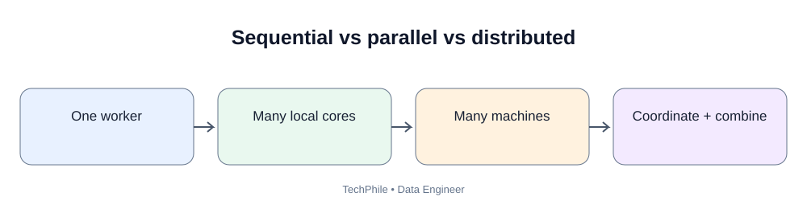
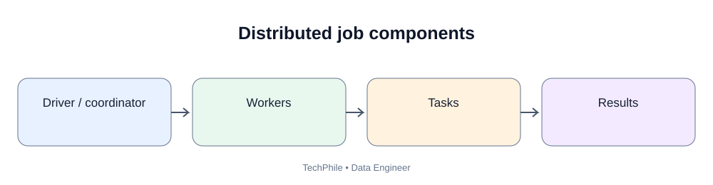
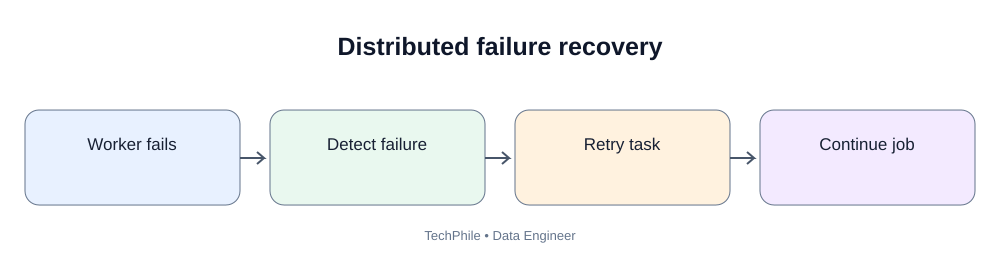

# Day 54: Distributed Computing

**Phase:** 6 — Cloud and Distributed Processing  
**Learning time:** 2–3 hours  
**Audience:** Complete beginners and junior Data Engineer candidates  
**Topic boundary:** Class notes only. Project workbook and interview guide are separate files.

> A laptop can process small datasets, but a company may need to process billions of events. One machine has limits in CPU, memory, storage and time. Distributed computing divides work across multiple machines or workers. Today you will learn how work is split, how results are combined, what partitions and shuffles mean, and why distributed systems introduce new failure and data-correctness challenges.

## Learning outcomes

- Explain distributed computing.
- Compare sequential, parallel and distributed processing.
- Explain nodes, workers, clusters and tasks.
- Understand data partitioning.
- Explain horizontal scaling and vertical scaling.
- Understand shuffle and data movement.
- Explain fault tolerance and retries.
- Recognize data skew and stragglers.
- Understand data locality and network overhead.
- Identify when distributed processing is unnecessary.
- Perform a simple local simulation of partitioned work.

---

# Part 1 — Why do we need distributed computing?

## 1. Start with a business problem

TechStore receives customer activity events from its website and mobile application.

One day of data contains:
- page views;
- product searches;
- cart additions;
- orders;
- payment events;
- delivery events.

Suppose the data grows from thousands of rows to billions of events.

A small laptop may not have enough memory or CPU to process the full dataset efficiently.

The team needs a way to divide the work.

## 2. What is distributed computing?

**Beginner definition:** Distributed computing means using multiple connected computers or workers to complete parts of a workload and coordinate the results.

Instead of one computer doing every task, a distributed system divides work across multiple machines.

The machines communicate through a network.

A distributed data processing job may:
1. read input data;
2. divide data into partitions;
3. send partitions to workers;
4. process partitions in parallel;
5. exchange data when required;
6. combine partial results;
7. write final output.

## 3. Sequential processing

Sequential processing performs operations one after another.

Example:

~~~text
Read file
   |
Process all rows
   |
Calculate total
   |
Write result
~~~

For small data, sequential processing is often simple and efficient.

## 4. Parallel processing

Parallel processing performs multiple independent tasks at the same time.

Example:
- Task A processes file A;
- Task B processes file B;
- Task C processes file C.

The tasks may run on different CPU cores of one computer or on different computers.

Parallelism does not automatically mean distributed computing. Multiple CPU cores inside one machine can run parallel tasks.

## 5. Distributed processing

Distributed processing uses multiple networked machines or workers.

Example:

~~~text
                 Coordinator
                /     |      \
             Worker  Worker  Worker
                \     |      /
                 Combined result
~~~

The workers may have separate CPU, memory and local storage.

The system must coordinate task execution, data movement, failures and final results.

## 6. Compare sequential, parallel and distributed

| Approach | Where work runs | Main idea |
|---|---|---|
| Sequential | One execution path | One step after another |
| Parallel | Multiple cores or workers | Several tasks at once |
| Distributed | Multiple networked machines | Coordinate work across machines |
| Hybrid | Multiple machines and multiple cores | Distributed and parallel execution together |

---

# Part 2 — Understand the building blocks

## 7. What is a node?

A node is a computer or machine participating in a distributed system.

A node may provide:
- CPU;
- memory;
- local disk;
- network connectivity.

A cluster may contain multiple nodes.

## 8. What is a worker?

A worker is a process or compute component that performs assigned work.

Depending on the platform, a worker may run on a node or inside a container.

A worker can process one or more tasks.

## 9. What is a cluster?

A cluster is a group of connected compute resources managed to work together.

A distributed data processing cluster may contain:
- a coordinator or driver;
- worker nodes;
- a cluster manager;
- storage access;
- network communication.

The exact architecture differs by platform. Apache Spark's architecture is introduced in Day 55.

## 10. What is a task?

A task is a unit of work assigned to a worker.

Examples:
- read one partition;
- filter a subset of records;
- calculate a partial sum;
- write one output partition.

A task should have a clear input and output.

## 11. What is a job?

A job is a larger unit of work submitted to a processing system.

A job may contain multiple stages and tasks.

For example, a daily sales aggregation job may:
1. read order files;
2. filter valid orders;
3. group by product;
4. calculate total sales;
5. write output.

---

# Part 3 — Understand scaling

## 12. What is vertical scaling?

Vertical scaling means increasing the capacity of one machine.

Examples:
- more CPU;
- more memory;
- faster storage.

Advantages:
- simpler architecture in many cases;
- fewer distributed coordination concerns;
- may be sufficient for moderate workloads.

Limitations:
- machine size has limits;
- larger machines can be expensive;
- one machine may remain a single failure point.

## 13. What is horizontal scaling?

Horizontal scaling means adding more machines or workers.

Example:
- start with two workers;
- add two more workers;
- distribute eligible tasks across the larger worker pool.

Advantages:
- can increase processing capacity;
- can support large workloads;
- can improve resilience when designed correctly.

Limitations:
- network communication;
- coordination overhead;
- data movement;
- skew;
- operational complexity;
- not every task can be divided efficiently.

## 14. Vertical versus horizontal scaling

| Feature | Vertical scaling | Horizontal scaling |
|---|---|---|
| Change | Increase one machine's resources | Add more machines/workers |
| Complexity | Often simpler | Requires coordination |
| Limit | Machine capacity | Cluster/service limits |
| Main concern | Large machine cost | Network and distributed overhead |
| Example | More memory in one server | More Spark executors |

## 15. Does adding workers always make a job faster?

No.

Suppose a job spends most of its time waiting for one external API. Adding more workers may not help and may overload the API.

Other bottlenecks include:
- reading storage;
- network bandwidth;
- data skew;
- serial code;
- shuffle;
- disk spill;
- database limits;
- task startup overhead.

Measure before scaling.

---

# Part 4 — Divide data into partitions

## 16. What is a partition?

A partition is a subset of a dataset that can be processed as a unit.

Suppose there are 12 records.

They can be divided into three partitions:

| Partition | Record IDs |
|---|---|
| P1 | 1, 2, 3, 4 |
| P2 | 5, 6, 7, 8 |
| P3 | 9, 10, 11, 12 |

Workers can process these partitions independently if the operation allows it.

## 17. Why partition data?

Partitioning can:
- divide large work into smaller tasks;
- allow parallel processing;
- reduce memory requirements per task;
- support recovery and retries;
- improve data organization.

The partition strategy affects performance.

## 18. How many partitions should we create?

There is no universal number.

Consider:
- input size;
- worker count;
- CPU cores;
- task duration;
- memory;
- file sizes;
- scheduling overhead;
- downstream operations.

Too few partitions:
- workers may sit idle;
- tasks may be too large;
- parallelism may be limited.

Too many tiny partitions:
- scheduling overhead increases;
- task setup can dominate useful work;
- too many small output files may be created.

## 19. Partitioning is not the same as splitting randomly

A partition strategy can be based on:
- file blocks;
- row ranges;
- date values;
- hash of a key;
- storage partitions;
- processing engine rules.

The strategy should match the workload.

---

# Part 5 — Understand shuffle and data movement

## 20. What is shuffle?

Shuffle is the movement of data across workers so records that need to be processed together can be brought together.

Example: We have sales records distributed across workers. We need total sales per customer.

Customer C001 may appear on Worker A, Worker B and Worker C.

To calculate the final total for C001, the partial records or aggregates must be combined.

This often requires data movement.

## 21. Simple shuffle example

Input partitions:

| Worker A | Worker B |
|---|---|
| C001, 100 | C002, 200 |
| C002, 50 | C001, 300 |
| C001, 25 | C003, 75 |

Goal: group by customer_id.

After shuffle, records for the same customer are routed to the same destination partition.

| Destination group | Records |
|---|---|
| C001 | 100, 300, 25 |
| C002 | 200, 50 |
| C003 | 75 |

Then the system can calculate grouped totals.

## 22. Why can shuffle be expensive?

Shuffle may involve:
- serialization;
- network transfer;
- disk writes;
- disk reads;
- sorting or hashing;
- memory pressure.

Large shuffles can slow jobs.

Spark-specific shuffle behavior is studied later.

## 23. Operations that may cause shuffle

Depending on engine and execution plan, operations such as these may require data redistribution:
- groupBy;
- distinct;
- repartition;
- joins on keys;
- global sorting.

Not every operation creates a shuffle. A simple filter on an existing partition can often run within each partition.

---

# Part 6 — Data locality and network

## 24. What is data locality?

Data locality means processing data close to where it is stored, when the platform supports that design.

Moving large datasets across a network can be expensive and slow.

A distributed platform may try to schedule work near the data or use storage systems designed for parallel reads.

Cloud object storage is accessed over service APIs and networks. The compute and storage placement should be considered together.

## 25. Network overhead

Distributed workers communicate through a network.

Network overhead can arise from:
- reading remote data;
- shuffle;
- joining data from different sources;
- sending results to a coordinator;
- writing outputs.

A job can have enough CPU but still be slow because it moves too much data.

---

# Part 7 — Fault tolerance and reliability

## 26. What is fault tolerance?

Fault tolerance is the ability of a system to continue operating or recover when some component fails.

In distributed data processing, failures may include:
- worker process stops;
- node becomes unavailable;
- network interruption;
- storage request fails;
- task runs out of memory;
- input file is corrupt.

A distributed engine may retry failed tasks or reschedule work.

## 27. Why can tasks be retried?

If one worker fails while processing a partition, the system may run that partition's task again on another worker.

This is useful only when the operation is safe to retry.

## 28. Idempotency matters

An operation is idempotent when repeating it produces the same final effect as running it once, under the defined conditions.

Example:
Writing a complete output partition to a deterministic path using a safe overwrite strategy can be designed to be repeatable.

Dangerous example:
A task increments an external counter every time it runs. If the task is retried, the counter may be incremented twice.

For data pipelines, design writes and side effects so retries do not create duplicates or incorrect totals.

## 29. Partial output problem

Imagine a job writes 10 output files and fails after writing 6.

If downstream systems read the output folder immediately, they may consume incomplete data.

Safer patterns can include:
- write to a temporary/run-specific location;
- validate output;
- publish a completion marker or table commit;
- expose only completed output;
- clean up abandoned temporary data.

The exact method depends on storage format and processing platform.

---

# Part 8 — Data skew and stragglers

## 30. What is data skew?

Data skew occurs when data is distributed unevenly across partitions or workers.

Example:
- Worker A gets 1 million records;
- Worker B gets 1 million records;
- Worker C gets 90 million records.

Worker C takes much longer.

The job waits for the slowest task or stage.

## 31. What is a straggler?

A straggler is a task that takes much longer than other tasks in the same stage.

Possible causes:
- data skew;
- slow disk;
- slow network;
- worker resource contention;
- garbage collection or memory pressure;
- unusually complex records.

## 32. Why average task time can hide a problem

Suppose four tasks take:
- 10 seconds;
- 11 seconds;
- 12 seconds;
- 120 seconds.

The average is 38.25 seconds, but the real completion time is dominated by the task that takes 120 seconds.

Look at task distribution and the slowest tasks, not only averages.

## 33. How can skew be addressed?

Possible approaches:
- choose a better partition key;
- pre-aggregate before a large join where logically valid;
- use skew-aware engine features;
- separate exceptionally large keys;
- repartition carefully;
- salt keys in suitable cases.

Do not apply salting automatically. It changes key distribution and may require a second aggregation to preserve correctness.

---

# Part 9 — Consistency and distributed-system trade-offs

## 34. Why is distributed correctness harder?

A distributed job has multiple components working at the same time.

Challenges include:
- network delay;
- worker failure;
- retry;
- duplicate execution;
- partial writes;
- inconsistent source snapshots;
- late-arriving data;
- coordination overhead.

The pipeline design must define what correctness means.

## 35. Exactly-once is not automatic

A platform may provide delivery or processing guarantees under particular conditions, but a pipeline can still create duplicate effects when writing to external systems or retrying non-idempotent operations.

Understand:
- source delivery guarantees;
- checkpoint behavior;
- sink transaction support;
- idempotency keys;
- deduplication;
- commit protocol.

Do not claim "exactly once" without defining the end-to-end system boundary.

## 36. Distributed processing trade-offs

| Benefit | Trade-off |
|---|---|
| More compute capacity | More coordination |
| Parallel execution | Shuffle and network cost |
| Fault recovery | Retry and duplicate-effect concerns |
| Scale out | Cluster management |
| Large dataset support | Partition and skew tuning |
| Shared workload | Resource contention |

---

# Part 10 — Local simulation: split and combine work

This exercise shows partitioned work using a small Python list. It does not create a distributed cluster. It simulates the idea of dividing work into groups.

## 37. Create sample sales values

~~~python
sales = [100, 200, 150, 300, 250, 400, 50, 350, 500, 100, 200, 150]

print("Total records:", len(sales))
print("Total sales:", sum(sales))
~~~

Expected output:

~~~text
Total records: 12
Total sales: 2750
~~~

## 38. Divide into three partitions

~~~python
partition_1 = sales[0:4]
partition_2 = sales[4:8]
partition_3 = sales[8:12]

print(partition_1)
print(partition_2)
print(partition_3)
~~~

Expected output:

~~~text
[100, 200, 150, 300]
[250, 400, 50, 350]
[500, 100, 200, 150]
~~~

Each partition contains four values.

## 39. Calculate partial totals

~~~python
total_1 = sum(partition_1)
total_2 = sum(partition_2)
total_3 = sum(partition_3)

print(total_1)
print(total_2)
print(total_3)
~~~

Expected output:

~~~text
750
1050
950
~~~

These are partial results.

## 40. Combine partial totals

~~~python
distributed_style_total = total_1 + total_2 + total_3

print("Combined total:", distributed_style_total)
~~~

Expected output:

~~~text
Combined total: 2750
~~~

The result matches the original total.

This is a map/reduce-style idea:
- map-like step: calculate a partial result for each partition;
- reduce-like step: combine the partial results.

The code ran on one Python process. A real distributed engine schedules partitions across workers and handles network, failures and execution planning.

## 41. Verify correctness

~~~python
print("Original total:", sum(sales))
print("Partition total:", distributed_style_total)
print("Same result:", sum(sales) == distributed_style_total)
~~~

Expected output:

~~~text
Original total: 2750
Partition total: 2750
Same result: True
~~~

If the totals do not match, the partition ranges may have missed or repeated values.

## 42. Simulate a partitioning mistake

~~~python
wrong_partition_1 = sales[0:4]
wrong_partition_2 = sales[4:8]
wrong_partition_3 = sales[9:12]

wrong_total = (
    sum(wrong_partition_1)
    + sum(wrong_partition_2)
    + sum(wrong_partition_3)
)

print("Wrong total:", wrong_total)
print("Correct total:", sum(sales))
~~~

Expected output:

~~~text
Wrong total: 2250
Correct total: 2750
~~~

One record was skipped. This shows why partition boundaries and data completeness must be validated.

---

# Part 11 — When should you use distributed computing?

## 43. Use it when the workload justifies it

Distributed processing may be useful when:
- data does not fit comfortably on one machine;
- processing time exceeds the business window;
- workload can be divided into parallel tasks;
- a distributed engine is already part of the platform;
- required throughput justifies operational complexity.

## 44. Do not distribute every small task

For a 2 MB CSV file, a simple Python or SQL script may be faster and cheaper than starting a cluster.

Cluster startup, scheduling, network and coordination have overhead.

Use the simplest tool that meets:
- data size;
- runtime;
- reliability;
- latency;
- cost;
- maintainability requirements.

---

# Part 12 — Common mistakes

| Mistake | Why it is wrong | Better approach |
|---|---|---|
| Parallel and distributed mean the same thing | Parallel work can happen on one machine | Explain the machine boundary |
| More workers always means faster | Bottlenecks and overhead remain | Measure the workload |
| More partitions are always better | Tiny tasks create scheduling overhead | Tune based on data and engine |
| Ignore shuffle | Data movement may dominate runtime | Inspect execution stages |
| Ignore skew | One worker can dominate completion time | Inspect task distribution |
| Retry every task blindly | Side effects may duplicate | Design idempotent writes |
| Read output while job is incomplete | Partial results may be consumed | Publish only validated output |
| Use a cluster for tiny files | Startup and management overhead | Use a simpler process |
| Claim exactly-once casually | End-to-end semantics are complex | Define source, processing and sink guarantees |

---

# Part 13 — Practice questions

## Exercise 1

What is distributed computing?

**Answer:** Using multiple connected computers or workers to complete parts of a workload and coordinate results.

## Exercise 2

What is horizontal scaling?

**Answer:** Adding more machines or workers to increase capacity.

## Exercise 3

What is a partition?

**Answer:** A subset of a dataset processed as a unit.

## Exercise 4

What is shuffle?

**Answer:** Moving data between workers so related records can be processed together.

## Exercise 5

Why can a job with many workers still be slow?

**Answer:** It may be limited by shuffle, network, storage, skew, serial work or an external dependency.

## Exercise 6

What is data skew?

**Answer:** Uneven distribution of data across partitions or workers.

## Exercise 7

Why does idempotency matter?

**Answer:** A retried task should not create duplicate or incorrect side effects.

## Exercise 8

Should a tiny CSV always be processed with a distributed cluster?

**Answer:** No. A local tool may be simpler, faster and cheaper.

---

# Part 14 — Revision sheet

| Term | Remember |
|---|---|
| Distributed computing | Multiple connected machines coordinate work |
| Node | Participating computer |
| Worker | Component that performs assigned tasks |
| Cluster | Group of connected compute resources |
| Job | Larger submitted workload |
| Task | Unit of work |
| Sequential | One step after another |
| Parallel | Multiple tasks at once |
| Vertical scaling | Increase one machine's capacity |
| Horizontal scaling | Add more machines |
| Partition | Subset of data |
| Shuffle | Data movement between workers |
| Data locality | Process close to data where possible |
| Fault tolerance | Recover from component failure |
| Retry | Execute failed work again |
| Idempotency | Repeating an operation has the same defined effect |
| Data skew | Uneven data distribution |
| Straggler | Unusually slow task |
| Partial output | Incomplete result published before job completion |

## Final self-check

- [ ] Explain sequential, parallel and distributed processing.
- [ ] Explain node, worker, cluster, job and task.
- [ ] Compare vertical and horizontal scaling.
- [ ] Explain partitioning and shuffle.
- [ ] Explain data locality and network overhead.
- [ ] Explain retries, fault tolerance and idempotency.
- [ ] Identify data skew and stragglers.
- [ ] Explain why distributed processing is not needed for every small task.
- [ ] Run the local partition simulation and validate totals.

**Next lesson — Day 55: Apache Spark Fundamentals.** You will learn Spark's driver, executors, cluster manager, SparkSession and DataFrames, then read a dataset and inspect its structure.

---

# Part 15 — Walk through a distributed sales job as an engineer

The earlier sections introduced partitions and workers. Now follow a business request from requirements to validated output.

## 44. Business request

TechStore asks:

"Calculate total paid sales by product category for yesterday. The result must be ready by 07:00."

Before choosing a cluster, ask:
- How many rows arrive each day?
- What is the source format?
- Where is the data stored?
- How much data must be read?
- Is the data already partitioned?
- What is the definition of paid sales?
- What is the required output format?
- How much time is available?
- What happens if the job fails?

A distributed architecture is a response to a workload requirement, not a default starting point.

## 45. Identify the grain and transformation

Assume the input has one row per order line.

| order_id | line_id | category | amount | status |
|---:|---:|---|---:|---|
| 501 | 1 | Computers | 1000 | PAID |
| 501 | 2 | Accessories | 200 | PAID |
| 502 | 1 | Computers | 1500 | PENDING |
| 503 | 1 | Accessories | 300 | PAID |
| 504 | 1 | Furniture | 900 | PAID |

Business rule: include rows where status is PAID, then sum amount by category.

Expected output:

| category | paid_sales |
|---|---:|
| Accessories | 500 |
| Computers | 1000 |
| Furniture | 900 |

The pending Computers row is excluded.

## 46. Understand the single-machine plan

One machine can perform the following steps:

1. Read the input.
2. Filter PAID records.
3. Group by category.
4. Sum amount.
5. Write the result.

For a small dataset, this is likely the simplest solution.

## 47. Understand the distributed plan

For a large dataset:

1. Read source files in parallel where supported.
2. Divide records into input partitions.
3. Assign partition tasks to workers.
4. Filter PAID rows on each worker.
5. Calculate partial totals by category.
6. Shuffle partial results so the same category is brought together.
7. Add partial totals.
8. Write validated output.

The engine plans and schedules these operations. Engineers reason about data size, partitioning, shuffle, skew, and correctness.

## 48. Visualize partial aggregation

Imagine the input is split across two workers.

Worker A sees:

| Category | Paid amount |
|---|---:|
| Computers | 1000 |
| Accessories | 200 |

Worker B sees:

| Category | Paid amount |
|---|---:|
| Accessories | 300 |
| Furniture | 900 |

After local aggregation, each worker sends only partial totals:

| Category | Worker A partial | Worker B partial |
|---|---:|---:|
| Accessories | 200 | 300 |
| Computers | 1000 | 0 |
| Furniture | 0 | 900 |

Final aggregation:

| Category | Final paid sales |
|---|---:|
| Accessories | 500 |
| Computers | 1000 |
| Furniture | 900 |

Partial aggregation can reduce the amount of data transferred during a shuffle. It is not possible or beneficial for every operation.

## 49. Check correctness before publishing

Compare:
- input rows read;
- eligible PAID rows;
- rejected or excluded rows;
- distinct categories;
- total paid amount;
- output row count;
- duplicate category keys.

For this example:
- input rows = 5;
- PAID rows = 4;
- PENDING rows excluded = 1;
- output categories = 3;
- total paid sales = 2,400.

If the final total is 2,700, inspect the status filter and source records. Do not publish based only on the job finishing.

---

# Part 16 — Understand MapReduce using a small example

MapReduce is a programming model for processing data in distributed stages. The basic idea is to map input records into intermediate key/value pairs and reduce values for the same key.

## 50. Input records

Imagine these website event records:

| event_id | event_type |
|---:|---|
| 1 | VIEW |
| 2 | CLICK |
| 3 | VIEW |
| 4 | PURCHASE |
| 5 | CLICK |
| 6 | VIEW |

Business question: count events by event_type.

## 51. Map stage

The mapper emits a key/value pair for each row:

~~~text
(VIEW, 1)
(CLICK, 1)
(VIEW, 1)
(PURCHASE, 1)
(CLICK, 1)
(VIEW, 1)
~~~

The key is event_type. The value is 1.

## 52. Shuffle and group stage

The system groups values with the same key:

~~~text
VIEW     -> [1, 1, 1]
CLICK    -> [1, 1]
PURCHASE -> [1]
~~~

This grouping requires records with the same key to be brought together. That is the data movement concept introduced earlier.

## 53. Reduce stage

The reducer adds the values:

| event_type | event_count |
|---|---:|
| VIEW | 3 |
| CLICK | 2 |
| PURCHASE | 1 |

The same total can be calculated on one laptop for this tiny example. MapReduce explains how the work can be divided across a large input.

## 54. Why use a key/value model?

The key tells the system which records belong together. The value contains the information to combine.

Examples:
- customer_id -> order amount;
- product_id -> quantity;
- event_type -> 1;
- date -> revenue.

The operation must define how values are combined. Summation is only one possible aggregation.

## 55. MapReduce limitations to understand

The classic MapReduce model is useful for understanding distributed batch processing, but it can involve materializing intermediate data between stages.

Modern engines such as Spark support richer execution plans and can optimize multiple transformations. Spark is the focus of the next lessons.

---

# Part 17 — Calculate why partition balance matters

## 56. Balanced partitions

Suppose 100 million records are divided into four partitions of 25 million records each.

If each worker has similar resources and each record costs roughly the same to process, tasks may finish at similar times.

This is an idealized example. Real records can have different processing costs.

## 57. Uneven partitions

Now imagine the partitions contain:

| Partition | Records |
|---|---:|
| P1 | 10 million |
| P2 | 10 million |
| P3 | 10 million |
| P4 | 70 million |

Even with four workers, P4 may take much longer.

Adding a fifth worker does not automatically split P4. The partitioning strategy or execution engine must create balanced work.

## 58. Understand the straggler effect

Imagine task durations:

| Task | Duration |
|---|---:|
| P1 | 18 seconds |
| P2 | 20 seconds |
| P3 | 19 seconds |
| P4 | 110 seconds |

The stage cannot finish until its required tasks complete. P4 dominates the stage completion time.

When investigating a slow distributed job, inspect the slowest tasks and their input sizes, not only total worker count.

## 59. Sources of uneven work

Uneven task duration can be caused by:
- uneven record counts;
- one key appearing far more often than others;
- different record sizes;
- complex parsing for some records;
- remote storage delays;
- a slow worker;
- resource contention.

Data skew is one possible cause, not the only cause of a straggler.

---

# Part 18 — Understand partition count and task overhead

## 60. Too few partitions

Suppose a cluster has 16 available worker slots but the input produces only two large partitions.

At most two partition tasks may run at once in that stage. Many available slots can remain unused.

Large partitions can also increase per-task memory and retry cost.

## 61. Too many tiny partitions

Suppose the same dataset is divided into one million tiny partitions.

The engine may spend significant time:
- scheduling tasks;
- tracking metadata;
- opening files;
- setting up execution;
- writing many small output files.

The work per task may be too small to justify its overhead.

## 62. Choose a partition count using evidence

Consider:
- total input size;
- target task size for the chosen engine;
- number of available cores/slots;
- expected shuffle volume;
- file count;
- task duration;
- memory per worker;
- output file requirements.

The correct number changes with the platform and workload. Do not memorize a universal partitions-per-core formula.

## 63. Partition count is not worker count

A cluster with four workers can process many more than four partitions over the life of a job. Each worker can process multiple tasks over time, subject to available execution slots.

Similarly, a stage with only two partitions may leave most of a large cluster idle.

---

# Part 19 — Understand failure and retry with a timeline

## 64. A worker fails during a task

Imagine partition P3 is being processed by Worker B.

~~~text
Job starts
   |
P1 -> Worker A
P2 -> Worker B
P3 -> Worker C
   |
Worker C fails during P3
   |
Scheduler detects failed task
   |
P3 task is retried elsewhere
   |
Output is validated
~~~

A capable distributed engine can retry task work when the input and computation allow it.

The exact recovery behavior depends on the engine, storage and job configuration.

## 65. Why retries need deterministic input

If a task reads a changing source, a retry may not see the same records as the first attempt.

Use a stable input snapshot, immutable batch or explicit source boundary where required.

This makes the retry more predictable.

## 66. Why external side effects are dangerous

Imagine a task sends a payment notification and then crashes before reporting success.

The scheduler retries the task. The notification may be sent twice.

For data engineering, similar duplicate effects can occur when a task:
- appends output without a unique key;
- increments an external counter;
- sends an event;
- writes to an external database without idempotency.

Design side effects with stable identifiers, deduplication or transactional publication.

## 67. Publish completed output only

A safer output workflow can be:

~~~text
Write to temporary/run-specific path
              |
              v
Validate schema, count and totals
              |
              v
Confirm all tasks completed
              |
              v
Publish/commit the completed result
              |
              v
Mark batch successful
~~~

The publication mechanism depends on the storage and table format. A plain object-store folder does not automatically provide atomic table commits.

---

# Part 20 — Understand data locality and cloud storage

## 68. Data and compute are separate resources

In cloud data platforms, data may live in object storage while compute runs in a cluster.

A worker reads data over the network, processes it and writes output back to storage.

~~~text
Object storage
      |
      | Network reads
      v
Compute workers
      |
      | Network writes
      v
Object storage
~~~

The architecture must account for network bandwidth, request volume, region placement and storage access permissions.

## 69. Keep compute and data placement sensible

When possible:
- choose compatible regions;
- avoid unnecessary cross-region transfers;
- use efficient file formats;
- avoid repeatedly reading the same large data;
- select only required columns;
- filter early when semantics allow;
- monitor data transfer cost.

Do not move sensitive data across regions without checking residency and governance requirements.

## 70. Locality is not always physical proximity

Some distributed engines schedule tasks near data when the storage architecture supports it.

With remote object storage, the engine may not literally place a worker on the same disk. It can still optimize reads, caching and data transfer.

Understand locality as reducing unnecessary movement, not as a guarantee that every dataset is physically beside a worker.

---

# Part 21 — Make a distributed-versus-local decision

## 71. Scenario A: 5 MB lookup file

One small reference file is read once per day and joined into a simple report.

A local script or database query may be enough. A cluster can add unnecessary startup and management overhead.

## 72. Scenario B: 2 TB historical event data

The job must scan, filter and aggregate a large historical dataset within a defined processing window.

A distributed engine may be appropriate. Measure the workload and consider partitioning, storage format, shuffle and cost.

## 73. Scenario C: one slow external API

A pipeline spends most of its runtime waiting for an API response.

Adding more Spark workers may not help. The API rate limit or latency is the bottleneck.

Investigate pagination, bounded concurrency, retries, caching and incremental extraction.

## 74. Scenario D: one highly skewed customer key

One customer produces 60% of all events.

A key-based group or join can send a disproportionate amount of data to one partition. Investigate skew-aware strategies and whether partial aggregation is valid.

## 75. Decision checklist

Before choosing distributed processing:
1. Can the data fit in memory or be streamed on one machine?
2. Does local processing meet the runtime target?
3. Is the workload parallelizable?
4. Where is the data stored?
5. How much data must move?
6. What is the expected shuffle?
7. Is the key distribution skewed?
8. What are the cluster startup and runtime costs?
9. How will failures and retries work?
10. Can the result be validated against a trusted baseline?

---

# Part 22 — Extend the local Python partition simulation

This is still a single-machine exercise. It helps you inspect partitions and aggregation before using Spark.

## 76. Cell 1 — Create category sales records

~~~python
sales_records = [
    ("Computers", 1000),
    ("Accessories", 200),
    ("Computers", 1500),
    ("Accessories", 300),
    ("Furniture", 900),
    ("Computers", 500),
    ("Furniture", 400),
    ("Accessories", 100)
]

print("Input rows:", len(sales_records))
~~~

Expected output:

~~~text
Input rows: 8
~~~

## 77. Cell 2 — Split records into two partitions

~~~python
partition_a = sales_records[0:4]
partition_b = sales_records[4:8]

print("Partition A:", partition_a)
print("Partition B:", partition_b)
~~~

Each partition contains four records. The slices do not overlap and together cover all eight input records.

## 78. Cell 3 — Calculate partial totals

~~~python
a_computers = sum(row[1] for row in partition_a if row[0] == "Computers")
a_accessories = sum(row[1] for row in partition_a if row[0] == "Accessories")
a_furniture = sum(row[1] for row in partition_a if row[0] == "Furniture")

b_computers = sum(row[1] for row in partition_b if row[0] == "Computers")
b_accessories = sum(row[1] for row in partition_b if row[0] == "Accessories")
b_furniture = sum(row[1] for row in partition_b if row[0] == "Furniture")

print("Partition A:", a_computers, a_accessories, a_furniture)
print("Partition B:", b_computers, b_accessories, b_furniture)
~~~

Expected output:

~~~text
Partition A: 2500 500 0
Partition B: 500 100 1300
~~~

These are local partial aggregates. Each expression selects one category and sums its amounts.

## 79. Cell 4 — Combine partial totals

~~~python
final_computers = a_computers + b_computers
final_accessories = a_accessories + b_accessories
final_furniture = a_furniture + b_furniture

print("Computers:", final_computers)
print("Accessories:", final_accessories)
print("Furniture:", final_furniture)
~~~

Expected output:

~~~text
Computers: 3000
Accessories: 600
Furniture: 1300
~~~

## 80. Cell 5 — Validate against the direct calculation

~~~python
direct_computers = sum(row[1] for row in sales_records if row[0] == "Computers")
direct_accessories = sum(row[1] for row in sales_records if row[0] == "Accessories")
direct_furniture = sum(row[1] for row in sales_records if row[0] == "Furniture")

print("Computers match:", final_computers == direct_computers)
print("Accessories match:", final_accessories == direct_accessories)
print("Furniture match:", final_furniture == direct_furniture)
~~~

Expected output:

~~~text
Computers match: True
Accessories match: True
Furniture match: True
~~~

The check compares the partitioned calculation with a direct calculation over the original records.

## 81. Cell 6 — Validate total input and output amount

~~~python
input_amount = sum(row[1] for row in sales_records)

output_amount = (
    final_computers
    + final_accessories
    + final_furniture
)

print("Input amount:", input_amount)
print("Output amount:", output_amount)
print("Totals match:", input_amount == output_amount)
~~~

Expected output:

~~~text
Input amount: 4900
Output amount: 4900
Totals match: True
~~~

A matching grand total is useful but does not prove each category is correct. That is why the previous cell compares each category separately.

## 82. Cell 7 — Inspect uneven partitions

~~~python
large_partition = [1] * 90
small_partition = [1] * 10

print("Large partition rows:", len(large_partition))
print("Small partition rows:", len(small_partition))
print("Large partition total:", sum(large_partition))
print("Small partition total:", sum(small_partition))
~~~

Expected output:

~~~text
Large partition rows: 90
Small partition rows: 10
Large partition total: 90
Small partition total: 10
~~~

One partition contains nine times as many rows as the other. In a real workload, the time difference may be even larger if those records also require more complex processing.

## 83. Cell 8 — Compare the work imbalance

~~~python
largest_partition_rows = max(
    len(large_partition),
    len(small_partition)
)

smallest_partition_rows = min(
    len(large_partition),
    len(small_partition)
)

print("Largest partition:", largest_partition_rows)
print("Smallest partition:", smallest_partition_rows)
print("Row-count imbalance:", largest_partition_rows / smallest_partition_rows)
~~~

Expected output:

~~~text
Largest partition: 90
Smallest partition: 10
Row-count imbalance: 9.0
~~~

This ratio compares row counts only. It is not a precise runtime prediction because records may have different processing costs.

---

# Part 23 — Additional practice exercises with worked answers

## Exercise 9 — Parallel versus distributed

A laptop uses eight CPU cores to process eight file chunks. Is this necessarily distributed computing?

**Worked answer:** No. Parallel work can happen on one machine. Distributed computing involves multiple connected machines or workers coordinating work.

## Exercise 10 — Too many workers

A job reads a slow API with a strict request limit. The team doubles worker count and the job starts failing more often. Why?

**Worked answer:** More workers can create more concurrent requests and trigger rate limits. The bottleneck is the external API, not necessarily compute capacity.

## Exercise 11 — Shuffle

A group-by customer_id runs across multiple input partitions. Why may records move between workers?

**Worked answer:** Records for the same customer must be brought together so their values can be combined. That redistribution is shuffle.

## Exercise 12 — Skew

One partition contains 80% of all records. What may happen?

**Worked answer:** That partition can take much longer than the others. The job waits for its slow task, creating a straggler.

## Exercise 13 — Retry safety

A task appends the same output rows every time it runs. The scheduler retries a failed task. What risk exists?

**Worked answer:** Duplicate output rows may be written. Use stable keys, idempotent writes, deduplication or a safe commit mechanism.

## Exercise 14 — Partial output

A job writes half of its output and fails. Why should downstream consumers not read the output folder immediately?

**Worked answer:** They may consume incomplete data. Write to a temporary location and publish only after validation and successful completion.

## Exercise 15 — Too many partitions

A small dataset is divided into 100,000 tiny partitions. What overhead can occur?

**Worked answer:** Task scheduling, metadata, file opening and output-file overhead may exceed the useful processing work.

## Exercise 16 — Local simulation

The local partition totals match the original total. Does that prove the code ran on a distributed cluster?

**Worked answer:** No. It proves only that the local simulation divided and recombined the values correctly. No distributed cluster was used.

## Exercise 17 — Data locality

A cloud processing job repeatedly transfers large data between regions. What should be investigated?

**Worked answer:** Region placement, data residency, network transfer, storage location and whether the workload can process data closer to its source.

---

# Part 24 — Day 54 practical completion checklist

### Concepts
- [ ] Explain sequential, parallel and distributed processing.
- [ ] Explain node, worker, cluster, job, stage and task.
- [ ] Compare vertical and horizontal scaling.
- [ ] Explain why more workers do not guarantee faster execution.
- [ ] Explain data partitioning and partition count.

### Distributed execution
- [ ] Explain map, shuffle/group and reduce.
- [ ] Explain why group-by and joins may move data.
- [ ] Explain data locality and network overhead.
- [ ] Explain data skew and stragglers.
- [ ] Explain why partial aggregation can reduce data movement.

### Reliability
- [ ] Explain fault tolerance and task retry.
- [ ] Explain idempotency and duplicate side effects.
- [ ] Explain why incomplete output should not be published.
- [ ] Explain stable input snapshots and checkpoint boundaries.
- [ ] Explain why exactly-once needs an end-to-end definition.

### Practical work
- [ ] Split a local dataset into partitions.
- [ ] Calculate partial totals.
- [ ] Combine partial results.
- [ ] Compare the result with a direct calculation.
- [ ] Detect a partitioning mistake.
- [ ] Inspect an intentionally uneven partition example.
- [ ] Explain why the local simulation is not a real cluster.

## Final self-assessment

Without looking at the notes, explain:

1. What is distributed computing, and how is it different from parallel processing?
2. What is the difference between a node, worker, cluster, job and task?
3. Why can a cluster with many workers still be slow?
4. What is partitioning, and how can poor partition boundaries lose records?
5. What is shuffle, and why can it be expensive?
6. What is data skew, and how does it create stragglers?
7. Why must retries be safe for external side effects?
8. Why should incomplete output not be published?
9. When is a local Python or SQL process better than a distributed cluster?
10. What validation proves that partial results combine into the intended business result?

If you can explain the distributed sales workflow and reproduce the local partition experiment, you are ready for Day 55.

**Next lesson — Day 55: Apache Spark Fundamentals.** We will install or access a suitable Spark environment, understand the driver and executors, create a SparkSession, load a dataset into a DataFrame, inspect its schema and rows, and understand what happens when a Spark action runs.

---

## Visual Learning Diagrams

### Sequential, parallel and distributed

### Distributed job components

### Distributed failure recovery

