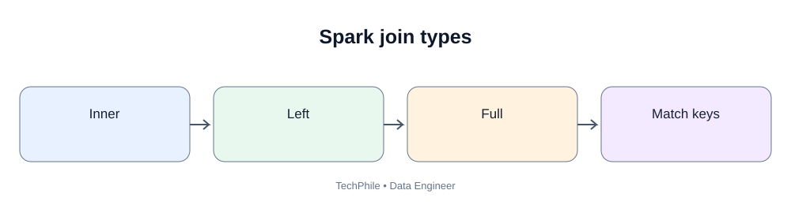
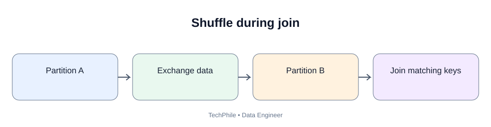
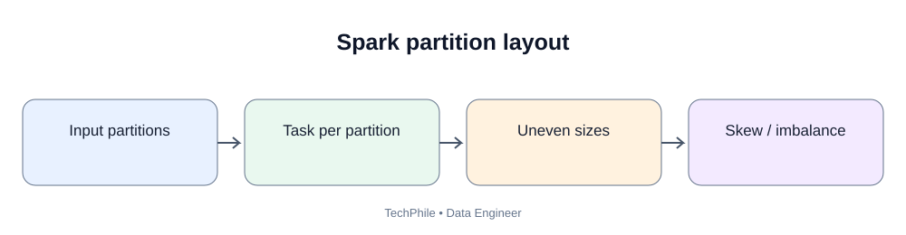

# Day 57: Spark Joins and Partitioning

**Phase:** 6 — Cloud and Distributed Processing  
**Learning time:** 2–3 hours  
**Audience:** Complete beginners and junior Data Engineer candidates  
**Technology:** PySpark DataFrames  
**Topic boundary:** Class notes only. Project workbook and interview guide are separate files.

> A sales dataset rarely contains every business detail in one file. Orders may contain customer IDs, while customer details live in another dataset. Today you will join orders, customers and products, understand join types, detect unmatched records and learn how Spark partitions data using repartition, coalesce and partitioned file output.

## Learning outcomes

- Explain why data engineers join datasets.
- Understand join keys and matching rows.
- Use inner, left, right and full outer joins.
- Understand left semi and left anti joins.
- Handle duplicate keys and null join keys.
- Avoid ambiguous column names.
- Understand repartition and coalesce.
- Explain shuffle during repartition.
- Write partitioned output using partitionBy.
- Validate join results and partition output.

---

# Part 1 — Why do we join datasets?

## 1. Business scenario

TechStore stores order records separately from customer details.

Orders:

| order_id | customer_id | amount |
|---:|---|---:|
| 101 | C001 | 250 |
| 102 | C002 | 499 |
| 103 | C001 | 100 |
| 104 | C003 | 750 |
| 105 | C005 | 300 |

Customers:

| customer_id | customer_name | city |
|---|---|---|
| C001 | Ravi | Hyderabad |
| C002 | Meena | Chennai |
| C003 | Arjun | Bengaluru |
| C004 | Sana | Pune |

The order table does not contain customer_name or city.

The customer table does not contain order amount.

To create a report with order and customer information, we join the datasets using customer_id.

## 2. What is a join?

A join combines rows from two DataFrames based on a matching condition.

The matching column is called a join key.

In this example:
- left DataFrame: orders;
- right DataFrame: customers;
- join key: customer_id.

A join can return:
- only matching rows;
- all rows from the left side;
- all rows from the right side;
- all rows from both sides.

The join type determines the result.

## 3. Why does the join key matter?

A join key should represent the intended relationship.

Examples:
- orders.customer_id = customers.customer_id;
- orders.product_id = products.product_id;
- payments.order_id = orders.order_id.

Joining on the wrong column can produce incorrect results or a huge row count.

Never choose a join key merely because two columns have similar names.

---

# Part 2 — Prepare practice DataFrames

## 4. Start Spark

~~~python
from pyspark.sql import SparkSession

spark = (
    SparkSession.builder
    .appName("Day57JoinsAndPartitions")
    .master("local[*]")
    .getOrCreate()
)
~~~

## 5. Create orders

~~~python
orders_data = [
    (101, "C001", 250),
    (102, "C002", 499),
    (103, "C001", 100),
    (104, "C003", 750),
    (105, "C005", 300)
]

orders = spark.createDataFrame(
    orders_data,
    ["order_id", "customer_id", "amount"]
)

orders.show()
~~~

## 6. Create customers

~~~python
customers_data = [
    ("C001", "Ravi", "Hyderabad"),
    ("C002", "Meena", "Chennai"),
    ("C003", "Arjun", "Bengaluru"),
    ("C004", "Sana", "Pune")
]

customers = spark.createDataFrame(
    customers_data,
    ["customer_id", "customer_name", "city"]
)

customers.show()
~~~

Expected customer rows: C001, C002, C003 and C004.

## 7. Inspect keys before joining

~~~python
orders.select("customer_id").distinct().show()
customers.select("customer_id").distinct().show()
~~~

Order customer IDs: C001, C002, C003 and C005.

Customer IDs: C001, C002, C003 and C004.

Therefore:
- C001, C002 and C003 match;
- C005 exists in orders but not customers;
- C004 exists in customers but has no order in this sample.

---

# Part 3 — Inner join

## 8. What is an inner join?

An inner join returns only rows with matching keys on both sides.

~~~python
inner_result = orders.join(
    customers,
    on="customer_id",
    how="inner"
)

inner_result.show()
~~~

Expected result:

| order_id | customer_id | amount | customer_name | city |
|---:|---|---:|---|---|
| 101 | C001 | 250 | Ravi | Hyderabad |
| 103 | C001 | 100 | Ravi | Hyderabad |
| 102 | C002 | 499 | Meena | Chennai |
| 104 | C003 | 750 | Arjun | Bengaluru |

Spark may display rows in a different order unless you sort them.

C005 is excluded because there is no matching customer row.

C004 is excluded because there is no matching order row.

## 9. When should you use inner join?

Use inner join when the business result should contain only records with valid matches on both sides.

Example:
A report that includes only orders linked to a known customer.

Do not use inner join if unmatched source records must be retained for investigation.

---

# Part 4 — Left join

## 10. What is a left join?

A left join keeps every row from the left DataFrame.

If the right side has no matching key, right-side columns become null.

~~~python
left_result = orders.join(
    customers,
    on="customer_id",
    how="left"
)

left_result.orderBy("order_id").show()
~~~

Expected result:

| order_id | customer_id | amount | customer_name | city |
|---:|---|---:|---|---|
| 101 | C001 | 250 | Ravi | Hyderabad |
| 102 | C002 | 499 | Meena | Chennai |
| 103 | C001 | 100 | Ravi | Hyderabad |
| 104 | C003 | 750 | Arjun | Bengaluru |
| 105 | C005 | 300 | null | null |

C005 is retained because it exists on the left side.

## 11. When should you use left join?

Use it when all rows from the main dataset must remain.

Examples:
- retain every order even if customer details are missing;
- retain every event even if product metadata is not available;
- identify missing dimension records.

---

# Part 5 — Right join

## 12. What is a right join?

A right join keeps every row from the right DataFrame.

~~~python
right_result = orders.join(
    customers,
    on="customer_id",
    how="right"
)

right_result.orderBy("customer_id").show()
~~~

Expected customer keys include C001, C002, C003 and C004.

C004 remains even though it has no matching order. Its order columns are null.

Right joins are valid, but many teams prefer to reorder the inputs and use a left join for readability.

---

# Part 6 — Full outer join

## 13. What is a full outer join?

A full outer join keeps matching and unmatched rows from both sides.

~~~python
full_result = orders.join(
    customers,
    on="customer_id",
    how="full"
)

full_result.orderBy("customer_id", "order_id").show()
~~~

Expected key coverage:
- C001, C002 and C003 have matches;
- C004 is a customer without an order;
- C005 is an order without a customer.

The unmatched side contains null values.

## 14. When is full outer join useful?

It can help with:
- reconciliation;
- source comparison;
- identifying records missing from one system;
- comparing two versions of a dataset.

It is not automatically the right join for a reporting query. Choose based on business requirements.

---

# Part 7 — Left semi and left anti joins

## 15. What is a left semi join?

A left semi join returns rows from the left DataFrame that have a match on the right.

It returns left-side columns only.

~~~python
matched_orders = orders.join(
    customers,
    on="customer_id",
    how="left_semi"
)

matched_orders.orderBy("order_id").show()
~~~

Expected order IDs: 101, 102, 103 and 104.

## 16. What is a left anti join?

A left anti join returns rows from the left DataFrame that do not have a match on the right.

~~~python
unmatched_orders = orders.join(
    customers,
    on="customer_id",
    how="left_anti"
)

unmatched_orders.show()
~~~

Expected result:

| order_id | customer_id | amount |
|---:|---|---:|
| 105 | C005 | 300 |

This is useful for finding missing dimension records or failed reference matches.

## 17. Compare join types

| Join type | Rows retained |
|---|---|
| inner | Matching rows only |
| left | All left rows plus matching right values |
| right | All right rows plus matching left values |
| full | All rows from both sides |
| left_semi | Left rows that have a match |
| left_anti | Left rows that do not have a match |

---

# Part 8 — Join on different column names

## 18. Join using an explicit condition

Sometimes the key columns have different names.

Example:
- orders.customer_id;
- customer_master.id.

Use a condition:

~~~python
joined_different_names = orders.join(
    customer_master,
    orders.customer_id == customer_master.id,
    "inner"
)
~~~

This example assumes customer_master exists and has an id column.

When the names differ, both key columns may appear in the output. Select the columns you need and rename them clearly.

## 19. Avoid ambiguous columns

If both DataFrames contain a column called status, a later reference to status may be ambiguous.

Use aliases:

~~~python
o = orders.alias("o")
c = customers.alias("c")

joined = o.join(
    c,
    col("o.customer_id") == col("c.customer_id"),
    "left"
)
~~~

Then select explicit columns:

~~~python
joined.select(
    col("o.order_id"),
    col("o.customer_id"),
    col("o.amount"),
    col("c.customer_name"),
    col("c.city")
).show()
~~~

Aliases make the source of each column clear.

---

# Part 9 — Duplicate keys and join multiplication

## 20. Why duplicate keys matter

Suppose the customer table contains two rows for C001.

An order for C001 may match both rows.

This can multiply output rows.

Example:
- one order row for C001;
- two customer rows for C001;
- join output contains two rows for that order.

This may inflate sales totals.

## 21. Demonstrate duplicate keys

~~~python
customers_duplicate_data = [
    ("C001", "Ravi", "Hyderabad"),
    ("C001", "Ravi Kumar", "Hyderabad"),
    ("C002", "Meena", "Chennai")
]

customers_duplicate = spark.createDataFrame(
    customers_duplicate_data,
    ["customer_id", "customer_name", "city"]
)

duplicate_join = orders.join(
    customers_duplicate,
    on="customer_id",
    how="inner"
)

duplicate_join.filter(
    col("customer_id") == "C001"
).show()
~~~

The two orders for C001 each match two customer rows. Four output rows are produced for C001.

## 22. Validate dimension key uniqueness

~~~python
customer_key_counts = customers_duplicate.groupBy(
    "customer_id"
).count()

customer_key_counts.filter(
    col("count") > 1
).show()
~~~

Expected result identifies C001 with count 2.

Before joining a fact dataset to a dimension, understand whether the dimension key is expected to be unique at the relevant point in time.

## 23. Do not remove duplicates blindly

If C001 has two customer records, determine why:
- accidental duplicate;
- source system conflict;
- historical customer versions;
- multiple addresses;
- slowly changing dimension rows.

The correct handling depends on the model and effective dates.

---

# Part 10 — Null join keys

## 24. Do null keys match?

In standard equality comparisons, null does not equal null.

A join using ordinary equality will not match null keys.

If the business requires special null matching behavior, use an explicitly chosen null-safe comparison supported by the Spark API and validate its consequences.

Do not convert every null key to the same placeholder without checking whether that creates false matches.

## 25. Find null join keys before joining

~~~python
orders.filter(
    col("customer_id").isNull()
).show()
~~~

Missing join keys should be measured and handled according to data quality rules.

---

# Part 11 — Understand Spark partitions

## 26. What is a Spark partition?

A Spark partition is a logical chunk of a DataFrame's distributed data.

Spark tasks process partitions.

The number and size of partitions affect:
- parallelism;
- task scheduling;
- memory use;
- shuffle;
- output file count.

## 27. Inspect partition count

~~~python
print("Partitions:", orders.rdd.getNumPartitions())
~~~

The exact number depends on how the DataFrame was created and the Spark environment.

Do not copy another student's partition count as your own result.

## 28. What is repartition()?

repartition() changes the number or distribution of partitions.

It generally causes a shuffle so Spark can redistribute records.

~~~python
orders_repartitioned = orders.repartition(4)

print("Partitions after repartition:", orders_repartitioned.rdd.getNumPartitions())
~~~

Expected partition count:

~~~text
Partitions after repartition: 4
~~~

The exact count is four because the requested partition count is explicit. The amount of data in each partition may not be perfectly equal.

## 29. Repartition by a column

~~~python
orders_by_city = orders.repartition(
    4,
    "city"
)

print("Partitions:", orders_by_city.rdd.getNumPartitions())
~~~

This redistributes rows using city as a partitioning expression.

Rows with the same city value are directed to the same hash partition for this repartition operation, but different cities can share a partition.

Do not assume each city gets a separate partition.

## 30. What is coalesce()?

coalesce() is commonly used to reduce the number of partitions while avoiding a full shuffle in typical use.

~~~python
orders_coalesced = orders_repartitioned.coalesce(2)

print("Partitions after coalesce:", orders_coalesced.rdd.getNumPartitions())
~~~

Expected partition count:

~~~text
Partitions after coalesce: 2
~~~

coalesce() is useful when reducing output partition count. It does not generally redistribute data evenly like repartition.

## 31. Compare repartition and coalesce

| Operation | Typical behavior | Shuffle |
|---|---|---|
| repartition(n) | Increase or decrease and redistribute partitions | Full shuffle generally occurs |
| coalesce(n) | Reduce partition count efficiently | Avoids full shuffle in typical use |

If you need a more even distribution or must increase partitions, use repartition. If you only need to reduce partitions, coalesce may be appropriate.

---

# Part 12 — Write partitioned files

## 32. What does partitionBy() do?

partitionBy() organizes output files into directory prefixes based on selected column values.

This is storage partitioning for output layout. It is related to, but not identical to, Spark's in-memory execution partitions.

## 33. Write sales data partitioned by city

~~~python
orders.write.mode("overwrite").partitionBy(
    "city"
).parquet("spark_day57/output/orders_by_city")
~~~

The output may look like:

~~~text
orders_by_city/
    city=Bengaluru/
        part-....parquet
    city=Chennai/
        part-....parquet
    city=Hyderabad/
        part-....parquet
~~~

The exact part-file count depends on the DataFrame's execution partitions.

## 34. Why partition output?

A query that filters for one city may be able to read only the relevant partition when the query engine supports partition pruning.

However, partitioning by a column with many unique values can create many small folders and files.

Choose partition columns based on query patterns and data volume.

## 35. Do not confuse three ideas

| Term | Meaning |
|---|---|
| Spark execution partition | Chunk processed by a task |
| DataFrame repartition/coalesce | Change execution partition layout |
| Storage partitionBy | Organize output files by column values |

They are related but not interchangeable.

---

# Part 13 — Join and partition validation

## 36. Compare row counts

Before and after a join, record row counts.

An inner join may reduce rows.
A left join should preserve left-side rows only when the right key is unique; duplicate right keys can multiply rows.
A full join may contain more rows than either input.

Never assume a join preserves the original row count.

## 37. Validate unmatched records

Use left_anti to identify left-side records without a match.

Use a reverse left_anti or full outer join to identify records missing from the other side.

## 38. Validate totals

If joining order rows to customer attributes, compare total amount before and after the join.

If the amount increases unexpectedly, check:
- duplicate customer keys;
- incorrect join condition;
- many-to-many relationships;
- historical dimension rows;
- unintended row multiplication.

## 39. Validate partitioned output

Check:
- expected partition columns;
- folder names;
- file count;
- row counts;
- null partition values;
- whether partitions are too small;
- whether downstream tools can read the output.

---

# Part 14 — Common mistakes

| Mistake | Why it is wrong | Better practice |
|---|---|---|
| Join on similarly named but unrelated columns | Produces incorrect matches | Confirm business key |
| Use inner join for all cases | Unmatched records disappear | Choose join type from requirement |
| Ignore duplicate dimension keys | Join can multiply facts | Validate key uniqueness |
| Ignore null join keys | Records may fail to match | Measure and handle nulls |
| Use ambiguous column names | Queries become unclear or fail | Alias and select explicitly |
| Assume join preserves row count | One-to-many matches multiply rows | Validate cardinality |
| Repartition constantly | Adds shuffle cost | Repartition only when needed |
| Use coalesce to increase partitions | It is intended primarily to reduce | Use repartition |
| Partition storage by high-cardinality field | Creates too many tiny directories/files | Choose sensible partition keys |
| Confuse execution partitions and storage partitions | Different concepts | Explain each separately |

---

# Part 15 — Practice questions

## Exercise 1

What does an inner join return?

**Answer:** Rows with matching keys on both sides.

## Exercise 2

Which join keeps all rows from the left DataFrame?

**Answer:** Left join.

## Exercise 3

Which join identifies orders without a matching customer?

**Answer:** Left anti join.

## Exercise 4

Why can duplicate customer keys increase order totals?

**Answer:** Each order may match multiple customer rows, multiplying the joined records.

## Exercise 5

What is repartition?

**Answer:** An operation that redistributes data into a requested number of Spark partitions, generally using a shuffle.

## Exercise 6

What is coalesce?

**Answer:** An operation commonly used to reduce partition count with less data movement than a full repartition.

## Exercise 7

What does partitionBy do?

**Answer:** Organizes written files into storage directories/prefixes based on selected column values.

## Exercise 8

Why should you validate totals after a join?

**Answer:** To detect duplicate keys, wrong join conditions and unintended row multiplication.

---

# Part 16 — Revision sheet

| Term | Remember |
|---|---|
| Join | Combines rows based on a condition |
| Join key | Column(s) used to match rows |
| Inner join | Matching rows only |
| Left join | All left rows |
| Right join | All right rows |
| Full outer join | All rows from both sides |
| Left semi | Left rows with a match |
| Left anti | Left rows without a match |
| Duplicate key | Key appears more than once |
| Join multiplication | One row matches multiple rows |
| Spark partition | Chunk of distributed data |
| repartition | Redistributes data and generally shuffles |
| coalesce | Commonly reduces partition count with less shuffle |
| partitionBy | Organizes output files by column values |

## Final self-check

- [ ] Explain why datasets are joined.
- [ ] Use inner, left, right and full joins.
- [ ] Use left semi and left anti joins.
- [ ] Identify unmatched and null keys.
- [ ] Detect duplicate keys and join multiplication.
- [ ] Use aliases to avoid ambiguous columns.
- [ ] Explain Spark execution partitions.
- [ ] Compare repartition and coalesce.
- [ ] Write output partitioned by a column.
- [ ] Validate row counts and totals after joins.

**Next lesson — Day 58: Spark Performance Optimization.** You will inspect execution plans, understand shuffle and caching, learn partition pruning and data skew, and compare performance using a repeatable experiment.

---

# Part 17 — Build a complete orders, customers and products join lab

The earlier examples used two small DataFrames. In a real warehouse pipeline, you often combine a fact-like dataset with multiple reference datasets.

This lab creates three inputs and joins them one step at a time.

## 40. Create the business input data

Orders have one row per order line:

~~~python
orders_data = [
    (1001, 1, "C001", "P01", 2, 100.00),
    (1001, 2, "C001", "P02", 1, 250.00),
    (1002, 1, "C002", "P01", 1, 100.00),
    (1003, 1, "C003", "P03", 3, 50.00),
    (1004, 1, "C005", "P02", 2, 250.00),
    (1005, 1, "C002", "P04", 1, 500.00)
]

orders = spark.createDataFrame(
    orders_data,
    ["order_id", "line_number", "customer_id", "product_id", "quantity", "unit_price"]
)

orders.show()
~~~

Expected input: six order-line rows.

Understand the grain: one row represents one product line in an order. order_id can repeat in a larger dataset. The combination order_id and line_number identifies the order line in this example.

## 41. Create customer data

~~~python
customers_data = [
    ("C001", "Ravi", "Hyderabad"),
    ("C002", "Meena", "Chennai"),
    ("C003", "Arjun", "Bengaluru"),
    ("C004", "Sana", "Pune")
]

customers = spark.createDataFrame(
    customers_data,
    ["customer_id", "customer_name", "customer_city"]
)

customers.show()
~~~

There are four customer records. C005 is deliberately missing so we can detect an unmatched order.

## 42. Create product data

~~~python
products_data = [
    ("P01", "Keyboard", "Accessories"),
    ("P02", "Monitor", "Electronics"),
    ("P03", "Mouse", "Accessories")
]

products = spark.createDataFrame(
    products_data,
    ["product_id", "product_name", "category"]
)

products.show()
~~~

There are three product records. P04 is deliberately missing.

## 43. Inspect the business keys

~~~python
orders.select("customer_id").distinct().orderBy("customer_id").show()
customers.select("customer_id").distinct().orderBy("customer_id").show()

orders.select("product_id").distinct().orderBy("product_id").show()
products.select("product_id").distinct().orderBy("product_id").show()
~~~

Expected unmatched keys:
- customer_id C005;
- product_id P04.

Before joining, understand the key coverage. This predicts which source rows will be unmatched.

## 44. Join orders to customers

~~~python
order_customer = orders.join(
    customers,
    on="customer_id",
    how="left"
)

order_customer.orderBy("order_id", "line_number").show()
~~~

Expected result has six rows because customer_id is unique in the customer DataFrame.

The C005 order line remains, but customer_name and customer_city are null.

Why use a left join? The order line is the main business record. We do not want to silently remove it just because a customer lookup is missing.

## 45. Join the result to products

~~~python
order_customer_product = order_customer.join(
    products,
    on="product_id",
    how="left"
)

order_customer_product.orderBy(
    "order_id",
    "line_number"
).show()
~~~

Expected result still has six rows because product_id is unique in the product DataFrame.

The P04 line remains, but product_name and category are null.

## 46. Calculate line sales

~~~python
from pyspark.sql.functions import col

joined_sales = order_customer_product.withColumn(
    "line_sales",
    col("quantity") * col("unit_price")
)

joined_sales.select(
    "order_id",
    "line_number",
    "customer_name",
    "product_name",
    "category",
    "quantity",
    "unit_price",
    "line_sales"
).orderBy("order_id", "line_number").show()
~~~

Expected line sales:

| order_id | line_number | customer | product | category | quantity | unit_price | line_sales |
|---:|---:|---|---|---|---:|---:|---:|
| 1001 | 1 | Ravi | Keyboard | Accessories | 2 | 100.00 | 200.00 |
| 1001 | 2 | Ravi | Monitor | Electronics | 1 | 250.00 | 250.00 |
| 1002 | 1 | Meena | Keyboard | Accessories | 1 | 100.00 | 100.00 |
| 1003 | 1 | Arjun | Mouse | Accessories | 3 | 50.00 | 150.00 |
| 1004 | 1 | null | Monitor | Electronics | 2 | 250.00 | 500.00 |
| 1005 | 1 | Meena | null | null | 1 | 500.00 | 500.00 |

Total line sales = 1,700.00.

The total is calculated from all six order lines, including lines with missing reference details. Missing descriptive attributes do not make the order line disappear.

## 47. Find orders with missing customer details

~~~python
missing_customers = order_customer.join(
    customers,
    on="customer_id",
    how="left_anti"
)

missing_customers.select(
    "order_id",
    "line_number",
    "customer_id"
).show()
~~~

Expected result: order 1004, line 1, customer C005.

Note: This uses the original orders DataFrame for the anti join. If you use a DataFrame that already contains customer columns, select the intended fields carefully.

## 48. Find order lines with missing product details

~~~python
missing_products = orders.join(
    products,
    on="product_id",
    how="left_anti"
)

missing_products.select(
    "order_id",
    "line_number",
    "product_id"
).show()
~~~

Expected result: order 1005, line 1, product P04.

This is a useful quality check before publishing a curated sales dataset.

## 49. Aggregate sales by category

For this exercise, keep unmatched product rows visible in the joined data, but do not assign them an invented category.

~~~python
category_sales = (
    joined_sales
    .filter(col("category").isNotNull())
    .groupBy("category")
    .sum("line_sales")
    .withColumnRenamed("sum(line_sales)", "category_sales")
)

category_sales.orderBy("category").show()
~~~

Expected values:

| category | category_sales |
|---|---:|
| Accessories | 450.00 |
| Electronics | 750.00 |

The unmatched P04 line contributes 500.00 to the overall order-line total but is not included in a known product category. Report that unmatched amount separately rather than silently losing it.

## 50. Reconcile the joined result

~~~python
from pyspark.sql.functions import sum, count

joined_sales.select(
    count("*").alias("joined_line_count"),
    sum("line_sales").alias("joined_sales_total")
).show()
~~~

Expected result:

| joined_line_count | joined_sales_total |
|---:|---:|
| 6 | 1700.00 |

Compare with the source order-line calculation:

~~~python
orders.withColumn(
    "line_sales",
    col("quantity") * col("unit_price")
).select(
    count("*").alias("source_line_count"),
    sum("line_sales").alias("source_sales_total")
).show()
~~~

Expected source result: six lines and 1,700.00.

If the joined total is higher, investigate duplicate customer or product keys. If lower, investigate inner joins, filters or missing rows.

---

# Part 18 — Demonstrate join multiplication

## 51. Create a duplicate product dimension

~~~python
duplicate_products_data = [
    ("P01", "Keyboard", "Accessories"),
    ("P01", "Keyboard - Old", "Accessories"),
    ("P02", "Monitor", "Electronics"),
    ("P03", "Mouse", "Accessories")
]

duplicate_products = spark.createDataFrame(
    duplicate_products_data,
    ["product_id", "product_name", "category"]
)
~~~

P01 appears twice.

## 52. Join without validating uniqueness

~~~python
duplicate_product_join = orders.join(
    duplicate_products,
    on="product_id",
    how="left"
)

print("Original order lines:", orders.count())
print("Joined rows:", duplicate_product_join.count())
~~~

Expected output:
- original order lines: 6;
- joined rows: 8.

Why eight?
- P01 appears in two order lines;
- each P01 line matches two product records;
- those two lines produce four joined rows instead of two;
- the other four order lines each produce one joined row;
- total = 4 + 4 = 8.

The correct joined row count is **8**.

This example demonstrates why row-count validation matters. A duplicate dimension key can multiply fact rows and inflate measures.

## 53. Detect duplicate product keys

~~~python
duplicate_product_keys = (
    duplicate_products
    .groupBy("product_id")
    .count()
    .filter(col("count") > 1)
)

duplicate_product_keys.show()
~~~

Expected output identifies P01 with count 2.

Resolve the duplicate using a documented rule:
- choose the authoritative current record;
- use effective dates for historical dimensions;
- consult source priority or update sequence;
- quarantine conflicting records if the correct version is unknown.

Do not call dropDuplicates("product_id") and assume the retained row is correct.

---

# Part 19 — Handle null join keys deliberately

## 54. Create a row with a missing customer key

~~~python
orders_with_null_key = spark.createDataFrame(
    [
        (2001, "C001", 100),
        (2002, None, 200)
    ],
    ["order_id", "customer_id", "amount"]
)

orders_with_null_key.show()
~~~

## 55. Run a normal left join

~~~python
null_key_join = orders_with_null_key.join(
    customers,
    on="customer_id",
    how="left"
)

null_key_join.show()
~~~

The row with a null customer_id does not match an ordinary customer key. Its customer descriptive columns remain null.

## 56. Find missing keys before joining

~~~python
orders_with_null_key.filter(
    col("customer_id").isNull()
).show()
~~~

A missing key should be recorded as a data quality issue. Do not replace every missing key with a shared placeholder that might match an unrelated row.

---

# Part 20 — Partition experiments in Spark

## 57. Inspect the original partition count

~~~python
print("Original partitions:", orders.rdd.getNumPartitions())
~~~

The value depends on how the DataFrame was created and the local Spark environment.

Record your actual output.

## 58. Repartition to four partitions

~~~python
orders_four_partitions = orders.repartition(4)

print("After repartition:", orders_four_partitions.rdd.getNumPartitions())
~~~

Expected output:

~~~text
After repartition: 4
~~~

repartition(4) requests four execution partitions. It normally causes a shuffle to redistribute records.

## 59. Inspect records per partition

Before running this cell, import the function:

~~~python
from pyspark.sql.functions import spark_partition_id
~~~

Then run:

~~~python
partition_sizes = (
    orders_four_partitions
    .groupBy(spark_partition_id().alias("partition_id"))
    .count()
    .orderBy("partition_id")
)

partition_sizes.show()
~~~

The number of rows in each partition can vary. With only six training rows and four partitions, some partitions may contain one or more rows and some may be empty.

The purpose is to inspect distribution, not to force equal row counts.

## 60. Repartition by customer ID

~~~python
orders_by_customer = orders.repartition(
    4,
    "customer_id"
)

print("Partitions:", orders_by_customer.rdd.getNumPartitions())
~~~

Rows with the same customer_id are directed to the same hash partition for this operation. Different customers can share a partition.

This can be useful for some later operations, but repartitioning has a shuffle cost.

## 61. Reduce partitions with coalesce

~~~python
orders_two_partitions = orders_four_partitions.coalesce(2)

print("After coalesce:", orders_two_partitions.rdd.getNumPartitions())
~~~

Expected output:

~~~text
After coalesce: 2
~~~

coalesce is commonly used to reduce partitions without a full shuffle. It may produce uneven partition sizes.

## 62. Compare partition counts

~~~python
print("Original:", orders.rdd.getNumPartitions())
print("Repartitioned:", orders_four_partitions.rdd.getNumPartitions())
print("Coalesced:", orders_two_partitions.rdd.getNumPartitions())
~~~

Use your actual original partition count. The requested repartition and coalesce results should be four and two.

---

# Part 21 — Write and inspect storage partitions

## 63. Write output partitioned by city

~~~python
orders.write.mode("overwrite").partitionBy(
    "city"
).parquet("spark_day57/output/orders_by_city")
~~~

Expected folder structure resembles:

~~~text
orders_by_city/
    city=Bengaluru/
    city=Chennai/
    city=Hyderabad/
~~~

There may be multiple part files under a city directory. Exact file names depend on Spark execution.

## 64. Read the partitioned output

~~~python
orders_by_city = spark.read.parquet(
    "spark_day57/output/orders_by_city"
)

orders_by_city.printSchema()
orders_by_city.orderBy("order_id").show()
~~~

Spark can restore the partition column from the folder layout when reading the dataset.

## 65. Filter one partition value

~~~python
hyderabad_orders = orders_by_city.filter(
    col("city") == "Hyderabad"
)

hyderabad_orders.show()
~~~

The query can benefit from partition pruning when the file source and plan support it. Inspect the execution plan rather than assuming that every read skips unrelated data.

## 66. Inspect the plan

~~~python
hyderabad_orders.explain()
~~~

Look for partition filters and file scan details. The exact plan depends on Spark version and reader configuration.

---

# Part 22 — Join strategy awareness

## 67. What is a broadcast join?

If one DataFrame is small enough, Spark may distribute a copy of it to executors so the larger DataFrame can be joined without shuffling both sides in the usual way.

This is called a broadcast join.

For example, a small product lookup may be joined to a very large order dataset.

## 68. Why broadcast can help

It may reduce shuffle of the large dataset when:
- one side is genuinely small;
- the broadcast fits in executor memory;
- the join type and plan support the strategy.

## 69. Why broadcast can hurt

Broadcasting a large dataset can:
- consume executor memory;
- increase network transfer;
- cause memory pressure or failure.

Do not force broadcast simply because one DataFrame is called a dimension. Inspect its actual size and Spark's plan.

## 70. Inspect join plan

~~~python
orders.join(
    customers,
    on="customer_id",
    how="left"
).explain()
~~~

The plan may show a join strategy selected by Spark. The strategy depends on statistics, configuration, join conditions and Spark version.

Day 58 will study performance and plan analysis more deeply.

---

# Part 23 — Common engineering checks after a join

Before publishing a joined dataset, ask:

1. What is the grain of the left dataset?
2. What is the grain of the right dataset?
3. Is the join key unique where required?
4. Are null keys present?
5. How many left-side keys have no match?
6. How many right-side keys have no match?
7. Can the join multiply rows?
8. Does the output row count make sense?
9. Do business totals reconcile?
10. Are descriptive values valid for the event date?
11. Is a historical dimension involved?
12. Is the selected join type consistent with the requirement?

A join that runs successfully can still be logically wrong.

---

# Part 24 — More practice exercises with worked answers

## Exercise 9 — Left join

A report must keep every order even if the customer lookup is missing. Which join should be used?

**Worked answer:** Left join with orders as the left DataFrame.

## Exercise 10 — Anti join

You need to identify orders whose customer_id does not exist in the customer table. Which operation is useful?

**Worked answer:** Left anti join from orders to customers.

## Exercise 11 — Duplicate dimension key

A customer key appears twice in a dimension. Why can the order total increase after joining?

**Worked answer:** Each order for that key may match both dimension rows, multiplying order records.

## Exercise 12 — Null key

An order has customer_id = null. Will an ordinary equality join match it to another null customer_id?

**Worked answer:** No. Ordinary equality does not treat null as equal to null. Handle missing keys explicitly.

## Exercise 13 — Repartition

Why does repartition often cause a shuffle?

**Worked answer:** Spark redistributes rows across the requested partitions so the new partition layout can be created.

## Exercise 14 — Coalesce

You have 100 partitions and want fewer output partitions. Which operation may be appropriate?

**Worked answer:** coalesce can reduce the number of partitions with less data movement than a full repartition in typical use.

## Exercise 15 — Storage partitioning

Does DataFrame repartition(4) create four city folders?

**Worked answer:** No. repartition changes execution partitions. partitionBy("city") organizes written files into city-based storage prefixes.

## Exercise 16 — Broadcast

A product lookup has 500 MB of data. Should it automatically be broadcast to every executor?

**Worked answer:** No. Check executor memory, network cost, actual compressed/in-memory size and Spark's plan. A 500 MB dataset may be too large for a safe broadcast.

## Exercise 17 — Join validation

The join output has more rows than the order input. What should you inspect?

**Worked answer:** Duplicate keys on the right side, join condition, relationship cardinality and many-to-many matches.

---

# Part 25 — Day 57 practical completion checklist

### Join concepts
- [ ] Explain join keys and business relationships.
- [ ] Use inner, left, right and full outer joins.
- [ ] Use left semi and left anti joins.
- [ ] Join on differently named columns.
- [ ] Use aliases to avoid ambiguous columns.
- [ ] Detect null join keys.
- [ ] Detect duplicate dimension keys.
- [ ] Explain join multiplication.

### Spark partitioning
- [ ] Inspect the number of execution partitions.
- [ ] Use repartition by count.
- [ ] Repartition by a key.
- [ ] Use coalesce to reduce partitions.
- [ ] Explain the shuffle cost of repartition.
- [ ] Distinguish execution partitions from storage partitions.
- [ ] Write Parquet output using partitionBy.
- [ ] Inspect a partition-filtered execution plan.

### Data correctness
- [ ] Validate row counts before and after joins.
- [ ] Find unmatched customer and product keys.
- [ ] Reconcile line-level sales totals.
- [ ] Explain why duplicate dimension keys inflate measures.
- [ ] Keep unmatched records visible for investigation.
- [ ] Publish only after quality checks pass.

## Final self-assessment

Without looking at the notes, explain:

1. What is a join key?
2. How do inner, left, right and full joins differ?
3. When is a left anti join useful?
4. Why can duplicate dimension keys multiply fact rows?
5. Why should null join keys be checked?
6. What is the difference between repartition and coalesce?
7. What is the difference between execution partitions and partitionBy?
8. What is a broadcast join and when can it be risky?
9. Which row-count and total checks should follow a join?
10. Why can a successful Spark join still produce an incorrect business result?

If you can complete the three-dataset join lab, identify unmatched records and validate totals, you are ready for Day 58.

**Next lesson — Day 58: Spark Performance Optimization.** You will inspect execution plans, understand shuffle and caching, learn partition pruning and data skew, and compare performance using a repeatable experiment.

---

## Visual Learning Diagrams

### Spark join types

### Shuffle during join

### Spark partition layout

