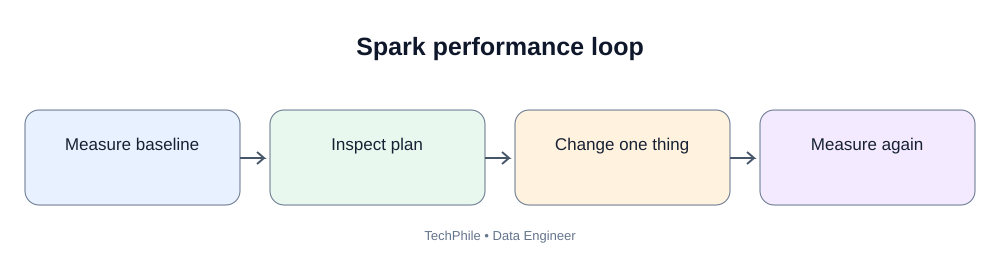
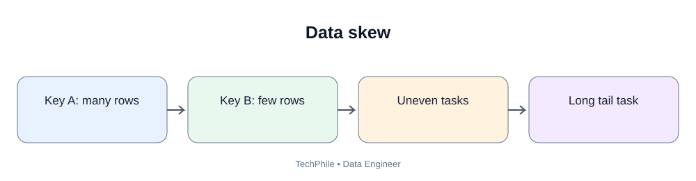
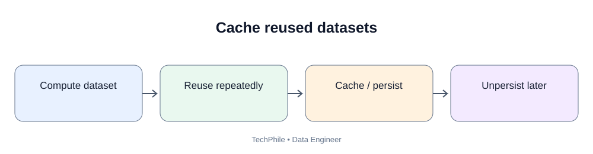

# Day 58: Spark Performance Optimization

**Phase:** 6 — Cloud and Distributed Processing  
**Learning time:** 2–3 hours  
**Audience:** Complete beginners and junior Data Engineer candidates  
**Technology:** PySpark  
**Topic boundary:** Class notes only. Project workbook and interview guide are separate files.

> A Spark job can produce the correct result and still be too slow or expensive. Today you will learn how to investigate performance rather than guessing. We will inspect execution plans, understand shuffle, cache and persistence, partition pruning, data skew, broadcast joins and file layout. You will also learn to measure before and after changes and validate that optimization has not changed the business result.

## Learning outcomes

- Explain why Spark jobs become slow.
- Establish a repeatable baseline.
- Read a basic Spark execution plan.
- Understand narrow and wide transformations.
- Explain shuffle and spill.
- Use cache and persist carefully.
- Understand partition pruning.
- Recognize data skew and stragglers.
- Understand broadcast joins.
- Avoid unnecessary actions, collect and Python UDFs.
- Explain small-file and output partition problems.
- Validate correctness after optimization.

---

# Part 1 — What is Spark performance?

## 1. Beginner definition

Spark performance describes how efficiently a Spark application processes data.

It can include:
- total job duration;
- stage and task duration;
- CPU and memory use;
- shuffle read and write;
- disk spill;
- data scanned;
- number and size of tasks;
- output file count;
- cloud compute cost.

A job that finishes quickly on a small sample may behave differently on production data.

## 2. Why can Spark jobs become slow?

Common causes:
- too much data is read;
- unnecessary columns are selected;
- large shuffles;
- skewed join keys;
- too many tiny files;
- too few or too many partitions;
- repeated recomputation;
- excessive caching;
- Python UDF overhead;
- driver collects too much data;
- insufficient cluster resources;
- slow external storage or database;
- expensive joins and sorts.

Do not increase the cluster size before identifying the bottleneck.

## 3. Correctness comes before speed

An optimized job must return the intended business result.

Before and after tuning, compare:
- row count;
- distinct business keys;
- important totals;
- null counts;
- duplicate counts;
- filter conditions;
- output schema.

A faster wrong result is a production defect.

---

# Part 2 — Measure a baseline

## 4. What is a baseline?

A baseline is the measured starting performance before a change.

Record:
- Spark version;
- local or cluster mode;
- input data size;
- row count;
- number of partitions;
- query or transformation;
- execution time;
- plan;
- resource configuration;
- cache state.

## 5. Why does one timing not prove improvement?

Execution time can vary because of:
- cold versus warm cache;
- other users;
- CPU availability;
- network conditions;
- file system behavior;
- cluster startup;
- adaptive query execution;
- background processes.

Run comparable tests and record the conditions.

## 6. Measure a simple action

~~~python
import time

start_time = time.time()

row_count = orders.count()

end_time = time.time()

elapsed_seconds = end_time - start_time

print("Rows:", row_count)
print("Elapsed seconds:", round(elapsed_seconds, 3))
~~~

Example output shape:

~~~text
Rows: 5
Elapsed seconds: <measured value>
~~~

The time is environment-dependent. Do not copy another person's timing and claim it is yours.

## 7. Why use the same input?

If the first test reads 1,000 rows and the second reads 1,000,000 rows, the timing comparison is not fair.

Keep the following consistent:
- same input;
- same transformations;
- same output requirement;
- same compute configuration;
- comparable cache conditions.

---

# Part 3 — Inspect the execution plan

## 8. What is an execution plan?

An execution plan describes how Spark intends to execute a DataFrame query.

It can show:
- data sources;
- filters;
- projections;
- joins;
- aggregates;
- exchanges/shuffles;
- sorts;
- physical execution operators.

The plan helps explain what work Spark performs.

## 9. Use explain()

~~~python
orders.filter(
    orders.amount > 300
).select(
    "order_id",
    "amount"
).explain()
~~~

Spark prints a plan. Exact text depends on Spark version and configuration.

## 10. Use explain with extended information

~~~python
orders.filter(
    orders.amount > 300
).select(
    "order_id",
    "amount"
).explain("extended")
~~~

Extended output can include parsed, analyzed, optimized and physical plans.

The physical plan is especially useful for understanding how Spark will execute the work.

## 11. What is a scan?

A scan reads data from a source such as CSV, Parquet or a table.

A query that reads every column from a large dataset may do more work than necessary.

## 12. What is projection?

Projection means selecting the columns needed for the result.

Example:

~~~python
small_orders = orders.select(
    "order_id",
    "amount"
)
~~~

Selecting only required columns can reduce data processed and moved through later stages.

## 13. What is filter pushdown?

Filter pushdown means a filter is applied as close to the data source as possible when the source and format support it.

Parquet and some table formats can support efficient filtering and column selection.

Not every source supports every filter pushdown. Inspect the plan and source capabilities.

---

# Part 4 — Narrow and wide transformations

## 14. What is a narrow transformation?

A narrow transformation can usually process each output partition using data from one input partition, without redistributing data across the cluster.

Examples often include:
- select;
- filter;
- simple withColumn expressions.

These operations can often run within existing partitions.

## 15. What is a wide transformation?

A wide transformation requires data from multiple input partitions to be redistributed or combined.

Examples may include:
- groupBy;
- distinct;
- repartition;
- joins requiring data redistribution;
- global sorting.

Wide transformations often involve shuffle.

The exact execution depends on the plan and optimizations.

## 16. Compare narrow and wide

| Type | Data movement | Example |
|---|---|---|
| Narrow | Usually no cross-partition redistribution | filter |
| Wide | Often requires shuffle | groupBy |

---

# Part 5 — Understand shuffle

## 17. What is shuffle?

Shuffle redistributes data across workers so records that need to be processed together reach the same partition or executor.

Example:
Sales records are distributed across multiple partitions. To calculate total sales by customer, records for each customer must be grouped together.

## 18. Why is shuffle expensive?

Shuffle can require:
- serialization;
- network transfer;
- memory buffers;
- disk writes;
- disk reads;
- sorting or hashing.

A large shuffle can increase execution time and cost.

## 19. How can you reduce unnecessary shuffle?

- filter early when logically valid;
- select only required columns;
- avoid repeated repartition;
- use appropriate join keys;
- aggregate before a join when business semantics allow;
- use broadcast joins for suitable small inputs;
- choose appropriate partition counts.

Never change query logic merely to avoid a shuffle if it changes the result.

---

# Part 6 — Cache and persistence

## 20. What is caching?

Caching stores a computed DataFrame so later actions can reuse it instead of recomputing the full lineage.

It can help when the same expensive DataFrame is reused multiple times.

## 21. When should you cache?

Cache may help when:
- the DataFrame is expensive to compute;
- it is reused by multiple downstream operations;
- it fits available memory/storage resources;
- repeated actions would otherwise recompute it.

Do not cache every DataFrame.

## 22. Cache example

~~~python
filtered_orders = orders.filter(
    orders.amount > 200
)

filtered_orders.cache()

print("Filtered count:", filtered_orders.count())

filtered_orders.groupBy("city").count().show()
~~~

The count action materializes the cached DataFrame. The later groupBy action may reuse cached data.

The actual storage level and execution behavior depend on Spark version and configuration.

## 23. Unpersist

Cached data occupies resources.

When it is no longer needed:

~~~python
filtered_orders.unpersist()

print("Cache released")
~~~

Expected output:

~~~text
Cache released
~~~

unpersist asks Spark to remove the persisted data from cache/storage.

## 24. Cache versus persist

cache() is a convenient default persistence method.

persist() allows an explicit storage level where supported.

Choose a storage level based on memory, disk and recomputation trade-offs. Do not assume cached data always stays entirely in memory.

## 25. Cache mistakes

- caching a DataFrame used only once;
- caching a huge DataFrame that causes memory pressure;
- forgetting to unpersist;
- assuming cache always makes a job faster;
- measuring the first cached action and later actions as if they were identical.

---

# Part 7 — Partition pruning

## 26. What is partition pruning?

Partition pruning means Spark or the query engine skips storage partitions that cannot match a filter.

Example storage layout:

~~~text
sales/
    year=2025/
    year=2026/
~~~

A query filtering for year 2026 may read only that partition if the table and query support pruning.

## 27. Why partition pruning helps

It can reduce:
- files opened;
- bytes scanned;
- input rows;
- compute time;
- cloud storage requests.

The filter should align with the partition column and be expressed in a way the engine can use.

## 28. Read a partitioned dataset

Assume a Parquet dataset is stored with a year partition.

~~~python
sales = spark.read.parquet(
    "spark_day58/data/sales"
)

sales_2026 = sales.filter(
    sales.year == 2026
)

sales_2026.explain("formatted")
~~~

Inspect the plan for partition filters. Exact output depends on Spark version and source layout.

## 29. Do not partition every field

High-cardinality fields such as customer_id can create many tiny partitions.

Common partition candidates for lake datasets include date fields, but only when they match query patterns and file volume.

---

# Part 8 — Data skew

## 30. What is data skew?

Data skew occurs when some keys or partitions contain much more data than others.

Example:
- city A has 1 million records;
- city B has 1 million records;
- city C has 80 million records.

One task may take much longer.

## 31. Why skew slows a job

The job may wait for the largest partition to finish.

Even if most tasks finish quickly, one straggler can keep the stage running.

## 32. How to investigate skew

Inspect:
- task input sizes;
- task duration distribution;
- shuffle read/write;
- keys with unusually high counts;
- partition sizes.

Do not rely only on average task time.

## 33. Possible skew solutions

Depending on the workload:
- use a better partition key;
- pre-aggregate where logically valid;
- enable supported adaptive skew handling;
- isolate very large keys;
- use salting in suitable cases;
- use a broadcast join when one side is sufficiently small.

Every change must be validated for correctness.

---

# Part 9 — Broadcast joins

## 34. What is a broadcast join?

A broadcast join sends a small dataset to executors so it can be joined locally with partitions of a larger dataset.

Example:
- a very large orders dataset;
- a small country-code reference dataset.

Instead of shuffling both sides, Spark may broadcast the small side.

## 35. Broadcast example

~~~python
from pyspark.sql.functions import broadcast

joined = orders.join(
    broadcast(customers),
    on="customer_id",
    how="left"
)

joined.explain()
~~~

This is appropriate only if customers is small enough to be safely broadcast to executors.

## 36. Broadcast risks

A dataset that seems small on one machine may become large after serialization or under cluster memory constraints.

Broadcasting a large table can cause memory pressure or executor failure.

Inspect the plan and size. Do not force broadcast without evidence.

---

# Part 10 — Avoid unnecessary Python overhead

## 37. Prefer built-in Spark functions

Spark understands built-in expressions such as:
- col;
- when;
- sum;
- avg;
- concat;
- date functions.

These can be optimized by Spark's query engine.

## 38. What is a Python UDF?

A user-defined function (UDF) lets you write custom logic in Python and apply it to Spark data.

UDFs can be useful when built-in expressions cannot express the required logic.

However, Python UDFs may add serialization and execution overhead and can limit some query optimizations.

Use built-in Spark functions when possible.

## 39. Avoid row-by-row driver loops

Do not collect a large DataFrame and loop over every row in Python.

That moves distributed data to the driver and loses Spark's distributed execution benefits.

Use DataFrame expressions and aggregations.

---

# Part 11 — File layout and small files

## 40. Why do file sizes matter?

A dataset with thousands of tiny files can require many metadata and file-open operations.

This can slow reads and increase scheduling overhead.

## 41. What is the small-file problem?

The small-file problem occurs when too many tiny files make processing inefficient.

Possible solutions:
- compact small files;
- control output partition counts;
- write appropriately sized files;
- avoid excessive storage partition columns;
- use platform-supported table maintenance.

Do not combine everything into one huge file. Parallelism and recovery also matter.

## 42. Output partition count

A DataFrame with many execution partitions may produce many output part files.

A DataFrame with too few partitions may produce large files and insufficient parallelism.

Tune based on data size, target file size and downstream workload.

---

# Part 12 — A before-and-after experiment

## 43. Prepare a larger training DataFrame

~~~python
from pyspark.sql import SparkSession
from pyspark.sql.functions import col, sum

spark = (
    SparkSession.builder
    .appName("Day58PerformanceExperiment")
    .master("local[*]")
    .getOrCreate()
)

sales = spark.range(0, 500000).withColumn(
    "customer_id",
    (col("id") % 10000)
).withColumn(
    "amount",
    (col("id") % 500) + 1
)
~~~

This creates synthetic rows locally. It is a learning dataset, not a benchmark of a cloud cluster.

## 44. Inspect schema and count

~~~python
sales.printSchema()
print("Rows:", sales.count())
~~~

Expected row count:

~~~text
Rows: 500000
~~~

## 45. Inspect the baseline plan

~~~python
baseline = sales.groupBy("customer_id").agg(
    sum("amount").alias("total_sales")
)

baseline.explain("formatted")
~~~

The plan shows how Spark performs the grouping. It may include an exchange/shuffle stage.

## 46. Measure baseline

~~~python
import time

start_time = time.time()

baseline_result = baseline.count()

baseline_time = time.time() - start_time

print("Groups:", baseline_result)
print("Baseline seconds:", round(baseline_time, 3))
~~~

Expected group count:

~~~text
Groups: 10000
Baseline seconds: <measured value>
~~~

Record the actual time from your environment.

## 47. Select only required columns before aggregation

~~~python
sales_required = sales.select(
    "customer_id",
    "amount"
)

optimized_candidate = sales_required.groupBy(
    "customer_id"
).agg(
    sum("amount").alias("total_sales")
)

optimized_candidate.explain("formatted")
~~~

This makes the required columns explicit. Spark may already prune unused columns in the original plan, so the plan and timing may not change. Do not claim an improvement unless measured.

## 48. Compare correctness

~~~python
print(
    "Baseline groups:",
    baseline.count()
)

print(
    "Candidate groups:",
    optimized_candidate.count()
)
~~~

Both should produce 10,000 groups for this dataset.

For stronger validation, compare aggregate totals as well.

~~~python
source_total = sales.agg(
    sum("amount").alias("source_total")
).first()["source_total"]

result_total = optimized_candidate.agg(
    sum("total_sales").alias("result_total")
).first()["result_total"]

print("Source total:", source_total)
print("Grouped total:", result_total)
print("Same total:", source_total == result_total)
~~~

Expected final check:

~~~text
Same total: True
~~~

The numeric totals depend on the sample generation logic and should match between source and grouped result.

## 49. Record the experiment

| Measurement | Baseline | Candidate |
|---|---|---|
| Input rows | 500000 | 500000 |
| Group count | 10000 | 10000 |
| Execution plan | Record actual | Record actual |
| Time | Record actual | Record actual |
| Total validation | Record | Record |

The candidate may not be faster because Spark can already optimize column pruning. The learning goal is to inspect the plan and measure honestly.

---

# Part 13 — Common mistakes

| Mistake | Why it is wrong | Better practice |
|---|---|---|
| Increase workers before investigation | Bottleneck may be elsewhere | Measure and inspect plan |
| Assume every shuffle is bad | Some operations require redistribution | Reduce unnecessary shuffle |
| Cache every DataFrame | Uses memory and storage | Cache only reused expensive data |
| Forget unpersist | Resources remain occupied | Release cached data |
| Ignore skew | One task can dominate | Inspect task distribution |
| Broadcast a large table | Executor memory can fail | Broadcast only suitable small data |
| Use Python UDF for simple logic | Adds overhead and limits optimization | Prefer built-in functions |
| Collect large data | Driver memory pressure | Keep operations distributed |
| Partition by customer ID | Too many small files | Choose workload-aligned partitions |
| Claim speedup without timing | Not evidence | Compare repeatable measurements |
| Change filters while tuning | Business result changes | Validate rows, keys and totals |

---

# Part 14 — Practice questions

## Exercise 1

What does explain() show?

**Answer:** Spark's logical and/or physical execution plan, depending on the selected mode.

## Exercise 2

What is shuffle?

**Answer:** Redistribution of data across partitions or workers.

## Exercise 3

When should you cache?

**Answer:** When an expensive DataFrame is reused and caching is likely to save recomputation without causing resource pressure.

## Exercise 4

What is partition pruning?

**Answer:** Skipping storage partitions that cannot match the query filter.

## Exercise 5

What is data skew?

**Answer:** Uneven data distribution that can make some tasks much slower.

## Exercise 6

What is a broadcast join?

**Answer:** Sending a small dataset to executors so it can be joined with larger partitions locally.

## Exercise 7

Why prefer built-in functions over Python UDFs?

**Answer:** Built-in expressions are generally easier for Spark to optimize and avoid some Python serialization overhead.

## Exercise 8

What must be validated after optimization?

**Answer:** Row counts, keys, totals, null behavior and intended business filters.

---

# Part 15 — Revision sheet

| Term | Remember |
|---|---|
| Baseline | Measured starting performance |
| explain() | Displays execution plan |
| Projection | Select required columns |
| Filter pushdown | Apply filter near source when supported |
| Narrow transformation | Usually works within input partitions |
| Wide transformation | Often requires data redistribution |
| Shuffle | Data movement across workers |
| Cache | Reuse computed data |
| Persist | Store data using a chosen storage level |
| unpersist | Release persisted data |
| Partition pruning | Skip irrelevant storage partitions |
| Data skew | Uneven data distribution |
| Straggler | Slow task |
| Broadcast join | Send small dataset to executors |
| UDF | User-defined function |
| Small-file problem | Overhead from many tiny files |
| Spill | Data moved from memory to disk under resource pressure |

## Final self-check

- [ ] Explain why Spark jobs become slow.
- [ ] Record a baseline.
- [ ] Inspect explain output.
- [ ] Explain narrow and wide transformations.
- [ ] Explain shuffle and spill.
- [ ] Use cache and unpersist carefully.
- [ ] Explain partition pruning.
- [ ] Identify skew and stragglers.
- [ ] Explain broadcast joins.
- [ ] Prefer built-in functions when possible.
- [ ] Explain small-file problems.
- [ ] Compare before/after without inventing speedups.
- [ ] Validate correctness after optimization.

**Next lesson — Day 59: Cloud and Distributed Pipeline Integration.** You will connect the ideas from object storage, cloud databases and Spark into a complete batch pipeline design, then compare it with a streaming architecture and learn the role of Kafka.

---

# Part 16 — Read a physical plan step by step

The plan is not just text to memorize. It is evidence about what Spark intends to do.

## 50. Start with a simple filter and select

~~~python
from pyspark.sql.functions import col

simple_query = (
    sales
    .filter(col("amount") > 100)
    .select("customer_id", "amount")
)

simple_query.explain("formatted")
~~~

Look for these ideas in the plan:
- a scan of the source;
- a filter condition;
- a projection of the required columns.

The exact node names and order vary by Spark version.

## 51. What is a scan node?

A scan node represents reading data from a source.

Questions to ask:
- Which files or table are read?
- How many columns are read?
- Is a partition filter applied?
- Are pushed filters shown?
- Is the source much larger than the result?

A scan of a large dataset may be expected. The issue is whether the job reads more data than the business requirement needs.

## 52. What is an exchange node?

An Exchange node commonly indicates data redistribution between partitions.

It is often associated with shuffle.

For example, a groupBy customer_id may require rows with the same customer_id to be brought together.

Do not treat every Exchange as a defect. Grouping and joins often need data movement to produce the correct result.

## 53. What is a sort node?

A sort node orders records.

Sorting a very large dataset can be expensive because it may require memory, disk and data movement.

Ask whether the business requirement actually needs a global sort. If only a small sample or top-N is required, use an appropriate limited and ordered operation.

## 54. What is a hash aggregate?

A hash aggregate groups values using a hash-based structure.

It may appear in groupBy aggregations. Large groups or high-cardinality keys can create memory pressure.

The plan and Spark UI help show whether aggregation is expensive.

## 55. A plan-reading checklist

When you inspect a plan, write down:

| Question | What to look for |
|---|---|
| What is the input? | Scan node and source |
| How many columns are read? | Projection |
| Are filters applied early? | Filter and pushed filters |
| Is data redistributed? | Exchange |
| Is data sorted? | Sort |
| Is data grouped? | Aggregate nodes |
| Which join is selected? | Join strategy |
| Are partitions pruned? | Partition filters |
| Is there an unexpected operation? | Compare plan to intended logic |

---

# Part 17 — Measure cache correctly

## 56. Why cache timing can mislead

The first action after cache may include:
- reading the source;
- executing transformations;
- storing the result;
- returning the action result.

A later action may reuse cached data.

Comparing the first cached action with a later uncached action is not a fair benchmark.

## 57. Cache a DataFrame that will be reused

~~~python
from pyspark.sql.functions import col

reusable_sales = sales.filter(
    col("amount") > 100
).select(
    "customer_id",
    "amount"
)

reusable_sales.cache()
~~~

At this point, cache has marked the DataFrame for persistence. The data is typically materialized when an action runs.

## 58. Materialize the cache

~~~python
cached_row_count = reusable_sales.count()

print("Cached rows:", cached_row_count)
print("Storage level:", reusable_sales.storageLevel)
~~~

The count depends on the filter and generated input. The action causes Spark to compute the DataFrame and populate its cache.

## 59. Reuse the cached DataFrame

~~~python
reusable_sales.groupBy("customer_id").count().show(5)
reusable_sales.groupBy("customer_id").sum("amount").show(5)
~~~

These two operations reuse the same filtered DataFrame. Caching may avoid repeating the source read and filter, depending on cache availability and execution.

## 60. Release the cache

~~~python
reusable_sales.unpersist()

print("Cached DataFrame released")
~~~

Expected output:

~~~text
Cached DataFrame released
~~~

Always unpersist data when it is no longer needed in a long-running application or notebook.

## 61. When not to cache

Do not cache a DataFrame when:
- it is used only once;
- it is cheap to recompute;
- it is too large for available storage;
- caching causes memory pressure;
- the application has no reason to retain it.

Caching is a resource decision, not a decoration to add to every Spark program.

---

# Part 18 — Understand partition pruning with a local Parquet exercise

## 62. Create a date column

~~~python
from pyspark.sql.functions import to_date, lit

dated_sales = sales.withColumn(
    "sale_date",
    to_date(lit("2026-11-10"))
)
~~~

This creates the same training date for each generated row. It is only for demonstrating a partition layout.

## 63. Add a year column

~~~python
from pyspark.sql.functions import year

dated_sales = dated_sales.withColumn(
    "sale_year",
    year(col("sale_date"))
)
~~~

## 64. Write a year-partitioned dataset

~~~python
dated_sales.write.mode("overwrite").partitionBy(
    "sale_year"
).parquet("spark_day58/data/sales_by_year")
~~~

Expected folder structure resembles:

~~~text
sales_by_year/
    sale_year=2026/
        part-....parquet
~~~

Spark may create one or multiple part files depending on execution partitions.

## 65. Read the dataset back

~~~python
partitioned_sales = spark.read.parquet(
    "spark_day58/data/sales_by_year"
)

partitioned_sales.printSchema()
print("Rows:", partitioned_sales.count())
~~~

Expected row count: 500000.

The partition column can be reconstructed from the folder layout.

## 66. Filter using the partition column

~~~python
sales_2026 = partitioned_sales.filter(
    col("sale_year") == 2026
)

sales_2026.explain("formatted")
~~~

Inspect the plan for partition filters. Because this sample contains only one year, it cannot demonstrate a reduction across multiple years. The point is to recognize how the filter is represented.

A meaningful pruning experiment needs multiple partition values and a query that selects only some of them.

## 67. Partition pruning requirements

Partition pruning is most useful when:
- data is physically organized by a partition column;
- the query filters on that column;
- the filter can be interpreted by the data source;
- the engine supports partition pruning.

If the data is not partitioned by the filtered column, a predicate may still filter rows but may not skip entire storage partitions.

---

# Part 19 — Create an intentionally skewed dataset

## 68. What does a skewed key distribution look like?

Suppose most sales events belong to one large customer, while other customers have only a few records.

A groupBy or join on customer_id can send much more data to one partition.

## 69. Build a small skew demonstration

~~~python
from pyspark.sql.functions import when

skewed_data = spark.range(0, 100000).withColumn(
    "customer_id",
    when(col("id") < 90000, "C001")
    .otherwise("C" + col("id").cast("string"))
)

skewed_data.groupBy("customer_id").count().orderBy(
    desc("count")
).show(5)
~~~

Expected leading result:

| customer_id | count |
|---|---:|
| C001 | 90000 |

The remaining 10,000 records have different customer IDs.

This data is intentionally skewed to make the concept visible.

## 70. Why the largest key matters

A groupBy or join that redistributes by customer_id may send the 90,000 C001 records to one hash partition.

That partition can become much larger than others.

The number of rows alone is not the only factor; record size and transformation cost also matter.

## 71. Inspect the plan

~~~python
skewed_data.groupBy("customer_id").count().explain("formatted")
~~~

Look for an exchange and aggregate operations. The plan describes the redistribution and aggregation strategy.

Do not assume the plan alone proves how long each task took. Use the Spark UI and task metrics for runtime evidence.

---

# Part 20 — Understand adaptive query execution

## 72. What is Adaptive Query Execution (AQE)?

Adaptive Query Execution allows Spark to adjust parts of a physical plan using runtime statistics collected while the query executes.

Depending on Spark version and configuration, AQE can help with:
- coalescing shuffle partitions;
- handling certain skewed joins;
- changing join strategies based on runtime information.

## 73. Why AQE matters

Before execution, Spark may estimate data sizes. Actual runtime sizes can be different.

AQE can use observed information to improve some decisions.

It does not automatically fix every slow query, poor data model, bad file layout or external system bottleneck.

## 74. Inspect whether AQE is enabled

~~~python
print(
    spark.conf.get(
        "spark.sql.adaptive.enabled",
        "not configured"
    )
)
~~~

The value depends on your Spark version and session configuration.

Do not change production configuration without understanding the cluster policy and workload.

---

# Part 21 — Understand output file sizing

## 75. Why does output partition count matter?

Spark commonly writes one or more part files per output partition and storage partition combination.

Too many small partitions can create many small files.

Too few partitions can create large tasks and insufficient parallel write throughput.

## 76. Inspect output files

After writing a dataset, inspect the output directory using File Explorer or CMD.

~~~bat
dir /s spark_day58\data\sales_by_year
~~~

The exact file count depends on Spark's execution partitioning and write behavior.

Record:
- number of part files;
- total bytes;
- partition folder count;
- whether empty or tiny files exist.

## 77. Reduce output partitions carefully

If the dataset is small enough for fewer output files, you may reduce partitions before writing:

~~~python
sales_output = dated_sales.coalesce(2)

sales_output.write.mode("overwrite").parquet(
    "spark_day58/output/sales_compacted"
)
~~~

coalesce can reduce partition count without a full shuffle in typical use. It may create uneven partitions.

Do not force one output file for a large dataset merely because it looks tidy.

## 78. Repartition before writing when needed

If a balanced redistribution is required:

~~~python
sales_output = dated_sales.repartition(4)

print("Output partitions:", sales_output.rdd.getNumPartitions())
~~~

repartition normally causes a shuffle. Use it when the expected benefit justifies the data movement.

---

# Part 22 — Performance investigation case study

## 79. Incident

A daily Spark job used to finish in 12 minutes. It now takes 55 minutes.

Do not immediately increase executor memory or worker count.

## 80. Step 1 — Confirm the workload

Check:
- input date range;
- number of source files;
- total bytes;
- input row count;
- schema changes;
- backfill activity.

A wider date range or larger source can explain longer runtime.

## 81. Step 2 — Compare execution plans

Check whether:
- a new join was introduced;
- a filter moved or disappeared;
- more columns are read;
- an unexpected sort appears;
- shuffle volume increased;
- partition pruning stopped working.

## 82. Step 3 — Inspect Spark UI metrics

Review:
- job and stage duration;
- task duration distribution;
- shuffle read/write;
- memory and disk spill;
- failed and retried tasks;
- executor loss;
- input size per task.

The Spark UI provides runtime evidence that a static plan cannot provide by itself.

## 83. Step 4 — Identify the bottleneck

| Observation | Possible investigation |
|---|---|
| One task much slower | Skew or slow worker |
| Large shuffle read/write | Join/grouping redistribution |
| High disk spill | Memory pressure or large aggregation |
| Many tiny tasks | Too many small partitions/files |
| Huge input scan | Filter or partition pruning issue |
| Executor lost | Resource, node or infrastructure failure |
| Long external wait | Source/sink/database bottleneck |

These are clues. Verify the actual cause before changing configuration.

## 84. Step 5 — Change one thing

Possible changes:
- filter earlier when logically valid;
- select only required columns;
- compact small files;
- correct partition layout;
- use a suitable broadcast join;
- reduce unnecessary repartition;
- handle skew;
- cache a reused expensive DataFrame;
- adjust resource allocation after evidence.

Change one major variable at a time where practical.

## 85. Step 6 — Validate correctness

Compare:
- output schema;
- output row count;
- distinct keys;
- total amount;
- date coverage;
- null counts;
- duplicate counts;
- reject counts.

Do not accept a performance change that alters the business result without an approved requirement change.

## 86. Step 7 — Record the result

| Field | Evidence |
|---|---|
| Run ID | Actual run identifier |
| Input size | Actual bytes and rows |
| Change | Exact code/configuration change |
| Before plan | Saved plan |
| After plan | Saved plan |
| Before runtime | Measured value |
| After runtime | Measured value |
| Correctness | Row/key/total checks |
| Cost/resource effect | Actual metrics |
| Rollback | Known previous configuration |

Never invent a speedup percentage. If measurements are noisy or inconclusive, record that honestly.

---

# Part 23 — Additional practice exercises with worked answers

## Exercise 9 — Exchange

An execution plan contains Exchange before aggregation. What does this commonly indicate?

**Worked answer:** Data is being redistributed between partitions so related keys can be grouped. It is a shuffle-related operation and may be required for correctness.

## Exercise 10 — Cache

A DataFrame is used once and then discarded. Should it automatically be cached?

**Worked answer:** No. Caching adds storage and management overhead. Cache when reuse and recomputation savings justify it.

## Exercise 11 — Cache timing

The first action after cache is slower than the next action. Why?

**Worked answer:** The first action may read, compute and materialize the cache. A later action can reuse cached data.

## Exercise 12 — Partition pruning

A dataset is partitioned by sale_year, but a query filters only by customer_id. Will it necessarily prune year partitions?

**Worked answer:** No. The filter does not restrict the partition column. The engine may need to examine multiple year partitions.

## Exercise 13 — Skew

One key contains 90% of the records. Why can repartitioning by that same key fail to balance work?

**Worked answer:** All records for that key are routed to the same hash partition. The skew remains.

## Exercise 14 — Broadcast

A dimension table is too large to fit safely in executor memory. Should it be broadcast?

**Worked answer:** No. Broadcasting can cause memory pressure or executor failure. Use a suitable join strategy based on size and plan evidence.

## Exercise 15 — Python UDF

A simple amount calculation can be written using Spark column arithmetic. Should a Python UDF be the first choice?

**Worked answer:** No. Prefer built-in Spark expressions because the engine can optimize them more effectively in many cases.

## Exercise 16 — Small files

A job reads 200,000 tiny files. What should be investigated?

**Worked answer:** Small-file overhead, file listing, metadata and task scheduling. Consider safe compaction and a better output partition strategy.

## Exercise 17 — Optimization result

A candidate job is 20% faster but returns fewer customer groups. Is it accepted?

**Worked answer:** No. First determine why groups are missing. Performance is not an improvement if the intended result changed.

---

# Part 24 — Day 58 practical completion checklist

### Measurement and plans
- [ ] Record a repeatable baseline.
- [ ] Use explain and explain("formatted").
- [ ] Recognize scan, filter, projection, exchange, sort and aggregate nodes.
- [ ] Distinguish plan information from runtime metrics.
- [ ] Use Spark UI evidence where available.

### Performance techniques
- [ ] Explain narrow and wide transformations.
- [ ] Explain shuffle and spill.
- [ ] Cache a reused DataFrame and unpersist it.
- [ ] Explain partition pruning.
- [ ] Identify data skew and stragglers.
- [ ] Explain broadcast join benefits and risks.
- [ ] Explain AQE at a high level.
- [ ] Explain why built-in functions are often preferable to Python UDFs.
- [ ] Explain small-file and output partition problems.

### Engineering validation
- [ ] Compare the same input and workload before and after.
- [ ] Change one major variable at a time.
- [ ] Record actual execution time rather than inventing it.
- [ ] Compare row counts, keys, totals and schema.
- [ ] Explain why a faster incorrect result must not be released.

## Final self-assessment

Without looking at the notes, explain:

1. What information does a Spark execution plan provide?
2. What does an Exchange node commonly indicate?
3. Why can shuffle slow a job?
4. When should a DataFrame be cached?
5. Why should cached data be unpersisted?
6. How does partition pruning reduce scanned data?
7. Why can repartitioning by a skewed key fail to balance work?
8. When is a broadcast join useful and when is it dangerous?
9. Why can too many small files slow Spark?
10. Which correctness checks must pass after optimization?

If you can inspect a plan, identify a likely bottleneck, run a controlled experiment and validate the result, you are ready for Day 59.

**Next lesson — Day 59: Cloud and Distributed Pipeline Integration.** You will connect S3, managed databases and Spark into a complete batch architecture, then compare it with a streaming design and learn where Kafka fits.

---

## Visual Learning Diagrams

### Spark performance improvement loop

### Data skew

### Cache reused datasets

