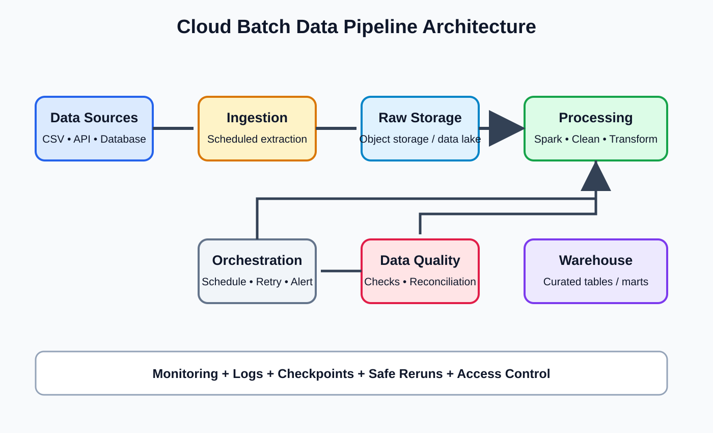

# Day 59: Cloud and Distributed Pipeline Integration

**Phase:** 6 — Cloud and Distributed Processing  
**Learning time:** 2–3 hours  
**Audience:** Complete beginners and junior Data Engineer candidates  
**Technology concepts:** AWS object storage, Apache Spark, batch pipelines, streaming architecture and Kafka fundamentals  
**Topic boundary:** Class notes only. Project workbook and interview guide are separate files.

> You have learned cloud fundamentals, object storage, S3, cloud databases, distributed computing and Spark. Today you connect those concepts into a data pipeline. You will design a batch workflow that reads data from cloud storage, processes it with Spark and writes curated results. You will compare batch and streaming architectures and learn the basic role of Kafka.

## Learning outcomes

- Draw an end-to-end cloud data pipeline.
- Explain the role of object storage and Spark.
- Design a batch processing workflow.
- Understand ingestion, raw, processed and curated stages.
- Explain pipeline run IDs, idempotency and safe publishing.
- Understand checkpoints and recovery at a high level.
- Compare batch, micro-batch and streaming.
- Explain Kafka brokers, topics, partitions, producers and consumers.
- Understand consumer groups and offsets.
- Identify common integration failures.
- Build a local Spark batch pipeline simulation.
- Document security, monitoring, cost and operational ownership.

---

# Part 1 — Connect the concepts from Phase 6

## 1. What have we learned?

| Day | Main concept | How it contributes to a pipeline |
|---:|---|---|
| 50 | Cloud fundamentals and IAM | Secure cloud resources |
| 51 | Object storage and data lakes | Organize data files |
| 52 | AWS S3 | Store and manage cloud objects |
| 53 | Cloud databases | Connect to managed relational databases |
| 54 | Distributed computing | Divide large workloads |
| 55 | Spark fundamentals | Process data with Spark |
| 56 | Transformations and actions | Clean and aggregate data |
| 57 | Joins and partitioning | Combine datasets and organize execution |
| 58 | Performance optimization | Improve efficiency safely |
| 59 | Integration | Connect storage, compute and delivery |

## 2. What is a data pipeline?

A data pipeline is a sequence of steps that moves data from sources to useful destinations.

A pipeline may:
1. extract or receive data;
2. store source data;
3. validate it;
4. transform it;
5. publish the result;
6. monitor execution;
7. recover from failures.

A pipeline is more than a script that copies a file. It needs ownership, correctness, security, repeatability and monitoring.

## 3. Business scenario

TechStore wants a daily sales dataset for reporting.

Source data:
- order files arrive from the order application;
- customer reference data comes from a managed database;
- product reference data arrives as a daily export.

The business expects a curated daily sales dataset by 7:00 AM.

The pipeline must:
- preserve original source files;
- validate incoming data;
- enrich orders with customer and product information;
- calculate daily sales;
- publish only completed output;
- report failures;
- avoid duplicate results when rerun.

---

# Part 2 — End-to-end batch architecture

## 4. What is batch processing?

Batch processing handles a group of records together.

Examples:
- process all orders received today;
- calculate yesterday's sales;
- load a monthly customer file;
- generate a daily report.

A batch pipeline may run on a schedule or after a file arrives.

## 5. Example cloud architecture

~~~text
Order application / API / Database
                |
                v
          Ingestion process
                |
                v
        S3 raw data zone
                |
                v
          Spark processing
                |
                v
      S3 processed data zone
                |
                v
      Validation and reconciliation
                |
                v
       S3 curated data zone
                |
                v
        Warehouse / BI reports
~~~

Monitoring, IAM, encryption, network security, cost controls and data quality apply across the architecture.

## 6. Responsibility of each layer

| Component | Responsibility |
|---|---|
| Source system | Creates business data |
| Ingestion | Receives or extracts data |
| Raw S3 prefix | Preserves original source files |
| Spark | Processes large datasets |
| Processed prefix | Stores standardized records |
| Quality checks | Validate schema and business rules |
| Curated prefix | Publishes business-ready data |
| Warehouse/BI | Makes data available for analysis |
| Monitoring | Tracks run status and failures |
| IAM | Restricts access |

## 7. Why separate ingestion from transformation?

Ingestion and transformation have different responsibilities.

Ingestion:
- connects to the source;
- receives data;
- records arrival;
- stores the source copy.

Transformation:
- reads stored data;
- applies business logic;
- validates and reshapes records;
- writes outputs.

Separating them helps replay processing without repeatedly extracting from the source system.

---

# Part 3 — Design a batch pipeline

## 8. Step 1: Identify the batch input

For each source, record:
- source owner;
- expected file or table;
- arrival time;
- format;
- schema;
- expected volume;
- unique business key;
- late-arrival behavior.

Do not start processing an incomplete file.

## 9. Step 2: Land the raw file

Example S3 key:

~~~text
s3://techstore-data-prod/raw/orders/ingest_date=2026-11-10/run_id=run_001/orders.csv
~~~

The run_id identifies the ingestion attempt.

A unique run identifier helps with:
- tracing;
- retry;
- auditing;
- duplicate investigation;
- comparing outputs.

The key is an example. A production design should define whether retries reuse the same run ID or create a new attempt ID.

## 10. Step 3: Validate the raw file

Before transformation, check:
- object exists;
- file size is expected;
- file is not empty unless empty batches are valid;
- required columns exist;
- format can be parsed;
- source metadata is recorded;
- duplicate delivery behavior is known.

A file upload success does not prove the data is valid.

## 11. Step 4: Process with Spark

Spark can:
- read raw files;
- validate and cast columns;
- filter or quarantine invalid rows;
- join reference datasets;
- aggregate business metrics;
- write processed and curated data.

Use DataFrame transformations and built-in functions where possible.

## 12. Step 5: Validate output

Possible checks:
- source rows = accepted rows + rejected rows, where that accounting applies;
- order IDs are unique at the intended grain;
- amount totals reconcile;
- required columns are not null;
- dates are in allowed ranges;
- output schema matches contract;
- output is complete.

Do not assume source and target row counts must always be identical. Filters, deduplication and aggregation can change counts. Define the reconciliation rule.

## 13. Step 6: Publish completed output

Do not let reporting users read a half-written dataset.

A safer pattern:
1. write to a run-specific temporary location;
2. validate files and business totals;
3. record the run as successful;
4. publish or update the curated table/location using a platform-appropriate commit mechanism;
5. make the completed version visible to consumers.

The exact atomic publish mechanism depends on the storage format, table layer and processing platform. A plain object-store folder rename should not be assumed to be atomic.

---

# Part 4 — Idempotency and reruns

## 14. Why do pipelines rerun?

A pipeline may fail because:
- source file was delayed;
- Spark executor failed;
- database connection timed out;
- output write failed;
- quality check rejected the batch;
- infrastructure was temporarily unavailable.

The team may need to rerun the batch.

## 15. What is idempotency?

An operation is idempotent when repeating it has the same intended final effect as running it once, under the defined conditions.

Example:
A daily partition is rebuilt from the same source data and replaces the previous output in a controlled way. Rerunning does not append a second copy of every row.

## 16. Non-idempotent example

A pipeline reads 100 orders and appends them to a target table.

The pipeline writes 100 rows, then crashes before marking the run successful.

When it retries, it appends the same 100 rows again.

The target now has duplicates.

## 17. Safer design choices

Depending on the destination:
- deterministic run IDs;
- unique source event IDs;
- merge/upsert using a business key;
- overwrite a specific date partition after validation;
- transaction or table-format commit support;
- run ledger and completion status;
- deduplication based on documented rules.

Do not use overwrite on a broad production path without confirming its scope.

## 18. Run ledger

A run ledger records pipeline execution.

Example fields:

| Field | Purpose |
|---|---|
| run_id | Unique run identifier |
| pipeline_name | Pipeline identity |
| source_name | Source dataset |
| start_time | Run start |
| end_time | Run end |
| status | RUNNING, SUCCESS or FAILED |
| input_count | Input rows/files |
| accepted_count | Accepted records |
| rejected_count | Rejected records |
| output_location | Published output |
| error_summary | Safe failure description |

A run ledger helps operators answer what ran, when, with which input and whether it succeeded.

---

# Part 5 — Checkpoints and recovery

## 19. What is a checkpoint?

A checkpoint is persisted progress or state used by a processing system to recover from failures.

The exact meaning depends on the technology.

For streaming systems, checkpoints can store progress and state needed to resume processing.

For batch workflows, a run ledger, completed partition record or durable intermediate output may support recovery.

A checkpoint is not the same as a backup.

## 20. Why checkpoints matter

Without durable progress information, a failed job may need to repeat expensive work or may not know which input was already processed.

Checkpointing helps define recovery boundaries.

## 21. Recovery design questions

- What input was being processed?
- Which steps completed?
- Which output was committed?
- Can the step safely run again?
- Is the checkpoint compatible with the code version?
- What happens to partial output?
- Who approves replay?
- How are duplicate effects prevented?

---

# Part 6 — Batch versus streaming

## 22. Batch processing

Batch processes a group of records at scheduled or triggered intervals.

Examples:
- hourly transaction aggregation;
- nightly warehouse load;
- monthly billing report.

Benefits:
- simpler operational model for many workloads;
- efficient processing of large groups;
- easier replay of bounded input ranges.

Trade-offs:
- results are delayed until the batch runs;
- large batches may take longer;
- late data may require correction runs.

## 23. Streaming processing

Streaming processes data continuously or in small increments as events arrive.

Examples:
- live click events;
- payment status events;
- IoT sensor messages;
- fraud signals.

Benefits:
- lower result latency;
- continuous event processing;
- useful for near-real-time decisions.

Trade-offs:
- state management;
- event-time and late data handling;
- checkpointing;
- delivery guarantees;
- operational complexity.

## 24. Micro-batch processing

Micro-batch processing collects incoming events over short intervals and processes them as small batches.

It sits between traditional scheduled batch and per-event processing.

Spark Structured Streaming commonly uses a micro-batch execution model by default, with other modes available for supported queries and sinks.

## 25. Compare batch and streaming

| Feature | Batch | Streaming |
|---|---|---|
| Input | Bounded group | Continuous/unbounded event flow |
| Trigger | Schedule or file arrival | Continuous event arrival |
| Latency | Minutes/hours or scheduled window | Seconds or lower, depending on system |
| State | Often simpler | Can require ongoing state |
| Recovery | Rerun bounded batch | Checkpoints and offsets/state |
| Example | Daily sales report | Live order monitoring |

Choose based on business latency requirements. Do not build streaming if a daily batch meets the requirement.

---

# Part 7 — Kafka fundamentals

## 26. What is Apache Kafka?

Apache Kafka is a distributed event streaming platform.

It is commonly used to publish, store and consume event streams.

Kafka can connect systems that produce events with systems that process them.

Example:
- order service publishes order-created events;
- payment service publishes payment-confirmed events;
- analytics consumers process the event stream.

Kafka is not the same as S3:
- Kafka is designed for event streams and consumption;
- S3 is object storage for files and objects.

## 27. What is a Kafka broker?

A broker is a Kafka server that stores and serves topic partitions.

A Kafka cluster typically contains multiple brokers.

Brokers work together to provide storage and availability features based on replication configuration.

## 28. What is a Kafka topic?

A topic is a named stream of records.

Examples:
- orders;
- payments;
- deliveries;
- customer_events.

Producers write records to topics. Consumers read records from topics.

## 29. What is a Kafka partition?

A topic is divided into partitions.

Partitions:
- allow parallel consumption;
- provide ordered records within an individual partition;
- are distributed across brokers;
- can be replicated for resilience.

Kafka does not guarantee one global ordering across all partitions of a topic.

## 30. What is a producer?

A producer is an application that publishes records to Kafka topics.

Example:
The order application publishes an order-created event.

## 31. What is a consumer?

A consumer is an application that reads records from Kafka.

Example:
A Spark streaming application consumes order events and calculates live order counts.

## 32. What is a consumer group?

A consumer group is a set of consumers that cooperate to read a topic.

Within a consumer group, a partition is assigned to one consumer at a time under normal group assignment behavior.

Multiple consumer groups can independently read the same topic for different purposes.

## 33. What is an offset?

An offset identifies a record's position within a Kafka partition.

Consumers track offsets to understand progress.

Offsets are partition-specific. Offset 100 in one partition is not the same record as offset 100 in another partition.

## 34. Why do Kafka partitions matter?

More partitions can allow more parallelism, but they also create operational overhead.

Within one consumer group, the number of active consumers that can receive partitions for a topic is limited by the number of partitions.

Partition count should be designed based on:
- expected throughput;
- ordering requirements;
- consumer parallelism;
- broker capacity;
- retention and operational needs.

## 35. Kafka ordering

Kafka preserves ordering within a partition.

If events for the same order must be processed in order, the producer can use a stable key such as order_id so related events are routed consistently to a partition.

Do not assume ordering across all topic partitions.

## 36. Kafka retention

Kafka retains records according to configured retention policies, such as time or size.

A consumer can read retained records again if its offset and retention window permit.

Kafka is not automatically a permanent data lake. Important long-term analytical data may also be written to object storage or a warehouse.

---

# Part 8 — Connect Kafka, Spark and S3

## 37. Example streaming architecture

~~~text
Order application
       |
       v
Kafka topic: orders
       |
       v
Spark Structured Streaming
       |
       v
Validation and transformation
       |
       v
S3 curated/event data
       |
       v
Analytics and monitoring
~~~

The exact integration requires compatible Kafka and Spark connectors, authentication, network connectivity, checkpoint storage and a supported output sink.

## 38. Batch versus streaming integration

Batch:
- source files land in S3;
- Spark reads bounded files;
- Spark transforms;
- output is written to curated storage.

Streaming:
- events are published to Kafka;
- Spark consumes events continuously or in micro-batches;
- Spark maintains checkpoints/state as required;
- output is written to a supported sink.

The architecture should be selected based on required latency and operational capability.

## 39. Event time versus processing time

Event time is when the event happened in the source business system.

Processing time is when the processing engine handles the event.

Example:
- payment event occurred at 10:00;
- network delay means Kafka receives it at 10:03;
- Spark processes it at 10:04.

These timestamps differ.

Streaming pipelines must define how late events affect windows and results.

---

# Part 9 — Local batch pipeline simulation with Spark

This exercise uses local files. It does not require an AWS account, S3 credentials or a Kafka cluster.

## 40. Create sample input

Create a folder:

~~~text
day59_pipeline/
    input/
~~~

Create orders.csv:

~~~csv
order_id,customer_id,order_date,amount
101,C001,2026-11-10,250.00
102,C002,2026-11-10,499.00
103,C001,2026-11-11,100.00
104,C003,2026-11-11,750.00
105,C004,2026-11-11,300.00
~~~

## 41. Create a Spark session and read input

~~~python
from pyspark.sql import SparkSession
from pyspark.sql.functions import col, sum, count

spark = (
    SparkSession.builder
    .appName("Day59CloudBatchPipeline")
    .master("local[*]")
    .getOrCreate()
)

raw_orders = spark.read.csv(
    "day59_pipeline/input/orders.csv",
    header=True,
    inferSchema=True
)

print("Input rows:", raw_orders.count())
raw_orders.show()
~~~

Expected input row count:

~~~text
Input rows: 5
~~~

## 42. Validate required columns

~~~python
required_columns = [
    "order_id",
    "customer_id",
    "order_date",
    "amount"
]

missing_columns = [
    name for name in required_columns
    if name not in raw_orders.columns
]

print("Missing columns:", missing_columns)
~~~

Expected output:

~~~text
Missing columns: []
~~~

This is a simple schema-presence check. It does not validate every type or business rule.

## 43. Create a processed DataFrame

~~~python
processed_orders = raw_orders.select(
    col("order_id").cast("integer"),
    col("customer_id").cast("string"),
    col("order_date").cast("date"),
    col("amount").cast("decimal(10,2)")
)

processed_orders.show()
processed_orders.printSchema()
~~~

The output schema should show:
- order_id as integer;
- customer_id as string;
- order_date as date;
- amount as decimal(10,2).

Always check invalid conversions and nulls before publishing.

## 44. Validate rows

~~~python
invalid_orders = processed_orders.filter(
    col("order_id").isNull() |
    col("customer_id").isNull() |
    col("order_date").isNull() |
    col("amount").isNull()
)

print("Invalid rows:", invalid_orders.count())
~~~

Expected output for the supplied clean sample:

~~~text
Invalid rows: 0
~~~

## 45. Create curated daily sales

~~~python
daily_sales = processed_orders.groupBy(
    "order_date"
).agg(
    count("*").alias("order_count"),
    sum("amount").alias("total_sales")
)

daily_sales = daily_sales.orderBy("order_date")

daily_sales.show()
~~~

Expected result:

| order_date | order_count | total_sales |
|---|---:|---:|
| 2026-11-10 | 2 | 749.00 |
| 2026-11-11 | 3 | 1150.00 |

## 46. Validate totals

~~~python
source_total = processed_orders.agg(
    sum("amount").alias("source_total")
).first()["source_total"]

curated_total = daily_sales.agg(
    sum("total_sales").alias("curated_total")
).first()["curated_total"]

print("Source total:", source_total)
print("Curated total:", curated_total)
print("Totals match:", source_total == curated_total)
~~~

Expected output:

~~~text
Source total: 1899.00
Curated total: 1899.00
Totals match: True
~~~

If totals do not match, stop publication and investigate.

## 47. Write processed and curated outputs

~~~python
processed_orders.write.mode("overwrite").parquet(
    "day59_pipeline/output/processed_orders"
)

daily_sales.write.mode("overwrite").parquet(
    "day59_pipeline/output/curated_daily_sales"
)

print("Pipeline output written")
~~~

Expected output:

~~~text
Pipeline output written
~~~

Spark writes directories containing part files. Confirm the output paths and row counts.

## 48. Read back and verify

~~~python
verified_sales = spark.read.parquet(
    "day59_pipeline/output/curated_daily_sales"
)

print("Curated rows:", verified_sales.count())
verified_sales.orderBy("order_date").show()
~~~

Expected curated row count:

~~~text
Curated rows: 2
~~~

Read-back validation confirms that the written output can be read by Spark. It does not prove the output was uploaded to AWS S3.

## 49. Stop Spark

~~~python
spark.stop()
print("Spark stopped")
~~~

---

# Part 10 — How the local pipeline maps to AWS

## 50. Local versus cloud mapping

| Local exercise | Cloud production equivalent |
|---|---|
| input/orders.csv | S3 raw object |
| local Spark session | Spark cluster or managed Spark service |
| local output directory | S3 processed/curated prefix |
| local environment variables | Managed identity/secret configuration |
| printed errors | Central logs and metrics |
| manual execution | Orchestrated scheduled job |
| local output validation | Automated data quality gate |

Do not replace a local path with an S3 URI and assume the same code will work. Cloud storage connectors, credentials, network access and compatible dependencies must be configured.

## 51. What is needed for Spark to read S3?

A real Spark-to-S3 integration may require:
- compatible Hadoop AWS/S3A libraries;
- AWS credential provider configuration;
- IAM role or approved temporary credentials;
- network connectivity;
- correct bucket and region;
- encryption permissions;
- compatible Spark/Hadoop versions.

Do not hardcode AWS access keys in Spark configuration.

## 52. What is needed for a production batch pipeline?

At minimum:
- source contract;
- ingestion process;
- raw retention;
- Spark job;
- schema and business validation;
- safe output publishing;
- run ledger;
- retry/idempotency strategy;
- logging and metrics;
- access controls;
- cost monitoring;
- owner and support process.

---

# Part 11 — Common integration failures

## 53. S3 access denied

Check:
- active workload identity;
- bucket policy;
- identity policy;
- prefix/resource scope;
- organization-level restrictions;
- KMS key permissions.

Do not grant account-wide administrator access as the first response.

## 54. Spark cannot read an S3 URI

Possible causes:
- missing S3A connector;
- incompatible dependency versions;
- missing credentials;
- wrong bucket or key;
- region/network issue;
- access denied;
- encryption key permission.

Check the exact Spark, Hadoop and connector compatibility.

## 55. Pipeline rerun creates duplicate data

Possible causes:
- append mode on retry;
- no unique event key;
- run status not recorded;
- non-idempotent write;
- partial output not cleaned or isolated.

Use deterministic keys, merge/upsert, safe partition replacement or transactional table support as appropriate.

## 56. Curated output is incomplete

Possible causes:
- source file was incomplete;
- Spark job failed during write;
- downstream read started too early;
- output validation was skipped;
- partial output was published.

Use temporary output, validation and a controlled publish step.

## 57. Kafka consumer falls behind

Possible causes:
- producer rate exceeds processing rate;
- insufficient consumer parallelism;
- too few topic partitions;
- slow processing;
- downstream sink bottleneck;
- consumer errors or repeated retries.

Monitor consumer lag and identify the bottleneck before adding consumers or partitions.

---

# Part 12 — Common mistakes

| Mistake | Why it is wrong | Better practice |
|---|---|---|
| Treat a pipeline as only a Spark script | Ignores ingestion, validation, recovery and monitoring | Design end to end |
| Publish while writing | Consumers may see partial output | Validate and publish completed results |
| Append every rerun | Duplicates can accumulate | Design idempotent writes |
| Mix raw and curated data | Source and business-ready states become unclear | Separate zones |
| Assume local Spark code works unchanged on S3 | Cloud connectors and identity are required | Configure and test integration |
| Put AWS keys in code | Credential leak | Use roles/temporary credentials |
| Choose streaming for a daily report | Adds unnecessary complexity | Match latency requirement |
| Assume Kafka gives global ordering | Ordering is within a partition | Choose keys and partitions deliberately |
| Ignore consumer lag | Pipeline may fall behind | Monitor lag and throughput |
| Claim exactly-once without design | End-to-end semantics depend on source and sink | Document guarantees and idempotency |

---

# Part 13 — Practice questions

## Exercise 1

What are the main stages of a batch data pipeline?

**Answer:** Ingest, land raw data, validate, transform, publish curated output, monitor and recover.

## Exercise 2

Why keep raw data?

**Answer:** To support replay, audit, debugging and reprocessing under approved retention and access controls.

## Exercise 3

What is idempotency?

**Answer:** Repeating an operation has the same intended final effect under defined conditions.

## Exercise 4

Why write to a temporary output path?

**Answer:** To prevent downstream consumers from reading incomplete output before validation and publication.

## Exercise 5

What is the difference between batch and streaming?

**Answer:** Batch processes bounded groups at scheduled or triggered times; streaming processes a continuous flow of events or small increments.

## Exercise 6

What is a Kafka topic?

**Answer:** A named stream of records.

## Exercise 7

What is a Kafka partition?

**Answer:** A subdivision of a topic that enables parallelism and preserves ordering within that partition.

## Exercise 8

What is a Kafka offset?

**Answer:** A record position within a particular partition.

## Exercise 9

What is consumer lag?

**Answer:** The gap between the latest available records and the consumer's progress.

## Exercise 10

Does the local Day 59 exercise prove S3 integration?

**Answer:** No. It proves a local Spark batch workflow. S3 integration requires compatible connectors, identity, network and cloud-side validation.

---

# Part 14 — Phase 6 revision

| Day | Competency |
|---:|---|
| 50 | Cloud concepts, IAM and least privilege |
| 51 | Object storage and data lake zones |
| 52 | S3 object management, lifecycle and security |
| 53 | Managed databases and secure connectivity |
| 54 | Distributed computing and partitioned work |
| 55 | Spark architecture, sessions and DataFrames |
| 56 | Spark transformations and actions |
| 57 | Spark joins and partitioning |
| 58 | Spark performance optimization |
| 59 | End-to-end cloud and distributed pipeline design |

## Phase 6 completion checklist

- [ ] Explain cloud service models and shared responsibility.
- [ ] Design least-privilege IAM access.
- [ ] Design raw, processed and curated object storage.
- [ ] Explain S3 buckets, storage classes, lifecycle and versioning.
- [ ] Design private managed database connectivity.
- [ ] Explain distributed workers, partitions, shuffle and skew.
- [ ] Create and inspect Spark DataFrames.
- [ ] Use transformations, actions, joins and aggregations.
- [ ] Explain repartition and coalesce.
- [ ] Inspect Spark plans and optimize based on evidence.
- [ ] Design a repeatable batch pipeline.
- [ ] Compare batch and streaming.
- [ ] Explain Kafka topics, partitions, producers, consumers and offsets.
- [ ] Explain security, monitoring, recovery and cost.

**Phase 6 complete:** You have moved from cloud fundamentals to object storage, managed databases, distributed computing, Spark processing and end-to-end pipeline design.

**Next phase — Phase 7: Orchestration, Quality and Monitoring (Days 60–67).** You will learn how to schedule, coordinate, monitor and secure production data pipelines using workflow orchestration and operational practices.

---

# Part 26 — Define the batch contract before implementation

A reliable pipeline starts with an agreed input and output contract. It should not begin by opening Spark and guessing what the columns mean.

## 58. Write the business requirement

TechStore needs a daily sales summary by order date.

The output must:
- include records that pass the agreed validity rules;
- use the approved sales amount;
- be ready by 07:00;
- preserve the original source delivery;
- identify rejected records;
- support safe reruns;
- publish only after validation.

For this teaching scenario, all valid order statuses are included in the daily amount. A real business may require PAID-only sales or another approved metric. Confirm that definition with the business owner.

## 59. Define the source contract

| Contract item | Training definition |
|---|---|
| Dataset | Orders |
| Grain | One row per order |
| Required fields | order_id, customer_id, order_date, amount, status |
| order_id | Unique, required identifier |
| customer_id | Required customer reference |
| order_date | Business order date |
| amount | Decimal amount in INR |
| Delivery | One complete file per daily batch |
| Duplicate delivery | Same batch ID must not be loaded twice |
| Invalid row | Quarantine with reason |
| Owner | Order application team |

The contract is illustrative. Confirm real source semantics with the business and source owners.

## 60. Define the output contract

| Property | Training definition |
|---|---|
| Dataset | Daily sales summary |
| Grain | One row per order_date |
| Columns | order_date, order_count, total_sales |
| Date role | Order date |
| Currency | INR |
| Refresh | Daily |
| Quality | No null date, totals reconcile |
| Consumer | Reporting team |

A clear grain prevents a consumer from interpreting one row as one order when it represents one day.

## 61. Separate batch ID and run ID

- Batch ID identifies a source delivery or logical input interval.
- Run ID identifies a particular pipeline execution.
- Attempt number identifies a retry or repeated attempt.

Example:

~~~text
batch_id = orders_20261111
run_id = orders_daily_20261111_run_001
attempt = 2
~~~

A retry should remain traceable to the original source batch. Do not invent a new source batch identity just because a compute task restarted.

---

# Part 27 — Define the run lifecycle and run ledger

## 62. Use explicit pipeline states

A run may move through these states:

| State | Meaning |
|---|---|
| RECEIVED | Source delivery detected |
| LANDED | Original data stored in raw |
| VALIDATING | Structural and content checks running |
| VALIDATED | Required checks passed |
| PROCESSING | Spark transformation running |
| OUTPUT_WRITTEN | Temporary output created |
| RECONCILED | Counts and totals passed |
| PUBLISHED | Approved output made visible |
| SUCCESS | Run completed |
| FAILED | Run stopped and requires investigation |

A real implementation may use different state names. The important point is that state transitions and success criteria are explicit.

## 63. Why distinguish output written from output published?

A file may exist in a temporary output folder even though validation has not passed.

If downstream users can read that folder, they may consume incomplete or incorrect data.

Use a controlled publish boundary. The publication mechanism must match the storage and table technology.

## 64. Example run ledger table

~~~sql
CREATE TABLE pipeline_run_ledger (
    run_id VARCHAR(100) PRIMARY KEY,
    batch_id VARCHAR(100) NOT NULL,
    pipeline_name VARCHAR(100) NOT NULL,
    status VARCHAR(30) NOT NULL,
    input_rows BIGINT,
    accepted_rows BIGINT,
    rejected_rows BIGINT,
    output_location TEXT,
    started_at TIMESTAMP,
    completed_at TIMESTAMP,
    error_summary TEXT
);
~~~

This is a teaching schema. Production designs may add attempt number, source watermark, code version, schema version, checksums and owner details.

Do not store credentials or sensitive row contents in the ledger.

## 65. What should a run ledger help answer?

- Which batch was processed?
- Which execution handled it?
- Did validation pass?
- How many records were accepted?
- How many were rejected?
- Where was output written?
- Was the output published?
- When did the run finish?
- What was the safe failure summary?

A run ledger is operational metadata. It is not a replacement for source data or a complete audit system.

## 66. Example state transition rules

A run should not move directly from RECEIVED to SUCCESS.

A possible sequence is:

~~~text
RECEIVED
   |
   v
LANDED
   |
   v
VALIDATING
   |
   v
VALIDATED
   |
   v
PROCESSING
   |
   v
OUTPUT_WRITTEN
   |
   v
RECONCILED
   |
   v
PUBLISHED
   |
   v
SUCCESS
~~~

If validation fails, mark the run FAILED or REJECTED according to the operating model. Do not continue publishing merely because Spark can still process the file.

---

# Part 28 — Improve the local pipeline with a manifest and rejection reasons

The earlier Day 59 lab saved raw, processed and curated output. This section adds traceability so an engineer can answer which file was used and why a record was rejected.

## 67. What is a manifest?

A manifest is a small record describing a batch or its files.

It may include:
- batch ID;
- source name;
- file name or object key;
- file size;
- checksum;
- expected record count;
- ingestion timestamp;
- schema version.

A manifest is useful when one batch contains multiple files.

## 68. Example manifest

~~~text
batch_id: orders_20261111
source_name: order_application
file_name: orders.csv
expected_format: CSV
expected_columns: order_id, customer_id, order_date, amount, status
schema_version: 1
expected_rows: 5
~~~

The values are training examples. In a real pipeline, manifest values must come from the source contract or actual delivery metadata.

## 69. Add a rejection reason to invalid records

Assume the DataFrame typed_orders and the validity conditions from the previous lab already exist.

~~~python
from pyspark.sql.functions import when, col

orders_with_reason = typed_orders.withColumn(
    "rejection_reason",
    when(col("order_id").isNull(), "MISSING_ORDER_ID")
    .when(col("customer_id").isNull(), "MISSING_CUSTOMER_ID")
    .when(col("order_date").isNull(), "INVALID_ORDER_DATE")
    .when(col("amount").isNull(), "INVALID_AMOUNT")
    .when(col("amount") < 0, "NEGATIVE_AMOUNT")
    .when(col("status").isNull(), "MISSING_STATUS")
    .otherwise(None)
)

orders_with_reason.select(
    "order_id",
    "amount",
    "rejection_reason"
).show()
~~~

For the supplied training file, order 105 should have rejection reason NEGATIVE_AMOUNT. Valid rows should have a null rejection_reason.

The order of the when conditions matters: the first matching condition is returned. A production rule set may record multiple failed checks rather than only the first one.

## 70. Split accepted and rejected rows with reason

~~~python
accepted_with_reason = orders_with_reason.filter(
    col("rejection_reason").isNull()
)

rejected_with_reason = orders_with_reason.filter(
    col("rejection_reason").isNotNull()
)

print("Accepted:", accepted_with_reason.count())
print("Rejected:", rejected_with_reason.count())
~~~

Expected counts: four accepted and one rejected.

## 71. Save rejection evidence

~~~python
rejected_with_reason.write.mode("overwrite").parquet(
    "quarantine/orders_with_reasons"
)

rejected_with_reason.select(
    "order_id",
    "amount",
    "rejection_reason"
).show()
~~~

Expected rejected record:

| order_id | amount | rejection_reason |
|---:|---:|---|
| 105 | -50.00 | NEGATIVE_AMOUNT |

Do not log sensitive row contents unnecessarily. Store the minimum evidence required by the approved data governance policy.

---

# Part 29 — Make batch publishing safer

## 72. Temporary output is not automatically atomic

Writing files to a temporary path prevents consumers from reading the candidate output if they are configured to read only the curated location.

However, copying multiple files into a consumer-visible folder can still expose partial state depending on the storage and publication design.

A plain folder copy is not a universal atomic transaction.

## 73. Common publication patterns

Depending on the platform, teams may use:
- immutable run-specific output paths;
- a manifest that points to the completed version;
- a table format with transactional commits;
- a catalog/table metadata update;
- a controlled partition replacement;
- a pointer or metadata record switched after validation.

Choose a method supported by the actual storage and table technology.

## 74. Example immutable output design

~~~text
curated/daily_sales/
    run_id=run_001/
        part-000.parquet
        manifest.json
    run_id=run_002/
        part-000.parquet
        manifest.json
~~~

A separate approved metadata record can identify which run is current.

This avoids overwriting the previous result while the new one is being prepared.

## 75. Publication checklist

Before making a run visible:
1. all expected tasks completed;
2. all output files are present;
3. output schema is correct;
4. accepted/rejected accounting passes;
5. business totals reconcile;
6. output freshness is correct;
7. manifest or commit metadata is complete;
8. the previous valid output can be recovered if required;
9. the publish operation is recorded;
10. the run ledger is updated.

---

# Part 30 — Understand Kafka consumer behavior more deeply

## 76. Event record anatomy

A Kafka record commonly includes:
- topic;
- partition;
- offset;
- key;
- value;
- timestamp;
- headers, where used.

The key can help determine partition placement. The value contains the event payload.

Example conceptual record:

~~~text
topic: orders
key: order_id=1001
value: {"order_id":1001,"status":"CREATED"}
partition: 2
offset: 18450
~~~

This is an illustrative record, not a real Kafka message.

## 77. Why use a message key?

Suppose events for order 1001 are:
- CREATED;
- PAID;
- SHIPPED.

If the producer consistently uses order_id as the key and the partitioning configuration is stable, these events can be routed to the same partition.

Kafka preserves ordering within a partition. This can help consumers process the order's events in sequence.

Do not assume ordering across partitions.

## 78. Understand a consumer group

Imagine a topic has four partitions.

A consumer group has two consumers. Kafka can assign two partitions to each consumer under an appropriate assignment.

If the group has six consumers, only four can receive one partition each for that topic at a time. The remaining consumers may be idle for that topic.

Actual assignment and rebalancing behavior depends on the group protocol and configuration.

## 79. What is a rebalance?

A rebalance occurs when partition assignments are redistributed among consumers in a group.

It may happen when:
- a consumer joins;
- a consumer leaves;
- a consumer fails;
- topic partition count changes;
- group membership or assignment changes.

Rebalances can temporarily affect consumption progress. Frequent rebalances can reduce throughput.

## 80. Understand offset commit timing

A consumer processes records and periodically commits its progress.

If offsets are committed before the sink write is durable, a failure can cause records to be skipped.

If the sink write completes but the offset is not committed, a retry can process the same records again.

This is why sink idempotency and offset coordination matter.

## 81. A safe conceptual processing sequence

~~~text
Read event batch
      |
      v
Validate and transform
      |
      v
Write to sink safely
      |
      v
Confirm sink result
      |
      v
Commit progress/offset
~~~

The actual guarantees depend on the consumer API, processing engine, checkpointing and sink transaction behavior. Do not assume this diagram alone creates exactly-once processing.

---

# Part 31 — Event time, late data and windows

## 82. Event time

Event time is when the event occurred in the business system.

## 83. Processing time

Processing time is when the processing application handles the event.

Example:
- event occurred at 10:00;
- network delivered it at 10:04;
- Spark processed it at 10:05.

The event time is 10:00; processing time is 10:05.

## 84. What is a late event?

A late event arrives after the processing system has already processed a later time period.

Example:
A payment event for 10:00 arrives at 10:20.

If the dashboard already published the 10:00–10:05 window, the late event may require an update to that window.

## 85. What is a time window?

A window groups events by a time interval.

Examples:
- five-minute order count;
- hourly payment total;
- daily delivery count.

A streaming system needs a policy for:
- window start and end;
- event-time field;
- allowed lateness;
- state retention;
- late-event handling;
- correction or retraction behavior.

## 86. Why event-time policy is a business decision

A real-time dashboard may accept a small correction delay. A financial report may require a controlled reconciliation and finalization period.

Do not assume every event should be discarded as soon as its window closes. Confirm the business's late-arrival and correction requirements.

---

# Part 32 — Compare batch and streaming through scenarios

| Scenario | Likely starting design | Reason |
|---|---|---|
| Daily finance report | Batch | Bounded daily output |
| Website click dashboard updated every few seconds | Streaming or micro-batch | Low latency requirement |
| Monthly customer file | Batch | Periodic file delivery |
| Fraud signal within seconds | Streaming | Time-sensitive response |
| Reprocess two years of history | Batch/backfill | Bounded historical range |
| IoT sensor alert | Streaming | Continuous event arrival |

The word "real-time" should be translated into a measurable latency requirement. Seconds, minutes and next-day delivery are different engineering problems.

---

# Part 33 — Failure scenarios across the integrated pipeline

## 87. Source file arrives late

Response:
1. keep the prior curated output available;
2. mark the expected batch as delayed;
3. alert the source owner;
4. do not fabricate an empty successful batch;
5. process when the complete source arrives;
6. record actual freshness.

## 88. Spark task fails

Response:
1. inspect failed stage and task;
2. check executor and input errors;
3. determine whether task retry is safe;
4. preserve batch identity;
5. retry according to policy;
6. validate output after completion.

## 89. S3 write fails

Response:
1. inspect the exact destination key;
2. check identity and object-write permissions;
3. check KMS permission if applicable;
4. check network and service response;
5. identify partial or incomplete output;
6. retry safely and verify object metadata.

## 90. Database source is unavailable

Response:
1. confirm whether the raw extract already exists;
2. avoid repeatedly overwhelming the database with retries;
3. alert the database owner;
4. resume from a safe extraction boundary;
5. validate the batch when the source becomes available.

## 91. Kafka consumer lag grows

Response:
1. identify affected topic and partitions;
2. compare producer rate and consumer throughput;
3. inspect slow processing and sink latency;
4. inspect errors and retries;
5. check partition and consumer capacity;
6. scale or optimize only after finding the bottleneck.

---

# Part 34 — Phase 6 integration review

## 92. Explain the complete platform

~~~text
Business sources
      |
      v
Ingestion and batch identity
      |
      v
Raw object storage
      |
      v
Spark validation and processing
      |
      v
Processed data
      |
      v
Reconciliation and quality gate
      |
      v
Curated output publication
      |
      v
Warehouse / BI consumers
~~~

Cross-cutting controls:
- IAM and least privilege;
- encryption and secrets;
- run ledger and checkpoints;
- logging, metrics and alerts;
- cost and retention;
- ownership and support.

A streaming path may begin with Kafka instead of a bounded file delivery, but it still needs schema, quality, state, sink, monitoring and recovery design.

## 93. Explain the engineering trade-offs

A junior Data Engineer should be able to explain:
- why the team chose batch or streaming;
- why raw data is retained;
- why Spark is appropriate for the data volume;
- how joins are validated;
- how output is published safely;
- how a retry avoids duplicate effects;
- how access is restricted;
- how freshness and cost are monitored.

Tool names alone do not demonstrate engineering understanding.

---

# Part 35 — Additional practice exercises with worked answers

## Exercise 11 — Source contract

The source adds a new optional column called sales_channel. What should the pipeline owner do?

**Worked answer:** Review the schema contract, determine whether the field is optional, test old and new file versions, update mapping and documentation, and check downstream consumers.

## Exercise 12 — Run ID

A Spark executor retries one failed task within the same job. Should the source batch ID change?

**Worked answer:** No. It is still the same source batch. Task retry metadata may change, but batch identity should remain stable.

## Exercise 13 — Publish boundary

A job wrote all output files but the reconciliation check failed. Should the output be published?

**Worked answer:** No. Keep the candidate output isolated, investigate the mismatch and publish only after the required quality gate passes or an approved exception is recorded.

## Exercise 14 — Consumer offset

A consumer writes an event to a database and crashes before committing its offset. What can happen?

**Worked answer:** The event may be read again. The sink should support idempotency or deduplication so a retry does not create a duplicate business effect.

## Exercise 15 — Event key

A consumer needs order events to be processed in order. What key can help?

**Worked answer:** Use order_id as the Kafka message key so related events are consistently routed to a partition, subject to producer partitioning configuration.

## Exercise 16 — Late event

A payment event arrives after its five-minute dashboard window was published. What should be defined?

**Worked answer:** A late-event policy: allowed lateness, whether the window is updated, whether a correction is emitted, and when the result is finalized.

## Exercise 17 — Batch versus streaming

A company needs a daily report by 07:00. Is streaming automatically the better design?

**Worked answer:** No. A scheduled batch pipeline may meet the freshness requirement with less complexity and lower operational overhead.

## Exercise 18 — Local integration

The local Spark pipeline completes and its totals match. Can the team claim the cloud pipeline is production-ready?

**Worked answer:** No. Cloud identity, network, S3 connector, managed database access, deployment, monitoring, cost, recovery and production-scale testing remain.

---

# Part 36 — Day 59 practical completion checklist

### Architecture and contracts
- [ ] Draw source-to-raw-to-processed-to-curated flow.
- [ ] Explain each component's responsibility.
- [ ] Define source and output contracts.
- [ ] Distinguish batch ID, run ID and attempt.
- [ ] Explain run states and ledger metadata.
- [ ] Explain why temporary output is separate from published output.

### Batch pipeline
- [ ] Read source data with Spark.
- [ ] Preserve original input.
- [ ] Validate schema and business values.
- [ ] Add rejection reasons and quarantine invalid records.
- [ ] Create curated aggregates.
- [ ] Reconcile accepted and rejected counts.
- [ ] Reconcile monetary totals.
- [ ] Write temporary output and publish after validation.
- [ ] Read output back and verify it.
- [ ] Explain safe rerun and backfill behavior.

### Streaming and Kafka
- [ ] Compare batch, micro-batch and streaming.
- [ ] Explain broker, topic, partition and record.
- [ ] Explain producer and consumer.
- [ ] Explain consumer group and offset.
- [ ] Explain partition ordering and message keys.
- [ ] Explain consumer lag and rebalancing.
- [ ] Explain event time, processing time and late events.
- [ ] Compare at-most-once, at-least-once and exactly-once at a high level.
- [ ] Explain why external sinks need idempotency.

### Operations and engineering
- [ ] Explain S3/Spark/warehouse integration requirements.
- [ ] Explain security and least privilege across components.
- [ ] Identify monitoring signals for ingestion, Spark, quality and Kafka.
- [ ] Define ownership and escalation.
- [ ] Explain recovery from source, Spark, S3 and consumer failures.
- [ ] Explain cost and retention controls.
- [ ] Distinguish local simulation from real cloud integration.

## Final self-assessment

Without looking at the notes, explain:

1. How do S3, Spark and a warehouse fit together?
2. Why should raw data be preserved?
3. What is the difference between a batch ID and a run ID?
4. Why should output be written temporarily before publication?
5. How do you prove accepted and rejected records account for the source?
6. Why is idempotency required for safe retries?
7. When is batch processing better than streaming?
8. What are Kafka topics, partitions, message keys and offsets?
9. Why can consumer lag increase?
10. What is the difference between event time and processing time?
11. Why does a local Spark lab not prove cloud integration?
12. Which security, monitoring and recovery controls must be present?

If you can explain the architecture and complete the local pipeline simulation, you have completed the Phase 6 learning outcomes.

**Phase 6 complete:** Cloud fundamentals, object storage, S3, managed databases, distributed computing, Spark DataFrames, transformations, joins, partitioning, performance and pipeline integration.

**Next phase — Phase 7: Orchestration, Quality and Monitoring (Days 60–67).** Day 60 begins with workflow orchestration fundamentals: why scheduling alone is not enough, what a DAG is, how task dependencies work and where Apache Airflow fits.
