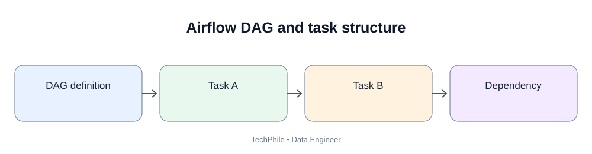
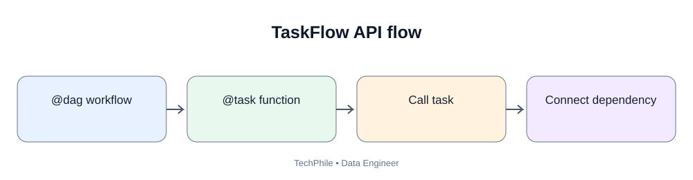
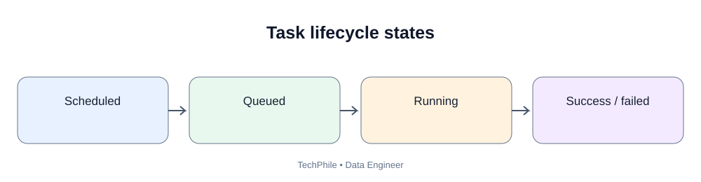

# Day 61: Airflow DAGs and Tasks

**Phase:** 7 — Orchestration, Quality and Monitoring  
**Learning time:** 2–3 hours  
**Audience:** Complete beginners and junior Data Engineer candidates  
**Tool:** Apache Airflow 2.x teaching examples (confirm exact installed version before running)  
**Topic boundary:** Class notes only. Project workbook and interview guide are separate.

> Yesterday you learned what a DAG and task mean. Today you will write a simple Airflow DAG in Python, understand each part of the code, define tasks, connect dependencies and inspect execution. We will use a small retail example so that you learn the orchestration pattern before connecting real databases or cloud services.

## Learning outcomes

- Understand the basic structure of an Airflow DAG file.
- Explain DAG ID, schedule, start date and catchup.
- Create tasks using the TaskFlow API.
- Understand PythonOperator and when it is useful.
- Define task dependencies.
- Pass small metadata between tasks.
- Understand DAG parsing versus task execution.
- Locate a DAG file in an Airflow project.
- Test business logic separately from the Airflow runtime.
- Troubleshoot common DAG import and execution errors.

## 1. What are we building?

TechStore wants a small daily workflow:

~~~text
start_pipeline
      |
      v
check_source
      |
      v
validate_orders
      |
      v
create_sales_summary
      |
      v
finish_pipeline
~~~

For today's first example, we will use simple Python functions. We will not connect to AWS or a production database.

## 2. What is a DAG file?

A DAG file is a Python file that defines a workflow for Airflow to discover.

Example project layout:

~~~text
airflow_project/
    dags/
        daily_sales_dag.py
    logs/
    plugins/
~~~

Airflow's configured DAG folder must point to the folder containing the DAG file.

The file name can be daily_sales_dag.py. The DAG ID inside the file is the workflow's identifier in Airflow.

## 3. Before running: version awareness

Airflow has changed across releases. The examples below use the Airflow 2.x TaskFlow API style.

Before running, check your version:

~~~bash
airflow version
~~~

The exact installation method and compatible Python version depend on the Airflow release. Use the official Airflow installation instructions and constraints for your Python version. Do not install Airflow with an arbitrary pip command into a production environment.

## 4. Understand the basic DAG ingredients

| Setting | Meaning |
|---|---|
| dag_id | Unique workflow identifier |
| start_date | Earliest logical scheduling date |
| schedule | How often a DAG run is scheduled |
| catchup | Whether to create runs for missed historical intervals |
| default_args | Default task settings such as owner and retries |
| task | A unit of work |
| dependency | Defines which task runs before another |

## 5. First DAG: create the workflow

Create file: dags/day61_hello_dag.py

~~~python
import pendulum

from airflow.decorators import dag, task

@dag(
    dag_id="day61_hello_workflow",
    description="First beginner Airflow workflow",
    schedule="@daily",
    start_date=pendulum.datetime(2026, 1, 1, tz="UTC"),
    catchup=False,
    tags=["techphile", "beginner"]
)
def day61_hello_workflow():

    @task
    def say_hello():
        print("Hello from the TechStore pipeline")

    say_hello()

day61_hello_workflow()
~~~

### 5.1 Explain the imports

- import pendulum: imports a timezone-aware date/time library used by this example.
- from airflow.decorators import dag, task: imports decorators that turn Python functions into DAG and task definitions.

### 5.2 Explain @dag

The @dag decorator marks a Python function as a DAG factory.

The configuration includes:
- dag_id: the unique ID visible in Airflow;
- description: a short explanation;
- schedule="@daily": request a daily schedule;
- start_date: the scheduling start boundary;
- catchup=False: do not automatically create all historical missed runs;
- tags: labels for organizing workflows in the UI.

### 5.3 Explain @task

The @task decorator converts the function into an Airflow task.

The function body is executed as a task when the workflow runs. It is not executed as ordinary business work just because the DAG file is parsed.

### 5.4 Explain the final line

day61_hello_workflow() invokes the DAG factory so Airflow can register the DAG definition when it parses the file.

## 6. Understand the schedule

schedule="@daily" means Airflow creates daily scheduled intervals according to the DAG's timetable and timezone configuration.

It does not mean the DAG necessarily starts at midnight and finishes instantly. A scheduled run is created for a data interval; task execution may happen after the interval boundary.

Day 62 explains logical dates, data intervals, catchup and backfills in detail.

## 7. Add multiple tasks

Create file: dags/day61_sales_dag.py

~~~python
import pendulum

from airflow.decorators import dag, task

@dag(
    dag_id="day61_sales_pipeline",
    description="Simple sales workflow with task dependencies",
    schedule=None,
    start_date=pendulum.datetime(2026, 1, 1, tz="UTC"),
    catchup=False,
    tags=["techphile", "sales"]
)
def sales_pipeline():

    @task
    def check_source():
        print("Checking the order source")
        return "orders_2026_11_10.csv"

    @task
    def validate_source(file_name):
        print("Validating:", file_name)
        return True

    @task
    def transform_orders(is_valid):
        if not is_valid:
            raise ValueError("Source validation failed")

        print("Transforming orders")
        return "daily_sales_summary"

    @task
    def publish_summary(summary_name):
        print("Publishing:", summary_name)

    source_file = check_source()
    is_valid = validate_source(source_file)
    summary = transform_orders(is_valid)
    publish_summary(summary)

sales_pipeline()
~~~

### 7.1 What does schedule=None mean?

This DAG is not assigned a time-based automatic schedule in this example. You can trigger it manually from the Airflow UI or CLI when the deployment permits it.

### 7.2 Understand the returned values

check_source returns a small string: a file name.

validate_source returns a Boolean value.

transform_orders returns a small summary identifier.

These values are small metadata. In a real pipeline, the file and summary data should live in object storage or a database. The task should return a path or identifier rather than the entire dataset.

### 7.3 How dependencies are created

When a TaskFlow task's output is passed into another task, Airflow creates a dependency.

~~~text
check_source -> validate_source -> transform_orders -> publish_summary
~~~

This is easier to read than manually writing every dependency.

## 8. What happens if validation fails?

In the example, transform_orders checks is_valid.

If validation returns False, the task raises ValueError. Airflow records the task as failed. Under the normal dependency rule, publish_summary will not run.

A production validation task should also record useful context in its logs without printing sensitive values.

## 9. Understand PythonOperator

TaskFlow is a convenient way to write Python tasks. Airflow also provides operators.

PythonOperator runs a Python callable.

Example for Airflow 2.x:

~~~python
from datetime import datetime

from airflow import DAG
from airflow.operators.python import PythonOperator

def print_message():
    print("PythonOperator task is running")

with DAG(
    dag_id="day61_python_operator_demo",
    start_date=datetime(2026, 1, 1),
    schedule=None,
    catchup=False
) as dag:

    show_message = PythonOperator(
        task_id="show_message",
        python_callable=print_message
    )
~~~

### 9.1 Explain the important parameters

- dag_id: workflow identifier;
- start_date: start boundary for scheduling;
- schedule=None: no automatic time schedule;
- catchup=False: do not create missed historical runs;
- task_id: unique task identifier inside the DAG;
- python_callable: Python function to execute.

The DAG context manager associates the operator with the DAG.

## 10. TaskFlow API versus PythonOperator

| TaskFlow API | PythonOperator |
|---|---|
| Uses @task | Uses PythonOperator |
| Python function becomes a task | Callable is supplied to an operator |
| Return values can create dependencies | Can use supported context/XCom mechanisms |
| Often concise for Python workflows | Useful when explicitly configuring an operator |

Both are valid patterns. Choose one style consistently for a given workflow where practical.

## 11. Inspect a DAG before execution

Useful commands:

~~~bash
airflow dags list
airflow dags list-import-errors
airflow tasks list day61_hello_workflow
~~~

What they do:
- dags list: lists discovered DAGs;
- dags list-import-errors: reports DAG parsing/import problems;
- tasks list: lists tasks in a DAG.

Command availability and options can vary by Airflow version.

## 12. Trigger a manual run

For a locally configured Airflow environment, a manual run can be triggered using:

~~~bash
airflow dags trigger day61_hello_workflow
~~~

Then inspect the DAG run and task logs in the web interface.

Do not run this command against a shared production Airflow environment unless you have permission and understand the effect.

## 13. Understand the DAG parse cycle

Airflow repeatedly discovers and parses DAG definitions.

Keep top-level code lightweight:
- define tasks;
- set DAG configuration;
- create operators.

Avoid doing these at the top level:
- downloading large files;
- connecting to a database and running queries;
- calling external APIs;
- performing large calculations;
- reading huge datasets.

Put actual work inside task functions or operators.

## 14. Test the business function separately

A simple Python function can be tested without starting Airflow.

Example:

~~~python
def calculate_total(amounts):
    return sum(amounts)

test_amounts = [100, 200, 50]

result = calculate_total(test_amounts)

print("Total:", result)
~~~

Expected output:

~~~text
Total: 350
~~~

This is ordinary Python. It proves the calculation works for this sample. It does not prove the DAG is correctly parsed or executed by Airflow.

## 15. Common errors and fixes

| Error | Likely cause | What to check |
|---|---|---|
| DAG not visible | File is outside configured DAG folder | Check Airflow DAG folder |
| Import error | Missing package or invalid import | Check import error list and environment |
| Syntax error | Python indentation or syntax problem | Run Python compile check |
| Task stays queued | Executor/worker capacity or configuration issue | Inspect scheduler and executor logs |
| Task fails immediately | Exception inside callable | Open task log |
| DAG runs on unexpected date | Timezone, start_date or timetable misunderstanding | Review schedule and data interval |
| Duplicate output on rerun | Non-idempotent task logic | Fix write strategy |

## 16. Simple syntax check

From the project folder:

~~~bash
python -m py_compile dags/day61_hello_dag.py
~~~

No output usually means Python syntax compilation succeeded.

This does not prove that Airflow imports are installed or that the DAG can be loaded by your Airflow environment.

## 17. Production habits

- Use unique and descriptive dag_id and task_id values.
- Use timezone-aware dates.
- Keep DAG parsing lightweight.
- Keep task functions focused.
- Return small metadata rather than large datasets.
- Make writes idempotent.
- Configure retries deliberately.
- Store secrets securely.
- Review logs after execution.
- Test the business logic independently.
- Pin and document compatible dependencies.

## 18. Knowledge check

**Q1. What is a DAG file?**  
A Python file that defines an Airflow workflow.

**Q2. What does @task do?**  
It converts a Python function into an Airflow task.

**Q3. What does schedule=None mean?**  
The DAG has no time-based automatic schedule in this example and can be triggered manually.

**Q4. What does catchup=False do?**  
It prevents automatic creation of missed historical scheduled runs.

**Q5. Why return a file path instead of a full DataFrame?**  
A path is small metadata. Large data should remain in appropriate storage.

**Q6. Why keep top-level DAG code lightweight?**  
Airflow parses DAG files repeatedly. Expensive top-level work slows parsing and can affect scheduler performance.

## Final self-check

- [ ] Explain DAG file and DAG ID.
- [ ] Explain @dag and @task.
- [ ] Explain schedule, start_date and catchup.
- [ ] Create a simple task.
- [ ] Create multiple dependent tasks.
- [ ] Explain TaskFlow value passing.
- [ ] Explain PythonOperator.
- [ ] List DAGs and inspect import errors.
- [ ] Trigger a manual run in a permitted environment.
- [ ] Inspect task logs.
- [ ] Test business logic separately.
- [ ] Explain why large data should not be returned through task metadata.

**Next lesson — Day 62: Airflow Scheduling and Reliability.** You will understand logical dates, data intervals, retries, backfills, task failures and safe recovery.

---

## Visual Learning Diagrams

### Airflow DAG and task structure

### TaskFlow API flow

### Task lifecycle states

