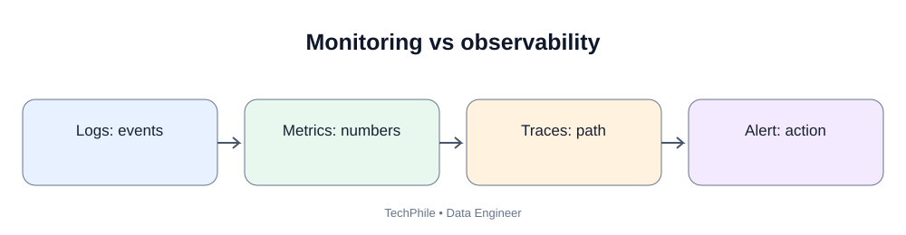
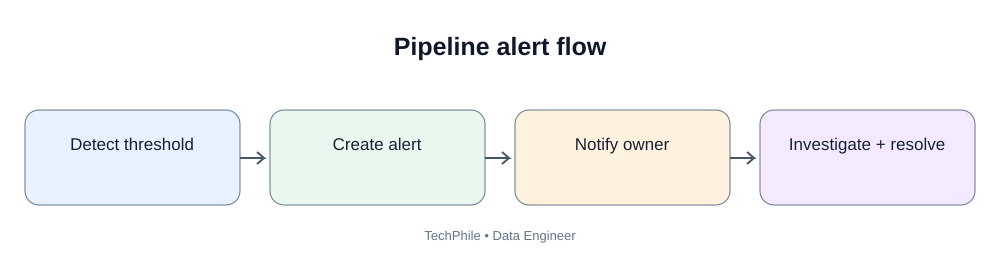
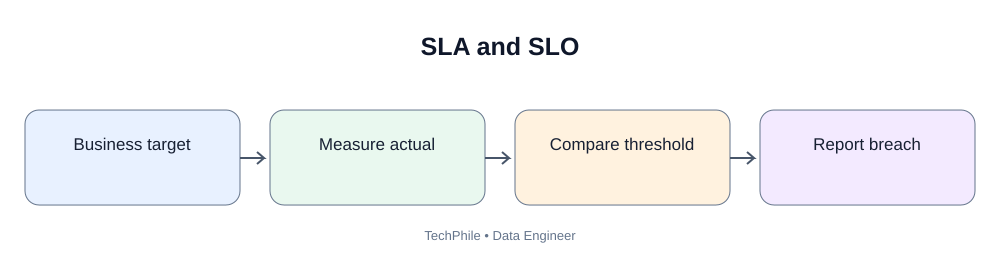

# Day 64: Pipeline Monitoring and Alerting

**Phase:** 7 — Orchestration, Quality and Monitoring  
**Learning time:** 2–3 hours | **Audience:** Beginners and junior Data Engineers  
**Tools:** Airflow UI/logs, Python logging, metrics and alerting  
**Topic boundary:** Class notes only. Project workbook and interview guide are separate.

> A pipeline that ran successfully yesterday can fail today. A production team must know whether workflows are running, whether data is arriving on time, how long tasks take, whether quality is degrading and who should respond. Today you will learn logs, metrics, traces, freshness, alerting, dashboards and operational response.

## Learning outcomes
- Explain monitoring and observability.
- Distinguish logs, metrics and traces.
- Identify useful pipeline health metrics.
- Monitor DAG runs and task execution.
- Understand freshness, volume, duration and success rate.
- Use Python logging.
- Design actionable alerts and avoid alert fatigue.
- Create an operational dashboard and runbook.

## 1. Business scenario

TechStore expects a daily sales report by 7:00 AM. At 7:30 AM, the report is missing. Possible causes:
- source file did not arrive;
- DAG did not start;
- a task failed;
- a worker was unavailable;
- validation failed;
- warehouse load completed but report publication failed.

Without monitoring, the team may learn about the issue only when a business user complains.

## 2. What is monitoring?

Monitoring is the ongoing collection and review of information about system health and behavior.

For a data pipeline, monitoring answers:
- Did the DAG run?
- Did every task finish?
- How long did processing take?
- How many records were read and rejected?
- Is the output fresh?
- Did the output total change unexpectedly?
- Was the business deadline met?

## 3. What is observability?

Observability is the ability to understand a system's internal behavior from outputs such as logs, metrics and traces.

Monitoring checks known conditions. Observability helps investigate unexpected behavior.

Example:
- Monitoring alert: daily pipeline failed.
- Investigation: logs show a database timeout; metrics show connection latency increased; trace shows time spent waiting on the source.

## 4. Logs, metrics and traces

| Signal | Meaning | Pipeline example |
|---|---|---|
| Logs | Timestamped event messages | "Loaded 10,000 rows" |
| Metrics | Numeric measurements over time | Task duration = 420 seconds |
| Traces | Connected timing across components | API call -> Spark job -> warehouse load |

All three are useful. A log is not a substitute for a metric, and a metric alone may not explain the cause.

## 5. What is a log?

A log records an event during program execution:
- pipeline started;
- source file found;
- 10,000 rows read;
- 35 invalid records quarantined;
- warehouse load completed;
- task failed due to timeout.

Good logs help answer what happened, when it happened and which run was involved.

## 6. Python logging basics

Use Python's logging module rather than relying only on print statements in long-running applications.

~~~python
import logging

logging.basicConfig(
    level=logging.INFO,
    format="%(asctime)s %(levelname)s %(message)s"
)

logging.info("Pipeline started")
logging.warning("Five records were rejected")
logging.error("Warehouse load failed")
~~~

Expected output shape (timestamps vary):

~~~text
2026-11-11 06:00:00 INFO Pipeline started
2026-11-11 06:01:00 WARNING Five records were rejected
2026-11-11 06:02:00 ERROR Warehouse load failed
~~~

### 6.1 Logging levels

| Level | Meaning | Example |
|---|---|---|
| DEBUG | Detailed diagnostics | Selected non-secret config flag |
| INFO | Normal progress | Source file read |
| WARNING | Unexpected but non-fatal | Volume lower than normal |
| ERROR | Operation failed | Database write failed |
| CRITICAL | Severe system failure | Required service cannot initialize |

Do not label every message ERROR.

## 7. Log useful context safely

Useful fields:
- pipeline_name;
- dag_id;
- task_id;
- run_id;
- data interval;
- source path/table;
- output location;
- input and rejected counts;
- duration;
- error category.

Never log passwords, tokens, private keys, full customer records or payment data. Use safe identifiers and controlled references.

## 8. What is a metric?

A metric is a numeric measurement collected over time.

Examples:
- rows processed;
- files received;
- task duration in seconds;
- failed run count;
- data freshness in minutes;
- consumer lag;
- rejected record count.

Metrics make it possible to detect trends and threshold violations.

## 9. Important pipeline metrics

| Metric | What it tells you |
|---|---|
| DAG success rate | How often scheduled runs succeed |
| Task failure count | How often tasks fail |
| Task duration | How long a task takes |
| Data freshness | How recent the latest available data is |
| Input row count | How much data arrived |
| Rejected row count | How many records failed validation |
| Output row count | How much data was published |
| Source arrival delay | How late source data arrived |
| Retry count | How often tasks needed another attempt |
| Consumer lag | How far a streaming consumer is behind |

## 10. Data freshness

Freshness measures how recent a dataset is compared with its expected update time.

Example:
- expected report: 7:00 AM;
- current time: 8:00 AM;
- latest successful data interval: two days ago.

The pipeline is stale even if its last run is green.

Define freshness using the business data timestamp, not only the task completion timestamp.

## 11. Duration and volume monitoring

Suppose the pipeline normally takes 8 minutes but today takes 55 minutes. Possible causes:
- larger input;
- slower source;
- skewed data;
- network issue;
- resource contention;
- inefficient query plan.

Daily row counts can also reveal anomalies. A sudden drop from around 10,000 rows to 1,200 may indicate incomplete delivery or changed business activity. It is a signal to investigate, not proof of a defect.

## 12. What is alerting?

Alerting sends a notification when a defined condition requires attention.

Examples:
- critical DAG fails;
- data is not fresh by 7:15 AM;
- required file is missing;
- rejected records exceed an approved threshold;
- task duration exceeds an operational limit.

A useful alert should tell the recipient what happened and what to do next.

## 13. Good alert design

Include:
- affected pipeline;
- failed DAG/task/run ID;
- data interval;
- failure time;
- severity;
- short safe error summary;
- link to logs/dashboard;
- owner/on-call team;
- first suggested action.

Avoid a generic message such as "Something failed."

## 14. Severity levels

| Severity | Example | Response |
|---|---|---|
| Critical | Financial report missing; data corruption | Immediate response |
| High | Main daily pipeline failed | Prompt investigation |
| Medium | Non-critical quality warning | Review during support window |
| Low | Informational retry recovered | Record/trend |

Severity should reflect business impact and urgency.

## 15. Alert fatigue

Alert fatigue occurs when people receive too many noisy or low-value alerts and begin ignoring them.

Reduce it by:
- alerting only on actionable conditions;
- grouping repeated alerts;
- using sensible thresholds;
- separating warning and critical levels;
- suppressing duplicate alerts during an incident;
- assigning clear ownership.

## 16. Airflow monitoring

Airflow provides visibility into:
- DAG status and run history;
- task instance state;
- duration and retries;
- task logs;
- scheduling delays.

The UI is a starting point. Production deployments may export metrics to external monitoring platforms.

## 17. Failure callback concept

Airflow supports callback mechanisms for task or DAG events. A callback can invoke a notification function when a configured failure occurs.

Conceptual example:

~~~python
def notify_pipeline_failure(context):
    dag_id = context["dag"].dag_id
    task_id = context["task"].task_id
    run_id = context["run_id"]

    print("Failure:", dag_id, task_id, run_id)
~~~

This only prints a message. It does not send email or chat. A real implementation needs an approved provider, secure credentials and version-compatible callback configuration.

## 18. Monitoring versus alerting

| Monitoring | Alerting |
|---|---|
| Collects and displays health information | Notifies people when action is needed |
| Helps identify trends | Triggers response |
| Example: duration chart | Example: duration exceeded threshold |

## 19. Operational dashboard

A useful daily pipeline dashboard can show:
- last successful run;
- latest run status;
- freshness;
- task duration;
- input and output counts;
- rejected rows;
- retries;
- failed runs;
- quality-gate status;
- business deadline status.

The dashboard should answer: **Is the data ready for consumers?**

## 20. What is a runbook?

A runbook is a documented procedure for handling a known operational situation.

Example: daily sales DAG failed.

1. Open the alert.
2. Identify DAG ID, task ID and run ID.
3. Open the task log.
4. Classify the failure: source, code, permission, infrastructure or quality.
5. Check whether a retry is safe.
6. Fix the root cause.
7. Rerun the correct task or workflow.
8. Verify output counts and totals.
9. Confirm freshness and report availability.
10. Record the incident and prevention action.

Do not rerun blindly if a task may have partially written data.

## 21. Incident timeline

Record:
- detected time;
- affected data interval;
- business impact;
- mitigation time;
- recovery time;
- root cause;
- corrective action.

This helps teams prevent repeated incidents.

## 22. Calculate a simple duration

~~~python
from datetime import datetime

start_time = datetime(2026, 11, 11, 6, 0, 0)
end_time = datetime(2026, 11, 11, 6, 12, 30)

duration = end_time - start_time

print("Duration:", duration)
print("Seconds:", duration.total_seconds())
~~~

Expected output:

~~~text
Duration: 0:12:30
Seconds: 750.0
~~~

This is a classroom calculation. Production monitoring should use consistent timestamps and handle timezones.

## 23. Common mistakes

| Mistake | Why it is wrong | Better approach |
|---|---|---|
| Log only "failed" | No diagnostic context | Include safe run/task IDs |
| Print secrets | Exposes credentials | Redact sensitive values |
| Alert on every retry | Creates noise | Alert on meaningful failure |
| Monitor only task status | Misses stale/incorrect data | Monitor freshness and quality |
| Fixed volume threshold without context | Normal variation triggers alerts | Use baseline and business rules |
| No alert owner | Nobody knows who acts | Assign responsibility |
| No runbook | Recovery depends on memory | Document procedures |
| Green DAG means fresh data | Latest interval may be missing | Monitor freshness separately |

## 24. Knowledge check

**Q1. What is monitoring?** Collecting and reviewing system health information over time.

**Q2. What are logs?** Timestamped records of events.

**Q3. What are metrics?** Numeric measurements such as duration, row count and failure count.

**Q4. What is data freshness?** How recent available data is compared with the expected update period.

**Q5. What is alert fatigue?** Excessive noisy alerts cause responders to ignore notifications.

**Q6. What is a runbook?** A documented procedure for responding to an operational issue.

**Q7. Why is a green DAG not enough?** It may have processed an old interval or produced incorrect data despite task success.

## Final self-check
- [ ] Explain monitoring and observability.
- [ ] Distinguish logs, metrics and traces.
- [ ] Use Python logging levels.
- [ ] Identify pipeline health metrics.
- [ ] Explain freshness, duration and volume.
- [ ] Design actionable alerts.
- [ ] Explain alert fatigue.
- [ ] Inspect Airflow status and logs.
- [ ] Design a dashboard and runbook.
- [ ] Avoid sensitive data in logs.

**Next lesson — Day 65: Data Pipeline Security.** You will manage credentials, environment variables, Airflow Connections, IAM roles, secure database access and least privilege.

---

## Visual Learning Diagrams

### Monitoring vs observability

### Pipeline alert flow

### SLA and SLO

