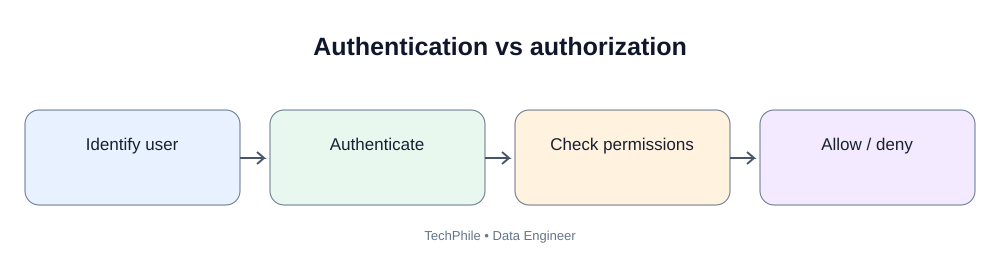
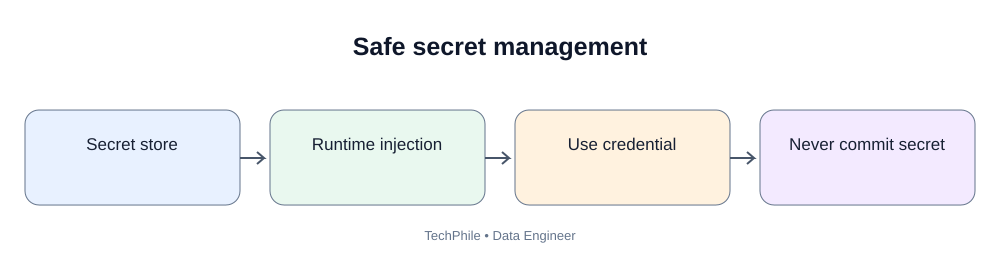
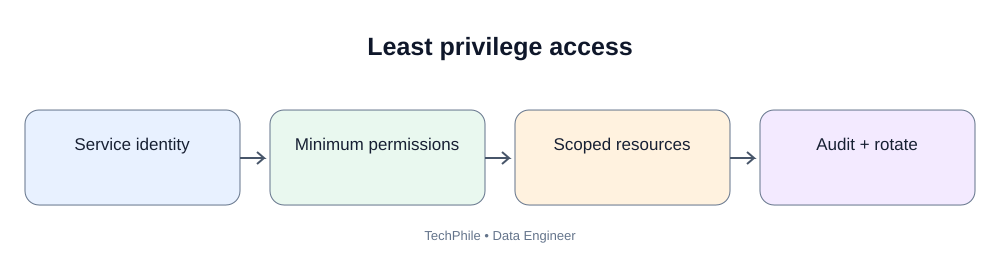

# Day 65: Data Pipeline Security

**Phase:** 7 — Orchestration, Quality and Monitoring | **Time:** 2–3 hours | **Audience:** Beginners and junior Data Engineers  
**Topic boundary:** Class notes only. Workbook and interview guide are separate.

> Pipelines connect to databases, APIs, object storage and cloud services. A hardcoded password committed to GitHub can expose business data. Today you will learn authentication, authorization, secrets, environment variables, Airflow Connections, IAM roles, least privilege and secure database access.

## Learning outcomes
- Distinguish authentication and authorization.
- Identify secrets and ordinary configuration.
- Read environment variables safely.
- Explain Airflow Connections, Variables and secrets backends.
- Explain IAM roles and temporary credentials.
- Apply least privilege.
- Secure database connections and respond to secret leaks.

## 1. Business scenario

TechStore's Airflow pipeline reads orders from a database and writes curated data to object storage. A developer puts the database password and AWS access key into Python and pushes the file to GitHub. Anyone with repository access may now see those credentials. If active, they may be used to access systems.

Security must be designed into the pipeline, not added at the end.

## 2. Authentication and authorization

**Authentication** answers: Who or what are you? Examples: username/password, API token, certificate or workload identity.

**Authorization** answers: What are you allowed to do? Examples: read one source table, write to one S3 prefix, execute a stored procedure or view logs.

Authentication verifies identity. Authorization controls permissions.

## 3. What is a secret?

A secret is sensitive information used to authenticate or protect access:
- database password;
- API token;
- private key;
- OAuth client secret;
- encryption key;
- cloud access credential.

A public service URL may be ordinary configuration. A password is a secret.

## 4. Why hardcoded secrets are dangerous

Unsafe example:

~~~python
DB_PASSWORD = "MyRealPassword123"
API_TOKEN = "abc123-real-token"
~~~

Credentials may be committed to Git, copied into notebooks/screenshots, exposed in reviews, reused across environments, retained in history and difficult to rotate. Never use real credentials in classroom examples.

## 5. Environment variables

An environment variable is a value supplied to a process through its runtime environment.

~~~python
import os

database_host = os.getenv("DB_HOST")
database_name = os.getenv("DB_NAME")

print("Database host configured:", database_host is not None)
print("Database name configured:", database_name is not None)
~~~

If variables are absent, expected output:

~~~text
Database host configured: False
Database name configured: False
~~~

This checks presence without printing the values.

## 6. Read a required secret safely

~~~python
import os

database_password = os.getenv("DB_PASSWORD")

if not database_password:
    raise ValueError("DB_PASSWORD is not configured")

print("Database password is configured")
~~~

When set, expected output is **Database password is configured**. If missing, the program stops with a clear configuration error. Never print database_password.

## 7. Set variables in Windows CMD

~~~bat
set DB_HOST=localhost
set DB_NAME=techstore
set DB_PASSWORD=replace_with_a_local_test_secret
python app.py
~~~

These variables apply to commands started from the current CMD session. Closing the window removes session-level values.

PowerShell uses different syntax:

~~~powershell
$env:DB_HOST = "localhost"
$env:DB_NAME = "techstore"
$env:DB_PASSWORD = "replace_with_a_local_test_secret"
python app.py
~~~

Use classroom placeholders only. Do not paste production credentials into shared terminals or screenshots.

## 8. Are environment variables a complete secrets platform?

No. They help inject values without source-code hardcoding, but may be exposed through process inspection, debug output, shell history, crash dumps, container inspection or overly broad machine access. Production systems should use an approved managed secrets service and workload identity.

## 9. What is an Airflow Connection?

An Airflow Connection stores connection information for an external system. It can include connection ID, type, host, database/schema, login, password, port and extra configuration.

A DAG can refer to a connection ID rather than hardcoding credentials. Example connection ID: techstore_postgres; provider type: Postgres; host: managed database endpoint; database: analytics. The relevant provider package must be installed and compatible with the Airflow version.

## 10. Connection versus Variable

| Connection | Variable |
|---|---|
| Models access to an external system | Stores general configuration |
| May contain host, login, password, port | May contain a threshold, path or feature flag |
| Used by provider integrations | Not a substitute for a properly modeled connection |

Use the correct abstraction. Avoid putting passwords casually into generic configuration values.

## 11. What is a secrets backend?

A secrets backend lets Airflow retrieve secrets from an external managed secret store or vault. Benefits include central storage, access policies, rotation, audit and less need to store credentials in DAG code. Exact setup depends on provider and Airflow version.

## 12. What is IAM?

Identity and Access Management controls identities and permissions in a cloud environment. A policy defines what an identity can do on which resources.

A sales pipeline may need read access to one source prefix and write access to one curated prefix. It does not need administrator access to the entire account.

## 13. Least privilege

Least privilege means giving an identity only the permissions required for its task.

A pipeline may need read from one source table, read objects from one raw prefix, write objects to one curated prefix and use a specific encryption key.

It does not automatically need permission to delete every object, change IAM policies, read payroll data or manage billing. Limit actions, resources and environments.

## 14. IAM user versus role

An IAM user is a long-lived identity in some access patterns. An IAM role is an identity that an authorized principal can assume. Workloads can use roles to obtain temporary credentials.

For supported cloud workloads, an attached role or workload identity is generally preferable to embedding long-lived access keys in code.

## 15. Temporary credentials

Temporary credentials have limited validity and are issued through an approved identity mechanism. They reduce reliance on long-lived static keys. Applications should use a supported provider that can refresh credentials as required.

## 16. Secure database connections

Consider approved private network path, authentication, least-privilege database account, TLS encryption in transit, certificate validation, secret rotation, connection timeout and audit logging.

Do not expose a database publicly just to make a classroom example easier.

## 17. Separate identities by environment

Use separate identities for development, testing, staging and production. A development workflow should not automatically have write access to production data.

## 18. Keep secrets out of Git

Never commit real .env files, access keys, passwords, private keys, tokens or credential exports. A .gitignore entry helps prevent accidental commits but does not remove a secret already committed.

If a secret is committed:
1. Revoke or rotate it immediately.
2. Check audit logs for misuse.
3. Remove the secret from current code.
4. Review repository history and access.
5. Use an approved history-cleaning process if required.
6. Move to managed secret retrieval.
7. Add secret scanning and review controls.

Deleting the visible line is not enough because the secret may remain in Git history or forks.

## 19. Safe logging

Unsafe:

~~~python
print("Connecting with password:", database_password)
~~~

Safe:

~~~python
print("Database credential is configured")
~~~

Report configuration status without exposing the secret value.

## 20. Airflow security boundaries

Control who can edit DAG files, trigger DAGs, view logs, edit Connections and Variables, which identity workers use, which networks workers can reach, how secrets are retrieved and how task output is protected.

DAG write access is sensitive because DAG code can execute with permissions available to the task environment.

## 21. Security review matrix

| Area | Question |
|---|---|
| Identity | Which identity runs the pipeline? |
| Authentication | How does it prove identity? |
| Authorization | What actions are allowed? |
| Secrets | Where are credentials stored? |
| Rotation | How are credentials replaced? |
| Network | Is access restricted? |
| Encryption | Is data protected in transit/at rest? |
| Logs | Are secrets and personal data excluded? |
| Repository | Are secrets blocked from Git? |
| Audit | Can access and changes be investigated? |

## 22. Common mistakes

| Mistake | Risk | Better approach |
|---|---|---|
| Hardcode passwords | Secret exposure | Managed secret retrieval |
| Commit .env | Credential leakage | Ignore local secret files and scan commits |
| Print tokens | Logs become a secret store | Redact values |
| Use administrator role for ETL | Excessive permissions | Least-privilege role |
| Share credentials across environments | Large blast radius | Separate identities |
| Public DB access for convenience | Expanded attack surface | Private network access |
| Delete leaked key but do not rotate | Old key may remain valid | Revoke/rotate immediately |

## 23. Knowledge check

**Q1. Authentication?** Verifying the identity of a user or workload.  
**Q2. Authorization?** Determining what an authenticated identity may do.  
**Q3. What is a secret?** Sensitive information such as a password, token or private key.  
**Q4. Are environment variables enough for every production secret?** No. They help inject values but can still be exposed. Use approved managed secret storage and workload identity.  
**Q5. What is an Airflow Connection?** A structured way to store and reference external system connection details.  
**Q6. Least privilege?** Grant only the permissions required for a task.  
**Q7. What if a key is committed to Git?** Treat it as exposed, rotate it, investigate access and fix secret management.

## Final self-check
- [ ] Distinguish authentication and authorization.
- [ ] Identify secrets and ordinary configuration.
- [ ] Read environment variables without printing secrets.
- [ ] Explain Airflow Connections, Variables and secrets backends.
- [ ] Explain IAM roles and temporary credentials.
- [ ] Apply least privilege.
- [ ] Describe secure database connections.
- [ ] Explain secret leakage and rotation.
- [ ] Review logs and Git for secret exposure.

**Next lesson — Day 66: Docker for Data Engineering.** You will package an ETL application into a container and understand images, containers, Dockerfiles, volumes, environment variables and Docker Compose.

---

## Visual Learning Diagrams

### Authentication vs authorization

### Safe secret management

### Least privilege access

