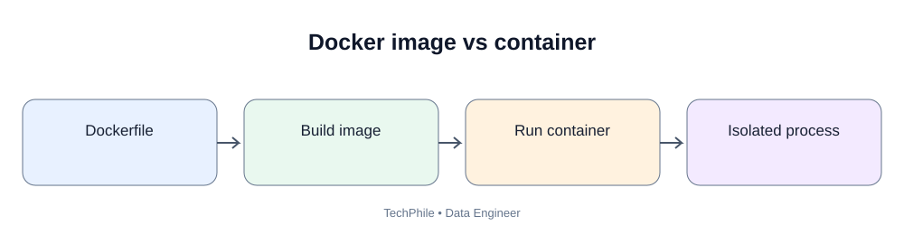
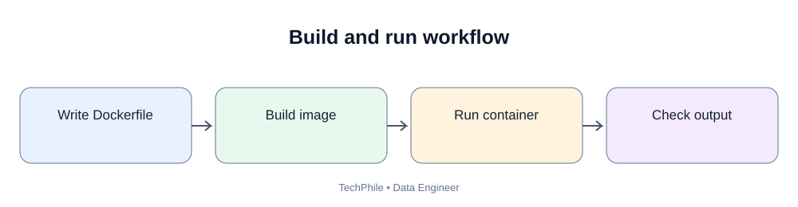
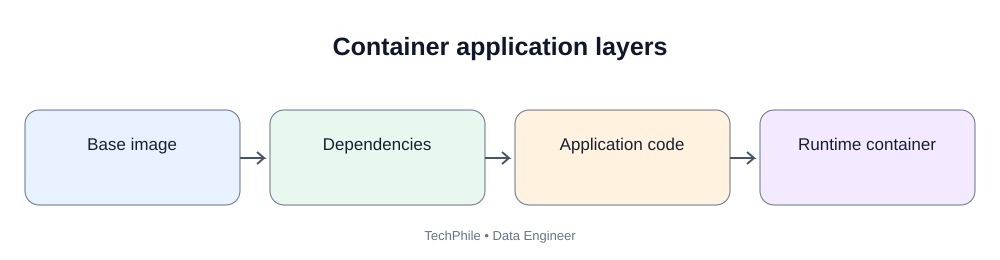

# Day 66: Docker for Data Engineering

**Phase:** 7 — Orchestration, Quality and Monitoring | **Time:** 2–3 hours  
**Audience:** Beginners and junior Data Engineers | **Tools:** Docker Desktop and Python  
**Topic boundary:** Class notes only. Project workbook and interview guide are separate.

> A Python ETL script may work on one laptop but fail elsewhere because Python versions, packages or paths differ. Docker packages an application and runtime dependencies into a container image. Today you will understand images, containers, Dockerfiles, volumes, environment variables and Docker Compose, then containerize a small ETL script.

## Learning outcomes
- Explain containers and why data teams use them.
- Distinguish image and container.
- Understand Docker Engine, Dockerfile and image layers.
- Build and run a simple Python ETL image.
- Use environment variables and bind mounts.
- Explain ports, volumes and Docker Compose.
- Troubleshoot common errors and understand container security.

## 1. Business scenario

TechStore has a Python script that reads orders.csv, calculates city sales and writes a summary. It works on one laptop but fails elsewhere because Python versions, packages and paths differ. Docker packages the application and its runtime dependencies into a repeatable environment.

## 2. What is a container?

A container is an isolated process environment that runs an application with its required files, libraries and configuration. It shares the host operating system kernel while providing process and filesystem isolation. It is not a full virtual machine.

## 3. Container versus virtual machine

| Container | Virtual machine |
|---|---|
| Shares host kernel | Runs a guest operating system |
| Usually lighter to start | Usually heavier |
| Packages app and dependencies | Includes a full OS environment |
| Isolated process environment | Virtualized machine |

Containers are not automatically secure. Isolation depends on configuration, privileges and host security.

## 4. Image and container

A Docker image is a packaged template containing application files, runtime and dependencies. A container is a running instance created from an image.

Think:
- Image = recipe/template.
- Container = running instance.

One image can create multiple containers.

## 5. Docker Engine and Docker Desktop

Docker Engine builds and runs containers. Docker Desktop provides a convenient local application on Windows/macOS. On Windows, it commonly uses WSL 2 or Hyper-V depending on configuration. Ensure virtualization requirements are met.

## 6. What is a Dockerfile?

A Dockerfile is a text file containing instructions for building an image.

| Instruction | Purpose |
|---|---|
| FROM | Select base image |
| WORKDIR | Set working directory inside image |
| COPY | Copy files into image |
| RUN | Execute command during image build |
| ENV | Set environment variable defaults |
| ARG | Define build-time argument |
| EXPOSE | Document intended container port |
| CMD | Default command when container starts |
| ENTRYPOINT | Configure main executable |

## 7. Create the ETL project

~~~text
docker_etl/
    Dockerfile
    requirements.txt
    app.py
    input/
        orders.csv
    output/
~~~

Create input/orders.csv:

~~~csv
order_id,city,amount
101,Hyderabad,250
102,Chennai,400
103,Hyderabad,150
104,Bengaluru,300
~~~

Create requirements.txt:

~~~text
pandas==2.2.3
~~~

This pinned version is an example. Confirm package and Python compatibility in your environment.

## 8. Write app.py

~~~python
import os
import pandas as pd

input_file = os.getenv("INPUT_FILE", "/app/input/orders.csv")
output_file = os.getenv("OUTPUT_FILE", "/app/output/city_sales.csv")

orders = pd.read_csv(input_file)

city_sales = orders.groupby("city", as_index=False)["amount"].sum()

os.makedirs(os.path.dirname(output_file), exist_ok=True)
city_sales.to_csv(output_file, index=False)

print("Input rows:", len(orders))
print("Output rows:", len(city_sales))
print(city_sales)
print("Output file:", output_file)
~~~

### 8.1 Explain the code

- os reads environment variables and creates directories.
- pandas reads and processes the CSV.
- INPUT_FILE selects the source path, with a default.
- OUTPUT_FILE selects the result path.
- read_csv loads the input into a DataFrame.
- groupby("city") groups rows by city.
- sum() adds amounts for each city.
- as_index=False keeps city as a normal column.
- makedirs creates the output folder if needed.
- to_csv writes the summary.
- print displays run evidence.

## 9. Expected result

If run in a suitable Python environment:

~~~text
Input rows: 4
Output rows: 3
         city  amount
0   Bengaluru     300
1     Chennai     400
2   Hyderabad     400
Output file: output/city_sales.csv
~~~

Exact DataFrame spacing and row order may differ. Totals are Bengaluru 300, Chennai 400, Hyderabad 400.

## 10. Create the Dockerfile

~~~dockerfile
FROM python:3.11-slim

WORKDIR /app

COPY requirements.txt .

RUN pip install --no-cache-dir -r requirements.txt

COPY app.py .

CMD ["python", "app.py"]
~~~

Line by line:
- FROM selects a Python 3.11 base image.
- WORKDIR sets /app as the working directory.
- COPY requirements.txt . copies dependency definitions.
- RUN installs packages during image build.
- COPY app.py . copies application code.
- CMD defines the default command when the container starts.

Input data is mounted at runtime, not baked into the image. Business data changes independently from application code.

## 11. Build the image

Open CMD in the docker_etl folder:

~~~bash
docker build -t techstore-etl:1.0 .
~~~

- docker build creates an image.
- -t assigns a name and tag.
- techstore-etl is the image name.
- 1.0 is the tag.
- . means current folder is the build context.

Check:

~~~bash
docker images
~~~

You should see techstore-etl with tag 1.0 if the build succeeds.

## 12. Run with mounted folders

Create the output folder if needed.

Windows CMD:

~~~bat
docker run --rm -v "%cd%\input:/app/input" -v "%cd%\output:/app/output" techstore-etl:1.0
~~~

PowerShell:

~~~powershell
docker run --rm -v "${PWD}/input:/app/input" -v "${PWD}/output:/app/output" techstore-etl:1.0
~~~

If shell path syntax is not accepted, use an absolute host path. Docker Desktop must have access to the folder.

### 12.1 What does -v mean?

-v mounts a host directory into the container:
- host input becomes /app/input;
- host output becomes /app/output.

The container reads input and writes output. The result remains on the host after the container exits.

### 12.2 What does --rm mean?

It removes the stopped container after exit. It does not remove the image or host output folder.

## 13. Inspect the output

Open output/city_sales.csv.

Expected contents:

~~~csv
city,amount
Bengaluru,300
Chennai,400
Hyderabad,400
~~~

Row order may differ if no explicit sort is added.

## 14. Runtime environment variables

You can override paths without rebuilding:

~~~bat
docker run --rm -e INPUT_FILE=/app/input/orders.csv -e OUTPUT_FILE=/app/output/daily.csv -v "%cd%\input:/app/input" -v "%cd%\output:/app/output" techstore-etl:1.0
~~~

-e passes a value into the container. Do not pass production passwords in command history or visible output. Use secure secret injection in real deployments.

## 15. What is a Docker volume?

A volume is persistent storage managed by Docker. A bind mount maps a specific host path into a container. A named volume is managed by Docker.

| Bind mount | Named volume |
|---|---|
| Points to a host path | Managed by Docker |
| Useful for local file sharing | Useful for persistent container data |
| Host path must exist | Docker manages its storage location |

Do not keep the only copy of production data in an ephemeral container filesystem.

## 16. What is a port?

A port is a network endpoint used by an application.

~~~bash
docker run -p 8080:8080 image_name
~~~

This maps host port 8080 to container port 8080. Our ETL script does not start a web server, so it does not need port publishing.

## 17. What is Docker Compose?

Docker Compose defines and runs multiple related containers using YAML. A local data environment might contain Airflow webserver, scheduler, PostgreSQL metadata database and a worker.

Example compose.yaml:

~~~yaml
services:
  etl:
    build: .
    volumes:
      - ./input:/app/input
      - ./output:/app/output
    environment:
      INPUT_FILE: /app/input/orders.csv
      OUTPUT_FILE: /app/output/city_sales.csv
~~~

Run:

~~~bash
docker compose up --build
docker compose down
~~~

The output remains in the host output folder because it is bind-mounted.

## 18. Container lifecycle commands

| Command | Purpose |
|---|---|
| docker images | List images |
| docker ps | List running containers |
| docker ps -a | List all containers |
| docker build | Build an image |
| docker run | Create and start a container |
| docker logs CONTAINER | View logs |
| docker stop CONTAINER | Stop a container |
| docker rm CONTAINER | Remove a stopped container |
| docker rmi IMAGE | Remove an image |

Use exact IDs/names and do not delete resources you do not own.

## 19. Why pin dependencies and use layers?

Pinning improves repeatability. Images are built from layers; Docker can reuse unchanged layers. Copying requirements.txt and installing dependencies before copying frequently changing application code improves build-cache reuse.

## 20. Container security basics

- Use trusted base images.
- Keep images patched.
- Avoid running as root when practical.
- Do not bake secrets into images.
- Keep build context small using .dockerignore.
- Scan images for vulnerabilities.
- Avoid unnecessary packages.
- Restrict network and mounted host paths.
- Do not mount sensitive host folders unnecessarily.

## 21. Common errors

| Error | Likely cause | Check |
|---|---|---|
| docker not found | Not installed/PATH | Docker Desktop installation |
| Cannot connect to daemon | Engine not running | Start Docker Desktop |
| Dockerfile missing | Wrong folder/name | Build from project root |
| ModuleNotFoundError | Dependency absent | requirements.txt and rebuild |
| Input not found | Incorrect mount/path | Inspect mounted path |
| Permission denied | Host folder access | Permissions and Desktop settings |
| Old code runs | Image not rebuilt | Rebuild after code change |
| Output disappears | Wrote only inside container | Mount persistent output |

## 22. Knowledge check

**Q1. Image versus container?** Image is the template; container is a running instance.  
**Q2. What does Dockerfile do?** Defines instructions to build an image.  
**Q3. WORKDIR?** Sets the working directory inside the image.  
**Q4. COPY?** Copies files from build context into the image.  
**Q5. Bind mount versus named volume?** Bind mount maps a host path; named volume is managed by Docker.  
**Q6. Why keep business data outside the image?** It changes independently and must persist.  
**Q7. Why not put passwords in Dockerfile?** They can be embedded in image layers and exposed to image users.

## Final self-check
- [ ] Explain container, image and Docker Engine.
- [ ] Read a Dockerfile.
- [ ] Build and run the ETL image.
- [ ] Mount input and output folders.
- [ ] Pass non-secret configuration at runtime.
- [ ] Explain ports, volumes and Compose.
- [ ] Inspect logs and container lifecycle.
- [ ] Explain image security and dependency pinning.

**Next lesson — Day 67: CI/CD and Automated Pipeline Testing.** You will create automated checks for pipeline code and learn how GitHub Actions validates changes before release.

---

## Visual Learning Diagrams

### Docker image vs container

### Build and run workflow

### Container application layers

